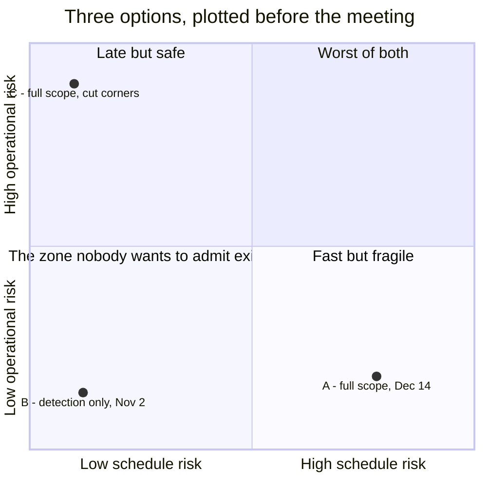
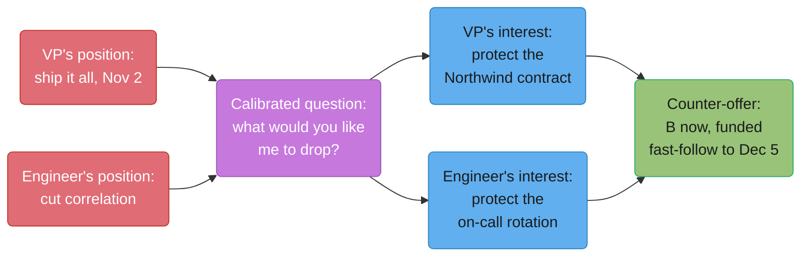

# Saying No to a VP

## Intuition

> **One-line analogy**: A press release is a contract signed by someone who was not in
> the room where the price was negotiated — your job is not to tear it up, it is to find
> out what was actually being bought.

Lumen Metrics, Inc. is a B2B observability and alerting platform: 450 engineers, $180M
ARR, 3,200 customers, roughly 40 million unique metric series ingested per day. This case
study follows Sam Okafor, a Staff Engineer on the Alerting Platform team, from the moment
a launch date lands in their Slack with no warning to the moment it is written down,
funded, and owned by everyone who has to build it. Nothing here is a story about being
right. Sam was right on the first day and it did not matter, because being right was never
the constraint — the VP's silence about a signed customer deal was.

---

## 1. Situation & Stakes

On September 15, 2026, Lumen's VP of Product, Renata Cole, opened the keynote at LumenCon
— the company's annual user conference, roughly 1,100 attendees, streamed to another
6,000 — with a feature called **Anomaly Copilot**: zero-configuration anomaly detection
across every metric a customer sends, plus, in Renata's words on stage, "it doesn't just
tell you something broke — it tells you *why*, automatically, no setup." The press release
that went out at 9:04 a.m. Pacific during the keynote named a date: **general availability
November 2, 2026** — seven weeks out.

Engineering had shipped the underlying anomaly-detection model the previous quarter as an
internal beta running on 14 design-partner accounts. That beta never included the
"automatically tells you why" piece — root-cause correlation across metric series — which
existed as a design doc and a spike, not working code. Nobody on the Alerting Platform
team had been asked whether "no setup, automatically" as a public, dated promise was
buildable. The first person on the engineering side to see the date was Sam, at 11:40 a.m.
that same day, in a Slack DM from the team's product manager, Jules Bennett, containing a
link to the press release.

**The stakes, concretely:**

- A committed public date, in a press release, with the company's name on it, live for
  seven weeks before anyone building it had been asked.
- Marketing had already scheduled 40 sales calls anchored to the November 2 date; Lumen's
  VP of Sales, in a note Sam later saw forwarded, put **$1.2M of active-quarter pipeline**
  against a GA that ships on time.
- The Alerting Platform on-call rotation — six engineers, weekly rotation — was already
  running close to the edge the team's own health metrics treat as a warning line: 2.1
  pages per engineer per week, against a target of roughly two incidents per on-call
  *shift* from Google's Site Reliability Engineering guidance (see
  [`team_health_and_sustainable_pace`](../team_health_and_sustainable_pace/team_health_and_sustainable_pace.md)).
  Any option that pushed correlation into production unguarded would land directly on that
  rotation.
- Sam did not manage Renata, did not manage Jules, and had exactly one asset going into
  this: a credible, numbered account of what the scope actually cost, ready before anyone
  asked for it.

---

## 2. The People and What Each One Wants

| Person | Role | What they actually want | What they say they want |
|---|---|---|---|
| Renata Cole | VP of Product | The keynote promise to hold in some form customers can see, and — unstated until the meeting — a specific $400K contract to close in Q4 | "Anomaly Copilot, as announced, on November 2" |
| Sam Okafor | Staff Engineer, Alerting Platform | A decision made with real numbers before code gets written the wrong way twice | To not be the person who says no and gets steamrolled, or the person who says yes and burns the team |
| Dave Kimura | Engineering Manager, Alerting Platform | Cover for the team's on-call rotation and a defensible plan he can repeat upward | "Whatever Sam and Renata land on, as long as it's written down" |
| Jules Bennett | Product Manager, Alerting Platform | To not have been the last one in the loop again | "I just forward what I see, same as you" |
| Elena Farkas | CTO | Not to be the escalation path — she finds out this was handled cleanly, after the fact, and stays out | Nothing; she is not in this meeting |
| The on-call rotation (6 engineers) | — | Not to inherit a page storm nobody asked them about | Two of the six had already told Dave, privately, they'd opt out of rotation if pages crossed double digits a week |

Renata's stated want and her actual want are not the same thing, and that gap is the whole
case study. She needs the keynote promise to survive contact with reality, but she has a
harder, narrower constraint sitting behind it that she has not told anyone below her level
about: Northwind Freight, an existing customer, signed an expansion contingent on
root-cause correlation specifically — $400K in incremental ARR, with a signature deadline
of **December 5** to land in Q4 bookings. Renata did not lie in the keynote. She also did
not check with the people who would build it, and she is not going to volunteer the
Northwind deal unless asked the right way.

---

## 3. The Approach

Sam's plan, decided with Dave the afternoon the press release surfaced, had three parts,
in order: **do not react in the channel where the damage was done; build the number before
building the ask; ask a question that lets Renata tell you her real constraint instead of
defending her stated one.** The third part is the one that took two failed drafts to get
right — see §4.

```mermaid
flowchart LR
    classDef bad    fill:#e06c75,stroke:#c0392b,color:#fff
    classDef warn   fill:#e5c07b,stroke:#f39c12,color:#1a1a1a
    classDef info   fill:#61afef,stroke:#2e86c1,color:#1a1a1a
    classDef accent fill:#c678dd,stroke:#9b59b6,color:#fff
    classDef good   fill:#98c379,stroke:#27ae60,color:#1a1a1a

    a(Keynote commits<br/>Nov 2, full scope) --> b(Press release<br/>goes live)
    b --> c(Sam learns from<br/>a Slack link)
    c --> d(Three-option memo<br/>built with Dave)
    d --> e(30 minutes<br/>booked with Renata)
    e --> f(Calibrated question<br/>reframes the ask)
    f --> g(Renata names the<br/>Northwind deal)
    g --> h(Decision: B now,<br/>funded fast-follow)
    h --> i(Written follow-up<br/>same afternoon)

    class a,b bad
    class c warn
    class d,i info
    class e,f,g accent
    class h good
```



*Caption: the gap between node b and node c is the actual failure in this story — everything
from c onward is Sam recovering time that a five-minute engineering check before the
keynote would have kept.*

Two decisions Sam made before opening a laptop mattered more than anything said in the
room:

1. **Nobody outside the Alerting Platform team saw a reaction from Sam for four hours.**
   The instinct to reply in the moment, in the channel, is where the expensive version of
   this conversation gets written — see the unsent message in §4.
2. **The three-option memo was finished before the meeting was booked**, not the other way
   around. Booking the meeting first and improvising the numbers in the room is how a
   30-minute conversation with a VP turns into "let me get back to you," which is a worse
   outcome than either "yes" or "no."

---

## 4. The Artifacts and Conversations

### 4.1 The message where Sam learns the date exists

```text
[Slack DM — Jules Bennett to Sam Okafor — Sep 15, 11:40 AM]

Jules: did you see this??
Jules: https://lumenmetrics.com/press/anomaly-copilot-ga
Jules: "general availability November 2" -- is that real? nobody looped
       me on a date either, I thought we were still scoping the
       correlation piece
Sam: reading it now
Sam: "it doesn't just tell you something broke, it tells you why,
      automatically" -- Jules that is the correlation engine. the one
      that is a design doc.
Jules: yeah
Sam: ok. give me the afternoon before this goes anywhere. I don't want
     the first reaction from our team to be a reply-all
```

### 4.2 The message Sam wanted to send

This is the draft Sam wrote at 11:52 a.m., eleven minutes after reading the press release,
into the `#eng-leadership` channel — 340 members, including three VPs and the CTO. It was
never sent. Dave talked Sam out of it at 12:15.

```text
[DRAFT -- never sent -- #eng-leadership]

Hi all -- just saw that Anomaly Copilot's GA date (Nov 2, full scope
including automatic root-cause correlation) went out in a press release
this morning. Nobody on the team building this was consulted before it
was announced publicly. The correlation piece doesn't exist yet outside
a design doc and a two-week spike. As it's scoped, this is not buildable
by Nov 2 without either being very late or shipping something that will
page our on-call rotation multiple times a night.

This is the second time in two quarters a customer-facing date has been
set before engineering had a chance to weigh in (see the Q2 export-API
launch). I'd like to understand what the process gap is here, because
the team is the one that has to absorb it every time.
```

**What is wrong with it, specifically.** Every sentence is true. It is also: sent to 340
people including Renata's peers before Renata has heard it from Sam directly; it opens
with "nobody... was consulted," which reads as an accusation in a channel where Renata
cannot respond privately; it reaches back to a prior incident to build a pattern, which
turns one conversation about one date into an indictment of Renata's whole process; and it
asks an abstract question ("what's the process gap") instead of proposing a concrete next
step. It would have been forwarded to Elena Farkas within the hour. It solves nothing on
its own — it just moves the argument to a bigger, worse-lit room.

### 4.3 The message Sam actually sent

```text
[Slack DM -- Sam Okafor to Renata Cole -- Sep 15, 3:50 PM]

Sam: Hi Renata -- I saw this morning's Anomaly Copilot press release.
     Congrats on the keynote reception, the room reaction on the livestream
     looked great.

     I want to flag one thing before it becomes a scheduling problem: the
     automatic root-cause correlation piece is currently a design doc and
     a two-week spike, not shipped code. I've put together three ways we
     could hit Nov 2 or close to it, with real costs on each, and I'd
     rather walk you through those than have engineering just quietly try
     to do all of it and tell you in October if we're short.

     Do you have 30 minutes tomorrow or Thursday? I'll send the doc ahead
     so we don't spend the time reading it together.
Renata: thursday 2pm works. send the doc tonight if you can
Sam: will do
```

Same facts as the draft. No reference to the prior incident, no channel with an audience,
a concrete ask (30 minutes) with a concrete deliverable (a doc, sent ahead) instead of an
open question about process. It also opens with something true and specific and positive
before the flag — not flattery, an actual fact about the livestream numbers Jules had
pulled that morning.

### 4.4 The three-option memo, sent ahead of the meeting

```text
ANOMALY COPILOT -- SCOPE VS. NOV 2 -- SAM OKAFOR, SEP 16

Capacity available: 6 Alerting Platform engineers + 2 borrowed from
Platform Data (approved by Dave through Sep 21) = 8 engineers x 7 weeks
to Nov 2 = 56 engineer-weeks.

Remaining build, full scope, done right (bounded correlation index,
per-customer cardinality guardrails, load-tested against our top 5%
customers by series count): 100 engineer-weeks.
  - Detection polish + zero-config onboarding + load testing: 30 wk
  - Correlation engine with guardrails: 70 wk

OPTION A -- Full scope, late
  Ship both pieces, done right, when capacity allows: 100 wk needed,
  56 wk available by Nov 2 -> 44 wk short -> at 8 eng/week that is
  ~5.5 weeks of slip -> GA December 14.
  Cost: the Nov 2 date is public. Sales has ~$1.2M of active pipeline
  anchored to it. A 6-week slip after a keynote promise is a trust cost
  we cannot put a clean number on, but it is not zero.

OPTION B -- Reduced scope, on time
  Ship detection only (30 wk, fits inside 56 wk with room to spare).
  Cut: automatic root-cause correlation.
  What we keep: in the design-partner beta, when we asked "would you buy
  this," detection alone captured 81% of stated purchase intent;
  correlation added the remaining 19%. Call it roughly 80% of the value
  for 30% of the engineering-weeks.
  Cost: the keynote's specific "tells you why, automatically" line is not
  true on Nov 2. We need a customer-facing name for what shipped that
  does not overclaim.

OPTION C -- Full scope, on time, cut the guardrails
  Ship both, but skip the cardinality guardrail and caching layer inside
  the correlation engine (saves 44 of the 70 wk on that piece) ->
  30 + 26 = 56 wk, exactly our capacity. Zero slack.
  Cost: a naive, unbounded correlation job breaks on any customer above
  ~50K concurrent series -- about 60 of our 3,200 customers today. Our
  load test against that segment predicts +9 pages/week on top of our
  current 2.1/engineer/week baseline, i.e. ~11/week during the rotation's
  worst weeks. Two of six on-call engineers have already told Dave they
  will opt out of rotation if pages cross double digits a week. This
  option prices that risk at roughly two of six engineers, inside one
  quarter.

Recommendation: B, with a named fast-follow date for correlation once we
know the real constraint behind Nov 2 -- I don't know what that is yet,
which is the first thing I want to ask Renata.
```

### 4.5 The meeting, transcribed

```text
[Renata's office -- Thursday, 2:00 PM -- Sam, Dave, Renata]

Renata: Hey. I read the doc on the way in. Look, I don't have the full
        30 -- I've got the board deck at 2:30. Bottom line it for me:
        can we hit November 2 or not.

Sam:    We can hit November 2. What we build by then depends on --

Renata: [cutting in, thirty seconds into Sam's answer] Sam, I said the
        room reaction to this was the best keynote pop we've had in two
        years. I need to know if that's still true on November 2.

        [pause]

Sam:    That's a fair question and I want to answer it straight, not
        dodge it. Can I ask you one first, because it changes which of
        the three options I'd actually recommend?

Renata: Go.

Sam:    Of the three things in the doc -- ship late, ship narrower, or
        ship everything and take on real on-call risk -- which would you
        like me to drop, and what does that one cost you if we drop it?

Renata: [long pause] ...Why are you asking it that way.

Sam:    Because I don't actually know what's driving the November 2 date
        specifically. If it's the keynote, "reduced scope, real name,
        fast-follow" probably protects that. If it's something else, I'd
        rather know now than guess.

Renata: [exhales] There's a contract. Northwind Freight -- $400K
        expansion, signed contingent on root-cause correlation
        specifically, not just "anomaly detection." Legal needs it closed
        by December 5 to land in Q4 bookings. That's not public. Marketing
        doesn't know it's tied to a specific customer. I built the
        keynote date backwards from that contract date, and I did not
        loop engineering in because I did not think the correlation piece
        was as far out as it apparently is.

Dave:   That changes the math a lot. December 5 is workable for
        correlation on its own if we're not also trying to ship detection
        from scratch in the same window.

Sam:    Right -- Option B ships detection on Nov 2, which is most of the
        keynote promise and buys us a real product to point Sales at.
        Correlation becomes its own project with its own date: December
        5, which is before your contract deadline, not after it. It needs
        headcount we don't have inside the current team without blowing
        up the on-call rotation on the detection side too.

Renata: How much headcount.

Sam:    Four more engineers for five weeks, or the equivalent in
        contractors. That's outside what Dave and I can approve.

Renata: [pause] There's a GTM acceleration fund I can pull two senior
        contractors from without going through the normal headcount
        process -- that's usually for pilot deals, but this qualifies.
        I can have them starting Monday.

Sam:    I didn't know that fund existed.

Renata: Most people don't. Okay -- ship B on November 2, correlation
        fast-follows by December 5 with contractor support, and I want a
        one-pager today naming both dates so I can tell Northwind's AE
        what to say. Don't put the contract in it -- put "root-cause
        correlation, targeted December 5."

Sam:    I'll have it to you by end of day.

Renata: [standing, already reaching for the board deck] Good. And Sam --
        good question, the "what would you like me to drop" one. Ask it
        that way again next time, not "what should I cut," it would have
        landed like I was being told I made a mistake in front of Dave.

        [meeting ends -- 14 minutes]
```

**Why the calibrated question worked and a flatter one would not have.** Sam had two
versions of that question ready. The one used — *"which would you like me to drop, and
what does that one cost you if we drop it?"* — is calibrated the way Chris Voss describes
in *Never Split the Difference* (HarperBusiness, 2016): open-ended, impossible to answer
with a flat yes or no, and phrased so the *decision* stays entirely with Renata. The
version Sam had crossed out in the notes margin — *"what should I cut, since we can't do
all of it"* — states the same fact but assigns the constraint to Sam's team ("we can't")
rather than asking Renata what she is protecting. Renata's own comment on the way out
confirms the difference: the flatter phrasing would have read as a correction delivered
in front of Dave, not a genuine question. The wording is not politeness for its own sake —
it is the mechanism that got the Northwind deal on the table at all.

### 4.6 The written follow-up

Sent the same afternoon, to Renata, Dave, Jules, and Elena Farkas cc'd for visibility only
— not as an escalation.

```text
Subject: Anomaly Copilot -- Nov 2 scope, confirmed

Renata, Dave, Jules --

Confirming what we landed on today so it's written down once, the same
way for everyone:

- November 2: Anomaly Copilot ships with zero-config anomaly detection
  across all metrics. This is live, in GA, and matches the majority of
  what was demoed at the keynote.
- Automatic root-cause correlation ships as a fast-follow, targeted
  December 5, with two contractors starting Monday to build it without
  pulling the detection team off on-call support for the Nov 2 launch.
- Marketing/Sales messaging for Nov 2 should describe detection, not
  correlation, to avoid a claim we can't back until December 5.
- I'll send a one-line schedule update every Friday until Dec 5 so
  there are no surprises on either date.

Thanks for the fast decision on the contractor budget -- that's what
makes both dates real rather than aspirational.

Sam
```

Nothing in it references the press release timing, the missed process, or the fact that
Sam raised the risk before it was confirmed. The point of the follow-up is to make the
decision durable, not to make a record of who was right.

### 4.7 The outcome

Sam expected Renata to pick one of the three options as written. She picked a fourth —
Option B plus a funded fast-follow — using a budget lever nobody on the engineering side
knew existed. Detection shipped November 2, on schedule, to positive but not spectacular
press coverage (TechCrunch's write-up specifically noted "root-cause analysis coming
later this year," which Sam and Jules had pre-briefed the reporter on to avoid an
overclaim story). Root-cause correlation shipped December 3, two days ahead of the
Northwind deadline; Northwind signed December 4. The two engineers who had told Dave
they'd leave the rotation over page volume never had to test that threshold.

---

## 5. Decisions & Tradeoffs



*Caption: Option C looks fastest on a Gantt chart and worst on this chart — it is the
option that trades a schedule number everyone can see for an on-call number nobody
budgets for until the pages start.*

| Option | Engineer-weeks | Date | What's true on that date | Hidden cost |
|---|---|---|---|---|
| A — full scope, late | 100 | Dec 14 | Everything announced, 6 weeks late | ~$1.2M pipeline anchored to a date that moved; trust cost on the next launch |
| B — reduced scope, on time | 30 (of 100) | Nov 2 | 81% of stated purchase intent, no overclaim | Keynote's specific "tells you why" line isn't true until Dec 5 |
| C — full scope, cut corners | 56 | Nov 2 | Everything announced, unbounded | +9 pages/week predicted; 2 of 6 on-call engineers at flight risk |
| **Chosen: B + funded fast-follow** | 30 then 60 (contractor) | Nov 2 / Dec 5 | Detection now, correlation before the real deadline | Required a budget lever only Renata could authorize — the thing the memo couldn't price because engineering didn't know it existed |

The memo's job was never to pick the answer. Its job was to make every real option, and
its real cost, visible in the same units — engineer-weeks, pages per week, dollars — so
that whichever one Renata picked, everyone in the room was choosing between the same three
facts instead of three different stories about the same facts.

---

## 6. Real-World Parallels

- **Amazon's PR/FAQ process** (documented in Colin Bryar and Bill Carr, *Working
  Backwards*, St. Martin's Press, 2021) exists to force exactly the conversation Lumen
  skipped, but in the opposite order: teams write the *internal* press release and FAQ
  before a product is built, specifically so a VP or exec review surfaces "can we actually
  build this" before any external commitment exists. Lumen's press release went out before
  an internal one that engineering had ever seen — the PR/FAQ discipline is designed to
  catch precisely this failure mode.
- **"Disagree and commit"** is an Amazon Leadership Principle, and Jeff Bezos's 2016
  shareholder letter describes using it explicitly to move fast on decisions where full
  agreement will not happen in time. Sam's written follow-up in §4.6 is disagree-and-commit
  in practice: Sam disagreed with shipping the announced scope in full by Nov 2, said so
  with numbers, and once Renata decided, wrote the decision down as a shared plan with no
  residual "for the record" language.
- **Basecamp's "Shape Up"** (Ryan Singer, Basecamp, 2019) formalizes Option B's shape as a
  named practice: **fixed time, variable scope**. A cycle's date does not move; what ships
  inside it does, and the team decides what to cut based on an "appetite" set before work
  starts, not a scope list assumed to be fixed. Lumen's Anomaly Copilot decision is a
  fixed-time-variable-scope call made under much more public pressure than Basecamp's
  internal six-week cycles usually face.
- **Google's Site Reliability Engineering** (Betsy Beyer et al., O'Reilly, 2016) guidance
  of roughly two incidents per on-call shift is the reference point the memo in §4.4 prices
  Option C against — the point isn't that 9 extra pages a week is merely uncomfortable, it
  is roughly five times a documented, widely-cited operational ceiling.

---

## 7. Frameworks Applied



*Caption: neither stated position — "ship it all" or "cut it" — was the real constraint.
The calibrated question moved the conversation from positions to interests, which is where
a workable counter-offer actually lives.*

- **Interests vs. positions (Fisher and Ury, *Getting to Yes*, 1981/1991).** Renata's
  *position* was "November 2, full scope." Her *interest* — protecting a $400K contract
  with its own deadline — was compatible with a narrower position she had not stated,
  because she had never been asked to separate the two. Sam's memo argued positions
  (three scope options); the meeting only worked once the question moved to interests.
- **BATNA.** Sam's BATNA going into the meeting was "escalate to Elena Farkas with the
  memo if Renata insists on Option C." Knowing that BATNA existed — and that it was a real
  but expensive option, not a bluff — is what let Sam ask an open question instead of
  pre-conceding to whatever Renata said first. Renata's BATNA, unstated until she named it,
  was "lose the Northwind deal" — a much worse outcome for her than anything in the memo,
  which is why she moved off her stated position as soon as a narrower path appeared.
- **Labelling and calibrated questions (Chris Voss, *Never Split the Difference*,
  HarperBusiness, 2016).** "Which would you like me to drop, and what does that one cost
  you" is a calibrated question: it cannot be answered "yes" or "no," and it hands Renata
  the authority to name the constraint instead of Sam guessing at it or asserting it. See
  §4.5 for the version that would have landed as an accusation instead.
- **The counter-offer instead of the refusal.** Sam never said "we can't do this." Every
  version of the ask included a concrete alternative with a date attached — refusal ends a
  negotiation; a counter-offer keeps it moving toward a decision.
- **Disagree and commit.** Once Renata chose B plus a funded fast-follow, Sam's written
  follow-up (§4.6) contains zero hedging language and zero "as I said" — full ownership of
  the decision as if it had been Sam's idea, because from that point forward, executing it
  well was Sam's job regardless of who proposed which option first.

---

## 8. Playbook

1. **Do not react in the channel where the damage happened.** Four hours between reading
   the press release and sending anything gave Sam time to build a memo instead of an
   accusation.
2. **Build the number before booking the meeting.** A VP with 14 minutes will not sit
   through you deriving 100 engineer-weeks live; they will sit through you presenting it.
3. **Price every option in the same units.** Engineer-weeks, pages per week, and dollars —
   not "a lot of risk" or "pretty tight." A VP cannot trade off vague quantities against
   each other; they can trade off numbers.
4. **Lead with a fact, not a complaint, in the first message to the person who committed
   the date.** "Congrats on the reception" cost nothing and was true; it is not flattery to
   say something true and positive before the flag.
5. **Ask what they want cut, not what you should cut.** The pronoun keeps the decision —
   and the authority — where it actually sits.
6. **Expect thirty seconds before the first interruption.** A VP under time pressure will
   cut to the bottom line; have the one-sentence version ready before the fifteen-slide
   version.
7. **Assume there is a constraint you have not been told.** Renata was not hiding the
   Northwind deal out of malice; nobody had asked a question shaped to surface it.
8. **Write the decision down the same day, with no blame in it.** The follow-up is a
   contract for the next six weeks, not a transcript of who was right in September.
9. **Commit fully to whichever option gets picked, even the one you did not expect.** Sam's
   Friday status updates after the meeting are as careful as the memo that preceded it.

---

## 9. What Went Wrong & What It Cost

**What the unsent message would have cost.** The draft in §4.2, if sent, would have gone
to 340 people including two of Renata's peers and the CTO before Renata had heard the
concern from Sam directly. Lumen has one internal precedent for what that costs: in Q1
2025, a different staff engineer on the Platform Data team raised a similar scope concern
in a wide channel after a director had already committed a date externally. That engineer
was not wrong either — the date slipped four weeks regardless — but it took eleven weeks,
measured by that engineer's own account, before the director stopped routing that
engineer's team around planning conversations and started including them again. The cost
of being right in the wrong room is not the disagreement; it is the working relationship
for the two quarters after it.

**What the late discovery cost regardless — even done well.** Finding out about a
committed public date from a press release, rather than before it went out, was not free
even though Sam handled everything after that cleanly. Concretely: roughly 1.5
engineer-weeks of Sam, Dave, and Jules's combined time went into same-day triage and memo
production that a five-minute engineering check before the keynote would have made
unnecessary — the memo's numbers did not change between what they would have been on
September 10 and what they were on September 16, only the time pressure did. The meeting
itself had to be forced into a 14-minute slot between board-deck prep, which is why Sam
had exactly one shot at the calibrated question rather than the fuller conversation the
topic deserved. And this was not a first offense: of Lumen's last four major launches, three
had a public date set before an engineering estimate existed. The process gap the unsent
message wanted to name in front of 340 people was real — it was simply the wrong message,
in the wrong place, at the wrong time, to fix it.

---

## 10. Variations

- **If Renata had no hidden constraint** — if "November 2" really was just a keynote
  applause line with nothing behind it — the calibrated question still would have been
  the right move: "what would you like me to drop" would have surfaced "nothing, I just
  didn't think about the tradeoff," which is itself useful information, and Option B
  would likely still have been the answer once the 81%-value number was on the table.
- **If the on-call cost of Option C had been smaller** — say, +2 pages/week instead of +9
  — the honest recommendation might have been Option C after all, with the operational
  cost explicitly accepted and time-boxed (e.g., "we run it unguarded for six weeks, then
  backfill the guardrail"), which is a legitimate tradeoff a VP can knowingly accept. The
  memo format does not presuppose the answer; it presupposes that the cost is named.
  before the decision, not discovered after it.
- **If Sam had no BATNA** — no credible path to escalate if Renata insisted on Option C —
  the calibrated question still works, but the meeting would have needed a harder fallback
  line ready: naming the on-call attrition risk explicitly as a decision Renata would be
  making with full information, in writing, rather than one engineering absorbed silently.
- **If this had been a peer, not a VP** — the same three-option structure applies, but the
  "what would you like me to drop" framing matters less, because a peer usually does not
  have unilateral authority to pick an option; the conversation becomes a joint scoping
  session rather than a single decision-owner meeting.
- **If the date had come from Legal or a regulator instead of a keynote** — the schedule
  itself becomes non-negotiable in a way a product marketing date is not, and the entire
  three-option structure collapses to Option C's shape by default; the negotiable variable
  becomes headcount and budget, not the date.

---

## 11. Interview Discussion Points

**Q: How do you say no to a VP who has already publicly committed a date?**
**Short:** Do not refuse — bring costed options and a counter-offer, and let them choose with full information.
Refusing a public commitment outright puts the VP in a position where agreeing with you
means admitting a public mistake, which makes agreement expensive for them regardless of
the facts. Bringing three costed options, each with a real date and a real tradeoff,
lets them choose without losing face — Sam's memo never said "we can't," it said "here is
what each version actually costs." The gotcha interviewers listen for is whether the
candidate's story ends in a flat "no" or in a decision the other person could actually
make.

**Q: What is a calibrated question, and why does "what would you like me to drop" work
better than "what should I cut"?**
**Short:** A calibrated question is open-ended and hands the decision-maker the authority, instead of assigning them blame.
Both sentences state the same fact — something has to give — but "what should I cut"
implicitly assigns the constraint to the person asking ("we can't do it all"), while
"what would you like me to drop" keeps the authority and the framing with the person who
actually made the commitment. Chris Voss's calibrated questions in *Never Split the
Difference* (2016) work because they cannot be answered yes or no and because the
counterpart supplies the content, not just the answer. In this case study, Renata said
explicitly on the way out of the room that the flatter phrasing would have read as a
correction in front of Dave — the wording is the mechanism, not decoration.

**Q: What is a BATNA and why did Sam need one before this meeting?**
**Short:** BATNA is your best outcome if the negotiation fails, and having one keeps you from pre-conceding.
Best Alternative To a Negotiated Agreement — the outcome if this specific conversation does
not produce a deal. Sam's BATNA was escalating the memo to the CTO if Renata insisted on
the unguarded Option C; simply knowing that path existed, without needing to threaten it,
is what let Sam ask an open question instead of caving to whatever Renata proposed first.
A negotiator with no BATNA has no real alternative to agreeing to anything offered, which
shows up as vague hedging rather than a firm, calm counter-offer.

**Q: The VP interrupted thirty seconds into the pitch. What should you do when that
happens?**
**Short:** Answer the bottom-line question directly first, then earn the room to explain the reasoning.
Sam did not restart the prepared explanation or push back on the interruption — the
one-sentence answer ("we can hit November 2, what we build depends on...") stayed on
track and only expanded once Renata engaged with a follow-up question. Fighting an
interruption to get back to a script signals that the meeting is about the deck, not about
the decision; answering the actual question first and using the follow-up as the opening
for detail keeps the conversation moving at the pace the VP set, which is the pace that
matters.

**Q: How do you price the operational cost of a rushed technical decision so a
non-engineer can weigh it?**
**Short:** Convert it into pages per week against a stated on-call ceiling, not a vague severity label.
"High risk" and "not ideal" are not comparable to a dollar figure or a date; "predicted
+9 pages/week on top of a 2.1/week baseline, against a documented ceiling of roughly two
incidents per shift" is. The memo in §4.4 translates every option into engineer-weeks,
pages per week, or dollars specifically so a VP can trade one option against another using
the same units she already uses for headcount and pipeline.

**Q: Why does disagree-and-commit require writing the decision down, not just accepting
it verbally?**
**Short:** A written record with no hedging turns a verbal agreement into a shared plan nobody can quietly renegotiate.
A verbal "okay, let's do B" leaves room for both sides to remember the meeting differently
a month later, especially once the pressure of the room has faded. Sam's follow-up email
in §4.6 states both dates, the scope split, and the messaging guidance with zero
"as I flagged" language — the point of writing it down is to make the decision durable and
equally owned, not to create a record of who predicted what.

**Q: What is the difference between interests and positions, and where did it show up in
this meeting?**
**Short:** A position is the stated demand; an interest is the underlying need it is protecting.
Fisher and Ury's distinction in *Getting to Yes* (1981/1991) is that two stated positions
can be incompatible while the interests behind them are not. Renata's position was
"November 2, full scope"; her interest was protecting a $400K contract with a December 5
deadline — a narrower position (detection now, correlation by December 5) fully satisfied
that interest without satisfying her original position at all. The calibrated question is
the mechanism that surfaces the interest; the memo's options are what makes a new position
possible once the interest is visible.

**Q: What would you have done if Renata had refused to name any hidden constraint and
just repeated "ship it all, November 2"?**
**Short:** Escalate the operational cost formally, in writing, with the decision-maker named, rather than absorb it silently.
At that point the honest move is not to quietly attempt Option C and hope — it is to put
the on-call attrition risk in writing, addressed to Renata, stating plainly that shipping
the unguarded version is a decision she is making with full information, and giving her
the chance to either accept that cost explicitly or change the date. This is not an
escalation to get her overruled; it is refusing to let an unstated risk become an
unstated decision.

**Q: What is the risk of finding out about a commitment from a press release instead of
before it goes out?**
**Short:** The team loses the chance to shape the commitment and instead spends time reacting to one already public.
Once a date is in a press release, changing it costs reputation regardless of whether
engineering was ever consulted; the entire negotiation shifts from "what should we
commit to" to "how do we not visibly miss what we already committed to," which is a much
worse starting position. The Amazon PR/FAQ process (Bryar and Carr, *Working Backwards*,
2021) exists specifically to force that conversation before the external commitment,
not after — the gotcha in the interview question is naming what changes about the
conversation once the audience is external, not just repeating that late discovery is bad.

**Q: How do you decide between shipping late, shipping less, or shipping everything at
higher operational risk?**
**Short:** Price all three in the same units and let the highest-authority stakeholder pick, with the cost visible.
There is no universally correct answer among the three — it depends on what a
missed date, a missing feature, or a page storm each actually cost in this specific
business, which is exactly why the memo prices all three in comparable units instead of
recommending one in the abstract. The engineer's job is to make the tradeoff impossible to
miss, not to make the decision alone; the VP has information (like the Northwind contract)
the engineer does not, and the engineer has information (like the true engineering cost)
the VP does not.

**Q: When is "disagree and commit" the wrong move?**
**Short:** When the disagreement is about safety, legality, or ethics rather than a reversible scope tradeoff.
Disagree-and-commit is appropriate for reversible, business-tradeoff decisions like scope
and timing, where the cost of moving fast on an imperfect-but-workable decision outweighs
the cost of further debate. It is the wrong move when the disagreement is about something
that would harm customers, break the law, or cannot be undone — in those cases the correct
response is to escalate and refuse to execute until the concern is resolved, not to commit
and hope it works out. Anomaly Copilot's scope tradeoff was reversible and time-boxed,
which is why disagree-and-commit was the right frame here.

**Q: Why open the first message to Renata with something positive about the keynote
before raising the concern?**
**Short:** Because it was true and specific, not flattery, and it signals the message is not an ambush.
A true, specific positive fact — "the room reaction on the livestream looked great" —
costs nothing to say, is verifiable, and tells the recipient the message that follows is
a flag from someone paying attention, not an attack from someone looking for a fight.
Generic flattery ("great job!") would have read as manipulative or empty; a specific
detail Jules had actually pulled that morning reads as observed and honest.

**Q: What made the three-option memo effective as a document, independent of how the
meeting went?**
**Short:** Every option was priced in the same comparable units, so no option could hide behind vague language.
Engineer-weeks, pages per week, and dollars appear in every option's cost line, which
means Renata could compare A, B, and C directly rather than translating three different
kinds of qualitative risk in her head. A memo that describes Option C as merely "risky"
without a page-volume prediction leaves the actual decision-maker to guess at a number
that the engineering team already had — the memo's value is entirely in refusing to let
that number stay implicit.

---
