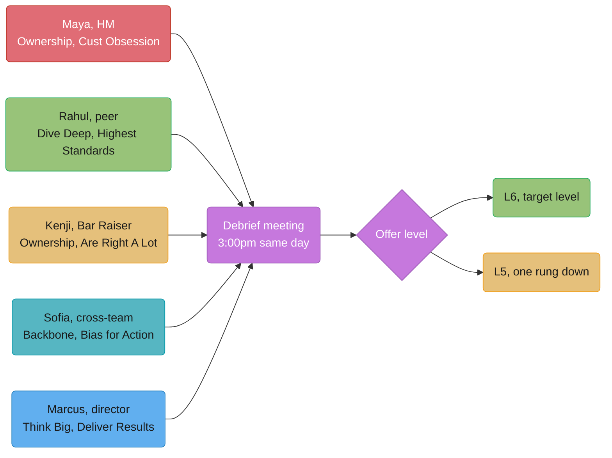
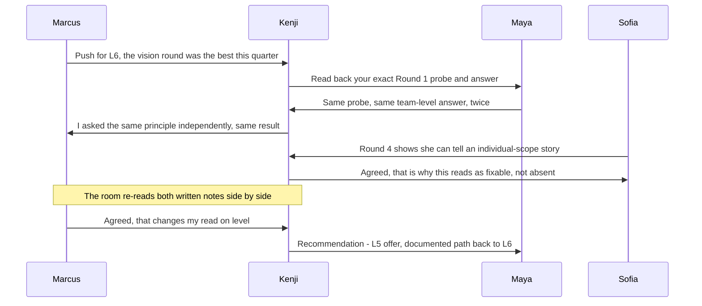
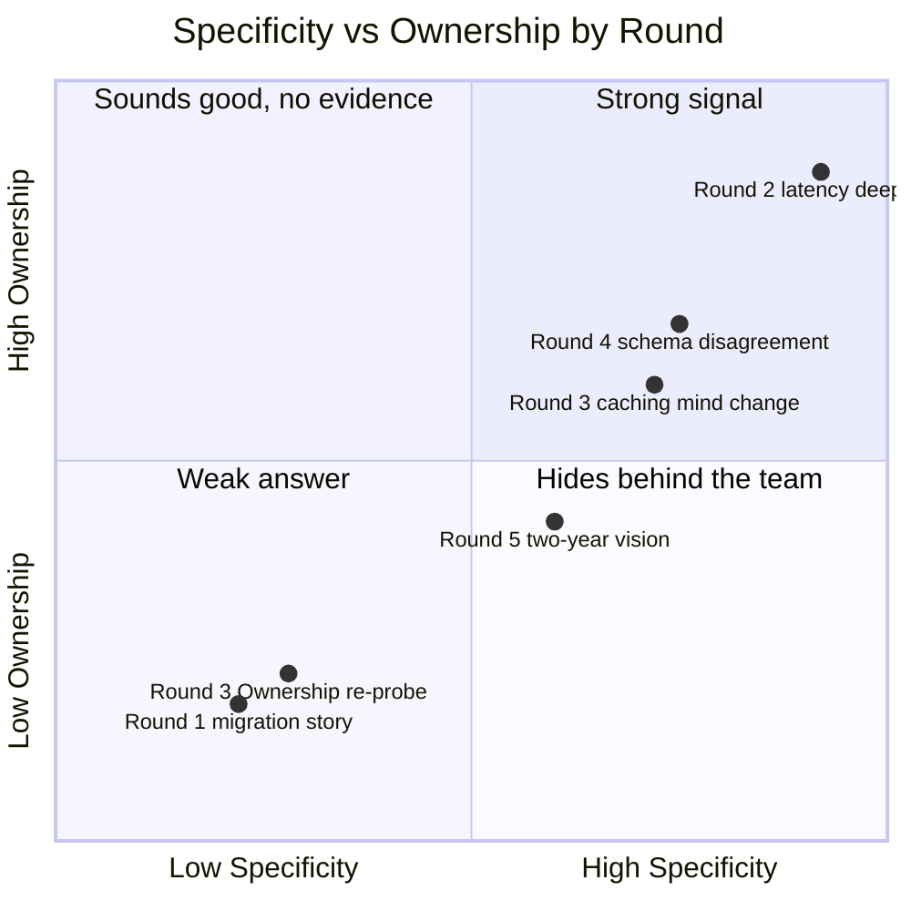

# The Amazon Loop

## Intuition

> **One-line analogy**: A loop is not five conversations, it is one distributed system
> collecting five independent, partial observations of you, and the only value anyone
> downstream ever reads is what got written to the log.

**Mental model.** Five interviewers walk into five separate rooms with the same candidate
and completely different jobs. Each is holding two or three of Amazon's sixteen named
Leadership Principles and nothing else — not "was this person good," just "did I collect
specific, individually-attributable evidence against exactly these principles." Nobody
scores holistically until the debrief, and by then the only thing left of the ninety
minutes anyone actually spent with the candidate is what got typed down.

**Why it matters.** This case study follows one candidate, Dana Okafor, through a full
five-interview loop for an L6 Senior SDE role on AWS's Elastic Container Service (ECS)
control plane team, and then into the room where five strangers who each saw a fifth of
the picture reconcile their notes into one decision. The candidate did not fail the loop.
The candidate also did not get the level offered. Both things are true at once, and the
reason is entirely legible if you read the five written debriefs in order.

**Key insight.** The most consequential fact about this loop's design is invisible from
the candidate's chair: two interviewers were independently assigned the same principle,
using different questions, in different rooms, three hours apart. Neither knew what the
other asked. When their two notes turned out to say the same thing, that stopped being
one weak answer and became one signal, collected twice — which is exactly the distinction
that decides this candidate's outcome.

---

## 1. Situation & Stakes

Dana Okafor is a Senior Software Engineer at Ledgerly, a 340-person payments-infrastructure
startup, seven years into her career and four years at Ledgerly. She is interviewing for
an L6 Senior SDE role on AWS's ECS control plane team — the role that owns the scheduler
logic deciding which EC2 instances or Fargate capacity a customer's containers land on.
Amazon's ladder has no separate "Staff" title; L6 Senior SDE is the rung immediately below
L7 Principal Engineer, and per Amazon's own reported level distribution it is already a
genuine milestone — the large majority of Amazon engineers sit at L4 or L5.

The loop is a single day: five back-to-back interviews starting at 9:00 a.m., a
group lunch with two of the interviewers at noon, and a debrief meeting at 3:00 p.m. the
same day, led by a Bar Raiser who is deliberately drawn from a team Dana is not
interviewing into (Alexa, not AWS). The hiring manager, Maya Lindqvist, wants a specific
outcome: a strong L6 hire who can own scheduler correctness end to end without her having
to check every decision. The recruiter wants a clean loop that closes in one debrief rather
than requiring a second onsite. Dana wants the level she is actually targeting — an L6
offer, not an L5 one, because the difference is a full rung on Amazon's ladder and a real
compensation band, not a title nuance.

What is actually at stake in the debrief is narrower than any of that: whether five strips
of written evidence, none of which any one interviewer can see in full, add up to L6-shaped
proof on every principle the loop was designed to probe — and whether the room can tell the
difference between a candidate who is thin on one axis and a candidate who told one story
badly under pressure.

---

## 2. The People and What Each One Wants

| Person | Role in the loop | Assigned Leadership Principles | What they actually want |
|---|---|---|---|
| **Dana Okafor** | Candidate | — | An L6 offer, not L5 — the difference is a full rung and a real compensation band, and she has spent six weeks preparing specifically against Amazon's published sixteen principles |
| **Maya Lindqvist** | Hiring manager, Round 1 | Ownership, Customer Obsession | A hire who can own scheduler correctness without her checking every call — she is the one who has to live with a bad hire for the next year |
| **Rahul Deshmukh** | Peer Senior SDE, Round 2 | Dive Deep, Insist on the Highest Standards | Confidence that Dana can find a real root cause under pressure, not recite a postmortem she read once |
| **Kenji Watanabe** | Bar Raiser, Round 3, debrief lead | Ownership (re-probed independently), Are Right, A Lot | A defensible, evidence-based decision the whole company can stand behind later — not a room that talks itself into liking someone |
| **Sofia Petrov** | Cross-team engineer (EKS), Round 4 | Have Backbone; Disagree and Commit, Bias for Action | Evidence Dana can hold a real position under disagreement, since EKS and ECS argue about shared infrastructure constantly |
| **Marcus Chen** | Skip-level director, Round 5 | Think Big, Deliver Results | A hire who can eventually own more than one team's worth of scheduler strategy — and, less officially, a candidate he personally likes |

Kenji's presence changes the shape of the room before anyone speaks. He reports to no one
in the ECS org, has no stake in filling this specific headcount by Friday, and is trained
specifically to be the person in the room least persuaded by "the vision round was great."
Amazon's own public materials describe the Bar Raiser as an objective third-party adviser
and a trained steward of the sixteen principles who leads the post-loop debrief — that is
confirmed company framing, and it is the exact role Kenji plays below.

---

## 3. The Approach

Amazon assigns each loop interviewer two or three specific Leadership Principles to
collect evidence against — never the whole list, and never told to the candidate in
advance. The recruiter sends Dana a generic prep note ("be ready to discuss your
experience using specific examples") but not the assignment sheet below, which exists only
internally, assembled by Maya and Kenji the week before the loop.

**The LP assignment sheet.**

| Round | Interviewer | Principles assigned | Why this pairing |
|---|---|---|---|
| 1 (9:00 a.m.) | Maya Lindqvist, HM | Ownership, Customer Obsession | The hiring manager probes the principle she personally cares most about living with day to day |
| 2 (10:00 a.m.) | Rahul Deshmukh, peer | Dive Deep, Insist on the Highest Standards | A peer engineer is best positioned to push on technical depth without status getting in the way |
| 3 (11:15 a.m.) | Kenji Watanabe, Bar Raiser | **Ownership** (deliberately re-assigned), Are Right, A Lot | See below — this is the one deliberate overlap on the sheet |
| 4 (1:00 p.m.) | Sofia Petrov, cross-team | Have Backbone; Disagree and Commit, Bias for Action | An interviewer from an adjacent, frequently-conflicting team is best positioned to judge whether a candidate holds a real position under real disagreement |
| 5 (2:00 p.m.) | Marcus Chen, director | Think Big, Deliver Results | The most senior person in the room owns the two principles about direction and delivery at scale |

Eight of the sixteen principles are covered across the five rounds; the remaining eight
are not probed at all in this loop, which is normal — Amazon does not require every
principle to be evidenced in every loop, only that the assigned ones are.

**Why Ownership is assigned twice.** This is the one deliberate design choice worth
naming, because it is invisible to Dana and does almost all of the work in §4 and §5.
Ownership is the principle most often inflated by "we" language — a candidate can sound
like they are answering it while giving the interviewer nothing individually
attributable. Kenji, as Bar Raiser, specifically re-assigns himself Ownership in addition
to his own Are Right, A Lot slot, using a different question from Maya's, in a different
room, three hours later, with no knowledge of what Maya asked or heard. If both
independently arrive at the same gap, that is not one weak answer counted twice — it is
one signal, collected twice, by two people with no way to have coordinated.



Round color tracks the round's outcome, not the interviewer's seniority: red is the weak
Ownership round, green is the strong Dive Deep round, yellow is the mixed Bar Raiser
round, teal is the honest-recovery round, blue is the solid-but-not-deciding Think Big
round. The diagram's shape is the entire point of §3 — every round feeds the same debrief
regardless of how it went, and nothing is discarded before that meeting.

---

## 4. The Artifacts and Conversations

### Round 1 — Maya Lindqvist (Ownership, Customer Obsession) — the round that goes badly

**The question asked:** "Tell me about a time you took ownership of a project outside
your immediate responsibilities."

**Dana's answer, transcribed:**

```text
Dana:  Sure. Last year our team led a migration of the checkout service
       to an event-driven architecture. It had been a monolith handling
       both order validation and payment authorization synchronously,
       which was causing latency problems under load. We decided to
       split it into separate services communicating over an event bus,
       and we owned that whole effort end to end. It took about four
       months. We ran into some challenges around data consistency
       during the transition, but we worked through them as a team, and
       by the end we had a much more scalable system. I think it really
       showed the kind of ownership mentality our team has — we didn't
       wait to be told to fix it, we saw the problem and took it on
       ourselves.
Maya:  That's a good overview. What was YOUR specific contribution to
       that migration, separate from the team's?
Dana:  I was pretty involved throughout — I participated in most of the
       design discussions, helped drive consensus on the event schema,
       and did a good amount of the implementation work on the payment
       authorization side specifically.
Maya:  Can you get more specific? If I asked three other people on your
       team "whose decision was it to split payment authorization out
       first, rather than order validation," what would they say?
Dana:  I mean, it was pretty collaborative — I'd say it was a group
       call. I was definitely one of the more vocal people pushing for
       payment auth to go first, but I wouldn't say it was solely my
       decision.
Maya:  Understood. Tell me about a moment of real disagreement during
       that migration — a point where two people on the team wanted
       different things.
Dana:  There was some tension early on about the rollout timeline —
       some people wanted to go faster, some wanted to be more
       cautious. We talked it through as a team over a couple of
       meetings and landed on a phased rollout everyone was comfortable
       with. It worked out well in the end.
```

**Maya's written debrief, filed within the hour:**

```text
PRINCIPLE: Ownership
CANDIDATE: Dana Okafor
ROUND: 1 of 5

Candidate described a four-month checkout-service migration to an
event-driven architecture. Language stayed at team level throughout
("we decided," "our team led," "we owned that effort") even after two
direct probes for individual contribution. First probe ("what was YOUR
specific contribution") produced a restated team narrative with no
isolated individual decision. Second probe, framed as a specific
counterfactual ("what would three teammates say"), produced an
acknowledgment that the payment-auth-first sequencing was "a group
call" rather than a decision candidate can point to as their own.

Conflict example ("tension about rollout timeline") resolved with no
described friction, no named opposing position, no data or argument
that moved anyone — reads as a non-disagreement offered in response to
a disagreement question.

PRINCIPLE: Customer Obsession — candidate connected the migration to
reduced checkout latency but did not name a specific customer-facing
number or a customer complaint that motivated the work; adequate but
not strong evidence.

RECOMMENDATION: LEANING NO HIRE on Ownership specifically. Insufficient
individually-attributable evidence after two direct probes. Flagging
for debrief discussion rather than treating as disqualifying on its
own — candidate may simply be under-prepared for this specific probe
style rather than lacking the underlying scope.
```

Dana leaves the room feeling the interview went fine — Maya was warm, nodded along, and
the conversation never felt adversarial. The written record tells a narrower story.

---

### Round 2 — Rahul Deshmukh (Dive Deep, Insist on the Highest Standards) — the round that goes well

**The question asked:** "Tell me about the deepest technical investigation you've done in
the last year — something where you had to go several layers past the obvious
explanation."

**Dana's answer, transcribed:**

```text
Dana:  Our payment authorization service had a P99 latency spike from
       roughly 90ms to 480ms under peak load, and the on-call rotation
       kept escalating it to me specifically because I'd built the
       service two years earlier. My first hypothesis, and everyone
       else's, was the downstream bank API — that's usually the slow
       part. I pulled the distributed traces for the slow requests
       first, before touching anything else, and the traces showed the
       bank API call itself was fast and consistent, around 40ms. The
       480ms was almost entirely time spent BEFORE the outbound call
       even started — a wait state inside our own service.
Rahul: What made you suspect the connection pool specifically, rather
       than, say, GC pauses or thread starvation?
Dana:  I didn't suspect it first, actually — I ruled things out in
       order. I checked GC logs first since that's usually the easy
       kill, and pause times were under 5ms, nothing close to 400ms.
       Then I looked at thread pool metrics — CPU utilization was
       normal, threads weren't blocked on CPU work. That left
       something waiting on an external resource without actually
       doing work, which pointed at connection acquisition. I checked
       our HikariCP metrics and the pending-connection count was
       spiking to 40+ during the exact windows the P99 spiked, against
       a configured max pool size of 20.
Rahul: Why was the pool undersized — was that a config mistake, or
       something that changed?
Dana:  It wasn't sized wrong when it was set — 20 connections had been
       plenty for our original traffic. We'd grown request concurrency
       about 3x over the prior two quarters without anyone revisiting
       that number, because nothing alerted on pending-connection
       count specifically, only on latency after the fact.
Rahul: What would you have done if raising the pool size hadn't fixed
       it?
Dana:  Raising it was a mitigation, not the actual fix, so I'd planned
       for that regardless — the real fix was adding a
       pending-connections alert with a threshold well below the point
       where it affects P99, so we catch pool exhaustion before it
       becomes a latency incident again. I shipped both: pool size
       went from 20 to 60 based on projected peak concurrency plus
       headroom, and I added the alert. P99 dropped from 480ms to
       about 60ms and has stayed there for the two months since.
```

**Rahul's written debrief:**

```text
PRINCIPLE: Dive Deep
CANDIDATE: Dana Okafor
ROUND: 2 of 5

Candidate identified a specific P99 latency regression (90ms -> 480ms)
and walked a genuine elimination process: ruled out GC (checked pause
times, <5ms), ruled out thread starvation (checked CPU utilization),
before isolating connection-pool exhaustion via HikariCP
pending-connection metrics. Explicitly named and rejected the obvious
first hypothesis (downstream bank API) using trace data before
assuming it. Survived two specific follow-ups (why the pool was
undersized historically; what the fallback plan was if the fix hadn't
worked) with consistent, technically coherent detail both times.
Quantified before/after (480ms -> 60ms, sustained two months).

PRINCIPLE: Insist on the Highest Standards — candidate didn't stop at
the mitigation (raising pool size), added a leading-indicator alert
specifically so pool exhaustion would be caught before it became a
customer-facing latency incident again. Strong signal of raising a
standard rather than just clearing an incident.

RECOMMENDATION: STRONG HIRE signal on both assigned principles. This is
the strongest round of technical depth I've seen this quarter — the
elimination process was real, not a story shaped to sound like one.
```

---

### Round 3 — Kenji Watanabe, Bar Raiser (Ownership re-probed, Are Right, A Lot)

**The Ownership question asked — deliberately different phrasing from Maya's:** "Tell me
about a time you owned an outcome that did not go the way you wanted."

**Dana's answer, transcribed:**

```text
Kenji: Tell me about a time you owned an outcome that did not go the
       way you wanted.
Dana:  After we fixed the connection pool issue, I tried to get the
       retry-and-idempotency pattern we'd built adopted more broadly —
       two other services at Ledgerly had the same class of bug
       waiting to happen. We pitched it to the fulfillment-notifications
       team, and it didn't land. They didn't adopt it, and about three
       months later they had almost the exact same kind of incident we'd
       already fixed.
Kenji: What was YOUR specific contribution to that pitch, separate from
       whoever else was involved?
Dana:  I wrote part of the design doc — the section describing the
       failure mode and the fix pattern — and I was in the pitch
       meeting. It wasn't really a solo effort though, our tech lead
       drove most of the actual conversation with their team.
Kenji: If the pitch had landed, what specifically would you have done
       differently to make that more likely, and did you do any of it?
Dana:  Looking back, I think we should have shown them our actual
       incident data rather than just describing the pattern
       abstractly — we didn't do that, we just walked through the
       design doc. I didn't push for that at the time.
```

**The Are Right, A Lot question:** "Tell me about a time new information changed your
mind on a technical decision you'd already made."

```text
Kenji: Tell me about a time new information changed your mind on a
       technical decision you'd already made.
Dana:  I'd designed a caching layer for exchange-rate lookups assuming
       a 5-minute TTL was safe, based on how often our upstream vendor
       said rates updated. A teammate pulled production data showing
       the vendor was actually pushing corrections mid-window on
       roughly 2% of rates, which meant we were occasionally serving a
       stale rate on a real transaction. I'd been fairly confident in
       the 5-minute assumption going in, but the data was
       unambiguous, so I dropped the TTL to 30 seconds and added a
       webhook listener for the correction events instead of relying
       on TTL expiry alone. Stale-rate incidents went from about 2 a
       month to zero over the following quarter.
Kenji: What made you confident enough in 5 minutes originally that you
       didn't check for mid-window corrections up front?
Dana:  Honestly, I took the vendor's documentation at face value
       instead of checking our own transaction logs against it before
       shipping — that's the part I'd do differently. The data existed
       the whole time, I just hadn't looked.
```

**Kenji's written debrief — the one that decides the outcome:**

```text
PRINCIPLE: Ownership (re-probed independently of Round 1)
CANDIDATE: Dana Okafor
ROUND: 3 of 5, Bar Raiser

Used a different Ownership question than Round 1 (per assignment sheet
design — see loop notes), with no visibility into Maya's round beforehand.
Result: same shape as Round 1. "We pitched it," "our tech lead drove
most of the conversation," language defaults to team framing under the
first probe. Direct follow-up ("what was YOUR specific contribution")
surfaced one concrete detail (wrote part of the design doc) — more than
Round 1 produced, but still thin relative to the scope of the story
being told. Candidate's own retrospective ("we should have shown
incident data, I didn't push for that") is honest and self-aware, but
notably is ALSO framed as a "we" failure rather than naming what
candidate specifically would do differently in their own actions next
time.

PRINCIPLE: Are Right, A Lot — strong. Candidate named a specific wrong
assumption (5-minute TTL), the specific evidence that changed it
(teammate's production data), the specific fix (30-second TTL plus
webhook listener), a quantified outcome (2/month to zero), and — this
is the differentiator — took individual accountability for the
original miss ("I took the vendor's documentation at face value... I
just hadn't looked") rather than diffusing it into team language. This
is what the Ownership answers above are missing.

FLAG FOR DEBRIEF: Two interviewers, independently, using two different
questions in two different rooms three hours apart, arrived at the
same specific gap on the same principle via the same probe. That is
not two weak data points — it is one signal, collected twice, with no
possibility of the interviewers having coordinated. I am bringing the
two written notes side by side into the debrief rather than relying on
my recollection of the room.
```

---

### Round 4 — Sofia Petrov (Have Backbone; Disagree and Commit, Bias for Action) — the round that handles "I don't have a good example" well

**The question asked:** "Tell me about a time you disagreed with your manager and had to
decide whether to push back or let it go."

**Dana's answer, transcribed:**

```text
Sofia: Tell me about a time you disagreed with your manager and had to
       decide whether to push back or let it go.
Dana:  I want to be honest with you rather than stretch something to
       fit — I don't actually have a strong example of a real
       disagreement with a manager specifically. My manager at Ledgerly
       and I have generally aligned on direction; where I've had real,
       substantive disagreements has been more with a tech lead or a
       peer on a specific technical approach. Would it be useful if I
       gave you the strongest version of that instead?
Sofia: Yes, that's exactly what I'm looking for — tell me about that
       one.
Dana:  Our tech lead proposed renaming a core column in the ledger-entries
       table as part of a schema cleanup — a straightforward
       backward-incompatible rename, done in a single migration. I
       disagreed. That table is read by four other services
       directly, not just through our API, and a synchronous rename
       would break all four the moment the migration ran, with no
       rollback path once other services had already read the new
       schema. I proposed an additive migration instead — add the new
       column, dual-write to both for one release cycle, migrate
       readers one at a time, then drop the old column — which is
       slower but has a rollback path at every single step.
Sofia: Your tech lead had already proposed a plan. What did you
       actually do with the disagreement, concretely?
Dana:  I asked for fifteen minutes before the migration was scheduled
       to run, and I wrote a one-page comparison — blast radius of
       each approach, specifically which four services would break
       under the direct rename and how, versus the four extra days the
       additive approach would take. I sent it in our team channel,
       not just to the tech lead privately, because two of the four
       affected services had representatives in that channel and I
       wanted them to see the actual risk, not just take my word for
       it.
Sofia: What happened after that?
Dana:  The tech lead read it, asked one clarifying question about
       whether dual-writing could be done without a perf hit, I showed
       the write path was already async so it was negligible, and they
       changed the plan to the additive migration same day. We shipped
       it over the following two weeks with zero incidents on any of
       the four dependent services.
```

**The Bias for Action follow-up, same round:**

```text
Sofia: Tell me about a reversible decision you made quickly rather than
       studying for a long time.
Dana:  Whether to ship the connection-pool fix from my earlier incident
       behind a feature flag or just push it straight to production.
       I decided in about ten minutes to flag it — it's a fully
       reversible decision, flags cost almost nothing to add, and it
       meant if the new pool size caused an unexpected problem I could
       revert in seconds instead of doing an emergency deploy. I didn't
       need a design review for that call, it was obviously reversible
       and obviously cheap to hedge.
```

**Sofia's written debrief:**

```text
PRINCIPLE: Have Backbone; Disagree and Commit
CANDIDATE: Dana Okafor
ROUND: 4 of 5

Candidate proactively flagged they didn't have a strong manager-conflict
example rather than stretching a weak one to fit — I want to note this
explicitly as a positive signal, not a gap. Redirected to a real,
specific technical disagreement with a tech lead over a schema
migration approach (destructive rename vs. additive dual-write).
Candidate named the actual stakes (four dependent services, no rollback
path under the original plan), took a concrete individual action (wrote
a one-page blast-radius comparison, posted it where the affected teams
would see it directly rather than only escalating privately), and
described a real change of plan with a quantified outcome (zero
incidents across four services). This is the clearest example of
individually-attributable action in the loop so far, and I'd note it
directly contradicts a candidate who is simply incapable of
individual-level detail — the capability is clearly present here.

PRINCIPLE: Bias for Action — solid, correctly reasoned as a small,
reversible decision (feature flag) rather than an example that needed
to be dramatic to count.

RECOMMENDATION: HIRE signal on both principles. Also flagging for
debrief: this round's strength is relevant context for interpreting
the Ownership gap in Rounds 1 and 3 — this candidate can clearly
produce individually-attributable detail when asked; whatever is
happening with the Ownership answers specifically looks more like which
stories get told than what the candidate is actually capable of
describing.
```

---

### Round 5 — Marcus Chen, Director (Think Big, Deliver Results)

**The question asked:** "If you had no constraints on headcount or time, what would you
build for payments infrastructure at Ledgerly over the next two years?"

**Dana's answer, transcribed:**

```text
Marcus: If you had no constraints on headcount or time, what would you
        build for payments infrastructure at Ledgerly over the next two
        years?
Dana:   I'd unify retry and idempotency handling across every service
        that touches money, instead of each service reinventing its own
        version of the pattern I built for payment authorization. Right
        now we have at least three separate implementations of "don't
        double-charge a customer if a retry happens," each written by a
        different team, each with slightly different edge-case bugs.
        I'd build one shared idempotency-key library, own it as a
        platform team rather than a side project, and make it the
        default rather than something teams have to discover and adopt.
        The failed pitch to fulfillment-notifications I mentioned
        earlier is actually the reason I believe this has to be a
        platform investment with real ownership behind it, not another
        optional pattern one engineer tries to sell to another team in
        a single meeting.
Marcus: What would you personally do in year one versus delegate?
Dana:   Year one I'd want to be hands-on writing the library itself and
        doing the first two migrations personally, specifically because
        the failed pitch taught me that showing working code and real
        incident data lands better than a design doc alone. Once there's
        a proven pattern with two real migrations behind it, that's when
        I'd delegate the remaining migrations to a rotating pair of
        engineers rather than doing all of them myself.
```

**The Deliver Results follow-up:**

```text
Marcus: Tell me about a time you delivered something on a deadline
        despite a real setback.
Dana:   The connection-pool fix had a hard deadline — a major merchant's
        Black Friday-equivalent sale weekend was ten days out when I
        found the root cause, and I'd budgeted five days to also add
        proper load testing before shipping. Two days in, the load-test
        environment itself broke — an unrelated infra issue — and I lost
        two full days waiting on the infra team to fix it. I cut scope
        rather than cut the deadline: shipped the pool-size increase and
        the alert without the full load-test suite I'd wanted, and
        instead did a smaller synthetic load test against a single
        instance to get enough confidence to ship safely. The full load
        test suite shipped the following week, after the sale weekend
        was already clear.
```

**Marcus's written debrief:**

```text
PRINCIPLE: Think Big
CANDIDATE: Dana Okafor
ROUND: 5 of 5

Candidate articulated a coherent two-year vision (platform-owned,
shared idempotency library replacing three redundant implementations)
grounded in a real prior failure (the fulfillment-notifications pitch
that didn't land), not an abstract "we should have more platform
investment" answer. Reasoned concretely about sequencing (hands-on in
year one specifically to build proof before delegating) rather than
giving a vague "I'd build a team" non-answer.

PRINCIPLE: Deliver Results — good, concrete example of cutting scope
(load-test suite) rather than cutting the deadline when a real,
external setback (broken test environment) hit, with the descoped work
completed the following week rather than dropped entirely.

RECOMMENDATION: HIRE. This was the most energizing round of the day —
candidate is clearly someone who thinks past the ticket in front of
them. I'd weight this heavily; the platform-thinking on display here is
exactly what L6 needs on the scheduler team.
```

---

### The debrief meeting, 3:00 p.m., transcribed

All five interviewers and the recruiter are present; Kenji, as Bar Raiser, runs the
meeting.

```text
Kenji:  Let's go around with recommendation and confidence, then get
        into the details. Maya?
Maya:   Leaning no-hire on Ownership specifically, hire on Customer
        Obsession. I probed twice for individual contribution and got
        team language both times.
Rahul:  Strong hire. Best Dive Deep round I've run this quarter, real
        depth, survived both follow-ups cleanly.
Kenji:  Also flagging Ownership — I re-probed it independently with a
        different question and got the same shape of answer. Strong
        hire on Are Right, A Lot though, that one was excellent.
Sofia:  Hire on both mine. And I want to push back a little on the
        Ownership read before we go further — my round showed this
        candidate can absolutely produce individual-level detail when
        asked. She told me upfront she didn't have a strong example for
        one question and redirected to a real one instead of padding a
        weak answer. That's not someone incapable of ownership
        language.
Marcus: Strong hire, and honestly I'd push for L6 without much debate.
        The Think Big round was the best I've heard in months — real
        vision, grounded, not generic. I think the Ownership thing is
        interview nerves on a specific question type, not a real gap.
        Let's not overweight two rounds against three strong ones.
Kenji:  I want to slow down on that specifically, because "interview
        nerves" is a claim we can actually check against the written
        notes instead of guessing. Maya, can you read your probe and her
        answer back exactly as you wrote it?
Maya:   "What was YOUR specific contribution, separate from the team's?"
        Answer: "I was pretty involved throughout... I'd say it was a
        group call."
Kenji:  My probe, worded differently, three hours later, no idea what
        Maya had asked: "What was YOUR specific contribution to that
        pitch, separate from whoever else was involved?" Her answer:
        "It wasn't really a solo effort though, our tech lead drove most
        of the actual conversation."
Marcus: Okay. That is a closer match than I expected.
Kenji:  That's the point of assigning it twice. Two interviewers, two
        different questions, three hours and two rooms apart, reaching
        for the same follow-up and getting the same answer shape — that
        isn't two weak rounds, it's one signal we happened to collect
        twice, independently, with no way the interviewers coordinated.
Sofia:  I'd still argue Round 4 shows the underlying capability is
        there. She can absolutely tell an individually-attributable
        story — she told me one about the schema migration with a named
        artifact and a named outcome.
Kenji:  Agreed, and I think that's actually the most useful data point
        in the whole loop, not a contradiction — it tells us this isn't
        a candidate who lacks ownership-shaped experience. It tells us
        she has real individual-scope stories and, on the specific
        questions two different interviewers asked about it, defaulted
        to a team narrative instead of leading with them. That is a
        real gap for an L6 bar, even if it's a narrower and more
        fixable one than "doesn't actually have the experience."
Rahul:  So where does that leave us on level?
Kenji:  My read: strong Dive Deep, strong Are Right A Lot, strong
        Backbone, strong Bias for Action, strong Think Big, strong
        Deliver Results — six clean principles. Ownership specifically
        did not clear the bar across two independent rounds, and
        Ownership carries real weight on our rubric for L6 scheduler
        work, because L6 here means being trusted to make calls nobody
        double-checks. I don't think this is a no-hire. I think this is
        an L5 offer with a documented, specific path back to L6.
Marcus: I still think that undersells the vision round.
Kenji:  It might. But the vision round isn't the principle in question —
        Ownership is, and we have two independent, written data points
        on it that agree with each other. I'd rather make a defensible
        L5 offer today than an L6 offer we can't back up against our
        own notes if anyone asks us to.
Maya:   I can live with L5. I'd genuinely like to have her on the team
        either way.
Kenji:  Then that's the recommendation I'll write up: hire at L5, with
        an explicit note for the recruiter to relay — the gap was
        specifically in how ownership got told, not in the underlying
        work, and a level-check in twelve months with Ownership-focused
        evidence is the stated path back to L6.
```

**The specific sentence in Kenji's final written debrief that decided it:**

```text
Two interviewers, on two separately assigned rounds of the same
principle, independently reached for the same follow-up question and
received the same answer — that is not two data points, it is one
signal collected twice, and it is the one principle this loop could
not clear for an L6 bar.
```

---

## 5. Decisions & Tradeoffs



The room did not overrule Marcus by outvoting him — four rounds recommended hire, one
leaned no-hire on one principle, and Marcus's read was the most senior and most confidently
delivered opinion in the room. What actually moved the decision was Kenji redirecting the
argument away from impressions ("the vision round was great," "this feels like nerves")
and toward the two written artifacts nobody else had put side by side yet. The Bar
Raiser's influence in this meeting was not authority — Kenji outranks no one else in the
room organizationally — it was insisting the room argue from the same evidence rather than
from whoever spoke most confidently.

The tradeoff the room explicitly weighed: an L6 offer risks putting someone in a role that
requires being trusted with unchecked decisions before the loop produced clean evidence
they operate that way; an L5 offer with a stated path back risks losing the candidate to a
competing L6 offer elsewhere, and slightly under-levels someone whose peer round (Sofia's)
showed real individual-ownership capability. The room chose the more conservative, more
evidence-defensible option, and named the specific reason in writing rather than leaving it
as an unstated judgment call.

---

## 6. Real-World Parallels

**Amazon's Bar Raiser program, 1999 to today.** Amazon's own public materials describe the
Bar Raiser as an objective third-party interviewer, deliberately drawn from outside the
hiring team, trained as a steward of the sixteen Leadership Principles, who leads the
post-loop debrief — all directly confirmed on Amazon's own pages (aboutamazon.com). The
program's stated standard, in Amazon's own words: every person hired should be better than
fifty percent of those currently in similar roles. The program's original internal name
was "Bar Keeper" at its 1999 founding, changed specifically because "keeper" implies
maintaining a standard rather than raising one.

**What is confirmed versus widely reported.** Amazon's public pages describe the Bar
Raiser as having outsized debrief influence and describe them as trained stewards of the
principles who lead the meeting. What those same pages do not state in so many words is
that a Bar Raiser holds a formal, unilateral veto over every other interviewer's vote — that
specific claim is extremely widely and consistently reported by interview-prep sources and
former recruiters, to the point of being operationally reliable, but it is reported
practice rather than a quoted company policy. This case study's debrief is written
consistent with that distinction: Kenji does not overrule the room by declared authority in
§4's transcript, he redirects it to evidence and the room updates on its own — which is
also the more commonly reported description of how a skilled Bar Raiser actually operates
a debrief, as distinct from a cruder "the Bar Raiser said no" shorthand.

**Written evidence, not impression, is directly confirmed practice.** Amazon's own
materials confirm interviewers submit written evidence tied to assigned principles ahead of
the debrief conversation — the mechanism this entire case study depends on. This is why
Dana's genuinely pleasant Round 1 conversation with Maya and the written note that resulted
from it can diverge as much as they do in §4: the room reads the note, not the room's
memory of the vibe.

**Google's parallel mechanism, for contrast.** Google's own re:Work materials describe a
structurally similar separation — interviewers write structured evaluations against named
attributes, and a hiring committee that was in none of the interviews makes the actual call.
The predictive-validity research behind why companies moved to this model at all (Schmidt &
Hunter's 1998 meta-analysis, reconfirmed by Sackett et al. in 2023) is the same research
underpinning why Amazon's design — assigning specific principles per interviewer rather
than "how did the candidate seem overall" — produces a defensible decision instead of a
popularity contest.

---

## 7. Frameworks Applied



Plotting all six probed answers on the specificity-versus-ownership quadrant from the
[Behavioural Interview Systems](../behavioral_interview_systems/behavioral_interview_systems.md)
module makes the pattern visible in one picture: two points cluster in "hides behind the
team" (both Ownership questions), four cluster toward "strong signal." The quadrant is not
predicting six different skill levels — it is showing one narrow, specific, repeatable gap
sitting next to five points that all say the underlying capability is present.

**The rubric mechanics applied here, precisely.** Amazon assigns two to three principles
per interviewer rather than a holistic "how did they do" score — this loop covered eight of
sixteen. The written-evidence-before-debrief discipline is what let Kenji's flag in §4 be a
side-by-side comparison of exact wording rather than a dueling-memories argument. And the
Bar Raiser's role, per §6, is confirmed to be outsized debrief influence exercised through
evidence stewardship — which is exactly the mechanism that overturns Marcus's confident,
senior, first-mover opinion in §5 without Kenji ever needing to assert authority to do it.

---

## 8. Playbook

For a **candidate** preparing for a Leadership-Principle loop:

- Build a portfolio deep enough that every principle you might be assigned has a real,
  individually-scoped story behind it — not six popular principles memorized and the other
  ten left to chance, since you are never told which two or three an interviewer owns.
- Lead every "tell me about a time" answer with your own decision first, then the team
  context — not the other way around. Dana's Round 1 and Round 3 answers both open with
  "we decided" / "we pitched"; Round 4's strongest moment opens with "I disagreed" and "I
  wrote a one-page comparison."
- When you genuinely lack a strong example for the exact question asked, say so and offer
  the closest real one — Round 4 shows this working better than stretching a mediocre story
  to fit the literal question.
- Assume every principle might be assigned to more than one interviewer. A story that
  survives being told twice, from two different angles, is stronger evidence than a story
  that only works once.

For an **interviewer** running an assigned-principle round:

- Ask the same specific follow-up ("what was YOUR contribution, separate from the team's")
  every time an answer defaults to "we" — do not let a well-told team story stand in for
  individual evidence just because it's fluent.
- Write the note immediately, in the candidate's own near-verbatim language where possible
  — a debrief argued from memory an hour later is a weaker artifact than one argued from
  exact quotes.
- If you are re-probing a principle another interviewer is also covering, use a genuinely
  different question. The value of the overlap in §3 depends entirely on the two probes
  being independent.

For a **Bar Raiser or debrief lead**:

- When the room's most confident opinion and the written evidence disagree, read the
  evidence back verbatim before letting the room vote on impressions.
- Treat "interview nerves" or "off day" as a claim to check against the actual notes, not
  an assumption to accept because it's the easier story.
- A gap on one principle across independent rounds is a level conversation, not
  automatically a no-hire — name the specific gap, the specific rounds that showed it, and
  a specific path back, in writing.

---

## 9. What Went Wrong & What It Cost

**What went wrong, specifically.** Dana never lacked individually-attributable stories —
Round 4 proves that directly. What went wrong is narrower and more common than "doesn't
have the experience": on the two rounds that happened to probe Ownership specifically, she
reached for team-framed language by default and did not self-correct even under a direct,
repeated probe. That is a habit of how a story gets told under a specific question type, not
a gap in the underlying work — and it is exactly the kind of gap that a rubric built around
independent, assigned-principle probing is designed to catch precisely because it does not
show up as "no examples," it shows up as "the wrong framing, twice, independently."

**What it cost, specifically.** The loop otherwise cleared L6 on every principle assigned:
strong Dive Deep, strong Insist on the Highest Standards, strong Are Right A Lot, strong
Have Backbone, strong Bias for Action, strong Think Big, strong Deliver Results. One
principle — Ownership, the single one deliberately double-covered on the assignment sheet —
did not clear, and it was enough on its own to move the offer from L6 to L5. Amazon's ladder
has no intermediate rung between Senior SDE and Principal, so an L5-versus-L6 gap is not a
title nuance; it is a full rung, with a real difference in base, stock, and sign-on that
publicly aggregated compensation data (levels.fyi and similar sources) generally shows
running into meaningful five- or six-figure total-compensation territory at this stage of a
major cloud provider's ladder — this case study does not cite an exact figure for this
specific pairing, because none was independently verified for it, but the direction and
rough scale of the gap is not in serious dispute.

**The counterfactual worth naming.** Had Dana simply opened her Round 1 and Round 3 answers
with the same individual-decision framing she used naturally in Round 4 — "I proposed," "I
disagreed," "I wrote" — with the exact same underlying facts, both debrief notes plausibly
read as strong Ownership evidence instead of thin evidence, and the loop very likely closes
at L6 on the same day, with the same work, the same numbers, and the same person. The gap
that cost a full level was not a gap in what she had done. It was which two rounds, of the
five in the loop, happened to be the ones where she told it as "we."

---

## 10. Variations

**When the redundant probe finds a real gap, not just a framing habit.** Not every
double-covered principle resolves the way this one did. If Dana's Round 4 example had not
existed — if every round, not just the two Ownership-assigned ones, showed the same
team-diffused framing — the same evidence-based process would correctly point toward a real
gap in individually-scoped experience rather than a fixable storytelling habit, and the
recommendation would more plausibly land at no-hire rather than a downleveled offer. The
mechanism in §4 and §5 does not manufacture a specific outcome; it manufactures a more
accurate read of whichever outcome is actually true.

**When the loudest voice does win.** A less disciplined debrief — one without a Bar Raiser
trained specifically to redirect the room to evidence, or with a Bar Raiser who is
themselves persuaded by seniority rather than notes — plausibly closes this exact loop at
L6 on Marcus's confidence alone, with the Ownership gap never surfaced as a pattern because
nobody put Maya's and Kenji's notes side by side. That version of the loop is not
necessarily wrong on the outcome, but it is a worse process: the same decision made without
the evidence that would justify it if anyone later asked why.

**A lighter loop, one level down.** An L4-to-L5 loop at Amazon typically assigns fewer,
narrower principles per interviewer and rarely doubles up deliberately the way this L6 loop
does — the redundant-probe design in §3 is a heavier-weight mechanism generally reserved
for higher-stakes, higher-level hiring decisions where the cost of a wrong call is larger.

**A Bar Raiser who does not also interview.** Some loops use a Bar Raiser purely as debrief
facilitator with no interview slot of their own, rather than one who — like Kenji here —
both interviews and leads the debrief. The dual role in this case study is what let Kenji
bring an independent Ownership data point into the room himself rather than relying entirely
on reconciling other people's notes; a pure-facilitator Bar Raiser has to do all of that
reconciliation work without a data point of their own to contribute.

---

## 11. Interview Discussion Points

**Q: Why does it matter that Ownership was assigned to two different interviewers instead of just one doing a longer round on it?**
**Short:** Two independent probes turn a single weak answer into a real, uncoordinated signal.
One interviewer's thin answer on a principle could be a bad question, a bad day, or a
misread by that specific interviewer. Two interviewers, using different questions, in
different rooms, with no knowledge of each other's results, arriving at the same gap is
categorically stronger evidence — it rules out the single most likely alternative
explanation, which is that one interviewer simply didn't ask well or didn't listen well.

**Q: Dana's technical answers were consistently strong. Why didn't that carry the Ownership rounds?**
**Short:** Technical depth and individually-attributed ownership are different, separately scored things.
Dive Deep and Insist on the Highest Standards were scored on technical depth and rigor,
which Dana clearly had. Ownership is scored on whether the candidate can point to a specific
decision as their own rather than the team's — a candidate can be technically excellent and
still default to "we" language under an Ownership-specific question, which is exactly what
happened, and the rubric treats these as genuinely separate signals rather than one general
impression of competence.

**Q: What should Dana have done differently in Round 1, given the facts were already strong?**
**Short:** Lead every story with the individual decision first, team context second.
Nothing about the underlying facts needed to change — Round 4 proves she had
individually-scoped material available. The fix was framing: opening with "I proposed
splitting payment authorization out first, and here's why," rather than "we decided to
split the service," and only adding team context after the individual decision was already
on the record. The same facts, reordered, read as completely different evidence.

**Q: Was it fair that "I don't have a good example of that" in Round 4 counted as a positive signal rather than a gap?**
**Short:** Yes — an honest redirect to a real story beats a stretched, hollow one.
Sofia's written debrief treats it as a genuine positive, and this is consistent with how
experienced interviewers are trained to read this moment: a candidate who honestly flags a
mismatch and redirects to their strongest real example produces better, checkable evidence
than one who stretches a weak or half-remembered story to fit the literal question asked.
The redirect itself — noticing the mismatch and proposing a better example — is also a small
piece of judgment evidence in its own right.

**Q: What is officially confirmed about the Bar Raiser role versus what is widely reported but not officially stated?**
**Short:** Amazon confirms outsized debrief influence; a formal unilateral veto is reported, not officially stated.
Amazon's own public pages confirm the Bar Raiser is an outside-the-team, principle-trained
adviser who leads the debrief and carries real weight in it. The specific claim that a Bar
Raiser holds a formal, unilateral veto over every other interviewer's vote is extremely
widely and consistently reported by interview-prep sources and former recruiters, but is not
stated in those exact terms on Amazon's own pages — treat it as reliable secondary
consensus, not a quoted company policy.

**Q: In the debrief, four of five recommendations were "hire." Why didn't majority rule?**
**Short:** The loop scores per-principle evidence, not a headcount vote across interviewers.
A Leadership-Principle loop isn't a vote-counting exercise — each interviewer's
recommendation is evidence about specific assigned principles, not a ballot on the whole
candidate. Four strong rounds on six different principles don't cancel out a real,
independently-confirmed gap on a seventh; they coexist with it, which is exactly why the
outcome here was a downleveled offer rather than either a clean hire or a no-hire.

**Q: Marcus was the most senior person in the room and pushed hardest for L6. Why didn't his seniority decide it?**
**Short:** The Bar Raiser redirected the room to written notes instead of letting seniority decide.
The debrief's design specifically routes around exactly this dynamic — Kenji's role is to
keep the room arguing from written, dated evidence rather than from whoever is most senior
or most confident. Marcus's opinion was heard and taken seriously, but it was tested against
the actual notes rather than accepted on authority, which is the mechanism that changed his
own read once he saw Maya's and Kenji's quotes side by side.

**Q: How did Kenji's Round 3 differ from Maya's Round 1, and why did that matter?**
**Short:** Different question, different room, three hours apart, same result — that independence is the evidence.
Maya asked about ownership outside normal responsibilities; Kenji asked about owning an
outcome that failed — a different angle on the same principle, asked with zero knowledge of
what Maya had asked or heard. The value of the finding comes entirely from that
independence: if Kenji had simply repeated Maya's exact question, a matching result would
be much weaker evidence, since it could just mean the candidate has one specific blind spot
tied to that literal question rather than to the principle itself.

**Q: What's the practical difference between "no hire" and the L5-with-a-path-back outcome the room actually chose?**
**Short:** A no-hire says the bar wasn't met at all; a downlevel says a different, lower bar was.
A no-hire recommendation would say the evidence didn't clear the bar for the role at any
level. The room's actual conclusion was narrower: six of the seven assigned principles
cleared cleanly at L6, and the room judged the underlying capability behind the seventh
(Ownership) was very likely present given Round 4, just not evidenced clearly enough,
twice, to justify L6 today — which is a fundamentally different, more specific claim than
"this candidate isn't good enough," and it's why the recommendation came with a named path
back rather than a flat rejection.

**Q: If Dana disagrees with the L5 offer, what evidence would actually change the outcome at a future level-check?**
**Short:** Individually-framed Ownership stories, told the way Round 4's schema story was told.
The exact same shape of evidence Round 4 already produced, applied to the principle that
didn't clear: stories that open with "I decided" or "I proposed" rather than "we decided,"
ideally including a moment of real friction and a specific, individually-attributable
action — not new projects or bigger scope, since the loop never questioned whether the scope
existed, only whether it got told as hers.

**Q: Why does the written debrief matter more than how the room "felt" about the candidate?**
**Short:** The committee reads the written notes, not a memory of how warm the room felt.
Dana's Round 1 conversation with Maya was pleasant and conversational in the room — Maya was
warm, nothing felt adversarial. None of that survives into what actually gets used: the
written debrief, built from near-verbatim notes taken during the answer, is what the rest of
the interviewers and any future reviewer actually reads. A good room and a thin written
record can coexist, and it's the record that decides the outcome, not the room's memory of
the mood.

**Q: Is re-probing the same principle with two interviewers standard practice at every company, or specific to how this loop was designed?**
**Short:** It's a deliberate design choice within Amazon's model, not guaranteed on every loop.
Amazon's model — assigning two or three specific principles per interviewer out of sixteen —
makes deliberate overlap possible in the first place, but not every loop chooses to use it;
this loop's hiring manager and Bar Raiser specifically chose to double-cover Ownership
because it's commonly inflated by team language. A candidate should not assume every
principle will be redundantly checked — most on a given loop won't be — which is exactly why
building a deep portfolio across many principles, per §8, matters more than optimizing for
any one expected overlap.

**Q: What would have happened if Round 4 hadn't existed — if every round showed the same team-diffused framing?**
**Short:** A gap that shows up everywhere reads as real experience missing, not a framing habit.
Per §10's first variation, the evidence-based process doesn't manufacture a specific
outcome — it reads whichever pattern is actually there. A gap isolated to two
independently-probed rounds, with a clean counterexample in a third, reads as a fixable
storytelling habit. The same gap showing up in every round, with no counterexample anywhere,
would read as a real absence of individually-scoped experience, and the honest
recommendation in that version is closer to no-hire than to a downlevel with a path back.

**Q: What does "Are Right, A Lot" actually reward, based on Dana's Round 3 answer?**
**Short:** Naming your own wrong assumption and what specifically changed your mind, not just being correct.
It rewards updating a position under new evidence and naming the update honestly, not simply
being right the first time. Dana's exchange-rate TTL answer is strong specifically because
she named the original wrong assumption (5-minute TTL was safe), the specific evidence that
overturned it (a teammate's production data), and took individual accountability for not
having checked it herself before shipping — the same individually-owned framing that was
missing from her Ownership answers, which is why Kenji's written note treats it as the clear
contrast case.

**Q: How should a candidate think about the risk that a "we" answer will read worse than intended?**
**Short:** Assume team language will be read as an absence of individual evidence, not neutral.
Treat every "we" sentence as one the interviewer cannot use as evidence for you specifically,
not as a neutral or safe default. It isn't dishonest to describe collaborative work as
collaborative — the fix isn't erasing the team, it's making sure your own specific decision
or action is named explicitly first, so the interviewer has something individually
attributable to write down before the team context gets added.

**Q: Does a downlevel offer like Dana's mean the loop failed to do its job?**
**Short:** No — a downlevel with a named, specific gap is the process working correctly.
No — arguably the opposite. A process that let Marcus's confidence carry the day, or that
simply averaged five rounds into one vague overall impression, would have either produced an
L6 offer nobody could defend against their own notes, or a no-hire that failed to notice the
gap was narrow and fixable. The downlevel-with-a-named-path outcome is what the process is
supposed to produce when the evidence is genuinely mixed in exactly this specific way.

**Q: What is the single biggest structural lesson of this loop for someone about to interview at a Leadership-Principle-mapped company?**
**Short:** Assume any principle might be checked twice, independently, and prepare accordingly.
Prepare as though any principle you're asked about might be checked by a second interviewer
later that same day, using a different question, with no knowledge of what you already said.
That assumption changes how you should tell every story — not by rehearsing a fixed script,
but by defaulting to individually-scoped framing everywhere, so that whichever version of a
story gets probed twice holds up both times.
