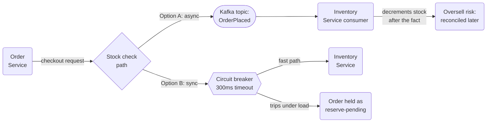
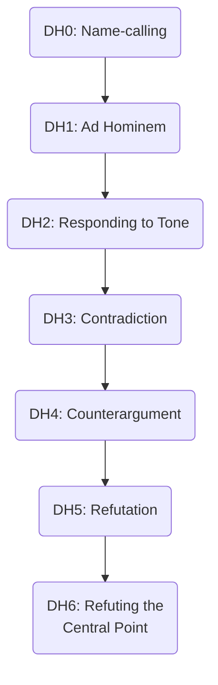

# The Disagreement That Went Wrong

## Intuition

> **One-line analogy**: The same two engineers, the same two options, the same eventual
> answer — run once through a PR thread and a stalemate, once through a fifteen-minute
> phone call, with a two-week gap between the cost of each.

**Mental model.** This case study is deliberately run twice. Part A is what actually
happened the first time a real disagreement between two senior engineers at a company
called Cascade Commerce went off the rails — transcribed as it happened, including the
messages that made it worse. Part B is the same disagreement, the same two people, the
same technical facts, replayed as if it had been handled well from the first comment. Both
parts land on the identical technical decision. The only thing that changes between them
is the two weeks, the four extra engineers, and the working relationship.

**Why it matters.** Most engineers can point to a technical disagreement that escalated
and assume the lesson is "we should have picked the right answer faster." That is not what
this case study shows. Both versions pick the same answer. What Part A actually cost was
never the technical uncertainty — it was two people arguing about the same design without
either of them ever finding out that one of them was arguing from a specific, un-stated
scar tissue from a previous job, because nobody asked and nobody offered.

**Key insight.** "This is over-engineered" is not an argument. It is a conclusion wearing
the clothes of an argument, and the entire cost of Part A traces back to nobody stopping
to ask what was underneath it before reacting to it.

---

## 1. Situation & Stakes

Cascade Commerce is an online marketplace doing roughly 800,000 orders a day, with volume
spiking to nearly 3x that during **Cyber Week** (the week spanning Black Friday through
Cyber Monday). During Cyber Week 2025, a synchronous dependency chain caused 35 minutes of
degraded checkout performance — Inventory Service's stock-check call was itself blocked on
a rate-limited downstream fraud check, and **Order Service's 2,000ms timeout meant checkout
requests queued up behind slow inventory checks instead of failing fast**, contributing to
an estimated 2,200 abandoned carts during the worst of it. Nobody wants a repeat before
Cyber Week 2026, which starts the last week of November.

See
[Difficult Conversations & Conflict](../difficult_conversations_and_conflict/difficult_conversations_and_conflict.md)
for the general model behind the restatement technique used in Part B.

Today, Order Service calls Inventory Service synchronously on every checkout to confirm
stock and decrement it. **Owen Baptiste**, Senior Engineer on the Order Service team,
opens a pull request in early October 2026 proposing to replace that synchronous call with
an asynchronous, Kafka-based flow: Order Service publishes an `OrderPlaced` event,
Inventory Service consumes it and decrements stock asynchronously, and the order is
provisionally confirmed with any oversell reconciled after the fact via automatic
cancellation and refund. His argument is that this removes Inventory Service's latency
from Order Service's checkout critical path entirely — no matter how slow inventory checks
get during a spike, checkout stays fast.

**Renata Cruz**, Senior Engineer on the Inventory Service team, objects. Her counter-
proposal keeps the call synchronous but tightens the timeout from 2,000ms to 300ms and
wraps it in a circuit breaker that fails fast and falls back to a "reserve pending" state
rather than blocking the request. Both positions are technically defensible, and both
engineers are right about the risk they are each most worried about — which is exactly
what makes this hard to resolve by force of argument alone.

Both are correct that last November's incident is the reason to act. They disagree about
which failure mode is worse: a rare total slowdown of a synchronous path, or a routine
low-grade risk of overselling stock that a customer has already been told is theirs.

The stakes are not abstract on either side. Cascade's finance team estimated the 2,200
abandoned carts from November 2025 at roughly $190,000 in lost same-day revenue, most of
which came back within the week as customers re-ordered — but the freeze window before
Cyber Week 2026 opens November 1, which means whatever gets decided has to be built,
load-tested, and merged inside a three-week window from the PR's original open date.
Neither engineer is arguing in the abstract; both are arguing against the clock.

---

## 2. The People and What Each One Wants

| Person | Role | Position | What they actually want |
|---|---|---|---|
| Owen Baptiste | Senior Eng, Order Service | Async via Kafka | Checkout to never be slow because of Inventory, no matter what |
| Renata Cruz | Senior Eng, Inventory Service | Sync call, tighter timeout + circuit breaker | Never oversell a SKU a customer was already told they got |
| Alicia Whitfield | EM over both teams (promoted 3 months ago from EM of Order Service alone) | Neutral, decides late | To make this stop consuming both teams' sprint capacity |
| Deshawn Wilkes | Principal Architect | Pulled in mid-stalemate | To not be seen taking sides in a fight that isn't formally his to referee |
| Lina Fischer | Senior Eng, Order Service | Loosely allied with Owen | To keep her own project off the list of things blocked by this |
| Tomasz Grabowski | Senior Eng, Inventory Service | Loosely allied with Renata | Same as Lina, opposite team |
| Farah Idris | SRE, on-call for both services | Wants operational risk taken seriously | Whichever choice pages her less at 2 a.m. |

Renata's stated objection throughout Part A is "this is over-engineered." Her actual
objection, which does not surface until Part B, is that she was paged four times in one
quarter at a previous employer by consumer lag in a Kafka-based order pipeline that
allowed stock to oversell for hours before anyone noticed, and she had to personally walk
finance through the manual reconciliation each time. She never says this in Part A. Nobody
asks.

---

## 3. The Approach

The technical crux is genuinely a tradeoff, not a case of one engineer being wrong. The
diagram below captures both options and the failure mode each one accepts.



*Option A decouples checkout latency from Inventory Service entirely, at the cost of a
window where a confirmed order can still be cancelled later. Option B keeps stock-accuracy
tight but accepts that Inventory Service's own health still gates checkout, even with a
breaker limiting how badly.*

Both parts of this case study reach the same conclusion: **Option B, synchronous with a
300ms timeout and a circuit breaker, plus a bulkhead limiting how many concurrent inventory
calls Order Service will make under load.** The queue idea is not wrong in the abstract —
it is wrong for this specific failure mode, because the thing that actually hurt Cascade
last Cyber Week was slow checkout, not exhausted inventory, and a circuit breaker fixes
slow checkout without introducing a new class of correctness bug. What differs between
Part A and Part B is not the answer. It is everything about how expensively they got there.

---

## 4. The Artifacts and Conversations

### Part A — What actually happened

#### 4.1 The pull request thread

```text
Owen Baptiste opened PR #4471: "Decouple stock decrement via Kafka
(event-driven inventory update)"

--- Description ---
Replaces the synchronous Inventory Service call in checkout with an
OrderPlaced event published to Kafka. Inventory Service consumes and
decrements asynchronously. Orders are provisionally confirmed; any
oversell is caught by a reconciliation job and auto-cancelled with a
refund and an apology email. This removes Inventory Service latency
from the checkout critical path entirely, which is what caused last
Cyber Week's 35-minute slowdown.

--- Comments ---

Renata Cruz:
This is over-engineered for what's fundamentally a single decrement
call on a request that already has a checkout ID to key off of. We
don't need eventual consistency and a reconciliation job for this --
we need a timeout that isn't 2 seconds and something that fails fast
instead of queuing behind a slow downstream call.

Owen Baptiste:
Sure, and if Inventory has another bad day next Cyber Week, we can
keep telling ourselves a faster timeout would've saved us. The whole
point is checkout shouldn't care how healthy Inventory is on any given
Tuesday. A circuit breaker just fails a little faster before the same
underlying problem shows up as cancelled carts instead of an oversell
-- I don't see how that's actually better.

Renata Cruz:
It's better because "cancelled cart before payment" and "confirmed
order that gets silently cancelled two hours later" are not the same
customer experience, and the second one is the one that generates
support tickets and chargebacks. I've seen this exact pattern before
and it does not go the way this PR description makes it sound.

Owen Baptiste:
"I've seen this before" isn't really an argument I can respond to
without more detail. Happy to take this to the design review if we're
not going to converge here.
```

**Where this sits on the hierarchy of disagreement** (see §7): Renata's opening comment is
a stated conclusion with almost no supporting evidence — a contradiction, not yet an
argument. Owen's reply responds to the dismissive tone of "over-engineered" with his own
sarcasm about "another bad day," which moves the exchange down, not up. Neither has yet
engaged with the other's actual failure mode.

#### 4.2 The design review — both dig in, in front of an audience

Six people in the room: Owen, Renata, Alicia (EM), Deshawn (Principal Architect), Lina
Fischer, Tomasz Grabowski. Farah Idris joins by video from the SRE side.

```text
Alicia: Let's use this slot to get to a decision on PR 4471. Owen, walk
        us through it, then Renata, your counter.

Owen:   Async decouples checkout latency from Inventory completely.
        Doesn't matter what's happening downstream, checkout stays
        fast. We eat a small oversell-reconciliation cost, which is
        rare and cheap to handle automatically.

Renata: Rare until it isn't. The reconciliation job is a whole new
        failure surface, and "the customer already got a confirmation
        email" makes an oversell a much worse conversation than a cart
        that just failed at checkout. I'd rather fail fast on the
        synchronous path with a tight timeout and a breaker.

Owen:   That still means checkout depends on Inventory's health, just
        with a shorter timeout before it gives up. That's not solving
        the actual problem from November, it's just tuning a knob on
        the same architecture.

Renata: It solves the actual problem, which was a 2-second timeout
        with no breaker, not "synchronous is inherently wrong."

Deshawn: Can I jump in -- honestly, both of these feel like more
         machinery than this problem needs. Have either of you looked
         at just doing CDC off the inventory table instead of either
         of these? That sidesteps the whole sync-vs-async framing.

Owen:   That's a different project, Deshawn, we'd need change-data-
        capture infra we don't have yet and it doesn't touch the
        checkout latency problem at all.

Renata: Agreed, that doesn't solve what we're actually here for.

Deshawn: Fair, just thought I'd raise it. I don't think I can call
         this one either way, honestly -- feels like it depends on risk
         appetite more than a right answer.

Alicia: Okay, we're not landing this today. Let's regroup next week.
```

Deshawn's interjection, meant to help, introduces a third option nobody asked for,
dismisses both existing positions as "more machinery than this problem needs" without
engaging either one's substance, and then declines to adjudicate — which leaves the room
exactly where it started, having spent forty-five minutes to arrive nowhere, with two more
people (Lina and Tomasz) now primed to relitigate this in their own team's Slack channels
afterward.

#### 4.3 The two-week stalemate

Over the following two weeks: Lina Fischer opens a side thread in `#order-service` arguing
Owen's case to her team, who start asking their own EM why Order Service's roadmap is
stuck. Tomasz Grabowski does the same in `#inventory-service` for Renata's case. Farah
Idris files a ticket asking both teams to at least agree on **something** before the Cyber
Week code freeze on November 1, since neither the queue nor the breaker has been load-
tested yet and both need runway. **Four engineers beyond Owen and Renata — Deshawn, Lina,
Tomasz, and Farah — end up spending meaningful time in this disagreement without being
part of resolving it.** A planned feature, "reserve-at-checkout for limited drops," which
depended on the checkout flow being stable, slips from its October 15 target to October 29
because neither team wants to build on top of a checkout path that might change shape
under them.

#### 4.4 The decision, made by exhaustion

```text
Alicia (Slack, Oct 20): I don't think either of you is going to change
                        the other's mind and we're two weeks from code
                        freeze with a feature already late. We're going
                        sync with the circuit breaker and the 300ms
                        timeout. I need this merged by Friday.

Owen (Slack, Oct 20): Understood. For the record I still think this
                      doesn't actually fix the underlying coupling
                      problem, but I'll build it.

Renata (Slack, Oct 20): Okay. Would've liked to get here without two
                        weeks of this, but I'll take it.
```

Renata's preferred option shipped, but nobody in that thread sounds satisfied. Owen
complied without being convinced. Renata got the outcome she wanted with no acknowledgment
that her original comment had cost two weeks by giving Owen nothing to engage with. Alicia
made the decision without ever hearing the specific thing that would have made it
unambiguous — that Renata's objection was rooted in something more concrete than a style
preference.

---

### Part B — The same disagreement, handled well

Same starting point: Owen opens the identical PR #4471 with the identical description.
Renata's first comment is, word for word, the same one from Part A — "this is over-
engineered for what's fundamentally a single decrement call..." The disagreement is
real; it does not disappear because people are being more careful. What changes is what
happens in the next two comments.

#### 4.5 Two comments, then a call

```text
Renata Cruz:
This is over-engineered for what's fundamentally a single decrement
call on a request that already has a checkout ID to key off of. We
don't need eventual consistency and a reconciliation job for this --
we need a timeout that isn't 2 seconds and something that fails fast
instead of queuing behind a slow downstream call.

Owen Baptiste:
I think we actually disagree about which failure mode is worse here,
not about whether November's incident needs fixing -- and that's
probably not going to resolve in PR comments. Got 15 minutes for a
call today?

Renata Cruz:
Yeah, works for me. 3pm?
```

The mechanism that changes everything downstream is small and specific: Owen does not
respond to the tone of "over-engineered." He names, in one sentence, what he thinks the
actual shape of the disagreement is, and moves it to a synchronous conversation before
either of them has said anything else in writing that would be harder to walk back in
front of an audience.

#### 4.6 The call — restating each other's position first

```text
Owen:   Before I make my case, let me try to say back what I think
        yours is, and tell me if I've got it right. You think a
        synchronous call with a real timeout and a breaker fixes the
        actual bug from November, and you think async trades a rare,
        visible failure -- checkout being slow -- for a routine,
        invisible one -- stock going wrong after the customer already
        got a confirmation. Is that fair?

Renata: That's exactly it, yeah. Especially the "invisible" part --
        with sync, when it breaks, it breaks in a way the customer
        sees immediately, at checkout, before anything's confirmed.
        With async, it breaks quietly and someone finds out later.

Owen:   Okay. Then let me say mine and you tell me if I've got that
        right too. I think you're weighing "checkout is occasionally
        slow" as an acceptable cost, and I'm not, because last
        November it wasn't just slow, it was slow enough to lose
        carts. I want an architecture where Inventory's health simply
        cannot make checkout slow, full stop.

Renata: That's fair, and I don't actually disagree that unbounded
        slowness is bad -- I think a 300ms timeout with a breaker gets
        you "fails fast" without needing "fails invisibly." Can I ask
        you something that's not really about the architecture?

Owen:   Sure.

Renata: Why does the eventual-consistency risk feel small to you? Because
        it doesn't to me, and I want to understand if that's a real
        difference in how risky it is or just a difference in how much
        it bothers each of us.

Owen:   Honestly -- I don't have a specific incident in mind, it just
        seems rare. Do you?

Renata: I do, and I haven't actually said this out loud before. At my
        last job I was on the on-call rotation for an order pipeline
        that used Kafka for exactly this -- async stock decrement --
        and consumer lag caused stock counts to drift for hours during
        traffic spikes. I got paged four times in one quarter for it,
        and every time I had to walk finance through a manual
        reconciliation of orders that had already gone out with stock
        we didn't have. That's not a hypothetical for me, it's
        something I lived through, and I think that's a lot of why
        "over-engineered" was my first reaction to seeing a queue
        proposed here -- it wasn't really about complexity, it was
        about not wanting to relive that.

Owen:   That's a completely different conversation than the one we were
        having in the PR thread. If I'd known that going in I wouldn't
        have pushed back the way I did -- I was treating it as a
        preference, and it's not, it's a specific failure mode you've
        actually been paged for.
```

Rapoport's first rule of criticism — from Anatol Rapoport, popularized by Daniel Dennett
in *Intuition Pumps and Other Tools for Thinking* (2013) — is to re-express the other
person's position so clearly they say "thanks, I wish I'd put it that way." Both of them
did it for the other before either tried to persuade. The unstated constraint that made
Renata's position non-negotiable — four pages in one quarter, at a previous job, for
exactly this failure mode — never surfaced in Part A because nobody asked what was under
"over-engineered," and Renata had no reason to volunteer it into a PR comment thread that
already felt adversarial.

#### 4.7 The shared doc

They spent the last ten minutes of the call filling in a shared doc together instead of
each writing separate position papers.

```text
Decision doc: Checkout <-> Inventory stock decrement
Owner: Owen Baptiste, Renata Cruz -- joint

| Option | What breaks | How bad | How visible |
|---|---|---|---|
| Async (Kafka, eventual) | Consumer lag under spike load | Oversold SKU, silent, discovered after confirmation sent | Low -- customer finds out later, support ticket, chargeback risk |
| Sync, 2000ms, no breaker (current) | Slow downstream blocks checkout | Cascading queue-up under load (Nov 2025) | High but slow to trip -- exactly what hurt us last year |
| Sync, 300ms + breaker + bulkhead | Breaker trips under sustained slowness | Order held as reserve-pending, retried once, then fails fast with a clear customer-facing message | High, immediate, no silent drift |

Recommendation: Sync with 300ms timeout, resilience4j circuit breaker,
bulkhead capping concurrent Inventory calls from Order Service. Revisit
async only if a future scaling requirement makes synchronous
inherently infeasible (not indicated by anything we have today).

Renata: agreed
Owen: agreed, and flagging the reserve-pending UX copy needs a review
      from Support before Cyber Week freeze
```

#### 4.8 The decision — forty minutes, start to finish

```text
Owen (Slack, to Alicia, same day): Renata and I talked it through --
                                   going sync with a 300ms timeout,
                                   breaker, and a bulkhead. Doc's
                                   linked. No need for a design review
                                   slot, we're aligned.

Alicia: Great, thanks for closing this out fast. Ship it.
```

No design review. No third party pulled in to referee. No two-week stalemate, no side
threads in either team's channel, no slip to the "reserve-at-checkout" feature. The call
was booked at 3:00 p.m. and the doc was finished by 3:40 p.m.

---

## 5. Decisions & Tradeoffs

| Decision | Alternative rejected | Why |
|---|---|---|
| Synchronous call, 300ms timeout, circuit breaker, bulkhead | Async via Kafka with post-hoc reconciliation | The failure mode that actually hurt Cascade (slow checkout) is fixed by failing fast, and the failure mode async trades it for (silent oversell) is worse for a customer who was already told the order is confirmed |
| Move to a call after two PR comments | Keep arguing in writing until someone in a review meeting adjudicates | Written threads make a tone-response ("over-engineered" met with sarcasm) easy and a real exchange of reasoning hard; voice makes the reverse true |
| Restate each other's position before arguing | Jump straight to making the case for your own side | Neither of them knew, going in, that "over-engineered" was standing in for a specific incident; restating surfaced that in under ten minutes |
| Write the decision doc jointly, on the call | Each write a separate position doc and compare afterward | A joint doc has no "my version vs. your version" to defend; disagreements about a line get resolved as they're typed, not escalated afterward |
| No design review meeting in Part B | Bring it to the room once aligned, for visibility | Nothing left to review — a meeting exists to resolve disagreement or build shared understanding, and both were already done |

---

## 6. Real-World Parallels

Amazon's engineering culture, as described in Colin Bryar and Bill Carr's *Working
Backwards* (2021), formalizes written narrative memos partly to slow down exactly this
kind of premature-position-taking — a memo forces the author to state the tradeoff before
anyone reacts to a one-line claim like "this is over-engineered," which is closer to what
the shared doc in Part B did after the fact than what the PR thread in Part A did in real
time.

Google's postmortem culture, documented in Beyer, Jones, Petoff, and Murphy's *Site
Reliability Engineering* (O'Reilly, 2016), draws a hard line between "blameless" analysis
of what happened and analysis of why a person made the call they made — the same
distinction that separates Part A's design review, where Owen and Renata's judgment was
implicitly under scrutiny in front of five colleagues, from Part B's private call, where
neither had to defend their competence to an audience while still working out what they
actually believed.

Chip and Dan Heath's *Decisive: How to Make Better Choices in Life and Work* (2013)
describes "widening the frame" — noticing when a decision has quietly narrowed to two
options and one of you is treating a third, unstated option (in this case, "sync with a
real timeout") as if it doesn't exist. Deshawn's CDC tangent in Part A is the inverse
failure: widening the frame at the wrong moment, introducing a third real option nobody
had bandwidth to evaluate instead of noticing the existing two hadn't been genuinely
compared yet.

Netflix's engineering culture memo, widely circulated in its public "Freedom &
Responsibility" slide deck, describes preferring "context, not control" and expecting
disagreement to be resolved by whoever is closest to the tradeoff rather than escalated
reflexively upward — the same principle that made Part B's outcome legitimate without a
design review: two people with full context reached a joint recommendation, and their
manager's role was to ratify it, not to referee a disagreement she had less context on
than either of them.

---

## 7. Frameworks Applied

Paul Graham's "How to Disagree" (2008) ranks disagreement on seven levels, DH0 through
DH6, from least to most rigorous. Mapping each part's key exchanges onto it makes the
actual difference between the two runs visible in a way "Part B communicated better" does
not.



*Part A's exchanges cluster at DH2-DH3. Part B's restatement step and the shared doc reach
DH6 — refuting the central point of each other's actual argument, once the central point
was finally spoken out loud.*

| Exchange | Part | Level | Why |
|---|---|---|---|
| "This is over-engineered..." | A and B (identical) | DH3 — Contradiction | States the opposite conclusion with almost no supporting evidence at this point |
| "Sure, and if Inventory has another bad day..." | A | DH2 — Responding to Tone | Reacts to the dismissiveness of "over-engineered" rather than to any claim in it |
| Design review digging-in | A | DH2-DH3 | Both restate their original positions to an audience rather than engaging the other's specific failure mode |
| Deshawn's CDC tangent | A | DH1-adjacent | Dismisses both positions as "more machinery than this needs" without engaging either one's substance |
| "I think we disagree about which failure mode is worse... got 15 minutes?" | B | DH4 — Counterargument (opening move) | Names the actual shape of the disagreement instead of reacting to phrasing |
| Mutual restatement on the call | B | DH5 — Refutation | Each demonstrates understanding of the other's argument well enough to be corrected on it |
| The pager-trauma reveal and the shared doc's failure-mode table | B | DH6 — Refuting the Central Point | Addresses the actual, now-named central point — which failure mode is worse and why — with a specific, comparable answer for each option |

The level a disagreement operates at is not a trait of the two people. Owen and Renata are
the same two people, with the same technical knowledge, in both parts. The level is a
property of the format and the first two or three moves — and both of those are choices.

---

## 8. Playbook

1. Treat "this is over-engineered" (or any one-line dismissal) as a symptom, not a
   position. Ask what specific failure it's protecting against before responding to it.
2. The moment a written thread produces a reply that responds to tone instead of content,
   move to a call. Two comments is a reasonable threshold — waiting for a design review to
   force the move costs a room full of people's time on top of the two people's.
3. Before making your own case, restate the other person's position well enough that they
   say "yes, that's it" without correction. This is not a courtesy step — it is often the
   step that surfaces the actual, unstated reason for the disagreement.
4. Ask directly whether either of you has a specific incident behind your position, not
   just an intuition. "Why does that feel small to you?" is a question that invites a real
   answer; "you're wrong about the risk" does not.
5. Write the decision jointly, in real time, rather than each producing a separate
   position doc to compare afterward — a joint doc resolves disagreements about a line as
   it's typed instead of turning them into round two.
6. Do not pull in a third party to adjudicate a disagreement neither side has actually
   tried to resolve directly yet. A referee before a real conversation just adds an
   audience.
7. If a manager is about to decide a technical disagreement by exhaustion rather than by
   understanding it, that is a signal the conversation needs to restart at a smaller
   scale, not that it needs a decision-maker.
8. Once a joint recommendation exists, do not schedule a review meeting out of habit —
   ratifying an already-resolved disagreement in a room full of people is a cost with no
   corresponding benefit, and it signals to the two people who did the work that their
   resolution wasn't trusted on its own.

---

## 9. What Went Wrong & What It Cost

**Part A cost two full weeks** — from the design review on October 6 to the Slack decision
on October 20 — during which the underlying technical question never actually moved; the
final decision was the same one that would have been reachable in the first phone call.

**Four engineers beyond Owen and Renata were pulled into a disagreement that was never
theirs to resolve**: Deshawn Wilkes spent forty-five minutes in the design review and left
having introduced a third option nobody adopted; Lina Fischer and Tomasz Grabowski each
spent time relitigating their teammate's position in their own team channels, dragging
two more teams' worth of attention into a two-person disagreement; Farah Idris had to file
an operational-risk ticket just to get a deadline attached to a decision that had none.

**The "reserve-at-checkout for limited drops" feature slipped two weeks**, from an October
15 target to October 29, because neither team wanted to build against a checkout flow that
might still change shape under them — a cost that had nothing to do with the technical
merits of either option and everything to do with how long the disagreement stayed open.

**The durable cost was to the working relationship**, and it is the hardest of the four to
reverse. In the weeks after Part A's resolution, Owen stopped tagging Renata as a reviewer
on Order Service PRs that touched the Inventory boundary, and Renata stopped attending
Order Service's planning syncs she had previously joined informally. Neither ever
explicitly disengaged — it just became easier not to route work through someone who,
weeks earlier, they'd stood across a stalemate from in front of five colleagues. That
pattern did not repair itself; it took a deliberate joint project the following quarter,
assigned by Alicia specifically to rebuild the working relationship, to reverse it.

**Part B produced the identical technical decision in roughly forty minutes**, with no
side threads, no slipped feature, and no visible cost to either engineer's working
relationship — if anything, Owen and Renata paired together on the bulkhead
implementation the following week, something that never happened after Part A's version
of the same disagreement.

---

## 10. Variations

**If Renata had volunteered the pager history in the PR comment itself.** Part A might
never have needed a Part B — a first comment reading "I've been paged four times for
exactly this failure mode at a previous job, here's what happened" gives Owen something
concrete to engage with instead of a bare conclusion to react to. The reveal did not need
a phone call to happen; it needed either person to ask, or either person to offer, earlier
than a live conversation forced it out.

**If the technical answer had actually been different for each of them.** Not every
disagreement run through Part B's process converges on one option — sometimes the better
process reveals that the two people are optimizing for genuinely incompatible priorities
that a manager does have to break the tie on. What Part B guarantees is not agreement; it
guarantees that if a manager does have to decide, they are deciding with the real
tradeoff on the table instead of two entrenched positions and a deadline.

**If Alicia had asked one question in the design review instead of scheduling a
regroup.** "What's the actual failure mode you're each most worried about, and has it
happened to either of you before?" — asked in that October 6 meeting — could plausibly
have surfaced Renata's history two weeks earlier, without needing Part B's phone call at
all. Managers do not have to wait for a disagreement to resolve itself; asking the
question that gets past the stated position is available to whoever is in the room,
including the person who eventually has to decide.

**If the disagreement had been between an engineer and someone more junior.** The
restatement step matters even more, not less, in that version — a junior engineer whose
position gets contradicted in a PR comment by a senior colleague has a much smaller
window to escalate to a phone call themselves without it reading as pulling rank in
reverse. The senior person carries the responsibility for proposing the move to a call
in that version, because they are the one with the standing to make it feel safe rather
than confrontational.

---

## 11. Interview Discussion Points

**Q: Tell me about a time you disagreed with a colleague on a technical decision.**
**Short:** Restated the colleague's position first, which surfaced a specific past incident behind their objection.
The strongest version of this answer names what changed once you understood the other
person's actual reasoning, not just that the disagreement got resolved. In this case,
learning that a colleague had been paged four times by the exact failure mode being
argued about reframed the whole conversation from a preference dispute into a specific,
answerable risk comparison.

**Q: How do you tell the difference between a real technical disagreement and a
communication problem?**
**Short:** If restating the other person's position surprises them, it was a communication problem all along.
A genuine technical disagreement survives accurate restatement — both people still
disagree once they've correctly understood each other. A communication problem usually
dissolves at that step, because at least one side was arguing against a version of the
other's position that wasn't quite right.

**Q: What do you do when a PR comment reads as dismissive?**
**Short:** Name what you think the real disagreement is and move to a call instead of matching the tone.
Responding to the tone of a comment instead of asking what's underneath it is one of the
most common ways a solvable disagreement turns into a two-week stalemate. The single
highest-leverage move available at that point is naming the actual shape of the
disagreement out loud and proposing synchronous time before either side writes anything
harder to walk back.

**Q: When should you escalate a technical disagreement to your manager?**
**Short:** Only after both sides have genuinely tried to understand each other's position, not before.
Escalating before that step means the manager is deciding between two entrenched
positions instead of a real tradeoff, and is likely to decide by exhaustion or by
whoever argues more persistently — which satisfies nobody and does not durably resolve
the underlying disagreement, since it can resurface identically next time.

**Q: What is Rapoport's rule and why does it matter in engineering disagreements?**
**Short:** Restate the other person's argument until they agree it's accurate before you respond to it.
Attributed to Anatol Rapoport and popularized by Daniel Dennett, it forces you to
understand a position well enough to state it fairly before you're allowed to argue
against it. In practice, doing this first is often what surfaces the actual, unstated
reason for a disagreement, rather than the reason each side has been arguing out loud.

**Q: How do unstated personal experiences distort technical arguments?**
**Short:** They turn a specific, justified fear into a generic-sounding objection nobody else can evaluate.
Renata's "over-engineered" was standing in for a concrete, four-times-paged history with
the exact failure mode being proposed, but phrased as a general style preference it was
easy for Owen to dismiss as taste. The fix is not for Renata to have been more persuasive
in her opening comment — it's for either side to ask "why does this matter this much to
you?" before assuming the stated reason is the whole reason.

**Q: What's wrong with bringing in a third senior engineer to help settle a
disagreement?**
**Short:** It adds an audience and a new position before either original party has tried resolving it directly.
A third party pulled in mid-disagreement, without either side having genuinely engaged
the other's argument yet, tends to introduce a new tangent rather than resolve the
original one — which is exactly what happened when a CDC alternative got raised in the
design review and satisfied nobody, including the person who raised it.

**Q: How do you know when a decision has been made by exhaustion rather than by
judgment?**
**Short:** Neither side sounds satisfied, and the deciding factor cited is time pressure, not the argument's merits.
The tell is the language of the decision itself — "we're two weeks from code freeze" is a
deadline, not a technical judgment. A decision made this way can be the right decision by
coincidence, but it leaves both parties with no reason to believe the process would
produce the right answer again next time.

**Q: What would you have done differently if you were the manager in this situation?**
**Short:** Asked what specific failure mode each engineer feared most, in the very first meeting.
A single question aimed at the underlying fear rather than the stated position — "has
this happened to either of you before?" — could have surfaced the pager history two weeks
earlier than the eventual phone call did, without requiring anyone to wait for the
disagreement to escalate first.

**Q: Why did moving to a call matter more than what was actually said on it?**
**Short:** Voice makes it harder to respond to tone instead of content, which is what derailed the written thread.
Written threads let a reader react to the phrasing of a comment without acknowledging
that a person is on the other end of it; a live conversation makes it much harder to
volley sarcasm back and forth without it registering as a way of treating a colleague, not
just a way of scoring a point.

**Q: How do you write a decision doc for a disagreement so it doesn't just restart the
argument in writing?**
**Short:** Write it jointly, in the same sitting as the resolving conversation, comparing failure modes side by side.
A doc written by one side and reviewed by the other invites the same dynamic as the
original PR thread — a position to react to. A doc built together, in the room, with both
people typing, resolves each disagreement about a line the moment it comes up instead of
carrying it into a second draft.

**Q: What is the actual cost of a two-week technical stalemate, beyond the delay
itself?**
**Short:** The dragged-in engineers' time, a slipped feature, and durable damage to the disagreeing pair's working relationship.
The delay is usually the most visible cost and the least expensive one. The side
conversations that pull uninvolved engineers in, the roadmap items that quietly slip
because nobody wants to build on unstable ground, and the erosion of trust between the two
original people are each larger and slower to repair than the two weeks on the calendar.

**Q: If both versions of this disagreement reach the same technical answer, why does
the process matter at all?**
**Short:** Because the answer was never actually the expensive part — the two weeks and the relationship damage were.
It is tempting to conclude the process is a nice-to-have as long as you get to the right
answer eventually, but that ignores everything that happened in between: four uninvolved
engineers' time, a slipped feature, and a working relationship that took a deliberate
joint project the following quarter to repair. A process that reliably reaches the right
answer slowly and expensively is still a worse process than one that reaches it quickly.

---
