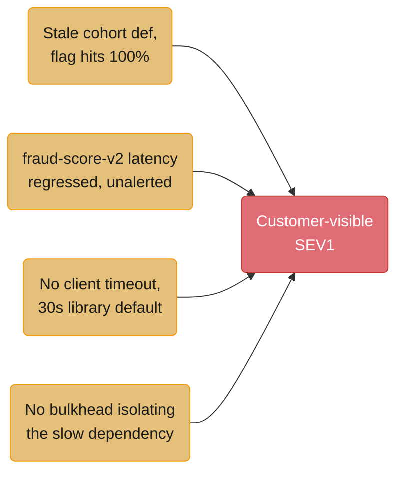

# The SEV1 and Its Postmortem

## Intuition

> **One-line analogy**: The incident channel is triage under a bleeding clock; the status
> page is a contract with strangers; the postmortem is the only artifact that outlives
> either — and all three are written by the same people, minutes apart, in three
> completely different registers.

Meridian Pay processes checkout authorizations for about 3,400 online merchants — a
payments API, not a bank, sitting between a merchant's checkout page and the card
networks. On August 11, 2026, a routine feature-flag rollout took checkout success from
99.95% to a trough of 58% for roughly an hour, cost the company an estimated $823,600 in
abandoned purchases, and burned 27.7% of the entire month's error budget in one incident.
This case study follows the same six people through three registers of writing about the
same 65 minutes: the internal channel where nobody is performing for an audience, the
status page where every sentence is read by a worried CFO at some merchant, and the
postmortem five days later where the job is to make the incident boring enough that it
cannot happen the same way twice. The gap between those three documents — what you say
when you don't know, what you commit to in public, and what you're willing to write down
about your own mistake once the fire is out — is the entire subject.

---

## 1. Situation & Stakes

Meridian Pay's `checkout-router` service sits in the hot path of every transaction: a
merchant's checkout page calls it, it calls a fraud-scoring service and then the card
network, and it returns approve or decline in under 300ms on a good day. It runs about
5,100 requests a minute at the traffic level Meridian sees on a Tuesday afternoon, backed
by 12 replicas behind a load balancer, and it carries a monthly SLO of 99.9% checkout
success measured against roughly 220 million monthly requests — an error budget of about
220,000 failed requests a month, or a little under 8,000 failures a day.

At 14:02 UTC on August 11, a PagerDuty alert fired: checkout success rate under 95% for
five minutes. By 14:30 it had dropped to a trough of 58%. Over the full 65-minute window
before the metric was back above 99.9%, `checkout-router` handled roughly 290,000 checkout
attempts, of which about 61,000 failed — 27.7% of the month's entire error budget consumed
in a single incident, on the 11th day of the month. An estimated 38,400 distinct customers
saw at least one failed checkout. Of those, Meridian's data team later estimated 14,200
never completed the purchase at all — no successful retry, no return visit within 24
hours — at an average order value of $58, for a directly attributable revenue loss of
roughly $823,600.

**The stakes, concretely:**

- A payments company whose entire pitch to merchants is "we don't go down at checkout" had
  gone down at checkout, during business hours, for over an hour.
- One enterprise merchant, Halcyon Outdoor ($340K ARR, a five-year account), had a support
  team that escalated on social media 22 minutes into the incident because the status page
  said only that Meridian was "aware of an issue" — not that checkout was affected, not
  that it was safe to assume retries would eventually work. That merchant opened a churn
  conversation two weeks later, citing the ambiguous status page, not the outage itself,
  as the reason they no longer trusted Meridian's comms.
- The five-person incident response team was going to write a postmortem that would be
  read, eventually, by every engineer at the company, by this quarter's SOC 2 auditor, and
  — because Meridian had disclosed a customer-impacting SEV1 to its board the previous
  quarter — probably by two board members.
- Nobody in the channel in the first ten minutes knew whether this was a database problem,
  a bad deploy, a card-network outage, or a DDoS. The IC's job was to run a good process
  before anyone knew which of those it was.

---

## 2. The People and What Each One Wants

| Person | Role | What they actually want | What they say they want |
|---|---|---|---|
| Marcus Cho | Senior SWE, owns `checkout-router`, primary on-call | To fix it before anyone above him notices, and to not repeat April — a SEV2 six months earlier where he'd been quietly blamed for a slow rollback | "Just let me work" |
| Priya Nair | Staff SRE, Incident Commander on rotation | Control of the process, not the fix — and no surprises from anyone in the channel | "A calm room" |
| Sam Osei | Senior SWE, database on-call | To rule the database out fast and get back to the migration he's mid-way through | "Tell me what you need checked" |
| Dana Okafor | Support & Comms Lead | Status page language that is honest enough to survive a lawsuit and calm enough to survive a CFO reading it | "Something we can stand behind in six months" |
| Tobias Reyes | Engineering Manager, `checkout-router` team | A clean handover at hour three and a team that doesn't associate his name with an all-nighter | "Whatever the IC needs" |
| Lila Fenn | VP of Engineering | To know, in the first hour, whether this is a board-disclosure incident, and to never again find out about a SEV1 from a customer instead of from her own team | "Keep me posted" |

Marcus's stated want and his actual want are the whole hinge of §4. He is good at his job
and has never once, in three years, said out loud in an incident channel "I'm not sure
this is safe" — because the one time he hesitated publicly, in April, a director in the
channel asked "are we sure Marcus is the right person on this," and it stuck. That history
is why he tries a fix without narrating it in this incident, and it is why Priya's response
to that moment (§4) is written the way it is: the fix Marcus almost tried a second time
alone was riskier than restarting a single pod — it was an all-replica simultaneous
restart that would have taken checkout fully offline for the 40–90 seconds it took the
pool to refill, converting a 58%-success incident into a 0%-success one, for a savings of
maybe two minutes over doing it as a rolling restart.

---

## 3. The Approach

The response ran in four phases, and the thing that makes it a good incident rather than a
lucky one is that each phase has a named owner and a named exit condition: **declare and
staff** (get an IC in the seat within four minutes of the page and have that IC do nothing
but coordinate), **investigate under a "narrate before you act" rule** (the rule Marcus
breaks once, at 14:33), **mitigate before you understand** (revert the suspect change and
watch the metric, rather than waiting for full root cause), and **hand off cleanly at the
three-hour mark** rather than letting the same two people run an incident into the night.

```mermaid
flowchart LR
    classDef bad    fill:#e06c75,stroke:#c0392b,color:#fff
    classDef warn   fill:#e5c07b,stroke:#f39c12,color:#1a1a1a
    classDef info   fill:#61afef,stroke:#2e86c1,color:#1a1a1a
    classDef accent fill:#c678dd,stroke:#9b59b6,color:#fff
    classDef good   fill:#98c379,stroke:#27ae60,color:#1a1a1a

    a(Page fires<br/>14:02) --> b(IC declares<br/>SEV1, 14:06)
    b --> c(Investigate,<br/>narrate every move)
    c --> d(Marcus goes quiet,<br/>risky restart, 14:33)
    d --> e(IC intercepts,<br/>redirects, 14:35)
    e --> f(Flag reverted<br/>14:52)
    f --> g(Mitigated,<br/>not resolved, 15:08)
    g --> h(Handover at<br/>hour three, 17:02)
    h --> i(Root cause fixed,<br/>resolved, 17:40)

    class a,d bad
    class c,e warn
    class b,f info
    class g accent
    class h,i good
```



*Caption: the gap between "mitigated" (g) and "resolved" (i) is almost two and a half
hours — the customer-visible pain ends at g, but the incident, and the incident channel,
do not close until the actual cause is fixed and verified, which is the distinction Priya
makes explicit in the transcript below.*

Two decisions shaped everything downstream:

1. **Priya opened the channel by saying what she would not do.** "I am IC. I will not be
   debugging." Said in the first ninety seconds, before anyone had a theory, it heads off
   the single most common IC failure: the most senior technical person in the room reflex-
   ively opens a terminal and becomes another pair of hands instead of the one person
   watching the whole board.
2. **Dana wrote the first status post before anyone had a cause**, because Meridian's own
   internal standard — borrowed loosely from Google's SRE guidance on postmortem
   triggers (§7) — says the first public word goes out within 15 minutes of declaration
   regardless of what is known, and an honest "we don't know yet" beats a confident guess
   that turns out wrong.

See [`incident_communication_and_postmortems`](../incident_communication_and_postmortems/incident_communication_and_postmortems.md)
for the general pattern this case study is a worked instance of, and
[`giving_and_receiving_feedback`](../giving_and_receiving_feedback/giving_and_receiving_feedback.md)
for the SBI framing behind Tobias's one-on-one with Marcus a week later (§10).

---

## 4. The Artifacts and Conversations

### 4.1 The incident channel — `#inc-2118-checkout-5xx` — transcribed in full

```text
[14:02:11] PagerDuty: ALERT - checkout-router success_rate < 95% for 5m
           (current: 71.2%). Paging primary on-call: Marcus Cho (payments).

[14:03:40] Marcus Cho: ack. checkout-router success rate is dropping, pulling up
           dashboards now.

[14:04:52] Marcus Cho: this isn't a blip. 71% and still falling. escalating to IC
           rotation, this needs a second set of eyes.

[14:05:30] PagerDuty: Paging Incident Commander rotation: Priya Nair.

[14:06:15] Priya Nair: on it. Declaring SEV1 - customer-facing checkout impact,
           unknown cause. This channel is now the incident channel.
           I am IC for this incident. I will not be debugging. If you need
           something from me, say my name and ask directly - don't assume I
           saw a message that scrolled past.

[14:06:41] Priya Nair: Marcus, you're Ops lead - you have the keys to
           checkout-router. Anyone else already looking, say so now.

[14:07:02] Sam Osei: joining. I'll check the DB tier, ruling that in or out.

[14:08:15] Priya Nair: Dana - need you for comms. Can you get eyes on the status
           page? We post something within 15 minutes of declare even if we
           don't have a cause. That's the standard, not a suggestion.

[14:08:33] Dana Okafor: on it. drafting now, will paste here before it goes live.

[14:09:47] Marcus Cho: success rate 63%, still sliding slowly. latency on
           checkout-router p99 is up 4x. nothing unusual in our own error logs
           yet - lots of 503s but no stack traces, looks like the requests
           are timing out somewhere downstream, not failing in our code.

[14:11:20] Sam Osei: DB tier looks clean. connection count normal, replica lag
           under 1s, no slow queries in the last 20 minutes. I don't think this
           is us. Will keep watching but leaning "not the database."

[14:13:58] Priya Nair: noted, thanks Sam. Marcus - "timing out somewhere
           downstream" - what does checkout-router call that could be slow
           without showing up as an error in your own logs?

[14:14:22] Dana Okafor: status page post is live. pasting text below.

[14:14:30] Dana Okafor: [STATUS PAGE - INITIAL POST, 14:14 UTC]
           "We are investigating reports of elevated checkout errors affecting
           a subset of transactions. We will post an update within 30 minutes."

[14:16:05] Marcus Cho: checkout-router calls fraud-score-v2 synchronously before
           authorizing. checking its dashboard now.

[14:17:44] Marcus Cho: fraud-score-v2 p99 latency is 640ms, up from a normal
           80ms. that's new - it wasn't like this yesterday.

[14:19:12] Priya Nair: good find. Two questions, out loud, for whoever knows:
           (1) did fraud-score-v2 deploy recently, and (2) does checkout-router
           have a timeout configured on that call, because 640ms shouldn't be
           enough to take us to 58% success on its own.

[14:20:30] Sam Osei: confirming DB tier stays clean, dropping out of active
           investigation, on standby if needed.

[14:24:50] Marcus Cho: fraud-score-v2 deployed yesterday at 16:00 - a model
           update, not obviously related. checking checkout-router's client
           timeout config now.

[14:26:18] Marcus Cho: ...we don't have one. the HTTP client checkout-router
           uses for fraud-score-v2 doesn't set a timeout, so it inherits the
           library default, which is 30 seconds. every slow call is holding a
           thread for up to 30s instead of failing fast.

[14:27:05] Priya Nair: so the thread pool is filling up with stuck calls and
           unrelated requests are getting 503'd once the pool's full. that
           tracks with what you saw at 14:09 - no errors in your own code, just
           timeouts. Marcus, don't fix the timeout live right now - that's a
           deploy, not a mitigation, and we don't have time to test it safely.
           What's the fastest way to take load off fraud-score-v2 or bypass it?

[14:28:40] Marcus Cho: there's a feature flag, fraud_score_v2_sync, that
           controls whether checkout-router calls it synchronously at all. it
           was supposed to be a 5% canary. let me check the targeting.

[14:31:55] Marcus Cho: flag targeting says 100%, not 5%. that's wrong, that's
           the bug. I can flip it.

[14:33:10] Marcus Cho: hold on, changed my mind, restarting all 12
           checkout-router pods right now to clear stuck threads, that's
           faster than waiting on the flag system to propagate.

[14:33:42] Priya Nair: Marcus - stop. Say back to me what "restart all 12"
           does to traffic while it happens.

[14:34:05] Marcus Cho: ...pool drains, no capacity to serve requests until pods
           come back up. maybe 60-90 seconds fully down.

[14:34:20] Priya Nair: right - you'd take us from 58% success to 0% success for
           up to 90 seconds, to save maybe two minutes over the flag revert.
           That's a bad trade during a customer-facing incident. Revert the
           flag first, watch the metric for two minutes. If it doesn't move,
           we talk about a rolling restart with max-unavailable of one pod at
           a time, not all twelve at once. Can you do the flag revert now?

[14:34:55] Marcus Cho: yeah. sorry - should have said what I was doing before
           I did it. flipping fraud_score_v2_sync targeting back to 5% now.

[14:35:10] Priya Nair: no apology needed, just narrate next time before you act,
           not after. that's the one rule. go ahead.

[14:36:02] Marcus Cho: flag reverted, targeting is 5% canary now, not 100%.
           propagating.

[14:38:47] Marcus Cho: fraud-score-v2 call volume dropping. checkout-router
           thread pool utilization coming down.

[14:41:15] Dana Okafor: [STATUS PAGE - UPDATE, 14:44 UTC, drafting before
           posting] "We have identified the cause of checkout errors and have
           applied a mitigation. Checkout success rates are recovering. We
           will post our next update by 15:15 UTC."

[14:44:00] Dana Okafor: that's live now.

[14:47:30] Marcus Cho: success rate 89% and climbing.

[14:52:18] Marcus Cho: success rate 96.8%, holding steady for the last three
           minutes.

[14:55:02] Priya Nair: good. I'm calling this MITIGATED, not resolved. The
           symptom is gone because we turned off the thing that was hurting us
           - we have not fixed the missing timeout on the fraud-score-v2
           client, and we have not fixed the flag-targeting bug that put us at
           100% instead of 5% in the first place. Either one recurring puts us
           right back here. Mitigated means customers stop feeling it.
           Resolved means the actual cause is closed out and we've confirmed
           it can't recur the same way. We are not resolved yet.

[14:56:40] Marcus Cho: got it. I'll start on the client timeout fix now - should
           be a small config change, but I want it code-reviewed and tested,
           not hot-patched, given what just happened.

[15:08:00] Priya Nair: agreed, no more live hot-patches today. Sam, you're
           released from standby, thank you. Dana, hold on the "all clear" post
           - we say mitigated, not resolved, same distinction.

[15:15:00] Dana Okafor: [STATUS PAGE - UPDATE, 15:15 UTC] "Checkout success
           rates have returned to normal levels. We are continuing to monitor
           and will confirm full resolution shortly."

[15:20:10] Priya Nair: Dana, quick gut check before that goes out again later -
           if we have nothing new to say at the next checkpoint, we still post,
           right? Silence after a mitigation reads as "they went home," even
           if we didn't.

[15:20:44] Dana Okafor: right, that's the standard. I'll post a no-news update
           at 16:00 if there's genuinely nothing new.

[16:00:05] Dana Okafor: [STATUS PAGE - UPDATE, 16:00 UTC] "We continue to
           monitor checkout success rates, which remain at normal levels. Our
           engineering team is completing root-cause remediation. Next update
           by 18:00 UTC or sooner if resolved."

[17:00:40] Priya Nair: Tobias - I've been IC for three hours, handing off to you
           per rotation policy. Summary: mitigated at 14:52 UTC by reverting a
           feature flag (fraud_score_v2_sync) that was mistakenly targeting
           100% of traffic instead of a 5% canary. Root cause is two-fold: the
           flag-targeting bug, and a missing client timeout on checkout-router's
           call to fraud-score-v2, which let slow calls exhaust the thread
           pool. Marcus is mid-fix on the timeout, PR up for review, should
           merge within the hour. Customer impact has been at zero since
           14:52. Open items: (1) land and verify the timeout fix, (2) confirm
           the flag-targeting bug in the flag service itself is understood and
           won't silently recur, (3) decide when we call this resolved vs.
           mitigated on the status page. Questions before I hand this off?

[17:01:55] Tobias Reyes: got it, taking over as IC. Confirming: no live
           customer impact right now, we're doing verification and cleanup,
           not firefighting. I'll page you back only if something regresses.
           Thanks Priya - go eat something.

[17:38:20] Marcus Cho: timeout fix (2s client timeout, with a circuit breaker
           on fraud-score-v2 calls) is merged, deployed, and I've verified in
           staging and against 1% of prod traffic that it fails fast instead
           of holding threads. Also confirmed with the flag-service team: the
           targeting bug was a stale cohort definition, they've added a
           validation check so a canary flag can't silently expand to 100%
           without a second approval.

[17:40:15] Tobias Reyes: that closes both open root causes. I'm calling this
           RESOLVED as of 17:40 UTC - not just mitigated. Dana, all-clear post
           whenever you're ready. Nice work, everyone. Thread stays open for
           postmortem scheduling, closing active incident response now.
```

### 4.2 The status page, all four posts, verbatim

**Weak version** (what Dana's first draft looked like, rejected by Priya before it went
live at 14:14):

> We are aware of an issue and are looking into it.

**Strong version** (what actually posted at 14:14, twelve minutes after the page fired):

> We are investigating reports of elevated checkout errors affecting a subset of
> transactions. We will post an update within 30 minutes.

**What changed:** the weak version names no symptom a merchant could match against their
own dashboard and makes no commitment about when they'll hear more. The strong version
says specifically what's degraded (checkout errors, not "an issue"), scopes it honestly
("a subset," since success rate was 71% and falling, not zero), and commits to a concrete
re-check time. It says exactly as much as is known — nothing more — but it says that much
precisely.

The full sequence, in order:

```text
[14:14 UTC - INITIAL]
We are investigating reports of elevated checkout errors affecting a subset of
transactions. We will post an update within 30 minutes.

[14:44 UTC - MID-INCIDENT, COMMITS TO A NEXT-UPDATE TIME]
We have identified the cause of checkout errors and have applied a mitigation.
Checkout success rates are recovering. We will post our next update by 15:15 UTC.

[15:15 UTC - MITIGATED, NOT YET CALLED RESOLVED]
Checkout success rates have returned to normal levels. We are continuing to
monitor and will confirm full resolution shortly.

[16:00 UTC - NOTHING NEW, POSTED ANYWAY]
We continue to monitor checkout success rates, which remain at normal levels.
Our engineering team is completing root-cause remediation. Next update by
18:00 UTC or sooner if resolved.

[17:52 UTC - ALL CLEAR]
This incident is resolved. Checkout success rates were degraded between
14:02 and 15:02 UTC due to a misconfigured internal service call; the
underlying cause has been fixed and verified. We estimate a subset of
customers experienced failed checkout attempts during this window. If you
believe a transaction was affected and did not complete, please contact
support and we will investigate individually. We are sorry for the
disruption this caused to your business.
```

The 16:00 post is the one worth studying hardest, because it has zero new information in
it and gets posted anyway. Meridian's internal standard treats silence after a mitigation
as a comms failure in its own right — a merchant refreshing the status page at 15:50 and
seeing nothing since 15:15 has no way to distinguish "still being watched" from
"abandoned." The post exists to answer a question nobody asked out loud: *is anyone still
looking at this.*

### 4.3 The executive escalation, transcribed

At 14:47 UTC, with success rate climbing but not yet confirmed steady, Priya sent this to
Lila Fenn, VP of Engineering, in a direct message — three sentences, sent before Lila
asked:

```text
[14:47 UTC] Priya Nair -> Lila Fenn (DM):
We had a SEV1 on checkout starting 14:02 UTC, success rate dropped to a
58% trough, currently recovering after a mitigation at 14:52. Root cause
looks like a feature-flag targeting bug plus a missing client timeout,
customer impact ongoing but decreasing, status page has been updated
three times. I'll page you directly if it regresses; otherwise next
update from me by 16:00 or sooner.

[14:49 UTC] Lila Fenn -> Priya Nair (DM):
Understood. One question: has this been publicly visible enough that a
customer might have already emailed their exec team, before we've told
ours?
```

Lila's question is the one worth naming: she is not asking whether the outage is fixed.
She is asking whether Meridian's leadership is about to be surprised by their own
customers before they are briefed by their own staff — which is exactly what happened two
weeks later with the Halcyon Outdoor churn conversation, and it is why the escalation
happens unprompted at 14:47 rather than only after Lila asks.

### 4.4 The postmortem — published August 16, 2026

```text
POSTMORTEM: Checkout Authorization Failures, 2026-08-11
Status: FINAL | Owner: Priya Nair | Reviewed: 2026-08-18
Severity: SEV1 | Customer-Facing: Yes | Postmortem trigger: user-visible
downtime beyond 5 minutes at >5% error rate (per Meridian's postmortem
criteria, adapted from Google's SRE book, "Postmortem Culture" chapter)

SUMMARY
A feature-flag targeting error exposed 100% of checkout traffic to a
synchronous call to fraud-score-v2 (intended: 5% canary) at the same time
fraud-score-v2's own latency had regressed following an unrelated model
deploy the previous day. checkout-router had no client-side timeout on
that call, so slow responses held request threads until the pool was
exhausted, producing 503s for unrelated checkout requests. Checkout
success rate fell from a baseline of 99.95% to a trough of 58% between
14:02 and 15:02 UTC. The incident was mitigated by reverting the flag at
14:52 UTC and resolved by 17:40 UTC once a client timeout and circuit
breaker were deployed and the flag-targeting bug was fixed at its source.

IMPACT
 - Duration of customer-visible degradation: 60 minutes (14:02-15:02 UTC)
 - Checkout attempts during window: ~290,000
 - Failed checkout attempts: ~61,000 (21% average; trough of 42% failure
   rate between 14:25 and 14:45)
 - Distinct customers affected: ~38,400
 - Customers with no successful retry within 24h: ~14,200
 - Estimated lost revenue: $823,600 (14,200 x $58 average order value)
 - Error budget consumed: 61,000 of ~220,000 monthly failure budget
   (99.9% SLO) = 27.7% of the month's entire budget in one incident
 - One enterprise account (Halcyon Outdoor, $340K ARR) opened a churn
   conversation two weeks post-incident, citing status-page ambiguity as
   the specific trigger

TIMELINE (times are UTC; each entry records what was KNOWN at that time,
not what was later found to be true)
 14:02 - Alert fires: checkout success rate <95%. Cause unknown.
 14:06 - SEV1 declared. IC in seat. Cause unknown; database, deploy, and
         network are all open hypotheses.
 14:11 - Database tier checked and provisionally ruled out (connection
         count, replica lag, query latency all nominal). Cause still
         unknown.
 14:14 - Initial status page post. Cause unknown; scope described as "a
         subset of transactions."
 14:17 - fraud-score-v2 latency observed at 8x baseline. Believed related
         but not yet confirmed as causal.
 14:26 - checkout-router's client to fraud-score-v2 found to have no
         configured timeout, inheriting a 30s library default. Believed
         to be the mechanism connecting slow fraud-score-v2 calls to
         checkout-router 503s.
 14:31 - Feature flag fraud_score_v2_sync found targeting 100% of
         traffic against an intended 5% canary. Believed to be the
         trigger that made the latent timeout gap consequential.
 14:52 - Flag reverted to 5% targeting. Success rate began recovering.
         Declared MITIGATED - customer impact ending, contributing
         factors not yet fixed at their source.
 15:02 - Success rate sustained above 99.9% for 10 consecutive minutes.
         Customer-visible impact window closed.
 17:38 - Client timeout (2s) and circuit breaker deployed and verified
         in production against 1% traffic; flag-service team confirmed
         and fixed the stale-cohort bug that allowed 100% targeting.
 17:40 - Declared RESOLVED - both contributing factors closed and
         verified.

CONTRIBUTING FACTORS (plural, deliberately - no single "root cause")
 1. A stale cohort definition in the flag-targeting service allowed a
    flag intended for 5% canary rollout to silently resolve to 100% of
    traffic, with no validation step catching the mismatch between
    intended and actual scope.
 2. fraud-score-v2's p99 latency regressed 8x (80ms to 640ms) after a
    model deploy the prior day; its own alerting was scoped only to its
    direct consumers' dashboards, not to services that called it, so
    the regression produced no alert on its own.
 3. checkout-router's HTTP client to fraud-score-v2 had no configured
    timeout, inheriting a 30-second library default well outside the
    service's own 300ms latency budget - a gap that had existed since
    the integration was built eight months earlier and had simply never
    been exercised under load until this incident.
 4. checkout-router's thread pool had no bulkhead isolating
    fraud-score-v2 calls from the rest of the service's request
    handling, so threads stuck waiting on one slow dependency degraded
    unrelated requests rather than failing in isolation.
 Any one of these four alone would likely not have produced a customer-
 visible incident. It took all four at once.

WHAT WENT WELL
 - IC was in the seat and had declared within four minutes of the page.
 - The database tier was ruled out within nine minutes, narrowing the
   search space early instead of investigating in parallel confusion.
 - The IC intercepted a risky, unannounced mitigation attempt (an
   all-replica restart) before it executed, avoiding what would likely
   have been a brief full outage layered on top of a partial one.
 - The team mitigated (reverted the flag) without waiting for full root
   cause, closing customer impact in under an hour.
 - A clean IC handover occurred at the three-hour mark rather than
   running the same two people past the point of good judgment.
 - The status page posted on schedule even when there was nothing new
   to report at 16:00 UTC.

ACTION ITEMS
 1. Add mandatory client-side timeouts to all synchronous inter-service
    HTTP calls in checkout-router, enforced by a lint rule in CI.
    Owner: Marcus Cho. Due: 2026-08-25. [DONE - shipped 2026-08-18 as
    part of incident mitigation, verified in this postmortem review]
 2. Add a bulkhead (separate thread pool) for calls to fraud-score-v2
    so a slow dependency cannot exhaust checkout-router's main pool.
    Owner: Marcus Cho. Due: 2026-09-05.
 3. Require two-person approval for any feature-flag targeting change
    that widens a cohort beyond its previously approved scope, enforced
    in the flag service itself, not by process alone.
    Owner: flag-platform team (Aisha Verma). Due: 2026-08-29. [DONE]
 4. Extend fraud-score-v2's alerting to include consumer-side latency
    (as seen by checkout-router), not only its own internal dashboards.
    Owner: fraud-platform team (Dev Patel). Due: 2026-09-12.
 5. Revise the status-page initial-post template to explicitly name the
    affected customer-facing symptom (not "an issue") as a required
    field, based on the gap identified with the Halcyon Outdoor account.
    Owner: Dana Okafor. Due: 2026-08-22. [DONE]
```

### 4.5 Four counterfactual rewrites — the language pass on the postmortem draft

Priya's first draft of the timeline and contributing-factors sections used counterfactual
language throughout. Before circulating it, she rewrote every instance she could find.
Each pair below is real: the sentence as first drafted, the sentence as published, and the
line naming what changed.

**1.**
> Draft: "Marcus should have set a timeout on the fraud-score-v2 client when he built the
> integration eight months ago."
> Published: "checkout-router's HTTP client to fraud-score-v2 had no configured timeout,
> inheriting a 30-second library default well outside the service's own 300ms latency
> budget — a gap that had existed since the integration was built eight months earlier."
> **What changed:** the draft names a person and an imagined alternate past ("should
> have"); the published version names a system state and a duration, with no subject who
> failed to act. Both describe the same fact. Only one implies a person to blame.

**2.**
> Draft: "The flag-platform team failed to catch that the cohort definition had gone
> stale."
> Published: "A stale cohort definition in the flag-targeting service allowed a flag
> intended for 5% canary rollout to silently resolve to 100% of traffic, with no
> validation step catching the mismatch."
> **What changed:** "failed to catch" puts the miss inside a person's judgment; "no
> validation step catching the mismatch" puts it inside the system's design. The fix that
> follows from the second framing (add a validation step) is also the actual action item —
> the first framing's implied fix ("be more careful") is not something a postmortem can
> assign to anyone.

**3.**
> Draft: "If Sam had checked the database tier faster, we might have narrowed the search
> space sooner."
> Published: *(removed entirely — not published in any form)*
> **What changed:** this sentence is speculative counterfactual reasoning about a
> different, imagined incident, not a description of what happened in this one. Sam's
> actual check took nine minutes and was, on its own timeline, fast. A sentence that only
> exists to imply a faster hypothetical response was cut rather than softened, because
> softening it would have kept the implication while changing only the words.

**4.**
> Draft: "Priya failed to notice Marcus was about to restart all 12 pods until he'd
> already started typing the command."
> Published: "The IC intercepted a risky, unannounced mitigation attempt (an all-replica
> restart) before it executed, avoiding what would likely have been a brief full outage
> layered on top of a partial one."
> **What changed:** the draft frames a four-second reaction gap as a personal lapse ("failed
> to notice ... until"); the published version describes the outcome (intercepted before
> execution) without narrating the gap as a failure at all, because catching it before
> execution is the actual result that matters, not the interval before catching it.

### 4.6 The postmortem review meeting, transcribed — August 18, 2026, 30 minutes

```text
[Tobias Reyes, facilitating]: Everyone's had the doc for 48 hours. I'm not
going to read it out loud - we're here to find gaps, not to re-narrate.
First question on the floor: does anyone think a contributing factor is
missing?

[Aisha Verma, flag-platform]: I want to flag something about factor 1 -
the stale cohort thing. Our team owns that service and we're the ones
adding the validation check. I don't want this to read like we were
careless; that cohort definition was set correctly eight months ago and
just never got revisited when the canary was supposed to expand on
schedule and didn't.

[Tobias Reyes]: Noted - and looking at the doc, factor 1 doesn't name your
team or use the word "careless" anywhere, it describes a missing
validation step. If you think the wording still reads that way even
without those words, say the sentence and we'll fix it live.

[Aisha Verma]: No, rereading it now, it's fine. I think I reacted to
having lived through it, not to what's actually on the page.

[Dev Patel, fraud-platform]: Question for the room, and I know this isn't
supposed to be how we talk in here, but - if fraud-score-v2's latency
alert had been scoped to consumers from the start, would this have
happened at all?

[Tobias Reyes]: That's a counterfactual, and I'm going to name it as one
rather than answer it, because "would this have happened" isn't
answerable - we don't get a control-group universe to check against. What
we can say, and what's already in the doc as action item 4, is that
consumer-scoped alerting on fraud-score-v2 would very likely have
surfaced the latency regression before the flag bug made it consequential.
That's a forward-looking argument for the fix, not a backward claim about
what would have happened. Different claim, same action item either way.

[Dev Patel]: Fair. I'll take that as a yes on the fix and drop the "what
if."

[Marcus Cho]: I want to say something about the transcript excerpt in
4.1, since it's in the doc verbatim and it's the part where I go quiet
and try the all-pods restart without saying anything. I don't want it
pulled, for the record - I think it's the most useful thing in the whole
postmortem for someone who ends up IC-adjacent during their first SEV1.
I just want to say out loud why I did it, since the doc doesn't
speculate: I've been dinged before for hesitating out loud in an
incident, so I optimized for looking decisive over checking in. That's
on me to unlearn, not on the process to fix.

[Priya Nair]: I'd only push back on "that's on me to unlearn, not on the
process to fix" as an either/or. It's both. You unlearning it helps this
incident; a channel norm where narrating before acting is stated
explicitly by the IC in the first two minutes - which I did here, and
will keep doing - helps every incident, including ones you're not in.

[Marcus Cho]: Take the both. Fair.

[Lila Fenn]: From the exec side - the thing I want on record isn't in the
doc and I don't think it needs to be, but I want the room to hear it: I
was told about this incident by my own engineer, unprompted, forty-five
minutes in, before I had to ask. That's the second time this year that's
happened and it should stay boring. Nothing to fix here, just noting what
"good" looked like so it doesn't quietly stop happening.

[Tobias Reyes]: Noted, and agreed it doesn't belong in the action items -
there's no fix for something that's already working. Last call on gaps
before we close - anyone see a missing contributing factor or an action
item without a real owner and date?

[Dana Okafor]: Action item 5 is mine and it's already done, want to
confirm the date in the doc matches - it says due 2026-08-22, shipped
2026-08-18, doc should probably note that too so it's not read as
overdue by someone skimming later.

[Tobias Reyes]: Good catch, I'll mark it [DONE] with the actual ship date
before this goes final. Anything else? ... Hearing nothing - we're closed.
Doc goes final today, action items tracked in the usual board, review in
six weeks to confirm 2 and 4 landed.
```

---

## 5. Decisions & Tradeoffs

| Decision | Alternative considered | Why this call |
|---|---|---|
| Post the initial status update at 12 minutes with no known cause | Wait until the cause was found, to avoid posting something that might be wrong | An honest "we don't know yet, we're looking" cannot be wrong. Waiting for certainty during a customer-visible outage trades comms-team comfort for customer trust, and the trade goes the wrong way |
| Revert the flag rather than fix the missing timeout live | Hot-patch the client timeout directly, since that's the "real" fix | The flag revert was a single boolean change, instantly reversible, with a known blast radius. A live timeout change is a code deploy under time pressure with no time to test — exactly the condition that produces a second incident inside the first one |
| Intercept the all-pod restart rather than let Marcus finish it | Let the on-call engineer run their own mitigation, since they own the service | Ownership of a service is not the same as sole authority to take an action that risks converting a partial outage into a total one, mid-incident, without saying so first |
| Call it "mitigated" at 14:52 and hold "resolved" until 17:40 | Call it resolved once the metric recovered, since that's what customers feel | Customers only feel the metric. The company still owes itself the discipline of not declaring victory until the actual mechanism (missing timeout, flag bug) is closed, or the same incident recurs on a slower fuse |
| Post a no-news update at 16:00 | Skip it since there was nothing new to say | Silence after "we're mitigated" reads as abandonment to someone checking the status page, which costs trust for the same reason a weak initial post does |
| Cut the Sam-speculative-counterfactual sentence entirely from the postmortem, rather than soften it | Rewrite it in passive voice to sound more blameless | Softening a counterfactual keeps the implied blame while changing the grammar. The sentence had no factual content beyond a hypothetical, so cutting it was the honest option, not rewriting it |

---

## 6. Real-World Parallels

**Etsy, under CTO John Allspaw, is the company most directly responsible for making
blameless postmortems standard industry practice**, formalized in Allspaw's May 2012 Code
as Craft post, "Blameless PostMortems and a Just Culture." Etsy's own postmortem
facilitation guide, published on the same engineering blog, is one of the few public,
detailed templates for how to *run* a review meeting rather than just how to write the
document — the counterfactual-question handling in §4.6 (Dev Patel's "would this have
happened") is a direct application of the facilitator discipline Etsy's guide describes:
name the question type, don't answer the unanswerable version of it.

**Google's SRE organization publishes its postmortem trigger criteria and a full example
postmortem** in the freely available "Site Reliability Engineering" book (O'Reilly, 2016),
chapter "Postmortem Culture: Learning from Failure." Meridian's own trigger — user-visible
downtime beyond a threshold — is adapted from the same public criteria: user-visible
downtime or degradation beyond a threshold, data loss of any kind, and any event requiring
on-call engineer intervention such as a rollback or traffic reroute.

**PagerDuty's public postmortem library and incident-response documentation** are a
frequently cited example of a company running the exact IC/Ops/Comms/Scribe role split
used in this case study's §3 diagram, including the explicit rule that the Incident
Commander does not personally debug.

---

## 7. Frameworks Applied

**Blameless postmortems (Allspaw, Etsy, 2012).** John Allspaw's "Blameless PostMortems and
a Just Culture" argued that a postmortem process which punishes the person closest to a
failure teaches every engineer to hide information rather than surface it, which makes the
organization less safe over time, not more. The four counterfactual rewrites in §4.5 are a
direct, mechanical application of this: the test isn't "does this sentence sound harsh," it
is "does this sentence name a person's should-have instead of a system's actual state."

**Sidney Dekker's Just Culture (2nd edition, Ashgate/CRC Press, 2012) and the "first
story" / "second story" distinction**, developed across *Just Culture* and Dekker's
earlier *The Field Guide to Understanding Human Error*. The "first story" is the
comforting, straightforward account that traces backward from the outcome to find who
should have done what differently — "Marcus should have set a timeout." The "second
story" is the harder, more useful account of the conditions that made the first story's
actions reasonable at the time — a stale cohort definition, an alerting gap scoped to the
wrong consumer, and eight months of the integration simply never being exercised under
this kind of load. §4.4's contributing-factors list and §4.5's rewrites are Meridian
choosing to publish the second story instead of the first.

**Google's SRE book postmortem triggers** (see §6) give Meridian's own trigger criteria —
named explicitly in the postmortem header in §4.4 — a citable, external anchor rather than
an ad hoc internal judgment call about when a postmortem is mandatory.

**Allspaw's "The Infinite Hows" (kitchensoap.com, November 2014)** argues against the Five
Whys technique specifically, on the grounds that a single chain of five "why" questions
converges on one root cause by construction, even when an incident actually has several
independent contributing conditions that happened to line up. The postmortem's own
"CONTRIBUTING FACTORS (plural, deliberately — no single root cause)" header, and its list
of four independent factors rather than one causal chain, is a direct rejection of a
Five-Whys-style single-chain analysis in favor of Allspaw's alternative: multiple,
independently true conditions, each necessary, none alone sufficient.



*Caption: a Five-Whys chain would have followed one branch back from the incident and
stopped at whichever factor happened to be asked about last. All four factors here are
independently true and independently necessary — remove any single one and the incident,
as it actually unfolded, does not happen.*

---

## 8. Playbook

1. **Get an IC in the seat inside five minutes of the page, and have them say, out loud,
   in the first two minutes, what they will not do** — "I will not be debugging" or its
   equivalent. This single sentence is what makes the IC available to catch the moment in
   §4.1 at 14:33.
2. **Post the first public status update on a clock, not on a cause.** Fifteen minutes
   from declaration, whatever is known or not known. "We are investigating" beats silence
   every time; silence gets filled in by the customer's imagination, and their imagination
   is worse than the truth.
3. **Treat "narrate before you act" as a rule, not a preference, and enforce it the moment
   it's broken** — not with blame, with a direct question ("what does this do to traffic
   while it happens") that makes the responder say the risk out loud themselves.
4. **Mitigate before you fully understand.** Reverting the suspect change is not the same
   as knowing why it was wrong; it buys time to find out safely instead of live, under
   pressure, in production.
5. **Say "mitigated," not "resolved," until the actual mechanism is fixed and verified.**
   The two words mean different things and conflating them is how the same incident
   recurs on a slower fuse three weeks later.
6. **Hand off the IC role at a fixed time boundary (Meridian uses three hours), not when
   the current IC happens to run out of steam.** A tired IC three hours in makes worse
   calls than a fresh one reading a five-sentence handover summary.
7. **Post an update even when there's nothing new to say**, on the same commitment
   schedule as the last one, because the alternative — silence — reads as abandonment to
   the person on the other end of the status page.
8. **Rewrite every "should have" / "failed to" sentence in a postmortem draft before it
   circulates**, replacing the imagined alternate past with the actual system state that
   made the real action reasonable at the time. If a sentence is purely speculative about
   a different, imagined incident, cut it rather than soften it.
9. **In the review meeting, name a counterfactual question out loud as a counterfactual
   the moment someone asks one**, and redirect to the forward-looking version the doc can
   actually act on, rather than either answering the unanswerable version or shutting the
   question down.

---

## 9. What Went Wrong & What It Cost

**The specific comms mistake and its cost.** Nothing in the four published status posts
was dishonest, but the *first draft* Dana nearly shipped — "we are aware of an issue and
are looking into it" — is exactly the register that, had it gone out instead of the
revised version, would have told Halcyon Outdoor's support team nothing they could match
against their own dashboard. As it happened, the *actual* 14:14 post was specific enough,
but the 22-minute gap between the incident's onset and any post at all (Dana's draft-then-
revise cycle took four extra minutes beyond the 15-minute internal SLA) was enough for
Halcyon's support lead to post publicly asking whether Meridian was down, before Meridian's
own status page had said so with any specificity. Two weeks later, in a account-health
review, Halcyon's decision-maker named that specific gap — not the outage duration, not the
revenue impact to them — as the reason they no longer trusted Meridian's comms enough to
recommend expanding the contract. The $340K account did not churn; it renewed at the
existing tier instead of the $460K upsell that had been in active discussion, a
$120,000-a-year opportunity cost directly traceable to a comms delay measured in single-
digit minutes.

**Quantified outage cost, restated in one place:**

| Metric | Value |
|---|---|
| Customer-visible degradation | 60 minutes (14:02-15:02 UTC) |
| Time to mitigation | 50 minutes (14:02-14:52 UTC) |
| Time to full resolution | 3h 38m (14:02-17:40 UTC) |
| Checkout attempts during window | ~290,000 |
| Failed checkout attempts | ~61,000 |
| Distinct customers affected | ~38,400 |
| Customers with no successful retry | ~14,200 |
| Directly attributable revenue loss | $823,600 |
| Monthly error budget consumed | 27.7% (61,000 of ~220,000) |
| Opportunity cost from comms-trust gap | $120,000/year (Halcyon upsell not taken) |

**What went wrong that the postmortem does not sugarcoat:** a canary flag was allowed to
silently expand to 100% with no validation step catching it, a dependency's latency
regression produced no alert because alerting was scoped to the wrong consumer, an
eight-month-old integration had a missing timeout that had simply never been exercised
under load, and the mechanism connecting those three to a customer-facing outage was a
missing bulkhead that let one slow dependency degrade an entire service. None of the four
action items in §4.4 assign the fix to "being more careful." All four assign it to a
system change with an owner and a date.

---

## 10. Variations

**If the flag revert hadn't worked.** Had success rate not recovered within the two
minutes Priya asked Marcus to wait, the next escalation was the rolling restart — one pod
at a time, `max-unavailable=1`, watching success rate after each — rather than the
all-at-once restart Marcus almost ran. This is the harder incident: mitigation takes 20-30
minutes instead of 10, the exec escalation in §4.3 happens earlier and with less certainty
in it, and the status page's 14:44 update would have had to say "still degraded, trying a
second mitigation" instead of declaring recovery — a genuinely harder sentence to write
well, because it has to avoid sounding like the first attempt failed due to a mistake
rather than due to reasonable uncertainty about which of two safe options to try first.

**If Sam had found something in the database tier.** The database-ruled-out step at 14:11
closed off an entire branch of investigation early. Had Sam instead found something
ambiguous — elevated but not clearly abnormal query latency, say — the investigation would
have split attention between two live hypotheses simultaneously, and Priya's job as IC
would have shifted from "follow the one thread" to "run two threads in parallel without
either lead losing the room," a materially harder coordination problem that this
particular incident never tested.

**If this had been the second time in a quarter.** Meridian's internal policy escalates a
second SEV1 sharing a contributing factor within 90 days from an engineering-owned
postmortem to a mandatory VP-reviewed remediation plan with weekly check-ins — a much
heavier process than the one shown here. This incident's action items (particularly the
two-person approval on flag targeting) exist specifically to prevent this variation from
becoming real, since the flag-targeting gap is a plausible root cause for a *different*
service's incident down the line if left unfixed platform-wide.

**A smaller version of the same shape.** Not every incident justifies a full IC/Ops/Comms
role split with an exec escalation. Meridian's own severity matrix reserves SEV1 for
customer-visible impact above a defined threshold; a SEV3 with the same shape (a bad flag
targeting a config service, caught before it affected customers) gets a lightweight
five-line incident summary in Slack instead of any of the artifacts in §4 — the discipline
scales down, not just up.

---

## 11. Interview Discussion Points

**Q: What's the first thing an Incident Commander should say when they take command?**
**Short:** State the IC role explicitly and say what you will not do — usually, "I will not be debugging."
Priya's opening line — "I am IC. I will not be debugging." — does two things at once: it
tells the room who has authority to make the call between two mitigation options, and it
pre-commits the most technically capable person in the channel to coordination instead of
hands-on-keyboard work. Without that second half, the natural pull for a senior engineer
running point is to open a terminal and become a fifth pair of hands, which is exactly the
failure mode that would have let the 14:33 restart execute unnoticed. Say it in the first
two minutes, before anyone has a theory, so it isn't read as a comment on anyone's
competence later.

**Q: Why does an Incident Commander interrupt someone mid-fix instead of letting them finish and reviewing after?**
**Short:** Because after the all-pod restart executes, the 60-90 seconds of full outage it causes cannot be undone.
Priya's 14:33 intervention happens before Marcus's command runs, not after, because the
downside — converting a 58%-success incident into a 0%-success one for up to 90 seconds —
is irreversible once triggered. The mechanism she uses is a question, not a command: "say
back to me what this does to traffic while it happens," which makes Marcus articulate the
risk himself rather than simply being told no. That's the difference between an IC
correcting an action and an IC building the habit that prevents the next one.

**Q: What's the difference between calling an incident "mitigated" and calling it "resolved"?**
**Short:** Mitigated means the customer-visible symptom is gone; resolved means the actual cause is fixed and verified.
Mitigated is a statement about what customers currently experience — Meridian's checkout
success rate recovering to 96.8% by 14:52 is mitigated. Resolved is a statement about the
system's internal state — the missing timeout and the flag-targeting bug both being fixed
and verified, which didn't happen until 17:40. Conflating the two is dangerous because a
mitigated-but-unresolved incident can recur through the same untouched mechanism, often on
a shorter fuse the second time since nothing about the underlying gap has changed.

**Q: How do you write a status page post when you genuinely don't know the cause yet?**
**Short:** Name the customer-visible symptom precisely, scope it honestly, and commit to a concrete next-update time.
"We are investigating reports of elevated checkout errors affecting a subset of
transactions. We will post an update within 30 minutes" says exactly three true things: a
specific symptom (checkout errors, not "an issue"), an honest scope ("a subset," matching
the 71%-and-falling reality rather than implying total outage or implying it's minor), and
a concrete commitment. It does not guess at a cause, and it does not need to — a reader
checking their own dashboard against "checkout errors" can self-diagnose whether they're
affected, which is the entire job of the sentence.

**Q: Why post a status update when there's nothing new to report?**
**Short:** Silence after a mitigation reads as abandonment, even when the team is still actively watching.
A customer refreshing the status page at 15:50, seeing nothing posted since 15:15, cannot
distinguish "still being actively monitored" from "the team went home." Meridian's 16:00
"nothing new" post exists purely to answer that unasked question, on the same cadence
promised in the prior update. The cost of posting a repetitive update is a few minutes of a
comms lead's time; the cost of not posting is a customer concluding, incorrectly, that
they've been forgotten.

**Q: What makes a postmortem "blameless" in practice, beyond avoiding the word "fault"?**
**Short:** Replacing every should-have/failed-to sentence with a description of the system state that made the action reasonable.
Blamelessness isn't a tone — it's a specific rewrite discipline. "Marcus should have set a
timeout" becomes "the client had no configured timeout, inheriting a 30-second default, a
gap that existed since the integration was built eight months earlier." Both sentences
describe the same fact. Only the first implies that a competent, careful engineer would
have prevented it, which is rarely true and never provable, and which teaches the next
engineer in Marcus's position to hide a similar gap rather than disclose it.

**Q: Why does the postmortem list four contributing factors instead of one root cause?**
**Short:** Because any one factor alone likely wouldn't have caused customer impact — it took all four together.
This is Allspaw's argument in "The Infinite Hows" applied directly: a Five-Whys-style
single causal chain converges on one answer by construction, which hides the fact that a
stale cohort definition, a wrong-consumer alerting gap, a missing timeout, and a missing
thread-pool bulkhead were each independently present and each individually insufficient to
cause the outage on their own. Naming all four, and fixing all four (§4.4's four action
items), closes more failure paths than naming and fixing only the one that happened to be
last in the chain.

**Q: How should a facilitator handle someone asking "would this have happened if X had
been different" during a postmortem review?**
**Short:** Name it as a counterfactual out loud, then redirect to the forward-looking version the team can act on.
Tobias's handling of Dev Patel's question in §4.6 — "that's a counterfactual, and I'm going
to name it as one rather than answer it" — does not shut the question down, because the
underlying concern (should fraud-score-v2's alerting have been scoped differently) is
legitimate and already has an action item attached to it. What gets refused is only the
unanswerable backward-looking form ("would this have happened"), replaced with the
answerable forward-looking form ("would this fix very likely have caught it sooner") — the
distinction that keeps a review meeting from turning into unfalsifiable speculation.

**Q: An engineer starts a risky, unannounced action mid-incident and stops the moment
you say something. Do you address it in the moment or wait for the retro?**
**Short:** Address it immediately with a direct question, not a rebuke — waiting risks the action completing first.
Priya's "Marcus — stop. Say back to me what this does to traffic while it happens" happens
in real time because the downside of waiting (an irreversible 60-90 second full outage) is
strictly worse than any awkwardness from interrupting. The follow-up matters just as much
as the interruption: "no apology needed, just narrate next time before you act" treats it
as a process gap to close going forward, not a moment to relitigate in the channel — that
relitigation, if it happens at all, belongs in the postmortem review, which is exactly
where Marcus raises it himself five days later.

**Q: Why write "we are sorry for the disruption this caused to your business" in the
all-clear post instead of a purely technical summary?**
**Short:** Because the audience is a merchant's business, not an engineer, and the outage cost them revenue too.
A status page's final post is read by people evaluating whether to trust Meridian with
their checkout flow going forward — not by engineers evaluating technical accuracy. The
all-clear post pairs a precise technical summary (the time window, the cause category,
what was fixed) with a direct acknowledgment of business impact and an offer to
investigate individual affected transactions, because a merchant who lost revenue during
the window needs both the facts and the acknowledgment, and a purely technical post
supplies only the first.

**Q: What's the actual difference between a "first story" and a "second story" in Dekker's framing?**
**Short:** The first story blames a person's choice; the second story explains the conditions that made that choice reasonable.
A first story about this incident is "Marcus should have set a timeout eight months ago" —
comforting, simple, and it stops the investigation at a single person's judgment. A second
story asks why a careful, competent engineer building that integration would not have set
one: no lint rule caught it, no incident had ever exercised the gap, and the library's
default silently absorbed the missing configuration instead of erroring loudly. The second
story is harder to write and less satisfying to read, and it is the only one of the two
that produces an action item (a CI lint rule) instead of a moral.

**Q: How do you decide when a "mitigated" incident should escalate from an
engineering-owned postmortem to a VP-reviewed remediation plan?**
**Short:** By a named policy trigger set in advance, such as a recurring contributing factor within a fixed window.
Meridian's policy escalates when a second SEV1 within 90 days shares a contributing
factor with a prior one — a criterion fixed before any specific incident, the same way
Google's SRE book criteria and Meridian's own trigger for requiring a postmortem at all
are fixed in advance rather than judged case by case. Deciding severity or escalation
level in the moment, under the stress of an active incident, produces inconsistent calls;
a pre-committed threshold removes that judgment call from the pressured moment entirely.

**Q: Why does the postmortem explicitly cut a speculative sentence about a different team member's hypothetical faster response, rather than just softening its wording?**
**Short:** Because softened counterfactual language keeps the implied blame while only changing the grammar.
The draft sentence about Sam's database check speed was pure speculation about an
imagined faster version of an already-fast response; no rewording of it produces a
factual, blameless statement, because there is no underlying system fact to describe —
only a hypothetical comparison. Cutting it, rather than passive-voicing it into something
like "database investigation could conceivably have proceeded faster," is the honest
option, since the passive version still smuggles in the same implicit criticism under
softer grammar.

---
