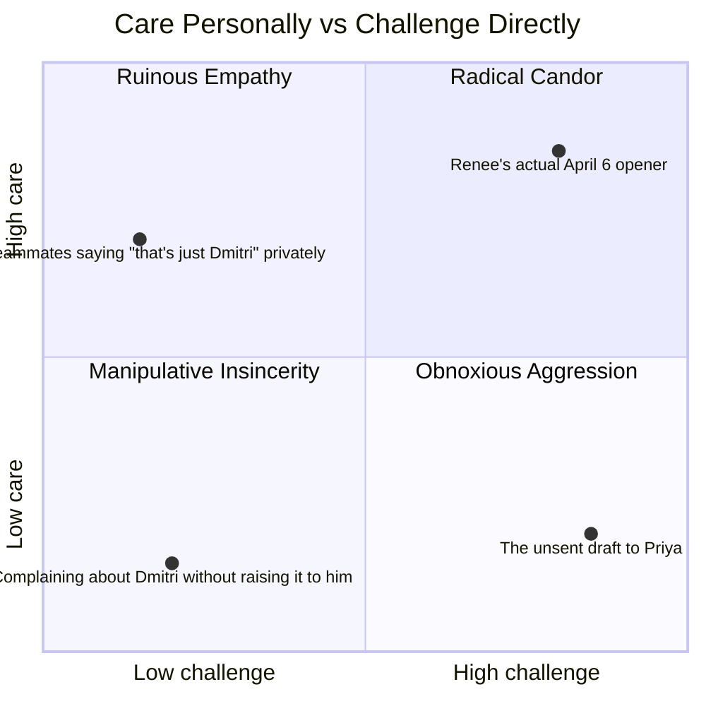

# The Underperforming Teammate

## Intuition

> **One-line analogy**: Ruinous Empathy is a loan against the relationship — every week
> you don't say it, the interest compounds, and the bill eventually comes due as a much
> harder conversation than the one you avoided.

This case study follows Renee Okafor, a Senior Engineer on Meridian Pay's Ledger
Platform team, through six months of watching a well-liked colleague's work quietly cost
the team money and morale, and the eleven weeks it took her to say something, fix what
she could, and escalate what she couldn't. Renee is not Dmitri's manager. Dmitri is
better liked than she is, has been at the company two years longer, and nothing about
this situation gives her formal authority to change anything. Handled badly, this
becomes a story about Renee being difficult. Handled well, it becomes a story about a
service getting a runbook, a review queue getting unstuck, and a manager finding out
about a pattern from the person best positioned to describe it accurately — before it
became six more months of quiet cost.

---

## 1. Situation & Stakes

Dmitri Volkov owns `ledger-service` — the system of record for every balance adjustment
at Meridian Pay, six years old, no full rewrite, moderate complexity, and for the last
two years effectively a one-person domain. He is well-liked: funny in standup, generous
with junior engineers' questions, first to volunteer for the unglamorous on-call swap
nobody else wants. He is also, over the six months from February to August 2026, the
person whose code reviews take an average of 3.4 days to get a first comment (team
median: 6 hours), whose `ledger-service` has no runbook despite being paged on 11 times
in that window, and who has committed to four sprint dates in that period and hit one.

None of this is dramatic on any single day. A review that sits for three days looks like
a busy week. A missed date looks like normal slip. It is only visible as a pattern
because Renee, as the engineer most often blocked by it, started writing dates down in
February — not planning to escalate anything, just because she was tired of not being
able to say precisely how long she'd been waiting when someone asked.

**The stakes, concretely:**

- Renee is not Dmitri's manager. Her standing to raise this comes entirely from being
  specific and being the person directly affected — not from authority.
- Dmitri is well-liked enough that a badly handled complaint reads as Renee being
  difficult, not as Dmitri having a problem. Two people on the team had privately told
  Renee some version of "that's just Dmitri" when she'd mentioned a slow review before.
- `ledger-service` has no runbook. The one time it paged Dmitri and he was unreachable —
  a 40-minute gap during a family emergency in April — a different engineer, David Kim,
  had to reverse-engineer the mitigation from source code during an active incident,
  extending customer impact by an estimated 25 minutes beyond what a runbook would have
  allowed.
- Renee's own two most recent projects were both delayed waiting on Dmitri's review —
  6 days on one PR, 4 on another — pushing her own quarterly deliverable past its date
  and costing her, in her own performance review five months later, a "delivered slightly
  late" note that made no mention of why.
- Six months of nobody saying anything directly to Dmitri had already cost the team, by
  Renee's own later accounting (§9): roughly 96 engineer-hours in review-wait time above
  the team median, one extended customer-impact window, and at least one missed
  promotion case for a different engineer whose project also stalled behind a slow review.

---

## 2. The People and What Each One Wants

| Person | Role | What they actually want | What they say they want |
|---|---|---|---|
| Renee Okafor | Senior SWE, Ledger Platform | The pattern to change without becoming "the person who went after Dmitri" | "Just faster reviews, that's all" |
| Dmitri Volkov | Senior SWE, owns `ledger-service` | To not be singled out, and — underneath that — relief from a workload he has not told anyone is unmanageable | "I've got it handled" |
| Priya Chen | Engineering Manager, Ledger Platform | To find out about a real pattern from a credible source before it shows up in someone's exit interview | "An open door, always" |
| David Kim | Senior SWE, same team | To stop being the one who gets paged into someone else's undocumented system | "Not my problem to fix" |
| Aisha Verma | Staff Engineer, adjacent team | Renee to handle this herself if she can, and clean data if she can't | "Bring me facts, not feelings" |

Dmitri's stated want and his actual situation are not the same thing, and that gap is
most of §4. He is not lazy and he is not coasting — he is quietly carrying an
undocumented, six-year-old system alone, has never said so out loud because saying so
felt like admitting he couldn't keep up with something he built his reputation on, and
has been managing the resulting overload by triaging reviews last, since reviews are the
only part of his job with no page attached to a missed one. Renee does not know this in
February. She learns it in April, in the middle of the first conversation, and the case
study's hardest moment is what she does with that information once she has it — which is
neither to drop the issue out of sympathy nor to hold the line as if she hadn't heard it.

---

## 3. The Approach

Renee's plan had four parts, built roughly in this order over eleven weeks: **separate
observation from conclusion, in writing, before saying anything out loud** (§4.1);
**open with a direct, specific, low-drama ask rather than a permission-seeking
preamble** (§4.2); **let the explanation land without either collapsing into pure
sympathy or ignoring it** (§4.3); **hold the second conversation six weeks later, even
though the easier move by far was to let one visible improvement stand in for the whole
picture** (§4.4); **and, only when direct conversation had run its course, escalate to
Priya — telling Dmitri first, always, before telling his manager** (§4.5).

```mermaid
flowchart LR
    classDef bad    fill:#e06c75,stroke:#c0392b,color:#fff
    classDef warn   fill:#e5c07b,stroke:#f39c12,color:#1a1a1a
    classDef info   fill:#61afef,stroke:#2e86c1,color:#1a1a1a
    classDef accent fill:#c678dd,stroke:#9b59b6,color:#fff
    classDef good   fill:#98c379,stroke:#27ae60,color:#1a1a1a

    a(6 months of<br/>silent pattern) --> b(Evidence log,<br/>Feb-Apr)
    b --> c(First SBI<br/>conversation, Apr)
    c --> d(Dmitri's real<br/>reason surfaces)
    d --> e(Two commitments<br/>made, tracked)
    e --> f(Six weeks pass,<br/>one improves)
    f --> g(Second, harder<br/>conversation)
    g --> h(Told Dmitri first,<br/>then escalated)
    h --> i(Priya owns the<br/>staffing fix)

    class a bad
    class b,c warn
    class d,g accent
    class e info
    class f,h,i good
```



*Caption: the distance between node a and node c — six months to eleven weeks to a first
direct conversation — is the actual cost center in this story. Everything from c onward
took less calendar time than the silence that preceded it.*

Two decisions shaped everything downstream:

1. **Renee wrote down what she observed for two months before saying anything**, not to
   build a case to win an argument, but because she genuinely did not trust her own
   memory of "always" and "never" against what had actually happened. See §4.1 for the
   discipline this took.
2. **She rejected her own first draft of the opening line** — "can I give you some
   feedback?" — after testing it on Aisha, because a question that asks permission to
   say something you have already decided to say either invites a "no" you won't honor,
   or reads as a warning shot that makes the other person defensive before they've heard
   a single specific.

See [`giving_and_receiving_feedback`](../giving_and_receiving_feedback/giving_and_receiving_feedback.md)
for the general SBI pattern this case study is a worked instance of, and
[`difficult_conversations_and_conflict`](../difficult_conversations_and_conflict/difficult_conversations_and_conflict.md)
for the truth/relationship/identity trigger framing behind Dmitri's reaction in §4.3.

---

## 4. The Artifacts and Conversations

### 4.1 The evidence, gathered first — observation beside the interpretation she almost wrote

Renee kept a running note from February 3 to April 6, one line per incident, dated. The
discipline she held herself to: write only what she could point to — a timestamp, a
message, a number — and cut anything that was already a conclusion dressed as a fact.
Two entries, shown with the interpretation she caught herself writing first and struck
out:

```text
2026-02-11
OBSERVED: PR #4021 (my change to ledger-service's balance-reconciliation
job) opened 09:14 Feb 9. First comment from Dmitri: 14:02 Feb 12. Elapsed:
3 days, 5 hours. Team's rolling median first-comment time (per our repo's
review dashboard, last 90 days): 6 hours 10 minutes.

STRUCK: "Dmitri doesn't care about unblocking people."
KEPT INSTEAD: elapsed time, against the team median, nothing else.

---
2026-03-24
OBSERVED: ledger-service paged at 02:11 on 2026-04-02 (reconciliation job
stuck). No runbook exists in the team wiki or the service's README for
this alert. On-call (David Kim, not Dmitri) spent 40 minutes reading
source code to find the mitigation before restoring service. Dmitri
was reachable again at 02:51 and confirmed the fix David had already
applied was correct.

STRUCK: "Dmitri is hoarding knowledge to make himself irreplaceable."
KEPT INSTEAD: the 40-minute gap, the absence of a runbook, and the fact
Dmitri confirmed rather than found the fix - I don't actually know why
the runbook doesn't exist, and I'm not going to write down a motive I
can't support.
```

By April 6, the log held fourteen entries: nine review-latency data points (average 3.4
days against a 6-hour median), three missed-commitment dates (four committed, one hit),
and two incidents where `ledger-service`'s missing runbook extended an on-call response.
Nothing in it used the words "always," "never," "doesn't care," or "lazy." Every line
traced back to something Renee could point to if asked.

### 4.2 The first conversation — April 6, 2026, in full

Renee tested two openers on Aisha Verma before the conversation. The rejected one first:

**Weak opener** (tested, rejected):

> "Hey, do you have a minute? Can I give you some feedback?"

**Why it was rejected:** it asks permission for something Renee had already decided to
say, which puts Dmitri in the position of either declining (awkward, and rarely done) or
consenting to something he now has to brace for before hearing a single specific — the
gap between the question and the actual content does the damage, not the content itself.
Aisha's note back: "you've turned a two-second window into a countdown he has to sit
through. Just say the thing."

**The opener Renee actually used:**

> "Hey — got 20 minutes? I want to walk through something specific about review timing
> on our team, using our own dashboard numbers, and figure out together what's going on."

Full transcript, in Dmitri's office, doors closed, 20 minutes booked:

```text
Renee: Thanks for making time. I want to start with something specific,
not a general impression. In the last two months, nine of my PRs went to
you for review. The team's median time to a first comment, per our repo
dashboard, is about 6 hours. Yours to mine averaged 3.4 days - the
longest was PR 4021, which sat 3 days 5 hours. I'm not asking you to
defend every one individually. I want to understand what's happening,
because it's affecting my ability to hit my own dates.

Dmitri: ...okay. That's a specific number, I wasn't expecting that. Can I
ask where it's from?

Renee: our repo's own review dashboard - I can send you the query, it's
not a private tracker, anyone on the team can pull the same numbers.

Dmitri: fair. Yeah. I don't have a good excuse. I've been meaning to get
to your PRs faster.

Renee: I'm less interested in an excuse than in what's actually going on
- because "meaning to" for two months straight usually means something
structural, not a lapse. Second thing, separate from reviews: I looked,
and ledger-service doesn't have a runbook. It paged in April and David
had to read your source to figure out the mitigation, which took 40
minutes he wouldn't have needed if there'd been a doc.

Dmitri: [pause] Yeah. I know. I've known for a while, honestly.

Renee: Can you tell me what's making both of those hard? Genuinely
asking, not rhetorically.

Dmitri: ledger-service is mine, has been for two years, and nobody else
touches it deeply enough to review it fast even if they wanted to, so
every review lands on me on top of everything else I'm carrying. And the
runbook - every time I sit down to write it I think "I'll just get paged
and fix it faster than documenting it," and then I do get paged, and I
fix it, and the doc still doesn't exist. I haven't told Priya any of this
because it feels like admitting I can't keep up with something I built.

Renee: That's useful, and I believe you. I also want to be straight with
you: knowing why doesn't undo the 40-minute gap in April, or the fact my
last two projects both landed late waiting on you specifically. Those are
both true at once - it's not your fault alone, and it's still costing the
team.

Dmitri: That's fair. What do you actually want from me, concretely?

Renee: Two things, and I want dates on both, not "soon." One: a runbook
for ledger-service's top three alert types - not everything, just enough
that whoever's on-call isn't reading source code at 2am. Two: on my PRs
specifically, a first comment within 24 hours, even if it's just "will
do a full pass by Thursday" - so I'm not finding out on day four that
you haven't started.

Dmitri: I can do both. Runbook by... let's say two weeks, April 20th.
24-hour first-comment starting now, this week.

Renee: Good. I'll check back in with you in about six weeks, not to
audit you, just to see how it's actually going day to day. And - I think
you should tell Priya you're carrying ledger-service alone. Not because
I'm going to, but because "nobody else touches it deeply enough to review
it" is a staffing problem, not a you problem, and she can't fix a
staffing problem she doesn't know about.

Dmitri: ...yeah. I'll think about that.
```

### 4.3 What Renee did with what she learned

Dmitri's explanation was real and partly legitimate: he was carrying a system alone, had
been for two years, and the two failures Renee raised were downstream of an unmanaged
workload, not indifference. The conversation had to survive that fact without going one
of two easy, wrong directions.

**The wrong direction it did not take, version one (collapse into pure sympathy):**

> "Oh, I had no idea, that makes total sense, don't worry about the runbook, I know
> you're swamped, we'll figure something else out."

This would have let the explanation absorb the two concrete asks entirely. Dmitri's
overload is real; it is also not a reason David should have to reverse-engineer a
mitigation during an active page, or a reason Renee's dates should keep slipping. Sympathy
that cancels the ask isn't kindness — it's Ruinous Empathy (§7), and it leaves both
problems exactly where they were.

**The wrong direction it did not take, version two (ignore it entirely):**

> "I appreciate you explaining, but I still need the runbook by Friday and reviews within
> 24 hours starting today, no exceptions."

This would have been true to the asks and false to what Renee had just learned — that the
underlying cause was a staffing gap neither of them could fix from inside this
conversation. Holding the line on two concrete commitments while ignoring the structural
cause entirely would have fixed the symptom Renee could see and left the cause that
produced it untouched, guaranteeing a similar pattern with the next system Dmitri picked
up alone.

**What Renee actually did**, visible in the transcript: she named both truths in the same
breath — "it's not your fault alone, and it's still costing the team" — kept both
concrete asks with dates, and separately, without taking it over herself, named the
staffing gap as something Dmitri needed to surface to Priya, because it was his to raise
and hers to notice, not the reverse.

### 4.4 Six weeks later — May 22, 2026 — the harder conversation

The runbook shipped April 19, a day early, and covered the three alert types Renee had
asked for. Review timing did not hold: of the six PRs Renee sent Dmitri between April 6
and May 22, first comments came in under 24 hours on the first two, then slid back —
2 days, 3 days, 2.5 days, 3 days on the last four. The easy version of this conversation
was to say nothing: one thing had visibly improved, Dmitri had clearly tried, and pointing
out that the other thing had quietly slid back risked reading as ingratitude for real
effort. Renee held it anyway.

```text
Renee: Thanks for the runbook, by the way - it's genuinely good, and
David told me it's already saved him time on a page two weeks ago.

Dmitri: he mentioned that, yeah. Felt good to actually finish it.

Renee: I want to check in on the other thing. First-comment time held for
the first two PRs after we talked, then slid back - 2 to 3 days on the
last four. I want to understand what changed, rather than assume.

Dmitri: ...honestly, the runbook took the two weeks I said it would, and
once it shipped I told myself the hard part was done. I didn't
consciously decide to let reviews slide back, it just happened because
nothing was actively forcing the 24-hour thing the way the runbook had a
hard date.

Renee: That tracks with what you told me in April - the review time was
never really about the reviews, it's still the workload. Did you talk to
Priya, like we discussed?

Dmitri: not yet. I keep meaning to.

Renee: I'm going to be direct: I think that's the actual fix, and I don't
think either of us solving it PR by PR is sustainable for you or for me.
I'm not going to keep having this exact conversation every six weeks. If
review time doesn't hold for real this time, I'm going to talk to Priya
myself - not to get you in trouble, but because a staffing gap that's
been true for two years isn't something I can keep absorbing quietly on
my side either. I'd rather you tell her first, on your terms.

Dmitri: ...I hear you. Give me until end of next week to talk to her. If
I haven't by then, you should go ahead.

Renee: Deal. I'll check with you Friday the 29th either way.
```

This is the harder conversation of the two, not because the words are sharper, but
because it has to hold a colleague accountable for backsliding on a real, tried commitment
without discounting the genuine progress on the other one — and because the easy failure
mode here is silence dressed as generosity, not open hostility.

### 4.5 The escalation to Priya — June 3, 2026

Dmitri did not talk to Priya by May 29. Renee followed through, but not before saying so
to Dmitri directly, in person, the same day she messaged Priya — never after, never as a
surprise.

**What Renee said to Dmitri first, before contacting Priya:**

```text
[June 3, 09:40] Renee, in person: I told you I'd check Friday the 29th -
I didn't, that's on me, it's now Wednesday. Has anything changed since
we talked?

Dmitri: No. I haven't talked to her. I know I said I would.

Renee: Okay. I'm going to message Priya today, like I said I would. I'm
not going to frame it as a complaint about you - I'm going to describe
the pattern and ask her to help staff ledger-service properly, which is
what you told me in April is the actual problem. I wanted you to hear
that from me before you see it land in her inbox.

Dmitri: ...I appreciate you telling me first. I'm not going to pretend
I'm thrilled, but I get why.
```

**The message Renee actually sent to Priya**, that afternoon:

```text
[June 3, 14:15] Renee -> Priya (1:1 request, sent same day):

Priya - want to grab 20 minutes this week about a pattern on the team,
not an urgent problem. Short version: ledger-service has been a
single-owner system under Dmitri for two years, and over the last four
months that's shown up as review turnaround on his PRs running well
above team median (I have the numbers), a missing runbook that extended
an incident in April, and four committed dates in that window with one
hit. I talked to Dmitri directly in April and again in May - he's been
straight with me about the cause, and the runbook issue is fixed. The
review-timing pattern hasn't held, and I think the actual fix is
staffing, which is outside what either of us can solve one-on-one.
Wanted you to have this from me directly, with real numbers, rather than
piecing it together later. Dmitri knows I'm sending this - I told him
this morning.
```

**The escalation that would have been unfair**, written the same afternoon and never
sent — Renee drafted it first, then rewrote it into the message above:

```text
[DRAFT - NOT SENT]
Priya - I need to flag that Dmitri isn't pulling his weight. He sits on
reviews for days, missed almost every date this quarter, and his service
doesn't even have basic documentation. I've tried to be patient but at
this point it's affecting my own performance review and I don't think
it's fair that I'm the one absorbing it.
```

**The difference, named:**

| | Draft (not sent) | Sent |
|---|---|---|
| Conclusions vs. observations | "isn't pulling his weight" — a conclusion about character | Specific numbers: review-time median, dates hit, one dated incident |
| Pattern vs. incident | "sits on reviews for days" — vague, unfalsifiable | "nine PRs, 3.4-day average against a 6-hour median" — a defined, checkable pattern over a defined window |
| Real chance to change, named | Absent — reads as a first report of a grievance | States explicitly that Renee raised it directly twice, that one fix landed, and that the second hasn't held |
| Framing of the ask | Implicitly asks Priya to manage Dmitri differently, unstated | Explicitly names the ask: staffing help, not discipline |
| Whether Dmitri was told first | Not addressed | Stated directly: "Dmitri knows I'm sending this" |

The unsent draft would have landed on Priya's desk as Renee's first word on the subject,
framed entirely as a character judgment, with no acknowledgment that two direct
conversations and one real fix had already happened — which would have made Dmitri's
honest disclosure in April look, retroactively, like it had bought him nothing.

---

## 5. Decisions & Tradeoffs

| Decision | Alternative considered | Why this call |
|---|---|---|
| Log observations for two months before the first conversation | Raise it the first time review latency felt bad | A single slow review is normal variance; a pattern needs enough data points to be credible to both parties, including to Renee herself, who didn't trust her own memory of "always" |
| Open with "got 20 minutes, here's something specific" instead of "can I give you feedback?" | Ask permission first, to be polite | Asking permission for something already decided either invites a "no" that won't be honored or forces the other person to brace before hearing content — it adds anxiety without adding respect |
| Name both the legitimate cause and the two unmet asks in the same breath | Pick one: either accept the explanation and drop the asks, or hold the line and ignore the explanation | Ruinous Empathy (dropping the asks) fixes nothing; ignoring real context damages the relationship and misses the actual fix (staffing) — both truths have to be held at once |
| Hold the second conversation at six weeks, even with one real improvement to point to | Let the runbook's success stand in for the whole picture and let review timing go unmentioned | Silence about the part that slid back, dressed as generosity about the part that improved, is how six more months of the original pattern begins |
| Tell Dmitri in person, same day, before messaging Priya | Message Priya first, tell Dmitri afterward or let him find out | An escalation someone learns about secondhand reads as an ambush regardless of how fair the content is — telling him first is the one non-negotiable move in this whole case study |
| Frame the Priya message around staffing, not character | Frame it around Dmitri's individual performance | The actual cause, confirmed by Dmitri himself, was a two-year-old staffing gap — framing the ask around the true cause gets it fixed; framing it around character gets a difficult conversation with no clear resolution |

---

## 6. Real-World Parallels

**The Center for Creative Leadership's SBI (Situation-Behavior-Impact) model** is the
direct source of the structure in §4.2 and §4.4: name the specific situation, describe
the observed behavior without inference, and state the impact — CCL's extension, SBI-I,
adds a fourth step of asking about **intent**, which is exactly the move Renee makes when
she asks "can you tell me what's making both of those hard?" rather than assuming she
already knows.

**Kim Scott's Radical Candor** (based on her time as a manager at Google and Apple,
published as *Radical Candor: Be a Kick-Ass Boss Without Losing Your Humanity*, 2017,
revised 2019) is this case study's central diagnostic. The framework Renee is actively
avoiding for six months, before February, is Ruinous Empathy — caring about Dmitri
personally without challenging him directly — and the specific harm Scott attributes to
that quadrant, that it is often mistaken for kindness while quietly doing the most damage
of any of the four, is close to exactly what happened on this team: two people privately
telling Renee "that's just Dmitri" instead of anyone saying it to Dmitri.

**Douglas Stone, Bruce Patton, and Sheila Heen's *Difficult Conversations: How to Discuss
What Matters Most*** (Penguin, 1999, updated 2010) frames every hard conversation as
three simultaneous conversations — What Happened, Feelings, and Identity — and the
authors' finding that most of the damage in a difficult conversation comes from treating
only the "What Happened" layer while the other two run unaddressed underneath is directly
visible in Dmitri's identity-level admission in §4.2 ("it feels like admitting I can't
keep up with something I built") — a sentence that has nothing to do with review latency
numbers and everything to do with identity.

---

## 7. Frameworks Applied

**SBI and SBI-I (Center for Creative Leadership).** Situation-Behavior-Impact structures
both conversations in §4: a specific situation (nine PRs, a defined window), an observed
behavior (average 3.4 days to first comment, no inference about motive), and a stated
impact (Renee's own dates slipping, David's extended on-call response). The SBI-I
extension — asking about intent — is what turns the first conversation from a one-way
statement into the exchange that surfaces the actual cause; without "can you tell me
what's making both of those hard," Renee would have left the room with a commitment and
no understanding of why the pattern existed, which is exactly why it partially recurred
by May.

**Radical Candor's four quadrants (Kim Scott).** Care Personally / Challenge Directly
defines Radical Candor, the quadrant Renee is aiming for in both conversations. The other
three name the failure modes this case study is built to avoid: **Obnoxious Aggression**
(challenging without caring — the unsent draft in §4.5, stripped of its "Dmitri knows I'm
sending this" line, would edge toward this register), **Ruinous Empathy** (caring without
challenging — six months of teammates saying "that's just Dmitri" privately instead of to
him, and the specific failure mode this entire case study exists to demonstrate avoiding),
and **Manipulative Insincerity** (neither — the version where Renee complains about
Dmitri to other teammates but never to Dmitri or Priya directly, which is closest to what
was actually happening before February).



*Caption: the two failure modes this case study is built to avoid sit in the left column —
low challenge, regardless of how much care is present. Renee's actual opener sits in the
upper right: specific and direct, and delivered because she was invested in Dmitri
succeeding, not despite it.*

**The three conversations (Stone, Patton, Heen).** The "What Happened" conversation is
the review-latency numbers and the runbook gap — the layer both parties can point to and
check. The "Feelings" conversation is mostly Renee's, and mostly unspoken in the
transcript itself: frustration at slipping dates, discomfort at being the one to raise it,
relief when Dmitri doesn't get defensive. The "Identity" conversation is Dmitri's, and it
surfaces explicitly — "it feels like admitting I can't keep up with something I built" —
which is the sentence that tells Renee this was never really about laziness, and which
is why the conversation in §4.2 does not simply end once the two concrete asks are made.

**Truth, relationship, and identity triggers (a framing used alongside the three
conversations to describe why feedback lands badly on the receiving end).** Dmitri's
brief defensiveness at "I don't have a good excuse" is a mild truth trigger (a reaction
to the content itself); his volunteering "I've known for a while, honestly" moves past it
quickly because Renee's numbers were specific enough to leave little room to contest the
facts. The identity trigger is the deeper one, and it is what actually explains why the
runbook and the review-timing commitment did not both hold equally — writing the runbook
was a bounded task with a clear finish line; sustaining a review-time standard required
Dmitri to keep treating his own overload as visible and nameable, which is the part his
identity was resisting.

---

## 8. Playbook

1. **Log observations, not conclusions, before you say anything.** Write down what you
   can point to — a timestamp, a number, a message — and strike anything that is already
   an interpretation ("doesn't care," "lazy," "hoarding"). If you can't support a line
   with something concrete, cut the line, not just the word.
2. **Skip the permission-seeking preamble.** "Can I give you some feedback?" turns a
   two-second window into a countdown the other person has to sit through before hearing
   any content. Open with what you actually want to talk about.
3. **Bring your own data, and name where it came from.** A shared dashboard number is
   harder to dispute and easier to discuss than a private tally — and volunteering the
   source before being asked signals you're not hiding how you built the case.
4. **Ask about intent, not just impact, once you've stated the impact.** "What's making
   this hard?" asked genuinely, after the specifics are on the table, is what surfaces
   the real cause — skip it and you'll get compliance without understanding, which rarely
   holds.
5. **When the explanation is legitimate, hold both truths in the same sentence.** "It's
   not your fault alone, and it's still costing the team" is not a contradiction — it's
   the only accurate description of a situation with a real structural cause and a real
   ongoing cost.
6. **Come back at a fixed interval, not just once.** Six weeks, named explicitly in the
   first conversation, is what makes the second conversation possible without it reading
   as ambush or grudge-holding — both people know it's coming.
7. **Don't let one visible improvement excuse silence about what didn't hold.** The
   runbook shipping on time doesn't cancel the review-timing slide; naming both, in the
   same follow-up, is harder than picking the easy half but is the only honest version.
8. **Never let someone learn about an escalation secondhand.** Tell the person, in
   person, the same day, before you send anything to their manager — this is close to a
   hard rule rather than a judgment call, because the alternative reliably converts a
   legitimate concern into a trust violation regardless of how accurate the concern was.
9. **Frame the escalation around the actual cause, not around character.** If the
   evidence points to a structural problem (staffing, scope, tooling), say that — a
   character-framed escalation invites a character-level response, which is much harder
   to act on than a staffing decision.
10. **Draft the unfair version on purpose, then don't send it.** Writing the version that
    leads with conclusions and omits the two prior conversations makes the gap between it
    and the honest version visible in a way that just "trying to be fair" in your head
    often doesn't catch.

---

## 9. What Went Wrong & What It Cost

**What six months of silence had already cost, before the first conversation happened, by
Renee's own later accounting:**

| Cost | Estimate |
|---|---|
| Review-wait time above team median, across the team, Feb-Aug (9 of Renee's PRs plus 6 more from two other engineers who separately raised similar delays to Priya after the June escalation) | ~96 engineer-hours |
| Extended on-call incident response (the April page, no runbook) | 25 minutes of added customer-impact time on a single incident |
| Renee's own delivery date slip, directly attributable to review wait | 6 days on one deliverable, noted in her performance review as "delivered slightly late" with no context recorded |
| A second engineer's promotion packet, delayed one cycle because a project central to the packet stalled behind the same slow-review pattern | One full promotion cycle (6 months) |
| Team-wide informal cost | at least two engineers privately telling Renee "that's just Dmitri" rather than raising it themselves — a norm of quiet tolerance that, left unaddressed, would have kept compounding |

**What went wrong that this case study does not sand down:** Renee did not raise this in
February, when the pattern was already visible in the data she was quietly logging — she
raised it in April, after two more months of the same cost accruing, partly because she
was genuinely unsure whether she had standing to say anything as a peer, and partly
because "that's just Dmitri" from two colleagues had made her doubt whether the pattern
was really as consequential as her own numbers said it was. The eleven weeks from the
first conversation to the escalation were handled well; the two months before it — where
the evidence existed and nobody, including Renee, acted on it — were not free, and the
96-hour figure above includes real cost accrued during exactly that gap.

**The specific moment that mattered most for trust, and what it would have cost to skip:**
telling Dmitri in person on June 3, the same day the message went to Priya. Renee's own
estimate, stated to Aisha afterward, was that skipping that conversation — sending the
Priya message first and letting Dmitri find out secondhand — would have cost the working
relationship entirely, regardless of how fair the message's content was, and would likely
have made Dmitri defensive with Priya in a way that obscured the actual staffing problem
rather than surfacing it clearly.

---

## 10. Variations

**If Renee had been Dmitri's manager instead of a peer.** The evidence-gathering
discipline in §4.1 and the SBI structure in §4.2 would be identical — but the available
moves would widen considerably: a manager can set an explicit performance expectation
with a formal follow-up date, adjust workload directly rather than only naming the
staffing gap for someone else to fix, and involve HR if the pattern persists past a
second conversation. As a peer, Renee's only lever past the second conversation was
escalation — which is why telling Dmitri first before escalating carries so much more
weight here than it would from a manager, who has standing to raise concerns through
formal channels without it reading as a betrayal of peer trust.

**If Dmitri's explanation in §4.2 had not been legitimate** — if he had simply said "I've
been busy, I'll try to do better," with no structural cause behind it. The conversation
in §4.3 would have looked different: Renee's asks would have stayed the same, but there
would be no staffing gap to name to Priya later, and the escalation in §4.5 would have
been framed around a genuine performance concern rather than a structural fix — a harder,
more adversarial version of the same case study, and the one where Radical Candor's
warning about Obnoxious Aggression becomes the live risk instead of Ruinous Empathy.

**If the second conversation in §4.4 had shown no improvement on either front.** Renee's
plan, stated but untested in this run, was to escalate immediately rather than waiting a
third cycle — a pattern that fails to hold even once after an explicit, dated commitment
is a materially different signal than a pattern that partially holds, and the case for
escalating earlier gets stronger, not weaker, the second time a specific commitment goes
unmet.

**A version where the well-liked colleague is also the most senior person in the room.**
Meridian's own staff-plus guidance (see
[`staff_plus_archetypes`](../staff_plus_archetypes/staff_plus_archetypes.md)) notes that
raising a performance pattern about someone more senior than you carries a materially
different risk profile — the standing question shifts from "does Renee have the
authority to say this" to "will raising this be read as challenging someone the
organization has already invested authority in" — which argues for an even higher bar on
evidence quality and an even more explicit framing around structural cause rather than
individual failing.

---

## 11. Interview Discussion Points

**Q: You're not someone's manager, but their work is affecting your team. How do you raise it?**
**Short:** Log specific, checkable observations first, then open directly with a specific ask, not a character judgment.
Standing to raise a peer performance concern comes from being specific and being directly
affected, not from formal authority. Gather dated, checkable observations — a review
turnaround number against a team median, a missed date, a documented gap — before saying
anything, then open the conversation with the specific pattern and a concrete ask rather
than a vague complaint. The goal is a conversation the other person can engage with
factually, not a verdict they have to either accept or defend against.

**Q: Why is "can I give you some feedback?" often a worse opener than just giving the feedback?**
**Short:** It asks permission for something already decided, forcing the other person to brace before hearing any content.
The question creates a gap between the ask and the content: the other person either has
to decline (rare, and awkward) or consent to something unspecified, which builds
anticipatory anxiety with no offsetting benefit. A better opener states what the
conversation is actually about — "I want to walk through something specific about review
timing" — so the first sentence a person hears is information, not a warning.

**Q: What is Ruinous Empathy, and why is it described as the most common failure mode among managers who think they're being kind?**
**Short:** Caring about someone personally while staying silent about a problem, which lets the problem compound uncorrected.
Kim Scott's Radical Candor framework names Ruinous Empathy as caring personally without
challenging directly — sparing someone's short-term feelings at the cost of the thing
they actually need to hear. It is the most dangerous of the three failure quadrants
specifically because it feels like kindness while doing damage. Two colleagues privately
telling Renee "that's just Dmitri" for months, instead of saying it to Dmitri, is Ruinous
Empathy in its most common workplace form — reserved for someone else instead of
withheld from the person who could act on it.

**Q: The person you're giving feedback to explains a real, legitimate reason for the problem. Do you drop the ask?**
**Short:** No — hold both the legitimate cause and the original ask in the same conversation, without collapsing either.
A legitimate explanation changes what the fix should target, not whether a fix is needed.
Renee's "it's not your fault alone, and it's still costing the team" holds two things
true simultaneously: Dmitri's overload is real, and the runbook gap and review delays
still have real costs that need addressing. Dropping the ask entirely out of sympathy is
Ruinous Empathy under a different name; ignoring the explanation entirely risks Obnoxious
Aggression. Both truths belong in the same sentence.

**Q: Six weeks later, one thing improved and one didn't. Do you bring up the one that didn't, or let the visible win stand?**
**Short:** Raise the part that slid back explicitly — silence about it, dressed as generosity, lets the pattern quietly return.
Praising the improvement while staying quiet about the regression feels considerate in
the moment but functions as another round of Ruinous Empathy: it lets the harder half of
the original commitment erode without anyone naming it. The harder, correct move is to
acknowledge the real win specifically and then ask directly what changed on the part that
slipped, treating both as worth a straight answer.

**Q: What's the one non-negotiable step before escalating a peer's performance to their manager?**
**Short:** Tell the person directly, in person, the same day — never let them learn about it secondhand.
An escalation someone discovers secondhand reads as a betrayal regardless of how accurate
or fair its content is, and that reaction tends to overwhelm the substance of the concern
in the ensuing conversation. Telling the colleague first — what you're going to say, and
that you're saying it — is what keeps the escalation about the pattern instead of about
the ambush.

**Q: How do you frame an escalation so it reads as a real problem report instead of a complaint?**
**Short:** Lead with specific numbers and a defined window, name the structural cause, and state what's already been tried.
Renee's message to Priya names a checkable pattern (nine PRs, 3.4-day average against a
6-hour median), a specific incident with a quantified cost, the fact that two direct
conversations already happened, which one fix landed, and an explicit ask framed around
staffing rather than character. Each of those elements is what separates a report Priya
can act on immediately from a complaint she has to first investigate to even understand.

**Q: What's the practical difference between escalating a pattern and escalating a single incident?**
**Short:** A pattern is a defined trend across a stated window with numbers behind it; an incident is one event.
"He missed a date" is an incident and largely unactionable on its own — everyone misses a
date occasionally. "Four committed dates in four months, one hit, against a team baseline
you can show" is a pattern, and it is the pattern, not any single missed date, that
justifies raising the issue at all. Confusing the two either overreacts to a single bad
week or underreacts to a real trend hiding behind normal-looking individual events.

**Q: What are the three conversations happening underneath a difficult conversation, per Stone, Patton, and Heen?**
**Short:** What Happened, Feelings, and Identity — and most damage comes from addressing only the first.
The "What Happened" conversation is the surface facts — who did what, whose account is
right. The "Feelings" conversation is the emotional layer usually left unspoken. The
"Identity" conversation is about what the situation implies about who someone is — "am I
competent, am I a good person." Dmitri's "it feels like admitting I can't keep up with
something I built" is the Identity conversation surfacing directly, and it's the sentence
that explains why a purely factual approach to the review-timing pattern would not, on
its own, have produced a lasting fix.

**Q: How do SBI and SBI-I differ, and why does the extra "I" matter here?**
**Short:** SBI states situation, behavior, and impact; SBI-I adds asking about intent to open a two-way conversation.
The Center for Creative Leadership's base SBI model — Situation, Behavior, Impact —
delivers clear, specific, one-way feedback. The SBI-I extension adds a question about
intent, turning the exchange into a dialogue rather than a verdict. Renee's "can you tell
me what's making both of those hard?" is the SBI-I step, and it's the single question
that surfaces the actual cause — without it, the conversation ends at two commitments with
no understanding of why the pattern existed, which is exactly why the review-timing half
partially recurred six weeks later.

**Q: You draft an escalation message and it feels harsh. How do you tell if it's actually unfair, or just direct?**
**Short:** Check whether it states observations or conclusions, a pattern or a single incident, and whether the person had a real chance to change.
The unsent draft in this case study fails on all three counts at once: "isn't pulling his
weight" is a conclusion, not an observable fact; "sits on reviews for days" describes no
defined pattern or window; and it omits that two direct conversations and one real fix had
already happened, making a genuine attempt look, retroactively, like it changed nothing.
Rewriting toward specific numbers, a named window, and an explicit account of what's
already been tried turns a character judgment into a report someone else can act on.

**Q: Why escalate around a structural cause (staffing) rather than the individual's performance, when the individual's behavior is what you actually observed?**
**Short:** Because fixing the named cause fixes the pattern; fixing the person's attitude, if that isn't the real cause, fixes nothing.
Once Dmitri confirmed the underlying cause was an unstaffed, single-owner system rather
than indifference, framing the escalation around his individual performance would have
targeted the wrong variable — even a fully engaged, highly motivated engineer would
struggle to sustain fast reviews while solely owning a paged production system. Naming
the actual cause is what lets Priya act on the actual problem instead of having a
disciplinary conversation that would not change the workload underneath it.

---
