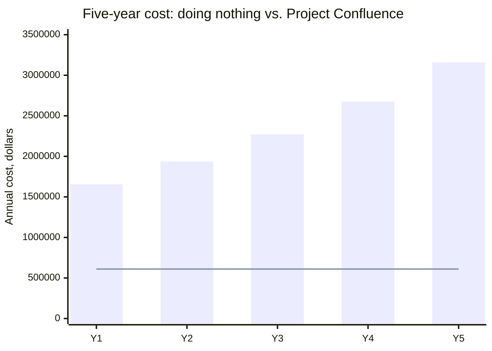

# Translating a Platform Bet to the CFO

## Intuition

> **One-line analogy**: An engineer pitching "technical debt" to a CFO is describing a
> debt in a currency the CFO's ledger does not accept — the fix is not to argue louder,
> it is to change currencies.

Lumen Metrics, Inc. — the same 450-engineer, $180M-ARR observability company from
[Saying No to a VP](saying_no_to_a_vp.md) — runs three data pipelines that all do
variations of the same job: move event data from ingest to somewhere useful. Two run on
a paid vendor. The third is a single engineer's Python script. This case study follows
Priyanka "Pri" Rao, a Staff Engineer on the Data Platform team, through two attempts to
get an eighteen-month, $1.82M platform investment approved — the first attempt, argued
correctly in engineering language, that went nowhere for two quarters, and the second,
argued in the CFO's own units, that got a decision in one meeting.

---

## 1. Situation & Stakes

Lumen's data platform moves roughly 40 million unique metric series a day (see
[Saying No to a VP §1](saying_no_to_a_vp.md#1-situation--stakes)) into three separate
places: a billing and usage-metering pipeline, a product-analytics pipeline, and the
training pipeline that feeds the Anomaly Copilot ML model. The first two run on
**PipeStream**, a managed data-pipeline vendor, metered by volume. The third is a Python
ETL script written three years ago by an engineer who has since moved teams; it is
maintained, informally, by whichever engineer is on-call when it breaks.

**The numbers behind "this is obviously correct to engineering":**

- PipeStream costs **$1.4M this year**, and has grown roughly **20% year over year**
  along with Lumen's own ingest volume — it is not a flat line, it is a line that tracks
  the thing Lumen's own product success makes bigger.
- The homegrown ML pipeline costs an estimated **$95K/year in engineering maintenance
  time** and caused **four data-quality incidents last year**, each delaying an Anomaly
  Copilot model retrain by an average of nine days — call the incident cost **$40K each**,
  **$160K/year**.
- Project Confluence — one internally-owned streaming platform replacing all three —
  is scoped at **18 months, 5 engineers**, with an ongoing run cost roughly **60% lower**
  than what the three systems cost combined today, and a run cost that does not scale
  with ingest volume the way PipeStream's metered fee does.

**Why it is unfundable as first argued.** Pri's first attempt, in Q1 2026, described this
correctly as an architecture problem: fragmented systems, technical debt, a bus-factor
risk, a chance to improve developer velocity. Owen Marsh, Lumen's CFO, heard it, said it
sounded reasonable, and shelved it — not because he disagreed, but because nothing in the
pitch was denominated in anything he could compare against the three other asks already
competing for the same Q4 budget: a $2.1M EMEA data-residency region, a $1.8M mobile app
rebuild, and $1.5M in new enterprise sales headcount. Two quarters passed. The second
attempt, in Q3, used the same facts and got a decision in one 30-minute meeting.

---

## 2. The People and What Each One Wants

| Person | Role | What they actually want | What they say they want |
|---|---|---|---|
| Owen Marsh | CFO | A defensible, comparable case for every dollar of Q4 budget, across four competing asks | "Walk me through the number, not the architecture" |
| Nadia Sultan | Finance Business Partner | To not be blindsided by a number in the room that she hasn't pre-checked | To review the model before it reaches Owen |
| Pri Rao | Staff Engineer, Data Platform | The project funded on its actual merits, not killed by a translation failure | To be taken seriously as someone who understands the business, not just the pipeline |
| Marcus Chen | VP Engineering | A win he can point to with Owen, and cover for sponsoring an 18-month bet | "Whatever gets this funded" |
| The three competing asks (EMEA region, mobile rebuild, sales headcount) | — | Their own budget, unaffected by Pri's pitch | Not present in the room, but their dollar figures are |

Owen's stated want and his actual want are close together here, which is different from
[Saying No to a VP](saying_no_to_a_vp.md), where Renata's real constraint was hidden. Owen
is not hiding anything — he genuinely cannot compare "reduces technical debt" against
"$2.1M EMEA region, which unlocks $4M of blocked EU enterprise pipeline." His job is
literally to rank dollar-denominated bets against each other, and an unpriced bet cannot
be ranked. It defaults to the bottom of the list, indefinitely, which looks like a "no"
but is actually a translation failure wearing a "no" costume.

---

## 3. The Approach

```mermaid
flowchart LR
    classDef bad    fill:#e06c75,stroke:#c0392b,color:#fff
    classDef warn   fill:#e5c07b,stroke:#f39c12,color:#1a1a1a
    classDef info   fill:#61afef,stroke:#2e86c1,color:#1a1a1a
    classDef accent fill:#c678dd,stroke:#9b59b6,color:#fff
    classDef good   fill:#98c379,stroke:#27ae60,color:#1a1a1a

    a(Q1: engineering-<br/>language pitch) --> b(Shelved,<br/>no decision)
    b --> c(Two quarters pass,<br/>cost compounds)
    c --> d(Q3: rebuilt in<br/>finance language)
    d --> e(One-page brief<br/>sent ahead)
    e --> f(30-minute<br/>CFO meeting)
    f --> g(Two hard<br/>questions)
    g --> h(Phase-1 rescope,<br/>smaller yes)

    class a bad
    class b,c warn
    class d,e info
    class f,g accent
    class h good
```



*Caption: the same facts travel the whole arc — only the currency they're argued in
changes between node a and node d, and that single change is the difference between
"shelved" and "decided in one meeting."*

Pri's second attempt followed three rules Marcus insisted on after the Q1 failure, all
borrowed directly from [business_and_finance_vocabulary](../business_and_finance_vocabulary/business_and_finance_vocabulary.md):

1. **Every claim gets a number, and every number gets a unit Owen already uses** — dollars,
   percent of gross margin, months of payback, not "significant" or "dramatic."
2. **Lead with the ask, not the architecture.** Owen does not need to understand Kafka to
   approve $1.82M; he needs to understand what it buys and what it costs to not buy it.
3. **Prepare for the two questions every CFO asks and nobody schedules time to prepare
   for**: what happens if we wait, and what's the cheapest version that still works. Pri
   prepared for the first. Pri did not prepare for the second, and it showed.

---

## 4. The Artifacts and Conversations

### 4.1 The engineering-language pitch (verbatim) — what Pri sent Owen in Q1 2026

```text
PROJECT CONFLUENCE: CONSOLIDATING OUR DATA PIPELINES
Pri Rao, Data Platform -- Q1 2026 planning doc, excerpt sent to Owen Marsh

Our current data pipeline architecture is fragmented across three
disconnected systems, creating significant technical debt. The billing
and analytics pipelines depend on PipeStream, a third-party vendor that
limits our ability to customize transformation logic and locks us into
their release cadence. Meanwhile, the ML training pipeline for Anomaly
Copilot is a brittle, single-engineer-maintained script that represents
a serious bus-factor risk and blocks us from iterating quickly on model
improvements.

By building a unified internal streaming platform, we can dramatically
improve developer velocity, reduce the operational burden of maintaining
three disparate systems, and establish an architecturally clean
foundation for future data products. This is exactly the kind of
foundational investment that separates companies that scale gracefully
from those that don't.
```

**Owen's actual response, forwarded back through Marcus a week later:** *"This sounds
reasonable, I don't have a way to prioritize it against the region and the mobile
rebuild right now — let's revisit later in the year."* Not a no. Not a yes. A pitch with
no unit Owen could rank.

**Why each sentence failed, specifically:**

| Sentence | Why it fails for a CFO |
|---|---|
| "fragmented... creating significant technical debt" | Technical debt is not a line on any financial statement; "significant" has no unit to compare against a dollar-denominated ask |
| "limits our ability to customize... locks us into their release cadence" | A flexibility complaint with no cost attached — Owen cannot price what "limited customization" is worth |
| "brittle, single-engineer-maintained... serious bus-factor risk" | Reads as a staffing gap, which sounds solvable by hiring one more engineer for $180K, not an 18-month, $1.8M program |
| "dramatically improve developer velocity" | "Dramatically" and "velocity" are both unitless — nothing here can sit in the same model as a $2.1M region ask with a defined revenue unlock |
| "architecturally clean foundation for future data products" | This is option value the pitch never prices, and it signals more money will be asked for later against a foundation nobody has seen yet |
| "the kind of foundational investment that separates companies that scale gracefully" | An assertion with no comparable named and no number attached — a mission statement wearing a business case's clothes |

### 4.2 The finance-language pitch (verbatim) — what Pri sent Owen in Q3 2026

```text
PROJECT CONFLUENCE: THE FINANCIAL CASE
Pri Rao, Data Platform -- Q3 2026, sent ahead of the Sep 25 meeting

Project Confluence turns a $1.4M/year vendor line -- growing 20%
annually with our own ingest volume -- plus roughly $255K/year in
unbudgeted engineering toil and incident cost, into one $610K/year
internally-run platform whose cost does not scale with volume the same
way. Fully loaded, including an 18-month build and a four-month
parallel-run cutover, the total cash outlay is $1.82M.

At a 10% discount rate, this is NPV-positive by $4.47M over five years,
and it pays back in 19 months -- about a month after the build itself
finishes. Every year we do not do this, the number we are walking away
from compounds at roughly 20%, which is the vendor's own growth rate,
not ours to control.
```

Same fifteen facts as the Q1 version. Every noun in it is either a dollar amount, a
percentage, or a number of months.

### 4.3 The arithmetic, shown in full

**Status quo — cost of doing nothing, five years, vendor fee growing 20%/year:**

```text
Year   PipeStream (20%/yr)   Homegrown maint.  Incident cost   Total do-nothing
Y1     $1,400,000            $95,000           $160,000        $1,655,000
Y2     $1,680,000            $95,000           $160,000        $1,935,000
Y3     $2,016,000            $95,000           $160,000        $2,271,000
Y4     $2,419,200            $95,000           $160,000        $2,674,200
Y5     $2,903,040            $95,000           $160,000        $3,158,040
```

**Build cost — upfront, at project start (Year 0, undiscounted since it lands immediately):**

```text
Build:      5 engineers x 18 months = 7.5 engineer-years x $180,000
            loaded cost/engineer-year                       = $1,350,000
Migration:  4-month parallel-run cutover -- PipeStream fee
            continues while the new platform is already live
            and being validated against it (the cost every
            model like this forgets to add)              = $  467,000
                                                    TOTAL  = $1,817,000
```

**Ongoing run cost — internal platform, modeled flat across the 5-year horizon** (people
$270K + infrastructure $340K = $610,000/year; flat because the platform is provisioned
with headroom, unlike PipeStream's per-GB metering, which is the entire point):

```text
Year 1-5 ongoing run cost, each year: $610,000
```

**Annual savings (do-nothing cost minus build-option ongoing cost):**

```text
Year   Do-nothing      Build option    Savings
Y1     $1,655,000      $610,000        $1,045,000
Y2     $1,935,000      $610,000        $1,325,000
Y3     $2,271,000      $610,000        $1,661,000
Y4     $2,674,200      $610,000        $2,064,200
Y5     $3,158,040      $610,000        $2,548,040
```

**NPV at a 10% discount rate over five years:**

```text
Year   Savings        Discount factor (1/1.10^n)   Discounted savings
Y1     $1,045,000     0.9091                        $  950,000
Y2     $1,325,000     0.8264                        $1,095,041
Y3     $1,661,000     0.7513                        $1,247,922
Y4     $2,064,200     0.6830                        $1,410,072
Y5     $2,548,040     0.6209                        $1,582,220
                                    Sum, discounted  $6,285,255

NPV = -$1,817,000 (upfront, Year 0, undiscounted) + $6,285,255
    = +$4,468,255  (roughly +$4.47M over five years)
```

**Payback period (undiscounted, simple):**

```text
Upfront outflow:           $1,817,000
Year 1 savings:             $1,045,000  -> cumulative $1,045,000 (short $772,000)
Year 2 savings:              $1,325,000, or ~$110,417/month
$772,000 / $110,417/month ≈ 7 months into Year 2

Payback ≈ 12 + 7 = 19 months from project start
```

A reader can check every line above: the do-nothing column compounds PipeStream at 20%
and holds the other two costs flat; the build option is a flat $610K/year against a
$1.817M upfront; the discount factors are 1/1.10^n for n = 1..5; NPV is the discounted
savings minus the undiscounted upfront outlay; and payback is the month at which
cumulative undiscounted savings first exceeds the upfront outlay.

### 4.4 The one-page brief, verbatim

```text
TO: Owen Marsh, CFO
FROM: Priyanka Rao (Staff Eng, Data Platform), Marcus Chen (VP Eng)
RE: Project Confluence -- decision requested by October 3

THE ASK
Approve $1.82M in build and migration spend, over 18 months, to replace
our PipeStream vendor contract and our single-engineer ML data pipeline
with one internally-owned streaming platform.

THREE FACTS
1. PipeStream costs $1.4M this year and grows ~20%/year with our own
   ingest volume -- doing nothing does not hold this cost flat, it
   grows it.
2. Our ML training pipeline for Anomaly Copilot is maintained by one
   engineer and caused four data-quality incidents last year, each
   delaying a model retrain by an average of nine days.
3. The internal platform's run cost is $610K/year, flat -- it does not
   scale with ingest volume the way the vendor fee does.

COST
$1.82M total cash outlay (build + a 4-month parallel-run cutover),
against a status-quo cost curve of $1.66M this year rising to $3.16M in
year five.

RETURN
NPV +$4.47M over five years at a 10% discount rate. Payback in 19
months -- about a month after the build itself finishes.

RISK
Migration risk during the 4-month parallel-run window; mitigated by
running both systems side by side and only cutting over once outputs
match for 30 consecutive days.

DECISION REQUESTED BY: October 3, ahead of Q4 budget lock.
```

### 4.5 The meeting, transcribed

```text
[Owen's conference room -- Thursday, Sep 25, 2026, 2:00 PM -- 30 minutes
booked. Present: Owen Marsh (CFO), Nadia Sultan (Finance Business
Partner), Marcus Chen (VP Eng), Pri Rao]

Owen:  I read the one-pager, thanks for keeping it to a page. Walk me
       through the number, not the architecture.

Pri:   PipeStream is $1.4M this year, growing about 20% a year with our
       own ingest volume. Add the homegrown pipeline's maintenance and
       incident cost and status quo is $1.655M this year, rising to
       $3.16M in year five if we do nothing. The build is $1.82M
       upfront, all-in with a four-month cutover, and the internal
       platform runs at $610K a year afterward, flat. At your 10%
       hurdle rate, that's NPV-positive by $4.47M over five years, and
       it pays back in 19 months.

Owen:  Good. Two questions. First -- what happens if I just tell you to
       come back in a year.

Pri:   Delay doesn't freeze that $1.655M, it compounds it -- waiting a
       year doesn't save us the $1.82M, it adds roughly another $1.66M
       of vendor and incident spend before we've even started, and it
       pushes the whole discounted return out a year, which costs us
       about $950K of the $4.47M NPV just from the wait. Whatever we
       decide, delay isn't free. It's just the option with no line item
       on anyone's budget.

Owen:  Fair, that tracks. Second one -- what's the cheapest version of
       this that gets us most of it. The 80% version.

Pri:   [pause] Um -- I mean, we could probably scope it down, maybe
       do... I'd have to look at which pieces we could cut, I don't
       have that broken out in front of me right now.

Nadia: [neutral] Is there a phase you could stand up first and defer the
       rest?

Pri:   Probably, yeah, I just haven't priced it that way.

Owen:  [not hostile] That's fine, that's homework, not a no. Get me a
       phased number by Friday and we'll talk about it again. I want to
       say yes to something here, I don't know yet if it's this whole
       $1.82M in one shot.

Marcus: We'll have it to you Friday.

Owen:  [standing] The rest of the doc is clean, by the way -- the
       "delay compounds it" line is the one I'll remember out of this
       whole meeting.

       [meeting ends -- 22 minutes]
```

**What went well and what didn't, honestly.** The "what happens if we do nothing"
question was handled well because Pri had rehearsed it — the do-nothing column in §4.3
existed specifically so this question had a number ready, not an adjective. The "cheapest
80%" question was handled badly, and it is the more predictable of the two: any CFO
weighing a request against three other asks is going to ask what a smaller version costs,
the same way an engineer reviewing a design doc asks "what's the MVP." Pri had priced one
option — the full build — and had nothing else in the room. Owen did not penalize the gap
in the meeting, but the gap was real, and it cost a second round trip that a scoped
alternative, prepared in advance, would have closed in the same meeting.

### 4.6 The follow-up that turned "not yet" into a smaller yes

```text
Subject: Project Confluence -- Phase 1 proposal (revised ask)
To: Owen Marsh, Nadia Sultan
Cc: Marcus Chen

Owen, Nadia --

Per Thursday's meeting, here's the phased version.

PHASE 1 (requesting approval now): Migrate the two PipeStream-hosted
pipelines -- billing/usage metering and product analytics -- onto the
internal platform. Leaves the ML training pipeline on its current
homegrown script for now.
  Upfront: $1.36M ($1.01M build + $350K migration)
  Ongoing: $460K/year
  Retires the full $1.4M/year PipeStream contract
  Payback: under 18 months
  Does NOT resolve: the $255K/year homegrown-pipeline cost or its
  four-incidents-a-year risk to Anomaly Copilot retraining

PHASE 2 (revisit at the Q1 2027 budget review, contingent on Phase 1
tracking to its savings target): migrate the ML training pipeline off
the single-engineer script and onto the same platform.
  Incremental cost: ~$460K (build + smaller migration)
  Resolves the remaining $255K/year cost and the bus-factor risk

This gets PipeStream off the books in full for $460K less upfront cash
than the combined ask, with Phase 2 reviewed against real numbers from
Phase 1 rather than projections. Happy to walk through the split in
more detail if useful before Friday.

Pri
```

Owen approved Phase 1 the following Monday, inside the October 3 deadline, with Phase 2
formally deferred to the Q1 2027 review rather than rejected. Nadia's one condition,
added in her reply: Phase 1's actual run cost gets reported against the $460K/year model
every month for the first two quarters, so Phase 2's case in Q1 is built on measured
numbers instead of another projection.

---

## 5. Decisions & Tradeoffs



*Caption: the bars are the status-quo cost, compounding at PipeStream's 20% growth rate;
the line is Project Confluence's flat $610K/year run cost once the $1.817M upfront is
spent. The gap between them, discounted, is the $4.47M NPV.*

| Option | Upfront | Ongoing/yr | 5-yr NPV @10% | Payback | What's still unresolved |
|---|---|---|---|---|---|
| Do nothing | $0 | grows 20%/yr | — (baseline) | — | Bus-factor risk, incident cost, growing vendor fee |
| Full build (both pitches, same project) | $1.82M | $610K flat | +$4.47M | 19 months | Nothing — full scope |
| **Phase 1 only (approved)** | $1.36M | $460K | not fully recomputed; retires full vendor fee | under 18 months | ML pipeline's $255K/yr and bus-factor risk, deferred to Phase 2 |

The number that actually moved Owen was not the $4.47M NPV — it was the single sentence
that reframed "no decision yet" as a cost rather than a neutral default: delay was never
free, it was simply the one option with no line item anyone had written down.

---

## 6. Real-World Parallels

- **Dropbox's Magic Pocket migration** off Amazon S3, completed in 2016, is a real,
  publicly disclosed build-vs-buy reversal at the scale this case study models in
  miniature: Dropbox's 2018 S-1 filing disclosed savings of approximately **$75 million
  over the two years following the migration** — $39.5M in 2015-2016 (a $92.5M reduction
  in third-party data-center costs offset by $53M in new owned-infrastructure spend) and
  a further $35.1M in 2017. It is the same shape as Project Confluence: a metered vendor
  bill that scaled with the company's own growth, replaced by an owned platform whose
  cost curve was flatter. [GeekWire, "Dropbox saved almost $75 million... building its
  own tech infrastructure," 2018.]
- **37signals (Basecamp)'s cloud exit**, announced by CTO David Heinemeier Hansson
  starting in 2022, is the same argument run at a much smaller company: after spending
  roughly **$3.2M/year on AWS**, they bought about **$600K of owned Dell hardware** and
  projected saving **over $7M across five years** (later revised upward toward $10M),
  reporting the cloud bill down to roughly **$1.3M/year** by late 2023. [Basecamp,
  "Leaving the Cloud," basecamp.com/cloud-exit; DataCenterDynamics, 2023-2024 coverage.]
  The parallel that matters here is not the dollar figure, it is the sequencing: DHH's
  public case is argued entirely in cash outlay, ongoing run cost, and a stated payback
  horizon — never in "architectural cleanliness" — which is the same translation Pri had
  to make between §4.1 and §4.2.
- **The FinOps Foundation's 2026 State of FinOps report** found cloud waste rose to
  **29%** of spend industry-wide, reversing a five-year downward trend, while adoption of
  **unit-economics metrics** (cost per transaction, cost per customer) reached **49%** of
  organizations, up from 40% the year before. Framing PipeStream's cost as "dollars per
  GB processed" rather than a flat vendor line is exactly this practice — it is what
  makes visible that the vendor's bill scales with Lumen's own success while the internal
  platform's does not. [data.finops.org, State of FinOps 2026.]
- **US GAAP's internal-use software rules (ASC 350-40)** let a company capitalize
  certain software-development costs incurred during the "application development
  stage" rather than expensing them immediately — which is why Nadia's review, not
  shown in the transcript, included a note that a portion of the $1.35M build cost could
  be capitalized rather than hitting opex in year one, changing how the project reads on
  Lumen's income statement without changing the cash spent.

---

## 7. Frameworks Applied

- **TCO (Total Cost of Ownership).** TCO alone compares $1.82M-then-$610K/year against
  a growing $1.4M+/year vendor line, but a TCO comparison with no benefit side is, per
  [business_and_finance_vocabulary §4.3](../business_and_finance_vocabulary/business_and_finance_vocabulary.md),
  "a weak standalone decision tool" — it says the internal option is cheaper but not
  whether it is cheaper *enough*, soon *enough*, to beat the other three asks for the
  same budget. TCO set up the comparison; it did not close the decision.
- **NPV and the discount rate.** The $4.47M five-year NPV at a 10% discount rate is the
  number that actually closes the decision, because it is the only one that accounts for
  the time value of money and produces a single figure directly comparable to the
  revenue unlock behind the EMEA region ask. Raising the discount rate to a riskier 15%
  hurdle (a reasonable stress test for an unproven internal build) would still leave this
  NPV-positive, which is worth checking before presenting a number this large — see §11.
- **Payback period.** Nineteen months mattered to Owen as a risk gut-check independent of
  the NPV — a positive NPV with an eight-year payback is a much harder sell to a CFO
  managing near-term cash than the same NPV paid back in under two years. Payback cannot
  distinguish "barely profitable, fast" from "hugely profitable, fast" the way NPV can;
  the two numbers answer different questions and both were needed in the room.
- **Opportunity cost.** This is the single framework that answered Owen's first hard
  question. "What happens if we wait a year" has no answer in a spreadsheet that only
  models the build option — it requires explicitly pricing the do-nothing path as its own
  option with its own cost, which is what let Pri say delay costs roughly $950K of the
  NPV rather than "it would be worse to wait."
- **Capex vs. opex.** This framework helped Finance, not Pri's pitch directly — ASC
  350-40's software-capitalization rules meant part of the $1.35M build cost could be
  capitalized and depreciated rather than expensed immediately, which changed how the
  project affected Lumen's reported opex in year one without changing the $1.82M cash
  decision Owen was actually making. Conflating the two — as the misuse example in
  [business_and_finance_vocabulary](../business_and_finance_vocabulary/business_and_finance_vocabulary.md)
  warns against — would have overstated how much the accounting treatment actually
  changes.
- **FinOps unit economics.** Reframing PipeStream's bill as a cost-per-GB metric, rather
  than a flat annual number, is what made the 20%-growth assumption defensible instead of
  asserted — the vendor's own pricing model is volume-based, so projecting Lumen's own
  20% YoY ingest growth onto it is a direct, checkable extrapolation rather than a guess.

---

## 8. Playbook

1. **Translate every claim into a unit the reader already uses.** A CFO uses dollars,
   percentages, and months; "significant," "dramatic," and "brittle" are not currencies.
2. **Lead with the ask, then three facts, then cost, then return, then risk, then a
   date.** The one-pager's order is not arbitrary — it answers "what do you want," "why,"
   "how much," "is it worth it," and "what could go wrong," in the order a reader deciding
   between four competing asks actually needs them.
3. **Show your arithmetic, not just your conclusion.** A reader who can check "$1.4M
   growing 20%/year" against the year-five figure of $2.9M trusts the $4.47M NPV more
   than one who is asked to take it on faith.
4. **Prepare for "what if we wait" as its own priced option**, not a rhetorical aside —
   it is close to the single most common CFO question about any multi-year investment.
5. **Prepare a cheaper, smaller version before the meeting, not after.** "What's the
   cheapest 80%" is exactly as predictable as "what happens if we wait," and only one of
   them was ready in this transcript.
6. **State the discount rate and the horizon out loud.** An NPV with no stated rate is not
   a number, it is a claim; stating "10%, five years" invites exactly the kind of scrutiny
   that makes the number more credible, not less.
7. **Price the thing everyone forgets: the overlap.** The four-month parallel-run cutover
   cost $467,000 that a naive "vendor bill stops the day we cut over" model would have
   missed entirely.
8. **When a "no" is really "not sized right," rescope instead of re-pitching the same
   number.** Phase 1 was not a smaller ask presented as a concession — it was the same
   arithmetic applied to a smaller, still fully-priced, scope.
9. **Let Finance's own reporting cadence become the proof for the next ask.** Nadia's
   condition — report Phase 1's actual run cost monthly — turns Phase 2's future pitch
   into a comparison against measured numbers instead of another projection.

---

## 9. What Went Wrong & What It Cost

**What the Q1 engineering-language pitch cost.** It was not rejected — it was shelved,
which is a slower and more expensive failure than a clean no, because nothing forced a
decision either way. Two quarters passed with the pitch sitting in "revisit later." In
that window, PipeStream's cost grew on its normal 20% trajectory — roughly $140,000 of
additional spend that a decision six months earlier would have started avoiding sooner.
More costly: in Q2 2026, Lumen lost a competitive deal with Cascade Foods, a $600,000 ARR
prospect, specifically because a rival observability vendor could demonstrate real-time
anomaly correlation in a live bake-off — the same category of pipeline-latency problem
Anomaly Copilot's correlation engine depends on (see
[Saying No to a VP §1](saying_no_to_a_vp.md#1-situation--stakes)), and one that Lumen's
fragmented, vendor-metered pipeline could not match on data freshness. The Q1 pitch was
not wrong about the underlying problem; it simply never got funded in time to matter for
that deal. Between the extra vendor spend and the lost deal, the two quarters of delay
cost Lumen conservatively **$740,000** and hand a competitor a proof point sales reps
still hear about in later cycles.

**What the fumbled "cheapest 80%" question cost.** Nothing catastrophic — Owen's response
was patient, and the Friday follow-up closed the gap within days rather than months. But
it cost a full week of calendar time and a second round trip that a prepared phased
option would have folded into the same 22-minute meeting, and it is the kind of gap that,
asked by a less patient stakeholder, reads as under-preparation rather than an honest "let
me check." The lesson generalizes past this specific meeting: **any pitch above a
threshold that competes with other asks should arrive with a phased fallback already
priced**, the same discipline [Saying No to a VP](saying_no_to_a_vp.md) applies to having
a three-option memo ready before a scope conversation starts.

---

## 10. Variations

- **If Owen had asked for the cheapest 50%, not 80%** — a much smaller foothold, say
  migrating only the billing/usage-metering pipeline — the honest answer is that the
  project's NPV degrades faster than its scope shrinks, because the $467K parallel-run
  migration cost is largely fixed regardless of how many pipelines move; a 50% option
  likely would not have cleared payback inside 24 months, and the honest pitch says so
  rather than shading the number to look better.
- **If the discount rate had been 15%, not 10%** — a reasonable stress test for an
  unproven internal build versus a known vendor — the five-year NPV would fall
  meaningfully but stay positive; presenting that sensitivity unprompted, rather than
  waiting to be asked, is a stronger version of this pitch than the one in §4.5.
- **If PipeStream's fee were flat instead of growing 20%/year**, the entire "what happens
  if we wait" answer collapses — waiting would cost only the ongoing $255K/year of
  homegrown-pipeline toil, not a compounding vendor line, and the urgency argument would
  need to rest entirely on the bus-factor and incident risk instead.
- **If this were a smaller, reversible bet** — say a $150K one-quarter experiment instead
  of an 18-month platform build — NPV and payback would be overkill; a simple
  cost-benefit estimate and a defined stop condition would be the right-sized argument,
  and building a five-year discounted model for it would itself be a sign of misjudging
  the decision's actual shape.
- **If Owen had said no outright, with no path to a smaller yes** — the correct next
  step is not to re-pitch the same number louder, but to ask what would have to be true
  for this to rank above the other three asks, and revisit at the next budget cycle with
  that specific gap closed, rather than the same document resent on a timer.

---

## 11. Interview Discussion Points

**Q: Why did the engineering-language pitch fail even though every sentence in it was
true?**
**Short:** It used no unit a CFO could compare against competing dollar-denominated asks.
"Technical debt," "brittle," and "dramatically improve velocity" are accurate
descriptions with no currency attached, so a CFO ranking this against a $2.1M region ask
with a defined revenue unlock has nothing to rank it by — it defaults to the bottom of the
list indefinitely, which looks like a no but is really an untranslated pitch. The fix
was not new facts, it was denominating the same facts in dollars, percentages, and
months.

**Q: What is TCO, and why is it a weak argument on its own?**
**Short:** TCO totals ownership cost but says nothing about time value or whether cheaper is cheaper soon enough.
Total Cost of Ownership compares the full cost of two options over their lifetime, but a
TCO comparison with no benefit side and no time value of money can show one option is
cheaper without showing whether it is cheaper *enough*, *soon* enough, to beat other
uses of the same capital. In this case study, TCO established that Project Confluence
was cheaper than the status quo; NPV is what proved it was cheaper by enough, discounted,
to justify $1.82M in cash today.

**Q: What is NPV, and why does the discount rate matter to the answer?**
**Short:** NPV discounts future cash flows to today's dollars; a higher rate shrinks the value of later years.
Net Present Value sums future cash flows after discounting each one back to today's
dollars at a rate representing the return available elsewhere, then subtracts the
upfront cost. At Lumen's 10% rate, Project Confluence's five-year NPV is +$4.47M; raising
the rate to a riskier 15% would shrink that figure because it discounts the later,
larger years of savings more heavily — stating the rate explicitly, rather than leaving
it implicit, is what lets a CFO trust or challenge the number on its own terms.

**Q: What is the payback period, and why isn't a fast payback the whole answer?**
**Short:** Payback is the time to recover the upfront cost; it ignores everything that happens after.
Payback period is the point at which cumulative savings first exceed the upfront outlay —
19 months here. It is a useful risk gut-check independent of NPV, because a CFO managing
near-term cash cares how fast money comes back regardless of the ultimate return. But
payback cannot distinguish a barely-profitable fast payback from a hugely-profitable
one, which is why NPV and payback were both presented rather than either alone.

**Q: How do you answer "what happens if we do nothing for a year"?**
**Short:** Price doing nothing as its own option and show that delay compounds cost rather than freezing it.
The honest answer requires modeling the status-quo cost as its own line, not treating
"wait" as a free, neutral default — in this case, PipeStream's 20% annual growth meant a
year of waiting added roughly $1.66M of additional spend before the build even started
and pushed the discounted return out a year, costing about $950K of the total NPV. The
gotcha interviewers listen for is whether the candidate treats delay as costless or
prices it explicitly.

**Q: The CFO asked for "the cheapest 80%" and the engineer didn't have it ready. What
should they have done differently, and how should they have handled the moment itself?**
**Short:** Pre-scope a smaller option before the meeting, and in the moment admit the gap plainly and commit to a date.
The predictable fix is preparation: any pitch that competes with other budget asks should
arrive with a phased, still fully-priced fallback already built, the same way a
three-option memo should exist before a scope negotiation. In the room, the honest move
that actually worked was admitting the number wasn't ready and committing to a specific
return date — bluffing a made-up figure would have cost more credibility than the honest
gap did.

**Q: What is capex vs. opex, and how did it apply to this build?**
**Short:** Capex is a capitalized asset depreciated over time; opex is expensed immediately, and US GAAP rules can split a build cost between them.
Capital expenditure buys an asset whose value is spread over its useful life; operating
expenditure is expensed in the period it's incurred. Under US GAAP's internal-use
software rules (ASC 350-40), a portion of a build like Project Confluence's $1.35M
engineering cost can be capitalized rather than expensed immediately, changing how the
project reads on the income statement without changing the $1.82M cash decision itself —
conflating the accounting treatment with the underlying cash reality is a common,
correctable mistake.

**Q: What did the parallel-run migration cost, and why does that cost usually get left
out of a build-vs-buy model?**
**Short:** $467,000 for four months of paying the vendor fee while the new system already runs, easy to omit if only steady-state costs are modeled.
Most build-vs-buy comparisons naively assume the vendor bill stops the instant the new
system exists, when in practice both systems have to run side by side while output is
validated — here, four months of continued PipeStream billing while the internal
platform was already live and being checked against it. Naming and pricing that overlap
explicitly, rather than letting it hide inside a rounding error, is what keeps the total
upfront figure ($1.817M) honest.

**Q: What is FinOps unit economics, and how did it strengthen this specific pitch?**
**Short:** It ties spend to a business unit like cost-per-GB, making a vendor's growth-linked pricing visible and checkable.
Unit economics reframes a cost as a rate — dollars per transaction, per customer, or in
this case per gigabyte processed — rather than a flat annual figure, which the FinOps
Foundation's 2026 State of FinOps report found roughly half of organizations now use to
tie spend to outcomes. Framing PipeStream's bill this way made the 20% year-over-year
growth assumption a direct, checkable extrapolation of the vendor's own metered pricing
against Lumen's known ingest growth, rather than an asserted number nobody could verify.

**Q: How do you handle a pitch that has to compete against several other asks for the
same pool of money?**
**Short:** Denominate the ask in the same units as every competing ask so the decision-maker can rank them directly.
The comparison only works if every option is priced the same way — dollars of upfront
cost, dollars of return, months of payback — which is exactly what the engineering-
language pitch failed to do against the EMEA region ask's defined revenue unlock. Naming
the competing asks explicitly, rather than pretending the budget is unlimited, also signals
to the decision-maker that the pitch understands it is one of several real tradeoffs, not
the only thing in the room.

**Q: What is the single biggest structural difference between the engineering-language
pitch and the finance-language pitch, given that both describe the same project?**
**Short:** The finance version replaces every unitless adjective with a dollar figure, a percentage, or a month count.
Both versions describe the identical eighteen-month build with the identical scope; the
only change is that "significant technical debt" becomes "$1.4M growing 20%/year," and
"dramatically improve velocity" becomes "NPV +$4.47M, payback 19 months." Nothing about
the underlying engineering changed between Q1 and Q3 — only the currency the argument was
made in, which is the entire lesson of this case study.

**Q: Why send the one-page brief ahead of the meeting instead of presenting it live for
the first time in the room?**
**Short:** It lets the reader arrive with questions instead of spending the meeting absorbing the ask cold.
A CFO reading the brief beforehand can pre-check the arithmetic with their own team —
which is exactly what Nadia's review did — and arrive ready to interrogate the number
rather than spending scarce meeting time simply understanding what is being asked. It
also signals the pitch is confident enough to be scrutinized in advance, rather than
timed to be persuasive only in the room.

---
