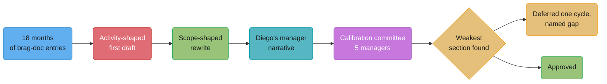
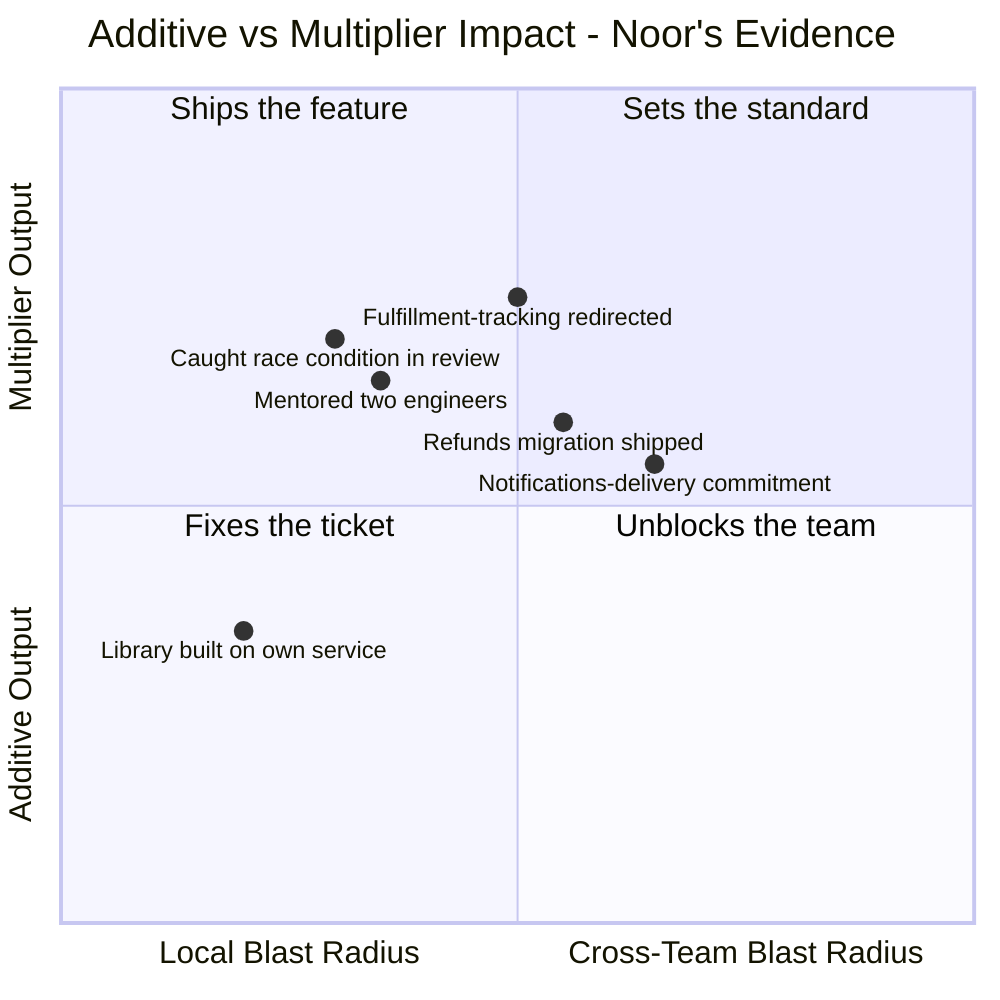

# Writing the Promotion Packet

## Intuition

> **One-line analogy**: A brag doc is raw sensor data. A promotion packet is not a
> longer brag doc — it's the finished report a stranger has to be able to act on without
> ever having stood in the room.

**Mental model.** Eighteen months of real work produces two very different documents from
the same underlying facts. The first is a list of things that happened, in the order they
happened, written the way anyone writes down what they did. The second is organized around
a question nobody asked out loud during any of those eighteen months: what did this person
decide that nobody else could have, and who would notice if they left? Almost none of the
translation work between those two documents involves doing anything differently. Almost
all of it involves writing what already happened in a completely different order.

**Why it matters.** This case study follows Noor Farouk, a Senior Backend Engineer on the
Payments Platform team at a mid-size logistics-software company, through eighteen months of
real brag-doc entries, a first packet draft that reads impressively and answers nothing,
the scope-shaped rewrite that replaces it, and the calibration room where five people who
have never met Noor decide whether the evidence clears the bar for Staff. The outcome is
not the clean win the rewrite earns on paper — and the specific, narrow, honest reason it
isn't is the most useful thing in this file.

**Key insight.** A calibration committee is not grading effort, and it is not grading the
rewrite's prose quality either. It is checking whether the evidence, however well written,
actually closes every axis the ladder requires — and a genuinely excellent packet can still
surface one real, unfinished gap that better writing cannot paper over, because the writing
was never the problem in the first place.

---

## 1. Situation & Stakes

Noor Farouk is a Senior Software Engineer on the Payments Platform team at Halyard, a
2,100-person logistics-software company whose internal ladder — like most of the ladders
surveyed in [Engineering Career Ladders](../engineering_career_ladders/engineering_career_ladders.md)
— gates Staff on scope, ambiguity, and multiplier impact rather than on technical
difficulty alone. Noor has been Senior for three years and has spent the last eighteen
months doing work that, in retrospect, was clearly Staff-shaped: designing and driving
adoption of a shared idempotency-key library across payment-adjacent services after a
recurring class of duplicate-charge bug kept resurfacing team by team.

Halyard runs promotion cycles twice a year, in January and July. Noor's manager, Diego
Alvarez, nominates her for the July cycle. The packet is due in three weeks. What is
actually at stake: Staff at Halyard is not a title bump on the same job — it changes what
decisions Noor can make without sign-off, what she is expected to notice before being
asked, and, per Halyard's compensation bands, a meaningful base-and-equity increase. The
calibration committee that will read the packet is five engineering managers who do not
manage Noor and, in four of five cases, have never worked with her directly. Everything
they know about eighteen months of her work will come from what fits on the page.

---

## 2. The People and What Each One Wants

| Person | Role | What they actually want |
|---|---|---|
| **Noor Farouk** | Candidate, Senior Software Engineer, Payments Platform | A Staff title and comp band that matches work she believes she's already been doing for a year |
| **Diego Alvarez** | Noor's manager | A packet the calibration committee can approve without him having to defend a weak section live — his own credibility as a manager who nominates accurately is also on the line |
| **Emeka Obi** | SRE lead, corroborator | Accurate credit for Noor's specific role in the reliability work, not overclaimed or underclaimed on either side |
| **Sana Vaidya** | Product manager, corroborator | The packet to reflect that the idempotency work was framed and prioritized as a real cross-team initiative, not a side project |
| **Liam Foster** | Staff engineer on an adjacent team, design reviewer and calibration-room peer | A packet that would actually convince him if he were reading it cold, since he sits on this exact committee for other candidates |
| **The calibration committee** (five managers, Liam among them) | Committee | A packet organized around the ladder's own axis language, with named, checkable evidence — not a longer story to interpret generously |

Noor is unusually well positioned relative to most first-time Staff candidates: she has
kept a brag doc for the full eighteen months, following the practice Julia Evans describes
in "Get your work recognized: write a brag document" (jvns.ca, 2019) — a running weekly log
rather than a reconstruction at review time. The problem this case study follows is not a
missing evidence problem. It is a translation problem, and then, underneath that, one real
evidence gap the translation cannot fix.

---

## 3. The Approach

The eighteen months break into three phases: discovering the recurring bug pattern
(months 1–4), building and proving the fix on Noor's own service (months 5–9), and driving
adoption of the shared library across the two other services that had the same bug waiting
to happen (months 10–18, still in progress as the packet is written in month 17).

**The conversation Noor should have had at month twelve, and didn't.** Around month twelve,
with the library built and proven on her own team but adoption elsewhere not yet started,
Noor should have asked Diego directly: "Do you think I'm Staff-shaped yet, and if not, what
is the one specific thing missing?" She didn't — she assumed that finishing enough
Staff-shaped work would speak for itself by the time nomination season came around, and
kept building rather than checking. Diego, for his part, assumed Noor would ask if she
wanted a read. Neither said anything until Diego initiated the July nomination five months
later. This gap matters concretely in §9: the cross-team adoption work that turns out to be
the packet's one real weakness started in month 10, not month 12, because nobody flagged it
as the piece the ladder would care about most until the packet was already being drafted.

**The packet-writing process at Halyard**, matching the calibration mechanics described in
[Engineering Career Ladders](../engineering_career_ladders/engineering_career_ladders.md)
§6: Noor self-nominates evidence to Diego, Diego writes the manager narrative mapping that
evidence onto Halyard's own Staff scope statement, and a cross-manager calibration
committee — five managers who do not manage Noor, reading against a leveling guide of
anonymized past Staff promotions — reads the resulting packet and decides.



Every arrow in this diagram is a real translation, not a formality — the distance between
`brag` and `draft1` is almost none (§4 shows how directly the first draft reuses the brag
doc's own language), while the distance between `draft1` and `rewrite` is the entire
substance of this case study.

---

## 4. The Artifacts and Conversations

### Six months of real brag-doc entries (months 12–17, the run-up to the packet)

Noor's brag doc runs the full eighteen months; these are the entries from the final six,
verbatim, including the two entries that read as trivial at the time and turn out to matter
most in the rewrite.

```text
Week of Jan 12 — Wrote the design doc for the shared idempotency-key
library (go/idempotency-lib-rfc). Proposing it as a platform-owned
component rather than something each team reimplements. Sent to Emeka
and Sana for review before circulating wider.

Week of Jan 26 — Design doc approved after two rounds of feedback.
Emeka pushed back on the key-expiry window (I'd proposed 24h, he
argued for 72h based on retry patterns he'd seen in incident data) —
he was right, changed it to 72h. Cost: half a day of rework, worth it.

Week of Feb 9 — Talked the fulfillment-tracking team out of building
their own retry-dedup layer. They'd scoped two weeks of work to solve
the same problem my library already solves. Walked their tech lead,
Priya Chandra, through the design doc and our incident history; they
agreed to wait for the shared library instead of building a parallel
one. Feels like a small thing but it's two engineer-weeks saved and
one fewer implementation of the same bug class to maintain.

Week of Feb 23 — Library v0.1 merged and live behind a flag on
Payments Platform's own authorization service only. No other team
using it yet.

Week of Mar 9 — Flipped the flag to 100% on our own service. Zero
duplicate-charge incidents in the three weeks since, versus roughly
one every ten days before. Wrote up the before/after in the team
channel.

Week of Mar 23 — Code review on a peer's PR for the refunds service
caught a race condition where a retry could process a refund twice
under a specific timeout-then-retry sequence — not something the
author had tested for, and not something our test suite would have
caught either since it required a specific timing window. Flagged it,
we added a test that reproduces it deterministically, fixed before
merge. No incident, no story, just didn't happen. Logging it anyway
because "the incident that didn't happen" isn't the kind of thing
anyone remembers to mention in a self-review otherwise.

Week of Apr 6 — First cross-team pitch meeting, presenting the library
to the notifications-delivery team and the refunds team, the two other
services with the same duplicate-processing bug class. Went reasonably
well but no commitment yet — both teams have their own Q2 priorities
already set.

Week of Apr 20 — Sana helped reframe the pitch around a specific
incident cost rather than an abstract "shared pattern" pitch — we
pulled the last six months of duplicate-charge and duplicate-notification
tickets across both teams and showed the actual number: 34 incidents,
roughly 40 engineering-hours of incident response total. That number
landed much better than the design doc alone did in April.

Week of May 4 — Refunds team committed to adopting the library,
starting migration this quarter. Notifications-delivery team still
undecided — their tech lead wants to see refunds' migration land
cleanly first before committing their own team's time.

Week of May 18 — Mentored two mid-level engineers on the refunds team
through their first migration PR against the library — not writing it
for them, reviewing and unblocking. Both shipped their pieces
independently by end of week.

Week of Jun 1 — Refunds migration live in production. Zero
duplicate-processing incidents on refunds in the three weeks since
cutover, versus roughly two a month before.

Week of Jun 15 — Notifications-delivery team's tech lead confirmed
they'll adopt next quarter, citing refunds' clean migration as the
reason they're now comfortable committing the engineering time. Their
migration hasn't started yet — realistically a Q3 project, not
finished by the time this packet is submitted.

Week of Jun 29 — Diego told me he's nominating me for the July Staff
cycle. Packet draft due in three weeks.
```

The February 9th entry (talking a team out of building something) and the March 23rd entry
(the incident that didn't happen) both read, in the moment, like the least significant
things logged that month — no dashboard moved, nothing shipped. Both turn out to be load-bearing
in the rewrite below, because they are two of the cleanest pieces of evidence Noor has for
judgment and multiplier impact specifically, the two hardest axes to evidence with a metric.

### The activity-shaped first draft — full text

This is what Noor sends Diego first, unprompted, assembled directly from the brag doc in
roughly chronological order.

```text
PROMOTION PACKET DRAFT — Noor Farouk, Senior -> Staff
Payments Platform

Summary of accomplishments, past 18 months:

- Designed and built a shared idempotency-key library for
  payment-adjacent services (go/idempotency-lib-rfc)
- Reduced duplicate-charge incidents on the authorization service from
  ~1 every 10 days to zero
- Presented the library to two other teams (notifications-delivery,
  refunds) and got refunds to adopt it
- Refunds team's migration is live with zero incidents since cutover
- Caught a race condition in a peer's PR before it shipped
- Mentored two engineers through their first migration PR
- Talked the fulfillment-tracking team out of building a redundant
  retry-dedup system
- Wrote the original design doc, incorporated feedback from Emeka Obi
  (SRE) and Sana Vaidya (PM)
- Notifications-delivery team has now committed to adopting the
  library next quarter

I believe this demonstrates the scope and impact expected of a Staff
engineer and would like to be considered for promotion in the July
cycle.
```

Nine bullets, every one of them true, every one of them shipped. It also does not answer a
single question a calibration committee will actually ask: what decision did Noor make that
nobody else could have made? Who outside her own team would notice if she left? How much of
this was handed to her versus how much did she notice and propose herself? The draft reads
like a list of things Noor did. It does not read like evidence of what Noor is trusted with.

### The scope-shaped rewrite — full text

Diego and Noor rewrite the packet together over one working session, organized under
Halyard's own three Staff-ladder criteria rather than chronologically.

```text
PROMOTION PACKET — Noor Farouk, Senior -> Staff
Payments Platform | Nominated by: Diego Alvarez | Cycle: July

=== SCOPE ===

Noor identified and closed a recurring bug class — duplicate payment
processing under retry conditions — that had independently surfaced on
three separate services (authorization, refunds, notifications-delivery)
over the prior year, each previously treated and fixed as an isolated
incident rather than a shared pattern. She is the person who first
named it as one problem rather than three, and designed the fix as a
platform-owned library rather than a fourth isolated patch.

Evidence:
- Design doc: go/idempotency-lib-rfc (approved Jan 26, this cycle)
- Authorization service: duplicate-charge incidents ~1/10 days -> zero,
  sustained 4+ months (dashboard: go/payments-dup-charge-dash)
- Refunds service: migrated and live, duplicate-processing incidents
  ~2/month -> zero, sustained since cutover (per Emeka Obi, SRE lead,
  who tracks the underlying incident data independently of Noor's team)
- Combined incident cost avoided across the two migrated services,
  measured over the six months preceding the pitch: 34 incidents, ~40
  engineering-hours of incident response (source: Sana Vaidya's Q2
  pitch-deck pull from the incident tracker, go/q2-idempotency-pitch)

=== AMBIGUITY ===

Noor was not handed a ticket or a spec for this work. She was handed
nothing — she noticed the pattern herself while investigating an
unrelated incident on her own service, and the decision to treat it as
a shared, platform-owned problem rather than a one-off fix was hers,
made before anyone asked her to look at the other two services at all.

Evidence:
- No design brief or manager request preceded the Jan 12 design doc;
  Diego can confirm this was self-initiated (see manager narrative
  below)
- The framing choice — platform library vs. one-off fix — was Noor's;
  Emeka's design-review feedback (72h key-expiry window vs. Noor's
  original 24h proposal) changed an implementation detail, not the
  underlying architectural decision, which had already been made
  before that review

=== MULTIPLIER IMPACT & CROSS-TEAM ADOPTION ===

Noor drove adoption of the shared pattern beyond her own team, which
is the specific axis distinguishing this from strong Senior-level work
on the same problem.

Evidence:
- Talked the fulfillment-tracking team out of building a redundant,
  duplicate implementation of the same fix (Feb 9), saving an
  estimated two engineer-weeks and preventing a fourth parallel
  implementation of the same bug class — confirmed by fulfillment-tracking's
  tech lead, Priya Chandra
- Refunds team fully migrated and live (see Scope section)
- Refunds' clean migration is the stated reason notifications-delivery
  committed to adopting the library next quarter — per their tech
  lead, quoted in the June 15 update — though that migration has not
  yet started as of this packet's submission
- Mentored two refunds-team engineers through their first migration
  PRs, unblocking rather than doing the work directly; both shipped
  independently

=== JUDGMENT (supporting evidence, not a separate ladder axis) ===

- Caught a race condition in a peer's PR (refunds service, Mar 23)
  before it shipped — no incident occurred because of the catch, which
  is exactly the kind of evidence that is real but produces no
  dashboard line by design
- Accepted and incorporated Emeka's pushback on key-expiry window
  (24h -> 72h) after being shown incident data that contradicted her
  original assumption

=== MANAGER NARRATIVE (Diego Alvarez) ===

I am nominating Noor for Staff based on eighteen months of
self-initiated, cross-team platform work, not a single project. The
clearest evidence of Staff-shaped judgment is what she chose to do
with an unglamorous, easy-to-ignore pattern: instead of fixing her own
team's instance of the bug and moving on, she named it as a shared
problem before being asked to, built the fix as a reusable platform
component, and is now two-thirds of the way through getting the other
two affected teams onto it. The one place I'd flag directly for the
committee, in the interest of not overselling: the third team's
migration (notifications-delivery) has committed but not yet started.
I believe the trajectory and the reasoning behind their commitment are
strong evidence on their own, but I want the committee reading this
with full information rather than discovering the gap themselves.
```

### The three-bullet side-by-side

| Weak (first draft) | Strong (rewrite) | What changed |
|---|---|---|
| "Designed and built a shared idempotency-key library for payment-adjacent services." | "Noor identified and closed a recurring bug class that had independently surfaced on three separate services... she is the person who first named it as one problem rather than three." | The weak version describes an artifact built. The strong version describes a decision made — noticing a pattern nobody else had connected, and choosing to solve it once rather than three times. |
| "Presented the library to two other teams and got refunds to adopt it." | "Refunds' clean migration is the stated reason notifications-delivery committed to adopting the library next quarter — per their tech lead... though that migration has not yet started." | The weak version reports an activity (a presentation happened). The strong version reports a verifiable causal chain (one team's success is the named reason a second team committed) and is explicit about exactly where that chain is currently incomplete, rather than letting the committee discover the gap on its own. |
| "Talked the fulfillment-tracking team out of building a redundant retry-dedup system." | "Talked the fulfillment-tracking team out of building a redundant, duplicate implementation of the same fix, saving an estimated two engineer-weeks and preventing a fourth parallel implementation of the same bug class — confirmed by fulfillment-tracking's tech lead, Priya Chandra." | The weak version is a single unquantified sentence a reader has no way to weigh. The strong version adds a number (two engineer-weeks), a named consequence (one fewer duplicate implementation to maintain long-term), and a corroborator who did not do the work and has no reason to overclaim on Noor's behalf. |

### The calibration room, transcribed

Five managers, including Liam Foster, meet for ninety minutes to review six packets,
Noor's third on the agenda. Diego presents; Noor is not in the room, per Halyard's process.

```text
Facilitator: Next up, Noor Farouk, Payments Platform, Senior to Staff.
             Diego, walk us through it.
Diego:       Eighteen months of work, but the packet is built around one
             thread — a duplicate-payment-processing bug class that hit
             three services independently. Noor connected the pattern
             herself, unprompted, designed a platform-owned fix instead
             of a one-off patch, and has driven adoption across two of
             the three affected teams so far.
Liam:        What did she decide that nobody else could have decided?
             I want the specific call, not the project description.
Diego:       The framing choice, mainly — treating it as one shared
             problem instead of three separate incidents. That's page
             two, the Ambiguity section. Nobody asked her to look past
             her own team's instance of the bug.
Liam:        Okay, that's real. Who outside her own team would actually
             notice if she left tomorrow?
Diego:       Refunds, directly — their migration exists because she drove
             it, start to finish, including mentoring two of their
             engineers through it. Fulfillment-tracking, indirectly —
             they didn't build a fourth version of this bug because she
             walked their tech lead through the incident history
             herself.
A second manager: The refunds numbers are solid. I want to push on the
             third team, notifications-delivery. The packet says they
             "committed," but also says the migration hasn't started.
             How much of the credit is real versus projected?
Diego:       That's fair, and it's the one thing I flagged explicitly in
             my own narrative rather than let you find it — the
             commitment itself is real, and their tech lead's stated
             reason for making it is real (refunds' clean migration),
             but the actual migration work is a Q3 project, not
             something that's happened yet.
Liam:        So the third leg of the multiplier story is a forecast, not
             a result. The first two legs — refunds shipped, fulfillment-tracking
             talked out of a redundant build — are both real,
             finished, corroborated evidence. The third is real
             momentum but not yet finished evidence.
A third manager: I don't think that sinks it. Two of three is still
             strong cross-team adoption for a first Staff packet.
Liam:        I agree it's strong. I don't think it's disqualifying
             either. But I want to be precise about what we're actually
             approving if we approve this today — we'd be crediting
             Staff-level multiplier impact partly on the strength of a
             team's stated intention rather than a completed migration,
             and our own leveling guide's past Staff examples all show
             the cross-team piece as already landed, not committed.
Facilitator: What's the practical alternative — defer, or approve with a
             note?
Liam:        I'd defer one cycle, specifically and only on that third
             leg. Everything else in this packet — the Scope section,
             the Ambiguity section, the first two legs of the
             multiplier story — clears our bar cleanly, and I want that
             said plainly so this doesn't read as a broader rejection
             than it is. The notifications-delivery migration is a
             single quarter away by the packet's own timeline. I'd
             rather approve a packet with a completed third leg in
             January than approve one today on a forecast we're asking
             this room to trust.
A second manager: Agreed. And I'd want that written back to Noor and
             Diego specifically — this isn't "not ready," it's one
             named, nearly-finished piece of evidence.
Facilitator: Diego, are you good relaying that framing rather than a
             flat no?
Diego:       Yes — and honestly, I'd rather she hear it this precisely
             than get a vague "come back next cycle" with no reason
             attached.
```

### The outcome, and the follow-up conversation with Diego

The committee's written decision, relayed to Diego the same afternoon:

```text
DECISION: Deferred to January cycle.
CANDIDATE: Noor Farouk
GAP: Multiplier/cross-team adoption evidence — two of three
legs complete and well-corroborated (fulfillment-tracking redirected,
refunds migrated and live). Third leg (notifications-delivery) is a
real, well-reasoned commitment but not yet a completed migration as of
this packet. Our leveling guide's past Staff examples all show this
axis fully landed, not in progress.
EVERYTHING ELSE: Scope and Ambiguity sections both clear cleanly and
do not need to be resubmitted or re-evidenced next cycle — only the
third migration's completion is required to close the gap.
RECOMMENDATION: Resubmit in January with the notifications-delivery
migration complete. No other changes to the packet anticipated.
```

Diego's conversation with Noor, the following Monday:

```text
Diego: I want to give you the exact reasoning, not just the outcome —
       it's a deferral, not a rejection, and it's narrower than it
       might feel at first.
Noor:  Okay. Hit me.
Diego: Scope and Ambiguity both cleared cleanly, no committee pushback
       on either. The gap is specifically the notifications-delivery
       leg of the multiplier story — they've committed, and the
       committee found that commitment credible and well-reasoned, but
       the actual migration hasn't happened yet, and our own leveling
       guide's past examples all show that axis fully landed by
       submission, not in progress.
Noor:  So it's the one piece that was already the most behind schedule.
Diego: Right. And I think that's actually useful information, not just
       bad luck — if we'd had this exact conversation five months ago
       instead of assuming the packet would speak for itself, we'd
       have known this was the piece to prioritize finishing before
       nomination, not after.
Noor:  That's fair. I didn't ask you directly if I was Staff-shaped
       yet until you brought up nominating me.
Diego: Which is on both of us, honestly — I assumed you'd ask if you
       wanted a read, you assumed the work would speak for itself. For
       January: same packet, same Scope and Ambiguity sections
       untouched, just the notifications-delivery migration completed
       and the numbers added. That's a much narrower ask than most
       Staff resubmissions get.
Noor:  I can push to get their migration started this month instead of
       waiting for their own Q3 planning cycle.
Diego: That's exactly the right move — and worth naming in writing to
       their tech lead now, both because it helps them and because it
       makes the timeline defensible if anyone asks in January why it
       moved up.
```

---

## 5. Decisions & Tradeoffs

Diego made one decision worth naming explicitly: including the notifications-delivery gap
in his own manager narrative rather than letting the committee find it. The alternative —
writing the packet to imply the third migration was further along than it was, or simply
omitting the "hasn't started yet" detail — would very plausibly have gotten past a less
careful room, and just as plausibly would have produced a worse outcome if a committee
member had asked the same question Liam asked and gotten a less prepared answer. Naming the
gap first cost nothing in this room and would have cost real credibility in a room that
caught it unprompted.

The committee's tradeoff was between two real risks: approving on a strong, well-reasoned
forecast (risking a Staff title granted for work not yet actually delivered) versus
deferring a packet that was, on two of three axes, unambiguously strong (risking a
demoralizing near-miss for a candidate who did essentially everything right). Liam's
proposed resolution — defer narrowly, name the gap precisely, and commit in writing that
nothing else needs re-evidencing — is the version of "no" that costs the least: it doesn't
ask Noor to redo work that already cleared, and it doesn't leave the door open to a vaguer,
harder-to-satisfy version of "not yet" next cycle.

---

## 6. Real-World Parallels

**Julia Evans's brag document (jvns.ca, 2019).** Noor's eighteen-month log is a direct
application of the practice Evans's widely cited essay names: a running weekly log,
capturing what happened and who it affected while it's still fresh, rather than
reconstructed from memory at review time. The February and March entries that read as
trivial in the moment and turn out to be load-bearing in the rewrite are exactly the
failure mode Evans's essay describes solving — by the time a review actually happens,
recent weeks dominate recall, and the quieter, earlier wins are the ones that get lost
without a dated record.

**Tanya Reilly, "Being Glue" (2019, noidea.dog/glue) and *The Staff Engineer's Path*
(O'Reilly, 2022).** Reilly, a former Staff engineer at Google and Principal engineer at
Squarespace, names the specific risk this packet's multiplier section runs into: glue
work — talking a team out of a redundant build, catching a peer's bug in review, mentoring
someone through their first PR against a new system — is real multiplier impact, but it
produces no dashboard line by default and has to be written down deliberately or it
disappears. Noor's brag doc entries for the fulfillment-tracking conversation and the
caught race condition are precisely this kind of evidence, logged specifically because
Evans's cadence discipline made her write them down before they felt unimportant enough to
forget.

**Will Larson, *Staff Engineer: Leadership Beyond the Management Track* (2021).** Larson's
archetype taxonomy — Tech Lead, Architect, Solver, Right Hand — gives a name to the shape of
Noor's work: closest to the Architect archetype, setting a technical direction (the shared
library pattern) across a wider area than any one team, without formally owning any of the
three affected teams. Naming the archetype isn't required in the packet itself, but it's a
useful check Diego ran privately before writing the manager narrative, confirming the
multiplier story wasn't a mismatched blend of two different archetypes' evidence.

**Camille Fournier's Rent the Runway ladder (2015) and the adder/multiplier split.**
Fournier's framework — covered in [Engineering Career Ladders](../engineering_career_ladders/engineering_career_ladders.md)
§4.1 — scores Dex and Str (execution, productivity) as "adder" attributes driving early
promotions, and Wis and Cha (judgment, communication/leadership) as "multiplier" attributes
mattering more at senior levels. Halyard's own three-axis packet structure is a different
vocabulary over the same underlying split Fournier published a decade earlier: Scope and
Ambiguity map closely to Wis, and the Multiplier & Cross-Team Adoption section is close to
a direct translation of Cha.

**Google's calibration committee, for structural contrast.** Google's own re:Work
materials describe the same core mechanism Halyard uses — individual evaluators produce
written evidence, a committee that was not present for any of it makes the actual call.
The mechanism exists for the same reason at both companies: it catches the manager who
grades a candidate generously out of personal fondness and the one who grades stingily out
of habitual caution, neither of which a single manager's unchecked narrative would catch on
its own.

---

## 7. Frameworks Applied



Plotted against the additive-vs-multiplier quadrant from
[Scope, Impact & Ownership](../scope_impact_and_ownership/scope_impact_and_ownership.md)
§5, the pattern in the calibration room's decision becomes visible: everything Noor has
already completed sits solidly in the upper half of the chart. The one point still
migrating toward the top-right — full cross-team, fully realized — is the
notifications-delivery commitment, which is exactly the point the committee named as
forecast rather than result.

**The five-part impact-statement anatomy, applied.** Every strong bullet in the rewrite
follows the verb-artifact-metric-timeframe-corroborator structure from
[Scope, Impact & Ownership](../scope_impact_and_ownership/scope_impact_and_ownership.md)
§5: "Talked [verb] the fulfillment-tracking team out of a redundant build [artifact], saving
an estimated two engineer-weeks [metric], in February [timeframe], confirmed by Priya
Chandra [corroborator]." The one bullet the committee flagged — the
notifications-delivery leg — is missing exactly one part of that anatomy: it has a verb, an
artifact, a timeframe, and a named source, but no completed metric, because the metric
doesn't exist yet. The framework doesn't just describe why the strong bullets work; applied
carefully, it also predicts exactly which bullet a careful reader will catch.

---

## 8. Playbook

For an **engineer building toward a promotion packet**:

- Keep a brag doc from day one of targeting the next level, not from three weeks before the
  packet is due — Noor's February and March entries were both written the week they
  happened and would very likely not have been reconstructed accurately five months later.
- Log the entries that feel too small to matter specifically — a redirected team, a caught
  bug that produced no incident — since these are frequently the cleanest multiplier
  evidence available, precisely because they don't show up on a dashboard by default.
- Ask directly and early whether your work reads as the next level's shape, rather than
  assuming enough shipped work will make the case on its own — Noor's twelve-month gap
  cost real time on exactly the piece that turned out to matter most.
- Organize the packet around the ladder's own criteria as headings, not chronologically —
  a reader should never have to do the axis-translation work themselves.

For a **manager writing the narrative**:

- Name the packet's own weakest point in your own narrative before the committee finds it —
  Diego's explicit flag on the notifications-delivery gap cost him nothing in this room and
  would have cost real credibility in a room that caught it unprompted.
- Distinguish, explicitly, between evidence that has landed and evidence that is a credible,
  well-reasoned forecast — a committee working from a leveling guide of past, completed
  examples will make this distinction with or without your help.
- Corroborate every named claim with someone who did not do the work and has no reason to
  overclaim on the candidate's behalf.

For a **calibration committee member**:

- Ask "what did they decide that nobody else could have?" before anything else — it
  separates activity from scope faster than any other single question.
- Ask "who outside their team would notice if they left?" to test whether the multiplier
  story is real or aspirational.
- When a packet is strong on most axes and thin on one specific, nameable piece, defer
  narrowly rather than rejecting broadly or approving on trust — say exactly what needs to
  change and confirm, in writing, what does not.

---

## 9. What Went Wrong & What It Cost

**What went wrong, specifically.** Nothing went wrong with Noor's actual work — the
committee's own decision says so explicitly, clearing Scope and Ambiguity cleanly and
crediting two of the three multiplier legs as fully landed. What went wrong is a single
timing gap: the skipped month-twelve conversation meant the slowest-moving piece of the
work (getting a third team to commit and then migrate) started later than it needed to,
and was still one quarter from finished when the packet's three-week deadline arrived.
Nobody misjudged the work. The clock simply ran out on the newest, least mature part of it
before the packet was due.

**What it cost, specifically — the deferral itself.** Six months: the gap between the July
cycle and the January cycle Noor will resubmit in, with the exact packet otherwise unchanged
per the committee's own note. That is the real, measured cost of this case study's actual
outcome, and it traces directly to a single missing quarter of lead time on one migration.

**What the activity-shaped first draft would have cost, had it been the one submitted.**
The rewrite is what let the committee locate the gap precisely — Liam's question sequence
in §4 works specifically because the packet is organized by axis, so a thin spot on one
axis is visible as a thin spot rather than buried inside a chronological list. The
activity-shaped draft in §4 has no axis structure for a committee to test against; a room
reading it cold would most likely not be able to name "notifications-delivery hasn't
migrated yet" as the specific, narrow, fixable gap it actually is — because the draft
never separates "committed" from "landed" in the first place, on any of its nine bullets.
The much more likely outcome from that draft is a vaguer rejection ("doesn't yet feel like
Staff scope," with no named axis) that would cost a full extra cycle of diagnostic
confusion on top of the six months already needed to finish the real work — twelve months
total instead of six, not because the underlying gap was any different, but because nobody
could locate it precisely enough to fix only that.

---

## 10. Variations

**When the packet is genuinely not at the level.** Halyard's committee distinguishes this
outcome sharply from Noor's: a packet where Scope, Ambiguity, and the multiplier story are
all thin is a "not yet, and not close" conversation, typically with guidance pointed at
what kind of work to seek out next, not a specific missing artifact to finish. Noor's
deferral is the narrower, rarer case — everything but one nameable, nearly-finished piece
already clears.

**When the packet is at the level with no written evidence.** A candidate who has done
comparably strong work but kept no brag doc, and reconstructs eighteen months from memory
and commit history three weeks before the deadline, would very plausibly produce something
closer to the activity-shaped first draft — not because the work was weaker, but because
memory recovers *what* happened far more reliably than *why it mattered* or *who it
affected*, which is exactly the information a brag doc captures while it's fresh and a
after-the-fact reconstruction usually cannot recover cleanly.

**When the packet is at the level with strong evidence but there is no slot.** Some ladders
and some cycles gate Staff promotions partly on available headcount or budget for that
level, independent of the evidence — a packet can clear every axis cleanly and still be
told "yes, and there isn't a Staff seat open this cycle." This is a different refusal
reason entirely from Noor's, and a candidate hearing it should ask directly whether the gap
is evidentiary (as it was for Noor) or structural, since the two require completely
different responses — closing a gap on one hand, waiting or changing teams on the other.

**A committee that approves on the forecast.** A less conservative calibration room,
reading the same packet, plausibly approves today rather than deferring — Liam's own
framing in §4 concedes the third leg's momentum is real and well-reasoned, not fabricated.
Halyard's committee chose the more conservative reading specifically because its own
leveling guide's past examples set a precedent of fully-landed evidence; a company whose
leveling guide included more forecast-credited past promotions would reasonably land in a
different place on the same packet.

---

## 11. Interview Discussion Points

**Q: What's the actual difference between the activity-shaped draft and the scope-shaped rewrite, if every fact in both is true?**
**Short:** The rewrite organizes the same true facts around decisions and axes, not a timeline.
Both documents are factually accurate. The activity-shaped draft lists what happened in
roughly the order it happened; the scope-shaped rewrite organizes the same facts around the
questions a calibration committee actually asks — what decision was this person's alone,
how much ambiguity did they operate under, who outside their team was affected. Nothing
about the underlying eighteen months changed between the two documents; only which question
each sentence is answering did.

**Q: Why did two supposedly trivial brag-doc entries — talking a team out of a build, catching a bug in review — turn out to matter more than expected?**
**Short:** They're rare, hard-to-fake evidence of judgment and multiplier impact specifically.
Most engineering work produces a metric almost automatically — a latency number, an
incident count. Judgment and multiplier impact rarely do, because preventing something (a
redundant build, an incident) leaves no artifact by default. Those two entries were the
cleanest evidence available for exactly the two hardest-to-evidence parts of the ladder,
which is why they ended up load-bearing in the rewrite despite feeling unremarkable when
logged.

**Q: The committee didn't reject Noor's packet outright — why was a narrow deferral the right call instead of either approving or rejecting broadly?**
**Short:** A narrow deferral names exactly what's missing instead of over- or under-crediting the whole packet.
Two of three axes cleared cleanly with strong, corroborated evidence; only one specific,
nameable piece — a migration that had committed but not yet happened — was incomplete.
Approving broadly would credit unfinished work as though it had landed; rejecting broadly
would discard genuinely strong, already-cleared evidence along with the one real gap. A
narrow deferral is the only response that matches the actual shape of the evidence.

**Q: Why did Diego flag the notifications-delivery gap himself instead of letting the committee find it?**
**Short:** Naming a known weak point yourself costs less credibility than a room catching it unprompted.
A manager narrative that omits or obscures a real gap risks a committee member finding it
independently and discounting the manager's credibility along with the specific section —
once a reader catches one unflagged gap, they read the rest of the packet more skeptically.
Naming it directly costs nothing when the room was going to find it anyway, and it
positions the manager as a reliable narrator of the evidence rather than an advocate
overselling it.

**Q: What are the three genuinely distinct reasons a promotion gets refused, and which one is this?**
**Short:** Not at the level, at the level with no evidence, or at the level with a slot missing — this is a fourth, narrower case.
The three broad reasons are: the work itself isn't at the target level yet; the work is at
the level but wasn't written down in a form a committee can check; or the work and the
evidence both clear, but no open slot exists for the level this cycle. Noor's outcome is
narrower than any of the three — the work is at the level, most of the evidence is
excellent and complete, and one specific, nameable piece of evidence is real but not yet
finished, which the committee treated as a scoped deferral rather than any of the three
broader refusal types.

**Q: What would the twelve-month conversation Noor skipped have actually changed?**
**Short:** Starting the slowest migration two to three months earlier likely closes the gap by July.
Had Noor asked Diego directly around month twelve whether her work read as Staff-shaped,
the honest answer at that point would very likely have flagged cross-team adoption as the
piece furthest behind — prompting the fulfillment-tracking-style outreach to
notifications-delivery two or three months earlier than it actually happened. Given the
observed pace (roughly two months from pitch to commitment, per the actual timeline), that
earlier start plausibly gets the third migration far enough along, if not fully complete,
by the July deadline.

**Q: Isn't it unfair that a real, credible commitment from another team wasn't enough to satisfy the committee?**
**Short:** Committing to adopt and completing a migration are different, distinctly checkable claims.
The committee's own reasoning distinguishes these explicitly: a stated commitment is real
evidence of influence, but it is a different, softer claim than a completed migration, and
Halyard's leveling guide's own past Staff examples all show the cross-team piece as already
landed. The committee wasn't disputing that Noor caused the commitment — it was declining
to credit a forecast as though it were the same category of evidence as a shipped result.

**Q: What made the fulfillment-tracking entry ("talked a team out of building something") count as strong multiplier evidence rather than just a nice anecdote?**
**Short:** It has a number, a named corroborator, and a durable consequence — not just a story.
The rewrite gives it exactly the five-part structure that separates evidence from anecdote:
a specific action (talked them out of it), a named artifact (the redundant retry-dedup
system that didn't get built), a metric (roughly two engineer-weeks saved), a timeframe
(February), and a corroborator with no reason to overclaim (fulfillment-tracking's own tech
lead). Strip any one of those and it reverts to an unverifiable claim a committee has no way
to weigh.

**Q: What should Noor's January resubmission actually change, according to the committee's own decision?**
**Short:** Only the notifications-delivery migration needs completing — nothing else is re-evidenced.
Per the committee's written decision, the Scope and Ambiguity sections cleared cleanly and
do not need to be resubmitted or re-argued; the sole requirement is completing the
notifications-delivery migration and adding its numbers to the existing Multiplier Impact
section. This is a materially narrower ask than most Staff resubmissions, precisely because
the committee named the gap specifically rather than returning a general "not yet."

**Q: Why does a calibration committee value a corroborator who "has no reason to overclaim" more than the candidate's own account?**
**Short:** An independent corroborator's confirmation is checkable; the candidate's own account isn't.
The candidate telling their own story has an obvious incentive to present it favorably,
which a reader has no way to independently verify. A corroborator like Emeka (SRE lead, who
tracks incident data independently of Noor's team) or Priya Chandra (the fulfillment-tracking
tech lead, who has no stake in Noor's promotion outcome) is confirming or denying a specific,
falsifiable claim from outside that incentive structure, which is exactly what makes their
confirmation carry more evidentiary weight in the room.

**Q: What's the single highest-leverage habit this case study shows for someone eighteen months out from their own next promotion?**
**Short:** Log the entries that feel too small to matter, and ask directly whether you're at the level.
Two habits, both shown directly: keep the brag doc from the start, logging especially the
quiet, dashboard-free wins that feel too minor to write down in the moment, since those are
frequently the hardest evidence to reconstruct later and the most valuable when the ladder
gates on judgment or multiplier impact. And ask the direct "am I there yet, and what's
missing" question well before a packet is due, rather than assuming finished work will
speak for itself — Noor's entire six-month deferral traces back to that one conversation
happening five months too late.
