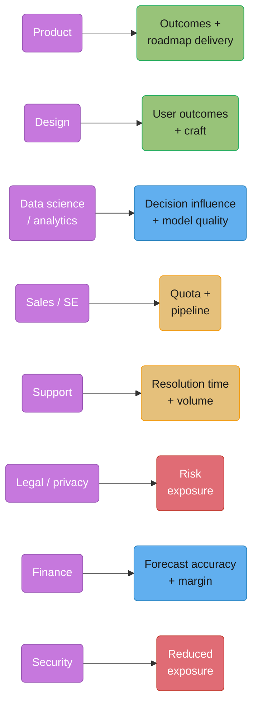
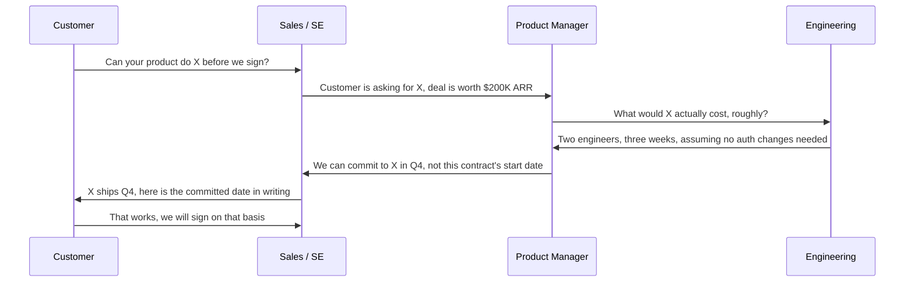
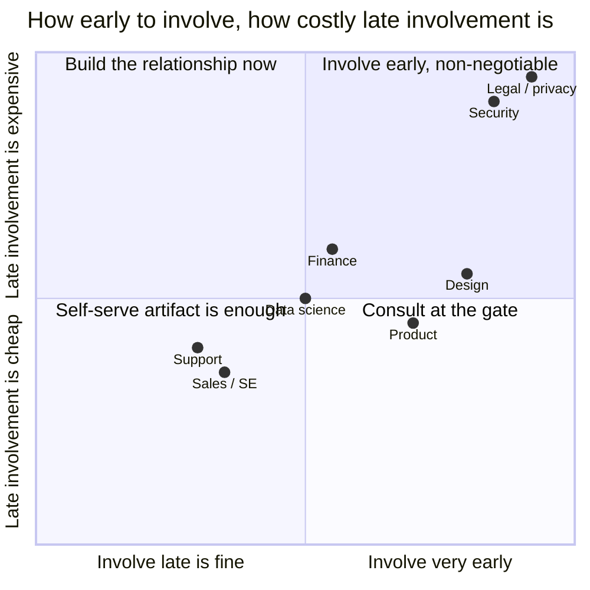

# Cross-Functional Collaboration

## 1. Concept Overview

Cross-functional collaboration is working with the people engineers most often work with
badly — not because either side is unreasonable, but because each function is measured on a
different thing, uses a different vocabulary for the same event, and needs a different
translation of the same fact. A schema change is "a two-line migration" to the engineer who
wrote it, "a broken dashboard" to the analyst who built a report on that field, and "the
number I told the board yesterday just changed" to the finance partner who pulled it into a
forecast. All three are describing the same commit.

This module covers eight functions engineers routinely interact with — product management,
design, data science and analytics, sales and sales engineering, customer support, legal and
compliance, finance, and security — and for each one, answers the same four questions: what
they are actually measured on, what they actually need from an engineer (which is usually
not what they ask for), what engineers routinely get wrong with them, and the specific
translation, a weak sentence and its strong rewrite, that fixes it. It also covers the
mechanism that makes any of this work at scale: a shared artifact everyone edits instead of
five private understandings of the same fact, and what to do when two functions want
opposite things and neither is going to move.

---

## 2. Intuition

> **One-line analogy**: every function you work with is reading the same event off a
> different instrument panel — the same outage is a customer escalation on support's screen,
> a churn-risk flag on data's, and a board question on finance's — and "communicating well"
> means describing the event in the units each panel actually displays, not describing your
> own instrument panel more loudly.

**Mental model**: nobody outside engineering is measured on the things engineering is
measured on, and assuming they should already understand your priorities is the single most
common cause of a cross-functional relationship going bad. A PM is not failing to appreciate
technical debt when they push back on a refactor — they are correctly optimizing for the
metric their own role is judged on, the same way you are correctly optimizing for yours. The
fix is translation in both directions, not persuading the other person to adopt your metric.

**Why it matters**: an engineer who is technically excellent and cannot translate across
functions gets read as difficult to work with, gets routed around on the next project, and
plateaus below the level where cross-functional trust is the actual job — which, at
staff-plus, it increasingly is. The translation skill is not soft in the sense of optional;
it is the mechanism by which good technical judgment actually reaches a decision.

**Key insight**: almost every function-specific friction in this module resolves to the same
root cause — an engineer answering the question that was asked instead of the question that
was actually being asked underneath it, or delivering a fact in engineering units to a reader
who needed it in their own function's units. Learn the eight translations once, and the
pattern generalizes to the ninth function this module didn't have room for.

---

## 3. Core Principles

- **Every function optimizes a real, legitimate metric that is not your metric.** Pushback
  from another function is evidence they are doing their job, not evidence they don't
  understand yours.
- **What a function needs is usually not what it literally asks for.** "How long will this
  take" from a PM is frequently "what do I tell my stakeholder today," which a range with
  an assumption answers better than silence while you compute a precise number.
- **Translate once, in writing, and let people self-serve it** — repeating the same
  explanation in five separate conversations is a sign the translation should have been a
  shared artifact instead.
- **An early, honest constraint is worth more to every function than a late, polished one.**
  The cost of a constraint only grows the longer it's held before being surfaced.
- **A schema, an API, or a public interface is a promise to everyone downstream of it, not
  just to the code that calls it.** Changing its meaning silently breaks trust with every
  function that built something on top of the old meaning.
- **When two functions want opposite things, the tradeoff is usually real, not a
  miscommunication** — the job is to make the tradeoff explicit and get the right person to
  decide it, not to find clever wording that makes both people feel like they won.

---

## 4. Types / Levels / Modes

| Engagement mode | What it looks like | When it fits | Failure mode |
|---|---|---|---|
| Embedded | A named person from the function sits inside the team full-time (a PM, a designer) | High-frequency, ongoing decisions that need daily context | Embedded person becomes the team's only channel to the rest of their function, and drifts out of sync with it |
| Liaison / on-call | A named contact from the function, available on request, not in daily standups | Medium-frequency needs — security review, legal sign-off, a data-schema question | The liaison becomes a bottleneck if every request routes through one person with no backup |
| Consulted at gates | The function reviews at defined checkpoints (design review, launch review) | Low-frequency, high-stakes decisions — legal, compliance, a major architecture change | Brought in too late to change anything, so the "review" is theater |
| Self-serve via artifact | The function publishes a doc, a checklist, or a Slack channel engineers use without a live conversation | High-frequency, low-ambiguity needs — "how do I file a data-classification request" | The artifact goes stale and nobody notices until it's wrong |

The axis underneath all four is **how early and how often the function's judgment is needed**
— get this wrong in either direction and you either burn a scarce specialist's time on
questions a doc could answer, or bring in genuine expertise so late it can only rubber-stamp
a decision that's already been made.

---

## 5. Models & Frameworks Diagrammed

*Eight functions, eight different scoreboards. None of these metrics is wrong, and none of
them is yours — the translation work in §6 exists because a fact stated in engineering units
doesn't move any of these numbers until it's restated in the units the reader is actually
graded on.*

*A feature request arriving through a live deal, handled well: it passes through product
before engineering commits to anything, and the customer-facing promise matches the
engineering estimate instead of preceding it. See §6.4 for the failure mode this sequence
avoids.*

*Legal and security sit in the top-right for a reason: both are cheap to involve early and
extremely expensive to involve late — a "no" in week eleven costs a rebuilt architecture, the
same "no" in week one costs a design conversation.*

---

## 6. How It Works — Detailed Mechanics

### 6.1 Product management

**Measured on**: outcomes against a roadmap — retention, activation, revenue, adoption — not
the count of features shipped. A PM who ships ten features that move nothing is judged worse
than one who ships two that move the north-star metric.

**What they need from you**: an early, honest cost estimate rather than a late, precisely
accurate one, because they are trading it off against other roadmap items in real time;
**options** rather than a flat verdict, so they can weigh a tradeoff instead of being told
"no"; and to hear about a risk from you before they hear about it from their own stakeholder,
the same "no surprises" principle covered in
[Executive Communication](../executive_communication/executive_communication.md).

**What engineers get wrong**: answering "how long will this take" with a bare number instead
of a range and its assumption, which turns a rough planning input into a commitment the PM
then repeats upward as fact; treating a written requirement as an order to be executed
literally rather than a hypothesis about the underlying user problem that an engineer with
context can often improve on; and saying no to the proposed *solution* when the actual
problem underneath it is still negotiable — "we can't do X" often really means "we can't do
X the way you specified it, but Y solves the same problem for a fifth of the cost."

### Weak version -> Strong version: an engineering "no" to a PM

**Weak version**

> We can't build real-time sync, that would require rearchitecting half the storage layer.

**Strong version**

> Real-time sync as specced — sub-second, bidirectional, every field — needs roughly two
> quarters and a storage rearchitecture. If the actual need is "changes show up within a
> minute, one-way," that's two weeks with what we have today. Which problem are we actually
> solving for the user?

**What changed**: the literal solution's real cost is stated, a cheaper option that solves
the likely underlying need is offered, and the conversation is redirected to the problem
instead of ending at the rejected solution.

### 6.2 Design

**Measured on**: user outcomes and craft — usability, task success, the coherence and
quality of the experience — evaluated by user research and by peers in design critique, not
by how technically clean the implementation is.

**What they need from you**: a technical constraint stated as a constraint, with its reason,
early — "anything over 400ms on this interaction will feel broken to the user, because it
crosses the threshold where a UI stops feeling responsive" — not a late rejection of a
finished mock; and to be in the room while the API shape is still being decided, because the
data an API returns constrains what the interface can show far more than most engineers
expect.

**What engineers get wrong**: saying "that's not technically possible" when the honest
statement is "that's expensive," which shuts down a conversation that a real cost tradeoff
would have kept open; and changing the implemented design silently during the build —
dropping an animation, simplifying a state, changing spacing — without looping the designer
back in, so the shipped product diverges from what was reviewed and approved without anyone
having actually decided that divergence was acceptable.

### Weak version -> Strong version: a design constraint

**Weak version**

> That interaction probably isn't going to be possible the way you've mocked it up.

**Strong version**

> The instant-preview interaction as mocked needs a round trip that runs 600-800ms on a
> typical connection — above the ~400ms threshold where it stops feeling instant. We can hit
> under 200ms if we preload on hover instead of on click; want to look at that variant
> together before you finalize the mock?

**What changed**: "not possible" became a specific number against a specific threshold, and
the response offers a collaborative path instead of a dead end.

### 6.3 Data science / analytics

**Measured on**: decision influence and the quality of their models or analyses — whether
their work actually changed what the business did, not the number of dashboards or reports
produced.

**What they need from you**: instrumented events with **stable semantics** — a field that
means the same thing today as it meant six months ago — and to be told proactively when the
meaning of a field is about to change, before the change ships, not discovered by them when
a dashboard's numbers suddenly don't make sense.

**What engineers get wrong**: shipping a schema or event-semantics change that silently
breaks two years of downstream dashboards and models, because from the engineering side it
looks like an internal refactor with no user-facing effect — the "user" the analytics team
serves is exactly the thing that broke.

### Weak version -> Strong version: a schema change

**Weak version**

> Heads up, we tweaked how the `order_status` field works, shouldn't affect much.

**Strong version**

> `order_status` is changing meaning on Sept 3: the value `pending` will split into
> `pending_payment` and `pending_fulfillment`, so any dashboard or model filtering on
> `pending` alone will undercount starting that date. Here's the mapping table if you need to
> backfill historical joins. Ping me if any report needs updating before the cutover.

**What changed**: an exact date, the precise semantic change, its concrete downstream
consequence, and a mapping the receiving team can act on before anything breaks instead of
after.

### 6.4 Sales and sales engineering

**Measured on**: quota attainment and pipeline — the deals they close and the deals they're
building toward closing, typically tracked against a pipeline-coverage ratio (commonly 3-4x
quota in B2B SaaS) that pressures every rep to keep deals moving.

**What they need from you**: a truthful statement of what the product does **today**, and a
realistic date for what it will do later, because whatever you say gets repeated verbatim to
a customer who is about to sign a contract on the strength of it — sales methodologies like
**MEDDIC** (Metrics, Economic Buyer, Decision Criteria, Decision Process, Identify Pain,
Champion — created at Parametric Technology Corporation in 1996 by John McMahon, Dick
Dunkel and Jack Napoli) exist precisely because enterprise deals hinge on qualifying facts
like these accurately, not on optimism.

**What engineers get wrong**: giving an optimistic "yes, we could probably do that" in a
casual conversation, which becomes a contractual commitment the moment sales repeats it to
the customer — the engineer never intended a promise, but the words functioned as one the
second they left the room. The mechanism for a feature request arriving via a live deal is
the sequence in §5's diagram: the request routes through product for a real cost estimate
before sales commits any date to the customer, never engineer-to-customer directly and never
sales-to-customer before engineering has actually looked at it.

### Weak version -> Strong version: a feature-request answer to sales

**Weak version**

> Yeah, that should be doable, we could probably get that in soon.

**Strong version**

> That's not built today. I'd estimate 2 engineers, 3 weeks, assuming no auth changes — but
> that's not a commitment, it needs to go through product for prioritization against the
> rest of the roadmap. Don't quote a date to the customer until product confirms one.

**What changed**: a clear statement of current capability, a rough estimate explicitly
labeled as not a commitment, and an explicit instruction about what must happen before any
date reaches the customer.

### 6.5 Customer support

**Measured on**: resolution time and ticket volume — how fast a customer's problem gets
solved and how many of them a team can handle, both of which get dramatically worse during
an unannounced incident.

**What they need from you**: to know about an incident **before** the ticket volume from it
arrives, and a workaround they can actually hand a customer — not "we're working on it,"
which a support agent cannot repeat to a frustrated customer as anything useful.

**What engineers get wrong**: closing a bug report as "cannot reproduce" without asking
support what they actually observed — support is often the only party who saw the original
customer's exact environment, steps, and error message, and closing the loop without asking
them throws away the best available reproduction data.

### Weak version -> Strong version: an incident notice to support

**Weak version**

> Investigating an issue with checkout, will update when we know more.

**Strong version**

> Checkout is failing for users paying with saved cards (not new cards) since 2:14pm PT.
> Workaround: ask the customer to remove and re-add their card, then retry — confirmed
> working. Fix ETA: 45 min. I'll post here the moment it's resolved so you can close out
> affected tickets.

**What changed**: the specific affected population, a workaround the agent can literally read
to a customer, and an ETA with a promised follow-up — support can act on this immediately
instead of stalling every affected ticket.

### 6.6 Legal, privacy and compliance

**Measured on**: reduced risk exposure — the company's legal, regulatory and contractual risk
going down, or at minimum not increasing unknowingly.

**What they need from you**: to be asked **early**, while a design decision can still change
cheaply, and a factual, precise description of what data goes where — which fields, which
systems, which third parties, retained for how long — not a summary that glosses over the
detail the answer actually turns on.

**What engineers get wrong**: treating legal as a rubber stamp consulted at the end of a
project, which is exactly backwards — a "no" that costs a design conversation in week one
costs a rebuilt architecture in week eleven, after the feature has already shipped internally
and stakeholders have already been told it's coming.

### Weak version -> Strong version: a data question to legal

**Weak version**

> We're planning to store some user location data for a new feature, wanted to flag it.

**Strong version**

> New feature stores GPS coordinates (lat/long, ~5m precision) per user session, retained 90
> days, used only for fraud scoring, never shared with third parties, deletable via the
> existing account-deletion flow. Does this need anything beyond our standard privacy notice
> before we build it? We're at the design stage, nothing shipped yet.

**What changed**: exact data fields, precision, retention, purpose and third-party exposure
stated concretely, plus an explicit note that the design is still changeable — which is what
makes the question answerable and the answer actually actionable.

### 6.7 Finance

**Measured on**: forecast accuracy and margin — how close actual spend and revenue land to
what finance told the board, and how much of each revenue dollar survives as profit.

**What they need from you**: predictable infrastructure and headcount spend, and early
warning the moment a number is going to move, because a surprise variance discovered at
quarter-close is a forecast-accuracy miss finance has to explain upward. See
[Business & Finance Vocabulary](../business_and_finance_vocabulary/business_and_finance_vocabulary.md)
for the precise terms — capex, opex, gross margin, TCO — this conversation is conducted in.

**What engineers get wrong**: treating a cloud cost spike as purely an engineering problem to
quietly fix, rather than a forecast variance finance needs to know about the moment it's
detected — by the time it shows up in a monthly bill, finance is already explaining a number
they didn't know was coming.

### Weak version -> Strong version: a cost variance to finance

**Weak version**

> Our AWS bill went up a bit this month, we're looking into why.

**Strong version**

> Infra spend is tracking 22% over the monthly forecast — roughly $40K — traced to a
> logging misconfiguration that started Aug 12. Fix is deployed; September should return to
> forecast. Flagging now because it affects this quarter's number, not next month's.

**What changed**: a quantified variance against the forecast, a root cause, a fix status, and
an explicit statement of which quarter's number it affects — the specific thing a forecast
owner needs to update their number correctly.

### 6.8 Security

**Measured on**: reduced exposure — fewer exploitable vulnerabilities, smaller attack
surface, faster detection and response — not the number of findings filed.

**What they need from you**: to be brought in as a **designer**, not just gated by, meaning
security review happens while the architecture is still a whiteboard sketch, using a shared
vocabulary like **STRIDE** (Spoofing, Tampering, Repudiation, Information disclosure, Denial
of service, Elevation of privilege — a threat-modeling framework developed at Microsoft by
Loren Kohnfelder and Praerit Garg in 1999) to reason about a design's attack surface together
rather than security auditing a finished decision after the fact.

**What engineers get wrong**: treating security review as an adversarial gate to get past
rather than expertise to use — which produces a design run past security only once, at the
end, when changing it is expensive, instead of a design shaped collaboratively with security
input from the start, when changing it is nearly free.

### Weak version -> Strong version: bringing security into a design

**Weak version**

> Can you sign off on this design doc before we ship? It's mostly finalized.

**Strong version**

> Early sketch of the new webhook system — before we lock the auth model, can we walk through
> the threat surface together? Specifically want your read on replay protection and how we
> verify webhook signatures.

**What changed**: security is invited while the design is still changeable, and the ask
names the specific decision their expertise should shape, rather than requesting a late
approval of a decision already made.

### 6.9 The shared artifact

The mechanism that makes all eight of the above scale past one-off conversations is a single
shared document — one source of truth everyone with a stake in the decision can read and
edit, rather than five people each holding a private, slightly different understanding of the
same fact. A cross-functional project doc that states the goal, the current status, the open
questions and who owns each one turns "ask the engineer in a DM" into "read the doc, and add
a comment if something's wrong" — which scales to a project with legal, security, data and
product all watching it, in a way that five separate private threads never does.

### 6.10 Running a meeting with four functions in it

The single biggest failure mode is one function's vocabulary dominating the whole meeting —
an engineering-heavy discussion of implementation detail loses legal and finance in the first
five minutes, and a purely business discussion loses the engineers who need to flag a real
constraint before a date gets promised. The fix is a **shared framing up front**: state the
decision needed, in plain language, before any function dives into their own detail, so
everyone in the room is oriented to the same question before anyone answers it in their own
vocabulary.

### 6.11 The "translate once" rule

If you find yourself explaining the same technical fact to a third different person in three
different conversations, the fact should have been written down once, in the shared artifact,
the first time — not re-explained from scratch each time a new stakeholder asks. Translating
once and pointing people at the artifact also produces a more consistent answer than
re-deriving a slightly different phrasing for each audience, which is how two stakeholders
end up with two subtly different understandings of the same fact.

### 6.12 When two functions want opposite things and neither will move

Legal wants a slower, more cautious rollout; sales wants to promise the feature to a customer
next week. Both positions are legitimate given each function's own metric — the job is not
to find a clever compromise sentence that makes both sides feel like they agreed, it is to
make the actual tradeoff explicit (cost, risk, and who bears each) and route it to whoever
has the authority to decide it, the same escalation discipline covered in
[Executive Communication](../executive_communication/executive_communication.md) §6.6.
Papering over a genuine conflict with vague language just relocates the disagreement to
whenever the tradeoff's cost actually lands.

---

## 7. Real-World Examples

- **The "product trio"** — product manager, product designer, and an engineering lead making
  discovery decisions together rather than sequentially — is the structure Marty Cagan
  describes across *INSPIRED* (2017) and *EMPOWERED* (2020), published by the Silicon Valley
  Product Group: the trio exists specifically because product, design and engineering
  optimize different things, and a decision made by only one of the three routinely misses a
  constraint the other two would have caught.
- **MEDDIC / MEDDPICC**, created at Parametric Technology Corporation in 1996, remains the
  most widely adopted enterprise sales qualification methodology and is the concrete
  mechanism behind §6.4 — every field in it (Metrics, Economic Buyer, Decision Criteria,
  Decision Process, Identify Pain, Champion, plus Competition and Paper Process in its later
  MEDDPICC form) is a fact an engineer's honest, precise answer directly feeds.
- **STRIDE**, developed at Microsoft by Loren Kohnfelder and Praerit Garg in 1999, remains
  one of the most widely taught threat-modeling frameworks specifically because its six
  categories are simple enough for engineers without a security background to reason about
  a design's attack surface collaboratively with a security partner, rather than treating
  security as an opaque external judgment.
- **DACI** (Driver, Approver, Contributors, Informed), which originated at Intuit and is
  documented publicly by Atlassian's Team Playbook, is a common mechanism for the exact
  escalation problem in §6.12 — naming a single Approver up front prevents a cross-functional
  disagreement from looping indefinitely between people who can all contribute but none of
  whom can actually decide.

---

## 8. Tradeoffs

| Approach | Upside | Downside |
|---|---|---|
| Embedding a function full-time on the team | Deep daily context, fast decisions | Expensive; risks drifting out of sync with the rest of their own function |
| Liaison / on-call model | Efficient use of a scarce specialist across many teams | Bottleneck risk if the liaison has no backup |
| Consulting only at review gates | Low ongoing overhead | Brought in too late to change a decision cheaply |
| A shared living artifact | One source of truth, scales past one-on-one explaining | Requires real discipline to keep current, or it becomes actively misleading |
| Escalating a cross-functional conflict explicitly | The real tradeoff gets decided by someone with authority to decide it | Feels slower and more confrontational than a vague compromise in the moment |
| A vague compromise that avoids naming the conflict | Feels resolved immediately, low friction in the room | The underlying tradeoff resurfaces later, usually at a worse time to deal with it |

---

## 9. When to Use / When NOT to Use

**Involve a function early** whenever its domain (legal, security, data semantics) is cheap
to change now and expensive to change later — which, per §5's quadrant, is most true of
legal and security and least true of support. **A self-serve artifact is enough**, and a live
conversation is overkill, for a well-understood, high-frequency, low-ambiguity request — most
routine data-classification or access questions fall here.

**Escalate a cross-functional disagreement explicitly** when the two positions reflect a
genuine tradeoff between two legitimate metrics (risk versus speed, cost versus coverage) and
no available option satisfies both. **Do not escalate** a disagreement that's actually a
missing translation — if restating the technical constraint in the other function's terms
resolves it, that was never a real conflict, just an unclear explanation.

---

## 10. Common Pitfalls

**The optimistic yes that becomes a contract line.** An engineer, asked casually in a hallway
whether the product "could probably" do something a prospect wants, says yes to be helpful.
Sales repeats it verbatim in the next call, the prospect signs partly on that basis, and
three months later the customer is asking why a feature that was "basically already
supported" hasn't shipped — the words were never intended as a commitment, but they
functioned as one from the moment they reached the customer.

**The schema change nobody told analytics about.** An engineer refactors an internal field
they consider purely implementation detail, changing what a status value means. Two years of
downstream dashboards silently start reporting wrong numbers, and the team only discovers it
three weeks later when a business stakeholder notices a metric that doesn't match what they
remember, by which point untangling which reports were affected costs far more than the five
minutes it would have taken to flag the change before shipping it.

**Legal consulted after the launch date is already public.** A team builds a data-sharing
feature for eleven weeks, announces a launch date to customers, and brings legal in during
week eleven expecting a formality. Legal identifies a real regulatory issue that requires
redesigning how the data is stored — a change that would have cost a single design
conversation in week one now costs blowing the announced date and rebuilding a shipped
architecture.

**Closing a support-reported bug as "cannot reproduce" without asking support what they saw.**
An engineer can't reproduce an intermittent issue from the bug report's sparse description and
closes the ticket. Support, who took detailed notes on the customer's exact browser, network
condition and error message during the original call, was never asked — the best
reproduction data available sat unused in a support system nobody checked before closing the
loop.

**A cross-functional meeting that never lands a decision.** Four functions each explain their
own constraint at length, everyone nods, and the meeting ends with no explicit decision and
no owner — because the meeting never stated up front which decision it existed to make, each
function's detailed explanation of their own constraint substituted for actually deciding
anything, and the same unresolved question resurfaces in next week's meeting, verbatim.

---

## 11. Frameworks, Books & Further Reading

- Marty Cagan, *INSPIRED: How to Create Tech Products Customers Love*, Wiley, 2017, and
  *EMPOWERED: Ordinary People, Extraordinary Products*, Wiley, 2020, published through the
  Silicon Valley Product Group — the product-trio model referenced in §7.
- John McMahon, Dick Dunkel and Jack Napoli, MEDDIC, developed at Parametric Technology
  Corporation, 1996 — the sales-qualification framework in §6.4 and §7, later extended to
  MEDDICC and MEDDPICC.
- Loren Kohnfelder and Praerit Garg, STRIDE, developed at Microsoft, 1999 — the
  threat-modeling framework in §6.8 and §7.
- Atlassian Team Playbook, "DACI: A Decision-Making Framework" — the Driver / Approver /
  Contributors / Informed model referenced in §7 for naming a single decider on a
  cross-functional call.
- See [Business & Finance Vocabulary](../business_and_finance_vocabulary/business_and_finance_vocabulary.md)
  for the precise terms the finance conversation in §6.7 is conducted in, and
  [Executive Communication](../executive_communication/executive_communication.md) for the
  escalation mechanics referenced in §6.12.

---

## 12. Interview Questions with Answers

**Q: A PM asks "how long will this take?" What's wrong with just giving them a number?**
**Short:** A bare number becomes a commitment the PM repeats upward; a range with a stated assumption stays a planning input.
A single number, offered without qualification, gets treated as fact the moment it leaves the
room and gets repeated to stakeholders as a commitment. A range with the specific assumption
that determines which end applies — "two to four weeks, assuming no auth changes" — gives the
PM something they can actually reason about and revise if the assumption turns out false,
instead of a number they have no way to know is soft.

**Q: A prospect asks in a sales call whether the product can do something it can't do today. You're on the call as the engineer. What do you say?**
**Short:** State current capability honestly, give a rough estimate explicitly labeled as not a commitment, and route it through product before any date is promised.
Answer truthfully about what's built today, offer a rough estimate if you have one while
explicitly flagging it as not a commitment, and make clear that any date promised to the
customer needs to go through product for real prioritization first. An optimistic "yeah,
probably" in that room functions as a contractual promise the moment the rep repeats it,
whether or not that was the intent.

**Q: What does it mean to treat a design constraint as a constraint instead of a rejection?**
**Short:** State the specific number, the threshold it violates, and an alternative — not a bare "not possible."
"That's not possible" shuts a conversation down; "that interaction runs at 600-800ms against
a ~400ms threshold for feeling instant, but a hover-preload variant gets it under 200ms" gives
the designer a concrete number to react to and a real alternative to consider, instead of an
unexplained dead end that reads as engineering being difficult.

**Q: Why does silently changing what a database field means break things for data science even if no application code depends on it?**
**Short:** Dashboards and models were built assuming stable semantics, and a silent meaning change breaks them without warning.
Analytics work is built directly on top of the field's meaning, not just its type — a
dashboard filtering on a status value, or a model trained on a field's historical
distribution, breaks the moment that meaning shifts, even though no application code changed
at all. The fix is telling the data team the exact date and nature of the change before it
ships, with a mapping table if the old and new values need reconciling.

**Q: What's the actual mechanism for handling a feature request that arrives through a live sales deal?**
**Short:** Route it through product for a real cost estimate before sales commits any date to the customer.
The request goes from the customer to sales, from sales to product with the deal context
attached, from product to engineering for an honest cost estimate, and only then back to
sales with a date they can actually promise — never engineer-to-customer directly, and never
a customer-facing commitment made before engineering has actually looked at the request.

**Q: A support ticket gets closed as "cannot reproduce." What did the engineer likely skip?**
**Short:** Asking support what they actually observed — often the best available reproduction data.
Support frequently has the most detailed record of the original failure — the customer's
exact browser, network conditions, and error text — captured during the live call, which
never made it into the sparse bug report an engineer is working from. Closing the loop
without asking support what they saw discards the best reproduction data available instead
of using it.

**Q: Why is legal review at the end of a project worse than legal review at the start, beyond just being annoying?**
**Short:** The same "no" costs a design conversation in week one and a rebuilt architecture in week eleven.
A concern legal raises before any code is written costs, at most, a redesigned approach on
paper. The identical concern raised after a feature has shipped internally, been demoed, and
had a public launch date announced costs unwinding real, already-built work and breaking a
public commitment — the legal answer doesn't change based on when it's asked, only the price
of hearing it does.

**Q: What's the "no surprises" principle applied to a finance partner specifically?**
**Short:** Flag a cost or revenue variance the moment it's detected, not when it shows up in the monthly close.
A spend or revenue number moving away from forecast is a forecast-accuracy problem for
whoever owns that forecast, and the cost of surfacing it grows the longer it's held — a
variance flagged the day it's detected can still be explained and corrected before the next
board update; the same variance discovered at month-close has already become an unexplained
number finance has to account for after the fact.

**Q: How should a security review happen to actually be useful, rather than a rubber stamp?**
**Short:** Bring security in while the design is a whiteboard sketch, using a shared threat vocabulary, not a late final sign-off.
Security review works best as collaborative design input while the architecture is still
cheap to change, using a shared framework like STRIDE to reason through the attack surface
together, rather than a single late gate the design is run past once at the end. A design
reviewed only after it's finished gets, at best, a list of findings that are now expensive to
fix.

**Q: What's the "translate once" rule?**
**Short:** Write a technical fact into a shared artifact the first time it's needed, instead of re-explaining it in every new conversation.
If the same fact is being explained from scratch to a third different stakeholder in a third
separate conversation, it should have been written into a shared document the first time —
both to save the repeated effort and because independently re-explaining the same fact to
different people tends to produce subtly different phrasings that leave each stakeholder with
a slightly different understanding of it.

**Q: Two functions want opposite things and neither will move. What do you actually do?**
**Short:** Make the real tradeoff explicit — cost, risk, who bears each — and route it to whoever has authority to decide.
Both positions are usually legitimate given each function's own metric, so the job isn't
finding clever wording that makes both sides feel like they won — it's naming the actual
tradeoff plainly and escalating it to a person with the standing to decide it, the same
one-way-door escalation discipline used for any other genuinely contested call. A vague
compromise that avoids naming the conflict just relocates it to whenever its cost lands.

**Q: What is the "product trio" and why does it exist as three roles instead of one decision-maker?**
**Short:** Product, design, and an engineering lead make discovery decisions together because each catches constraints the others miss.
Marty Cagan's product trio — a product manager, a product designer and an engineering lead —
makes early product decisions together rather than sequentially, because each of the three
optimizes a different thing and a decision made by only one of them routinely misses a
constraint the other two would have caught: a feasibility issue design didn't know about, a
usability issue engineering didn't consider, or a business-viability issue neither of the
other two was tracking.

**Q: What does DACI solve that a purely consensus-based cross-functional meeting doesn't?**
**Short:** It names a single Approver, so a disagreement between contributors has someone with authority to end it.
A meeting where everyone can weigh in but nobody is explicitly the decider tends to loop
indefinitely on a genuine disagreement, because no one in the room has the standing to end
the discussion. DACI — Driver, Approver, Contributors, Informed — fixes this by naming exactly
one Approver up front, so Contributors are understood to have a voice but not a vote, and the
decision has a clear owner the moment it's actually needed.

**Q: Why is a truthful "it doesn't do that yet, here's a rough estimate" better for a sales relationship than a vague optimistic non-answer?**
**Short:** An honest gap with a rough estimate is something sales can manage with a customer; a vague non-answer isn't.
Sales can work with "not built today, roughly three weeks, not yet committed" — it's a fact
they can plan a customer conversation around. A vague "we'll look into it" gives them nothing
usable and, worse, tends to get quietly rounded up to "yes" by the time it's repeated to the
customer, because an unclear answer under deal pressure defaults optimistic.

**Q: A cross-functional Slack thread has ballooned to forty messages with no resolution. What's usually gone wrong?**
**Short:** The decision needed was never stated up front, so each function explained their own constraint instead of converging on it.
The thread almost always started without a plainly stated decision to make — each function
jumped straight into explaining their own constraint in their own vocabulary, and the
discussion never converged because there was no shared frame for what "resolved" would even
look like. Restating the actual decision needed, in plain language, before continuing usually
collapses the remaining conversation to a fraction of its length.

---

## 13. Best Practices

- Answer "how long will this take" with a range and its assumption, never a bare number.
- Route any feature request that arrives via a live deal through product before committing a
  date to a customer.
- Flag a change to a field's meaning to the data team before it ships, with an exact date and
  a mapping if needed.
- Bring legal and security in while a design is still a sketch, not as a final gate.
- Ask support what they actually observed before closing a bug as unreproducible.
- Flag a cost or forecast variance the moment it's detected, not at the next scheduled report.
- State a design constraint as a specific number against a specific threshold, with an
  alternative, not as a bare rejection.
- Write a recurring explanation into a shared artifact instead of repeating it conversation
  by conversation.
- State the decision a cross-functional meeting exists to make before anyone dives into their
  own function's detail.
- When two functions genuinely disagree, name the real tradeoff and escalate to a named
  decider rather than papering over it.

---

## 14. Case Study

**The launch that legal killed in week eleven.** An engineering team spent eleven weeks
building a feature that shared aggregated usage data with a customer's own analytics
dashboard, treating it as a straightforward reporting feature. Product had scoped it, design
had shipped mocks, and a launch date had already gone out in a customer newsletter. In week
eleven, as a matter of routine pre-launch process, someone finally looped in legal — who
identified, within a day, that the aggregation method didn't sufficiently anonymize a small
subset of enterprise customers with very low usage volume, which meant an individual user's
activity could in some cases be reverse-inferred from the "aggregate" numbers being shared
with that customer's counterpart. The launch was pulled the week it was supposed to ship.

**What it cost.** Beyond the immediate scramble, the team spent three additional weeks
redesigning the aggregation approach to add a minimum-volume floor before any data was shared
— a change that would have been a single afternoon's design discussion in week one, before any
UI existed to build around it. The newsletter announcement had to be walked back with a
customer-facing apology, and the team's next quarter's roadmap absorbed the delay.

**What the team changed.** The tech lead added a standing rule to the team's project
template: any feature touching cross-customer or cross-tenant data gets a one-paragraph legal
and privacy check **at the design stage**, before a single mock is built — not a full review,
just a factual description of what data moves where, routed to the team's legal liaison, with
an explicit invitation to flag anything that needs a deeper look. On the team's next
cross-tenant feature, that one-paragraph check surfaced a smaller version of the same
anonymization issue in the first week, when the fix was a data-modeling choice on a
whiteboard rather than a rebuild of a feature customers had already been told was coming.

**The lesson**, as the tech lead put it afterward: legal's answer to the anonymization
question would have been exactly the same in week one as it was in week eleven. The only
thing that changed between those two moments was the price of hearing it — and that price is
the entire argument for involving a function early rather than a preference for
thoroughness.
