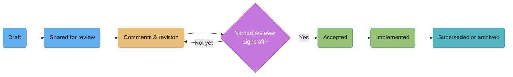
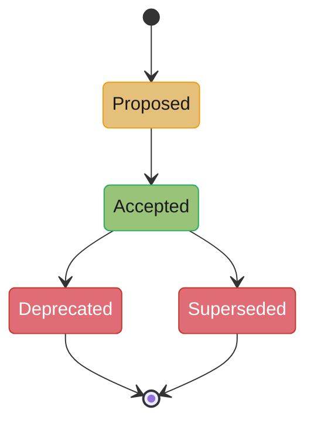
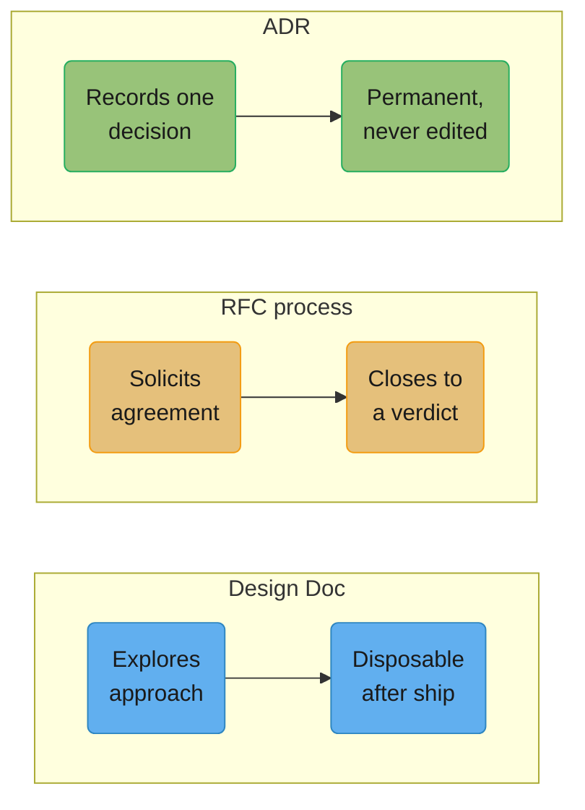

# Design Docs, RFCs & ADRs

## 1. Concept Overview

Three written artifacts carry every technical decision that matters, and engineers
routinely confuse them because they look similar and often share a template. A **design
doc** explores a problem before the decision is made — it argues for an approach and shows
the ones it rejected. An **RFC** (Request for Comments) is the mechanism by which a design
doc, or a smaller proposal, gets a verdict from a defined set of people by a defined date.
An **ADR** (Architecture Decision Record) is what survives after the verdict: a short,
permanent, near-immutable record of what was decided and why, stripped of the exploration
that produced it.

The failure mode this module exists to prevent is not "we didn't write anything down." It
is worse: teams write plenty down, in the wrong shape, so that six months later nobody can
answer "what did we actually decide" without re-reading a 40-page doc, a Slack thread, and
a meeting nobody minuted. A design doc without a decision, an RFC that never closes, and an
ADR that gets silently edited instead of superseded are three versions of the same
underlying failure: treating the written record as decoration rather than as the
decision-making mechanism itself.

This module covers Google's design doc practice (Malte Ubl, "Design Docs at Google",
industrialempathy.com, 2020), Amazon's six-pager and PR/FAQ ("working backwards"), RFC
processes at Squarespace, Uber and Stripe, the RFC 2119/8174 keyword vocabulary every
engineer should be able to use precisely, and Michael Nygard's original ADR format
(Cognitect blog, 2011) plus its community successor, MADR.

---

## 2. Intuition

> **One-line analogy**: A design doc is a rehearsal, an RFC is the vote that ends it, and
> an ADR is the plaque bolted to the wall afterward — nobody repaints the plaque, they hang
> a new one next to it.

**Mental model**: the three artifacts are not three levels of formality on one scale.
They are the same underlying decision at three different points in its life, with
different audiences and different rules about mutability. Before the decision, the
document is exploratory and expected to change — that is the design doc, and an RFC is the
process wrapped around it that forces the exploration to end. After the decision, the
document is not supposed to change at all — that is the ADR. Editing a design doc mid-review
is normal. Editing an accepted ADR to reflect a new decision is the single most common
mistake this module corrects.

**Why it matters**: the cost of an undocumented decision is not paid by the person who made
it. It is paid eighteen months later by whoever inherits the system, asks "why is it built
this way," and gets either silence or a wrong guess. A five-minute ADR at decision time is
cheaper than the two hours of archaeology — reading old PRs, pinging people who have left
the team, reconstructing a Slack thread from search — that the same question costs without
one.

**Key insight**: length and formality are not the variable that matters. A one-paragraph
ADR and a twenty-page design doc can both be doing their job correctly, or both failing,
because the real test is whether the document answers a different question than the one
next to it. A design doc answers "what should we do and what did we rule out." An RFC
process answers "who agreed, and by when." An ADR answers "what did we decide" — nothing
more.

---

## 3. Core Principles

- **Writing forces rigor that talking does not.** A sentence that sounds fine spoken aloud
  often falls apart the moment it has to survive being read silently by a skeptic. This is
  the entire rationale behind Amazon's silent-reading ritual, covered in §6.
- **A decision record answers "what did we decide," not "what should we do."** Conflating
  these is the single most common structural mistake in this space: a design doc that gets
  reused as the permanent record ages badly, because it still contains the rejected
  alternatives and the author's hedging as if they were live.
- **Non-goals are a scope-defense mechanism, not padding.** Every goal you write invites a
  reviewer to ask why you didn't also solve the adjacent problem. A non-goal answers that
  question once, in advance, instead of in every review comment and in every "why doesn't
  this handle X" conversation for the life of the project.
- **Written artifacts outlive the team that wrote them.** Assume the reader has never met
  you, does not remember the meeting, and is reading this two years from now to decide
  whether to rip your system out.
- **Review is a converging process with a deadline, not an open solicitation.** "Any
  feedback welcome, no rush" produces silence. A named reviewer and a specific date
  produces a decision.
- **Immutability plus supersession beats editing.** The record of *why something used to be
  true* is exactly as valuable as the record of what is true now — usually more valuable,
  because it is the only thing standing between the next engineer and repeating the mistake
  the original decision avoided.

---

## 4. Types / Levels / Modes

| Artifact | Typical length | Audience | When it's used | Mutable? | Owner after decision |
|---|---|---|---|---|---|
| Mini design doc | 1-3 pages | Immediate team | Small, low-ambiguity change | Yes, during review | Author, informally |
| Full design doc | 10-20 pages | Team + adjacent teams | Ambiguous problem or solution, cross-team impact | Yes, during review; then frozen or archived | Whoever owns the system it describes |
| Amazon six-pager | 6 pages, narrative prose | A room, read together | Any decision meeting at Amazon, from a new feature to an org change | Yes, up to the meeting | The meeting's decision-maker |
| PR/FAQ | 1-2 pages press release + FAQ | Leadership, "working backwards" reviews | New product or feature, before it is built | Yes, iterated like a doc | Product owner |
| RFC (process) | Wraps a design doc or a shorter proposal | Named reviewers/approvers + broadcast list | Any decision that needs multiple stakeholders' agreement | The wrapped doc is mutable; the RFC's outcome (accepted/not yet) is not | Whoever is accountable for the decision |
| ADR | Half a page to two pages | Future engineers, current team | Immediately after an architecturally significant decision is made | No — supersede, never edit | The repository / codebase itself |
| MADR (Markdown ADR) | Same as ADR, structured template | Same as ADR | Teams wanting a stricter, more automatable ADR format | No | Same as ADR |

The axis that actually separates these is **mutability and permanence**, not "how
technical" the content is. A design doc and an ADR can describe the identical decision; the
design doc is disposable scaffolding, the ADR is the load-bearing wall.

---

## 5. Models & Frameworks Diagrammed

*A generic doc lifecycle covering both design docs and RFC-wrapped proposals: the loop
between "shared for review" and "comments & revision" is meant to close, not run forever —
§10 covers what it looks like when it doesn't.*

*Nygard's ADR status lifecycle. There is no "rejected" state for an accepted decision and
no path back from Accepted to Proposed — a changed mind produces a new ADR that supersedes
the old one, it never rewrites it.*

*Same underlying decision, three different lifespans. A single decision can legitimately
pass through all three: explored in a design doc, ratified through an RFC, and permanently
recorded as an ADR once the RFC closes.*

---

## 6. How It Works — Detailed Mechanics

### 6.1 Google's design doc anatomy

Malte Ubl's essay "Design Docs at Google" (industrialempathy.com, 2020) lays out the
anatomy that Google engineers use in practice:

- **Context and Scope** — a short, factual grounding of the landscape the new system is
  being built into, written so a reader with no prior context can follow the rest of the
  document.
- **Goals and Non-Goals** — goals are the outcomes the design is judged against.
  **Non-goals are not negated goals** ("the system shouldn't crash" is not a non-goal). A
  non-goal is something that could reasonably have been a goal, and was explicitly chosen
  not to be one.
- **The Actual Design** — the design itself, opening with an overview and getting more
  detailed, with an explicit focus on the trade-offs made, not just the shape of the final
  system.
- **Alternatives Considered** — other designs that were seriously evaluated, with the
  trade-off comparison that justifies why the chosen one won.
- **Cross-cutting Concerns** — security, privacy, observability and similar
  organization-wide standards, addressed while the design is still cheap to change.

Ubl reports the sweet spot for a larger project's design doc is roughly **10-20 pages**,
with smaller "mini design docs" of 1-3 pages for incremental changes. A doc is warranted
when the solution is ambiguous because of problem complexity, solution complexity, or
both — his heuristic is a short set of guiding questions, and answering yes to most of them
means write the doc. Review at Google ranges from lightweight comment-based feedback to a
scheduled design review meeting for anything with wide-reaching or hard-to-reverse
consequences. After the project ships, the doc is not deleted; it accumulates amendments
over time until, in Ubl's words, it looks "a state more akin to the US constitution with a
bunch of amendments" — a historical record, not a live spec.

**Why the non-goals section is the one engineers skip, and the one that saves the most
time.** Writing a non-goal feels like admitting weakness before anyone has attacked you for
it, so authors leave it out and only discover its absence in review, when a stakeholder
asks "does this handle X" and the author has to improvise an answer live, in a meeting,
under mild pressure. A non-goal written down in advance turns that same question into a
one-line pointer back to the doc instead of a fresh argument every time it comes up — and
it comes up more than once, from more than one reviewer, because nobody who asks it has
seen anyone else ask it first.

### 6.2 Amazon's six-pager, the silent-reading ritual, and the PR/FAQ

Amazon's decision-meeting format bans slide decks outright. From the company's own **2017
Letter to Shareholders**:

> "We don't do PowerPoint (or any other slide-oriented) presentations at Amazon. Instead,
> we write narratively structured six-page memos. We silently read one at the beginning of
> each meeting in a kind of 'study hall.' Not surprisingly, the quality of these memos
> varies widely. Some have the clarity of angels singing. They are brilliant and thoughtful
> and set up the meeting for high-quality discussion."

The ban traces back to a 2004 internal memo from Jeff Bezos to Amazon's senior leadership
(the "S-team"), reported consistently across secondary sources (CNBC, Amazon reporting by
Brad Stone) but whose exact original wording is not itself published, so this module
paraphrases rather than quotes it: the rule was that no team could use PowerPoint or bullet
points as meeting documentation, full stop.

**The silent reading ritual.** The first 20-30 minutes of a decision meeting at Amazon are
spent with everyone reading the six-page memo in silence, before any discussion starts.
This is the point, not a scheduling inconvenience:

- It guarantees every person in the room has actually engaged with the argument, instead of
  skimming it beforehand or nodding along to a presenter's summary.
- It removes the presenter's advantage — the author does not get to control pacing, gloss
  over a weak section, or read the room and adjust the pitch live. The document has to
  survive on its own.
- It surfaces problems before anyone has publicly committed to a position, because the
  first questions come from people who formed their opinion in silence rather than in
  reaction to a colleague's.
- A narrative memo, unlike a slide deck, cannot hide a missing argument behind a bullet
  point. Bezos's own framing (reported by CNBC and elsewhere) is that a bulleted deck "gives
  permission to gloss over ideas" in a way full sentences do not.

**The PR/FAQ.** Amazon's "working backwards" method for new products opens with two
documents written *before any building starts*: a mock press release announcing the
finished product as if it already shipped, and a customer-facing FAQ answering the
questions a real customer would ask. Writing the press release first forces the team to
state the customer benefit in one paragraph, in plain language, with no internal jargon —
if that paragraph is weak or generic, the team finds out before writing a line of code
instead of after.

### 6.3 RFC processes: who writes, who reviews, how it closes

**Uber.** Uber's proposal process began as an internal format called DUCK and evolved into
the RFC, a Request for Comments document that authors of a new service write to describe
its purpose, architecture and dependencies before building it, circulated to segmented
engineering mailing lists (Backend, Web, Mobile) to keep the volume manageable as the
company scaled. It serves two purposes: soliciting feedback that improves the design, and
surfacing duplicate effort across teams before it happens.

**Stripe.** Stripe's engineering culture is documented as an unusually deep writing
culture: significant decisions begin with a detailed internal memo rather than a meeting,
and leadership — including the CEO — publishes regularly to internal engineering blogs to
model the practice. Stripe maintains sample documents (RFC templates, README templates,
runbook templates, FAQ templates) specifically so new hires can see what "good" looks like
rather than inferring it.

**Squarespace.** Squarespace calls its RFCs "Design Documents" and documented a concrete
evolution of the process in a 2019 post by Principal Engineer Tanya Reilly, "The Power of
'Yes, if': Iterating on Our RFC Process" (Squarespace Engineering Blog). Two changes
mattered most: the RFC template gained an explicit **approvers** section — named people who
must actually sign off before implementation starts, not just an open comment thread — and
the company created an **Architecture Review**, a twice-weekly meeting where a small group
of senior engineers reviews one RFC in depth for a full hour. The philosophy that gives the
post its title: an RFC at Squarespace can never be given a flat "rejected" status, only
**"not yet"** — a rewrite of the same idea with a named condition attached is always the
answer, never a dead end with no path forward.

**The failure mode: an RFC process becomes a veto queue.** This happens when "who must
review" is unbounded (anyone can add themselves as a blocking reviewer), when there is no
closing mechanism (no date, no named decision-maker, no default outcome if nobody objects),
and when disagreement is expressed as silence or a stalled comment thread rather than a
counter-proposal. Squarespace's "yes, if" reframe and its named-approvers-plus-deadline
structure is a direct structural fix to this exact failure: a reviewer who blocks has to
say what would make it a yes, which converts an open-ended objection into a specific,
resolvable ask.

### 6.4 RFC 2119 / RFC 8174 keyword semantics

Any spec, protocol document, or internal engineering standard that uses MUST/SHOULD/MAY is
invoking a specific, published vocabulary — RFC 2119 (Bradner, 1997), clarified by RFC 8174
(Leiba, 2017):

| Keyword | Meaning |
|---|---|
| MUST / REQUIRED / SHALL | An absolute requirement of the specification. |
| MUST NOT / SHALL NOT | An absolute prohibition of the specification. |
| SHOULD / RECOMMENDED | Full implications must be understood and weighed before ignoring; valid reasons to deviate may exist in particular circumstances. |
| SHOULD NOT / NOT RECOMMENDED | Same as SHOULD, inverted: there may be valid reasons to do the labeled thing, but the full implications must be weighed first. |
| MAY / OPTIONAL | Truly optional; an implementation is free to include or omit it. |

**RFC 8174's clarification, which most engineers who quote RFC 2119 get wrong: these words
carry the special meaning ONLY when written in ALL UPPERCASE.** Writing "the client should
retry" in a design doc is an ordinary English sentence with no binding force. Writing "the
client SHOULD retry" is invoking RFC 2119 explicitly, and a reader familiar with the
convention will treat it as a formal, if soft, requirement. This matters directly in any
spec, API contract, or internal standard an engineer writes: casually capitalizing "MUST"
for emphasis, without meaning to invoke RFC 2119, creates a document that reads as more
binding than intended, and inconsistently lowercasing a genuine requirement creates the
opposite problem.

### 6.5 ADR mechanics

Michael Nygard's original template ("Documenting Architecture Decisions," Cognitect blog,
2011-11-15) has exactly five fields:

1. **Title** — a short noun phrase.
2. **Status** — proposed, accepted, deprecated, or superseded (with a reference to the
   superseding ADR).
3. **Context** — the forces at play: technological, political, social and project-local,
   stated as objectively as possible.
4. **Decision** — the response to those forces, written in active voice: "We will..."
5. **Consequences** — the resulting context after the decision is applied, including the
   negative and neutral consequences, not just the positive ones.

Nygard's status rule, in his own framing: a decision is "proposed" until stakeholders agree
with it, then "accepted." If a later decision reverses it, the old ADR is marked
**"deprecated" or "superseded"**, never deleted and never rewritten — "we will keep the old
one around, but mark it as superseded. It's still relevant to know that it *was* the
decision, but is *no longer* the decision." That is the entire argument for immutability:
the historical record of a wrong or outgrown decision is exactly as valuable to a future
engineer as the record of the current one, because it explains what was already tried.

**MADR** (Markdown Architectural Decision Records, documented at adr.github.io) is the
community's more structured successor template: it adds explicit fields for the decision
drivers, the options considered with pros and cons for each, and a "chosen option"
rationale — effectively folding a compressed alternatives-considered section into the ADR
itself. Teams adopt MADR over Nygard's original when they want the ADR to stand alone
without a companion design doc, at the cost of a longer per-decision record.

### Weak version -> Strong version: a doc's opening paragraph

**Weak version**

> This document discusses some options for how we might want to think about improving our
> caching strategy going forward, and outlines some of the tradeoffs involved.

**Strong version**

> Our cache hit rate has fallen from 94% to 71% over the last two quarters as catalog size
> grew 3x, and origin load is now the top cause of P1 incidents (4 of the last 6). This doc
> proposes moving from single-node LRU to a sharded cache with consistent hashing, argues
> against the two alternatives we considered, and asks for a decision by the next
> architecture review on 2026-09-08.

**What changed**: a measured before/after number, a named consequence (P1 incident count),
a stated proposal instead of "some options," and a decision date. The weak version reads
like the start of a brainstorm; the strong version reads like the start of a decision.

---

## 7. Real-World Examples

- **Google** — the design doc practice described in §6.1 is internal Google engineering
  culture, documented externally by a Google engineer (Malte Ubl) rather than by Google
  itself; it has since become one of the most widely copied design-doc templates outside
  the company.
- **Amazon** — the six-pager and PR/FAQ are documented directly by Amazon in its own
  shareholder letters and, in more operational detail, in Colin Bryar and Bill Carr's book
  *Working Backwards* (2021), written by two former Amazon executives.
- **Squarespace** — Tanya Reilly's "The Power of 'Yes, if'" post (Squarespace Engineering
  Blog, 2019) is a rare public account of a company iterating its RFC process based on a
  named, observed failure mode (RFCs stalling with no path to yes) rather than describing
  an idealized process.
- **Uber** — the DUCK-to-RFC evolution, and the later move to segmented mailing lists per
  engineering group, is a direct public example of an RFC process being restructured
  specifically to survive scale.
- **Stripe** — publishes engineering-culture retrospectives (via external interviews and
  its own engineering blog) describing a writing-first decision culture, including
  leadership modeling the practice by publishing their own internal memos regularly.
- **adr.github.io / MADR** — the community home for the ADR format and its most common
  structured template, used across many organizations that adopted Nygard's format without
  adopting Amazon's or Google's broader document culture around it.

---

## 8. Tradeoffs

| Dimension | Design doc | RFC (process) | ADR |
|---|---|---|---|
| Primary question answered | What should we do, and what did we rule out? | Who agreed, and by when? | What did we decide? |
| Length | 1-20 pages | Wraps a doc; process overhead is separate | Half a page to two pages |
| Mutability | High, until frozen | The wrapped doc is mutable; the outcome is not | None — supersede only |
| Speed to produce | Slow (exploration takes time) | Adds a review/closing cycle on top | Fast (minutes, after the decision is made) |
| Best for | Ambiguous or cross-team problems | Getting a defined set of people to commit | Preserving the "why" permanently |
| Failure mode if misused | Never converges to a decision | Becomes a veto queue with no closing rule | Gets edited instead of superseded, erasing history |

| RFC-as-consensus-tool | Upside | Downside |
|---|---|---|
| Broad review before building | Catches design flaws and duplicate effort early, per Uber's stated rationale | Can be gamed by simply not raising objections, then blocking after implementation starts |
| Named approvers | Makes "who must agree" explicit and closeable, per Squarespace's fix | Adds a bottleneck if approvers are too few or too busy |
| Open comment threads | Broadens the set of people who can catch a problem | Without a closing rule, becomes the perpetually-in-review doc (§10) |

---

## 9. When to Use / When NOT to Use

**Use a full design doc** when the solution is genuinely ambiguous — multiple credible
approaches exist, the choice crosses team boundaries, or getting it wrong is expensive to
reverse. This lines up closely with what Amazon's "one-way door" framing (2015 Letter to
Shareholders: irreversible decisions demand slow, careful, consultative process; reversible
ones do not) calls a Type 1 decision. **Skip the full doc** for a single-team, easily
reversible change — a 1-3 page mini doc, or no doc at all beyond a PR description, is
enough, and writing 15 pages for a two-way-door decision is itself a pitfall (§10).

**Use an RFC process** whenever a decision needs agreement from people who were not in the
room when the idea was formed — cross-team infrastructure, a shared API contract, anything
that becomes hard to unwind once other teams build on it. **Skip the formal RFC** for a
decision entirely inside one team's remit with no external dependents; routing it through a
multi-week review process just to get a rubber stamp burns the credibility of the process
for the decisions that actually need it.

**Use an ADR alone**, without a preceding full design doc, when the decision itself is
simple to state but easy to forget the reasoning behind later — a library choice, a naming
convention, a "we tried X and it didn't work" record. The exploration that a design doc
would provide isn't needed because there wasn't much to explore; what's needed is that the
decision and its reasoning survive.

---

## 10. Common Pitfalls

**The doc written after the code.** A design doc produced to retroactively justify a
decision that is already merged reads differently from one written before, and reviewers
can tell — the "alternatives considered" section becomes decorative, because there is no
real chance the decision changes based on feedback. One infrastructure team's postmortem on
a failed migration attributed a large share of the rework to exactly this: the
alternatives section listed two options nobody had seriously evaluated, because the doc
was written to explain a decision that had already shipped, and the real alternative that
should have been chosen never appeared in it at all.

**The 40-page doc.** Beyond roughly 20 pages, reviewers stop reading closely and start
skimming, which defeats the entire purpose of writing it down instead of talking about it.
A doc that has grown to 40 pages is very often three separate decisions wearing one
document's clothes — the fix is almost always splitting it, not trimming prose.

**The doc with no decision in it.** A document that surveys the landscape, lists five
options, and stops without recommending one is not a design doc; it is research notes
wearing a design doc's template. It costs the reader everything a real doc costs and
returns nothing, because the actual decision still has to happen somewhere else, off the
record, and that "somewhere else" is exactly what an ADR is supposed to prevent.

**The doc that lists alternatives nobody seriously considered.** A strawman alternative
padded into the "Alternatives Considered" section to make the chosen option look inevitable
is detectable by any reviewer who has done this job before, and it costs the author
credibility on every future doc they write, not just this one.

**The perpetually-in-review doc.** No named approver, no deadline, and an open comment
thread that anyone can extend indefinitely — this is the RFC-as-veto-queue failure
described in §6.3, and its cost compounds: teams learn that shipping without waiting for
the RFC to close is faster than waiting for it, which trains the organization to route
around the exact process meant to catch problems early.

**Editing an accepted ADR instead of superseding it.** One team edited ADR-009 in place
when a caching decision changed six months later, updating the "Decision" section to
describe the new approach. The next engineer who hit a bug caused by the *old* caching
behavior spent two days looking for a decision record that no longer existed, because it
had been silently overwritten — the exact failure Nygard's immutability rule exists to
prevent.

### Weak version -> Strong version: the review request message

**Weak version**

> Hey, whenever you get a chance, would love any thoughts on this doc if you have time,
> no worries if not!

**Strong version**

> Could you review the "Sharded Cache" doc by EOD Thursday 2026-08-27? I specifically need
> your read on section 4 (the consistent-hashing approach) since you've hit rebalancing
> issues with it before. If Thursday doesn't work, let me know today so I can find another
> reviewer.

**What changed**: a named reviewer, a specific deadline, a specific question instead of
"any thoughts," and a stated reason the ask is theirs to answer. "Any feedback welcome, no
rush" is engineered to be ignored — nobody feels the cost of not responding to it, because
no cost was ever attached.

### Weak version -> Strong version: an alternatives-considered entry

**Weak version**

> We also thought about using a message queue instead, but decided against it.

**Strong version**

> Alternative: Kafka-backed async processing. Rejected because our write volume (~40
> events/sec peak) doesn't justify the operational cost of running a Kafka cluster, and the
> 200ms of added latency from async processing breaks the synchronous confirmation flow
> product requires at checkout. Revisit if peak write volume grows past ~500 events/sec.

**What changed**: the alternative is named specifically, the rejection reason is a
quantified tradeoff rather than an unstated preference, and a condition is given for when
the decision should be revisited — which is itself the kind of detail an ADR built from
this doc should preserve.

---

## 11. Frameworks, Books & Further Reading

- Malte Ubl, ["Design Docs at Google"](https://www.industrialempathy.com/posts/design-docs-at-google/), industrialempathy.com, 2020.
- Colin Bryar and Bill Carr, *Working Backwards: Insights, Stories, and Secrets from Inside
  Amazon*, St. Martin's Press, 2021 — the six-pager and PR/FAQ methods from two former
  Amazon executives.
- Amazon.com, 2017 Letter to Shareholders — the primary published source for the "no
  PowerPoint, silent reading" description quoted in §6.2.
- Amazon.com, 2015 Letter to Shareholders — the "Type 1 / Type 2," one-way-door /
  two-way-door decision framework referenced in §9.
- Michael Nygard, ["Documenting Architecture Decisions"](https://www.cognitect.com/blog/2011/11/15/documenting-architecture-decisions), Cognitect blog, 2011-11-15 — the original ADR
  format.
- [adr.github.io](https://adr.github.io/) — the community home for ADRs and the MADR
  template.
- Tanya Reilly, ["The Power of 'Yes, if': Iterating on Our RFC Process"](https://engineering.squarespace.com/blog/2019/the-power-of-yes-if), Squarespace
  Engineering Blog, 2019.
- S. Bradner, [RFC 2119, "Key words for use in RFCs to Indicate Requirement Levels"](https://www.rfc-editor.org/rfc/rfc2119), IETF, 1997.
- B. Leiba, [RFC 8174, "Ambiguity of Uppercase vs Lowercase in RFC 2119 Key Words"](https://www.rfc-editor.org/rfc/rfc8174), IETF, 2017.
- See also [Executive Communication](../executive_communication/executive_communication.md)
  in this section for how the decision captured in a design doc or ADR gets carried into a
  budget or headcount conversation with people who never read the doc itself.

---

## 12. Interview Questions with Answers

**Q: What's the actual difference between a design doc and an ADR?**
**Short:** A design doc explores and is disposable; an ADR records one decision and is permanent.
A design doc argues for an approach and shows the alternatives that were rejected, and it
is expected to keep changing until review closes. An ADR is what's left after the decision
is made: five short fields — title, status, context, decision, consequences — with no
argument left to make. Conflating the two produces a permanent record still full of hedging
and rejected options, or a disposable doc treated as if it were the permanent one; keep
them as separate artifacts, and let the ADR outlive the doc that produced it.

**Q: Why do engineers skip the non-goals section, and why is that expensive?**
**Short:** Skipping it feels like admitting weakness, but its absence costs one re-litigated argument per reviewer, forever.
Writing "we are explicitly not solving X" up front feels like inviting an attack before
anyone has made one, so it's the section authors cut when time is short. Its absence means
every reviewer who wonders about X asks it live, in a comment or a meeting, and the author
re-argues the same scope boundary from scratch each time — a non-goal turns that recurring
cost into a one-line pointer back to the doc. The section is short to write and expensive to
have skipped.

**Q: An RFC has been open for six weeks with no resolution. What's actually wrong with the process?**
**Short:** No named approver and no deadline turned an open review into a veto queue.
The structural cause is almost always that nobody was ever named accountable for closing
it, and no date forced a decision either way. Squarespace's engineering blog documents
exactly this failure and its fix: an explicit approvers list plus a scheduled review
meeting, and a house rule that a review can only say "not yet" with a condition attached,
never a silent stall. Without those two structural pieces, a review process degrades into
whichever objection was raised most recently, indefinitely.

**Q: What does "MUST" mean in a spec, versus "should", versus "must" (lowercase)?**
**Short:** MUST is absolute; SHOULD allows deviation with justification; lowercase carries no special meaning at all.
Under RFC 2119, MUST/REQUIRED/SHALL is an absolute requirement, and SHOULD/RECOMMENDED
means valid reasons to deviate may exist but the full implications must be weighed first.
RFC 8174 then clarified something most engineers who quote 2119 miss: **only the
ALL-UPPERCASE spelling carries the special meaning** — "the client should retry" in
lowercase is an ordinary English sentence with no binding force, while "the client SHOULD
retry" invokes the formal vocabulary. Writing a spec that casually capitalizes "MUST" for
emphasis, without meaning to invoke RFC 2119, makes the document read as more binding than
intended.

**Q: How do you get a design doc actually reviewed instead of ignored?**
**Short:** Pre-wire the hardest reviewer privately first, then ask a named person for a specific decision by a specific date.
Send the doc to the person most likely to object before broadcasting it, so their concerns
are folded in rather than surfacing as a public objection later. Then request review with a
named person, a specific question ("I need a decision on the sharding approach in section 4"),
and a date — "any feedback welcome" gets ignored because no individual feels the review is
theirs to do, while a named ask with a deadline creates a specific person who now owns
responding.

**Q: What happens to an ADR when the underlying decision changes — do you edit it?**
**Short:** No — you write a new ADR that supersedes the old one and mark the old one superseded.
Nygard's original rule is immutability: the old ADR is kept, not deleted or rewritten,
because "it's still relevant to know that it was the decision, but is no longer the
decision." The new ADR references the one it replaces, and the old one's status changes to
"superseded." Editing an accepted ADR in place erases the record of what was tried before
and why it changed, which is precisely the information a future engineer debugging
old-behavior artifacts needs most.

**Q: What is Amazon's six-pager, and why the silent reading at the start of the meeting?**
**Short:** A narrative six-page memo replaces slides, read silently for 20-30 minutes before discussion starts.
Amazon bans PowerPoint for decision meetings; instead, the meeting opens with everyone
reading a six-page narrative memo in silence, a practice Bezos describes in the 2017
Letter to Shareholders as producing "high-quality discussion." The silent read guarantees
everyone actually engaged with the argument rather than skimming beforehand, and it removes
the presenter's ability to gloss over a weak section live — the document has to stand on
its own without a speaker controlling the pacing.

**Q: What's a PR/FAQ, and why write the press release before building anything?**
**Short:** Amazon's "working backwards" method: write the customer-facing press release and FAQ before building the product.
The PR/FAQ opens with a mock press release announcing the finished product as if it already
shipped, plus a customer FAQ, both written before any engineering work starts. Forcing the
customer benefit into one plain-language paragraph up front surfaces a weak or generic value
proposition immediately, instead of after months of building something nobody asked for in
those terms.

**Q: What are the five fields of Michael Nygard's original ADR template?**
**Short:** Title, Status, Context, Decision, Consequences.
Title is a short noun phrase; Status is proposed/accepted/deprecated/superseded; Context
states the forces at play (technical, political, social, project-local) as objectively as
possible; Decision is the response, written in active voice ("We will..."); Consequences
covers both the positive and negative outcomes of applying the decision, not just the ones
that favor it. All five fit comfortably on a single page for most decisions.

**Q: What's the failure mode where an RFC process becomes a veto queue, and how is it fixed?**
**Short:** Unbounded reviewers and no closing rule let any objection block indefinitely; named approvers and a deadline fix it.
It happens when anyone can add themselves as a blocking reviewer, there's no date forcing a
decision, and disagreement is expressed as silence in a stalled comment thread rather than
a counter-proposal. Squarespace's documented fix pairs a named-approvers section with a
twice-weekly Architecture Review meeting and a rule that a review can only say "not yet"
with a specific condition attached — turning an open-ended block into a resolvable ask.

**Q: How long should a design doc actually be?**
**Short:** Roughly 10-20 pages for a larger project; 1-3 pages for an incremental change.
Google's internal norm, per Malte Ubl's essay, treats 10-20 pages as the sweet spot for a
project with real ambiguity, and a 1-3 page mini design doc for smaller, less ambiguous
changes. Past roughly 20 pages, reviewers start skimming instead of reading closely, which
defeats the purpose of writing it down in the first place — a doc that has grown that long
is very often more than one decision wearing a single document's clothes.

**Q: Who should be allowed to write an RFC, and who has to review it?**
**Short:** Anyone can propose one; only named approvers can close it, which is what actually prevents drift.
Across Uber, Stripe and Squarespace's documented processes, proposal is generally open —
any engineer can write an RFC — but resolution is not: a defined set of reviewers or
approvers, not an open-ended comment thread, is what actually has to sign off before
implementation starts. The open-authorship, closed-approval split is what lets the process
scale without either gatekeeping ideas or letting every decision stall on universal
consensus.

**Q: What's the difference between SHOULD and MUST when you're writing your own internal spec?**
**Short:** MUST is non-negotiable; SHOULD permits a justified exception when the full tradeoff is understood.
A MUST in your own spec should be reserved for requirements you genuinely intend to be
absolute — the kind you'd fail a design review over. A SHOULD signals "there is a strong
default here, and deviating requires understanding what you're giving up" — appropriate for
guidance like retry behavior or naming conventions where a real exception can exist. Mixing
them up in either direction either makes real requirements look optional or turns every
soft preference into a blocking rule.

**Q: Why does cross-cutting concerns need its own dedicated section in a design doc?**
**Short:** Security, privacy and observability are cheapest to design in and most often forgotten without a forcing function.
Security, privacy and observability requirements are the ones most likely to be treated as
an afterthought if they don't have a named place to be addressed, because none of them are
the "main" thing the doc is proposing. A dedicated section forces the author to state, in
the same document that's under review, how the design handles each one — while the design
is still cheap to change, rather than after implementation when the same conversation costs
a rewrite instead of a paragraph.

**Q: What's the MADR template, and why would a team choose it over Nygard's original format?**
**Short:** MADR adds structured decision drivers and per-option pros/cons so the ADR stands alone without a separate design doc.
MADR (Markdown Architectural Decision Records, documented at adr.github.io) extends
Nygard's five fields with explicit decision drivers and a considered-options list with pros
and cons for each. A team adopts it over the original when it wants the ADR itself to carry
enough of the alternatives-considered reasoning to stand alone, without needing a companion
design doc — at the cost of a longer per-decision record than Nygard's original half-page
format.

**Q: What's wrong with a design doc written after the code is already merged?**
**Short:** Its alternatives section is decorative, because the decision it claims to be exploring has already shipped.
A retroactive doc's "alternatives considered" section can't do real work, because there is
no live chance any feedback changes the outcome — the code is already merged. Reviewers can
usually tell, and the practical cost is that the section becomes padding rather than
argument, which erodes the value of every alternatives-considered section the same author
writes afterward, since reviewers learn to skim past them.

**Q: How do you close out review comments on a design doc without an endless back-and-forth?**
**Short:** Triage each comment as blocking, non-blocking, or out of scope, and say so explicitly rather than replying to each in turn.
Sort every comment into one of three buckets — blocking (must be resolved before approval),
non-blocking (a suggestion, noted and optionally deferred), or out of scope (belongs in a
different doc or a follow-up) — and label each reply that way rather than litigating every
point to exhaustion. Knowing when to stop iterating and call the doc done is itself a skill:
once every blocking comment is resolved, further iteration on non-blocking suggestions is a
sign the deadline from the review-request ask (§10) needs to be enforced, not extended again.

---

## 13. Best Practices

- Write the review request with a named reviewer, a specific question, and a date — never
  "any feedback welcome."
- Pre-wire the hardest, most skeptical reviewer privately before broadcasting the doc.
- Write non-goals even when nobody has asked; they are cheapest before the first review.
- Keep the alternatives-considered section honest — list only options that were genuinely
  evaluated, with the real trade-off that ruled each one out.
- Cap a design doc around 20 pages; past that, split it into more than one decision.
- Never edit an accepted ADR's Decision field — write a new ADR and mark the old one
  superseded.
- Reserve MUST/SHOULD/MAY in your own specs for cases where you actually intend the
  RFC 2119 meaning, and keep them uppercase when you do.
- Give an RFC review a named approver list and a closing date before it goes out, not after
  it stalls.
- Use silent, individual reading time before a decision meeting whenever the stakes justify
  it — it is cheap and it measurably changes discussion quality.
- Match the artifact's weight to the decision's reversibility: heavy process for one-way
  doors, light process for two-way doors.

---

## 14. Case Study

**The sharding decision nobody wrote down.** A payments team decided, in a design review
meeting in early 2025, to shard their primary database by merchant ID instead of by region.
The decision was discussed for forty minutes, everyone in the room agreed, and the meeting
ended with no document — the assumption was that the resulting pull requests would make the
decision self-evident.

Fourteen months later, a new engineer proposed re-sharding by region to fix an unrelated
hot-partition problem, unaware the team had already tried and rejected that exact approach.
Nobody in the current team had been in the original meeting; two of the four attendees had
left the company. The re-sharding effort got two weeks into implementation — writing a
migration script, testing it against a staging clone — before someone found a stale Slack
thread referencing "the merchant-ID decision" and traced it back through search to a
half-remembered meeting nobody could fully reconstruct. The two weeks of implementation work
were discarded.

**What an ADR would have cost, and what it would have saved.** A five-field ADR written the
day of the original meeting — Title: "Shard primary DB by merchant ID, not region"; Status:
Accepted; Context: region-based sharding was evaluated first and rejected because merchant
transaction volume is heavily skewed toward three large clients, producing hot regional
shards; Decision: shard by merchant ID with consistent hashing; Consequences: cross-merchant
queries become more expensive, mitigated by a read replica keyed on region for reporting —
would have taken perhaps fifteen minutes to write. It would have been found by the new
engineer's first search for "sharding," instead of an accidental Slack-thread discovery two
weeks into rebuilding the same rejected approach.

**The fix the team made.** The team adopted a one-line rule: no architecturally significant
decision leaves a meeting without an ADR filed the same day, using Nygard's five fields, and
the doc is linked from the PR that implements it. The rule cost roughly ten minutes per
decision. Six months later, the same new engineer, evaluating a different resharding idea,
found the ADR in under a minute and moved on to a genuinely new alternative instead.
