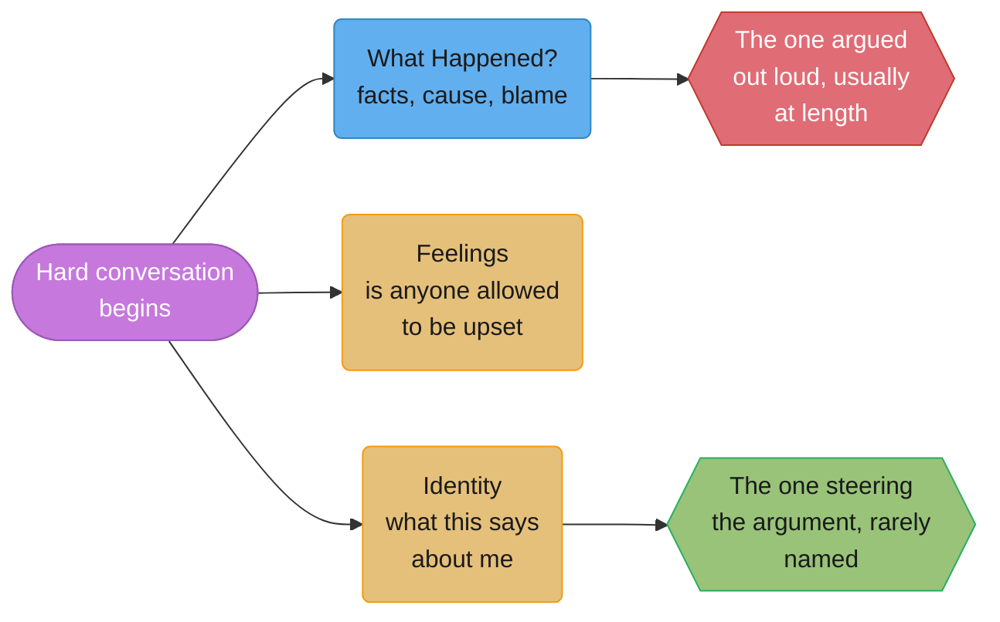
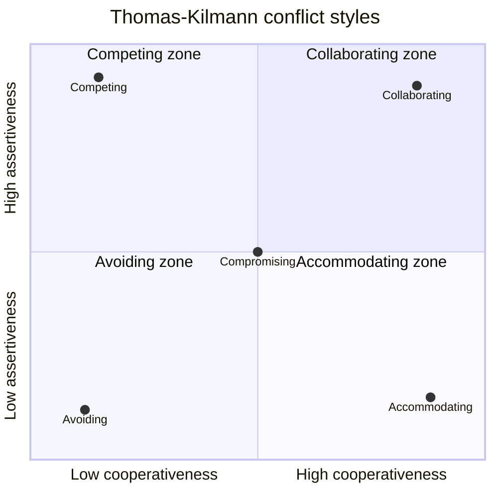
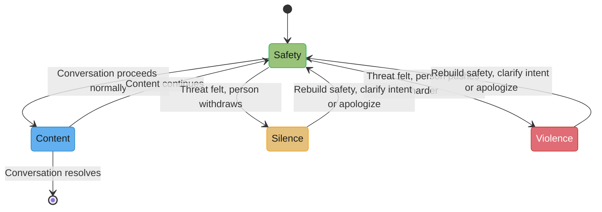

# Difficult Conversations & Conflict

## 1. Concept Overview

Every engineer avoids some conversation. The design review where you have to tell a peer
their approach will not survive contact with production. The 1:1 where you have to say
that someone's review comments read as contempt. The postmortem where you have to admit
the bug was yours. The Slack thread that has been "going in circles" for three days
because nobody will pick up the phone. This module is about those conversations — not
communication in the abstract, but the specific mechanics of a conversation where the
stakes are real, the outcome is uncertain, and both people would rather be somewhere
else.

The central claim, borrowed from two research programs that have earned the right to be
cited by name — Douglas Stone, Bruce Patton, and Sheila Heen's *Difficult Conversations*
(Penguin, 1999), and Kerry Patterson, Joseph Grenny, Ron McMillan, and Al Switzler's
*Crucial Conversations* (McGraw-Hill, first edition 2002) — is that a hard conversation
is never about the thing it appears to be about. A design review argument that sounds
like it is about caching strategy is often about whose judgment gets trusted on this
team. A dispute over a missed deadline is often about whether the estimate was ever
realistic or whether someone was set up to fail. Engineers are trained to argue the
technical merits and are almost never trained to notice when the technical merits stopped
being the actual argument three exchanges ago.

Conflict is not a defect in a team. A team with zero visible conflict either has no
disagreements worth having or has pushed every disagreement underground, where it comes
out as passive resistance, quiet attrition, or a postmortem that reads like a mystery
novel. The goal of this module is not conflict avoidance; it is conflict competence —
recognizing which conversation you are actually in, and running it on purpose instead of
by accident.

---

## 2. Intuition

> **One-line analogy**: a difficult conversation is an iceberg — the visible argument is
> the 10% above the waterline, and the feelings and identity stakes underneath are the
> 90% actually steering the ship.

**Mental model.** Treat every hard conversation as three simultaneous conversations
layered on top of each other: what happened (facts, causes, blame), feelings (is anyone
allowed to be upset, and about what), and identity (what does this say about me — am I
still competent, still a good person, still someone worth listening to). You can win the
first one completely and still fail the conversation, because the other two never got
addressed.

**Why it matters.** The conversations engineers are worst at are exactly the ones with
the largest asymmetry between technical skill and interpersonal stakes: telling a senior
engineer their approach is wrong, telling a report their performance has to change,
telling a peer that a decision they fought for and lost is still the wrong one to
relitigate. Avoiding these is not neutral — it has a cost, and the cost compounds weekly
in ways this module puts a number on (§6).

**Key insight.** You cannot solve the identity conversation by getting better facts. Bring
better data to a conversation where the other person is protecting their sense of
competence, and you will watch them get more entrenched, not less — because you are
answering a question ("who's right") that was never the one actually being asked
("am I still good at this").

---

## 3. Core Principles

- **A disagreement about "what happened" is rarely resolvable, because both stories are
  partially built from information the other person doesn't have.** You saw the missed
  deadline; they saw the incident that ate their week. Trying to establish a single true
  narrative before moving on wastes the conversation's best fifteen minutes.
- **Feelings that go unstated do not go away — they leak.** Into tone, into terse Slack
  messages, into who gets looped into the next design doc. Naming a feeling out loud,
  briefly, is cheaper than managing its leakage for six weeks.
- **Identity is almost always the real stake in an engineering disagreement.** "Am I
  still the person who can be trusted with the hard problems" is underneath more design
  review fights than "is this the right caching strategy."
- **Safety, not agreement, is the precondition for a useful conversation.** Once someone
  goes quiet or gets loud, the content of the disagreement is no longer what is
  happening; restore safety first, or nothing said past that point registers.
- **Contrasting prevents the worst kind of misread** — stating what you do *not* mean
  before what you do, so the other person isn't left to fill in the worst interpretation
  on their own.
- **The conversation you are avoiding is not getting cheaper while you wait.** It is
  accumulating interest, and the other party is the one who eventually pays the surprise.
- **Separate the person from the position, but do not pretend the position isn't personal
  when it plainly is** — a lot of "technical" disagreements in engineering are actually
  about ownership, credit, or someone having been overruled before, and treating them as
  pure engineering debates guarantees you argue past the real objection.

---

## 4. Types / Levels / Modes

**By what's actually being contested:**

| Mode | What it looks like | What it's usually really about |
|---|---|---|
| Technical disagreement | "This design won't scale past 10x" | Sometimes genuinely technical; often a proxy — see below |
| Process disagreement | "We shouldn't have shipped without a review" | Whose judgment the team trusts by default |
| Credit/ownership disagreement | "I already built half of this" | Recognition, career narrative, who gets to say "I built X" |
| Overruled-last-quarter disagreement | Re-litigating a decided call | The decision process felt illegitimate, not just wrong |
| Standards disagreement | "This isn't how we do error handling here" | Enforcing a norm nobody wrote down, so it reads as personal taste |

**By conflict style (Thomas-Kilmann Conflict Mode Instrument, Kenneth Thomas and Ralph
Kilmann, early 1970s)** — five modes along two axes, assertiveness (pursuing your own
concerns) and cooperativeness (pursuing the other person's):

- **Competing** — high assertiveness, low cooperativeness. Push your position, accept the
  relationship cost.
- **Collaborating** — high assertiveness, high cooperativeness. Work the actual interests
  until you find a solution neither started with.
- **Compromising** — moderate on both. Split the difference; faster than collaborating,
  worse than it on quality.
- **Avoiding** — low assertiveness, low cooperativeness. Sidestep the conflict entirely.
- **Accommodating** — low assertiveness, high cooperativeness. Give the other person what
  they want, at your own expense.

Engineers' default is **avoiding** — silently disagreeing in the design doc comments and
then building it their way anyway, or agreeing in the meeting and slow-walking it after.
The second-most-common default is **competing dressed as objectivity**: turning a
disagreement that is actually about trust or credit into a technical argument, because
"the benchmarks say so" feels safer to say out loud than "I don't think you've thought
this through" or "I built the last version of this and wasn't asked."

**By channel:**

- **Synchronous, in person or on a call** — richest signal, hardest to avoid, best for
  anything with an identity or feelings component.
- **Asynchronous, written** — a PR comment, a Slack thread, a doc comment. Fastest to
  start, easiest to misread, because tone is invented by the reader and it is invented
  worse the longer the thread runs.
- **Escalated / triangulated** — brought to a manager or a third party. Necessary
  sometimes; a trap when used to avoid the direct conversation rather than to genuinely
  need a decision-maker.

---

## 5. Models & Frameworks Diagrammed



*The visible argument (What Happened) is almost never the one deciding whether the
conversation actually resolves. Identity, the quietest of the three, is usually driving.*



*Engineers cluster in the bottom-left (avoiding) far more than any other quadrant, then
jump straight to top-left (competing) once avoidance fails — skipping collaborating
almost entirely, because it requires naming the interest under the position out loud.*



*From Crucial Conversations: the moment someone goes to silence (sarcasm, withdrawal,
masking) or violence (interrupting, labeling, dominating), stop discussing the content and
restore safety — nothing said past that point is actually being heard.*

---

## 6. How It Works — Detailed Mechanics

### 6.1 The pool of shared meaning

Patterson, Grenny, McMillan, and Switzler's central image in *Crucial Conversations*: the
best decisions come from the largest shared pool of relevant facts, feelings, and
theories — and every person who stays silent, or who dominates instead of contributing,
shrinks that pool. A design review where the two most senior people argue and everyone
else stays quiet is not a review with two data points; it is a review that discarded
everyone else's information before the decision got made.

"Start with heart" means checking, before you open your mouth, what you actually want —
for yourself, for the other person, for the relationship — because a conversation that
starts from "I want to win" produces a different fifteen minutes than one that starts
from "I want the service not to go down again."

### 6.2 STATE

The five STATE skills, in order: **Share your facts** (start with the observable, not
your conclusion — "the last three releases each had a rollback" not "you're being
careless"), **Tell your story** (your interpretation, offered as an interpretation — "and
I'm starting to wonder if we're rushing releases"), **Ask for others' paths** (invite
their view before you've finished building the case against them), **Talk tentatively**
("it might be" instead of "it is", which leaves room for a different explanation to be
true), and **Encourage testing** (make it safe to disagree with you, explicitly — "tell
me if I'm wrong about this").

### 6.3 Contrasting

Say what you do **not** mean before what you do. This single move prevents the most
common failure of a hard conversation: the other person filling the ambiguity with the
worst plausible interpretation while you're still talking.

```text
Without contrasting:
"We need to talk about your code reviews."
[Recipient spends the next ten seconds silently cataloguing every review they've
left this month, assuming the worst, and stops listening to whatever comes next.]

With contrasting:
"This isn't about your technical judgment, which is one of the strongest things
you bring to this team, and it isn't a formal warning. It's specifically about
tone — three people have told me your review comments feel like they're aimed
at the person, not the code, and I want to walk through two examples with you."
```

### 6.4 The arithmetic of the conversation you keep postponing

This is the section worth the most to an engineer reader, because it is the one place
avoidance can be priced instead of merely disapproved of.

Say a tech lead has decided a teammate's approach to a service migration is going to
create an operational problem, but has not said so — three sprints running, hoping the
teammate will course-correct on their own or that a code review comment will do the work
a conversation should.

```text
Week 1:  the tech lead notices the issue. Cost of raising it now: one 20-minute
         conversation, plan adjusts before any code is merged.
Week 4:  the teammate has built two more services on the same pattern. Cost of
         raising it now: the same 20-minute conversation, plus a rework
         conversation, plus the teammate now has to explain to their own
         reviewers why the pattern is changing mid-project.
Week 12: the pattern is in production, referenced by two other teams' services.
         Cost of raising it now: the same 20-minute conversation the tech lead
         could have had in week 1, PLUS a migration plan, PLUS a conversation
         with the two dependent teams, PLUS the teammate finding out — from a
         postmortem, not from the tech lead — that this was known and unsaid
         for eleven weeks.
```

The arithmetic that matters is not just that the fix gets more expensive — every reader
already believes that. It is that **the other person loses the chance to fix it
themselves.** In week 1, the teammate could have made the correction and nobody outside
the two of them would ever know it happened. By week 12, the correction is public, the
teammate did not choose the timing, and they find out that the tech lead knew and said
nothing at the exact moment their competence is on display to the widest audience. The
silence did not protect the relationship; it transferred the entire cost, plus interest,
to the worst possible moment to pay it — and it did that without ever asking the teammate
whether they'd have wanted to know sooner. Six months of silence is not six months of
neutrality; it is six months of the other person operating on information you knew was
wrong.

### 6.5 De-escalating in a channel

Text conversations lose tone, so the reader invents one — and under stress, people invent
the worst available tone. A flat "this doesn't work" reads as contempt in a thread and
reads as nothing at all said out loud on a call, same eleven characters. The written
de-escalation move is to **narrate the thing you'd normally convey with tone**: "I want to
flag — genuinely not trying to be sharp here, just want to get the API right before
Thursday" costs one extra sentence and removes the ambiguity a terse comment leaves open.

The move to know when to make: if a thread has had more than two or three round-trips
without converging, stop typing and say so.

```text
"This thread's gone back and forth four times and I don't think we're
converging — can we grab ten minutes on a call? I'll bring the two options
I see and we can just pick one."
```

Ten minutes on a call resolves what forty minutes of typing will not, because a call
restores the tone information text discarded.

### 6.6 What a real apology contains

A real apology names the specific thing, states its impact, contains no "if" ("if I hurt
you"), offers no explanation framed as an excuse, and says what changes. A non-apology
substitutes at least one of these with a hedge.

**Weak version**

> Sorry if the deploy caused problems for anyone. Things have been hectic and mistakes
> happen — we'll try to be more careful going forward.

**Strong version**

> I deployed Friday afternoon without a rollback plan, and it took the payments service
> down for 40 minutes. That's on me — I knew the on-call rotation was thin and pushed
> anyway. I'm adding a hard rule to my own workflow: no production deploy after 3pm on a
> Friday, full stop, and I'll say so out loud next time I'm tempted.

**What changed:** the "if" is gone, "mistakes happen" (blaming circumstance) is gone, the
specific act and its measured impact (40 minutes, payments) are named, and there's a
concrete, checkable change instead of a vague promise to be more careful.

### 6.7 Opening a sensitive topic

**Weak version**

> We need to talk about your code reviews.

**Strong version**

> This isn't about your technical judgment, which is one of the strongest things you
> bring to this team, and it isn't a formal warning. It's specifically about tone — three
> people have told me your review comments feel aimed at the person, not the code, and I
> want to walk through two examples with you.

**What changed:** the weak version leaves ten seconds of silence for the listener to fill
with the worst plausible meaning before they've heard a single specific fact; the strong
version contrasts what it isn't before what it is, and names the evidence (three people,
two examples) instead of leaving the scope of the complaint undefined.

### 6.8 Escalating a stuck cross-team disagreement

**Weak version**

> We should probably get someone else involved in this at some point since we're not
> agreeing.

**Strong version**

> I don't think the two of us are going to resolve the on-call split just between
> ourselves — I want to bring it to both our managers next week so we get a decision. I
> wanted to tell you first, before it happens, not have you hear about it in a meeting you
> weren't in.

**What changed:** "at some point" became "next week"; "someone else" became "both our
managers"; and the weak version can be agreed with and then never acted on, while the
strong version commits to a date and tells the other person directly instead of letting
them find out secondhand.

### 6.9 Escalating without ambushing

Escalating a conflict — bringing it to a manager, a skip-level, or a cross-team lead — is
sometimes the right call: when you've tried the direct conversation and it hasn't moved,
when the disagreement needs a decision-maker neither of you is, or when there's a pattern
a single conversation can't fix. The rule that keeps it from becoming a betrayal: **you
tell the other person before you escalate, not after.**

```text
"I want to be straight with you before I do this: I don't think we're going to
resolve the on-call split between our teams just between the two of us, and
I'm going to bring it to both our managers next week. I wanted you to hear
that from me first, not find out in a meeting you weren't in."
```

### 6.10 Four conversations, badly and well

Descriptions of conversations are cheap; the actual words are where the technique either
holds up or falls apart. Four complete conversations follow, each run twice.

**1. Telling a peer their design will not work, in a review, in front of others.**

```text
BADLY:

Priya: "Honestly I don't think this design works. The retry logic is going
to double-charge people, it's kind of an obvious problem."

Marcus: "It's not obvious, I spent two weeks on this."

Priya: "Well it's obvious to me. We can't ship this as-is."

Marcus: "Cool, so what do you want me to do, throw out two weeks of work
in the meeting?"

[Silence. The room moves on without a resolution. Marcus stops presenting
designs in this forum for the next two months.]

WELL:

Priya: "I want to flag one specific thing on the retry logic — not the
whole design, just this piece. If a retry fires before the first charge's
ack comes back, I think we could double-charge under load. Can we take the
fix offline after this and I'll show you the numbers?"

Marcus: "Sure — I hadn't modeled it against a traffic spike specifically.
Let's grab time after this."

Priya: "Sounds good. Everything else here looks solid to me, for what
it's worth."
```

**2. Telling someone their code review comments are hurting the team.**

```text
BADLY:

Dana (manager): "A few people have said your reviews come off harsh. You
might want to work on that."

Alex: "Which people? What did I even say?"

Dana: "I don't have the specifics in front of me, just — try to be nicer."

Alex: "Okay... I guess I'll try to be nicer."

[Alex has no idea what to actually change and starts leaving fewer
comments altogether, including ones that would have caught real bugs.]

WELL:

Dana: "This isn't about your technical judgment — it's genuinely some of
the sharpest review in the org. It's specifically about two comments.
On the payments PR you wrote 'this is obviously wrong,' and on the auth
PR you wrote 'did you even test this.' Both times the bug you caught was
real. I want the catches to keep happening — I want the wording to change."

Alex: "Huh. I didn't think of it as harsh, I thought I was being direct."

Dana: "The direct part is great. Something like 'I think this has a bug —
here's why' gets you the same catch without the person reading it as a
judgment on them. Want to try that phrasing on your next few?"

Alex: "Yeah, that's fair. I can do that."
```

**3. Being on the receiving end of "you're being difficult."**

```text
BADLY:

Jordan: "You're being kind of difficult about this migration timeline."

Sam: "I'm not being difficult, I'm being realistic. There's a difference."

Jordan: "Sure, whatever you say."

[Both leave the conversation more entrenched than they started it. The
timeline disagreement is never actually resolved, just abandoned.]

WELL:

Jordan: "You're being kind of difficult about this migration timeline."

Sam: "Can you say more about what specifically is landing as difficult?
I want to understand what you're seeing before I respond to it."

Jordan: "I guess — every option I bring you, you say why it won't work,
but you haven't proposed one that would."

Sam: "That's fair, I hadn't noticed I was doing that. Let me actually
put a proposal on the table instead of just reacting to yours — give me
until tomorrow."
```

**4. A conversation where you were wrong and have to say so.**

```text
BADLY:

Priya: "So the postmortem says the incident was caused by the config
change I pushed without review."

Marcus: "Yeah, I saw that."

Priya: "Well, the review process is honestly kind of slow anyway, that's
part of why I skipped it. Not totally on me."

Marcus: "...Okay."

[Marcus stops trusting Priya's config changes and starts quietly
re-reviewing them after the fact, without saying so.]

WELL:

Priya: "I want to own this directly before the postmortem review: I
pushed a config change without review Thursday night, and that's what
caused the outage. I knew the review step was there and skipped it
because I thought it was low-risk. I was wrong about the risk and wrong
to skip the step regardless. Starting now, no config change from me goes
out without a second pair of eyes, no exceptions, even at 11pm."

Marcus: "I appreciate you leading with that. Given it's said, I don't
think we need to relitigate it further in the review."
```

---

## 7. Real-World Examples

- **Google's Project Aristotle** (2012–2015 internal research on team effectiveness)
  found psychological safety — the shared belief that the team is safe for interpersonal
  risk-taking, including disagreement — as the single strongest predictor of team
  performance across 180+ teams studied, ahead of who was on the team. A team that avoids
  its difficult conversations is directly suppressing the variable Google's own data says
  matters most.
- **Netflix's "Keeper Test" and candor culture**, described in Reed Hastings and Erin
  Meyer's *No Rules Rules* (Penguin, 2020), formalizes blunt, in-person feedback as a
  stated norm rather than an occasional exception — explicitly to prevent the "postpone
  and let it leak" pattern this module prices in §6.4.
  ("Netflix" is a company name; the specific internal mechanics beyond the published book
  are not independently verified here and are not claimed beyond what the book states.)
- **Basecamp's "How we communicate" guide** (basecamp.com/guides/how-we-communicate)
  states "If it's important, critical, or fundamental, write it up, don't chat it down"
  and "Real-time sometimes, asynchronous most of the time." Applied to a disagreement,
  this puts each person's actual position in a written document that others can read and
  answer, instead of a hallway comment that never gets resolved. That counters the
  "avoiding" default this module names as engineers' most common conflict style.

---

## 8. Tradeoffs

| Approach | Strength | Cost |
|---|---|---|
| Raise it immediately, in private | Cheapest fix, most repairable | Requires catching your own avoidance in the moment |
| Raise it in the group setting (review, standup) | Efficient, transparent | Higher identity stakes for the other person; easy to accidentally humiliate |
| Raise it in writing first, talk after | Lets you draft calmly, gives the other person time to prepare | Tone gets invented by the reader; can read colder than intended |
| Escalate to a manager | Brings a decision-maker, can break a stuck loop | Damages trust if done without telling the other person first |
| Say nothing, let it resolve itself | Zero short-term cost, zero risk of a bad conversation | Compounds per §6.4; the other person loses the chance to fix it themselves |
| Compromise quickly to end the discomfort | Fast, low-conflict | Frequently worse than either party's actual best option — see Never Split the Difference in [Negotiation for Engineers](../negotiation_for_engineers/negotiation_for_engineers.md) |

---

## 9. When to Use / When NOT to Use

**Have the direct conversation when:** the cost is compounding weekly (§6.4), the other
person would want to know, the disagreement recurs (a one-off can sometimes be let go;
a pattern cannot), or silence is already leaking into tone and everyone can feel it.

**Do not have it in the group setting when:** the point could land as a peer critique in
front of an audience they didn't choose — take it to a 1:1 first, and if it needs to be
said publicly later, say it in a way the person has already heard privately.

**Escalate when:** you've had the direct conversation and it genuinely hasn't moved, or
the decision needs someone whose call it actually is. **Do not escalate when:** you
haven't had the direct conversation yet, or escalation is a way to get someone else to
say the thing you're avoiding saying yourself.

**Let it go when:** the disagreement is genuinely a one-time, low-stakes call and raising
it would cost more relationship capital than the issue is worth — not every second-best
decision needs a conversation, only the ones that recur or compound.

---

## 10. Common Pitfalls

- **Winning.** A design review "won" by out-arguing a peer in front of the team costs more
  in the next six months of that relationship than the technical point was worth — the
  loser doesn't forget being made to look wrong publicly, and starts routing around you
  instead of working with you.
- **The passive-aggressive "just to be clear."** "Just to be clear, I did flag this risk
  in the doc three weeks ago" is not a clarification; it is a public scorecard entry
  dressed as one, and everyone in the thread reads it as exactly that.

  **Weak version**

  > Just to be clear, I did flag this risk in the doc three weeks ago.

  **Strong version**

  > I did raise this risk three weeks ago in the doc — happy to help fix it now either
  > way, want to pair on it this afternoon?

  **What changed:** the weak version's only function is to be seen having been right; the
  strong version states the same fact once, then immediately offers to spend effort on
  the fix, which is the part that actually helps the person reading it.
- **Relitigating a decided thing.** Bringing back a call that was made and shipped on,
  without new information, reads as "I didn't accept the decision" even when the stated
  reason is "just want to make sure we got this right" — if there's no new fact, there's
  no reason to reopen it, and repeatedly doing this is how a team stops trusting a
  decision process at all.
- **Venting to a third party instead of the person.** Telling two other engineers that a
  teammate's reviews are "getting personal" — instead of telling the teammate — spreads
  the impression without giving the one person who could fix it the chance to.
- **The conversation held over chat that should have been a call.** A four-round-trip
  Slack thread arguing about ownership of a service is not more efficient than a ten-minute
  call; it's a worse conversation that takes longer and leaves a permanent, decontextualized
  transcript that can be reread months later stripped of tone.
- **Assuming malice where there is only a different set of constraints.** "They shipped
  without telling us" reads as disrespect until you learn their manager told them the
  deadline was fixed and non-negotiable — the fastest de-escalation available in almost
  any engineering conflict is asking "what were you working with when you decided this?"
  before assuming an answer.
- **A real incident:** a platform team at a mid-size fintech shipped a breaking API change
  without notifying a downstream consumer team, who found out from a failed deploy at 6pm
  on a Thursday. The consumer team's lead escalated straight to both directors without
  telling the platform team's lead first. The API break itself was fixed in 40 minutes;
  the working relationship between the two teams took most of a quarter to recover,
  because the platform lead's first knowledge that there was a problem was a director
  asking him about it in a meeting he wasn't warned about.

---

## 11. Frameworks, Books & Further Reading

- Douglas Stone, Bruce Patton, Sheila Heen — *Difficult Conversations: How to Discuss What
  Matters Most* (Penguin, 1999). Source of the three-conversations model (What Happened,
  Feelings, Identity).
- Kerry Patterson, Joseph Grenny, Ron McMillan, Al Switzler — *Crucial Conversations:
  Tools for Talking When Stakes Are High* (McGraw-Hill, 1st ed. 2002, 3rd ed. 2021).
  Source of the pool of shared meaning, "start with heart," contrasting, STATE, and the
  silence/violence model.
- Kenneth W. Thomas and Ralph H. Kilmann — the Thomas-Kilmann Conflict Mode Instrument
  (TKI), first published early 1970s. Source of the five conflict styles and the
  assertiveness/cooperativeness axes.
- Kim Scott — *Radical Candor: Be a Kick-Ass Boss Without Losing Your Humanity* (St.
  Martin's Press, 2017). Adjacent framework for the "care personally, challenge directly"
  axis that governs how a hard conversation gets delivered, not just what's in it —
  covered fully in [Giving and Receiving Feedback](../giving_and_receiving_feedback/giving_and_receiving_feedback.md).
- Reed Hastings and Erin Meyer — *No Rules Rules: Netflix and the Culture of Reinvention*
  (Penguin, 2020). Source of the Netflix candor examples in §7.
- Related module: [Negotiation for Engineers](../negotiation_for_engineers/negotiation_for_engineers.md)
  — what to do once the conversation has moved from "who's right" to "what do we each
  need."
- Related module: [Giving and Receiving Feedback](../giving_and_receiving_feedback/giving_and_receiving_feedback.md)
  — the recurring, lower-stakes cousin of the difficult conversation.
- Related module: [Incident Communication and Postmortems](../incident_communication_and_postmortems/incident_communication_and_postmortems.md)
  — difficult conversations under the specific constraints of an active incident.

---

## 12. Interview Questions with Answers

**Q: How do you tell a peer, in a design review, in front of others, that their approach won't work?**
**Short:** Name the specific failure mode with data, then move the disagreement to a private follow-up.

The tell: never make the identity stakes public. Say the concrete, falsifiable thing —
"at our current write volume this will hit the connection pool limit around month four,
here's the math" — and then take the disagreement about what to do next offline: "let's
grab fifteen minutes after this to figure out the fix together." The public part stays
factual and bounded; the working-it-out part, which is where someone's competence is
actually on the line, happens where only the two of you are present. Doing it the other
way around — hashing out the fix in the room — turns a technical correction into a public
contest.

**Q: Someone tells you "you're being difficult." How do you respond in the moment?**
**Short:** Ask what specifically prompted it instead of either accepting or rejecting the label.

Don't argue the label itself — "I'm not being difficult" just restarts the fight one
level more abstract. Ask: "what specifically am I doing that's landing as difficult?" This
does two things: it forces the other person to name a behavior instead of a character
trait, which is often more fixable than it sounded, and it signals you're willing to hear
it rather than defend against it. If the honest answer, once you hear the specifics, is
that you were right to push back, say so calmly — being right about the substance and
being told you're difficult about the delivery are not mutually exclusive, and only one of
them needs fixing.

**Q: What does a real apology contain that a non-apology doesn't?**
**Short:** A named specific act, its concrete impact, and a stated change — no "if," no excuse.

A real apology names the specific thing done, states the impact in concrete terms,
contains no "if" ("if this caused problems"), offers no explanation framed as an excuse,
and says what changes going forward. "Sorry if the deploy caused issues, things have been
hectic" hedges on whether anything happened and blames circumstance; "I deployed without a
rollback plan and took down payments for 40 minutes, that's on me, and I'm changing my own
workflow so it can't happen the same way again" does none of that. The presence of "if" is
the single fastest tell.

**Q: What are the STATE skills from Crucial Conversations, and what's the precondition for using them?**
**Short:** Share facts, tell your story, ask their path, talk tentatively, encourage testing — after safety.

Share your facts (the observable, not your conclusion), tell your story (your
interpretation, offered as one), ask for others' paths (invite their view before you've
finished building a case), talk tentatively ("it might be," not "it is"), and encourage
testing (make it safe to disagree with you). None of it works if the other person has
already gone to silence or violence — restore safety first, or the five skills are being
performed at someone who has stopped listening.

**Q: Why does winning the "what happened" argument usually fail to resolve a conflict?**
**Short:** Because the real disagreement is usually about feelings or identity, not facts.

Establishing whose version of events is more accurate answers a question that was rarely
the one actually driving the conflict. Underneath most heated "what happened" arguments is
an unaddressed feelings question (is anyone allowed to be upset here) or an identity
question (does this mean I'm not good at my job) — and winning the facts argument while
leaving those unaddressed produces someone who agrees with your account and is still angry,
because you answered a question they didn't ask.

**Q: What's the engineer's default conflict style, and why is it a liability?**
**Short:** Avoiding — silently disagreeing and building it your own way anyway, which erodes trust.

Per the Thomas-Kilmann model, engineers default to avoiding: low assertiveness, low
cooperativeness, sidestepping the disagreement rather than naming it. The liability isn't
the discomfort avoided — it's that the disagreement doesn't disappear, it goes
underground, and shows up later as quiet non-compliance, a design that quietly diverges
from what was agreed, or a working relationship that's cooled without either party ever
having said why.

**Q: How do you know when a written thread should become a call?**
**Short:** After two or three round-trips without convergence — say so directly and ask to talk.

Text loses tone, and the reader fills the gap under stress with the worst plausible
reading. If a Slack thread or PR comment chain has gone back and forth more than two or
three times without converging, stop typing and say it plainly: "this thread's going in
circles, can we talk for ten minutes?" Ten minutes synchronous resolves what forty minutes
of async back-and-forth usually will not, because it restores the tone information text
discarded in the first place.

**Q: What does six months of postponing a difficult conversation actually cost, concretely?**
**Short:** The fix gets more expensive weekly, and the other person loses the chance to fix it themselves.

It compounds two ways. First, mechanically: raising an issue in week one might cost a
20-minute conversation before anything is built on the flawed premise; by week twelve, the
same conversation now needs a migration plan and conversations with every team that built
on top of the unaddressed problem in the meantime. Second, and more costly: the other
person loses their own chance to notice and fix it quietly. They find out publicly,
usually at the worst moment, that you knew and didn't say anything — which damages the
relationship more than the original issue would have.

**Q: What is "contrasting" and when should you use it?**
**Short:** Stating what you don't mean before what you do, to prevent a worst-case misread.

From Crucial Conversations: open a sensitive topic by naming what you are *not* saying
before you say what you are — "this isn't a warning, and it isn't about your technical
judgment" before "it's specifically about the tone in three review comments." Use it any
time the first sentence of a hard conversation could plausibly be misread as worse than
you mean it, which is most of the time; without it, the other person spends the next ten
seconds silently assuming the worst and stops actually listening.

**Q: How do you escalate a conflict to a manager without it becoming a betrayal?**
**Short:** Tell the other person you're escalating before you do it, never after.

Escalation itself isn't the problem — sometimes a disagreement genuinely needs a
decision-maker neither party is. What makes it feel like an ambush is finding out about it
secondhand, in a meeting you weren't part of. Say it to their face or in a direct message
first: "I don't think the two of us are going to resolve this, and I'm bringing it to both
our managers next week — wanted you to hear that from me before it happens."

**Q: What is the "pool of shared meaning"?**
**Short:** The combined facts, feelings, and theories everyone in a discussion is drawing on.

From Crucial Conversations: the quality of a group's decision is bounded by how much
relevant information made it into the shared pool, and every person who stays silent out
of fear, or who dominates and crowds others out, shrinks that pool before the decision
gets made. A design review where two senior engineers argue while five others stay quiet
is not actually drawing on seven people's judgment — it's drawing on two, with five
silent data points discarded.

**Q: How do you tell a colleague their code review comments are hurting the team?**
**Short:** Cite two or three specific comments and their read, not a character judgment.

Bring examples, not a verdict: "in these two comments, the wording read as sharper than I
think you intended — 'this is obviously wrong' versus 'I think this has a bug, here's
why.'" Naming the specific pattern in specific comments is fixable; "you're harsh in code
review" is a character judgment the person has no concrete way to act on, and will
usually contest rather than absorb.

**Q: You're in the wrong and someone else already noticed before you said anything. How do you open that conversation?**
**Short:** Name that you know, before they have to raise it, and lead with the fix.

Don't wait to be confronted — the fact that you already know and are raising it yourself
changes the entire tone of the conversation. "I know the release notes were wrong, and I
know you probably caught that before I did — I should have caught it too, and here's what
I'm changing about my pre-release checklist." Leading with the admission removes the need
for the other person to spend energy extracting it from you.

**Q: What's the difference between someone going to silence versus going to violence in Crucial Conversations terms, and what do you do differently for each?**
**Short:** Silence withdraws (sarcasm, masking); violence pushes (interrupting, labeling) — both need safety restored first.

Silence shows up as sarcasm, going quiet, or masking real opinions with vague agreement;
violence shows up as interrupting, labeling ("that's a junior mistake"), or dominating the
airtime. Both are the same underlying signal — the person no longer feels safe — and the
fix is the same regardless of which direction it went: stop discussing the content and
address the safety problem directly, often by clarifying intent ("I'm not trying to
corner you here, I actually want your read on this") before returning to the topic.

**Q: A "technical" disagreement keeps resurfacing and the arguments never change. What's actually going on?**
**Short:** It's usually not technical — check for an unresolved ownership, credit, or overruled-decision issue underneath.

When the same technical argument keeps recurring with the same two people making the same
points neither has ever conceded, the technical layer is usually a proxy for something
that hasn't been named: who owns this system, who gets credit for having built it, or a
decision one of them was overruled on before and never accepted. Ask directly, privately:
"is there something about how this got decided last time that's still sitting wrong?" —
it surfaces the real disagreement faster than another round of benchmarks will.

**Q: What's wrong with opening a message with "just to be clear, I did flag this risk three weeks ago"?**
**Short:** It's a scorecard entry disguised as clarification, and everyone reading it knows it.

It reads as exactly what it is — a public "I told you so" wearing the grammar of a
neutral clarification — and it costs credibility with everyone reading the thread, not
just the person it targets, because it signals you're keeping score instead of solving
the problem in front of you. If the point genuinely needs making for the record, say it
plainly: "I did raise this risk three weeks ago in the doc — happy to help fix it now
either way."

**Q: Someone wants to relitigate a decision that already shipped, with no new information. How do you handle it?**
**Short:** Ask what's new since the decision; if nothing, decline to reopen it and say why.

Ask directly: "has anything changed since we decided this, or is this the same
information we had before?" If the answer is genuinely new information — a changed
constraint, a result the original decision didn't anticipate — reopening is correct. If
it's the same facts revisited because someone still disagrees with the outcome, say so
plainly rather than re-running the debate: "I hear that you still think this was the
wrong call, and I want to make space for that feedback separately — but I don't think we
should reopen the decision itself without something new." Reopening decisions on request
alone teaches the team that no decision is ever actually final.

---

## 13. Best Practices

- Have the conversation while it's still cheap — the arithmetic in §6.4 only gets worse.
- Separate the public and private parts: name the fact publicly if it must be public,
  work out the fix privately.
- Use contrasting before any sentence that could be misread worse than you mean it.
- Watch for silence and violence in the other person, not just in yourself, and address
  safety before continuing the content.
- Never let a Slack thread run past three unresolved round-trips — offer a call.
- Tell someone before you escalate about them, every time, no exceptions.
- When you're wrong, say so before you're asked, and lead with what changes.
- Ask "what were you working with when you decided this?" before assuming malice.
- If a technical disagreement keeps recurring unchanged, look for the ownership, credit,
  or overruled-decision issue underneath it before running another technical round.

---

## 14. Case Study

**Scenario.** A payments team's tech lead, Priya, reviews a teammate's (Marcus's) design
for a new reconciliation service and privately believes the retry logic will cause
duplicate charges under load. She says nothing in the design review — Marcus is well
regarded, the meeting is public, and she doesn't want to be "that person" who nitpicks in
front of the team. She plans to raise it "later, one on one."

Three weeks pass. Marcus ships the service. Priya still hasn't raised it — she's been
busy, and each day it feels slightly more awkward to bring up something that shipped
without objection. In week six, the service processes a spike during a promotional event
and double-charges 1,900 customers before anyone catches it. The postmortem review pulls
up the original design doc, where Priya's silence in the review is indistinguishable from
agreement.

**What the postmortem actually surfaces.** Marcus, understandably, is angry — not
primarily about the bug, but about learning that Priya had concerns for six weeks and
never said so. "If you saw this, why didn't you just tell me?" is the actual sentence he
says in the retro, and it is a Feelings-and-Identity question wearing a What-Happened
costume: the real content is "I trusted that silence meant I'd built it right, and I
didn't get the chance to fix it while it was still cheap."

**The conversation that should have happened, three weeks earlier:**

```text
Priya: "I want to flag something on the reconciliation design before it
ships — not a blocker on the whole thing, just the retry logic. Do you have
fifteen minutes?"

Marcus: "Sure, what's up?"

Priya: "I think under load, if a retry fires before the first charge's ack
comes back, we could double-charge. I ran the numbers assuming our current
p99 latency and a promo-level spike — it's not hypothetical, I think it's
likely within the first big event we run through this."

Marcus: "Huh. I hadn't modeled it against promo traffic specifically. Walk
me through the numbers?"

Priya: "Yeah — here's the doc. I think the fix is an idempotency key on the
charge request, which is maybe a day of work. I didn't want to say this in
the review in front of everyone since it's not really about whether the
design is good, it's one specific edge case."

Marcus: "No, I'd have wanted to hear this regardless of the room. Let's
fix it before we ship."
```

**Resolution.** The org adopted a norm after this incident: any reviewer with a specific,
unresolved technical concern about a design being shipped commits to raising it directly
with the author within 48 hours of the review, in writing if not in person — explicitly
to close the exact gap between "I said nothing in the room" and "I agreed with this."
Priya and Marcus's working relationship recovered within the quarter, in large part
because the retro named the six-week silence as the actual failure, not the retry logic
itself, which is what let both of them stop treating each other as the person who caused
1,900 duplicate charges and start treating the norm as the thing that broke.
