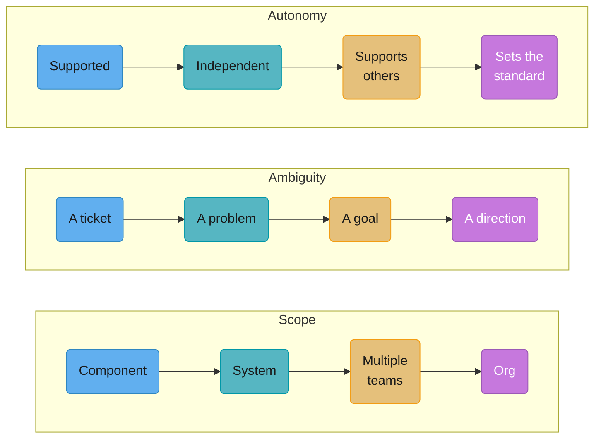
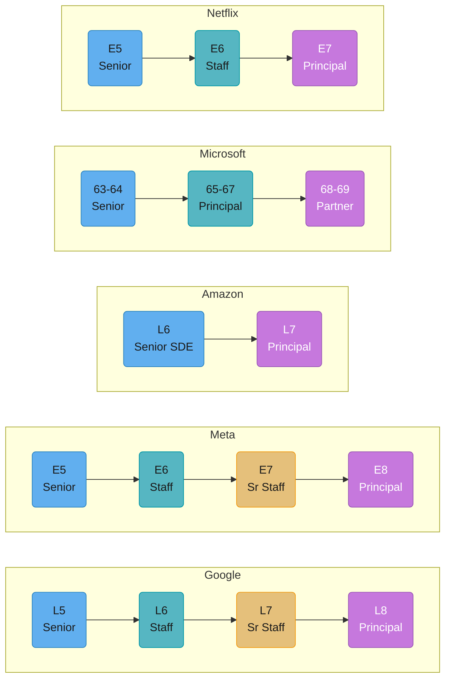
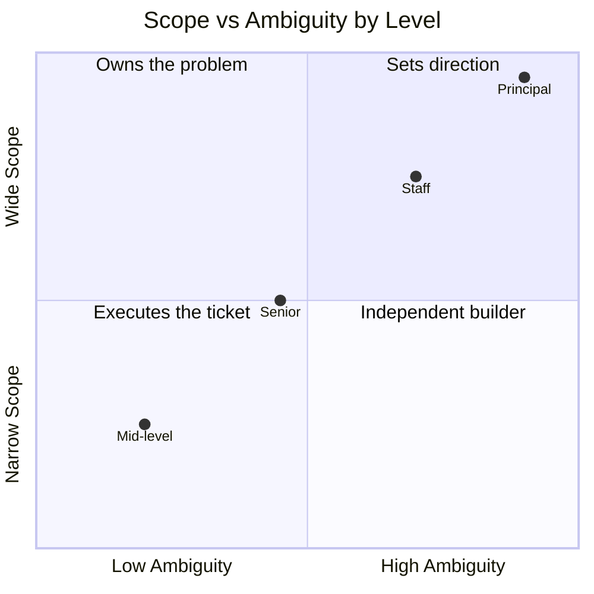
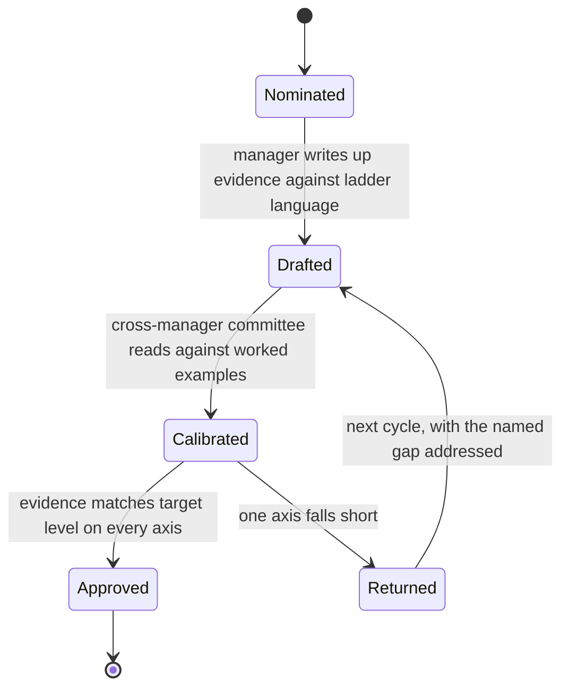
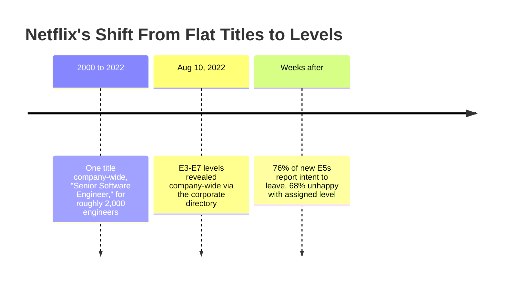

# Engineering Career Ladders

## 1. Concept Overview

A career ladder is a written document that maps observable job scope to a title, a level number, and a compensation band. It exists to solve one specific organizational problem: without it, two managers evaluate the same evidence differently, one engineer's "Senior" is another's "Staff," and promotion becomes a function of who asks loudest rather than what changed. A ladder is a calibration tool first and a motivational poster a distant second.

Ladders serve two audiences that pull in different directions. Internally, they give a promotion committee a shared yardstick so five different managers can argue from the same document instead of five different gut feelings. Externally, a published ladder is a recruiting and negotiation artifact — a candidate can read Monzo's or Square's ladder before an onsite and know what "Staff" is actually supposed to mean there, and a hiring manager can point to a specific line rather than a vibe. The tension: a document precise enough to calibrate five managers is usually too detailed to stay current, and a document loose enough to stay current is too vague to calibrate anyone.

Ownership of the document itself is worth naming explicitly, because it shapes what the ladder actually optimizes for: a ladder authored and owned by engineering leadership (Rent the Runway's was written by the CTO) tends to read in scope-and-judgment language; one owned primarily by HR/People tends to read closer to generic competency-framework language shared across non-engineering functions at the same company. Neither is wrong, but they produce different documents, and knowing who actually maintains the one in front of you is a fast way to predict how literally to read it.

Almost every ladder in production forks into two tracks at some level: individual contributor (IC) and management (EM). Where the fork happens, and whether the tracks are actually paid and respected equally past that point, is one of the most consequential and most poorly disclosed facts about any given company — Square forks explicitly (SWE track starts at L3, EM track starts at L5), while others let the fork happen informally around Staff/Senior. Ladders are also not static once written. Monzo's four major published revisions between 2017 and 2025 are the most visible public example of a ladder being actively maintained rather than left to go stale, and even companies that never publish externally typically revise their internal document every few years as the org's actual work changes — a ladder written for a 200-person company rarely still fits the same company at 2,000. An engineer citing "what the ladder says" is implicitly citing a specific dated version of it, which is worth confirming explicitly rather than assuming (§10).

This module covers the IC side of the ladder — how it is built, how the same three axes recur under different vocabulary, and how to read one honestly instead of chasing a title. Everything that actually moves someone up a rung — scope, ambiguity, ownership, counterfeit vs. real impact — is a separate module: [Scope, Impact & Ownership](../scope_impact_and_ownership/scope_impact_and_ownership.md).

---

## 2. Intuition

> **One-line analogy**: A career ladder is not a ruler measuring how good your code is — it's a map of how much blast radius the organization currently trusts you with.

**Mental model**: Picture every level as a permission slip, not a grade. A junior engineer's permission slip says "you may modify this function, with review." A staff engineer's says "you may decide that twelve services should stop having their own retry logic, and go tell four teams why." The code doesn't get "better" between those two slips in any way a compiler would notice — the blast radius of being wrong, and the amount of the problem nobody defined for you in advance, both grew.

**Why it matters**: Engineers routinely misread ladders as a difficulty curve ("Staff work is just harder Senior work") and then wonder why writing more code, or writing cleverer code, doesn't move them. It doesn't, because the ladder isn't measuring code quality past a baseline — it's measuring scope, ambiguity, and autonomy, and those three axes are set by the org's trust in you, not by your keyboard output.

**Key insight**: Every published ladder — Google's numbered levels, Rent the Runway's D&D stats, Netflix's post-2022 grid — uses different words for the same three underlying axes. Learn to read past the vocabulary to the axes, and any company's ladder becomes legible in about ten minutes, including one you've never seen before.

---

## 3. Core Principles

- **Scope** — how much of the system is affected by your decisions: one component, one system, multiple teams' worth of systems, or the org's technical direction. This is the axis most engineers track instinctively, and the one that is easiest to inflate by counting lines of code touched rather than decisions made.
- **Ambiguity** — how much of the problem was defined before it reached you: a ticket with acceptance criteria, a named problem with no prescribed solution, a goal with no named problem ("reduce customer-reported latency complaints"), or a direction with no named goal ("what should our resilience story be for the next three years"). Ambiguity is the axis that best explains why two engineers with identical technical skill land at different levels — one is handed problems, the other is handed the absence of a problem statement.
- **Autonomy / support** — whether you are supported through the work, work independently, support others through their work, or set the standard others are measured against. This is the axis that explains why "Staff" is not "Senior but harder": Staff is usually the first level where a meaningful fraction of your value is measured by what *other people* produce because of you, not by what you personally shipped. That mechanism is covered in depth in [Scope, Impact & Ownership](../scope_impact_and_ownership/scope_impact_and_ownership.md) §6.
- **Levels are cumulative, not lockstep.** A ladder assumes each level's expectations subsume the previous level's — Square's own framework states this explicitly ("each level builds on the criteria from the preceding level"). This is why an engineer with lopsided skills (excellent system design, weak mentorship) usually stalls rather than half-promotes — most calibration processes require the floor to be met on every axis, not just the ceiling on one.
- **A ladder is only as good as its calibration process.** The document itself is inert; what makes it fair is a cross-manager committee reading packets against shared worked examples, catching the manager who grades generously and the one who grades stingily. A beautifully written ladder with no calibration behind it is decoration.
- **A title is a claim; the scope statement is the evidence.** The rest of this module is largely about training yourself to read and write in scope-statement language instead of title language, because titles don't transfer across a company boundary and scope statements — imperfectly — do.

### A short glossary, since the vocabulary here is inconsistent across companies

- **Scope statement** — the specific written language a ladder uses to describe what a given level owns and decides; the thing to compare instead of the title.
- **Calibration committee** — a cross-manager group that reads promotion packets against a shared leveling guide, specifically to catch one manager's individual bias.
- **Leveling guide** — the internal document of real, anonymized past-promotion examples a calibration committee checks a new packet against.
- **Packet** — the assembled evidence (narrative, metrics, design docs, testimony) submitted for a promotion decision.
- **Terminal level** — the level most engineers in a given ladder are expected to reach and stay at; not a failure state (§10).
- **Fork point** — the level at which the IC and management tracks diverge into separately calibrated ladders.
- **Bar** — informal shorthand for the evidence threshold a given level requires; "raising the bar" means tightening what evidence a level demands.
- **Downleveling** — being placed at a lower level than a candidate's previous title, based on the evidence gathered rather than the prior title (§7, §12).
- **Level-checking** — the practice of interviewing a candidate against a target level's scope statement rather than a fixed title.
- **Track fork** — the point in a ladder where the IC and management paths become separately calibrated and separately titled.
- **Blast radius** — how much of the system, and how many people, are affected if a given decision is wrong; the primary way "scope" is judged in practice (fully developed in [Scope, Impact & Ownership](../scope_impact_and_ownership/scope_impact_and_ownership.md) §3).
- **Multiplier work** — work whose value comes from other people's output changing because of you, rather than from your own individual output; the mechanism behind why Staff-plus scope isn't just "more code" (see the companion module).

### Reading an unfamiliar ladder in ten minutes

A repeatable checklist for a document you've never seen before — a competing offer's ladder, a target company's public framework, or your own company's ladder on the first day you actually read it closely:

1. **Find the fork point.** Where does IC split from management, and is it explicit (Square: L3 vs. L5) or informal?
2. **Count the rungs above Senior.** One extra rung (Amazon: straight to Principal) behaves very differently from three (Google: Staff, Senior Staff, Principal) — more rungs usually means more calibration overhead but finer-grained recognition.
3. **Find the terminal level the document itself implies.** Look for language like "most engineers," "the majority," or an explicit statement that the next level isn't guaranteed (Monzo's "not a given" language for Principal is the clearest example in this module).
4. **Translate each level's language back to the three axes in this section.** Ignore the company's own vocabulary; ask what it says about scope, ambiguity, and autonomy specifically.
5. **Check whether there's a published or implied calibration process behind it,** or whether the document is aspirational with no committee actually reading packets against it — see §6 for what a real process looks like.

---

## 4. Types / Levels / Modes

### 4.1 Published company ladders

These are the primary sources that shaped how the industry writes ladders. Several were transcribed and mirrored by the community after the originals went offline — check both the source and archived link before citing one as current.

| Company | Level names | What Senior / Staff / Principal actually says (paraphrased where not verbatim) | Status in 2026 |
|---|---|---|---|
| **Rent the Runway** | No numbered levels — four scored attributes: **Dex** (technical execution), **Str** (productivity), **Wis** (impact/judgment), **Cha** (communication/leadership) | Published 2015 by then-CTO Camille Fournier. The framework's own guidance: "Dex and Str (the 'adder' attributes) are the primary drivers of promotions at lower levels. At higher levels, the importance gradually shifts to Wis and Cha (the 'multiplier' attributes)." Progression is explicitly *not* lockstep across the four stats. | Original blog/doc largely offline; content preserved verbatim in the community mirror `nelz9999/rtr2md` on GitHub, transcribed from the public 2019 documents. |
| **Dropbox** | Seven-tier IC ladder | Organized around a single word — **Impact** — as the throughline distinguishing every tier rather than skill checklists. | Publicly referenced via `bmoeskau/engineering-ladders`; treat as historical unless Dropbox republishes current text. |
| **CircleCI** | E1 Associate Engineer → E2 Engineer → E3 Senior Engineer → E4 Staff Engineer → E5 Senior Staff Engineer → E6 Principal Engineer | Introduced in 2018 (Lena Reinhard). Notable for including an explicit security-competency assessment at every level, not bolted on as a separate track. | Live and maintained on `progression.fyi/f/circle-ci`. |
| **Square** | L3+ for the IC/SWE track, L5+ for the Engineering Manager track — two explicit, separately-numbered tracks | "Levels describe the scope, complexity, and impact of an engineer's role and factor into compensation," used consistently for hiring calibration, performance review, and coaching — the same document serves all three purposes rather than three separate ones. | Live: published on Square's developer blog and mirrored at `progression.fyi/f/square`. |
| **Monzo** | Associate → Engineer (L1) → Senior Engineer → Staff / Senior Staff Engineer (described internally as Director-equivalent scope) → Principal Engineer | First published 2017; now on v4.0 (last updated 13 Feb 2025). Explicit statement that promotion to Principal "is not a given" and depends on a specialism critical to the company, not just tenure at Staff. | Live and versioned in the open: `github.com/monzo/progression-framework`, with PDF snapshots of each version history published on monzo.com. |
| **Medium** | Multiple parallel tracks rather than one ladder — reported to include Mobile, Servers, Foundations, Web, Communication, Craft, Initiative, Org Design, Mentorship, Evangelism, and several more | The best-documented example of a ladder that abandoned a single-column model entirely in favor of many named growth tracks an engineer could advance on independently. Exact current wording not independently verified here — treat the track *names* as reported by aggregators (swyx's ladder survey), not as directly quoted. | Original unclear; cited secondhand via aggregator surveys. |
| **Kickstarter** | Role-description style rather than a scored rubric, covering IC roles up through CTO | Weaker source confidence than the others in this table — the public material reads more like job descriptions per level than a scope-statement ladder. Included here for completeness, not as a primary reference. | Unclear currency; treat as historical. |
| **progression.fyi** | Not a company — an aggregator | Hosts dozens of real company ladders (CircleCI, Square, and others) in a searchable, structured format, built by the team behind the Progression SaaS product. | Live. |
| **levels.fyi** | Not a company — an aggregator | The comp-and-leveling counterpart to progression.fyi: crowdsourced compensation by level across hundreds of companies, plus a "custom level mapping" tool for lining up one company's numbers against another's. Answers "what does this level *pay*," where progression.fyi answers "what does this level *mean*." | Live. |

### 4.2 The big-tech numbered grids

| Company | IC ladder | Senior | Staff-equivalent | Principal-equivalent | Terminal level (where most ICs settle) |
|---|---|---|---|---|---|
| **Google** | L3–L8+ | L5 — Senior Software Engineer, impact reaching adjacent teams | L6 — Staff Software Engineer, leads a large project or product area | L8 — Principal Engineer, defines direction for a division; L9+ (Distinguished, Fellow) beyond that | L5 |
| **Meta** | E3–E8+ | E5 — Senior Software Engineer | E6 — Staff Software Engineer, E7 — Senior Staff | E8 — Principal Engineer, industry-shaping impact, extremely rare | E5 (up-or-out pressure runs E3→E4→E5; promotion past E5 is optional, not required) |
| **Amazon** | L4–L8+ | L6 — Senior SDE (also called SDE III) | — (Amazon's ladder moves Senior SDE directly to Principal; there is no separate "Staff" title) | L7 — Principal Engineer, fewer than roughly 2,000 people hold this title company-wide | L6 |
| **Microsoft** | Numeric bands, not letters — commonly reported as 59 through 70+ | 63–64 — Senior Software Engineer | 65–67 — Principal Software Engineer | 68–69 — Partner; 70+ — Distinguished Engineer / Technical Fellow | 63 (widely reported as a stable long-term band; Microsoft does not publish an official level-to-title map, so all of this row is community-reported via levels.fyi rather than confirmed by Microsoft) |
| **Apple** | ICT2–ICT6 | ICT4 — senior engineer, designs and builds large components, technical lead for a feature, mentors ICT2/ICT3 | ICT5 — leads the technology for a whole area across several teams (maps loosely to Staff/Principal elsewhere) | ICT6 — defines technical direction for a large part of Apple's products, typically 15+ years' experience | ICT4 (commonly reported as Apple's terminal level for the majority of ICs) |
| **Netflix** | E3–E7 (see §7 for how this replaced a flat model) | E5 — Senior Software Engineer | E6 — Staff Software Engineer | E7 — Principal Software Engineer | E5 |

None of these numbers are interchangeable across rows in a strict sense — see §4.3. Levels beyond the table (L9+ at Google, E9+ at Meta, Distinguished/Fellow titles broadly) exist at every company but are rare enough that public, verified scope statements for them are scarce; this module does not fabricate them.

**Why "archived" ladders still get cited.** Rent the Runway's original hosting is gone and Dropbox's is stale, yet both still appear in nearly every serious survey of the field, including this one. The reason is that a ladder's *language* — the specific way it phrases a scope statement — tends to get copied, adapted, and re-used by later companies long after the source document itself stops being maintained; Artsy's public ladder states outright that it was inspired by Rent the Runway's. Citing an archived ladder isn't citing current company practice at that specific company — it's citing the vocabulary that shaped several ladders that came after it.

**Distribution, not just definition, matters when reading a grid.** A ladder document tells you what a level *means*; it says nothing about how many people actually hold it. Amazon is a instructive case: the company is reported to have fewer than roughly 2,000 Principal Engineers (L7) globally against a workforce of hundreds of thousands, with the large majority of engineers sitting at L4 or L5 — L6 (Senior SDE) is already a genuine career milestone, not a default outcome of tenure. Reading a grid without also asking "what fraction of engineers here actually reach this rung" produces an unrealistic sense of how fast the top of any of these ladders is supposed to move.

### 4.4 Startups and the informal ladder

Most companies below roughly 50–100 engineers don't run anything resembling the calibration process in §6 — level and title are usually a founder's or an early-hire's judgment call, applied inconsistently as the team grows. This produces two recurring, predictable distortions worth naming explicitly:

- **Title creep with tenure, not scope.** An early engineer's title tends to rise with how long they've been there and how much the founders trust them personally, which correlates with scope but isn't the same thing — someone can hold a "Staff" or "Principal" title mostly because they were employee #3, not because a calibration process ever checked their evidence against a scope statement.
- **Compressed ladders.** A 30-person startup often has no meaningful room between "the person who built most of this" and "everyone else," so titles jump straight from mid-level language to Staff or Principal with nothing in between — not because the scope gap is smaller, but because there's no population of engineers at the intervening levels to calibrate against.

Neither distortion is dishonest on the founders' part — it's a structural consequence of not yet having the volume of comparable packets a real calibration process (§6) requires. The practical implication for reading a startup title, covered from the candidate's side in §7 and §12, is the same throughout this module: ask for the scope statement, not the label.

### 4.3 What "Senior" actually measures, regardless of the word

Every row above, and every ladder in §4.1, is a different vocabulary wrapped around the same three axes from §3. Rent the Runway calls them Dex/Str/Wis/Cha. CircleCI calls them competency dimensions. Google calls them "scope of impact." None of that vocabulary is load-bearing — the axes are. That is the entire reason company ladders can be compared at all despite using no shared terms: translate each one back to scope, ambiguity, and autonomy, and a Staff Engineer at CircleCI and an L6 at Google turn out to be describing something close to the same shape, even though neither document mentions the other's name for it.

**A worked translation.** Rent the Runway's own guidance — "at higher levels, the importance gradually shifts to Wis and Cha" — translates directly: Wis (impact/judgment) is this module's ambiguity-and-scope axis by another name, and Cha (communication/leadership) is a large part of what autonomy/support looks like once it flips from "supported" to "sets the standard." None of the four D&D-derived stat names are doing independent conceptual work once translated; they're a memorable label over the same three axes every other ladder in this table uses.

**A phrase decoder.** Ladders rarely use the words "scope," "ambiguity," or "autonomy" directly — they use dozens of near-synonyms instead. A rough decoder for the phrasing you'll actually encounter:

| Phrase you'll see in a ladder document | Axis it's usually describing |
|---|---|
| "impact beyond your immediate team" | Scope |
| "influence spans multiple teams / a product area / the org" | Scope |
| "solves problems with a well-defined solution" | Ambiguity — low |
| "identifies the problem before being asked to" | Ambiguity — high |
| "given a goal, not a spec" | Ambiguity — high |
| "works independently with minimal oversight" | Autonomy — independent |
| "others seek you out for guidance" | Autonomy — supports others |
| "mentors engineers at lower levels" | Autonomy — supports others, early multiplier |
| "sets precedent for how the org solves a class of problem" | Autonomy — sets the standard |
| "shapes technical strategy" | Scope and ambiguity combined, almost always Staff+ |
| "trusted to represent the team externally" | Autonomy, often bundled with scope at Staff+ |

Reading a new ladder is largely pattern-matching its specific phrasing against a table like this one — the exact words vary, but the underlying axis they're gesturing at rarely does.

---

## 5. Models & Frameworks Diagrammed

### The three axes, restated as a progression



Every column lines up: the leftmost boxes describe roughly a mid-level IC, the rightmost describe roughly a Principal. Whatever a given company calls the rungs in between, its ladder is almost always tracing these three rows in parallel.

### The same tier, five vocabularies



Same four color tiers (blue = Senior-equivalent, teal = Staff-equivalent, yellow = Senior-Staff-equivalent, purple = Principal-equivalent) laid across five different numbering schemes. Amazon and Netflix compress the middle tier away entirely — Amazon has no separate "Staff" title, and Netflix's E6 (Staff) sits directly under E7 (Principal) with no Senior-Staff step.

### Scope vs. ambiguity as a quadrant



Read the diagonal, not any single axis: the levels that matter for promotion move on *both* scope and ambiguity together. An engineer with wide scope but low ambiguity (a large, well-specified rollout) is not automatically Staff-shaped; the ladder is asking whether you can operate in the top-right corner, not just the top edge.

---

## 6. How It Works — Detailed Mechanics

### How a promo packet actually moves

A ladder document is inert until a process reads it. The typical flow at a company with a real calibration process:

1. **Self-nomination or manager nomination** — the engineer (usually with their manager) assembles a packet: a narrative, supporting evidence (design docs, metrics, testimony), and a self-assessed level.
2. **Manager write-up against the ladder** — the manager maps the packet's evidence onto the ladder's specific language for the target level, not a general "they're great" endorsement. A packet that doesn't quote the ladder's own scope statement back at the committee is doing the committee's job for them badly.
3. **Cross-manager calibration committee** — a group of managers who do *not* manage the candidate reads the packet against worked examples from the leveling guide (real, anonymized past promotions at that level). This is the step that catches the generous grader and the stingy one; a packet that only ever passed through one manager's judgment is not calibrated, however confident that manager was.
4. **Decision, delivered with the gap named** — approved, or returned with the specific axis (scope, ambiguity, or autonomy) that fell short, ideally with the exact evidence type that would have closed it.

The step engineers most often skip is step 2 — self-assessing your own level in your own head, then being surprised the committee didn't see the same thing, because nobody translated the evidence into the ladder's own words.



The state most packets actually die in is `Calibrated -> Returned`, not `Drafted` — which is exactly why step 2 (writing the evidence in the ladder's own axis language before it ever reaches the committee) is the highest-leverage place to invest effort, not the committee meeting itself.

**Weak version**

> I've basically been doing senior work for the past year, I think I'm ready.

**Strong version**

> In the last two quarters I designed and shipped the checkout-retry redesign with no spec handed to me — the problem statement was "payment timeouts are up," not a design. It cut payment-timeout tickets from 40/week to 6/week, and two other teams adopted the same retry pattern without my asking them to, which is the autonomy line our ladder uses for Senior: "operates independently and is sought out by others."

**What changed:** the weak version is a self-rating with no evidence attached to it — a committee has nothing to check it against. The strong version supplies a number, a named artifact, an unprompted second-order effect (other teams adopting it), and quotes the ladder's own language back, which is exactly what step 2 above is supposed to produce.

### Translating a raw accomplishments list into axis language

The gap between "I did a lot this year" and a packet a committee can actually calibrate is almost always a translation problem, not an evidence problem — the evidence usually exists, it just hasn't been converted. A worked example:

| Raw accomplishment (how most engineers first write it) | Translated to axis language (how a packet should state it) |
|---|---|
| "Led the migration to the new deployment pipeline." | **Scope**: touched every service owned by the team (system-level, not component-level). **Ambiguity**: handed a goal ("cut deploy time"), not a prescribed pipeline design — the specific tooling choice was mine to make. |
| "Helped other engineers with on-call issues." | **Autonomy**: this is the "supports others" tier, not "supported" — worth stating explicitly, since the raw phrasing reads as an assistant role rather than the multiplier-shaped work it actually was. |
| "Pushed back on a proposal that would have broken backward compatibility." | **Autonomy**: this is the "sets the standard" tier in miniature — saying no to a request against a system you're accountable for, covered in depth in [Scope, Impact & Ownership](../scope_impact_and_ownership/scope_impact_and_ownership.md) §4.2. |

None of the underlying facts changed between the left and right columns — only the framing did. That framing is exactly what step 2 of the packet lifecycle above is for, and it's the single highest-leverage edit most engineers can make to their own packet without doing any additional work.

### Level-checking an offer

Companies frequently ask candidates to interview for "the level they'll land at" rather than a fixed title, then run an internal leveling committee on the interview loop's evidence — the same calibration mechanism as an internal promo, aimed at a stranger instead of an employee.


This is why two candidates with identical resumes sometimes land at different levels at the same company: the loop surfaced different evidence about scope and ambiguity, not different raw skill — and it is also why the prior title, sitting at the far left of the diagram, feeds the process only as a weak starting prior rather than as an input the committee treats as binding.

---

## 7. Real-World Examples

**Netflix's 2022 leveling reveal.** For roughly 25 years, Netflix ran essentially the entire engineering org — around 2,000 engineers — under a single title, "Senior Software Engineer," relying instead on market-rate pay (matching outside offers) and the "keeper test" (would your manager fight to keep you on the team?) rather than a leveling ladder. On August 10, 2022, Netflix rolled out a five-level grid, E3 through E7, and made everyone's assigned level visible in the corporate directory the same day. The stated reasons, per Netflix leadership at the time: the flat model didn't work for new-grad hiring (no intermediate rungs to grow through), wasn't sustainable to pay everyone at senior rates as headcount grew, and cost Netflix Staff+ candidates who assumed a company with no visible senior titles didn't value or reward advanced roles. The rollout was rocky — anonymous internal surveys reported 76% of engineers leveled at E5 said they intended to look for other jobs, and 68% said they were unhappy with their assigned level — because a level that used to be implicit and personal became a number stamped on a directory entry overnight, and most existing engineers were leveled at E5 regardless of how differentiated their actual scope had been under the old flat title.



The chart's shape is the lesson, not just the dates: 22 years of stability, one visibility change, immediate and measurable friction — the risk isn't introducing levels, it's introducing them without a gradual on-ramp onto a culture that was never built around comparing them.

**Level-name collisions at offer time.** "Staff Engineer" at a 40-person seed-stage startup and "Staff Engineer" at Meta are two different jobs wearing the same two words. The startup's Staff Engineer may own the entire backend alone with no calibration committee ever having reviewed the title; Meta's E6 sits under a specific written scope statement, calibrated against hundreds of comparable packets a year. Neither is more "real" — but they are not the same level, and comparing them by label instead of scope statement is the single most common mistake candidates make when reading a competing offer (see §9 and the Weak/Strong pair in §10).

**Rough cross-company equivalence.** Based on the scope statements in §4.2, a reasonable (not precise) alignment reads: Google L5 / Meta E5 / Amazon L6 / Microsoft 63–64 / Apple ICT4 / Netflix E5 cluster around "Senior," and Google L6 / Meta E6 / Microsoft 65–67 / Apple ICT5 / Netflix E6 cluster around "Staff." Amazon is the outlier — it has no separate Staff title and moves Senior SDE (L6) directly to Principal (L7), so an Amazon L6 who would be "Staff-shaped" at Google is still called Senior SDE at Amazon. This is exactly the kind of comparison levels.fyi's custom level-mapping tool exists to crowdsource, because no company publishes an official cross-mapping to any other.

**Downleveling at interview time.** A Staff-titled candidate from a small company frequently interviews into a Senior-equivalent slot at a big-tech employer, and this is routinely a correct outcome rather than an insult — the interview loop is testing for evidence against that company's own calibrated scope statement, not honoring the previous employer's title. The reverse also happens: an engineer titled "Senior" at a large, heavily-calibrated company can interview into a "Staff" role at a smaller one, because the smaller company's scope at that title is genuinely narrower. Either direction, the mechanism is the same one covered throughout this module — the interview loop is re-deriving level from evidence, and the previous title is, at most, a weak prior.

**Amazon's L5-to-L6 wall.** Amazon's own reported level distribution — the large majority of engineers at L4 or L5, L6 (Senior SDE) already "a significant career milestone," L7+ increasingly rare — is a concrete illustration of §9's point that most engineers should expect to plateau at a mid-ladder rung, and that the wall is structural (a limited number of Staff+-shaped problems exist at any given time) rather than a personal shortfall.

**A downleveling conversation, verbatim.** A recruiter call following a loop that landed a candidate one rung below their prior title, illustrating §7's point that this is routinely a correct, evidence-based outcome rather than an insult:

```text
Recruiter: We'd like to move forward with an offer at Senior. I know your
           current title is Staff, so I want to walk through how we got
           there before you see the number.
Candidate: I appreciate that — go ahead.
Recruiter: Across the loop, the strongest evidence was around independent,
           well-scoped systems work — that's squarely our Senior bar. We
           didn't see evidence in the loop of the ambiguity or cross-team
           scope our Staff bar requires — being handed a goal with no
           named problem, or work that changed what other teams shipped.
           That doesn't mean it isn't true of your day-to-day, only that
           the loop didn't surface it.
Candidate: That's useful to know. Is there a path to revisit that with
           more evidence, rather than starting over at Senior indefinitely?
Recruiter: Yes — a level-check after your first year is standard here, and
           bringing exactly that kind of evidence into it is the way to
           make the case directly.
```

The recruiter's framing is doing real work here: naming the specific axis the loop didn't see evidence for, rather than a vague "we felt Senior was the right fit," is the same axis-language discipline this module argues for throughout — on the company's side of the conversation this time, not the candidate's.

**CircleCI's security dimension.** CircleCI's ladder is a useful counterexample to the idea that "the axes" are always exactly scope, ambiguity, and autonomy with nothing else — its rubric bakes an explicit security-competency assessment into every level rather than treating security as a bolt-on specialization. This doesn't contradict §3's three-axis model so much as show a company adding a fourth, domain-specific axis on top of it where the business genuinely requires it (a CI/CD vendor has an unusually direct security-posture obligation to its customers); most ladders in this module's survey don't do this, and a reader should expect occasional company-specific axes layered onto the three universal ones rather than assume every ladder is a pure three-axis instance.

---

## 8. Tradeoffs

| Design choice | What you gain | What it costs |
|---|---|---|
| **Detailed, rubric-style ladder** (CircleCI, Square) | Precision — a manager and a committee can point to the same line and mean the same thing; reduces "it depends who reviews you" variance | Invites checklist-chasing: engineers start optimizing for boxes on the rubric instead of the underlying scope the boxes were trying to measure |
| **Loosely worded ladder** ("shows good judgment," few concrete examples) | Stays current without constant rewriting; harder to game mechanically | Recreates the exact inconsistency-across-managers problem the ladder was supposed to fix, just one level removed |
| **Publishing the ladder externally** (Monzo, Square, CircleCI, Rent the Runway) | Recruiting signal, negotiation leverage for candidates, public accountability that the internal document matches the internal reality | Legal and comp-band exposure; a public commitment is harder to quietly redefine when the business changes |
| **Keeping the ladder private** | Flexibility to recalibrate without a public paper trail; avoids candidates negotiating against your own document | Opacity that candidates and even employees read as evasiveness, and a comp/leveling gap that only outside aggregators (levels.fyi) end up documenting instead |
| **Numbered levels everywhere** (Google, Meta, Amazon, Microsoft, Apple, post-2022 Netflix) | Legible, quantifiable, comparable in bulk (this is exactly what makes levels.fyi possible) | Turns level into a visible, comparable status marker — which is precisely the dynamic Netflix's 76%-want-to-leave number shows can backfire when introduced onto a culture that wasn't built around it |
| **One flat title for everyone** (pre-2022 Netflix) | No status ladder to game internally; hiring and pay decoupled from a level number | No intermediate rungs for growing engineers, and — per Netflix's own stated reasoning — a signal to Staff+ candidates that advanced scope isn't recognized |
| **Frequent calibration cycles** (quarterly-style committees) | Faster recognition of genuine scope growth; less time spent doing work at a level before it's acknowledged | More committee overhead per year; more opportunities for a packet to be rushed or under-evidenced because the next cycle always feels close |
| **Infrequent calibration cycles** (annual or semi-annual) | Deeper, better-evidenced packets — a full six or twelve months to accumulate real translated evidence | Longer stretches of doing next-level work without recognition, which is exactly the gap the §12 Q&A on "doing staff work for two years" describes |
| **A deep ladder with several rungs above Senior** (Google's L6/L7/L8, Meta's E6/E7/E8) | Fine-grained recognition — a Staff engineer whose scope keeps growing has somewhere to go without needing a "Principal" title prematurely | More rungs to calibrate consistently, and more opportunities for adjacent rungs to blur together in practice even if the document distinguishes them cleanly |
| **A shallow ladder with few rungs above Senior** (Amazon's single jump from Senior SDE to Principal) | Simpler to calibrate and communicate; less title inflation pressure in the middle | A large scope gap can exist between two people who share the same title, since there's no intermediate rung to separate them |

---

## 9. When to Use / When NOT to Use

**A formal ladder earns its keep when:**

- the org is big enough that no single person can calibrate everyone by memory (roughly the point at which a company needs a promo committee at all, commonly cited around 50–100 engineers);
- comp decisions need a defensible, auditable basis rather than one manager's unchecked judgment;
- hiring volume is high enough that "what does Senior mean here" needs a documented answer every single week, not a one-off conversation reinvented per candidate; and
- the company is public, publishing one externally (§8), or otherwise has real recruiting-legibility pressure to show candidates what a level actually means before they accept.

A useful proxy question for "is it time yet": can the two most senior engineering managers in the org still describe every other manager's team's Staff-or-above engineers by name and by scope, from memory, without checking a spreadsheet? Once the answer is no, informal calibration has already quietly broken down, whether or not anyone has noticed yet.

**A formal ladder backfires or is premature when:**

- the company is small enough that everyone's scope is common knowledge and a rubric just adds bureaucratic overhead to a five-person team's Tuesday;
- it's used as a *substitute* for actual manager feedback — a manager who points at the ladder document instead of giving a specific, personal assessment of gaps has outsourced their job to a spreadsheet; or
- engineers start reading it as a game to be won: optimizing visible scope and title-chasing over the actual judgment the ladder was trying to describe is the single most common failure mode covered in [Scope, Impact & Ownership](../scope_impact_and_ownership/scope_impact_and_ownership.md) §10 under "counterfeit impact."

---

## 10. Common Pitfalls

**The Netflix E5 shock (2022).** Covered in §7 with the numbers: 76% of newly-leveled E5 engineers said they intended to leave, 68% were unhappy with their assigned level. The mechanism worth internalizing: a level that used to be *invisible and personal* ("I know I'm doing good work") became *visible and comparative* ("I am now provably the same level as the person next to me who I always assumed was more senior") in a single day, with no gradual adjustment period. Any org introducing levels onto a previously flat or informal culture should expect this exact failure mode, not treat Netflix's outcome as a one-off.

**Comparing offers by title instead of scope statement.**

**Weak version**

> They offered me Staff, that's a step up from my Senior title here, so it's the better job.

**Strong version**

> Their Staff scope statement reads "sets technical direction for one product area, working across 3–4 teams" — that is what my Senior role already covers here. The title moved up; the scope didn't. I should be negotiating the comp number and asking what happens at their next calibration cycle, not treating the label as the win.

**What changed:** the weak version treats the label as information; the strong version discards the label and compares the two companies' own written scope language, which is the only thing that transfers across the company boundary intact.

**Mistaking "harder Senior work" for Staff readiness.** An engineer who takes on a bigger, more technically difficult version of the same kind of ticket they've always done is demonstrating depth, not the ambiguity-and-multiplier shift that most ladders actually gate Staff on. The technical difficulty axis tops out well before the scope/ambiguity axis does — see [Scope, Impact & Ownership](../scope_impact_and_ownership/scope_impact_and_ownership.md) §3 for the worked example of the same task expressed at four different scopes.

**Terminal-level anxiety.** Senior is the terminal, majority-outcome level at nearly every company in §4.2 — Meta's own up-or-out pressure explicitly stops applying after E5, and Apple's ICT4 and Microsoft's 63 band are both widely reported as stable long-term bands, not way-stations. Treating "I've been Senior for six years" as a personal failure, when the ladder's own design assumes most people land there permanently, produces a specific, avoidable kind of career anxiety that a five-minute look at the actual level-distribution numbers would resolve.

**Chasing a title inflation, then discovering the scope didn't come with it.** A "Principal Engineer" title handed out at a 40-person startup, with no calibration committee and no comparable body of past promotions to check it against, can be worth less on the open market than the candidate expects, because the next interviewer will ask for the scope statement, not the label — and find nothing behind it.

**Treating a levels.fyi comparison as an official mapping.** levels.fyi's custom level-mapping tool is crowdsourced from self-reported employee data, not published or endorsed by any of the companies it compares — it's a genuinely useful starting estimate, not a guarantee that a Google L5 and a Meta E5 are calibrated against the same evidence. An engineer who walks into a negotiation asserting "levels.fyi says these are equivalent" as though it were an authoritative source is citing an aggregator's best guess as a fact neither company has ever confirmed.

**Citing a stale ladder as though it were current practice.** A ladder document is a snapshot, not a live feed — Monzo's own four major published revisions (2017 through v4.0 in 2025) are the exception, not the norm; most companies revise a ladder informally and infrequently, and the copy an engineer half-remembers from onboarding two years ago may no longer match how packets are actually calibrated today. Before citing "what the ladder says" in a promotion conversation or a negotiation, confirm you're looking at the current version, not a memory of an old one — the gap between the two is exactly the kind of thing that quietly loses an otherwise well-evidenced packet.

**The boomerang re-leveling surprise.** An engineer who leaves a company as Staff and returns two or three years later is not automatically re-hired at Staff — the calibration committee re-derives the level from current evidence, the same as for any external candidate, and time away doesn't count as scope maintained. Engineers who assume a returning hire is a formality at their old level are frequently surprised when the loop levels them lower, and the mechanism is exactly the one this module describes throughout: the committee is calibrating against evidence, not honoring a title that used to be true.

---

## 11. Frameworks, Books & Further Reading

- **Camille Fournier, *The Manager's Path* (O'Reilly, 2017)** — the standard reference for how IC and management tracks diverge, written by the same person who authored the Rent the Runway ladder.
- **Rent the Runway Engineering Career Ladder (2015)** — original attribute-based (Dex/Str/Wis/Cha) ladder; preserved at `github.com/nelz9999/rtr2md` after the original hosting went offline.
- **CircleCI Engineering Ladder** — `progression.fyi/f/circle-ci`; six-level (E1–E6) rubric including an explicit security competency track.
- **Square's Growth Framework for Engineers and Engineering Managers** — published on Square's developer blog and `progression.fyi/f/square`; explicit dual-track (L3+ IC, L5+ EM) model.
- **Monzo Engineering Progression Framework (v4.0, 2025)** — `github.com/monzo/progression-framework`; a rare example of a ladder versioned in the open with a public changelog across four major revisions.
- **progression.fyi** — aggregator of dozens of public company ladders in a comparable, structured format.
- **levels.fyi** — crowdsourced compensation-by-level aggregator; the custom level-mapping tool is the practical way to line up unfamiliar companies' numbering against each other.
- **The Pragmatic Engineer (Gergely Orosz)** — reporting on Netflix's 2022 leveling introduction, including the internal survey figures cited in §7.
- **Will Larson, *Staff Engineer: Leadership Beyond the Management Track* (2021)** — the primary reference for what changes once an engineer is past the Senior rung; the archetype taxonomy it introduces belongs to [Scope, Impact & Ownership](../scope_impact_and_ownership/scope_impact_and_ownership.md) rather than this module.

**Which source to reach for, by question:**

| If you're trying to answer... | Reach for |
|---|---|
| "What does Staff mean at company X?" | That company's own published ladder, or `progression.fyi` if it's listed there |
| "What does this level pay?" | `levels.fyi` |
| "How do I compare an unfamiliar company's numbering to one I know?" | `levels.fyi`'s custom level-mapping tool, read as an estimate (§10, §12) |
| "How do IC and management tracks actually diverge?" | Camille Fournier, *The Manager's Path* |
| "What actually changes at Staff, beyond a bigger scope statement?" | Will Larson, *Staff Engineer*; see [Scope, Impact & Ownership](../scope_impact_and_ownership/scope_impact_and_ownership.md) |
| "What happens when a flat, title-free culture introduces levels?" | The Pragmatic Engineer's Netflix reporting, §7 |

---

## 12. Interview Questions with Answers

**Q: If you've been doing what feels like staff-level work for two years without getting the title, doesn't that prove the ladder is broken?**
**Short:** Staff-scope work in one narrow area for years isn't the same as being trusted with staff scope broadly.
Not necessarily — it's the single most common false signal engineers read from their own experience. Doing staff-shaped work in one narrow lane (one system, one team asking you for help) is different from being trusted with staff-shaped scope broadly (multiple teams, ambiguous problems handed to you by default, not sought out by you). It can also mean there's no open staff-scoped problem in your current org right now, which is an organizational-capacity issue, not a personal one — see §9 on when a ladder is premature or mismatched to team size. The practical move is to name the specific evidence gap rather than assume the ladder itself is wrong.

**Q: Does a "Senior" title at a 40-person startup mean the same thing as "Senior" at Google?**
**Short:** No — compare scope statements across companies, never titles, since a title carries no fixed scope.
No, and this is the single most common comparison error covered in this module. Google's L5 sits behind a calibrated scope statement checked against hundreds of comparable promotions a year; a 40-person startup's "Senior" may simply mean "the third engineer we hired." Read the written scope statement behind the title — what decisions can this person make alone, across how many systems — rather than trusting the label, and if no written scope statement exists, ask for one directly in the interview process.

**Q: Is Staff Engineer just Senior Engineer but with harder code?**
**Short:** No — Staff is a different job than Senior, built on ambiguity and cross-team scope, not harder code.
No — this is covered in depth in [Scope, Impact & Ownership](../scope_impact_and_ownership/scope_impact_and_ownership.md), but the short version: Staff is gated on the ambiguity and autonomy axes (being handed a goal or direction instead of a problem, and a meaningful share of your value coming from other people's output changing because of you), not on technical difficulty. An engineer solving a very hard, very well-specified problem is demonstrating depth, which tops out well before the scope shift Staff actually requires.

**Q: Should you feel behind if you've been at Senior for years without moving to Staff?**
**Short:** No — Senior is the terminal level at most companies, and staying there is the normal, healthy outcome.
No — Senior is the terminal, majority-outcome level at nearly every ladder in this module. Meta's own promotion pressure explicitly stops being mandatory after E5; Apple's ICT4 and Microsoft's 63 band are both widely reported as stable long-term homes, not way-stations people are expected to leave. Staff is a different job with a limited number of seats for it, not a default next stop, and treating years at Senior as a personal failure ignores that the ladder's own design assumes most people land there permanently.

**Q: A promotion packet got rejected — should the fix be to list more accomplishments next cycle?**
**Short:** No — a rejected packet usually means one missing axis (scope, ambiguity, or autonomy), not too few bullets.
No, and this is a common but expensive mistake — adding volume to a packet that's missing one specific axis doesn't fix the axis. A rejected packet almost always failed on scope, ambiguity, or autonomy specifically (see §3), and the calibration committee's rejection notes, read carefully, usually name which one. The fix is targeted evidence for that one axis, not a longer list of unrelated accomplishments that don't address it.

**Q: What are the three axes every ladder measures, regardless of the vocabulary it uses?**
**Short:** Every ladder measures scope, ambiguity, and autonomy or support, whatever words it uses for them.
Scope (component, system, multiple teams, org), ambiguity (a ticket, a problem, a goal, a direction), and autonomy or support (supported, independent, supports others, sets the standard). Rent the Runway calls these Dex/Str/Wis/Cha, Google calls it "scope of impact," CircleCI breaks it into named competencies — but translating any of them back to these three axes is what makes cross-company ladders comparable at all, since none of them share vocabulary directly.

**Q: How does a promotion committee actually use the ladder document in practice?**
**Short:** A cross-manager calibration committee reads packets against a leveling guide's worked examples, not one opinion.
A manager first maps the candidate's evidence onto the ladder's own scope-statement language for the target level, then a cross-manager calibration committee — people who don't manage the candidate — reads that packet against worked examples from past, anonymized promotions at that level. That second step is what catches an individual manager's generosity or stinginess; a packet that only ever passed through one manager's judgment was never actually calibrated, regardless of how confident that manager was.

**Q: What changed when Netflix introduced formal engineering levels in 2022?**
**Short:** Netflix replaced one flat "Senior Software Engineer" title with E3-E7 levels on August 10, 2022.
Netflix replaced roughly 25 years of a single flat title — "Senior Software Engineer" for essentially the entire engineering org — with a five-level grid (E3 through E7), making the change visible company-wide in the corporate directory on August 10, 2022. The stated reasons were new-grad hiring (no intermediate rungs previously existed), cost sustainability (paying everyone at senior rates didn't scale), and losing Staff+ candidates who assumed a title-flat company didn't value advanced roles. The rollout produced real internal friction — 76% of newly-leveled E5 engineers reported intending to leave, 68% were unhappy with their level — because a status that used to be invisible became a number stamped on a directory entry overnight.

**Q: Why do most ladders make Staff an optional, competitive step rather than an automatic one after Senior?**
**Short:** Staff is optional after Senior because it requires a role and problem of that scope to exist, not just skill.
Because Staff-level work requires Staff-shaped problems and organizational trust to exist in the first place, not just individual skill — Monzo's ladder states outright that promotion to Principal "is not a given" and depends on a specialism critical to the company, and Meta's mandatory promotion pressure explicitly stops applying after E5. An org can only support a limited number of people operating at cross-team ambiguity and scope; making it automatic would either dilute the level's meaning or create seats that don't correspond to real organizational need.

**Q: Where does the IC/management branch point actually happen, and is it the same everywhere?**
**Short:** The IC/management branch point differs by company — some fork as early as Senior, others much later.
No — it varies significantly by company and is one of the least-disclosed facts in most public ladders. Square forks explicitly and early: its SWE track starts at L3, its separately-numbered EM track starts at L5. Other companies let IC and management diverge informally somewhere around Senior/Staff without publishing an explicit fork point at all. Ask directly in an interview process where the fork happens and whether both tracks are calibrated and paid on the same schedule — a company that can't answer quickly usually hasn't thought about it rigorously.

**Q: What is Rent the Runway's Dex/Str/Wis/Cha framework, and why does it matter beyond Rent the Runway itself?**
**Short:** Rent the Runway's 2015 ladder scored Dex/Str as additive skills and Wis/Cha as multiplier skills.
Published in 2015 by then-CTO Camille Fournier, it scored engineers on four attributes — Dex (technical execution), Str (productivity), Wis (impact/judgment), Cha (communication/leadership) — with the framework's own guidance stating that Dex and Str are the "adder" attributes driving early promotions, while Wis and Cha become the "multiplier" attributes that matter more at senior levels. That adder/multiplier split predates and closely parallels the additive-vs-multiplier-impact distinction covered in [Scope, Impact & Ownership](../scope_impact_and_ownership/scope_impact_and_ownership.md) §6, and it directly influenced several other public ladders, including Artsy's.

**Q: Why do companies with a public ladder document often keep the exact level-to-compensation mapping private?**
**Short:** Exact level-to-pay mapping stays private for legal and comp-band reasons even when the ladder is public.
Publishing the qualitative scope statement ("what Staff means") carries far less legal and competitive exposure than publishing the exact number ("what Staff pays"), which is why the two live in separate places — the company's own ladder document for scope, and a crowdsourced aggregator like levels.fyi for pay, built entirely from self-reported employee data because companies themselves rarely publish it directly.

**Q: You have offers from two companies with mismatched titles for similar total comp — how do you actually compare them?**
**Short:** Read the scope statement behind each title, not the label — a 'Staff' offer can be a lower scope step.
Line up the written scope statements, not the labels — a title that reads higher on paper (Staff vs. your current Senior) can describe the same or even narrower scope than what you already have, as shown in the worked Weak/Strong pair in §10. If a company won't produce a written scope statement for the level they're offering, ask what decisions that level can make alone and how many teams' work it touches — the answer is the real comparison point, and its absence is itself informative.

**Q: How should you read a startup's "Principal Engineer" title in an interview process?**
**Short:** Ask for the written scope statement behind a startup's title — a small company's Principal can be a big company's Senior.
Treat it as an unverified claim until you see the scope behind it — without a calibration committee and a body of comparable past promotions to check it against, a small company's "Principal" can describe scope closer to a big company's Senior. This isn't a knock on the person or the company; it's a structural fact about titles that were never run through a calibration process. Ask what decisions this person makes without sign-off and across how many systems, and compare that answer to the scope statements in §4.2.

**Q: Can an engineer skip a level entirely — say, go straight from Senior to Principal?**
**Short:** Skipping a level happens but is rare, and requires evidence spanning the intervening level's scope too.
It happens, but it's rare and it isn't really a "skip" from the calibration committee's point of view — it requires evidence that spans the intervening level's scope as well, compressed into a shorter timeframe, rather than evidence that jumps straight to the higher level's language. A packet that only demonstrates Principal-shaped work with no demonstrated Staff-shaped foundation underneath it is a harder sell to a committee than one that shows the progression compressed, because the committee is calibrating against past examples that mostly didn't skip.

**Q: What's the actual failure mode when a company writes an extremely detailed, checklist-style ladder with dozens of boxes per level?**
**Short:** A 40-box rubric ladder invites checklist-chasing instead of the scope growth the boxes were meant to measure.
Engineers start optimizing for visibly checking the boxes rather than for the underlying judgment and scope the boxes were meant to proxy for — see the tradeoff table in §8. A detailed rubric buys consistency across managers at the cost of turning the promotion process into a checklist-completion audit, and a sufficiently gamed rubric stops correlating with the actual scope/ambiguity/autonomy growth it was written to measure.

**Q: If your manager tells you they think you're ready for the next level, does that mean you're getting promoted?**
**Short:** No — manager readiness is necessary but not sufficient; calibration and an open slot still have to agree.
No — manager sign-off is necessary but not sufficient in a real calibration process. The packet still has to pass a cross-manager calibration committee reading it against the ladder's own language and past worked examples, and in some orgs there also has to be an available slot at the target level or budget cycle for it. A manager's confidence is a strong predictor, not a guarantee, and conflating the two leads to exactly the kind of surprised disappointment a well-run calibration process is supposed to prevent by naming gaps explicitly when they exist.

**Q: What should you actually bring to the "am I ready for the next level" conversation with your manager?**
**Short:** Bring evidence mapped to the specific axis you're missing, not a longer list of things you did.
Bring evidence mapped explicitly to the ladder's own scope/ambiguity/autonomy language for the target level — not a longer accomplishments list, a translated one. A useful version of the conversation sounds like: "here's the evidence I have for [specific axis], here's the gap I think I still have on [specific axis], what am I missing that you're seeing that I'm not." That framing turns the conversation into a targeted gap analysis instead of a status update, and it's the same translation work described in the §6 packet-writing mechanics.

**Q: Should you assume a ladder document you read during onboarding two years ago still describes how promotions are actually calibrated today?**
**Short:** No — confirm you're citing the current version, since most ladders are revised quietly and infrequently.
No — a ladder is a snapshot, not a live feed, and most companies revise theirs quietly and infrequently rather than announcing every change. Monzo's own four major published revisions (2017 through v4.0 in 2025) are the visible exception that proves the rule: most ladders are less actively maintained than that, and citing a two-year-old memory of one in a promotion conversation risks arguing from language the committee no longer actually calibrates against.

**Q: Is it an insult to be "downleveled" from your current title when interviewing at a bigger company?**
**Short:** No — downleveling usually means the loop calibrated evidence against a stricter bar, not that you regressed.
No, usually not — a Staff title at a small, uncalibrated company frequently maps to a Senior-equivalent slot at a company with a rigorous, evidence-based calibration process, simply because the two titles were never measuring the same scope statement to begin with. The interview loop re-derives your level from the evidence it gathers against its own bar, and the previous title is at most a weak prior — see §7 for the mechanism in both directions.

**Q: If you leave a company as Staff and return a few years later, are you automatically re-hired at Staff?**
**Short:** No — a returning hire is re-leveled from current evidence, same as any external candidate.
No — a calibration committee re-derives the level from current evidence the same way it would for any other external candidate; time away from the company doesn't count as scope maintained, and the loop doesn't treat a former title as a guarantee. This "boomerang re-leveling" surprise (§10) is one of the more common places engineers discover, sometimes uncomfortably, that a title was never portable in the first place — even back to the company that originally granted it.

**Q: Can you use a tool like levels.fyi's comparison feature as an authoritative source in a negotiation?**
**Short:** No — levels.fyi's comparisons are crowdsourced estimates, not confirmed by either company involved.
Not as an authoritative source — it's crowdsourced from self-reported employee data and is a genuinely useful starting estimate, but neither company involved has confirmed or endorsed the specific mapping. Treat it the way you'd treat any unverified secondhand claim: a reasonable starting point for your own research, not a citation you'd want a calibration committee or a recruiter to have to take on faith.

**Q: Why is a startup's career ladder often "compressed," with titles jumping straight from mid-level to Staff or Principal?**
**Short:** A startup's ladder is compressed because it lacks the volume of comparable packets to calibrate intermediate rungs.
Because a real calibration process (§6) requires a population of comparable past packets to check a new one against, and a 20- or 30-person company simply hasn't produced enough of them to populate intermediate rungs meaningfully — see §4.4. It isn't dishonesty on the founders' part; it's a structural consequence of scale, and it's exactly why a startup's title should be read by asking for the scope statement rather than assumed to carry the same weight as an equivalently-named title at a calibrated company.

**Q: Does it matter whether a company's ladder document is owned by engineering leadership or by HR?**
**Short:** An engineering-owned ladder tends to use scope language; an HR-owned one reads closer to generic competencies.
Somewhat — a ladder authored by engineering leadership (Rent the Runway's was written by its CTO) tends to be phrased directly in scope-and-judgment language specific to the work, while one owned primarily by an HR/People function tends to read closer to a generic competency framework shared across non-engineering roles at the same company. Neither is inherently better, but knowing which one you're reading helps calibrate how literally to take its specific wording.

**Q: What's the practical tradeoff between a deep ladder (several rungs above Senior) and a shallow one (a single jump straight to Principal)?**
**Short:** A deep ladder gives finer-grained recognition; a shallow one can hide a large scope gap under one shared title.
A deep ladder — Google's L6/L7/L8, Meta's E6/E7/E8 — gives an engineer somewhere to go as scope keeps growing without needing a "Principal" title prematurely, at the cost of more rungs to calibrate consistently. A shallow ladder — Amazon's single jump from Senior SDE straight to Principal — is simpler to calibrate and communicate, but can let a meaningful scope gap exist between two people who happen to share the same title, since no intermediate rung exists to separate them.

**Q: Why do frequent and infrequent calibration cycles trade off against each other rather than one simply being better?**
**Short:** Frequent cycles recognize growth faster but rush packets; infrequent cycles evidence better but delay recognition.
Frequent, quarterly-style cycles recognize genuine scope growth faster and reduce how long someone does next-level work unacknowledged, but compress how much evidence a packet can accumulate before the next deadline. Infrequent, annual or semi-annual cycles let evidence accumulate more deeply and get better-translated into the ladder's own language, at the direct cost of longer stretches where real growth goes unrecognized — the same tension named in §8's tradeoff table.

---

## 13. Best Practices

**Locate yourself by evidence, not by feeling.** Take the last two to three quarters of actual work and sort it against the three axes from §3: what was the biggest single decision you made alone (scope), how much of the problem was already defined when it reached you (ambiguity), and how much of the outcome depended on other people doing something differently because of you (autonomy/multiplier). Most engineers can do this exercise in under an hour and walk away with a much more specific self-assessment than "I think I'm doing well."

**Find the ONE gap, not five.** A packet or a self-assessment that tries to shore up every axis at once usually ends up vague on all of them. Identify the single axis most likely to be the sticking point — often it's ambiguity, since scope and autonomy tend to follow it naturally once someone is regularly handed underspecified problems — and spend the next quarter deliberately generating evidence for that one axis specifically.

**Bring the gap to your manager, not a status update.** The conversation that actually moves things forward names the specific axis and asks a specific question rather than fishing for reassurance. A representative version of that conversation:

```text
Engineer: I want to talk through where I think I am against Staff, and get your
          read on it before the cycle starts. Is now an okay time?
Manager:  Sure, go ahead.
Engineer: On scope, I think I'm there — the retry library shipped across four
          teams this year, not just my own. On autonomy, I think I'm there too;
          three of those four teams adopted it without my chasing them down.
          Where I think I'm short is ambiguity. Every one of those projects
          started from a problem someone else had already named for me. I
          haven't yet been handed something more open-ended than that.
Manager:  That tracks with what I've seen too. What would close it, in your
          view?
Engineer: I think the reliability-standard work coming up next quarter is
          exactly that kind of open-ended problem — nobody's named the
          solution yet, just the worry. I'd like to own the ambiguous front
          end of that, not just get looped in once it's already scoped.
Manager:  Let's make that explicit in your goals for the quarter, then. I'll
          flag it to the rest of the committee as the evidence we're
          building toward.
```

That exchange does two things a generic "am I ready" conversation doesn't: it shows the self-assessment work from §6 has already been done, in the ladder's own axis language, and it gives the manager a specific, actionable gap to solve for — a concrete next project, not a vague reassurance — which is exactly the translation discipline covered in §6's evidence table.

**Treat the dual ladder as a real fork, and ask about it explicitly.** Whether IC and management are calibrated on the same schedule, paid on comparable bands past the fork point, and treated as equally prestigious internally varies enormously by company and is rarely volunteered in an interview. Ask directly — "where does the IC and management ladder diverge here, and are both tracks calibrated together" — before assuming either track is the safer or higher-status choice at a given company.

**A short pre-cycle checklist**, worth running through the quarter before any calibration cycle rather than the week of:

1. Pull the last two to three quarters of work and sort it against scope, ambiguity, and autonomy (§3).
2. Identify the single axis most likely to be the gap — resist the urge to "fix" all three at once.
3. Translate your strongest evidence into the target level's own scope-statement language, not your own words for it (§6).
4. Check every claim against the counterfeit-impact patterns your manager or committee is likely to be alert to — see the companion module [Scope, Impact & Ownership](../scope_impact_and_ownership/scope_impact_and_ownership.md) §10.
5. Bring the gap, not a status update, to your manager (see above), and ask explicitly what evidence would close it.

---

## 14. Case Study

**Scenario.** Priya is a Senior Software Engineer (Google L5-equivalent scope, four years in role) at a mid-size fintech. She has an offer in hand from a 90-person Series C startup, titled "Staff Engineer," with a base salary 15% above her current one. Her current company's own internal calibration is scheduled for review in five months.

**Step 1 — read the scope statement, not the title.** Priya asks the startup's hiring manager directly for the written scope behind their "Staff Engineer" role:

```text
Priya:   Before I go further, could you share what the written scope is for
         the Staff level here — what does someone at this level own, and
         what can they decide without further sign-off?
Manager: We don't have it fully written down yet, honestly, but the shape of
         it is: owns the payments integration layer end to end, makes
         architecture calls for that system without further sign-off.
Priya:   Got it. And is there a calibration process — a committee, past
         examples — that this title was checked against, or is it more of a
         judgment call for this hire specifically?
Manager: It was my call as CTO for this hire. We're still building out that
         process.
```

She maps the answer against her own current scope: she already owns payments-adjacent infrastructure across two teams and regularly makes unreviewed architecture calls in that area. The startup's "Staff" role, translated to the axes in §3, is roughly scope: one system; ambiguity: a problem, sometimes a goal; autonomy: independent. Her current role is closer to scope: multiple teams; ambiguity: goal, sometimes direction; autonomy: independent, occasionally sought out by others. By the axes, the startup's Staff offer is a lateral move wearing a higher-sounding title — and the second exchange confirms there's no calibration process behind it yet either.

**Step 2 — check whether the title still has value anyway.** Priya doesn't dismiss the offer outright — a "Staff" title from a company with an actual (even small) calibration process can still be a useful external signal for her next move, even if the day-to-day scope is comparable. She asks whether the startup has a leveling document or calibration committee behind the title at all. The answer is no — the CTO assigned the title unilaterally when extending the offer. This matters: without a calibration process behind it, the title is closer to Rent the Runway's own advice about small companies — useful internally, weakly transferable externally, because the next interviewer will ask for the scope statement and find a single person's judgment behind it rather than a committee's.

**Step 3 — use the comparison, not the label, in the actual negotiation.** Rather than negotiating "Staff vs. Senior," Priya negotiates on the specific scope she'd be taking on (a narrower, single-system scope than her current role) and asks the startup directly what happens at their next calibration point — is there a document, is there a committee, or is leveling entirely at the CTO's discretion going forward.

**Step 4 — bring the comparison to her own manager as evidence, not as leverage.** Ahead of her own five-month calibration cycle, she raises it directly:

```text
Priya:   I want to flag something ahead of my cycle rather than surprise you
         with it later. I have an outside offer, titled Staff, but when I
         asked for the written scope behind it, it's narrower than what I
         already own here — one system, not the two teams I currently work
         across. I'm not using this to push for anything specific, I just
         think it's useful, concrete evidence for my own packet.
Manager: That's genuinely useful — can you send me the scope language they
         gave you? I'd like to fold that comparison directly into how we
         frame your ambiguity and scope evidence for this cycle.
Priya:   I'll write it up the same way I'd write up any other evidence —
         what I own, what they said Staff owns there, and where the two
         actually line up.
```

Framed this way, the offer becomes a specific, checkable data point in her own packet rather than an implicit threat to leave — which is also, not incidentally, a stronger negotiating position than "match this offer or I walk," because it's backed by the same axis-language evidence the rest of this module argues for throughout.

**Outcome.** Priya stays, using the offer as external corroboration in her own upcoming internal calibration packet rather than as leverage for a title she'd have gotten with less actual scope. Six months later her internal promotion to a genuinely Staff-scoped role (calibrated, with a written scope statement behind it) closes the gap the offer only appeared to close.

**What this demonstrates:** every mechanism in this module in miniature — reading scope statements instead of titles (§4.3, §7), checking whether a title has a calibration process behind it (§8, §10), and using the manager conversation from §13 to turn an external data point into internal evidence rather than a threat.

**What Priya would have gotten wrong with the naive read.** Had she compared the two offers by title alone, the decision would have looked simple: higher title, higher pay, take it. The naive version also would have thrown away her strongest negotiating asset — the offer's specific scope statement, used as external corroboration in her own internal packet — by either taking the job (removing the leverage entirely) or citing it internally as "I got offered Staff elsewhere" without the scope detail that made the comparison actually persuasive to her own calibration committee. The scope-statement comparison isn't just a filter for deciding whether to leave; it's frequently the stronger asset if you stay.

**Field notes from this case, mapped back to the module:**

- The title comparison alone (§4.3, §7) would have produced the wrong read; the scope-statement comparison produced the right one.
- Asking whether a calibration process exists behind a title (§4.4, §6) revealed that the startup's "Staff" was a single person's judgment call, not a calibrated level.
- The manager conversation (§13) turned an external data point into internal evidence rather than a threat, which is the harder and more valuable version of the same conversation.
- Nothing in this case study required Priya to be more technically skilled than she already was — every step was about reading and communicating scope accurately, which is the entire thesis of this module.
