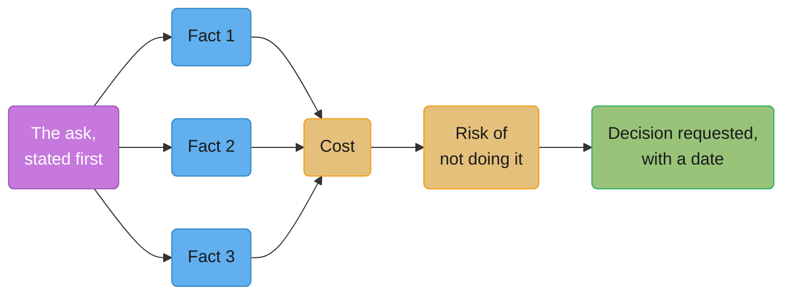
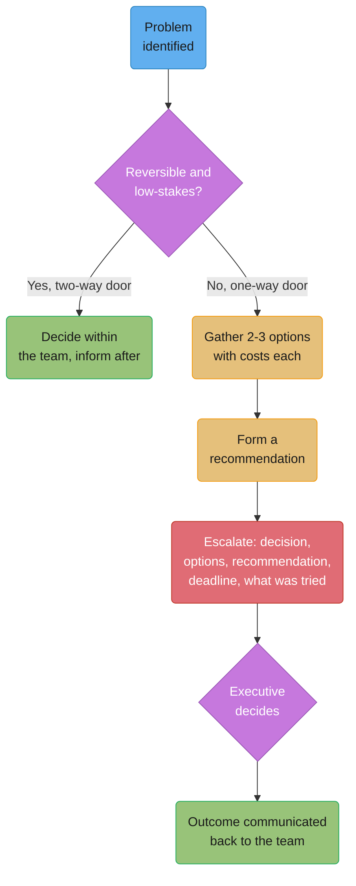
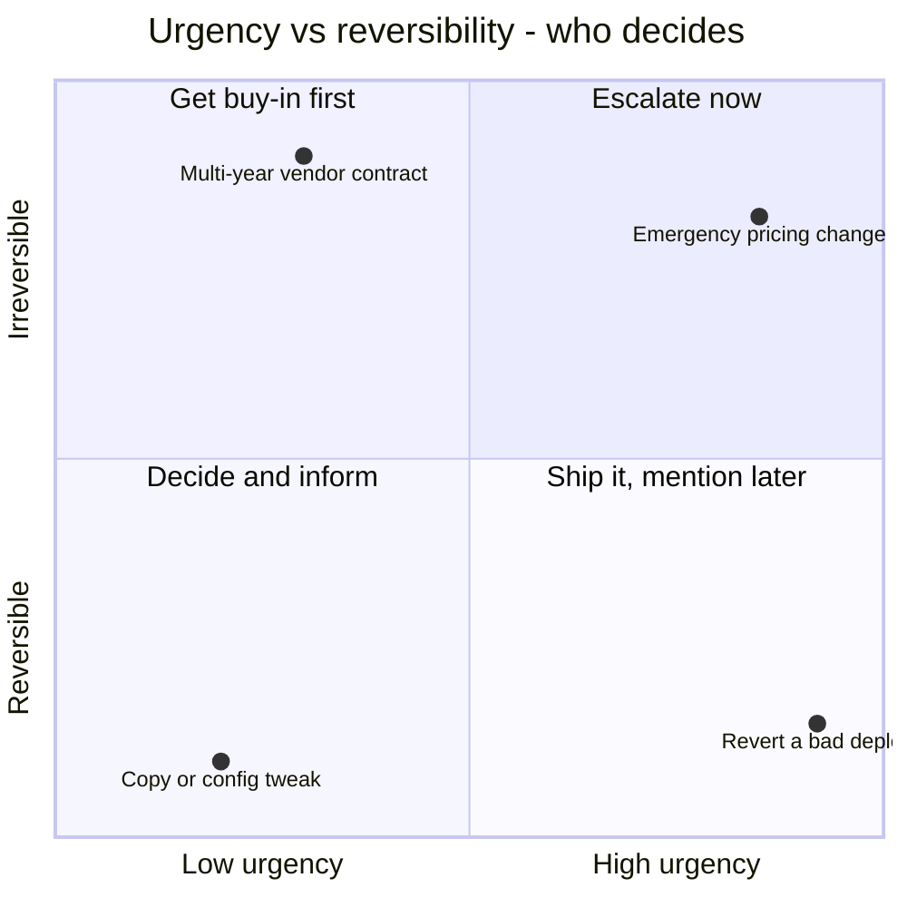

# Executive Communication

## 1. Concept Overview

Executive communication is talking to people whose unit of thought is money, risk and
time — not architecture. An engineer walks into a room with a technical decision fully
justified in engineering terms and walks out having failed, not because the decision was
wrong, but because it was never translated into the currency the room actually trades in.
An executive is not less intelligent than an engineer and does not need the technical
content simplified; they need it re-denominated, the way a number in yen needs converting
before it means anything to someone who thinks in dollars.

This module covers the concrete translation from engineering nouns to business nouns, what
an executive is actually holding when an engineer walks in (competing asks, incomplete
information, a five-minute calendar block), the fixed set of questions every executive asks
regardless of topic, the one-page brief as the artifact that survives all of this, what to
do when the ten-minute pitch gets interrupted at minute one, how to escalate without
burning credibility, and how to deliver bad news early enough that it costs nothing.

---

## 2. Intuition

> **One-line analogy**: An executive's calendar is an emergency room, and you are not the
> only patient — the job is not to explain your illness fully, it is to tell the doctor
> what to do about it in the ten seconds before the next patient arrives.

**Mental model**: every executive interaction is bandwidth-constrained in a way most
engineering conversations are not. An engineer reviewing a design doc has, effectively,
unbounded time to reach understanding. An executive in a five-minute calendar block does
not, and the scarce resource is never technical comprehension — it's their decision
bandwidth. Your job is not to be understood in full; it is to make the decision in front of
them cheap to make.

**Why it matters**: the same true information, delivered as a wall of engineering
justification versus as a cost/risk/decision framing, gets opposite outcomes from the same
executive on the same day. A senior engineer who cannot make this translation gets read as
"can't communicate" regardless of the quality of their technical judgment, and that
read is exactly what the Staff-plus rungs of every published engineering ladder test for.

**Key insight**: this is not about talking down to executives or hiding complexity. It is
about leading with the answer to the question they are actually going to ask — what does
this cost, what happens if we don't, what do you need from me — instead of the question you
wish they'd ask, which is usually "how does the system work."

---

## 3. Core Principles

- **Every engineering noun has a business-noun translation, and the translation is the
  message, not a simplification of it.** "Technical debt" isn't a dumbed-down version of
  "high change failure rate" — it's the same fact in a currency the listener can act on.
- **An executive's default state is triage, not curiosity.** They are not waiting to learn
  about your system; they are trying to figure out which of several competing asks to fund,
  with less information than they'd like and less time than they need.
- **Lead with the ask.** The single most common structural mistake is explaining the
  reasoning first and the request last — by the time the ask arrives, the listener has
  already built their own guess about what you want and is evaluating that guess instead of
  your actual request.
- **A number beats an adjective, every time.** "Significant risk" is a Rorschach test;
  "1.2M records, three customer escalations" is a fact two people can agree on.
  
- **Bad news gets cheaper the earlier it's disclosed and more expensive the longer it's
  held.** The "no surprises" rule exists because an executive's worst outcome isn't a
  problem — it's finding out about a problem from someone else first.
- **"I don't know" is a correct, professional answer when it comes with a date.** A wrong
  guess costs more credibility than an honest gap.

---

## 4. Types / Levels / Modes

| Conversation type | What it's for | Typical length | What must be in it |
|---|---|---|---|
| Budget / headcount ask | Requesting money or people | 5-10 min or one page | Cost, what it buys, what happens without it, a date |
| Status update | Informing, not deciding | 2-5 min | The headline number, red/yellow/green, no hidden ask |
| Escalation | Getting a decision only the executive can make | 5-15 min | The decision needed, options with costs, a recommendation, a deadline |
| Bad news delivery | Disclosing a slip, a miss, or a failure | However long it takes | What happened, impact, mitigation, what you own |
| Roadmap / plan review | Getting buy-in on direction | 15-30 min | The 2-3 bets, the tradeoffs, what's explicitly not being done |
| Post-incident summary | Explaining what broke and what changes | 5-10 min | Customer impact in numbers, root cause in one sentence, the fix and its date |

The axis that separates these is **what decision, if any, is being requested** — a status
update requests none, an escalation requests exactly one, and confusing the two is itself
one of the anti-patterns in §10.

---

## 5. Models & Frameworks Diagrammed



*The one-page brief's anatomy: the ask leads, three facts support it, cost and risk feed
into a single decision request with a date attached — never buried at the end.*



*An escalation path with its decision points. The gate that matters is reversibility, not
urgency alone — a reversible, low-stakes call gets decided and reported, not escalated.*



*Four real examples plotted on urgency versus reversibility, echoing Amazon's 2015
shareholder-letter framing of one-way versus two-way doors: a reversible, low-urgency call
never needs to reach an executive at all.*

---

## 6. How It Works — Detailed Mechanics

### 6.1 The engineering-to-business translation table

The single highest-leverage skill in this module is converting an engineering noun into a
business noun without losing the truth of the underlying claim. A partial working table:

| Engineering noun | Business noun | Example translation |
|---|---|---|
| Refactor the auth service | Incident-class removal | "Three of our last five customer-facing incidents traced to one component; two engineers for a quarter removes that class of incident." |
| Technical debt | Change failure rate | "Our change failure rate is 18%, against an industry benchmark closer to 5-10%; every fifth deploy needs a follow-up fix." |
| P99 latency | Checkout abandonment | "P99 checkout latency is 4.2s; each additional second of load time is correlated with measurable cart abandonment." |
| We're on an EOL library version | Unpatched CVE exposure + audit finding | "We're carrying a known CVE class our last security audit flagged, and the vendor stopped shipping patches for it in March." |
| Flaky test suite | Release cadence | "We ship every 3 weeks instead of weekly because a flaky suite adds two days of manual verification per release." |
| On-call burden | Attrition risk | "Two engineers on this rotation have raised leaving over page volume; replacing a senior engineer costs 6-9 months of ramp." |
| Database migration | Downtime window / customer-visible risk | "This requires a 4-hour maintenance window; without it, customer data corruption risk stays elevated indefinitely." |
| Code review backlog | Feature lead time | "Feature lead time has grown from 4 days to 11; review capacity is the bottleneck, not development speed." |
| Monolith | Hiring ramp time / blast radius | "New hires take 8 weeks to ship safely because any change can affect any part of the system." |
| Rate limiting gap | Abuse cost / infra spend | "Unthrottled traffic from a single bad actor cost us $40K in compute last month." |
| Observability gap | Mean time to detect, then cost per outage hour | "We average 45 minutes to detect an outage instead of under 5; at our revenue run rate that's roughly $12K per undetected hour." |
| Load testing gap | Peak-revenue risk | "We have not load-tested past 2x normal traffic, and Black Friday runs at 6x." |
| API versioning debt | Partner integration breakage | "Two partner integrations broke on our last release because we don't version the API; each breakage costs a support escalation and partner trust." |
| Single point of failure | Revenue at risk during outage | "This service has no redundancy; an outage here stops checkout entirely, which is 60% of daily revenue." |
| Data retention policy gap | Compliance fine exposure | "We're retaining data past the window our contracts specify, which is a documented audit finding with a fine attached." |
| Low test coverage | Regression / hotfix rate | "We ship a hotfix within 48 hours of roughly 1 in 6 releases; better coverage on the payment path would cut that." |
| Cloud cost creep | Gross margin | "Infra spend grew 40% while revenue grew 12%; that's a two-point hit to gross margin if it continues." |
| Security patch backlog | Breach probability / insurance premium | "We're behind on patching for a class of vulnerability our cyber insurer specifically asks about at renewal." |
| Feature flag debt | Release risk / rollback time | "We can't cleanly roll back the last three releases because flags were never cleaned up, which turns a 5-minute rollback into a 2-hour one." |
| Build pipeline slowness | Engineer idle cost | "A 25-minute build times four engineers waiting per day is roughly $180K a year in idle fully-loaded time." |
| Documentation debt | Onboarding / ramp cost per hire | "New engineers take 6 weeks to their first production change instead of 2, almost entirely due to missing docs." |
| Dependency upgrade backlog | Supply-chain vulnerability exposure | "We're 14 major versions behind on a core dependency, which is the exact profile our last pen test flagged as highest risk." |

### 6.2 What an executive is actually holding when you walk in

Before the content of your message, account for the state of the person receiving it: they
are holding **several competing asks** from other people who also think theirs is the most
urgent, a **budget that does not cover all of them**, **incomplete information** about most
of the topics on their plate (they cannot be deep in your system the way you are), and **a
calendar cut into five-minute blocks** where your topic gets one slot among many that day.
None of this is personal, and none of it means the executive doesn't care — it means your
job is to make the decision in front of them as cheap as possible to make, not to transfer
your full understanding of the system to them.

### 6.3 The exec question set

Regardless of topic, expect some subset of these, and prepare an answer to each before you
walk in:

1. **What does it cost?** — in dollars and headcount-time, not story points.
2. **What happens if we don't?** — the concrete consequence of inaction, not "it would be
   nice to have."
3. **When will it be done?** — a date, not a quarter described in relative terms.
4. **What could go wrong?** — the real risk, stated by you before it's found by them.
5. **What do you need from me?** — a specific ask: budget, a decision, a name, an
   introduction.
6. **Who else is affected?** — which other teams, customers, or systems this touches.
7. **Is there a cheaper 80%?** — a smaller version that gets most of the value; have an
   answer even if the answer is "no, and here's why."

An engineer who has not prepared an answer to "is there a cheaper 80%" in advance
frequently improvises one badly in the room, which reads as not having thought it through —
better to have genuinely considered it and be able to say why the full version is the right
call.

### 6.4 The one-page brief

Anatomy, in order: **the ask**, **three supporting facts**, **cost**, **risk**, **decision
requested with a date**. A complete real one:

```text
ASK: Approve 2 engineers for 6 weeks to migrate the payments retry queue off the
     deprecated SQS classic queue type before AWS's Dec 2026 sunset.

FACTS:
  1. AWS has published a hard sunset date for SQS classic queues; ours processes
     ~40K payment retries/day.
  2. Migration to standard queues requires idempotency-key changes in 3 services;
     we've scoped this and it's a known, bounded change.
  3. We attempted this in Q1 and stopped after 1 week when a P1 pulled the team;
     the partial migration is currently the reason retries occasionally duplicate.

COST: 2 engineers x 6 weeks = ~$58K fully loaded, no new infra spend.

RISK: If we do nothing, the queue stops working on AWS's sunset date with no
      warning period after that, taking payment retries down entirely.
      If we do it now, the main risk is a repeat P1 interruption; we're asking
      for the team to be shielded from non-P1 work for the 6 weeks.

DECISION NEEDED BY 2026-09-05: approve headcount and shield the team from
non-critical interrupts for the 6-week window.
```

### 6.5 Being interrupted at minute one

You planned a ten-minute walkthrough. Thirty seconds in, you get a question. The instinct
to say "I was getting to that" and continue the planned flow is wrong — it signals the
deck matters more than the answer. Answer the question directly, then return to where you
were.

**Bad handling:**

```text
YOU: So I wanted to start with some context on how the retry queue works today,
     the architecture has three components and--
EXEC: Wait, is this going to cost us anything this quarter?
YOU: I'll get to the cost slide in a minute, let me just finish the context
     first so it makes sense.
EXEC: [checks phone]
```

**Good handling:**

```text
YOU: So I wanted to start with some context on how the retry queue works today,
     the architecture has three components and--
EXEC: Wait, is this going to cost us anything this quarter?
YOU: Yes — $58K, two engineers for six weeks, no new infra spend. Let me back up
     one step and give you the one fact that makes that number make sense, then
     I'll take any other questions as they come.
EXEC: Go ahead.
```

The good version answers the actual question asked, in the terms it was asked, then
resumes on the executive's terms rather than the planned deck's terms — the plan was
always a means to the decision, not the deliverable itself.

### 6.6 Escalation

A good escalation contains: **the decision needed**, stated as a specific question; **the
options**, each with its cost; **a recommendation**, not just a menu; **a deadline**; and
**what you already tried** before escalating. Arriving with a problem and no options costs
credibility because it reads as either not having done the work or not trusting your own
judgment enough to recommend anything — an executive's job is to decide between options an
expert has already narrowed down, not to invent the options themselves.

### 6.7 Delivering bad news

Bad news should be **early, specific, paired with the mitigation, and it should own the
part that was actually yours.** The "no surprises" rule: an executive's worst outcome is
not a problem existing, it's hearing about the problem from someone else first — a customer,
a board member, another executive — before hearing it from the person responsible for it.

A slip disclosed in week two, when there's still runway to adjust a commitment made to a
customer or the board, costs almost nothing beyond the discomfort of saying it. The
identical slip disclosed in week nine, after commitments were made downstream based on the
original date, costs the credibility of everyone who repeated that date in good faith — and
it costs the discloser's credibility specifically, disproportionately, because "you knew
in week two and didn't say anything" is the sentence that follows.

### 6.8 Reading the room

Not every executive wants the same shape of answer, and misreading which one you're in
front of wastes the meeting even when the content is right.

**The detail-oriented executive versus the headline-oriented one.** Some executives
(commonly ones with a technical background, or ones who will personally have to defend the
number upward) will ask for the mechanism — "walk me through why it's 45 minutes and not
20." Others want only the headline and the ask, and treat a mechanism explanation as a
stall. Neither preference is wrong; the tell is usually the first follow-up question. A
question about *how* a number was derived signals the detail-oriented type — answer it and
stay in that mode. A question about *what to do next* signals the headline type — drop the
remaining mechanism slides and move straight to the ask.

**The question that is really an objection.** "Have we thought about doing this a cheaper
way?" is rarely a literal request for a brainstorm; it is usually a soft version of "I'm not
convinced this is worth the cost," phrased as a question so it's easier for both people to
back away from if the answer is good. Answering it as a literal question — "no, we haven't,
want me to go look?" — misses the actual objection and leaves it unaddressed, so it
resurfaces later, later, more bluntly. Answer the objection underneath it directly: "we
considered a smaller version; here's specifically why it doesn't get us the same outcome."

**Silence.** A pause after you finish stating the ask is not automatically agreement, and
filling it with more justification is a common mistake — it can read as not trusting your
own case, and it buries the ask you just successfully landed under new material the
listener now has to re-parse. Let the pause sit; the executive is usually doing arithmetic
you can't see (their other commitments, their own manager's likely reaction), not waiting
for you to say more.

### Weak version -> Strong version: a budget ask

**Weak version**

> We've been having some scaling issues and it would probably be good to get some more
> engineers on the infra team at some point to help out.

**Strong version**

> Infra is the reason our last two releases slipped by a combined 9 days. Two additional
> engineers for this quarter closes the gap at $95K fully loaded; without them, we're
> projecting the same slip pattern into Q4, which puts the November launch date at risk.
> I need a headcount decision by August 29 to make the Q4 planning cycle.

**What changed**: a measured consequence (9 days of slip, tied to a named cause), a real
cost, a specific date-driven risk if declined, and a decision deadline. The weak version
invites a "let's keep an eye on it"; the strong one requires an actual yes or no.

### Weak version -> Strong version: a status headline

**Weak version**

> Things are mostly going okay with the migration, we've hit a few bumps but the team is
> working through them.

**Strong version**

> Migration is 60% complete, on track for the Sept 30 date. One risk: the legacy-data
> cleanup step is taking longer than estimated (3 weeks vs 1 week planned); if it doesn't
> resolve by next week, the date slips by 2 weeks. No action needed from you yet — flagging
> now so it isn't a surprise if it does.

**What changed**: a percentage, a date, a named risk with its size quantified, and an
explicit statement of whether action is needed right now. "Mostly going okay" tells the
listener nothing they can act on; the strong version pre-empts the surprise the "no
surprises" rule exists to avoid.

---

## 7. Real-World Examples

- **Amazon's PR/FAQ and six-pager** (see
  [Design Docs, RFCs & ADRs](../design_docs_rfcs_and_adrs/design_docs_rfcs_and_adrs.md)) are
  themselves executive-communication artifacts: they force a customer-outcome-first,
  narrative-over-slides framing before a decision-maker ever sees the proposal.
- **Bezos's one-way door / two-way door framework** (2015 Letter to Shareholders) is a
  direct, publicly documented model for exactly the urgency-versus-reversibility judgment
  this module's quadrant diagram draws on: irreversible decisions get slow, careful,
  consultative process; reversible ones should be made quickly and cheaply, without
  escalating them to an executive at all.
- **Barbara Minto's Pyramid Principle** (developed at McKinsey & Company, and published as
  *The Pyramid Principle: Logic in Writing and Thinking*, 1996) is the source discipline
  behind "lead with the ask": state the answer first, then the grouped supporting arguments
  underneath it, rather than building up to a conclusion the way a technical proof does.
- **BLUF (Bottom Line Up Front)** is standard US military communication doctrine, adopted
  widely in business writing for the same reason Minto's pyramid is — a reader under time
  pressure needs the conclusion before the reasoning, not after it.
- **The "no surprises" rule** is a named, common piece of vocabulary in program- and
  project-management practice for the same principle described in §6.7: an executive's tolerance
  for bad news is far higher than their tolerance for being the last to know about it.

---

## 8. Tradeoffs

| Approach | Upside | Downside |
|---|---|---|
| Headline-first (answer, then support) | Respects time-constrained attention; survives an interruption at minute one | Feels abrupt to an audience expecting narrative build-up |
| Narrative-first (context, then conclusion) | Builds shared understanding for a genuinely novel or contested topic | Loses the room if interrupted before the point lands |
| Written brief before the meeting | Lets the executive read at their own pace; supports asynchronous decisions | Requires the same rigor as a design doc — a bad brief reads worse in writing than badly delivered live |
| Escalating early with an unfinished analysis | Preserves the runway to change a downstream commitment | Risks looking like you haven't done the work if options aren't at least sketched |
| Escalating late with a complete analysis | Arrives with a fully-formed, defensible recommendation | The decision window may already be gone by the time it lands |

---

## 9. When to Use / When NOT to Use

**Escalate to an executive** when the decision is a genuine one-way door — expensive or
slow to reverse — and you've exhausted what your own team's judgment can resolve, or when
it requires resources, authority, or a tradeoff only that executive can approve.

**Do NOT escalate** a reversible, low-stakes decision your team is equipped to make; doing
so trains the organization to route trivial calls upward and dilutes the executive's
attention exactly when a genuinely irreversible decision needs it. This is the same
one-way-door / two-way-door test used in §6.6 and plotted in §5's quadrant diagram.

**Use a written one-page brief** when the decision can tolerate asynchronous review, or
when you expect to be interrupted and want the full argument to survive on paper even if
the live conversation doesn't get through it.

**Use a live conversation, not a written brief,** when the topic is genuinely contested and
needs real-time back-and-forth to resolve — a document can't adapt to an objection the way
a conversation can.

---

## 10. Common Pitfalls

**The demo with no ask.** An engineer spends fifteen minutes showing a working prototype to
a VP, gets enthusiastic nods, and leaves without ever stating what they need — headcount,
a go-ahead, a budget line. The VP leaves the meeting having enjoyed a demo and approved
nothing, because nothing was actually requested; the engineer later describes the meeting
as "it went great" while nothing changes.

**The status update presented as a decision meeting.** A team books thirty minutes on an
executive's calendar framed as needing a decision, then spends the time walking through
what's already been decided and done. The executive arrives ready to decide something and
leaves having sat through a report — the next time that team asks for thirty minutes, it
gets ten.

**Hedging every number.** "Roughly, approximately, somewhere around, give or take" attached
to every figure in a brief erodes trust in all of them at once — an executive who can't
tell which numbers are load-bearing and which are decoration for tone starts discounting
every number in the document equally.

**The twelve-slide deck for a two-minute decision.** A reversible, low-stakes call — extend
a vendor trial by a month, approve a $5K tool subscription — arrives wrapped in a full deck
with an agenda slide and a "context" section. The format signals a weight the decision
doesn't have, and the executive spends more attention parsing the format than the decision
warranted, which is the opposite of respecting their time.

**Using acronyms unexplained.** An engineer says "we need to fix our MTTR before the SLO
review" to an executive who has never had those terms defined for them, and the executive
either interrupts to ask (costing the meeting's momentum) or nods without understanding
(costing the decision's quality). The fix is not avoiding precise vocabulary — it's
defining it inline, once, the first time it's used with that audience.

### Weak version -> Strong version: a bad-news message

**Weak version**

> Just a heads up that the migration might be a little delayed, we're still figuring out
> the exact impact, will keep you posted.

**Strong version**

> The Sept 30 migration date is slipping to Oct 14. Cause: the legacy-data cleanup step
> took 3x longer than estimated because of undocumented schema drift in a system we
> inherited. I own the estimating miss — I should have spiked that step before committing
> to the date. Mitigation: we're running the cleanup and the new-system cutover in parallel
> starting Monday, which recovers a week. I'll confirm the final date by Friday.

**What changed**: a specific new date instead of "a little delayed," a stated cause, an
explicit ownership of the mistake instead of a vague "we're still figuring out," and a
concrete mitigation with its own recovery estimate. The weak version defers the entire
problem to a future update; the strong one resolves as much of it as currently exists to
resolve.

### Weak version -> Strong version: an "I don't know" answer

**Weak version**

> Um, I think it's probably around, maybe, I'd guess somewhere in the low six figures? I'd
> have to check.

**Strong version**

> I don't know the exact number off the top of my head — I'll have it for you by end of
> day Thursday. If you need a rough order of magnitude right now to make today's call, it's
> closer to $100K than $1M, but treat that as a placeholder, not the number to plan against.

**What changed**: an honest, unhedged "I don't know" replaces a guess dressed up as an
answer, paired with a concrete date for the real number and, when useful, an explicitly
labeled rough estimate the listener is told not to rely on. A confidently wrong guess costs
more credibility later than an honest gap costs now.

---

## 11. Frameworks, Books & Further Reading

- Barbara Minto, *The Pyramid Principle: Logic in Writing and Thinking*, 3rd edition,
  Financial Times/Prentice Hall, 1996 — the answer-first, top-down structuring discipline
  this module's "lead with the ask" principle draws on.
- Amazon.com, 2015 Letter to Shareholders — the one-way-door / two-way-door decision
  framework used throughout §5, §6.6 and §9.
- Colin Bryar and Bill Carr, *Working Backwards: Insights, Stories, and Secrets from Inside
  Amazon*, St. Martin's Press, 2021 — the PR/FAQ discipline referenced in §7.
- See [Design Docs, RFCs & ADRs](../design_docs_rfcs_and_adrs/design_docs_rfcs_and_adrs.md)
  in this section for the written artifacts (design docs, ADRs) that a decision gets
  captured in before it ever reaches an executive-communication conversation.
- BLUF (Bottom Line Up Front) — US military communication doctrine, widely adopted in
  business and technical writing for the same time-pressure reasoning as Minto's pyramid.

---

## 12. Interview Questions with Answers

**Q: How do you translate "we need to refactor this service" into something an executive will act on?**
**Short:** State the cost of NOT refactoring in incidents or dollars, then the cost of refactoring, then a date.
Lead with the business consequence, not the engineering noun: "Three of our last five
customer-facing incidents traced to one component; two engineers for a quarter removes
that class of incident." That single sentence contains the same information as "we need to
refactor the auth service," but denominated in something an executive can weigh against
their other asks — incident count, engineer-time, and a bounded cost — instead of a
technical judgment they have no basis to evaluate.

**Q: You planned a ten-minute pitch and get a question thirty seconds in. What do you do?**
**Short:** Answer the actual question directly, then return to your remaining point, never saying "I was getting to that."
Answer it in the terms it was asked, briefly, then pick up the thread you were on — "I was
getting to that" signals the deck matters more than the executive's actual question, and it
reads as a stall. The plan you walked in with was always a means to the decision, not the
deliverable; abandoning its order the moment the room needs something different is the
correct move, not a failure of preparation.

**Q: What's the structure of a good escalation?**
**Short:** The decision needed, options with costs, a recommendation, a deadline, and what you already tried.
Arrive with a specific question that needs a decision only the executive can make, two or
three real options each with its cost stated, a stated recommendation rather than a bare
menu, a deadline, and a brief account of what you tried before escalating. Arriving with a
problem and no options costs credibility, because it reads as not having done the framing
work an executive is trusting you to have already done.

**Q: Why does "any feedback welcome" or "just a heads up" fail as a message to an executive?**
**Short:** It requests nothing specific, so no individual feels the message is theirs to act on.
A message with no explicit ask and no deadline puts the entire burden of deciding what to
do with it on the reader, and busy people default to deferring anything that doesn't come
with an obvious next action. "The Sept 30 date is slipping to Oct 14, here's why and what
I'm doing about it" produces engagement precisely because it is specific enough to require
either an acknowledgment or a response, unlike a vague heads-up.

**Q: How do you deliver bad news to an executive well?**
**Short:** Early, specific, with a mitigation attached, and owning the part of the miss that was actually yours.
State what happened and its concrete impact, name the mitigation already in motion, and
explicitly own the part of the failure that was within your control rather than diffusing
responsibility across "the team" or unnamed circumstances. Disclosed early — while there's
still runway to adjust a downstream commitment — the same slip costs almost nothing beyond
the discomfort of saying it; disclosed late, after other people have repeated the original
date in good faith, it costs their credibility along with yours.

**Q: What's the "no surprises" rule, and why does timing matter more than the size of the bad news?**
**Short:** An executive's worst outcome is hearing about a problem from someone else first, not the problem itself.
The rule states that bad news should always reach the executive from the person responsible
for it, before it reaches them from any other source — a customer, the board, another
executive. A slip disclosed in week two, while a downstream commitment can still be
adjusted, costs almost nothing; the identical slip disclosed in week nine, after other
people have repeated the original date, costs the discloser's credibility specifically,
because "you knew and didn't say anything" is the sentence that follows.

**Q: How do you answer "is there a cheaper 80%" when you believe the full scope is necessary?**
**Short:** Show you already considered a smaller version and state specifically why it doesn't hold.
Come prepared with the smaller version you'd cut to and a specific, concrete reason it
falls short — not a vague "we need the full scope." An engineer who has genuinely
considered the cheaper option and can explain precisely what it fails to solve reads as
rigorous; one who improvises a defense of the full scope on the spot reads as not having
thought about cost at all.

**Q: What goes on a one-page brief, in order?**
**Short:** The ask first, then three supporting facts, then cost, then risk, then a decision request with a date.
Lead with the specific ask, follow with three concrete supporting facts, then state the
cost and the risk of not acting, and close with the exact decision requested and the date
it's needed by. Putting the ask last, after all the reasoning, is the single most common
structural mistake — by the time it arrives, the reader has already formed their own guess
about what you want and is evaluating that guess instead of your actual request.

**Q: When should a decision be escalated to an executive versus made by the team?**
**Short:** Escalate genuinely irreversible, high-stakes calls; decide and inform for reversible, low-stakes ones.
Use reversibility as the primary test, the way Amazon's 2015 shareholder letter frames
one-way versus two-way doors: an irreversible or expensive-to-reverse decision warrants
slow, careful, consultative process and belongs with someone who can own that risk, while a
reversible, low-stakes call should be made quickly by the team and reported afterward.
Escalating every decision upward trains the organization to route trivial calls to an
executive and dilutes their attention exactly when a real one-way door shows up.

**Q: How do you answer "what could go wrong" without sounding like you're talking yourself out of the ask?**
**Short:** State the real risk yourself, before it's found by someone else, paired with the mitigation.
Naming the genuine risk proactively, with the mitigation attached, reads as rigor rather
than doubt — "the main risk is a repeat P1 interruption; we're asking for the team to be
shielded from non-P1 work for the six weeks" states the risk and immediately neutralizes it
with a specific ask. Omitting the risk and having the executive find it themselves in
questioning costs more credibility than naming it up front ever would.

**Q: What's the difference between a status update and an escalation, and why does conflating them fail?**
**Short:** A status update requests no decision; an escalation requests exactly one, and mixing them wastes both.
A status update informs; an escalation asks for a specific decision only the executive can
make. Booking time framed as needing a decision, then delivering a report of what's already
done, leaves the executive having sat through content they had no way to act on — and the
next time that team asks for time to "decide something," it gets less of it, because the
label has stopped meaning what it says.

**Q: An executive interrupts your update to ask a pointed, skeptical question. How do you tell if it's a real objection or just due diligence?**
**Short:** Treat it as a real objection until answered fully; a satisfied due-diligence question stops, an objection returns.
Answer it completely and concretely regardless of which it is — a skeptical question
answered thoroughly resolves itself if it was due diligence, and reveals its real shape if
it wasn't. Trying to guess the intent and give a lighter answer to a question that turns
out to be a genuine blocking objection reads as evasive and forces the executive to ask it
again, more pointedly, the second time.

**Q: Why is a number always stronger than an adjective in executive communication?**
**Short:** An adjective like "significant" means something different to every reader; a number is a shared fact.
"Significant risk" or "a lot of technical debt" invites the listener to fill in their own
size for the word, and two people in the same meeting can walk away with completely
different mental numbers attached to the same sentence. "1.2M records, three customer
escalations" is a fact both people can agree on and act against, which is the entire point
of the translation table in §6.1.

**Q: How do you present a roadmap review without it turning into a wish list?**
**Short:** State 2-3 bets with tradeoffs and name what is explicitly not being done, not everything that could be done.
Limit the pitch to two or three genuine bets, each with its tradeoff stated plainly, and
explicitly name what's being deprioritized as a result — a roadmap that lists everything
the team could plausibly do reads as not having made a decision at all, which is the one
thing a roadmap review is supposed to demonstrate.

**Q: What's wrong with hedging every number in a brief with "roughly" or "approximately"?**
**Short:** It signals none of the numbers are load-bearing, so the reader discounts all of them equally.
Constant hedging language erodes trust in every figure at once, because the reader can no
longer distinguish a number you're confident in from one you're not. State the numbers you
have confidently, and reserve an explicit caveat ("treat this as a placeholder, not the
number to plan against") for the one figure that genuinely needs it, rather than hedging
uniformly out of habit.

**Q: How should you explain an acronym like MTTR or SLO to an executive who hasn't seen it before?**
**Short:** Define it inline, once, the first time you use it — don't avoid precise terms, just don't assume they're known.
Precise vocabulary is not the problem; assuming shared context for it is. Say "our mean
time to recovery — MTTR, how long an outage typically lasts — is 45 minutes" the first time
the term appears, then use the acronym freely afterward. Skipping the definition forces the
executive to either interrupt and ask, which costs the meeting's momentum, or nod along
without understanding, which costs the decision's quality.

---

## 13. Best Practices

- Lead every message with the ask; put the supporting reasoning after it, not before.
- Prepare an answer to all seven items in the exec question set (§6.3) before the meeting,
  including "is there a cheaper 80%."
- Convert every engineering noun in your message using the translation table in §6.1 before
  you walk in — do this as a written exercise, not live.
- When interrupted, answer the actual question first; resume your point after, never say
  "I was getting to that."
- Escalate only genuine one-way-door decisions; decide and report reversible ones yourself.
- Bring options and a recommendation to every escalation, never just a problem.
- Disclose bad news in the earliest week you know it, not the latest week you can still
  explain it.
- Say "I don't know, I'll have it by <date>" rather than a hedged guess.
- Reserve hedging language for the one number that actually needs it; state the rest
  plainly.
- Match the format's weight to the decision's size — a one-page brief for most asks, not a
  twelve-slide deck.

---

## 14. Case Study

**The headcount ask that got fifteen seconds.** A senior engineer, Priya, had thirty
minutes booked with the VP of Engineering to ask for two additional infra engineers. She
had prepared a fourteen-slide deck: current architecture (4 slides), the scaling problem
(3 slides), options considered (3 slides), recommendation (2 slides), cost (1 slide), ask
(1 slide).

She opened with slide one. Fifteen seconds in, the VP said: "I have another meeting in
eight minutes — what's the ask and what does it cost?" Priya, thrown, said "I'll get to
that, let me just set up the context first," and continued to slide two. The VP glanced at
their phone twice more before the eight minutes ran out. The meeting ended with no
decision, and the VP's assistant rebooked it for "sometime next month, whenever there's a
free slot" — which, six weeks later, had not yet happened.

**What Priya changed for the rebooked meeting.** She rewrote the fourteen slides as the
one-page brief format from §6.4: ASK (2 engineers, 1 quarter), three facts (the 9-day
combined release slip, the specific bottleneck, the Q4 risk if unaddressed), COST ($95K),
RISK (continued slip pattern into the November launch), DECISION NEEDED BY a specific date
tied to the Q4 planning cycle. When the meeting happened, she led with the ask in the first
sentence. The VP asked two clarifying questions — both from the exec question set in §6.3,
"what happens if we don't" and "is there a cheaper 80%" — both of which Priya had already
prepared answers to. The VP approved one engineer immediately and asked Priya to come back
in two weeks with updated numbers on whether the second was still needed. The whole
exchange took six minutes.

**The lesson Priya took from it, stated the way she later told it to her own reports:** the
first meeting failed for a structural reason, not a content reason — the same information,
in the same person's head, produced a wasted thirty minutes once and a six-minute yes the
second time, because the second version was built to survive an interruption at minute one
instead of built to be watched start to finish.
