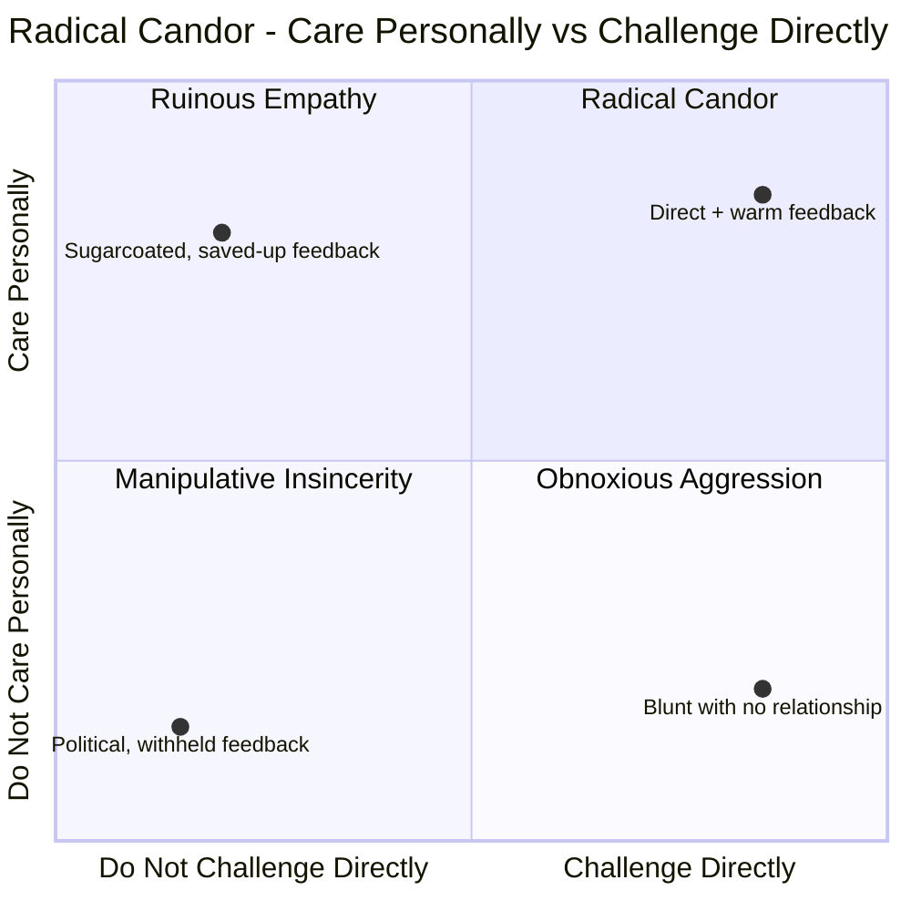
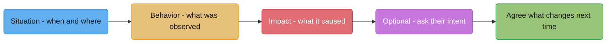
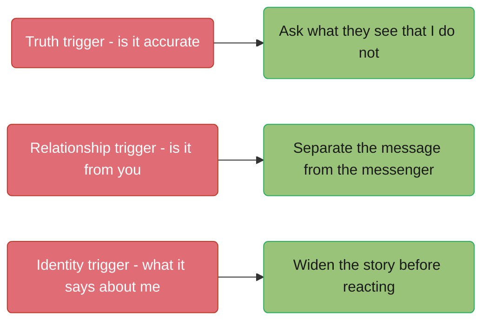

# Giving & Receiving Feedback

## 1. Concept Overview

Feedback is the highest-leverage, most frequently botched act of communication in
engineering. Most engineers get almost no formal training in it, deliver it either too
vague to act on or too blunt to hear, and receive it defensively even when it's accurate —
and the research is uncomfortable on this point: a landmark meta-analysis found that
feedback interventions made performance *worse* in a large minority of studies, not better.
This module covers both directions as a craft with named techniques, not a personality
trait some people have and others don't: **SBI** for constructing observable, specific
feedback; **Radical Candor** for calibrating care against directness; and the three
"triggers" that explain why accurate feedback still gets rejected, and what to do about
each one.

The house rule underneath all of it: feedback aimed at the *task* — what happened, what it
cost, what to do differently — improves performance; feedback aimed at the *person* — who
they are, what kind of engineer this makes them — is the kind the research says backfires.
Nearly everything below is a technique for staying on the first side of that line.

---

## 2. Intuition

> **One-line analogy**: Good feedback is a bug report — reproducible steps, observed
> behavior, impact — not a review of the reporter's character.

**Mental model.** A bug report that says "this code is bad" is useless; one that says "on
line 42, calling `close()` twice throws on the second call because the connection pool
doesn't guard against double-release, and it took down three pods during last Tuesday's
deploy" is actionable. Feedback about a person's behavior works the same way. "You're not a
team player" is unfalsifiable and undebuggable. "You merged the schema migration without
posting it in #eng-database, and it broke two other teams' local dev environments for a
day" is a bug report the person can fix.

**Why it matters.** Engineers who give vague or personality-aimed feedback create the exact
outcome they were trying to prevent: the recipient either can't figure out what to change,
or hears an attack on their identity and defends instead of listens. Both outcomes leave the
actual problem — the behavior — untouched, so it recurs, and the next round of feedback
about it lands even worse because now there's a history.

**Key insight.** The single biggest lever in this entire module is separating the
**behavior** from the **person**. Every technique here — SBI, Radical Candor's axes, the
three triggers — is a different angle on the same move: keep the conversation on what was
observed and what it cost, and keep it off of what kind of person did it. The moment a
feedback conversation becomes about identity, on either side of the table, the information
content drops to roughly zero and the conversation becomes about restoring safety instead.

---

## 3. Core Principles

- **Behavior must be observable, not inferred.** "You interrupted Priya three times in
  standup" is behavior. "You were dismissive of Priya" is your interpretation of behavior,
  and the other person can — correctly — argue with an interpretation in a way they cannot
  argue with a timestamped fact.
- **Soon beats saved up.** Feedback about a code review from three sprints ago has lost its
  specificity and its stakes; the recipient barely remembers the PR.
- **Private by default, in public only with explicit consent** (praise is often fine in
  public; correction almost never is, because an audience turns feedback into a status
  event instead of information).
- **One thing per conversation.** A list of five issues delivered at once reads as an
  indictment, not a bug report, and the recipient can hold approximately one of the five in
  working memory anyway.
- **The giver does not own the truth, only the observation.** "Here's what I saw and the
  impact it had" is defensible; "here's the truth about you" is not, and conflating the two
  is where most feedback conversations go wrong.
- **Receiving well is a separate, trainable skill from giving well**, and most engineering
  culture trains only the first.

---

## 4. Types / Levels / Modes

| Mode | Direction | Typical channel | Hardest part |
|------|-----------|-------------------|----------------|
| **Downward** (manager to report) | Has positional cover | 1:1, written review | Saying the specific, hard thing instead of the vague, comfortable one |
| **Upward** (report to manager) | No positional cover | 1:1, skip-level, survey | Being specific without appearing to be complaining |
| **Peer** (no authority either direction) | Flattest, most avoided | Code review, retro, hallway | No formal channel forces it, so it's easiest to simply never happen |
| **Written / asynchronous** | Highest volume, lowest bandwidth | Code review comments, PR descriptions | Tone reads worse in text; no facial expression to soften a blunt line |
| **Solicited** | Recipient asked for it | 1:1, retro round-robin | Asking a question specific enough to get a real answer |
| **Unsolicited** | Given without being asked | Any of the above | Earning the right to give it before you've given it, especially peer-to-peer |

Code review comments are the highest-volume feedback channel most engineers actually use —
see §6.5 — and it is also the channel with the least formal training attached to it, which
is why weak review comments are so common.

---

## 5. Models & Frameworks Diagrammed

Kim Scott's *Radical Candor* (2017) plots two axes — Care Personally and Challenge
Directly — and names four quadrants. **Radical Candor** is high on both: direct feedback
from someone who has clearly invested in you. **Ruinous Empathy** is high care, low
challenge — the sandwich-feedback zone, the withheld correction, the saved-up annual-review
surprise — and it is the quadrant most engineers default to, because it feels kind in the
moment. **Obnoxious Aggression** is high challenge, low care — blunt, correct, and
delivered with no evidence the person is invested in the recipient succeeding.
**Manipulative Insincerity** is low on both — political, withheld, or dishonestly
flattering. The critical misreading of this framework is treating it as license to be
blunt: Radical Candor is not "say whatever you think," it is the specific claim that
bluntness without demonstrated care is a *different, named, worse* quadrant
(Obnoxious Aggression), not a shortcut to the good one.

SBI — Situation, Behavior, Impact — is the Center for Creative Leadership's construction
model for a single piece of feedback. Situation anchors it in time and place so it isn't a
vague pattern accusation. Behavior must be the observable act, not your read of their
motive. Impact is what it caused — to you, to the team, to the system — stated as fact, not
as blame. SBI-I adds a fourth step, asking about Intent, before concluding anything: what
were you trying to do — which frequently reveals the behavior was a reasonable attempt at
something else entirely, and changes what "fixing" it even means.

Douglas Stone and Sheila Heen's *Thanks for the Feedback* (2014) names three triggers that
make accurate feedback get rejected anyway — see §6.6 for the mechanics of each.

---

## 6. How It Works — Detailed Mechanics

### 6.1 SBI, five real examples

**1.**
> Situation: in yesterday's design review, when Marcus proposed the event-schema change.
> Behavior: you said "that won't work" and moved to the next agenda item within about five
> seconds, before he'd finished explaining the tradeoff. Impact: he didn't raise his next
> two ideas in that meeting, and told me afterward he felt like there was no point.

**2.**
> Situation: on the payments incident channel last Thursday during the sev-2. Behavior: you
> posted a full root-cause hypothesis with supporting log links within four minutes of the
> page firing. Impact: that cut roughly twenty minutes off our time-to-mitigation, because
> the on-call engineer didn't have to start from zero.

**3.**
> Situation: in the PR for the retry-ceiling change. Behavior: you left six comments, each
> starting with "this is wrong," with no suggested alternative. Impact: the author closed
> the PR without responding and the fix didn't ship that sprint.

**4.**
> Situation: in the last two 1:1s. Behavior: you've mentioned being blocked on the API
> contract twice without filing a ticket or pinging the owning team. Impact: I don't have
> visibility into it until it's already cost you most of a sprint.

**5.**
> Situation: in the promo packet you wrote for Alex. Behavior: every bullet names the system
> Alex touched but not the specific decision Alex made or the alternative they rejected.
> Impact: the calibration committee can't tell from the doc whether Alex drove the design or
> executed someone else's.

### 6.2 Why the feedback sandwich fails

Praise-criticism-praise trains exactly the wrong reflex over repeated use: the recipient
learns that an opening compliment is the reliable signal a correction is coming, so they
brace at the first positive sentence and stop absorbing it as praise at all — which means
the technique quietly destroys its own first ingredient the second or third time it's used
on the same person. The middle criticism, meanwhile, tends to get softened to fit the bread
around it, so the one piece of information that actually needed to be clear and specific is
the piece most likely to get vague. What the recipient walks away with is often neither the
praise nor the correction, just the sense that something was off and a vague unease about
which part was real.

What to do instead: give praise and correction as separate conversations, each specific and
complete on its own, rather than stapled together. If both are genuinely warranted in one
sitting, sequence them — the correction first while attention is sharpest, the praise after
as its own full statement, not a wrapper.

### 6.3 The research that should make you humble

Kluger and DeNisi's 1996 meta-analysis in *Psychological Bulletin*, covering 131
experiments and 607 effect sizes, found that feedback interventions improved performance on
average — but in roughly 38% of the individual studies, the feedback *decreased*
performance. That number is widely cited; treat it as an order-of-magnitude finding
("well over a third") rather than a precise universal constant, since it's an average across
a wide range of feedback types and contexts, not a fixed rate for any single kind of
feedback. Their explanation, Feedback Intervention Theory, is the load-bearing part for this
module: feedback that shifts the recipient's attention toward the **self** — how am I doing,
what does this say about me — tends to hurt performance, while feedback that keeps attention
on the **task** — what's the gap, what's the next step — tends to help it. This is the
research-level version of the SBI discipline above: Situation and Behavior keep attention on
the task; a personality judgment pulls it onto the self.

### 6.4 Timing, setting, dosage — and feedback debt

Soon, private, specific, one thing. Feedback given the same week the behavior happened is
concrete and low-stakes; feedback saved for a quarterly or annual review has accumulated
interest — the recipient has repeated the behavior a dozen more times, believing it was
fine because nobody said otherwise, and now the "one thing" has become "here's a list," and
the recipient reasonably asks "why didn't you tell me this in March?" There is no good
answer to that question. The debt is not metaphorical: every skipped moment of small, timely
feedback is a larger, harder, more identity-threatening conversation later, paid with
interest in trust rather than just information.

### 6.5 Peer feedback with no authority

This is the hardest case and the one engineers face most often, because there's no formal
channel forcing it the way a 1:1 or a performance cycle does — it only happens if you make
it happen.

**Weak version** (the permission-asking opener)

> Hey, can I give you some feedback? Is now a good time? I don't want to overstep or
> anything, but...

**Strong version**

> In the incident channel this morning you posted the fix before confirming it with the DB
> owner, and it caused a second outage. Want to grab 10 minutes so I can walk through what
> I saw and we can figure out a checklist for next time?

**What changed:** "can I give you feedback" outsources the anxiety of the moment onto the
recipient, who now has to consent to something they can't evaluate yet, and it telegraphs
that what's coming is a Big Deal before any content has landed — which primes a defensive
stance before a single fact is on the table. Just giving it, framed with the situation and
an offer to work through it together, treats it as normal collaborative information rather
than a special, dreaded event. Asking permission first is worse than giving it well.

### 6.6 Receiving feedback — the three triggers

Douglas Stone and Sheila Heen's *Thanks for the Feedback* (2014) identifies three reasons
accurate feedback still gets rejected, and each needs a different response:

- **Truth triggers** — the feedback is (or seems) wrong. Response: ask what they're seeing
  that you're not, rather than immediately arguing your side; separate whether it's
  *accurate* from whether it's *useful* — feedback can be technically correct about a rare
  edge case and still not be the most useful thing to act on right now, and those are two
  different questions.
- **Relationship triggers** — it's not about the content, it's about who delivered it
  ("you, of all people, are telling me this?"). Response: consciously separate the message
  from the messenger; the fact that someone with imperfect standing raised a real issue does
  not make the issue less real.
- **Identity triggers** — the feedback threatens the story you tell about yourself ("I'm the
  reliable one," "I don't make careless mistakes"). Response: widen the story before
  reacting — one piece of feedback about one incident is not a referendum on your entire
  competence, and identity triggers are the ones most likely to produce a reaction wildly
  out of proportion to the actual feedback.

The discipline that handles all three at once: ask one clarifying question before
responding at all — "can you say more about what you saw?" — which buys a few seconds for
the triggered reaction to pass and usually surfaces information that changes how the
feedback should be weighted.

**Weak version** (a response to feedback you disagree with)

> I don't think that's fair, I was actually dealing with a lot that week and you don't
> really understand the full context.

**Strong version**

> I see it differently than you do right now, and I want to understand what you saw before
> I respond — can you walk me through the specific moment? I might be missing something, or
> there might be context you're missing, and I'd rather figure out which before I push back.

**What changed:** the weak version defends identity immediately and closes the loop before
any new information can enter; the strong version asks a genuine question first, which
either surfaces something the giver missed or something the receiver missed, and either way
produces more information than a reflexive defense does.

### 6.7 Soliciting feedback people will actually give you

**Weak version**

> Any feedback for me? Let me know if you think of anything!

**Strong version**

> What's one thing I could have done differently in yesterday's incident response?

The weak version is answerable with "nope, all good!" at zero social cost to the other
person, because it asks for an unbounded, unscoped judgment about you as a whole. The
strong version names an event, asks for exactly one thing, and frames it as something you
could have *done* rather than something you *are* — all three of which lower the cost of
answering honestly. The first time someone gives you real feedback through this channel,
act on something visibly and say so afterward ("I moved the migration announcement earlier
based on what you said last week") — that single visible action is what tells people it was
actually safe, and it's the difference between getting one honest answer and getting a
recurring one.

### 6.8 Written feedback — code review comments

Code review is the highest-volume feedback channel most engineers have, and it inherits
every problem of written communication: no tone of voice, no pause to soften a blunt line,
and a permanent record the recipient can reread at 2 a.m. and interpret in the worst light.

**Weak version**

> This is wrong.

**Strong version**

> This throws if `items` is empty — line 34 assumes at least one element. Suggest a guard
> clause returning early, or `items.stream().findFirst()`. Non-blocking if you want to
> handle it in a follow-up, but flagging since it'll NPE on the empty-cart path.

**What changed:** the strong version names the exact failure, points at the line, offers a
concrete fix, and states explicitly whether it blocks the merge — which removes the need for
the author to guess your intent from tone alone.

Conventions worth adopting explicitly, in writing, as a team norm:

- **The `nit:` prefix** for anything genuinely optional — style preference, a naming
  quibble — so the author can triage it instantly instead of wondering if it's a blocker.
- **Blocking vs. non-blocking, stated explicitly.** "This needs to change before merge" and
  "consider this for later" read identically without the label, and authors will guess
  wrong in both directions.
- **Reviewing a junior's PR is teaching; reviewing a principal's PR is peer challenge.** A
  junior's review should explain the *why* behind a requested change, since that's the
  point at which they're building the mental model; a principal's review can assume the why
  and go straight to "did you consider X" — over-explaining to a principal reads as
  condescending, and under-explaining to a junior wastes the teaching opportunity the review
  represents.

### 6.9 Feedback to someone more senior than you

Upward feedback has no positional cover, and the instinct it produces is to either say
nothing or bury the point so deep in qualifiers that it can't be acted on. The fix is the
same SBI discipline as any other direction, delivered without apologizing for having an
opinion.

**Weak version**

> This might be a dumb question, but I was just wondering if maybe we could possibly think
> about whether the way standup runs is working for everyone? No worries if not, just a
> thought.

**Strong version**

> In the last three standups, updates have run long enough that we've gone nine minutes over
> twice. I'd like to try a hard two-minute timer per person for two weeks and see if that
> gets us back on schedule — can we try it starting Monday?

**What changed:** the weak version hedges so heavily that a busy senior person can
reasonably read it as "no real opinion here" and move on; the strong version names the
specific pattern, quantifies it, and proposes a bounded, reversible experiment with a
concrete start date — which is easy to say yes to precisely because it isn't asking for a
permanent verdict.

### 6.10 A performance-review sentence

Performance-review writing is feedback under the worst conditions for specificity: written
once a year, read by a calibration committee with zero context, and prone to compressing a
whole person into vague adjectives.

**Weak version**

> Alex is a strong engineer who works well with others and has good technical skills.

**Strong version**

> Alex redesigned the checkout retry path after identifying that the existing fork was
> blocking the observability initiative — a problem nobody had assigned to them. The
> migration shipped with zero production incidents and unblocked three downstream teams.

**What changed:** the weak version is true of nearly every engineer on every team and gives
a calibration committee nothing to compare against; the strong version names a specific
decision Alex drove, the scope of the problem, and a measurable outcome — the same
Situation-Behavior-Impact shape as any other piece of feedback, just written for a reader
who wasn't in the room.

---

## 7. Real-World Examples

- **Netflix's "Keeper Test" culture**, described in the company's public culture memo,
  formalizes blunt, frequent feedback as a stated norm rather than an occasional event —
  managers are explicitly asked whether they'd fight to keep each report, and that framing
  is designed to force specific, timely feedback instead of saved-up annual surprises.
- **Pixar's "Braintrust" process**, described by Ed Catmull in *Creativity, Inc.* (2014),
  is a peer-feedback structure with an explicit rule: the Braintrust has no authority to
  mandate a change, only to give candid notes — the director decides what to do with them,
  which removes the identity trigger of "I'm being told what to do" and replaces it with
  "I'm being given information I can use."
- **Spotify's "squad health checks"** use a lightweight, recurring, low-stakes format (a
  simple red/yellow/green self-assessment discussed as a team) specifically to keep
  feedback frequent and small rather than allowing it to accumulate into a quarterly event.
- **Amazon's written narrative culture** — six-page memos read silently at the start of a
  meeting — pushes feedback into writing precisely because written comments in the margin
  are typically calmer and more specific than what the same people say out loud under time
  pressure in a live discussion.

---

## 8. Tradeoffs

| Approach | Speed | Specificity | Risk |
|----------|-------|--------------|------|
| Immediate, private, SBI-structured | Fast to deliver, fast to act on | High | Low, if behavior not identity |
| Saved for the review cycle | Slow — months of latency | Low — details have faded | High — feedback debt, surprise reaction |
| Feedback sandwich | Fast | Low — correction gets softened | Medium — praise stops registering over repeated use |
| Public correction | Fast to deliver | Can be high | High — audience turns it into a status event |
| Written-only (no live conversation) | Fastest, async | Can be very high | Loses tone; ambiguity reads as harsher than intended |
| Anonymous feedback channel | Removes power-distance barrier | Often low — no follow-up possible | High — can become a way to vent without accountability |

---

## 9. When to Use / When NOT to Use

**Give feedback immediately and directly when:** the behavior is recent, specific, and
recurring risk exists if it isn't named — a broken deploy practice, a review pattern that's
shutting down junior engineers, a missed commitment with a real cost.

**Slow down and use SBI-I (ask intent first) when:** the behavior seems clearly wrong but
you don't know why it happened — asking intent before concluding often reveals a reasonable
attempt at solving a different, adjacent problem.

**Do not give feedback about personality, potential, or character.** "You're not detail-
oriented" is not actionable and is exactly the self-directed feedback the Kluger-DeNisi
research associates with worse outcomes. If you can't state it as an observed behavior and
its impact, you don't have feedback yet — you have a feeling, and it needs more specificity
before it's ready to deliver.

**Do not use public correction** except in the rare case of active, visible harm that must
stop immediately (e.g., someone about to run a destructive command in prod) — everything
else waits for private.

---

## 10. Common Pitfalls

**Feedback as a vent.** A tech lead, frustrated after a rough sprint, opened a 1:1 with "I
need to be honest, I've been unhappy with your output lately" — no situation, no specific
behavior, just an accumulated feeling released all at once. The report spent the next two
weeks anxious and unproductive trying to guess which of a dozen possible things was meant,
and eventually asked a peer to interpret the meeting for them, because the actual feedback-
giver had never named anything concrete enough to act on.

**Anonymous feedback used as a weapon.** An engineering org introduced an anonymous
peer-feedback tool intended to surface things people were afraid to say directly. Within two
cycles, several managers reported it being used to settle unrelated grudges — vague,
unfalsifiable comments with no path for the recipient to ask a clarifying question or even
confirm what specific incident was meant. The tool was retired after one year; the
replacement required feedback to be attributed, which cut volume by roughly half but made
every remaining piece of feedback specific enough to act on.

**The manager who saves everything for the review.** An engineer received a "meets
expectations" rating with four pages of specific critical feedback, none of which had been
mentioned in any of the twelve 1:1s that preceded it. The engineer's read, reasonably, was
that the manager had either been dishonest all year or had failed to do their job in real
time — and left within two quarters. The manager's own retrospective, six months later,
named this exact review as the reason two other reports on the team started interviewing
elsewhere that same quarter.

**The "just being honest" defense.** After a review comment that read "this is a mess, did
you even test it," the author pushed back and the reviewer responded "I'm just being
honest, someone has to say it." Bluntness with no evidence of care is Obnoxious Aggression
per the Radical Candor framework, not honesty — honesty and cruelty are not the same axis,
and using one as cover for the other is precisely the misreading the framework was written
to correct.

**Praise so generic it reads as indifference.** A manager's standard feedback for good work
was "nice job, keep it up" — delivered identically regardless of what was actually done. An
engineer who'd spent three weeks debugging a subtle race condition described the response
as "worse than nothing," because it signaled the manager hadn't actually looked closely
enough to know what happened, which is its own form of information, and not a flattering one.

**Feedback about personality rather than behavior.** "You need to be more of a self-starter"
given to an engineer who was, in fact, blocked on access permissions for three weeks and had
filed two tickets about it that nobody answered — the feedback was aimed at an assumed
character trait instead of the actual, checkable situation, and it took a skip-level
conversation to surface what had really happened.

---

## 11. Frameworks, Books & Further Reading

| Framework / Source | What it gives you |
|---------------------|---------------------|
| Center for Creative Leadership, SBI (Situation-Behavior-Impact) | The construction model for a single piece of observable feedback |
| Center for Creative Leadership / various practitioners, SBI-I | SBI plus an explicit step asking the other person's intent before concluding |
| Kim Scott, *Radical Candor: Be a Kick-Ass Boss Without Losing Your Humanity* (2017) | The Care Personally / Challenge Directly axes and the four named quadrants |
| Douglas Stone & Sheila Heen, *Thanks for the Feedback: The Science and Art of Receiving Feedback Well* (2014) | The three triggers — truth, relationship, identity — and how to work each |
| Avraham Kluger & Angelo DeNisi, "The Effects of Feedback Interventions on Performance," *Psychological Bulletin* 119(2), 1996 | The meta-analysis showing feedback interventions decreased performance in roughly a third to 38% of studies, and Feedback Intervention Theory (self-focus hurts, task-focus helps) |
| Ed Catmull with Amy Wallace, *Creativity, Inc.* (2014) | Pixar's Braintrust — candid, non-mandatory peer feedback as an organizational structure |

Related modules in this section: [Influence Without Authority](../influence_without_authority/influence_without_authority.md),
[Difficult Conversations & Conflict](../difficult_conversations_and_conflict/difficult_conversations_and_conflict.md).

---

## 12. Interview Questions with Answers

**Q: What does SBI stand for, and what's the one rule that keeps it from becoming a vague accusation?**
**Short:** Situation, Behavior, Impact — Behavior must be an observable act, not an inferred motive.
Situation anchors the feedback to a specific time and place. Behavior is what was actually
observed — "you interrupted Priya three times," never "you were dismissive," because the
second is your interpretation, not a fact, and the recipient can correctly argue with an
interpretation in a way they can't argue with a timestamp. Impact states what it caused, to
you, the team, or the system. The rule that keeps it honest: if you can't point to the
observable behavior, you don't have SBI feedback yet, you have a feeling dressed up as one.

**Q: Name Radical Candor's four quadrants and what each one is.**
**Short:** Radical Candor, Obnoxious Aggression, Ruinous Empathy, Manipulative Insincerity.
The two axes are Care Personally and Challenge Directly. Radical Candor is high on both —
direct feedback from someone who has clearly invested in you. Obnoxious Aggression is high
challenge, low care — correct but delivered with no evidence you're invested in the other
person's success. Ruinous Empathy is high care, low challenge — the withheld correction, the
sandwich, the saved-up surprise — and it's the quadrant most engineers default to because it
feels kind in the moment. Manipulative Insincerity is low on both — political or dishonestly
flattering.

**Q: What is the most common misreading of Radical Candor, and why is it wrong?**
**Short:** Treating it as license to be blunt — bluntness without care is a separate, named, bad quadrant.
People hear "radical candor" and read it as permission to say whatever they think, however
they think it. But the framework's own structure says the opposite: bluntness with no
demonstrated care is Obnoxious Aggression, a distinct and explicitly bad quadrant, not a
shortcut to the good one. Radical Candor requires both axes to be high at once — the care
has to be real and visible, not assumed.

**Q: Why does the feedback sandwich fail, and what should you do instead?**
**Short:** The praise stops registering as praise, and the correction gets softened past use.
Used more than once on the same person, the sandwich trains them to brace at the opening
compliment because it reliably precedes a criticism, which destroys the praise's value; the
correction in the middle, meanwhile, tends to get diluted to fit the surrounding tone,
softening the one part that needed to stay sharp. Instead: give praise and correction as
separate, complete conversations, sequenced rather than stapled, with the correction first
while attention is sharpest if both are needed in one sitting.

**Q: What did Kluger and DeNisi's 1996 meta-analysis find, and what does it imply about how to give feedback?**
**Short:** Feedback interventions decreased performance in roughly a third of the studies reviewed.
Their meta-analysis of 131 experiments in *Psychological Bulletin* found feedback improved
performance on average but made it worse in a substantial share of cases — commonly cited
around 38%, though treat that as an order-of-magnitude figure rather than a precise
universal rate. Their explanation, Feedback Intervention Theory, is the actionable part:
feedback that shifts attention to the self — what this says about me — tends to hurt
performance, while feedback that keeps attention on the task tends to help it. It's the
research case for staying on the SBI side of the line.

**Q: What are the three triggers that make people reject accurate feedback, per Stone and Heen?**
**Short:** Truth triggers, relationship triggers, and identity triggers.
Truth triggers fire when the feedback seems wrong — respond by asking what the giver saw
that you didn't, and separately checking accuracy against usefulness. Relationship triggers
fire based on who delivered it, not what was said — respond by consciously separating the
message from the messenger's standing. Identity triggers fire when the feedback threatens
the story you tell about yourself — respond by widening the story instead of treating one
incident as a referendum. All three are best handled by asking one clarifying question
before responding at all.

**Q: Why is "can I give you some feedback?" a worse opener than just giving it well?**
**Short:** It outsources anxiety onto the recipient and signals a Big Deal before any content lands.
Asking permission first forces the other person to consent to something they can't yet
evaluate, and it telegraphs that whatever's coming is significant enough to require a
warning — which primes a defensive stance before a single fact is on the table. Opening with
the situation directly and an offer to work through it together treats the conversation as
normal collaborative information instead of a dreaded event, which is a better outcome for
both people.

**Q: How should you ask for feedback so people actually give you something real?**
**Short:** Ask "what's one thing I could do differently" about a specific event, not "any feedback?"
"Any feedback?" is answerable with "nope, all good" at zero cost, because it's an unbounded
judgment about you as a whole. Asking for exactly one thing, tied to a specific event, and
framed as something you could have done rather than something you are, lowers the cost of
answering honestly. The first time you get a real answer, act on it visibly and say so
afterward — that's what proves it was actually safe to tell you the truth.

**Q: What's the difference between a blocking and a non-blocking code review comment, and why does the distinction matter?**
**Short:** Blocking must change before merge; non-blocking is a suggestion for now or later.
Stated without a label, "this needs to change" and "consider this" read identically in
text — there's no tone of voice to disambiguate, and authors will guess wrong in both
directions, either merging something you meant to block or stalling on something you meant
as optional. Explicitly labeling blocking vs. non-blocking, and using a `nit:` prefix for
genuinely optional style points, removes the guesswork and lets the author triage instantly.

**Q: How should reviewing a junior engineer's PR differ from reviewing a principal engineer's PR?**
**Short:** Explain the why for a junior; skip straight to the tradeoff question for a principal.
A junior's review is partly teaching — explaining the reasoning behind a requested change is
the point, since that's where their mental model gets built. A principal's review can assume
that reasoning and go straight to "did you consider X" as a peer challenge; over-explaining
to a principal reads as condescending, and under-explaining to a junior wastes the teaching
opportunity the review represented.

**Q: What is "feedback debt," and how does it accumulate?**
**Short:** Small unsaid feedback compounds into a larger, harder, more identity-threatening conversation later.
Every moment a piece of timely, small feedback is skipped, the behavior continues unchecked
because the recipient reasonably assumed silence meant it was fine. By the time it surfaces —
often in a quarterly or annual review — it has repeated enough times that "one thing" has
become "a list," and the recipient's fair question, "why didn't you tell me this months
ago," has no good answer. The interest is paid in trust, not just information.

**Q: What does SBI-I add to SBI, and why does the order matter?**
**Short:** SBI-I adds asking the other person's Intent before you conclude anything about the behavior.
Before drawing a conclusion from the observed behavior, SBI-I asks what the person was
trying to do. This frequently reveals the behavior was a reasonable, even good-faith,
attempt at solving a different or adjacent problem than the one the observer assumed — which
changes what "fixing" it should even mean. Asking intent after you've already delivered your
interpretation is much less useful than asking before, because by then the recipient is
already defending the interpretation rather than explaining their actual reasoning.

**Q: Why does public correction usually backfire even when the content is accurate?**
**Short:** An audience turns feedback into a status event, and the recipient defends status instead of listening.
The presence of witnesses changes what the recipient is optimizing for — instead of
processing the information, they're managing how the correction looks to everyone watching,
which produces defensiveness regardless of how accurate the feedback is. Reserve public
correction for the rare case of active, ongoing harm that must stop immediately; everything
else belongs in private, where the only thing at stake is the information itself.

**Q: What is Pixar's Braintrust, and what specific design choice keeps it from triggering defensiveness?**
**Short:** A peer-feedback group with explicitly no authority to mandate changes — only to give notes.
Described by Ed Catmull in *Creativity, Inc.* (2014), the Braintrust gives directors candid
peer feedback on work in progress, but has no power to require any change — the director
decides what to do with the notes. That design choice removes the relationship and identity
triggers that come with being told what to do by someone with authority over you, and
replaces them with a lower-stakes frame: being handed information you're free to use or set
aside.

**Q: An engineer says "I don't think that's fair, you don't understand the full context" in response to feedback. What trigger is firing, and what's the better response?**
**Short:** Likely a truth or identity trigger; ask a clarifying question before defending.
It could be either — a truth trigger if they genuinely believe the feedback is inaccurate,
or an identity trigger if it threatens a self-story like "I always account for context." The
better response in the moment isn't to argue the point immediately; it's to ask one
clarifying question — "can you walk me through what you saw?" — which buys a few seconds for
the reflexive reaction to settle and usually surfaces which trigger is actually firing, so
the real conversation can follow it rather than the reflex.

**Q: What makes anonymous feedback channels risky, and when do they still make sense?**
**Short:** They can be used to settle grudges with no accountability and no path to clarify.
Anonymity removes the power-distance barrier that keeps some people from raising real
issues, which is the legitimate case for it — but it also removes the ability for the
recipient to ask a clarifying question, confirm what specific incident is meant, or hold the
giver to any standard of specificity, which makes it easy to misuse as a vent rather than
information. It works best as a supplement that surfaces a pattern worth investigating
directly, not as the primary or only feedback channel on a team.

---

## 13. Best Practices

- Build every piece of feedback out of an observable Situation and Behavior before you say
  anything — if you can't state those two, you're not ready yet.
- Deliver correction within days, not sprints, and default to private.
- One issue per conversation; a list reads as an indictment even when every item is true.
- Never staple praise and correction together as a sandwich — give each as its own complete
  statement.
- Before concluding anything about a surprising behavior, ask the person's intent.
- When receiving feedback that stings, ask one clarifying question before responding, and
  identify out loud (to yourself, at least) which trigger — truth, relationship, or
  identity — just fired.
- In code review, label blocking vs. non-blocking explicitly and use a `nit:` prefix for
  genuinely optional comments.
- Ask for feedback with a specific, bounded question, and visibly act on the first honest
  answer you get.
- Watch your own language for behavior-versus-personality framing before you say it out
  loud — "you didn't test this" is behavior; "you're careless" is not.

---

## 14. Case Study

**Scenario.** A five-person backend team has an unspoken pattern: one senior engineer,
Daniel, reviews every PR with terse, correct, but cold comments — "wrong," "no," "this
breaks prod" — with no explanation and no acknowledgment of what worked. Two junior
engineers on the team have started routing around him, quietly asking a different senior
engineer to review first so Daniel's pass is a formality. Daniel's own 1:1s describe him as
frustrated that "nobody takes review seriously anymore" — he sees his terse style as
efficient and can't see the routing-around happening.

**Diagnosis using this module's frameworks.** Daniel's reviews are high Challenge Directly,
low visible Care Personally — Obnoxious Aggression on the Radical Candor grid, not because
Daniel doesn't care, but because nothing in the comments signals that he does. The juniors'
avoidance is a truth-and-relationship-trigger response: the feedback might be accurate, but
its abruptness reads as "this person doesn't respect me enough to explain," which is a
relationship read, not a technical one.

**What the EM did.** Rather than telling Daniel to "be nicer" (personality feedback, exactly
what this module argues against), the EM used SBI: "In the payments PR last week, you left
'this breaks prod' with no further explanation — the author spent two hours guessing what
you meant before asking a teammate to translate. That cost the team half a day and the
author told me afterward they've started asking Marcus to review first instead of you."
Behavior, not character; impact, stated as fact.

**Daniel's response, and the fix.** Daniel's first reaction was a mild truth trigger — "I
was right that it broke prod" — which the EM didn't argue with; being right about the bug
and being an effective reviewer of the bug are different claims. The EM asked Daniel's
intent (SBI-I): Daniel said he moves fast because he reviews between meetings and doesn't
have time to write paragraphs. That reframed the fix — not "explain everything," but a
two-line minimum: what's wrong, and either a pointer to the fix or a specific question. Three
weeks later, review turnaround on Daniel's PRs from the two junior engineers who'd been
avoiding him was back to same-day.

**The one-line lesson.** The behavior that needed to change was specific and small — one
more sentence per comment — but it was invisible until someone applied SBI instead of
delivering the personality judgment ("be nicer") that both the Kluger-DeNisi research and
the Radical Candor framework predict would have failed.
