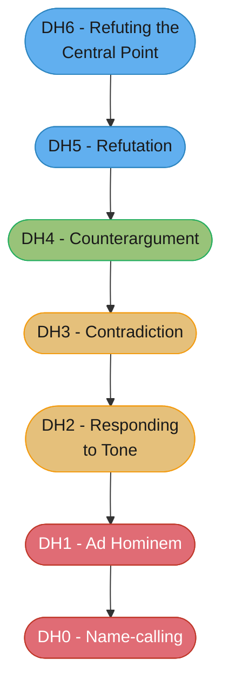
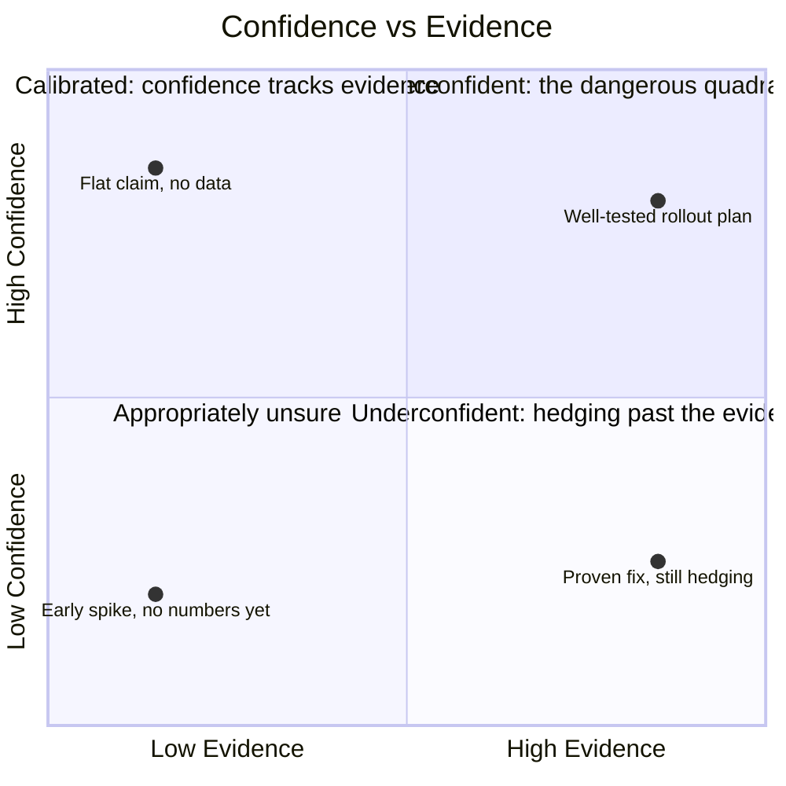

# Hedging, Commitment & the Language of Disagreement

## 1. Concept Overview

Two failure modes sit on either side of good judgment, and both are common. The engineer
who hedges everything — "I think maybe we should probably consider possibly looking at
this" — never says anything that can be checked against reality, and is therefore never
useful; their calibration cannot even be measured, because they never made a claim.
The engineer who states everything flatly — "this will definitely work," "the migration
takes two days" — is confidently wrong on a predictable fraction of calls, and because
they never attached a probability, nobody can tell the difference between their 95%-sure
calls and their 55%-sure ones until after the fact.

This module is about the middle: calibrating how certain you actually are and saying so
in words or numbers a listener can act on, and disagreeing in a way that moves a decision
forward instead of running the same two positions in a loop. It draws on Philip Tetlock's
forecasting research, Sherman Kent's 1964 CIA memo on estimative language, RFC 2119's
commitment vocabulary, Paul Graham's hierarchy of disagreement, Anatol Rapoport's rules
for criticism (via Daniel Dennett), and the Chatham House Rule. Most of the content below
is `Weak version -> Strong version` pairs, because the skill is a rewrite habit, not a
theory — you will recognize your own last stand-up update in at least one weak version.

---

## 2. Intuition

> **One-line analogy**: A hedge is a probability with the number filed off — "might",
> "could", "possibly" all compress a number you actually have in your head into a word
> that throws it away, and the listener has no way to get it back.

**Mental model**: Certainty is not a virtue and hedging is not a vice — both are just
miscalibration in opposite directions. The question is never "should I hedge" but "does
my stated confidence match my actual confidence," and the fix for both failure modes is
the same: attach a number, or a concrete consequence, to the claim.

**Why it matters**: A stand-up update that says "I think it's mostly working" gives a
manager nothing to plan around — not because it's dishonest, but because it's not a
claim at all. A design review where one engineer says "this will definitely scale" and
is wrong burns trust the exact same way a string of "I don't knows" burns credibility —
both are miscalibration, just in opposite directions, and both cost the same thing:
people stop being able to use what you say to make decisions.

**Key insight**: The fix for a bad hedge is not more confidence — it's a number, a date,
or a named consequence. "I'm about 70% sure the fix works, and here's what tells us by
Thursday if it doesn't" is more honest than either "it'll definitely work" or "I think it
might work," and it is also more useful, because it is the only one of the three a
listener can act on.

---

## 3. Core Principles

- **Calibration is measurable.** If your 70%-confidence calls come true about 70% of the
  time over many calls, you are calibrated. If they come true 95% of the time, you are
  underconfident; if 40% of the time, overconfident. This is Tetlock's whole research
  program, not a metaphor.
- **A hedge with no number is not honesty, it's a refusal to be checked.** "It might
  work" cannot be wrong later, which is exactly why it teaches the listener nothing.
- **Commitment language has a scale, and mixing levels is the most common failure.**
  "I'll look into it," "I'll have an answer by Thursday," and "I'll ship it by Thursday"
  obligate you to three different things — see Section 6.
- **Disagreement has levels, and most engineering disagreement stalls two levels below
  the top.** Paul Graham's hierarchy names exactly where — see Sections 4 and 5.
- **You may decline to commit. You may not fake a commitment.** "I can't promise Friday"
  is a complete, honest sentence. "Sure, I'll try" when you know you won't is not.

---

## 4. Types / Levels / Modes

**Three commitment levels**, in ascending obligation:

| Level | Example | What it obligates |
|-------|---------|--------------------|
| Investigation | "I'll look into it" | You will spend time and report back what you found — no promise about outcome or date |
| Deliverable-by-date | "I'll have an answer by Thursday" | A specific artifact (a diagnosis, a decision, a number) by a specific time — not the fix itself |
| Outcome-by-date | "I'll ship it by Thursday" | The actual result, on you, checkable on Thursday with no ambiguity about whether it happened |

**Paul Graham's Hierarchy of Disagreement** (from his 2008 essay "How to Disagree"),
DH0 through DH6, lowest to highest:

| Level | Name | What it looks like in a code review |
|-------|------|--------------------------------------|
| DH0 | Name-calling | "This is a dumb way to do this." |
| DH1 | Ad Hominem | "You always over-engineer things." |
| DH2 | Responding to Tone | "Calm down, no need to get defensive about your PR." |
| DH3 | Contradiction | "No, this won't scale." (no reason given) |
| DH4 | Counterargument | "This won't scale because it does an O(n²) scan on every request." |
| DH5 | Refutation | Quotes the specific line, shows the benchmark, demonstrates the O(n²) with a profiled trace. |
| DH6 | Refuting the Central Point | Identifies and directly refutes the strongest form of the author's actual argument, not a nearby one. |

Section 5 diagrams this as a pyramid; Section 6 covers why DH3-DH4 is where most real
disagreement gets stuck, and what moves it up.

---

## 5. Models & Frameworks Diagrammed



*Most engineering disagreement lives at DH3-DH4 — a flat "no" or a single counterargument
— and stalls there because nobody does the work to reach DH5 (cite the specific evidence)
or DH6 (address the strongest form of the other side's actual claim, not a weaker nearby
one). A design review that feels unproductive is almost always parked two levels below
the top of this pyramid, not because anyone is being hostile.*


*ICD 203 (the U.S. Intelligence Community's current standard, successor to Sherman
Kent's 1964 bands) maps estimative words to percentage ranges. Kent's original problem,
verified across secondary sources describing his 1964 paper: readers interpreted
"probable" anywhere from roughly 25% to 90% likely — the word alone carried almost no
information. A number in the sentence removes that entire argument.*



*The diagonal from bottom-left to top-right is the calibrated line — confidence tracking
evidence as it accumulates. Both off-diagonal quadrants are failure modes: quadrant 1 is
the flat overclaim from Section 1, quadrant 4 is the reflexive hedge holding on past the
point the evidence justified it.*

---

## 6. How It Works — Detailed Mechanics

### Calibrated probability language

Philip Tetlock's *Superforecasting: The Art and Science of Prediction* (with Dan
Gardner, 2015) reports the Good Judgment Project's central finding: forecasters who
state numeric probabilities and update them as evidence arrives outperform those who use
vague verbal language, and the best forecasters — the "superforecasters," roughly the
top 2% of participants — are *calibrated*: across many predictions made at 70%
confidence, about 70% of them come true. Calibration is scored with a Brier score
(mean squared error between stated probability and outcome), which rewards being both
right and correctly confident, and punishes overconfidence more than honest uncertainty.

**Sherman Kent's "Words of Estimative Probability"** (1964, written while he led the
CIA's Office of National Estimates) is the origin document for this whole discipline in
professional forecasting. Kent's problem, as reported across secondary sources
describing the paper (the primary CIA document is not reliably reachable to verify
directly, so treat the specific numbers below as commonly reproduced rather than
independently confirmed): readers of intelligence estimates interpreted the word
"probable" across a huge range — some read it as roughly 25% likely, others as 90% —
meaning the same sentence told different readers different things. Kent proposed
attaching numeric bands to standard words, commonly reproduced as: Certain 100%, Almost
certain ~93%, Probable ~75%, Chances about even ~50%, Probably not ~30%, Almost
certainly not ~7%, Impossible 0%. His scheme itself was not formally adopted, but the
idea shaped everything that followed.

**ICD 203** (Intelligence Community Directive 203) is the modern, current U.S.
intelligence-community standard descended from Kent's idea, mapping words to bands
(commonly reproduced): Almost no chance 1-5%, Very unlikely 5-20%, Unlikely 20-45%,
Roughly even chance 45-55%, Likely 55-80%, Very likely 80-95%, Almost certain 95-99%.
The **IPCC** runs a parallel, independently documented calibrated-language scale for
climate science: virtually certain 99-100%, very likely 90-100%, likely 66-100%, about
as likely as not 33-66%, unlikely 0-33%, very unlikely 0-10%, exceptionally unlikely
0-1%. Both exist for the identical reason Kent identified in 1964: a bare word is
ambiguous across a huge range, and a number in the sentence is not.

**The modern practice for an engineer is simpler than either scale: say a number.**
"70% confident we ship by the 12th" carries more information than "probably" and takes
no longer to say. It also creates an artifact — six months later, you can check whether
your 70%-confidence calls landed about 70% of the time, which a verbal hedge never lets
you do.

**Weak version**

> I think maybe we should probably consider possibly looking at the ingest service, since
> there have been some issues.

**Strong version**

> I'm about 70% confident the ingest drops are caused by the retry storm from last week's
> config change. I want two days to confirm it with a targeted rollback test.

**What changed:** four hedge words collapsed into one number, and the vague "some issues"
became a specific hypothesis with a specific test and a specific deadline.

### Epistemic status: stating how much you've actually checked

**Epistemic status** is a convention, not a framework — a line at the top of a document
or message stating how much verification actually backs the claims that follow, so the
reader calibrates their own trust correctly instead of assuming a polished doc means a
verified one. A good epistemic-status line names the *kind* of confidence, not just a
vibe:

```text
Epistemic status: I've read the relevant RFC sections and tested the retry behavior
locally. I have not tested this under production load, and the concurrency numbers
below are back-of-envelope, not measured.
```

versus a doc with none, where "I skimmed three blog posts" and "I ran this in
production for a month" are typographically indistinguishable. The convention is
borrowed from the rationalist and forecasting communities and fits naturally at the top
of a design doc or an incident update, immediately below the title.

### Commitment language: three levels, and the failure is mixing them

Section 4's table names the three levels; the failure mode is a listener hearing one
level and the speaker meaning another. "I'll look into it" said by the speaker as an
investigation-only commitment, heard by the listener as a promise of a fix, produces a
missed expectation that neither party would call a lie — it's a level mismatch, and it's
extremely common because English doesn't mark the difference.

**Weak version**

> Sure, I'll get to it this sprint.

*(Said while already carrying two other commitments, with no intention of reprioritizing
for this — and it doesn't happen.)*

**Strong version**

> I can't commit to this sprint — I'm already carrying two P0s. I can start Monday if
> this is more important than those; if so, tell me which one to bump.

**What changed:** the fake commitment, which obligates nothing and disappoints later,
became a real decline plus a real, checkable offer.

**RFC 2119 keywords are the most precise commitment vocabulary available to an
engineer**, because they were built for exactly this problem: MUST/MUST NOT is an
absolute requirement; SHOULD/SHOULD NOT is a strong recommendation that may be
overridden with a documented reason; MAY is genuinely optional. RFC 8174 (2017) closed
a real ambiguity in the original 1997 RFC 2119, which said the keywords "are often"
capitalized without saying what non-capitalized use meant — RFC 8174 clarifies that
**only the all-uppercase form** carries the normative meaning, so a spec can write "the
system should log errors" as an informal aside and "the system SHOULD log errors" as an
actual requirement in the same document, distinguishable only by case. Borrowing this
discipline outside of specs — writing MUST/SHOULD/MAY in a design doc's requirements
section — imports the same precision into commitments between teams.

### Rapoport's Rules: how to criticize well

**Anatol Rapoport's rules**, as presented by Daniel Dennett in *Intuition Pumps and
Other Tools for Thinking* (2013), are four steps, strictly in order, before you are
allowed to criticize:

1. **Re-express the other person's position** so clearly, vividly, and fairly that they
   say "thanks, I wish I'd put it that way."
2. **List the points of agreement**, especially ones that are not general or obvious.
3. **Mention anything you learned** from their position, even something small.
4. **Only then** are you permitted to say a word of rebuttal or criticism.

The rules work because steps 1-3 force you to actually understand the position before
attacking it — and because they are visible to the other person, which changes how they
receive step 4. A criticism that opens with an accurate restatement of your position
lands as engagement; the identical criticism with no restatement lands as dismissal, even
when the content is the same.

**Weak version**

> So you're saying we should just not test anything before shipping?

**Strong version**

> Let me say back what I think you're arguing: skip the full integration suite for this
> specific hotfix because the bug is actively costing customers money right now, not
> that testing is optional in general. Is that right? If so, I agree for this one case —
> my concern is only about making it the default.

**What changed:** the strawman (extending the position to an extreme nobody holds) became
an accurate restatement, which is Rapoport's step 1, and revealed genuine partial
agreement that the strawman version had hidden.

### Steelmanning vs strawmanning

A **strawman** is a weakened, easier-to-attack version of someone's position,
substituted for the real one, usually without the arguer noticing they've done it. A
**steelman** is the opposite discipline: construct the strongest, most defensible version
of the other person's position — even stronger than they stated it — before responding.
The lineage traces to John Stuart Mill's *On Liberty* (1859): Mill's argument is that you
do not truly understand a position, including why it might be wrong, until you can state
it as well as its most capable defender would. The practical version in a meeting is a
single sentence: "let me say back what I think you're arguing" — which is functionally
Rapoport's step 1, applied as a standing habit rather than a formal four-step process.

### "Strong opinions, weakly held"

The phrase originates with **Paul Saffo**, a forecaster at the Institute for the Future,
promoted for years by IFTF director **Bob Johansen** — Saffo's own description: form a
strong opinion quickly enough to let it guide action, then actively look for the
evidence that would prove it wrong, and change it the moment that evidence appears. The
"strong" half forces you to commit enough to actually test the opinion against reality;
the "weakly held" half is supposed to make updating easy.

**The backlash is substantial and worth taking seriously.** The critique, made in
several independent forms, is that "strong opinions, weakly held" reliably produces
confident, loud assertion and only rarely produces the actual updating the second half
promises — because stating an opinion loudly and often is a public, visible act, while
quietly updating it later is not, so the incentive gradient runs entirely toward the
"strong" half. One well-known reformulation of the critique: the phrase, once separated
from Saffo's original context, tends to become "strong opinions, weakly held — until
someone makes me defend them, at which point I defend them very strongly indeed." The
practical fix several critics converge on is the one this module already recommends:
replace the phrase with an actual number. "I'm 70% confident" states the same
underlying stance — commit enough to act, stay open enough to update — without the
plausible deniability the slogan provides.

### The Chatham House Rule

The **Chatham House Rule** — singular "Rule," not "Rules," a detail that gets misquoted
constantly in engineering orgs — exists to let people speak candidly in a group
discussion. Its exact wording, from Chatham House itself: *"When a meeting, or part
thereof, is held under the Chatham House Rule, participants are free to use the
information received, but neither the identity nor the affiliation of the speaker(s),
nor that of any other participant, may be revealed."* Two things engineers routinely get
wrong: it does not mean "off the record" — the content is entirely shareable, only the
attribution is protected — and it covers every participant's identity, not just the
speaker's. Invoking it correctly in an internal postmortem or a cross-team retro means:
"I can tell you what was discussed and decided, but not who said what."

### Nonviolent Communication: four components

**Marshall Rosenberg's Nonviolent Communication** framework names four components for a
difficult message: **Observation** (what happened, stated evaluation-free, "like a video
camera might record it" — not "you were late" but "the meeting started at 2:05, the
invite said 2:00"); **Feeling** (an actual feeling, not a judgment wearing a feeling's
grammar — "I feel frustrated," not "I feel like you don't respect my time," which is an
accusation dressed as a feeling); **Need** (the underlying need behind the feeling — "I
need to trust that start times are reliable so I can plan back-to-back meetings"); and
**Request** (a specific, actionable ask that genuinely accepts "no" as an answer — a
request that doesn't tolerate refusal is a demand wearing NVC's grammar).

NVC helps most in a conflict where accusation has already started an escalation spiral —
separating the observation from the judgment can stop the spiral before it compounds. It
reads as strange corporate-speak when applied to low-stakes, ordinary disagreements,
where the four-part structure adds ceremony a plain sentence didn't need — "the build's
been red for two hours, can we fix it before we merge more" doesn't require decomposing
into observation/feeling/need/request to work.

**Weak version**

> You never review my PRs on time, and honestly it feels like you don't take my work
> seriously.

**Strong version**

> My last three PRs sat unreviewed for four-plus days each. I feel anxious about
> shipping on time when that happens. I need reviews within a day or two to keep my
> sprint commitments. Could we agree on a same-day-or-next-day review norm for each
> other's PRs?

**What changed:** "you never" and "it feels like" (a judgment wearing a feeling's
grammar) became a specific observation, an actual feeling, a named need, and a request
that genuinely accepts "no" — the four NVC components, applied to a real accusation
already headed into an escalation spiral.

### Admitting you were wrong

Speed matters more than grace. A wrong call named and corrected within the hour costs a
fraction of what the same call costs if defended for three more days while its
consequences compound. The shortest credible version has three parts and no
qualifications: what was wrong, what you're doing about it, and what changes so it
doesn't repeat.

**Weak version**

> Well, in my defense, the ticket wasn't very clear, and honestly the deadline was
> unrealistic to begin with, so it's not really—

**Strong version**

> I was wrong about the migration timeline — I estimated two days and it's taking six.
> Here's the revised plan. I'm changing how I estimate: from now on I'm adding a
> discovery day for anything touching the auth service, since that's where both
> overruns this quarter came from.

**What changed:** the hedge-and-blame-shift became a flat admission, a fix, and a named
process change — the version that actually rebuilds trust instead of spending more of it.

---

## 7. Real-World Examples

- **Amazon's Leadership Principles codify "Disagree and Commit"** as an explicit,
  named behavior: state your disagreement clearly, escalate it if needed, and once a
  decision is made, commit to it fully rather than quietly withholding effort — a
  formal answer to exactly the DH3/DH4 stall this module addresses.
- **The Good Judgment Project (the research program behind *Superforecasting*)** ran a
  multi-year, IARPA-funded forecasting tournament and found numeric, updated
  probabilities from ordinary volunteers consistently beat both chance and, in some
  categories, credentialed intelligence analysts with access to classified information.
- **The IPCC's calibrated-language footnote** appears in every major assessment report
  precisely because journalists and policymakers kept reading "likely" and "very likely"
  as far more certain, or far less, than the stated 66-100% and 90-100% bands intended —
  the scale exists because the plain words alone kept failing.
- **RFC 8174 exists because of a real, repeated ambiguity**: implementers reading
  RFC 2119-derived specs disagreed for two decades about whether a lowercase "must"
  carried normative weight, enough that the IETF issued a dedicated follow-up RFC just
  to settle it.

---

## 8. Tradeoffs

| Choice | Benefit | Cost |
|--------|---------|------|
| Stating a numeric confidence | falsifiable, trackable over time, forces real thought | feels exposed; invites "why not 80%?" nitpicking if the culture punishes being wrong |
| A verbal hedge ("probably", "likely") | fast, natural, socially softer | ambiguous across a wide range (Kent's whole finding); listener fills in their own number |
| Rapoport's full four steps | genuinely de-escalates, surfaces real agreement | slow — often too slow for a fast-moving Slack thread or an urgent incident call |
| "Strong opinions, weakly held" as a personal practice | forces a testable position instead of paralysis | easily weaponized into confident assertion with no real updating, per the backlash |
| Chatham House Rule for a retro | candor increases measurably | decisions and content still need someone accountable for follow-through, which anonymity can obscure |

---

## 9. When to Use / When NOT to Use

**Use a numeric probability** when the claim will drive a real decision with a deadline
— a ship date, a go/no-go, an incident severity call — because the decision-maker needs
your actual confidence, not your social discomfort with sounding uncertain, to weigh it
correctly.

**Don't bother** for a claim nobody is going to act on differently regardless of the
number — "I'm 85% sure the coffee machine is broken" adds nothing a plain sentence
didn't already convey, and forcing numbers into every sentence is its own kind of
insufferable precision-for-its-own-sake that Section 6 of the companion vocabulary
module warns against in a different form.

**Use full Rapoport's Rules or NVC's four-part structure** for a disagreement that has
already escalated or that recurs — a genuinely contentious design decision, a
long-running interpersonal friction. **Don't** use the full ceremony for a routine code
review comment; "I think this needs an index, here's why" is DH4/DH5 already, without
four labeled steps.

---

## 10. Common Pitfalls

**Pitfall: "strong opinions, weakly held" as cover for never actually updating.** An
engineer used the phrase to justify re-litigating the same architecture decision in
every design review for two quarters, loudly, while treating every counterargument as
something to overcome rather than evidence to weigh — exactly the backlash pattern
Section 6 describes. The team's fix was blunt: banning the phrase itself and requiring a
stated percentage instead, which made the lack of updating visible for the first time.

**Pitfall: DH2 disguised as professionalism.** "Let's keep this constructive" and "I
hear you, but let's not get emotional about it" are Responding to Tone (DH2) wearing
polite language — they address how something was said instead of whether it's true, and
they reliably shut down the person raising a real DH4/DH5-level concern who happened to
sound frustrated while raising it. The tell: if the reply doesn't engage with the
technical content at all, it's DH2 regardless of how courteously it's phrased.

**Weak version**

> Calm down, no need to get defensive about your PR.

**Strong version**

> Your central claim is that the cache fixes the latency problem. The p99 data shows
> caching only helps the cache-hit path, which is about 20% of traffic — that's the part
> I think doesn't hold. Am I reading the data right?

**What changed:** DH2 (commenting on tone) became DH5-DH6 (citing specific evidence
against the strongest form of the actual claim), and the question at the end invites a
real answer instead of ending the exchange.

**Pitfall: misquoting the Chatham House Rule as "off the record."** A team lead told a
postmortem attendee "this is Chatham House, so nothing said here leaves the room" —
which is not what the Rule says at all; it protects *who* said something, not *whether*
the content can be shared. A subsequent engineering-wide summary that shared the
findings but not the names was correct; the initial framing that implied total secrecy
was not, and had to be walked back before the meeting, costing ten minutes of confusion.

**Weak version**

> That's not how it works, and I've already explained this twice.

**Strong version**

> I might be wrong about the specific failover timing — what would change your mind
> here? If you can show me a case where the standby doesn't pick up within the SLA, I'll
> agree the design needs to change.

**What changed:** "as I already said" (which ends a disagreement without resolving it)
became a genuine question that names a concrete piece of evidence that would change the
speaker's position — the tell of a disagreement that's actually still live, not
performing openness while refusing to move.

---

## 11. Frameworks, Books & Further Reading

| Source | Covers |
|--------|--------|
| Philip Tetlock & Dan Gardner, *Superforecasting: The Art and Science of Prediction* (2015) | calibration, Brier scoring, the Good Judgment Project |
| Sherman Kent, *"Words of Estimative Probability"* (CIA, Studies in Intelligence, 1964) | the origin problem and his proposed word-to-percentage bands |
| Intelligence Community Directive 203 (ICD 203) | the current U.S. intelligence-community calibrated-language standard |
| RFC 2119, *"Key words for use in RFCs to Indicate Requirement Levels"* (IETF, 1997) | MUST/SHOULD/MAY as commitment vocabulary |
| RFC 8174, *"Ambiguity of Uppercase vs Lowercase in RFC 2119 Key Words"* (IETF, 2017) | the uppercase-only clarification |
| Paul Graham, *"How to Disagree"* (paulgraham.com, 2008) | the DH0-DH6 hierarchy |
| Daniel Dennett, *Intuition Pumps and Other Tools for Thinking* (2013) | Rapoport's Rules |
| John Stuart Mill, *On Liberty* (1859) | the philosophical case for steelmanning |
| Marshall Rosenberg, *Nonviolent Communication: A Language of Life* (2003) | observation/feeling/need/request |
| Chatham House, *"Chatham House Rule"* (chathamhouse.org) | the exact wording, verbatim |
| Paul Saffo / Bob Johansen, Institute for the Future | the origin of "strong opinions, weakly held" |

---

## 12. Interview Questions with Answers

**Q: What's wrong with saying "I think maybe we should probably look into this"?**
**Short:** It's a hedge with no number — unfalsifiable, and it teaches the listener nothing they can act on.

Four hedge words in a row compress a probability you actually have in your head into a
phrase that discards it entirely. The fix isn't more confidence, it's a number: "I'm
about 70% confident X is the cause, I want two days to confirm it" is both more honest
and more useful, because it can be checked later and it gives the listener something to
plan around. A hedge with no number cannot be wrong, which is exactly why it's useless.

**Q: What does it mean for a forecaster to be "calibrated," precisely?**
**Short:** Across many predictions made at 70% confidence, about 70% of them come true — not more, not fewer.

This is Philip Tetlock's Good Judgment Project finding, not a metaphor: calibration is
scored with a Brier score comparing stated probability to outcome across many
predictions. A forecaster whose 70%-confidence calls come true 95% of the time is
underconfident; one whose 70% calls come true 40% of the time is overconfident. Both are
miscalibration, and both are measurable only because the forecaster stated a number in
the first place — a verbal hedge like "probably" can never be scored this way.

**Q: Someone says "let's keep this constructive" in response to a technical objection. What's actually happening?**
**Short:** That's DH2, Responding to Tone — it addresses how something was said, not whether it's true.

Per Paul Graham's hierarchy, DH2 comments on the tone or manner of an argument rather
than its content, and it reliably shuts down someone raising a real DH4/DH5-level
concern who happens to sound frustrated while raising it. The tell is whether the reply
engages with the technical claim at all — if it doesn't, it's DH2 regardless of how
politely it's phrased, and it stalls the disagreement rather than resolving it.

**Q: What are Rapoport's Rules, in order?**
**Short:** Re-express their position so well they thank you, list agreements, say what you learned, only then criticize.

Per Daniel Dennett's *Intuition Pumps* (2013), attributing the method to game theorist
Anatol Rapoport: (1) restate the other position so clearly and fairly they'd say "thanks,
I wish I'd put it that way"; (2) list points of agreement, especially non-obvious ones;
(3) mention anything you learned from their view; (4) only then are you permitted to
criticize. The ordering is the point — steps 1-3 force real understanding before attack,
and make the eventual criticism land as engagement rather than dismissal.

**Q: What's the difference between steelmanning and just being polite about disagreeing?**
**Short:** Steelmanning constructs the strongest version of the other position before responding, not just a courteous tone.

A strawman substitutes a weaker, easier-to-attack version of someone's argument for the
real one, often without the arguer noticing. A steelman is the opposite discipline:
build the most defensible version of their position — sometimes stronger than they
stated it — before responding. Politeness is about tone; steelmanning is about content,
and per Mill's *On Liberty*, you don't fully understand why a position might be wrong
until you can state it as well as its best defender would.

**Q: "Strong opinions, weakly held" — is this good advice?**
**Short:** The intent is sound, but the phrase reliably produces confident assertion far more than actual updating.

Paul Saffo's original intent, per accounts of his Institute for the Future practice: form
an opinion strong enough to guide action, then actively look for disconfirming evidence
and update fast. The substantial critique is that the "strong" half is public and visible
while the "weakly held" half is private and easy to skip, so the incentive gradient runs
entirely toward confident assertion with little actual updating. The practical fix is to
replace the phrase with an actual number, which states the same stance without the
plausible deniability the slogan provides.

**Q: What's the exact wording of the Chatham House Rule, and what does it actually protect?**
**Short:** It protects who said something, not whether the content can be shared — it is not "off the record."

Verbatim: "When a meeting, or part thereof, is held under the Chatham House Rule,
participants are free to use the information received, but neither the identity nor the
affiliation of the speaker(s), nor that of any other participant, may be revealed."
Content is entirely shareable; only attribution — of any participant, not just the
speaker — is protected. Calling it "off the record" and implying total secrecy is a
common, incorrect misquote in engineering orgs.

**Q: What's the difference between "I'll look into it" and "I'll have an answer by Thursday"?**
**Short:** Different commitment levels — investigation-with-no-promised-outcome versus a specific deliverable by a specific date.

"I'll look into it" obligates you to spend time and report back, with no promise about
outcome or timing. "I'll have an answer by Thursday" commits to a specific artifact — a
diagnosis or decision, not the fix itself — by a specific date. "I'll ship it by
Thursday" is a third, stronger level: the actual outcome, checkable with no ambiguity.
The common failure is a speaker meaning the first level while the listener hears the
second or third, which produces a missed expectation nobody would call a lie.

**Q: What did RFC 8174 actually fix in RFC 2119?**
**Short:** It clarified that only ALL-CAPS keywords (MUST, SHOULD, MAY) carry normative weight — lowercase does not.

RFC 2119 (1997) said its keywords "are often" capitalized without specifying what
lowercase use meant, and implementers spent two decades disagreeing about whether a
lowercase "must" in a spec was a real requirement. RFC 8174 (2017) closed the ambiguity:
only the fully uppercase form carries the defined meaning, so a document can write
"the system should log errors" as an informal aside and "the system SHOULD log errors"
as an actual requirement, distinguished purely by case.

**Q: A teammate says "so you're saying we should never write tests" in response to your suggestion to skip tests for one hotfix. What happened, and what's the fix?**
**Short:** That's a strawman — an extreme version of your position substituted for what you actually said.

The fix is Rapoport's step 1 in reverse: ask them to re-state what you actually argued,
or restate it yourself precisely — "skip the full suite for this one urgent hotfix, not
testing in general" — before continuing. Correcting a strawman with more force ("no,
that's not what I said!") often escalates; restating the narrow claim calmly and asking
"is that closer to what you heard?" usually resolves it in one exchange.

**Q: What is calibration testing you for, when an interviewer asks you to estimate something with a confidence level?**
**Short:** Whether your stated confidence tracks your actual accuracy, not whether the number itself is close.

A candidate who says "I'm 90% sure" and is right 90% of the time across many estimates
is calibrated even if some individual guesses are off. A candidate who says "I'm 90%
sure" and is right only 50% of the time is overconfident, which is a specific, measurable
failure mode independent of raw accuracy. The interviewer is checking whether you can
separate "how sure am I" from "am I right," which is the entire skill Tetlock's research
measures.

**Q: What are the four components of Nonviolent Communication, and where does it actually help versus feel like ceremony?**
**Short:** Observation, feeling, need, request — it helps in escalated conflict, and can feel like ceremony in routine disagreements.

Observation is evaluation-free ("the meeting started at 2:05," not "you were late");
feeling is an actual feeling, not a judgment dressed as one ("I feel frustrated," not "I
feel like you don't respect my time"); need is the underlying need; request is a specific
ask that genuinely accepts "no." It helps most once accusation has already started an
escalation spiral, separating fact from judgment before it compounds. It reads as
corporate-speak applied to a routine disagreement that a plain sentence would resolve
just as well.

**Q: What is an "epistemic status" line, and why would you put one at the top of a design doc?**
**Short:** A statement of how much verification actually backs the document's claims, so readers calibrate their trust correctly.

Without one, a polished-looking doc and a doc backed by real testing are typographically
indistinguishable, and readers default to trusting confident-sounding prose regardless of
how much checking actually happened. A line like "I've read the RFC and tested locally;
I have not load-tested this" tells the reader exactly where to apply skepticism, which a
generically confident document never does.

**Q: What's the fastest way to admit you were wrong, and why does speed matter more than how graceful the admission is?**
**Short:** State what was wrong, what you're doing about it, and what changes — fast, because delay compounds the cost.

A wrong call named and corrected within the hour costs a fraction of the same call
defended for three more days while its consequences accumulate. The credible short
version has three parts and no qualifications or blame-shifting: "I was wrong about X,
here's the fix, here's what I'm changing so it doesn't repeat." Adding a defense of why
the mistake was reasonable, before the admission lands, reads as still arguing the point
rather than owning it.

**Q: Why is "impossible" at one end of Kent's probability bands and "certain" at the other, rather than 0% and 100% just being implied?**
**Short:** Because the whole point of the exercise is replacing an ambiguous word with an explicit number, including at the extremes.

Kent's finding was that words carry a *range* of interpretation even at what feel like
the extremes — "certain" said casually can mean anything from "very likely" to
"absolutely." Assigning explicit percentages, even to the words that feel unambiguous,
is what makes the whole scale usable: it removes the reader's guesswork at every point
on the scale, not just the middle ones like "probable" where Kent's original problem was
most visible.

---

## 13. Best Practices

- **Attach a number to any claim that will drive a real decision.** "70% confident" beats
  "probably" every time the stakes justify the extra three words.
- **State which commitment level you mean, out loud.** "This is investigation-only, no
  promised outcome yet" prevents the single most common expectation mismatch in this
  module.
- **Before criticizing, restate the other position accurately.** Even a one-sentence
  version of Rapoport's step 1 changes how the criticism that follows is received.
- **Ask "what would change your mind" when a disagreement stalls.** It's the single
  highest-leverage sentence in this module for moving a DH3/DH4 stall toward DH5/DH6.
- **Admit you were wrong in the first sentence, not the last.** A defense that precedes
  the admission reads as still arguing the point.
- **Use RFC 2119-style keywords when a doc's requirements need to be unambiguous** — MUST,
  SHOULD, MAY, capitalized, with the RFC 8174 convention stated once at the top.
- **Never invoke the Chatham House Rule to mean "secret."** It protects identity, not
  content — say so explicitly if you actually mean the content is confidential too, since
  that is a separate promise the Rule does not make.

---

## 14. Case Study

**Scenario.** Two senior engineers, Priya and Marcus, disagree in a design review about
whether a new write path should be synchronous or asynchronous. The synchronous
proposal is Priya's; Marcus objects. The exchange, as it actually happened:

> **Marcus:** This won't scale. Synchronous writes are just the wrong call here.
>
> **Priya:** It scales fine, we've done this before.
>
> **Marcus:** No we haven't, not at this volume.

Three exchanges in, both are at DH3 (Contradiction) — flat assertions with no evidence,
looping without progress. The meeting has eleven more minutes scheduled and is about to
end in a stalemate that gets escalated to a tech lead who wasn't in the room.

**What changes it.** The facilitator (not either arguing party) asks Marcus: "what would
change your mind here?" — the single question from Section 10. Marcus, forced to name a
concrete threshold instead of a flat objection, says: "if p99 write latency stays under
50ms at our projected peak of 2,000 writes/second, I'd be fine with synchronous." This
is DH4 (Counterargument) — a real, checkable claim has entered the conversation for the
first time.

Priya, instead of restating her position again, applies Rapoport's step 1: "let me say
back what I think you're arguing — you're not against synchronous writes in general,
you're worried specifically about tail latency at 2,000 writes/second. Is that right?"
Marcus confirms. Priya now has a steelmanned, checkable version of the actual
disagreement instead of a vague "won't scale."

The design review ends not with a decision but with a concrete follow-up: Priya runs a
load test at 2,000 writes/second and reports p99 latency by Thursday — an
outcome-by-date commitment (Section 4's third level), not a vague "I'll look into it."

**The follow-up message, Thursday:**

**Weak version**

> Tested it, should be fine.

**Strong version**

> p99 write latency at 2,000/sec is 38ms, measured over a 20-minute sustained run —
> under Marcus's 50ms threshold. I'm about 90% confident this holds at the actual
> projected peak, since the test used synthetic writes slightly larger than our real
> payload. Marcus, does 38ms clear your bar, or do you want the test re-run with real
> payload sizes before we commit?

**What changed:** "should be fine" (an unfalsifiable hedge closing exactly nothing) became
a number against the specific threshold Marcus named, a calibrated confidence with a
stated reason for the uncertainty, and a genuine question inviting Marcus to either
agree or name what more he needs — DH6, addressing the actual, narrowed disagreement
directly, reached because someone asked what would change a mind instead of restating a
position a fourth time.
