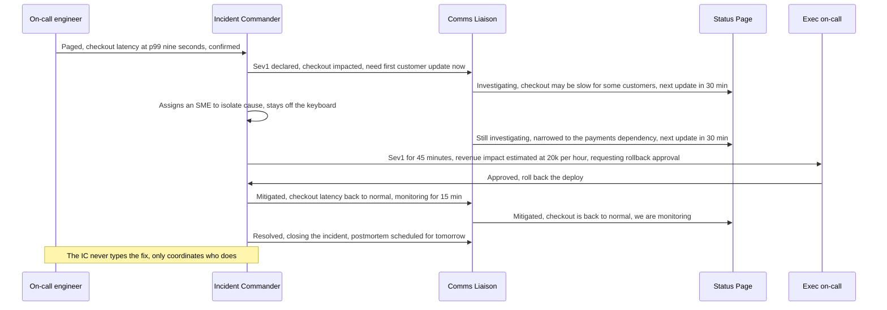
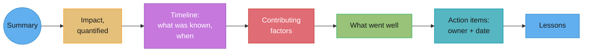
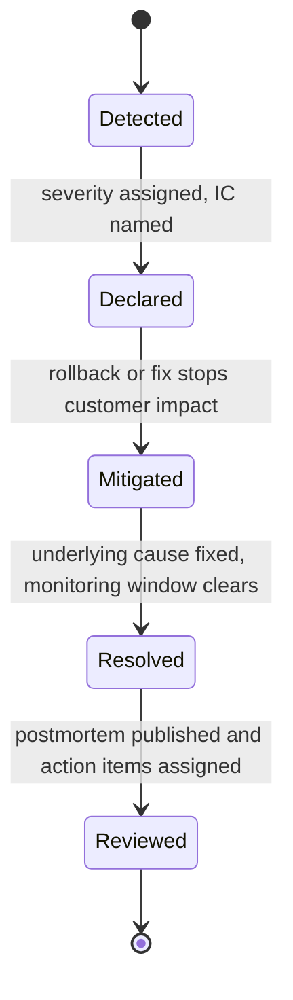

# Incident Communication & Postmortems

## 1. Concept Overview

This module is about the words during and after an incident, not the tooling that pages
you or the runbook that fixes the service — that lives in `devops/`. Two engineers can run
the identical technical recovery and produce completely different outcomes for the
business, because the outcome that customers, executives, and the team itself remember is
mostly made of language: the incident-channel message that orients the tenth person who
joins, the status-page update that either builds confidence or destroys it, and the
postmortem that either teaches the organization something or gets read by nobody and
repeats itself in four months. An incident is a technical event with a short half-life; a
badly communicated incident is a trust event with a long one.

The discipline splits into two halves that are easy to conflate and genuinely different.
**During the incident**, communication has to be fast, honest about uncertainty, and
structurally separated from the debugging itself, or the person fixing the problem becomes
the bottleneck for everyone who wants an update. **After the incident**, communication has
to resist two decades of institutional instinct — assign blame, find "the" root cause,
close the ticket — because both instincts produce a document that looks like accountability
and functions as amnesia. The rest of this module is built from three primary sources that
are worth reading directly: John Allspaw's 2012 Etsy post "Blameless PostMortems and a Just
Culture," Sidney Dekker's book *Just Culture: Balancing Safety and Accountability*, and the
"Postmortem Culture" chapter of Google's *Site Reliability Engineering* book.

---

## 2. Intuition

> **One-line analogy**: an incident channel is a cockpit voice recorder, not a group chat —
> everything in it should be reconstructable by someone who wasn't there, in order, with
> timestamps.

**Mental model.** Treat every incident as two simultaneous, separately staffed jobs: fixing
the system, and narrating the fixing to everyone who isn't hands-on-keyboard. The moment
one person tries to do both, the narration gets skipped under pressure — not because they
don't care, but because debugging under load consumes all the attention a human has, and
typing an update is the first thing to drop.

**Why it matters.** The technical fix is graded by whether the system comes back. The
incident is graded, afterward, by whether customers trusted the status page, whether
leadership trusted the on-call engineer's judgment, and whether the team is measurably less
likely to have the same incident again in six months. All three of those are entirely
functions of what got written down, not what got typed into a terminal.

**Key insight.** Blameless does not mean consequence-free, and it does not mean "nobody is
responsible." It means the analysis asks a different question than instinct wants to ask.
Instinct asks "who caused this and what should they have done differently" — a question
that assumes the person had the same information and clarity you have now, after the fact,
knowing how it ends. The blameless question is "what made this action look reasonable to
this person, with what they knew, at that moment" — which is the only question whose
answer can actually prevent a recurrence, because it points at the system the person was
operating inside, not the person.

---

## 3. Core Principles

1. **Separate the fixer from the narrator.** The person typing the fix is never the person
   typing the customer-facing or channel updates during a live incident. If they are the
   same person, updates stop the moment the technical work gets hard, which is exactly when
   updates matter most.
2. **Commit to a next-update time, even with nothing new to say.** "No update, will check
   back in 30 minutes" is a complete, honest, useful message. Silence is not neutral during
   an incident — the reader fills silence with their own worst assumption.
3. **State impact before cause.** A customer or executive reading an update needs to know
   what is broken for them before they need to know why. "Checkout is failing for roughly
   15% of US customers" beats "we're investigating a database connection pool issue" as the
   opening sentence, every time.
4. **The postmortem is blameless about the person, not about the facts.** Every fact stays
   — who ran what command, what the deploy contained, what alert didn't fire. What's banned
   is counterfactual language: "should have," "could have," "failed to." The document
   states what happened and why it looked reasonable at the time, not what an idealized
   version of the person would have done instead.
5. **A single root cause is almost always a fiction.** Real incidents are the intersection
   of several conditions that were each individually survivable — a flaky test that got
   skipped, an alert that had been noisy for months and got muted, a deploy that shipped on
   a Friday because the freeze policy had an exception nobody remembered the reason for.
   Removing any one of them would have prevented the incident; naming only one as "the"
   cause erases the other three lessons.
6. **The document exists to change what the organization does next, not to close a
   ticket.** An action item with no owner and no date is not an action item, it's a wish,
   and a postmortem full of wishes trains the team to stop expecting postmortems to change
   anything.

---

## 4. Types / Levels / Modes

**Incident-response roles** (the exact PagerDuty naming, since imprecise titles cause the
confusion this section exists to prevent):

| Role | Job | Explicitly NOT their job |
|---|---|---|
| Incident Commander (IC) | Owns the incident: coordinates responders, makes the call on next steps, is the single source of truth for what's happening | Debugging the system themselves |
| Deputy | Directly supports the IC — takes over tasks the IC can't get to, keeps the IC focused on commanding rather than doing | Being a second, uncoordinated decision-maker |
| Scribe | Documents everything as it happens: actions taken, decisions made, timestamps, screenshots | Making decisions or running the fix |
| Liaison (Customer / Internal) | Owns outward communication — status page, support team, or internal stakeholders, depending on which liaison | Working the technical problem |
| Subject Matter Expert (SME) | Brought in for deep knowledge of a specific system; does the actual debugging/fixing | Running the incident channel or deciding comms cadence |

PagerDuty's own guidance is explicit that these roles are flexible and can combine for a
small incident (a Deputy may also scribe), but the IC role is never combined with hands-on
debugging — that separation is the one rule that doesn't flex with incident size, because
it's the one that breaks first under pressure if it isn't enforced structurally.

**Severity levels**, a representative SEV1-SEV5 scale in the shape used across the industry
(GitLab's own incident-management process, for comparison, runs a closely related four-tier
scale — Critical/S1, High/S2, Medium/S3, Low/S4 — mapping cleanly onto SEV1-SEV4 below,
with SEV5 added here for the cosmetic tier many orgs track separately):

| Severity | Meaning | Who gets woken | Status-page cadence |
|---|---|---|---|
| SEV1 | Full outage or critical data-integrity risk, all customers | Entire on-call chain plus IC plus exec on-call, immediately | Every 30 min, no exceptions |
| SEV2 | Major functionality broken or degraded for a large customer segment | Primary on-call plus IC, immediately | Every 30-60 min |
| SEV3 | Limited-scope degradation, workaround exists | Primary on-call, standard paging | Every 2-4 hours or on material change |
| SEV4 | Minor issue, no meaningful customer impact | Logged, addressed next business day | Not customer-facing |
| SEV5 | Cosmetic or internal-only, no customer impact | Backlog, no paging | None |

**"Mitigated" vs "resolved,"** a distinction that gets collapsed constantly and shouldn't
be: mitigated means customer impact has stopped, usually via a rollback or a workaround,
while the underlying cause may still be present in the system; resolved means the
underlying cause is actually fixed and monitoring has confirmed it won't recur. A status
page that says "resolved" the moment the rollback lands, before the root cause is
addressed, sets an expectation the team hasn't actually earned yet.

---

## 5. Models & Frameworks Diagrammed



Five roles, one narrow channel of communication running in parallel with the technical
work rather than blocking on it. Every status-page post in this timeline commits to the
next update time even when the content is "still investigating" — the cadence is a promise
kept regardless of what's known.



Impact is quantified before the timeline appears, because a reader deciding whether to
keep reading needs to know how much this mattered before they invest in the mechanism.
Contributing factors sit in the middle — plural, deliberately, never "the root cause" —
and action items come after "what went well," so the document doesn't read as a pure
list of failures.



Mitigated and Resolved are separate states on purpose — the gap between them is exactly
the gap between "customers stopped noticing" and "we actually fixed it," and collapsing
them on a status page is one of the more common ways trust gets spent without anyone
deciding to spend it.

---

## 6. How It Works — Detailed Mechanics

### 6.1 The incident channel

**The opening message** has to orient someone who joins at minute 40 without making them
scroll:

```text
SEV1 — Checkout failing for ~15% of US traffic, started 14:02 UTC
IC: @dana | Scribe: @wei | Comms: @priya
Current theory: payments-service latency spike, not yet confirmed
Next update: 14:35 UTC
Pinned: link to dashboard, link to status page draft
```

**The running log** is timestamped and terse, written by the Scribe, not the IC or the
SMEs actually debugging:

```text
14:02 - Alert fired: checkout p99 latency 9s (baseline 200ms)
14:05 - IC declared SEV1, @dana commanding
14:09 - @wei confirms payments-service is the latency source
14:14 - @raj (SME) pulls payments-service deploy history, last deploy 13:45
14:19 - Theory: 13:45 deploy introduced the regression, rollback proposed
14:22 - IC escalates to @exec-oncall for rollback approval (revenue impact)
14:26 - Rollback approved, @raj executing
14:31 - Checkout latency back to baseline, monitoring
14:46 - 15 min clean, IC declares mitigated
```

**Handover** — when an incident outlives one IC's shift, the handover is a written
statement in the channel, not a verbal aside: current theory, what's been ruled out, what's
in progress, and an explicit "I am handing command to @X at 15:00" so there is never a
moment where two people believe they are, or nobody believes anyone is, in command.

**Declaring the incident over** happens in two steps, not one: mitigated is declared the
moment customer impact stops and confirmed stable for a monitoring window (commonly 15-30
minutes depending on the failure mode); resolved is declared only once the underlying cause
has an actual fix deployed or a firm follow-up plan, not merely a symptom suppressed. A
channel that goes straight from "still investigating" to "resolved" with no mitigated step
in between is very often masking that nobody's sure the rollback will hold.

### 6.2 Customer-facing status updates

**Cadence**: commit to a next-update time in every single post, even the ones that say
nothing changed. A status page with no update for ninety minutes reads as either abandoned
or worse than it is, regardless of what's actually happening internally.

**The register — what you may say before you know the cause:** state observed impact in
plain terms, never speculate about cause publicly until it's confirmed, and never promise
a fix time you don't have evidence for. "We are aware of an issue" is banned on its own —
it names nothing. It must always be paired with a concrete impact statement.

**Weak version**

> We are aware of an issue affecting some users and are looking into it.

**Strong version**

> We're seeing checkout failures for roughly 15% of customers in the US starting at 14:02
> UTC. We've identified the likely cause and are testing a fix. Next update by 14:35 UTC.

**What changed:** "some users" became a real percentage and region, "looking into it"
became a specific stage of the investigation, and the update commits to a time instead of
leaving the reader to refresh with no signal of when they'll know more. The weak version
answers no question a reader actually has; the strong version answers three.

**Worked examples across the incident lifecycle:**

```text
INITIAL (within minutes of declaring):
"We're investigating reports of checkout failures for some US customers. We'll post an
update within 30 minutes."

MID-INCIDENT (cause suspected, not yet fixed):
"Checkout failures are affecting roughly 15% of US customers since 14:02 UTC. We've
traced this to a recent deployment and are rolling it back now. Next update by 14:35 UTC,
or sooner if resolved."

ALL-CLEAR:
"The checkout issue affecting some US customers between 14:02 and 14:31 UTC is resolved.
We rolled back the change that caused it and confirmed normal checkout performance for
customers. We'll publish a postmortem within 5 business days."
```

Note the all-clear names a real time window and commits to a postmortem, rather than just
declaring victory — both are what let a customer trust the *next* status page post, because
this one didn't quietly drop the details that made the last one checkable.

**Weak version**

> Still looking into the checkout issue, hang tight.

**Strong version**

> Checkout failures are affecting roughly 15% of US customers since 14:02 UTC. We've
> traced this to a recent deployment and are rolling it back now. Next update by 14:35
> UTC, or sooner if resolved.

**What changed:** "still looking" gave no scope and no mechanism; the strong version names
the affected percentage, the specific remediation already in progress, and a firm time for
the next word — a mid-incident update's job is to show the reader the investigation is
converging, not just continuing.

### 6.3 Escalating mid-incident

Wake a VP or executive on-call when at least one of these is true: the incident has run
past a defined time threshold at SEV1/SEV2 with no resolution in sight (commonly 30-60
minutes), the fix requires an authority the IC doesn't have (a public rollback with
revenue or legal exposure, a decision to take the whole service offline), or the incident
has a reputational or regulatory dimension beyond the technical fix. Escalating is not a
failure signal about the IC — it's a structural part of the role.

**The three sentences escalation consists of:**

```text
1. What's broken and for whom: "Checkout is down for all US customers, started 14:02."
2. What's been tried: "We've identified a bad deploy and are rolling it back now."
3. What you need from them: "Approving the rollback risks a 10-minute further outage on
   the affected 15%; I need your sign-off given the revenue exposure, or an alternative."
```

Three sentences because an executive being pulled into an active incident has seconds of
attention, not minutes — the escalation has to be readable, and actionable, in one glance.

### 6.4 Blameless postmortems

**What "blameless" actually means.** John Allspaw's 2012 Etsy post "Blameless PostMortems
and a Just Culture" — one of the most cited pieces of writing in the SRE literature —
builds directly on Sidney Dekker's concept of a "second story": the first story is what a
retrospective, hindsight-equipped reviewer sees ("they should have checked the config
before deploying"); the second story is what the situation looked like to the person
inside it, in real time, with the information, workload, and incentives they actually had.
Blameless means the postmortem is written entirely in the second story. It does not mean
no one is responsible, and it does not mean the engineer's actions are hidden — every
action stays in the timeline with the engineer's name attached where relevant. What
changes is the question asked about that action: not "why didn't they do the right thing"
but "what made this look like the right thing to do, given what they knew."

**Counterfactual language, banned and rewritten:**

**Weak version**

> The on-call engineer should have checked the deploy dashboard before approving the
> rollback, which would have caught the second regression and avoided the extended
> outage.

**Strong version**

> The rollback approval flow does not surface the deploy dashboard by default; the
> on-call engineer approved based on the information the tool presented, which did not
> include the second regression. The tool's default view is the contributing factor, not
> the approval decision itself.

**What changed:** "should have checked" — a demand on a person's judgment, made with
hindsight the person didn't have in the moment — became a description of what information
the tool actually surfaced, which is the thing an action item can actually fix. You cannot
write an action item against "be more careful"; you can write one against "the approval
flow's default view."

**The Google SRE book's postmortem chapter** ("Postmortem Culture: Learning from Failure")
argues that postmortem criteria should be defined *before* an incident happens, so
declaring one is never a judgment call made under the stress of a specific event — common
triggers include user-visible downtime past a threshold, data loss of any kind, or an
engineer or stakeholder simply requesting one, which the book treats as always a valid
trigger on its own.

### 6.5 Why 5 Whys is a weak instrument

John Allspaw's follow-up post "The Infinite Hows" makes the direct case for retiring the
Five Whys technique from incident analysis, building on the resilience-engineering
argument — echoed by researchers like Richard Cook — that real incidents fail for several
simultaneous, individually survivable reasons, not one linear chain. Five Whys forces a
single path through a genuinely branching structure, and the chain terminates wherever the
person asking got tired, satisfied, or ran out of the traditional five iterations — which
means the "root cause" it produces is an artifact of when the questioner stopped, not a
property of the incident.

**What to use instead:**

- **Contributing factors, plural, never ranked into a single "root."** List every
  condition that, removed, would have prevented or reduced the incident: a stale runbook,
  a metric that alerts on the wrong threshold, a review process with a known bypass.
- **A timeline built from what was known at each point**, not what's known now. "At 14:09
  the dashboard showed X, so the engineer reasonably concluded Y" — reconstructing the
  actual epistemic state at each decision, rather than grading each decision against
  information that only became available later.
- **Counterfactual-free analysis** — describing what happened and why it made sense, never
  what "should" have happened instead. A "should have" sentence is a tell that the writer
  has substituted a hindsight-informed ideal for an analysis of the actual conditions.

### 6.6 The postmortem document

**A real skeleton:**

```text
TITLE: Checkout latency incident — 2026-08-14

SUMMARY: A deploy to payments-service introduced a connection-pool regression that
caused checkout latency to spike to 9s p99 for 29 minutes, affecting an estimated 15% of
US checkout attempts.

IMPACT: ~12,400 failed or abandoned checkouts, estimated $9,200 in lost revenue, 3
customer-support escalations, SLO burn: 4.2% of the monthly checkout-latency error budget
consumed in one incident.

TIMELINE (all UTC):
13:45 - payments-service v2.31 deployed (connection pool size reduced as part of an
        unrelated cost-optimization change)
14:02 - p99 checkout latency alert fires
14:05 - SEV1 declared, @dana commanding
14:09 - payments-service confirmed as latency source
14:14 - deploy history reviewed, 13:45 deploy identified as the change window
14:22 - rollback approved by exec on-call given revenue exposure
14:26 - rollback executed
14:31 - latency back to baseline

CONTRIBUTING FACTORS:
- The connection-pool change shipped in a deploy labeled "cost optimization, no
  behavior change," so it bypassed the load-test gate that behavior-changing deploys
  require.
- The pool-size default had no documented safe range, so the reviewer had no way to
  evaluate whether the new value was risky.
- The alert that caught this took 17 minutes to fire because its threshold was tuned for
  a different, noisier failure mode from an earlier incident.

WHAT WENT WELL:
- Rollback was identified and approved within 24 minutes of detection.
- The IC/Scribe/Comms role split held even though this was a small on-call team.

ACTION ITEMS:
- Add pool-size changes to the load-test gate's trigger list. Owner: @raj. Due: 2026-08-28.
- Document a safe range for payments-service connection-pool size. Owner: @priya. Due:
  2026-08-21.
- Re-tune the p99 latency alert threshold. Owner: @wei. Due: 2026-08-21.

LESSONS: "No behavior change" is a claim about intent, not a property the deploy
pipeline can verify — the gate needs to key on what changed, not on what the label says
changed.
```

Every action item names an owner and a date because an item without both is not a
commitment anyone can be held to — it's a suggestion that will still be open at the next
postmortem for the same class of incident.

**Weak version**

> Action item: add more monitoring around the payments-service connection pool.

**Strong version**

> Action item: alert when payments-service connection-pool utilization exceeds 80% for 5
> minutes, wired to the same on-call rotation as the checkout-latency alert. Owner: @wei.
> Due: 2026-08-21.

**What changed:** "more monitoring" named no signal and no threshold, so there was no way
to check afterward whether it would have caught this incident; the strong version names
the exact metric, the exact threshold, who owns building it, and by when — which makes it
both implementable and falsifiable against the next incident of this shape.

### 6.7 Named public postmortems worth imitating

**Cloudflare's July 2, 2019 outage** — a 27-minute global outage caused by CPU exhaustion
from a single WAF rule containing a poorly optimized regular expression that triggered
catastrophic backtracking, rolled out to every edge server simultaneously with no gradual
deployment. Cloudflare's CTO published a detailed public report ten days later. What it
does well: it names the exact technical mechanism (backtracking regex, global
simultaneous rollout with no canary) rather than a vague "a rule caused problems," and the
resulting fix — a global kill switch and staged WAF rule deployment — is described as a
direct structural response to a named contributing factor, not a generic "we'll be more
careful."

**GitLab's January 31, 2017 database incident** — an engineer accidentally removed data
from the primary database during a live troubleshooting session, and roughly six hours of
data (projects, comments, issues, user accounts) created or modified in a window before the
incident was permanently lost, exposing that five of GitLab's backup mechanisms had not
been working. GitLab live-streamed the entire recovery process on YouTube, drawing over
5,000 concurrent viewers, and published a detailed postmortem shortly after. What it does
well: total transparency during the incident itself, not just after, and a public admission
that the backup failures were a systemic gap across multiple layers rather than one
person's mistake — the person who ran the command is never framed as the story.

**AWS post-event summaries** — published for major regional outages, following a
consistent structure: a plain-language timeline, the technical mechanism in enough detail
to be useful to other engineers, and a list of concrete mitigations AWS is implementing.
What they do well: naming the exact failure mode (a specific subsystem, a specific
capacity-management process) rather than a vague "increased error rates," even when the
disclosure is commercially uncomfortable.

---

## 7. Real-World Examples

- **Cloudflare's July 2, 2019 regex outage** — a public, technically specific postmortem
  published within two weeks, naming the exact WAF rule mechanism and the deployment
  process gap that let it reach every edge server at once.
- **GitLab's January 31, 2017 database incident** — live-streamed recovery, public
  postmortem, and a since-famous case study in backup-system failure surfaced without
  singling out the engineer who ran the delete.
- **PagerDuty's own published incident-response process** — the IC/Deputy/Scribe/Liaison/
  SME role split described in §4 is PagerDuty's real, publicly documented structure, not a
  generic invention, and is widely adopted outside PagerDuty itself.
- **Google's SRE book postmortem chapter** — the source for defining postmortem trigger
  criteria in advance rather than deciding ad hoc whether an incident "deserves" one.
- **Etsy under John Allspaw** — the origin of the "blameless postmortem" term itself, and
  the origin of the critique of Five Whys that this module's §6.5 is built on.

---

## 8. Tradeoffs

| Choice | Pro | Con |
|---|---|---|
| Separating IC from hands-on debugging | Updates keep flowing under pressure; decisions get made with full attention | Needs enough headcount on-call to staff two roles, which small teams may not have |
| Committing to a fixed update cadence | Predictable, builds trust even with no news | Feels like overhead when genuinely nothing has changed |
| Public, detailed postmortems (Cloudflare/GitLab style) | Builds long-term customer trust; teaches the wider industry | Commercially uncomfortable; requires legal/PR buy-in |
| Naming a single root cause | Simple, fast to write, satisfies a stakeholder who wants "the" answer | Usually wrong, and hides the other factors that will cause the next incident |
| Contributing-factors analysis (no single root cause) | More accurate; surfaces multiple real fixes | Takes longer to write; harder to summarize in one sentence for an exec |
| Escalating early to a VP | Gets authority/resources fast when needed | Can be read as crying wolf if the bar for escalation isn't calibrated |

---

## 9. When to Use / When NOT to Use

**Run a full IC/Scribe/Comms split** for any SEV1/SEV2 — the coordination overhead pays for
itself the moment more than two people are involved in the response. For a SEV4/SEV5, one
engineer handling both fixing and a brief log entry is proportionate; standing up a full
role split for a cosmetic bug is its own kind of waste.

**Write a full postmortem** for anything that hit a defined trigger — user-visible
downtime past a threshold, any data loss, any incident a stakeholder explicitly requests
one for. **Do not** skip a postmortem because the fix was fast — a 4-minute outage caused
by a gap that could just as easily have caused a 4-hour one is exactly the kind of incident
a postmortem should catch before the slow version happens.

**Escalate to an executive** when authority or exposure crosses a threshold you can name in
advance, not based on how the incident *feels* in the moment — feel is a bad instrument
under stress, and a pre-agreed threshold removes the judgment call from the worst possible
time to make one.

---

## 10. Common Pitfalls

**The postmortem that names a person.** A postmortem sentence like "John's change caused
the outage" does two kinds of damage at once: it makes the document unsafe to read
honestly for everyone else who might have made the same call, and it trains the whole team
to hide mistakes rather than surface them, because the visible consequence of surfacing one
is now on record with your name on it. The fix from §6.4 — write in the second story,
describe what the tool or process presented, not who clicked what — is not a softening,
it's the only version that produces a usable action item.

**The action-item list with no owners.** "We should add more monitoring" with no owner and
no date is not an action item; it is a wish that will reappear, word for word, in the next
postmortem for the same class of failure. Teams that track this seriously report the same
handful of generic items — "improve monitoring," "add more tests," "update the runbook" —
recurring across unrelated incidents for years, which is the visible symptom of a
postmortem process that produces documents but not change.

**"Add more monitoring" as the only action.** This is specifically weak because it doesn't
name what to monitor, at what threshold, or how anyone would know if the new monitoring
actually would have caught this incident. A real action item names the exact signal: "alert
when payments-service connection-pool utilization exceeds 80% for 5 minutes," not "add more
monitoring to payments-service."

**The postmortem nobody reads.** A document that gets written, approved, and filed with no
review meeting and no distribution is functionally the same as no postmortem — the
organization paid the writing cost and got none of the learning benefit. Teams that get
value from postmortems typically hold a short review where the contributing factors are
discussed out loud, not just circulated as a document link nobody opens.

**The review that turns into a trial.** Even a postmortem written correctly in the
second-story voice can be destroyed live, in the review meeting, if someone asks "but
why didn't you just check the dashboard first" — a counterfactual question asked out loud
undoes the discipline of the written document instantly, and everyone in the room learns
the real lesson is that the document's politeness was cosmetic.

**Blaming the on-call.** The most common informal version of naming a person: not writing
"John caused this" in the document, but saying it in the hallway afterward, in the 1:1,
or in the tone of the review meeting. The consequence is measurable — teams with a
reputation for blaming on-call see on-call burnout and voluntary attrition rise, and,
worse for the org's actual goal, they see incidents under-reported, because an engineer
who suspects they caused a minor issue has every incentive to quietly fix it and say
nothing rather than trigger a process they've watched turn into blame before.

---

## 11. Frameworks, Books & Further Reading

- John Allspaw — "Blameless PostMortems and a Just Culture," Etsy Code as Craft blog, 2012
  — the origin of the term and the foundational argument for this module's §6.4.
- John Allspaw — "The Infinite Hows (or, the Dangers of the Five Whys)," Kitchen Soap blog,
  2014 — the direct critique behind §6.5.
- Sidney Dekker — *Just Culture: Balancing Safety and Accountability* — the "second story"
  concept that Allspaw's postmortem philosophy builds on.
- Google — *Site Reliability Engineering*, "Postmortem Culture: Learning from Failure"
  chapter — the source for defining postmortem trigger criteria in advance.
- PagerDuty — public incident-response documentation (response.pagerduty.com) — the
  IC/Deputy/Scribe/Liaison/SME role definitions used verbatim in §4.
- Cloudflare — "Details of the Cloudflare outage on July 2, 2019," published by CTO John
  Graham-Cumming.
- GitLab — "Postmortem of database outage of January 31" (published February 10, 2017).

---

## 12. Interview Questions with Answers

**Q: Why should the Incident Commander never also be the person debugging the system?**
**Short:** Debugging under pressure consumes all of a person's attention, so updates are the first thing dropped if roles combine.
Combining the roles means the moment the technical work gets hard — which is exactly when
communication matters most — updates stop, because a human under load cannot reliably do
both narration and deep technical work at the same time. The IC's actual job is
coordination and decision-making, not diagnosis; PagerDuty's documented role structure
keeps the IC off the keyboard specifically so the flow of updates never depends on how
hard the current debugging step happens to be. The gotcha interviewers probe for: a
candidate who says "the most senior engineer should run the incident" is describing an SME,
not an IC, and conflating the two is the exact failure this role split prevents.

**Q: What does "blameless" actually mean in a blameless postmortem?**
**Short:** It means asking what made the action reasonable at the time, not whether the person should have known better.
Blameless does not mean nobody is responsible or that facts get hidden — every action stays
in the timeline. What changes is the question: instead of "why didn't they do the right
thing," a blameless postmortem asks "what made this look like the right thing to do, given
what they knew at the time," which is Sidney Dekker's "second story." The practical
consequence is that "should have" and "failed to" are banned from the document, because
they encode the first, hindsight-biased question rather than the second one.

**Q: Why is Five Whys considered a weak analysis technique for incidents?**
**Short:** It forces a single linear chain onto an incident that failed for several simultaneous reasons.
Five Whys produces exactly one causal path, and that path terminates wherever the person
asking got tired or satisfied — which makes the resulting "root cause" an artifact of when
the questioning stopped, not a property of the incident itself. John Allspaw's "The
Infinite Hows" argues real incidents are the intersection of several individually
survivable conditions, so a technique that outputs one answer is structurally unable to
represent what actually happened. The fix is a contributing-factors list, plural, with no
single item ranked as "the" cause.

**Q: What's the difference between an incident being "mitigated" and being "resolved"?**
**Short:** Mitigated means customer impact stopped; resolved means the underlying cause is actually fixed.
Mitigated is typically a rollback or workaround that stops the symptom customers see, while
the root cause may still be present in the system; resolved means the cause itself has a
deployed fix and a monitoring window has confirmed it won't recur. Collapsing the two —
declaring "resolved" the moment a rollback lands — sets an expectation the team hasn't
earned yet, because the underlying condition that caused the incident is often still live
and could recur under different triggering conditions.

**Q: A customer status page says "we are aware of an issue and are looking into it." What's
wrong with that update?**
**Short:** It states nothing about impact, cause status, or when the next update is coming.
The sentence names no scope (who's affected, how badly), commits to no next-update time,
and gives the reader nothing to act on or trust. A usable version states observed impact
in concrete terms ("checkout failures for ~15% of US customers since 14:02 UTC"), the
current investigation stage, and a specific time for the next update — even when that next
update will say "still investigating." The gotcha: teams think a vague update protects them
from saying something wrong before the cause is known, but it's possible to be precise
about impact while staying appropriately vague about cause.

**Q: Why should a status update commit to a next-update time even when there's nothing new
to report?**
**Short:** Because silence during an incident isn't neutral — readers fill it with their worst assumption.
A gap with no update reads as either "nobody is working on this" or "it's worse than
they're telling us," regardless of what's actually happening internally. "No update yet,
will check back in 30 minutes" is itself useful information — it confirms the team is
still active and gives the reader a concrete point to stop worrying until. The discipline
costs nothing and directly prevents the trust erosion that silence causes.

**Q: What are the three sentences an escalation to a VP or executive should consist of?**
**Short:** What's broken and for whom, what's been tried, and exactly what you need from them.
An executive pulled into an active incident has seconds of attention, so the escalation has
to be readable in one glance: impact stated plainly, the current attempted fix, and a
specific, answerable ask — an approval, a resource, a decision only they can make. A vague
escalation ("things are bad, need help") forces the executive to ask clarifying questions
before they can act, which burns exactly the time the escalation was meant to save.

**Q: Why is "add more monitoring" considered a weak postmortem action item?**
**Short:** It names no signal, no threshold, and no way to verify it would have caught the incident.
A real action item specifies the exact metric and threshold to alert on — "alert when
connection-pool utilization exceeds 80% for 5 minutes" — so it's both implementable and
falsifiable: you can check afterward whether that specific alert would have caught the
incident sooner. "Add more monitoring" survives every postmortem review because it's too
vague to fail, which is exactly why it recurs across unrelated incidents without ever
actually preventing one.

**Q: What makes an incident-channel opening message useful to someone who joins 40 minutes
in?**
**Short:** Severity, who's in each role, current theory, and the time of the next update, all in one glance.
The opening message needs to answer, without scrolling: what severity is this, who is
commanding and who to talk to for what, what's the current working theory, and when is the
next update — everything after that lives in a timestamped running log a late joiner can
skim. A channel that instead opens with a stream of unstructured debugging chatter forces
every new joiner to interrupt and ask "what's the status," which is exactly the load the
Scribe role exists to remove from the IC.

**Q: Why does the Google SRE book recommend defining postmortem trigger criteria before an
incident happens?**
**Short:** So declaring one is never a stressed, ad hoc judgment call made during the incident itself.
Pre-defined triggers — user-visible downtime past a threshold, any data loss, a
stakeholder request — remove the decision of "does this deserve a postmortem" from the
worst possible moment to make it, which is mid-incident under pressure, when the instinct
to skip the paperwork is strongest exactly when the incident was serious enough to need
it. The book also treats "a stakeholder asked for one" as a valid trigger on its own,
independent of the objective thresholds, which prevents a technically-below-threshold
incident with real organizational impact from falling through.

**Q: Rewrite this postmortem sentence to remove counterfactual language: "The engineer
should have checked the deploy dashboard before approving the rollback."**
**Short:** State what information the tool actually surfaced instead of what the person should have checked.
The rewrite becomes something like: "The rollback approval flow does not surface the
deploy dashboard by default; the engineer approved based on the information the tool
presented." The mechanism: "should have checked" assumes information or diligence the
person didn't actually have access to in the moment, while the rewrite identifies the
tool's default view as the actual contributing factor — which is also the only version of
the sentence you can write an action item against.

**Q: What went well about how Cloudflare handled its July 2019 outage publicly?**
**Short:** It named the exact technical mechanism and rollout gap rather than a vague explanation.
Cloudflare's CTO published a detailed report naming the specific cause — a WAF rule with a
regex vulnerable to catastrophic backtracking, deployed globally with no canary or staged
rollout — within about ten days of the incident, and the resulting fixes (a global kill
switch, staged WAF deployment) map directly to the named contributing factors. The lesson
for a postmortem author: specificity about mechanism is what makes a public postmortem
actually useful to other engineers, versus a PR-safe but empty "we had an issue with a
configuration change."

**Q: What did GitLab do during its January 2017 database incident that's worth
imitating?**
**Short:** Live-streamed the entire recovery on YouTube instead of going dark until the postmortem was ready.
GitLab live-streamed the recovery process to over 5,000 concurrent viewers rather than
communicating only through a status page, and the postmortem that followed described the
loss as a failure across five separate backup mechanisms rather than framing it as one
engineer's mistake. The transparency during the incident, not just the postmortem
afterward, is the part most companies skip — most orgs only apply the blameless discipline
after the fact and go dark or defensive while the incident is still live.

**Q: Why should you never let a fast-resolved incident skip a postmortem?**
**Short:** A short outage caused by a real gap could just as easily have been a long one under different conditions.
A 4-minute outage and a 4-hour outage can share the identical root gap — the difference is
often luck in when the on-call happened to be watching, not anything about the underlying
system being more resilient. Skipping the postmortem because "it was quick" means the gap
that caused it stays unaddressed until it recurs under worse timing, at which point it's
the long outage instead. The trigger for a postmortem should be the presence of a real gap,
not the duration of the customer-visible symptom.

**Q: What is the specific, measurable cost of a team culture that blames on-call
engineers for incidents?**
**Short:** Under-reporting of incidents, because engineers hide small issues rather than trigger a process they've seen turn into blame.
Beyond the immediate morale and attrition cost, a blame culture creates an information
problem: an engineer who suspects they contributed to a minor issue has every incentive to
quietly fix it and stay silent rather than declare an incident and risk the review turning
personal. That silence directly damages the organization's ability to catch the small,
survivable version of a failure before it recurs as the large, customer-visible one — the
exact function postmortems are supposed to serve.

**Q: How do you write a severity-level table that actually changes who gets paged, rather
than just labeling incidents?**
**Short:** Each tier must specify a concrete paging rule and a concrete status-page cadence, not just a description of severity.
A severity table is only useful operationally if SEV1 names who gets woken (the full
on-call chain plus IC plus exec on-call) and how often the status page updates (every 30
minutes, no exceptions), and SEV4/SEV5 explicitly opt out of paging and customer
communication entirely. A table that just describes "SEV1 = very bad, SEV4 = not very bad"
gives on-call engineers no operational instruction, which means severity gets assigned
inconsistently and the paging and comms cadence end up decided ad hoc, incident by
incident, by whoever happens to be commanding.

---

## 13. Best Practices

- Staff the IC and the hands-on-debugging role separately for every SEV1/SEV2, even on a
  small team where it means pulling in a second responder.
- Commit to a fixed status-page cadence in every update, including the ones that say
  nothing has changed, and never miss the promised time.
- State customer impact, quantified, before cause, in every update — impact first,
  mechanism second, always.
- Ban "should have" and "failed to" from postmortem drafts; if a sentence needs one of
  those phrases, rewrite it to describe what information or process made the action look
  reasonable at the time.
- Never rank contributing factors into a single "root cause" — list every condition that,
  removed, would have prevented or reduced the incident.
- Every action item gets a named owner and a real date in the same sentence it's written,
  or it doesn't go in the document.
- Hold a short, spoken postmortem review for anything above SEV3, and treat a
  counterfactual question asked out loud in that review as a signal to redirect, not
  answer as asked.

---

## 14. Case Study

**Scenario.** A payments team ships a routine dependency upgrade at 09:15 on a Tuesday. By
09:40, checkout success rate has dropped from 99.7% to 91%. The on-call engineer, Mei,
is paged and confirms the drop within four minutes.

**What goes right.** Mei declares SEV2 immediately rather than trying to fix it quietly
first — the team's culture treats declaring early as free and declaring late as costly, so
there's no hesitation. She pages a second engineer, Tom, explicitly as IC, and stays as the
SME doing the actual diagnosis herself. Tom never touches the keyboard; his first act is
posting the opening message with roles, current theory (none yet), and a 09:55 next-update
commitment.

**The complication.** By 09:55, Mei has narrowed the cause to the dependency upgrade but
the rollback path isn't clean — the new dependency version changed a database migration
that already ran, and rolling back the code without rolling back the migration will cause
a worse failure. Tom's 09:55 update to the channel is honest about this: "Rollback isn't
simple, migration already applied. Evaluating a forward fix instead. Next update 10:15."
The customer status page gets the same honesty in customer language: "We've identified the
cause and are testing a fix. Next update by 10:15 UTC."

**Escalation.** At 10:10, with no fix yet and checkout still degraded, Tom escalates to the
VP of engineering with the three-sentence format: "Checkout success rate down to 91% for
all customers since 09:40. We've found the cause — a schema-incompatible dependency
upgrade — and are writing a forward-fix migration rather than a rollback, ETA 30 minutes.
I need you to know this may run past an hour and may need a customer-support heads-up."
The VP approves proceeding and loops in support proactively — a decision Tom's three
sentences gave her everything she needed to make without a call.

**Resolution.** The forward fix ships at 10:32; checkout recovers to 99.6% by 10:40. Tom
declares mitigated at 10:55 after a clean monitoring window, and resolved the next morning
once a permanent migration-compatibility check is added to the deploy pipeline.

**The postmortem**, written by Mei with Tom reviewing, states as a contributing factor:
"the CI pipeline does not run a migration-compatibility check against the dependency
version being upgraded, so a schema-breaking upgrade passed all existing gates" — not "Mei
should have checked the migration compatibility before approving the upgrade." The action
item is a specific CI gate, owned by Mei, due in two weeks. The review meeting includes the
engineer who originally approved the dependency upgrade PR; nobody in the room asks why
they didn't catch it, because the postmortem already answered that question structurally —
there was no gate that would have surfaced it to anyone.
