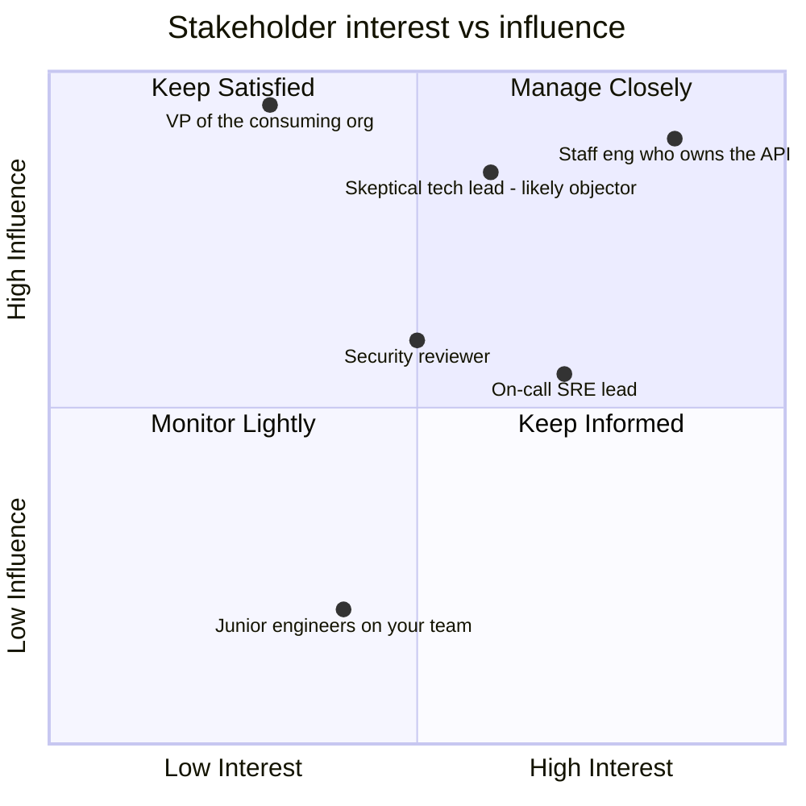
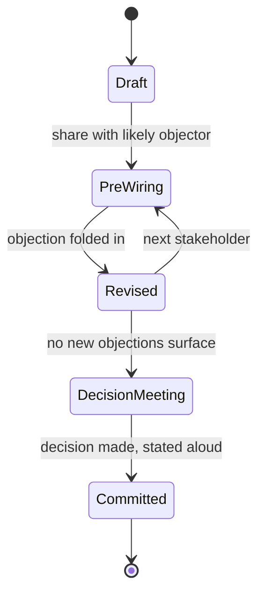

# Influence Without Authority

## 1. Concept Overview

Influence without authority is the practice of getting a decision you want from people who
do not report to you, cannot be ordered by you, and have their own roadmap that your idea
is not on. It is the defining staff-plus skill in engineering, because everything a staff
engineer is actually evaluated on — a cross-team migration, a platform other teams adopt, a
standard that sticks — requires exactly this and nothing else. A staff engineer with a
title and no influence gets a nice offer letter and a roadmap nobody follows.

The mechanism is not persuasion in the debate-team sense of having the better argument. Most
technical disagreements are not won in the room; they are won or lost in the two weeks before
the room, in one-on-one conversations most people in the meeting never see. This module is
about that pre-meeting work: reading the room before it exists, finding out what a "yes"
costs each stakeholder, and removing that cost before you ask.

It also covers the honest half of persuasion theory (Cialdini's principles, used to build
trust rather than extract it) and the two protocols that keep a disagreement from turning
into a grudge: giving someone a face-saving way to change their mind, and disagreeing then
committing for real once the decision is made.

---

## 2. Intuition

> **One-line analogy**: A decision meeting should be a formality that ratifies a consensus
> you already built — not a debate you are hoping to win in the room.

**Mental model.** Treat every contested decision as a graph, not a speech. There is a
decider, a set of people who influence the decider, a set of people affected by the outcome,
and a set of people who will be blamed if it goes wrong. Your job before the meeting is to
walk that graph in the right order and make sure nobody's first exposure to your idea is the
moment you ask them to approve it. If someone hears your proposal for the first time in the
room, you have already lost some of them — not because the idea is bad, but because you gave
them no way to raise a concern without doing it in public, and people protect themselves in
public.

**Why it matters.** Engineers who are technically right lose proposals constantly, and the
reason is almost never the technical merits. It is that the proposal arrived as a surprise to
someone whose job it was to have an opinion, and that person's instinct in a surprise is to
slow things down, not speed them up — asking a clarifying question that is really a stall,
requesting "more analysis," or simply not showing up enthusiastic. None of that is malice.
It is a rational response to being asked to co-sign something in public that you have not
had five minutes to think about in private.

**Key insight.** Authority gets compliance. Influence gets commitment. Compliance is what you
get when someone does the minimum required and stops the moment enforcement looks away;
commitment is what you get when someone argued for the idea themselves in a hallway
conversation last week and now defends it as if it were theirs. Six months after a rollout,
compliance has produced a system nobody maintains and commitment has produced a system three
teams extended on their own. The entire module is about building the second kind.

---

## 3. Core Principles

- **The room is the last step, not the first.** By the time you present, every likely
  objection should already have an answer you built together with the objector.
- **A decision has a decider, but adoption has many deciders.** Getting formal sign-off from
  one VP does not make five team leads write the migration code; each of them re-decides
  whether to actually do it every sprint until it ships.
- **State the ask in the other person's terms, not yours.** "This removes 200 lines of
  boilerplate" is your win. "This means you stop getting paged for the retry bug your team
  inherited from us" is theirs.
- **Face is a resource, not a nicety.** A person who cannot change their public position
  without looking beaten will defend that position past the point where they privately agree
  with you. Every technique in this module either builds credibility or protects someone's
  face; the ones that do neither are manipulation and they are also short-lived, because you
  work with these people again next quarter.
- **Sequence beats volume.** Ten Slack messages sent in a burst the night before a meeting
  move nobody. One five-minute conversation with the right person, ten days out, moves the
  whole graph.
- **Credibility compounds, and it compounds slowly and asymmetrically** — years to build,
  one overclaimed launch date to spend most of it.

---

## 4. Types / Levels / Modes

Influence attempts fall into a small number of recognizable modes. Knowing which mode you are
in changes what "success" looks like.

| Mode | What you are actually asking for | Typical mistake |
|------|-----------------------------------|------------------|
| **Sign-off influence** | One decider's formal approval (a design review, an architecture board) | Optimizing the room instead of the pre-wire; treating the board as the audience instead of the ratifier |
| **Adoption influence** | Many autonomous teams each choosing to integrate your thing | Treating it like sign-off influence — one approval, then assuming rollout follows; it does not, adoption is re-decided weekly by each team |
| **Peer influence** | A colleague at your level changing their technical opinion | Under-preparing because "we're equals" — peers have the least incentive to defer and the most standing to say no in the room |
| **Upward influence** | A more senior person reallocating headcount, budget, or a deadline | Bringing the objection instead of the alternative; see [Executive Communication](../executive_communication/executive_communication.md) |
| **Cross-org influence** | A team with a different manager, different incentives, different quarter | Assuming shared context; their scorecard rewards something your proposal does not move |

Each mode needs the same pre-wiring discipline, but the stakeholder map and the "what's in it
for them" translation are different every time. Adoption influence is the hardest of the
five and the one staff engineers spend the most time in — a platform is not "approved," it is
re-chosen by every team, every sprint, until it either becomes the default or gets ripped out.

---

## 5. Models & Frameworks Diagrammed


The pre-wire order is deliberate and counter-intuitive: the most likely objector goes first,
not the most senior person. Talking to the senior person first and getting their support
before you have an answer to the objection means you now have to walk that support back when
the objector raises something you had no answer for — which reads as either sloppy or as
using seniority as a shield. Talk to the objector first, fold their concern into the proposal,
then everyone after them hears a stronger version.



This is the classic stakeholder-triage grid from project-management practice (the axes —
interest and influence or power — are standard; the specific quadrant contents above are this
module's worked example, not a citation). High-interest, high-influence people get the
individual pre-wire conversations. High-influence, low-interest people (the VP) get a short,
outcome-framed heads-up, not a deep-dive — they will tune out a design discussion and remember
that you wasted their time. Low-influence, high-interest people (junior engineers on your own
team) get informed, not persuaded — they are not the blocker, and treating them as one wastes
pre-wire budget you need for the actual objector.



A proposal that goes straight from Draft to DecisionMeeting has skipped the entire module.
Every loop back into PreWiring is cheap; every objection that first surfaces inside
DecisionMeeting is expensive, because now it is being litigated in front of an audience whose
attention span for revisions in real time is a few minutes.

---

## 6. How It Works — Detailed Mechanics

### 6.1 Opening a proposal

The opening paragraph of a design doc or an RFC does the same work as the opening line of a
pre-wire message: it tells the reader in the first ten seconds whether this is worth their
attention and what, specifically, you are asking of them. Most proposals bury that
information under three paragraphs of background the reader does not yet have a reason to
care about.

**Weak version**

> As we scale, it's become increasingly important to think about how we handle service
> resilience. This document explores some ideas around retry logic and proposes we consider
> consolidating our approach going forward.

**Strong version**

> Checkout maintains a forked retry library that duplicates the shared resilience library's
> functionality and now blocks the platform observability initiative from getting a single
> view of retry behavior. This doc proposes deleting the fork and migrating checkout onto
> the shared library, with a new configurable retry ceiling added to close the one real gap
> (see §3). Ask: sign-off from checkout's tech lead and platform director by August 29;
> estimated migration cost is two engineer-days.

**What changed:** the weak version could be the opening paragraph of a hundred different
documents and asks nothing of the reader; the strong version names the problem, the proposed
fix, the open gap already addressed, the specific decision-makers, a date, and a cost. A
reader can decide in one paragraph whether to keep reading closely or skim.

### 6.2 Pre-wiring, step by step

Pre-wiring is talking to the people who will object **before** the meeting, one at a time, in
the order the stakeholder map gives you, and asking a specific question: not "what do you
think of this," which invites a polite non-answer, but **"what would make you say no to
this?"** That question does three things a generic ask does not: it signals you expect
disagreement and are not fragile about it, it gives the other person permission to be
concrete instead of diplomatic, and it hands you the actual objection while you still have
time to fix it.

The message that opens this conversation matters as much as the conversation itself.

**Weak version**

> Hey, wanted to get your thoughts on a proposal I've been working on, let me know what you
> think whenever you get a chance, no rush!

**Strong version**

> Hi Priya — I'm proposing we migrate checkout's retry logic onto the shared resilience
> library your team maintains, instead of the fork checkout carries today. Before I bring
> this to next Thursday's review, I want to know what would make you say no to it — you're
> the person most likely to spot something I'm missing. 15 minutes this week?

**What changed:** a named recipient, a specific proposal, an explicit reason she was picked
first, the actual pre-wire question, and a time-bound ask. The weak version can be ignored
for a week with zero social cost; the strong one gets a calendar hold.

The actual conversation that follows the message should look roughly like this:

```text
You:   Thanks for the time. Quick context — checkout has its own retry fork because when
       we adopted the shared library two years ago it didn't support idempotency keys.
       That gap closed six months ago. I want to delete the fork and move onto the shared
       lib. What would make you say no to that?

Priya: The fork also does something the shared lib doesn't — it caps retries differently
       under partial outages, because checkout got burned by a retry storm during the 2024
       payments incident. If you migrate us and lose that cap, that's a hard no from me.

You:   Good catch, I didn't know about that incident. Is the cap logic something the
       shared lib could absorb as a configurable ceiling, or is it checkout-specific
       enough that it needs to stay a local override even after migration?

Priya: If it's a config option other teams could also set, I'd actually want that in the
       shared lib — we're not the only team that got burned by retry storms.

You:   Then I'll add a configurable retry ceiling to the shared lib as part of this, with
       checkout's current cap as the default value, and loop you in on that PR before I
       bring the migration to review.
```

Notice what happened: the objection was real and specific, it got folded into the proposal
rather than argued down, and Priya leaves the conversation as a co-author of the fix rather
than someone who was talked out of a concern. By the time the design review happens, she is
the person in the room saying "yeah, I already looked at this, it's fine" — which is worth
more than any slide you could present.

### 6.3 Coalition and sequencing

Before any pre-wire conversation happens, map four roles, because each one needs a different
conversation:

| Role | Question to ask about them | What they need from you |
|------|------------------------------|--------------------------|
| **Decider** | Who actually has to say yes for this to happen? | A clean, short summary at the end — after the coalition already agrees |
| **Influencer** | Whose opinion does the decider ask for before deciding? | Enough detail to form a real opinion, early |
| **Affected** | Whose day-to-day work changes if this ships? | To be asked what would break for them, not told what will change |
| **Accountable** | Who gets paged, blamed, or budget-cut if this fails? | To see the failure mode addressed explicitly, not glossed over |

Getting the order wrong is expensive in a specific way: if you brief the decider before the
likely objector, and the objector then raises something serious in the room, the decider now
has to either overrule someone they already tacitly endorsed (costs the decider face) or
reverse in public (costs you the decision). Brief bottom-up: objector, then influencer, then
affected, then accountable, then decider last, with the decider's conversation being the
shortest one because by then there is nothing left to discover.

### 6.4 Making the other person's win visible

Nobody adopts a shared library, a new on-call rotation format, or a coding standard because
it is well-designed. They adopt it because it removes something from their roadmap, their
pager, or their review queue. Find that thing before you pitch anything by asking a plain
question: **"what does your team's quarter look like?"** — not as small talk, as
reconnaissance. The answer tells you whether your proposal is a gift or a tax.

**Weak version** (asking another team to adopt something, stated in your terms)

> We built a new deployment pipeline that's way more elegant than the old Jenkins setup —
> you should switch over, it'll be much cleaner.

**Strong version** (the same ask, stated in theirs)

> Your team filed three tickets last quarter about flaky Jenkins deploys blocking releases —
> I checked, they average 40 minutes of lost time each. The new pipeline we built for
> platform-core has had zero flaky failures in four months. Migrating checkout is about two
> days of config work; I can pair with whoever picks it up.

**What changed:** the pitch opens with their pain, cites their own tickets, quantifies the
cost in their terms, and turns the ask into a bounded, named amount of work rather than an
open-ended "switch over." Elegance is not a currency any team's roadmap is denominated in;
lost time is.

### 6.5 Giving people a way to change their mind without losing face

This is the single most useful move in a stuck disagreement, and it is almost never taught.
The mechanism: people don't resist your idea, they resist the experience of having been
wrong in public. Give them an exit that lets the change look like new information landing,
not defeat.

Concrete phrasings that do this:

- **"I think I under-explained X earlier — here's what I meant, does that change anything?"**
  — frames the earlier disagreement as your communication failure, not their misjudgment.
- **"Given what we just learned from Priya about the retry storm, does the calculus shift?"**
  — attributes the new position to new information, which is true and lets everyone move
  together.
- **"You were right that the naive version had a gap — here's the version that closes it.
  Does this address what you raised?"** — credits their objection publicly before asking them
  to update, which converts their prior "no" into a contribution rather than a loss.
- In a meeting, when someone is visibly boxed in: **"It sounds like there are two good options
  here and we should decide with data rather than in this room — can we timebox a spike?"** —
  removes the need for anyone to concede on the spot.

The move to avoid is re-litigating the exact point they lost on and asking them to say so out
loud. Even if they privately agree, making them say "you were right and I was wrong" in front
of peers buys you a worse outcome than letting the position shift quietly — they will
comply, then look for the next chance to be right in public at your expense.

### 6.6 Disagree and commit, as a protocol rather than a slogan

The phrase is older than any one company. The earliest documented use traces to Scott
McNealy at Sun Microsystems, sometime in the 1983-1991 range: "agree and commit, disagree
and commit, or get out of the way." Andrew Grove is separately credited with the idea at
Intel, connected to the peer-review, high-disagreement culture he wrote about in *High
Output Management* (1983) — the discipline of surfacing real disagreement fast so that
indecision, not the quality of the idea, doesn't become the thing that kills it. Amazon
formalized it as a written Leadership Principle, "Have Backbone; Disagree and Commit,"
sometime around 2010-2011, and Jeff Bezos referenced it directly in his 2016 letter to
shareholders. The exact Amazon wording: *"Leaders are obligated to respectfully challenge
decisions when they disagree, even when doing so is uncomfortable or exhausting. Leaders
have conviction and are tenacious. They do not compromise for the sake of social cohesion.
Once a decision is determined, they commit wholly."*

Two obligations, on two different people, and both have to be real for the protocol to work:

- **The dissenter must actually dissent — before the decision, not after.** Staying quiet in
  the room and objecting afterward in Slack is not "disagree and commit," it's just
  disagreeing late, and it's the failure mode that gives the phrase a bad reputation.
- **The decider must have actually listened.** If the dissent gets a "noted" and no visible
  change to the decision or the reasoning behind it, "disagree and commit" is functioning as
  a way to shut down a conversation that never really happened — the test is whether the
  decider can accurately restate the strongest version of the objection back.

A committed statement should sound like a decision, not a resignation:

**Weak version**

> I still don't love this, but whatever, we're doing it, I guess.

**Strong version**

> I raised the concurrency risk and I still think it's real — the team decided to ship the
> optimistic-locking version anyway to hit the date, with a follow-up ticket to revisit if we
> see contention in production. I'm committing to that: I'll build the optimistic version,
> and I'll flag it loudly the moment the metrics show the risk landing, not quietly say "I told
> you so" later.

**What changed:** the weak version signals compliance without commitment — it will show up
as foot-dragging the first time the work gets hard. The strong version names the specific
disagreement, states the decision and its rationale, and commits to a concrete, visible
follow-through, including how the dissenter will behave if they turn out to be right.

The exit clause is narrow, and it matters: a committed decision reopens on **new
information** the decider did not have — a cost estimate that was wrong by a wide margin, a
dependency that didn't ship, an assumption that turned out false — not on renewed discomfort
with a decision that hasn't changed. "I've had more time to think about it and I still don't
like it" is not new information, and treating it as grounds to reopen is what makes a team
stop trusting anyone's commitments, including yours.

---

## 7. Real-World Examples

- **Google's internal "20% projects that stuck"** pattern — the ones that survived past the
  founder's attention (like early versions of Gmail's internal tooling culture) did so
  because engineers pre-wired adoption team by team rather than mandating a company-wide
  switch; the ones that got mandated top-down and skipped that step were the ones engineers
  quietly stopped maintaining once the mandate's sponsor moved on.
- **Kubernetes' governance model** at the CNCF runs almost entirely on influence without
  authority by design: SIG (Special Interest Group) leads have no reporting authority over
  contributors from other companies, so every API change of consequence goes through a KEP
  (Kubernetes Enhancement Proposal) process that is, functionally, a mandatory pre-wiring
  step — sponsors are required, and a KEP without sponsors from the affected SIGs does not
  move, no matter how technically sound it is.
- **Stripe's internal API design reviews** are structured so that a proposal cannot be
  scheduled for the review board until it has documented sign-off from every team whose API
  surface it touches — the pre-wire is a checklist gate, not a cultural nicety, precisely
  because Stripe learned that skipping it produced reviews that re-litigated design decisions
  live instead of ratifying ones.
- **Amazon's "working backwards" PR/FAQ process** front-loads pre-wiring by requiring a
  written narrative and mock press release before a resourcing decision — reviewers read it
  silently in the room and write comments, which forces objections onto paper where they can
  be answered calmly instead of into a live debate where the loudest voice wins.

---

## 8. Tradeoffs

| Approach | Speed to decision | Quality of adoption | Political cost if it fails |
|----------|--------------------|----------------------|------------------------------|
| Skip pre-wiring, present cold | Fast to the meeting, slow (or never) to adoption | Low — compliance at best | High — looks like you didn't do the work |
| Full pre-wire, one stakeholder at a time | Slower to the meeting by 1-3 weeks | High — coalition already agrees | Low — failure is shared, not yours alone |
| Mandate from a VP, no pre-wire | Fastest formal approval | Lowest — resentment compliance, reverts once attention moves | Borne by the VP, but you lose credibility for needing it |
| Pre-wire everyone including low-influence people | Slowest — wasted cycles on people who were never blockers | No better than targeted pre-wire | Wastes your influence budget, no upside |

The honest tradeoff is time. Pre-wiring costs one to three weeks that presenting cold does
not. What it buys is a decision that survives contact with the org after the meeting ends,
which is the only kind that matters for anything bigger than a single team's internal choice.

---

## 9. When to Use / When NOT to Use

**Use full pre-wiring when:** the decision crosses team boundaries, someone with a real
objection has not yet weighed in, adoption depends on people who are not in the decision
meeting, or the proposal reverses a prior decision someone is invested in.

**Skip or shorten it when:** the decision is reversible and cheap (ship it, learn, adjust),
the decider already explicitly delegated the call to you, or the stakeholder set is one team
you already talk to daily — in that case the "pre-wire" is just how the team already works,
and formalizing it adds ceremony without adding information.

**Do not use it as a substitute for a real decision process.** Pre-wiring a proposal until
everyone privately agrees, then presenting it as a fait accompli to a decider who was never
actually consulted, is not influence — it is engineering consent, and the first time the
decider notices, you lose standing for every future proposal.

---

## 10. Common Pitfalls

**Going over someone's head as a first move.** An engineer at a mid-size fintech disagreed
with their tech lead's data-model choice, could not get traction in three rounds of comments,
and escalated straight to the tech lead's manager with a doc titled "concerns about the
current approach." The manager backed the tech lead — correctly, since the manager had no
context and the doc read as a complaint, not a proposal — and the engineer spent the next two
quarters being routed around on every design decision, because nobody trusts someone who
skips a level as their first move. The fix was not "don't escalate" — it was "pre-wire the
tech lead's manager as an influencer before, not instead of, the tech lead," and only after
the direct conversation had genuinely stalled.

**The surprise proposal in a large meeting.** A platform team demoed a new deployment system
to 40 people in an all-hands-style review with zero prior individual conversations. Three
team leads raised objections live, in front of their own reports, and — because raising a
concern in public commits you to defending it — all three spent the next month defending
positions they might have abandoned in a private conversation twenty minutes long. The
project shipped four months late. The fix, applied to the next platform launch by the same
team, was the pre-wire protocol in §6.1; that launch shipped on schedule with the same
technical content.

**Winning the argument and losing the adoption.** A staff engineer at a logistics company won
a heated design review for a new event schema — every technical objection was answered,
correctly, on the spot, with visible command of the material. Adoption six months later was
at 15%. The room remembered who won; the individual teams who would have to do the migration
work were never asked what it would cost them, so nobody budgeted for it, and "won the
review" turned out to be a different achievement from "got adopted."

**Escalating a technical disagreement into a political one.** Two senior engineers disagreed
on a caching strategy. One, losing ground technically, started copying their skip-level on
every thread "for visibility." The disagreement stopped being about caching and became about
who had more organizational weight, which nobody can win cleanly, and which both engineers'
managers spent a week cleaning up instead of shipping anything.

**The "I told you so" that costs a year of goodwill.** A proposal was rejected, the thing it
warned about happened, and the proposer opened the postmortem by pointing at the old doc. The
postmortem stopped being about the incident and became about whether the proposer was
trustworthy to bring findings to neutrally — the correct move (verified afterward with the
same engineer, one year later, after they'd rebuilt trust by never doing it again) was to let
the postmortem's own findings make the point, then privately note "this is what the earlier
proposal was about, happy to revisit" once the room was already looking for a fix.

---

## 11. Frameworks, Books & Further Reading

| Framework / Source | What it gives you |
|---------------------|---------------------|
| Robert Cialdini, *Influence: The Psychology of Persuasion* (1984) | The original six principles: reciprocity, commitment and consistency, social proof, authority, liking, scarcity |
| Robert Cialdini, *Pre-Suasion: A Revolutionary Way to Influence and Persuade* (2016) | The seventh principle, unity — shared identity as a distinct driver of persuasion, separate from liking |
| Andrew Grove, *High Output Management* (1983, rev. 1995) | The management-by-objectives and peer-review culture that "disagree and commit" grew out of at Intel |
| Amazon Leadership Principles, "Have Backbone; Disagree and Commit" | The written obligation both to challenge and to commit once decided; see §6 for exact wording |
| Robert Cialdini, various interviews on *Pre-Suasion* | Cialdini's own framing of unity as an amplifier of the other six principles, not a peer to them |
| Kubernetes Enhancement Proposal (KEP) process, `kubernetes/enhancements` repo | A working example of mandatory cross-SIG pre-wiring baked into governance |

Related modules in this section: [Giving & Receiving Feedback](../giving_and_receiving_feedback/giving_and_receiving_feedback.md),
[Difficult Conversations & Conflict](../difficult_conversations_and_conflict/difficult_conversations_and_conflict.md),
[Negotiation for Engineers](../negotiation_for_engineers/negotiation_for_engineers.md).

---

## 12. Interview Questions with Answers

**Q: What is the single highest-return technique for getting a cross-team proposal approved?**
**Short:** Pre-wiring — talking to likely objectors individually before the decision meeting.
Pre-wiring means finding your likely objectors and talking to each of them privately, in
order, before you ever present. It converts the decision meeting from a debate into a
ratification of a consensus you already built, and it means every objection gets answered
while there is still time to change the proposal instead of defend it live. The gotcha
interviewers listen for: candidates who describe "having a great slide deck" as the answer —
that is optimizing the wrong ten minutes.

**Q: Why doesn't authority work for most engineering decisions, even for a manager?**
**Short:** Authority buys compliance, which decays; only influence buys the commitment that lasts.
A manager can order a team to adopt a library, but cannot order anyone to defend it in a
design review six months later, extend it to a new use case, or fix it at 2 a.m. without
resentment. Compliance is doing the minimum while being watched; commitment is doing the
extra mile because you believe the thing is right. Ordered adoption typically survives only
as long as the mandate's sponsor keeps attention on it — the moment that attention moves, the
system reverts to whatever the team actually wanted.

**Q: Someone raises a serious objection to your proposal in the decision meeting that you had no answer for. What went wrong before the meeting, and what do you do in the room?**
**Short:** The pre-wire missed that stakeholder; in the room, take it seriously and follow up.
What went wrong is upstream: that person should have been on your stakeholder map, and if
they were, they should have been pre-wired before people more senior than them. In the room,
the wrong move is defending on the spot with an answer you're inventing live — it reads as
dismissive even when you're right. The right move is naming it as a real gap, thanking them
for catching it, and taking an action item to follow up 1:1 — which is exactly the pre-wire
conversation you should have had, just later and with an audience that now trusts you more
for handling it calmly.

**Q: What is "disagree and commit," and what does it actually obligate?**
**Short:** Raise your objection honestly, then execute the decided plan as if it were yours.
It obligates two things, on two different people. The dissenter is obligated to actually
raise the disagreement — respectfully, with an alternative, before the decision — and then,
once the decision is made, to commit in a way that is visible: not undermining it in
hallway conversations, not doing a slow-motion version of the old approach. The decider is
obligated to have actually listened, not just heard the objection and moved on — "disagree
and commit" used to shut down a conversation that never really happened is the failure mode,
and everyone can tell the difference by whether the decider can accurately restate the
objection back.

**Q: What reopens a decision you already committed to?**
**Short:** New information the decision-maker did not have when they decided — not new discomfort.
The exit clause is information, not feelings. If a cost estimate turns out to be off by 5x,
if a dependency you were told would ship didn't, or if the assumption the decision rested on
turns out to be false, that is new information and it is legitimate to reopen the
conversation — ideally by naming the specific thing that changed, not by re-arguing the
original case. "I've had more time to think about it and I still don't like it" is not new
information, and reopening on that basis is what makes people stop trusting your commitments.

**Q: Name Cialdini's principles of influence, including the one added after the original book.**
**Short:** Reciprocity, commitment/consistency, social proof, authority, liking, scarcity, unity.
The original 1984 book *Influence* named six: reciprocity, commitment and consistency, social
proof, authority, liking, and scarcity. Cialdini added a seventh, unity, in his 2016 book
*Pre-Suasion* — the idea that shared identity ("they are of me," not just "they are like me")
is a distinct and often stronger driver than liking alone, and that it amplifies the other
six when present.

**Q: Give an honest engineering use of "social proof" and a manipulative one.**
**Short:** Honest: naming real teams already using it. Manipulative: implying adoption that isn't real.
Honest: "Three teams migrated to this library last quarter and none have filed a regression"
is true, verifiable, and lets the listener check it themselves. Manipulative: implying broad
adoption that hasn't happened yet ("everyone's moving to this") to create pressure to not be
the holdout — this works exactly once, because the first person who checks and finds it false
stops trusting anything else you say, and engineering orgs are small enough that they will
check.

**Q: What is the difference between "authority" as a Cialdini principle and organizational authority (having the title to order someone)?**
**Short:** Cialdini's authority is credibility signaling expertise; org authority is the power to compel.
Cialdini's principle is about signaling genuine relevant expertise — citing the incident you
personally debugged, or the fact that you wrote the original system — so people weight your
opinion appropriately. It is honest when the expertise is real and you're not overstating your
role. It curdles into manipulation when you borrow authority you don't have — citing a
credential or a role that isn't actually relevant to this specific claim, which is a
different, much shorter-lived thing than the organizational authority this whole module
is about operating without.

**Q: How do you find out what would make a proposal a win for another team, rather than a tax?**
**Short:** Ask what their quarter looks like, then find where your proposal intersects their pain.
Ask directly, as reconnaissance rather than small talk — "what's your team's quarter look
like, what's eating the most time?" — and listen for a concrete, recurring cost: flaky
deploys, a pager rotation nobody wants, a manual process that breaks every release. Then
state your proposal against that cost specifically, with a number if you have one, instead
of describing your own design's elegance, which is not a currency their roadmap is
denominated in.

**Q: What's wrong with the phrase "any feedback on this proposal?" as a pre-wire opener?**
**Short:** It's too generic to get a real answer; ask what would make them say no instead.
It invites a polite non-answer, because "any feedback?" puts the burden on the other person to
generate a concern from nothing, and most people default to "looks good" rather than do that
work. "What would make you say no to this?" is a sharper, more specific question that signals
you expect disagreement, gives explicit permission to be concrete, and hands you the actual
objection instead of a vague nod.

**Q: Someone you need to say yes cannot easily reverse their earlier public objection without losing face. What do you do?**
**Short:** Give them an exit — attribute the shift to new information, not to them being wrong.
Give them a face-saving path: attribute the change to new information rather than to them
having been wrong — "given what we learned from the retry-storm story, does the calculus
shift?" — or credit their original objection as the reason the current version is better
before asking them to sign off on it. Never make someone say "you were right and I was wrong"
out loud in front of peers; even if you get the yes, you buy resentment that resurfaces on
the next proposal.

**Q: Why should the most likely objector be pre-wired before the most senior stakeholder, not after?**
**Short:** Briefing seniors first traps them into defending a position before the real objection surfaces.
If you brief a senior stakeholder first and get their tacit support, then the actual objector
raises something serious afterward, the senior person now has to either overrule someone they
already backed — which costs them face — or reverse their support in public, which costs you
the decision either way. Handling the objector first means every subsequent conversation,
including the senior one, hears the strongest version of the proposal with the real gap
already closed.

**Q: What is "adoption influence" and why is it harder than "sign-off influence"?**
**Short:** Adoption is re-decided by every team every sprint; sign-off is one decision, once.
Sign-off influence needs one decider to say yes, once. Adoption influence needs many
autonomous teams to each choose, repeatedly, to keep investing in your thing over their own
priorities — a platform is not "approved" the way a design doc is, it's re-chosen every
sprint by every team that could quietly stop maintaining their integration. Treating adoption
like a sign-off — get the VP's blessing and assume rollout follows — is the single most
common mistake platform teams make.

**Q: What is the failure mode of over-pre-wiring?**
**Short:** Spending pre-wire effort on high-interest, low-influence people who were never blockers.
Pre-wiring everyone, including people with high interest but low actual influence over the
decision, wastes your limited pre-wire budget — those individual meetings do not move the
decision, they just consume time you needed for the one or two people who actually could
block it. The stakeholder-triage grid exists precisely to stop this: interest without
influence gets a heads-up, not an individual persuasion campaign.

**Q: How do credibility and influence relate, and what specifically burns credibility fastest?**
**Short:** Credibility is influence's currency; overclaiming and unresolved hedges spend it fastest.
Credibility is built slowly, by being right in public about small, checkable things and by
admitting error quickly when you're wrong. It is spent fast by overclaiming — promising a
date or an outcome you privately doubt — and by hedged predictions that never get resolved
either way, because nobody can tell afterward whether you were right, which quietly teaches
people to discount everything you forecast. Being right in a way that costs someone else face
in public also burns it, even when you were correct, because it teaches people that being
near you in a disagreement is dangerous.

**Q: What's the difference between winning a design review and getting a design adopted?**
**Short:** Winning is answering objections live; adoption is teams actually doing the migration work.
Winning the review means every objection raised in the room got a correct answer on the
spot, and the room remembers who was right. Adoption means the teams who now have to migrate
actually budget the time, actually do the work, and actually keep using the thing after the
initial push fades — none of which the review itself produces, because the people who have
to do that work were often never individually asked what it would cost them or given a
reason framed in their own terms. A technically won review with no pre-wire of the affected
teams routinely produces low adoption.

---

## 13. Best Practices

- Build the stakeholder map before you write the proposal, not after — it changes what you
  write, because you'll know in advance which sections need to pre-empt which objections.
- Pre-wire the most likely objector first, always, even if it means delaying a more senior
  conversation.
- Ask "what would make you say no to this?" instead of "any thoughts?" — it is a different
  question and it gets a different, more useful answer.
- State every cross-team ask in the recipient's terms: their ticket count, their pager load,
  their quarter's stated goals — not your design's elegance.
- Leave every disagreement with the other person's face intact, even the ones you win —
  especially the ones you win, since that is when the temptation to gloat is highest and the
  cost of doing so is also highest.
- Treat "disagree and commit" as bidirectional: you owe a real objection with an alternative
  before the decision, and real commitment — visible, not passive-aggressive — after it.
- Never let a decision meeting be the first place a stakeholder hears your idea.
- Track your own credibility like a budget: know what you've overclaimed and repair it
  before you spend more of it on the next proposal.

---

## 14. Case Study

**Scenario.** A mid-size company's checkout team maintains a forked retry library, born two
years ago because the shared resilience library the platform team owns didn't support
idempotency keys at the time. That gap closed six months ago. A staff engineer on the
platform team, Marcus, wants checkout to delete the fork and adopt the shared library, both
to cut maintenance burden and to unblock a company-wide observability initiative that assumes
one retry implementation.

**What Marcus did.** He built a four-role stakeholder map: Priya (checkout's tech lead, most
likely objector — she inherited institutional memory of a 2024 payments incident involving
retry storms), the platform director (influencer on the decider), the checkout team itself
(affected), and checkout's EM (accountable if migration breaks a release). He messaged Priya
first, named the specific proposal, and asked what would make her say no. She surfaced a real
gap: the fork had a retry ceiling under partial outages that the shared library lacked. Marcus
proposed adding a configurable ceiling to the shared library, defaulting to checkout's current
value, and looped Priya into that PR before bringing anything to review. He then briefed the
checkout EM, framing the migration in her terms — two fewer systems to reason about during
incident response, not "cleaner architecture." He briefed the platform director last, with a
two-sentence summary, because by then there was nothing left to discover.

**What happened in the review.** Priya spoke first, unprompted, and said the retry-ceiling gap
had already been addressed in a PR she'd reviewed. No new objections surfaced. The decision
took four minutes. Migration shipped in the next sprint, done by an engineer on checkout who
volunteered — not assigned — because Priya had been treating it as her own fix since the
pre-wire conversation.

**What would have happened without pre-wiring.** The same technical proposal, presented cold
to a room including Priya, would very likely have surfaced the retry-storm objection live,
with Priya having no path to raise it except in front of her own EM and the platform
director — which, per the mechanics in §6.4, tends to produce defended positions rather than
folded-in fixes. Best case, the review stalls for "more analysis." Worst case, it passes on a
split vote and checkout quietly under-invests in the migration for two quarters.

**The one-line lesson.** The four minutes the review took were purchased by roughly ninety
minutes of individual conversations across two weeks — that trade is the entire content of
this module.
