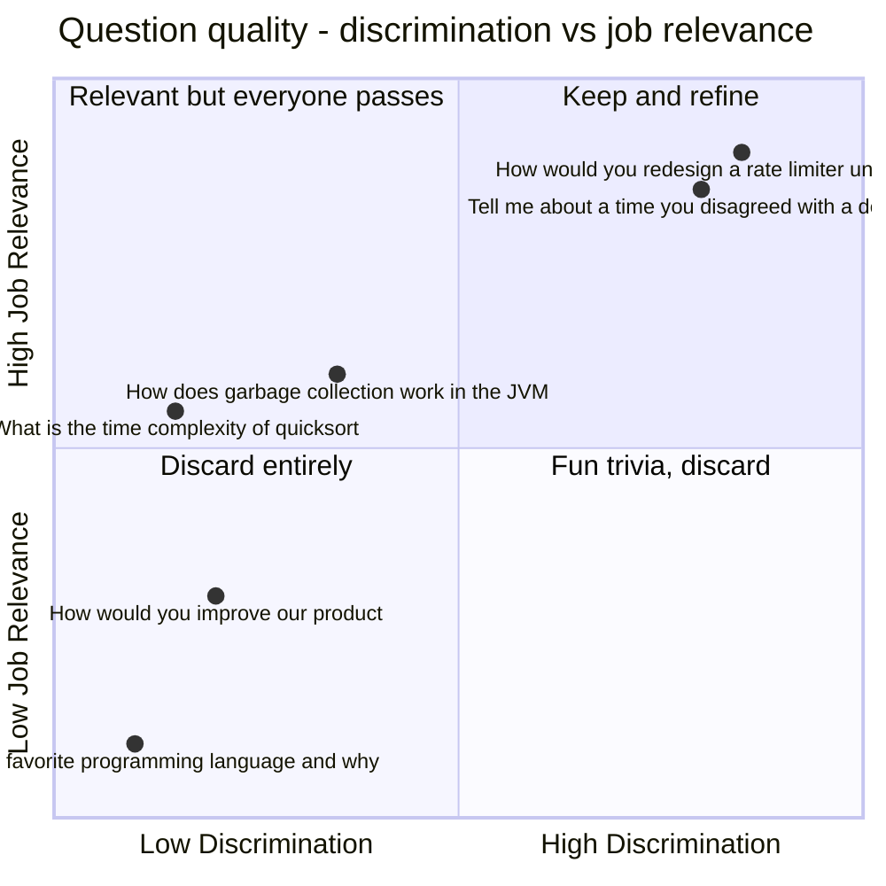
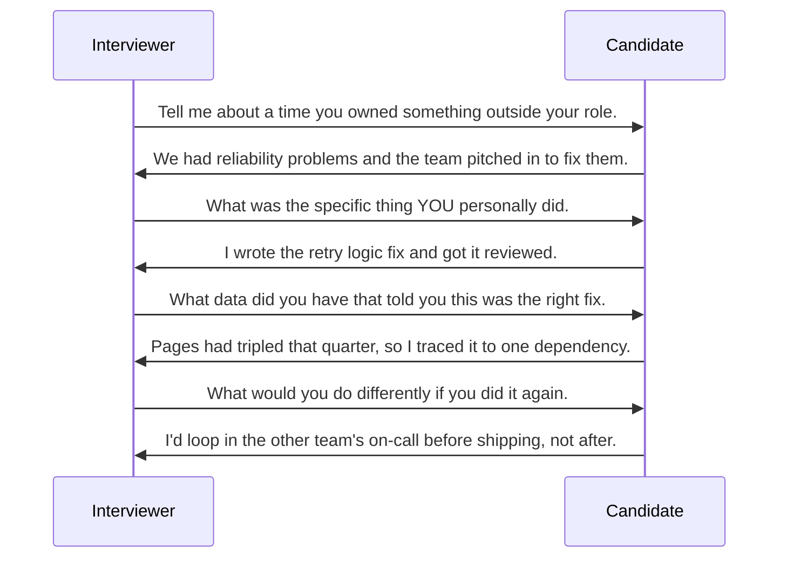

# Interviewing as the Interviewer

## 1. Concept Overview

A staff engineer who runs interviews for three years at a normal hiring pace sits on 40-80
loops. Each one produces a written document, a hire or no-hire outcome that follows a real
person for years, and a data point about the interviewer's own judgment that the
organization is — whether anyone says so out loud — quietly tracking. Doing this badly is
not a victimless inefficiency. A bad interviewer rejects strong candidates for reasons that
have nothing to do with the job, passes weak candidates because the room felt good, and
produces notes nobody else can act on — and all three failures are invisible to the
interviewer unless someone is measuring outcomes against decisions, which most
organizations do not do well.

This module is the other side of the table from
[Behavioural Interview Systems](../behavioral_interview_systems/behavioral_interview_systems.md)
and
[Story Portfolio & Answer Frameworks](../story_portfolio_and_star_frameworks/story_portfolio_and_star_frameworks.md),
both written for the candidate. Everything here is written for the person asking the
questions: how to write a question that actually discriminates between a strong and a weak
candidate, how to build and use a scoring rubric, how to probe without leading, how to take
notes a committee can act on, how to recognize and structurally suppress your own bias, and
what a staff engineer owes a candidate regardless of the outcome.

---

## 2. Intuition

> **One-line analogy**: An interviewer is not having a conversation, they are running an
> instrument — and an uncalibrated instrument produces confident, wrong readings exactly as
> often as it produces useless vague ones.

**Mental model.** Every question you ask either produces evidence or it does not. A trivia
question produces evidence about what the candidate happened to memorize. A leading
question produces evidence about how well the candidate can read your face. A question with
one right answer produces a single bit — pass or fail — from sixty minutes of room time. A
good behavioural or technical question produces a spread: a strong candidate's answer and a
weak candidate's answer to the *same* question look visibly, describably different. Writing
that kind of question is a design problem, not an improvisation, and most interviewers never
design a single one — they inherit a question from whoever trained them and never ask
whether it discriminates at all.

**Why it matters.** The organizational cost of a bad interviewer compounds silently. A
false negative — a strong candidate rejected for a bad reason — never generates a ticket,
a postmortem, or a retro. Nobody at the company ever learns that person went on to do great
work somewhere else. A false positive — a weak hire who interviewed well — generates months
of visible cost: ramp time, a struggling teammate, an eventual performance conversation, and
often another hiring cycle to replace them. Both failures are real, and only one of them
shows up in anyone's metrics, which is exactly why "raising the bar" is usually argued about
in terms of the visible failure and rarely in terms of the invisible one.

**Key insight.** The rubric has to exist before you meet the candidate, in writing, in
observable terms — not because process is virtuous for its own sake, but because a rubric
written after the conversation is not a rubric, it is a rationalization with a table format.
The single most common failure mode in this whole module — the decision made in the first
three minutes and confirmed for the next fifty-seven — is precisely what a pre-written
rubric with anchored levels is designed to interrupt.

---

## 3. Core Principles

- **Structure beats gut feel, and the evidence for this is old and repeatedly reconfirmed.**
  This is not a stylistic preference; it is one of the most replicated findings in personnel
  psychology, covered in detail in §6.1.
- **A rubric written after the loop is a rationalization, not a rubric.** Define what a 1,
  2, 3, and 4 look like in observable behavioural terms before the candidate walks in.
- **A question that cannot fail is not a question.** If you cannot picture what a weak
  answer sounds like, distinct from a strong one, the question is not doing its job.
- **The follow-up is where the signal lives.** A rehearsed answer survives the first thirty
  seconds; it rarely survives three layers of "what did you specifically do."
- **Write down what you observed, not what you concluded.** "Seemed junior" is an opinion
  with no evidence trail. "Could not name the tradeoff when asked twice" is evidence a
  committee that never met the candidate can act on.
- **Present evidence to the debrief, not a verdict.** The moment you say "I think we should
  hire this person" before anyone else has spoken, you have replaced five independent
  assessments with one, and everyone after you is now reacting to your opinion instead of
  forming their own.
- **The candidate is interviewing you too**, and a staff engineer in the room is one of the
  most credible signals a candidate gets about what the company is actually like.

---

## 4. Types / Levels / Modes

Not every round in a loop is testing the same thing, and conflating them is one of the more
common ways a loop produces weak signal even when every individual interviewer is trying
hard.

| Round type | What it should test | What it is not for |
|---|---|---|
| **Technical deep dive** | Depth in a system the candidate actually built or operated; how they reason about a tradeoff under a followed-up "why" | Testing whether they can derive an algorithm from a textbook under time pressure — that is a different round |
| **System design / architecture** | How the candidate structures ambiguity, negotiates requirements, reasons about failure modes and cost | A test of whether they've memorized one specific architecture pattern |
| **Behavioural / values** | Individual, evidenced past behaviour against a named competency or principle | A personality test or a "do I like this person" gut check |
| **Bar-raiser / cross-functional** | An independent, less invested read on the whole candidate, often weighted more heavily precisely because it is not run by the hiring team | A lower-stakes "culture chat" late in a long day — see the companion module's §6.1 on why treating it that way is a common candidate mistake, and it is an equally common interviewer mistake to under-prepare for the slot on the theory that it does not "really" count |
| **Pairing / work sample** | Real collaborative behaviour under real, if abbreviated, working conditions | A pass/fail coding puzzle graded on speed alone |

**The four rubric levels, generically.** Regardless of which round or which company's
specific rubric, a well-built scale collapses to roughly the same four bands, defined in
*observable, behavioural* terms rather than adjectives:

| Level | Generic meaning | What it should never be |
|---|---|---|
| **1 — Does not meet the bar** | Could not produce a relevant, coherent answer even with heavy prompting; answers contradicted themselves under follow-up | "I didn't like them" |
| **2 — Below the bar, real gaps** | Produced a relevant answer but it lacked ownership, a number, or fell apart under the second follow-up | "Seemed a bit junior" |
| **3 — Meets the bar** | Produced specific, first-person, defensible evidence that would satisfy this competency at the target level | "Pretty solid overall" |
| **4 — Exceeds the bar** | Evidence that would itself be a strong example to calibrate other interviewers against | "Amazing, hire immediately" |

§6.3 shows a real rubric, anchored to actual observable statements, for one named
competency — the generic four-band table above is the shape; the anchors are what make it
usable.

---

## 5. Models & Frameworks Diagrammed

```mermaid
flowchart LR
    classDef good   fill:#98c379,stroke:#27ae60,color:#1a1a1a
    classDef bad    fill:#e06c75,stroke:#c0392b,color:#fff
    classDef info   fill:#61afef,stroke:#2e86c1,color:#1a1a1a
    classDef warn   fill:#e5c07b,stroke:#f39c12,color:#1a1a1a
    classDef accent fill:#c678dd,stroke:#9b59b6,color:#fff
    classDef calm   fill:#56b6c2,stroke:#0097a7,color:#1a1a1a

    design(Question design<br/>discriminates strong vs weak) --> rubric(Rubric written<br/>BEFORE the loop)
    rubric --> ask(Ask, then probe<br/>3+ layers deep)
    ask --> notes(Notes: verbatim quotes,<br/>observed not concluded)
    notes --> indep(Independent written<br/>score, pre-debrief)
    indep --> debrief(Debrief:<br/>evidence, ascending seniority)
    debrief --> decision{Hire decision}
    decision --> yes(Offer)
    decision --> no(No hire)

    class design info
    class rubric warn
    class ask calm
    class notes accent
    class indep good
    class debrief bad
    class decision good
    class yes good
    class no bad
```

Every stage upstream constrains what is possible downstream. A weak question at the top of
this pipeline cannot be rescued by a good debrief — there was never any evidence to debrief
about. See §6 for each stage in detail.

A question can be relevant and still fail — "what is the time complexity of quicksort" is
on-topic for an engineering role and almost every candidate who prepared at all answers it
identically, which is why it sits in the low-discrimination band despite reasonable
relevance. §6.2 rewrites four questions from the low-discrimination quadrants into ones
that move right.

The first answer is generic. Each successive probe removes one more layer of "we" language
and forces one more concrete fact — a specific action, a specific number, a specific
lesson. A rehearsed answer tends to survive the first probe and start fragmenting by the
third; a lived one gets *more* specific with each question, not less. §6.4 covers the exact
probe phrasing and how to read the difference.

---

## 6. How It Works — Detailed Mechanics

### 6.1 Why structured beats unstructured — the actual evidence

The claim that structure improves hiring is not folklore, and it is also not settled at the
number most people quote. The canonical citation is Frank Schmidt and John Hunter's 1998
meta-analysis in *Psychological Bulletin*, "The Validity and Utility of Selection Methods in
Personnel Psychology," which aggregated 85 years of personnel-selection research and put
structured interviews at roughly .51 predictive validity against roughly .38 for
unstructured interviews — a large, durable gap by the standards of that literature. Treating
those exact figures as the final word would be dishonest: a more recent meta-analytic update
(Sackett et al., "Revisiting the Design of Selection Systems in Light of New Findings
Regarding the Validity of Widely Used Predictors," 2023) revised the structured-interview
estimate down to roughly .42 once newer studies and corrections for range restriction and
other statistical artifacts were incorporated. The direction of the finding — structured
clearly and reliably beats unstructured — has held up for over two decades of
re-examination; the exact magnitude has been revised downward, and an interviewer citing
this research should say so rather than quoting 1998 as if it were still the current
number.

Google's own re:Work materials (rework.withgoogle.com, "A guide to structured interviewing
for better hiring practices") make the same case from a different angle: same questions
asked of every candidate, scored independently against a fixed rubric before any
discussion, produces more consistent and more predictive hiring decisions than letting each
interviewer run their own free-form conversation. The mechanism re:Work names explicitly is
noise reduction — two interviewers asking two different questions in two different orders
are not actually comparable measurements of the same candidate, no matter how confident
each one feels about their read.

Daniel Kahneman, Olivier Sibony, and Cass Sunstein's *Noise: A Flaw in Human Judgment*
(2021) makes the general case this specific finding is an instance of: independent
judgments, aggregated, are far more accurate than the same judgments formed after a group
discussion, because discussion introduces anchoring — the first strong opinion in the room
disproportionately shapes everyone else's. Their recommended fix, the "mediating assessments
protocol," is structurally identical to what a well-run interview loop already does when it
works: score independently, in writing, before comparing notes.

### 6.2 Writing a question that discriminates

The test is simple to state and hard to apply under time pressure while prepping a loop:
**would a strong candidate and a weak candidate give visibly, describably different
answers to this exact question?** Most inherited interview questions fail this test, and
they fail it in one of four recurring shapes.

**Weak version — the trivia question**

> What is the time complexity of quicksort in the average and worst case?

**Strong version — the same topic, rewritten to discriminate**

> Walk me through how you'd choose a sorting approach for a system processing 50 million
> records a day where 90% of the data arrives nearly pre-sorted. What would you actually
> pick, and what would make you change your mind?

**What changed:** the weak version has exactly one correct answer that any candidate who
skimmed a textbook the night before can recite, so it produces a single bit of information
— pass or fail on recall — from an entire question slot. The strong version has no single
correct answer; it forces the candidate to reason about a real constraint (nearly-sorted
input), state a judgment, and defend it, which is where the actual difference between a
strong and weak engineer shows up.

**Weak version — the question with one right answer**

> What does the `volatile` keyword do in Java?

**Strong version**

> Tell me about a concurrency bug you've actually debugged in production. What was
> happening, how did you find it, and what did you change?

**What changed:** the weak version rewards memorized definitions and produces no signal
about whether the candidate has ever actually debugged a real race condition under
pressure. The strong version cannot be answered from a definition — it requires the
candidate to have lived through the problem, and the follow-ups (§6.4) will expose a
candidate who is improvising a plausible-sounding story within the first two probes.

**Weak version — the question that rewards having worked at a specific company**

> How does Google's Borg scheduler handle bin-packing across a cluster?

**Strong version**

> Describe a resource-contention or scheduling problem you've hit — could be a Kubernetes
> cluster, a database connection pool, a build farm, anything you actually operated. What
> was the failure mode and how did you fix it?

**What changed:** the weak version filters for prior exposure to one specific company's
internal system, which correlates with employer history far more than it correlates with
engineering ability — a candidate from a five-person startup who has never heard of Borg is
not thereby a weaker engineer. The strong version asks about the underlying *class* of
problem and lets any candidate bring their own real example to it.

**Weak version — the question that is really the interviewer's pet opinion**

> Don't you think microservices are usually a mistake for a team this size?

**Strong version**

> Tell me about a time you had to decide between a monolith and a more distributed
> architecture. What tradeoffs did you actually weigh, and what would make you revisit that
> decision today?

**What changed:** the weak version is a leading question dressed as a technical one — a
candidate who has learned to read interviewer body language will agree with whatever the
interviewer clearly already believes, and the "signal" collected is really a measurement of
social calibration, not engineering judgment. The strong version asks for the candidate's
own reasoning on their own real decision and does not smuggle the interviewer's opinion
into the premise.

### 6.3 The scoring rubric — anchored before you meet anyone

A rubric that says "1 = weak, 4 = strong" is not a rubric; it is a Likert scale with no
information in it, because "weak" and "strong" mean whatever the interviewer decides they
mean in the moment — exactly the rationalization problem §2 names. A usable rubric is
written in the format the industrial-organizational psychology literature calls a
Behaviorally Anchored Rating Scale, or BARS (Smith & Kendall, "Retranslation of
expectations: An approach to the construction of unambiguous anchors for rating scales,"
*Journal of Applied Psychology*, 1963): each level is anchored to a real, observable
statement a candidate might actually make, not an adjective.

**Example rubric, competency: "Handles Ambiguity"** (written before the loop, for a senior
engineering role):

| Level | Anchor — what you actually hear |
|---|---|
| **1 — Does not meet bar** | Waits to be told exactly what to build; when given an underspecified problem, asks no clarifying questions and either freezes or picks an arbitrary interpretation without naming the tradeoff |
| **2 — Below bar, real gaps** | Asks some clarifying questions but stops at the first plausible interpretation; when asked "what did you do when the requirements were unclear," describes escalating and waiting rather than making and communicating a provisional call |
| **3 — Meets bar** | Names the specific ambiguity, states the assumption they chose to run with and why, and describes how they'd validate or revisit that assumption as new information arrived — e.g., "I didn't know if we needed strong consistency, so I built it eventually-consistent first with a clear seam to swap it, and flagged the open question to the PM rather than blocking on it" |
| **4 — Exceeds bar** | All of level 3, plus evidence of *proactively* surfacing an ambiguity nobody else had noticed yet and changing the team's plan before it became an expensive problem — e.g., catching that two teams were about to build conflicting assumptions into a shared API and forcing the decision two weeks before it would have cost a rewrite |

**Weak version — a rubric level written after meeting the candidate**

> Level 3: Candidate was pretty good at dealing with unclear requirements, seemed
> comfortable with it.

**Strong version — the anchor above, written before anyone walked in**

> Level 3: Names the specific ambiguity, states the assumption they chose and why, and
> describes how they'd validate or revisit it as new information arrived.

**What changed:** the weak version can be stretched to justify almost any answer after the
fact — "seemed comfortable" has no falsifiable content. The strong version was written
before the candidate existed to the interviewer as a person, so it cannot be quietly
reshaped to fit whoever is sitting in the room; either the candidate said something that
matches the anchor or they did not.

### 6.4 Probing without leading

The follow-up carries more signal than the initial answer, because almost any candidate can
produce sixty seconds of plausible-sounding opening material — the follow-ups are what
separate a rehearsed answer from a lived one. A working probe sequence, roughly in order:

- **"What was your specific contribution?"** — forces individual ownership out from behind
  team language.
- **"What did the other person / team think?"** — tests whether the candidate can represent
  an opposing view accurately, which a fabricated or self-serving story usually cannot do
  convincingly.
- **"What would you do differently?"** — tests for a real, metabolized lesson versus
  performed humility bolted onto a story that was actually a clean win.
- **"What data did you have at the time?"** — pulls the story out of hindsight narration and
  back into the actual decision point, where the real judgment call happened.
- **"How did you know it worked?"** — tests whether the candidate closed the loop with a
  measurement, or is asserting an outcome they never actually verified.

**The distinction between probing and leading.** A probe asks the candidate to produce more
of their own information — "what was your specific contribution" gives the candidate
nowhere to go but their own memory. A leading probe supplies the answer inside the
question — "so you basically drove the whole thing yourself, right?" hands the candidate
the exact sentence to agree with, and a candidate who is uncomfortable disagreeing with an
interviewer will simply take it. If you can imagine a candidate answering your follow-up
with a single word ("yes"), it is leading; if the follow-up requires a candidate to
generate new content, it is a real probe.

**Telling a rehearsed answer from a lived one.** A rehearsed answer tends to be smooth and
detailed in the first thirty to sixty seconds and then noticeably degrade under the second
or third probe — new details contradict earlier ones, or the candidate falls back to vaguer
language exactly where a probe asks for more specificity. A lived answer tends to do the
opposite: the *opening* summary is often looser, and each probe produces genuinely new,
consistent, increasingly specific detail, because the candidate is retrieving a real memory
rather than reciting a prepared script. See §6.9 in the companion behavioural-interviews
module for how this distinction has become more load-bearing, not less, since candidates
began preparing with LLM-generated scripts.

### 6.5 Taking notes that survive

You are not writing a diary entry about how the conversation felt; you are writing the only
artifact a committee, a Bar Raiser, or a hiring manager who was never in the room will ever
see. Verbatim quotes and specific observed facts are usable evidence; impressions and
adjectives are not.

**Weak version — an interviewer's note**

> Candidate seemed a bit junior on the systems design question. Not totally sure they
> could own something at this level. Leaning maybe.

**Strong version — the same candidate, same question, observed evidence**

> Asked candidate to design a rate limiter for 50K req/s across multiple regions. Candidate
> proposed a single global counter in one Postgres instance; when I pointed out the
> cross-region latency this would add to every request, candidate could not name an
> alternative (token bucket, sliding window, per-region limits with async reconciliation) on
> either the first or second prompt. Eventually landed on "maybe cache it somehow" with no
> further detail when asked what "somehow" meant.

**What changed:** the weak version cannot be independently evaluated by anyone who was not
in the room — a committee reading "seemed a bit junior" has no way to judge whether the
interviewer's bar was reasonable. The strong version lets a reader with no context reach the
same conclusion the interviewer did, because it reports what was said and done rather than
how it landed emotionally. "Could not name the tradeoff when asked twice" is falsifiable
and specific; "seemed junior" is neither.

**The general rule**: write down the question you asked, the candidate's answer close to
verbatim on anything load-bearing, and what you observed — not what you inferred — about
whether it met the anchor. Save your actual score and reasoning for a clearly separated
section so a reader can distinguish your raw observation from your judgment call, the same
separation Kahneman et al. argue for at the level of the whole loop.

### 6.6 Bias — specific, not abstract

Generic "watch out for bias" advice is close to useless because it gives an interviewer
nothing to actually check for in the room. The concrete failure modes, and the structural
mitigation for each:

| Bias | What it looks like in the room | Structural mitigation |
|---|---|---|
| **Similarity / affinity bias** | Scoring a candidate higher because they went to your school, worked at your old company, or share a hobby you mentioned in small talk | Same questions for every candidate; score against the written anchor, not against how much you liked talking to them |
| **Halo effect** | One strong answer early in the loop makes every subsequent answer sound better than it actually was | Score each question independently, immediately after it's asked, before the next question colors your read |
| **First-impression anchoring** | A confident opening two minutes sets your read for the whole hour, and everything after gets fit to confirm it | Delay forming or writing a summary judgment until the loop is over; write per-question notes as you go, not a running verdict |
| **"Culture fit" as a laundered preference** | Rejecting a candidate for being "not a fit" when what actually happened is they communicate differently, or don't share your specific working style, with no connection to any actual competency | Never allow "culture fit" as a standalone rejection reason without naming the specific observed behaviour and which competency it maps to — if you can't name one, the rejection isn't defensible |
| **Debrief anchoring by seniority** | The most senior or most confident voice in the debrief speaks first and everyone else's read quietly drifts toward it | Everyone writes and submits their score *before* the debrief conversation starts, and the room speaks in ascending order of seniority — see §6.7 |

The mitigations share a shape: replace "trust your gut in the moment" with a structural
rule that runs the same way regardless of who the candidate is or how the interviewer
happens to feel that day. None of them requires an interviewer to become a different
person; they require the *process* to not depend on any one interviewer's self-discipline
under pressure.

### 6.7 The debrief and the hiring decision

**Present evidence, not verdicts.** The single most damaging habit in a debrief is opening
with a conclusion — "I think we should hire this person" — before presenting the evidence
that led there. Once a verdict is on the table, every subsequent speaker is reacting to that
verdict rather than forming an independent read, which is the exact anchoring effect
Kahneman, Sibony, and Sunstein describe in *Noise* and the reason their recommended fix is
independent written scores collected *before* group discussion begins.

**The failure mode where the most senior or most confident voice wins.** In an unstructured
debrief, whoever speaks first and with the most conviction — often correlated with title,
not with the quality of their evidence — sets the frame, and disagreement after that point
carries real social cost. A junior interviewer with a strong, specific, well-evidenced
objection will frequently just not raise it once a staff engineer has already said "strong
hire" in a confident tone.

**The mechanism that fixes it: inclination first, then discussion.** Every interviewer
writes and submits an independent score with supporting notes before the debrief meeting
starts, so no one's read is contaminated by hearing anyone else's first. The room then
speaks in *ascending* order of seniority — the newest or most junior interviewer presents
their evidence first, working up to the most senior — specifically so the room is not
anchored by the most confident voice before anyone else has had a chance to speak.

**Weak version — a debrief write-up**

> Really liked this candidate. Good energy, seemed sharp, I think they'd be a great add to
> the team. Strong hire from me.

**Strong version — the same candidate, evidence-first**

> On the systems design round, candidate identified the cross-region latency issue in the
> rate-limiter problem unprompted and proposed token-bucket-per-region with async
> reconciliation, then correctly flagged the reconciliation-lag tradeoff when I pushed on
> consistency. On the behavioural round, candidate described taking unprompted ownership of
> a cross-team retry bug, gave a specific before/after number (40/week pages to 6/week), and
> named a real, specific thing they'd do differently. Recommend hire — evidence for both
> Technical Judgment and Ownership meets the level-4 anchor on both.

**What changed:** the weak version is a verdict with an adjective attached and gives the
rest of the room nothing to evaluate independently — anyone reading it either has to trust
the interviewer's mood or ignore the note entirely. The strong version lets every other
person in the debrief check the evidence against their own read of the same anchors, which
is the entire purpose of running a structured loop in the first place.

### 6.8 The bar

**What "raising the bar" actually asks.** The honest, mechanical version of the question is
narrow: *is this candidate better than the median performer currently doing this job at
this level, on the team they'd actually join?* Not "would they be fine," not "could they
probably figure it out" — better than the current median, specifically so that every hire
incrementally raises rather than merely maintains the team's overall level.

**The courage cost.** Applying that bar honestly is genuinely harder when the team is
short-staffed, the backlog is on fire, and the hiring manager has been trying to fill the
role for four months. A no-hire decision under that pressure carries real social and
political cost for the interviewer who delivers it, and it is much easier — in the moment —
to talk yourself into "good enough" than to be the person who says no to a candidate
everyone else in the room is inclined to want.

**The asymmetry, and the honest counterargument.** The standard case for erring toward
no-hire is that a bad hire costs far more than a missed good candidate: months of ramp time,
a manager's attention diverted into a performance conversation, morale cost to the team that
has to cover the gap, and eventually another full hiring cycle to replace them — against a
missed good candidate, who simply goes and does good work somewhere else at no direct cost
to your company. That asymmetry is real and is the actual justification behind "when in
doubt, don't." The honest counterargument, and it deserves to be stated as more than a token
concession: this same asymmetry argument has historically been used to justify a large
number of unfair, biased rejections dressed up as "maintaining the bar," precisely because
"I had a bad feeling" is much easier to launder as caution than as prejudice. The structural
mitigations in §6.6 exist specifically because "raise the bar" and "reject people who make
me personally uncomfortable" are not the same instruction, and an interviewer who cannot
articulate, in observable rubric terms, exactly which competency a candidate failed to meet
does not have a defensible no-hire — they have a feeling wearing the bar's language.

### 6.9 AI policy, AI-assisted answers, and the law on automated screening

**Decide the policy before the loop, and tell the candidate.** There are two coherent
positions and one incoherent one. Canva's position (June 2025, a post titled "Yes, you can
use AI in our interviews. In fact, we insist.") replaced its CS-fundamentals round with an
AI-assisted coding round and scores how the candidate directs and checks the tool. Meta
began piloting AI-assisted coding interviews in mid-2025 (reported by 404 Media in July
2025). The other coherent position bans assistants and says so in the invite. The
incoherent one is no stated policy, where one interviewer penalises what another expected,
and the debrief compares two different tests.

| Policy | What the rubric scores | What the interviewer does |
|--------|------------------------|---------------------------|
| AI allowed or required | problem framing, prompts, catching the tool's wrong output, tests written, final explanation | asks "what did the tool get wrong, and how did you know?" at least once |
| AI not allowed | the candidate's own reasoning and recall | states the rule at the start, then probes for unrehearsable detail |
| No stated policy | nothing comparable | do not run the loop until one exists |

**Probes that expose a generated answer, without accusing anyone.** A script read off a
second screen holds up on the first pass and fails under questions it could not predict.
The probes:

1. **Return to a number later.** Ask for the p99 or the team size early; ten minutes later
   ask "you said the p99 was 340 ms, what was it before the change?" A lived memory stays
   consistent; a generated one drifts.
2. **Change a constraint mid-answer.** "Same design, but the writes are now 10x and the
   budget is flat. What breaks first?" This forces new reasoning, not retrieval.
3. **Ask for the other person's words.** "What did the engineer who disagreed actually
   say?" Generated stories have generic opponents.
4. **Ask about their own artifact.** "Sketch the schema you shipped, not the ideal one."
5. **Ask what they would not do again.** Stock answers produce a stock regret.

Write down what you observed, never a conclusion about tools: "answer to the 10x-writes
change repeated the original design word for word; could not say what broke first after
two asks" is evidence. "Probably using ChatGPT" is an accusation you cannot support, and
it does not belong in a scorecard that HR, a committee, or a court may read.

**Weak version** (scorecard note)

> Pretty sure he was reading from an AI. Eyes kept moving. No hire.

**Strong version**

> Policy: no assistants, stated at the start. Gave p99 of 340 ms at 10:05; at 10:16 gave
> 180 ms for the same service and could not reconcile them when asked. Under the 10x-writes
> change, repeated the original design and did not name a bottleneck after two prompts.
> Problem-solving: 1 of 4 against the anchor "adapts the design when a constraint changes".

**What changed:** the weak note scores a suspicion and an eye movement, neither of which is
on the rubric. The strong note records the policy, two observable inconsistencies with
timestamps, and a rubric score tied to its anchor, which survives a debrief and an audit.

**The law on automated screening.** These rules bind the employer that uses a tool to
screen, rank or score candidates. An interviewer who pastes a transcript into a chatbot to
"score this candidate" may be creating exactly such a use without an audit, a notice, or a
data-protection basis.

| Rule | Scope | What it requires | In force |
|------|-------|------------------|----------|
| NYC Local Law 144 of 2021 | an "automated employment decision tool" that substantially assists hiring or promotion decisions for NYC jobs | an independent bias audit within one year before use, a public summary of the results, and notice to candidates 10 business days before use | enforced from July 5, 2023 |
| Illinois HB 3773 (amends the Illinois Human Rights Act) | any AI use in recruitment, hiring, promotion, discipline or discharge | bans AI use that has a discriminatory effect, bans zip code as a proxy for a protected class, requires notice to employees | January 1, 2026; IDHR proposed notice rules in May 2026 and withdrew them in June 2026, so the notice format is still undefined |
| Illinois Artificial Intelligence Video Interview Act | AI analysis of recorded video interviews | explain the AI to the applicant and get consent before use | January 1, 2020 |
| EU AI Act, Art. 5(1)(f) | emotion recognition in the workplace | prohibited, outside medical or safety uses | February 2, 2025 |
| EU AI Act, Annex III point 4 | AI for recruitment, filtering applications, evaluating candidates | high-risk system: risk management, human oversight, logging, transparency to the people assessed | December 2, 2027, after the AI Omnibus, Regulation (EU) 2026/1744, moved it from August 2, 2026 |

What this means for the interviewer, not the legal team:

- **Do not run candidate material through an unapproved model.** It is personal data
  leaving the company, and the output may count as an automated assessment the employer
  never audited.
- **An AI note-taker in the interview is a recording.** California (Penal Code §632) and
  Illinois require all-party consent to record a confidential conversation; say it is on
  and get a yes.
- **A video tool that scores "enthusiasm" from facial expressions is emotion recognition.**
  In the EU it has been banned since February 2025. If your team's vendor does this, escalate
  it before your next loop.

---

## 7. Real-World Examples

- **Google's re:Work initiative** publishes its structured-interviewing rationale and
  practical guidance openly at rework.withgoogle.com — a deliberate choice to open-source
  internal hiring research rather than treat it as competitive advantage, which is a large
  part of why "structured, rubric-scored, independently-rated" loops now look broadly
  similar in shape across the industry even where the specific rubric content differs.
- **Amazon's Bar Raiser role**, described at aboutamazon.com, is explicitly staffed from
  *outside* the hiring team specifically to counteract the hiring manager's own incentive to
  fill the role — a structural answer to exactly the "team is short-staffed, courage cost is
  high" problem named in §6.8, built into the process rather than left to individual
  willpower.
- **Kahneman, Sibony, and Sunstein's "mediating assessments protocol"** from *Noise* (2021)
  is not a hiring-specific invention — it is a general decision-quality technique the
  authors apply to hiring as one of several worked examples — and it is structurally
  identical to what §6.7 describes as "inclination first, then discussion": independent
  written judgments collected before any group conversation happens.
- **The critical-incident method** (John Flanagan, "The Critical Incident Technique,"
  *Psychological Bulletin*, 1954) is the older research lineage behind writing interview
  questions around specific, describable past behaviour rather than abstract self-report —
  "tell me about a time" traces directly back to this line of research, not to any one
  company's HR department inventing it.

---

## 8. Tradeoffs

| Approach | Consistency across interviewers | Setup cost per loop | Risk if skipped |
|---|---|---|---|
| Fully structured — written rubric, same questions, independent pre-debrief scores | Highest | Real — someone has to write and maintain the rubric and question bank | Lowest false-negative and false-positive risk, at the cost of feeling less like a "natural conversation" |
| Semi-structured — a fixed question list, informal scoring | Medium | Low — question list exists, no anchored rubric | Score drift between interviewers; two "3 out of 5"s from two interviewers may not mean the same thing |
| Fully unstructured — interviewer's own judgment, own questions | Lowest | None upfront, high hidden cost | Highest exposure to every bias in §6.6, and the research in §6.1 says this is also the weakest predictor of the outcome you actually care about |
| Written notes before debrief vs. verdict-first debrief | Independent scores preserve signal; verdict-first collapses it toward one voice | Independent scoring takes more discipline and slightly more time before the meeting | A verdict-first debrief can produce a false consensus that feels unanimous but was really one confident opinion nobody challenged |

The honest tension: full structure has a real cost — someone has to build and maintain the
rubric, and a loop that feels like filling out a form rather than having a conversation can
read as impersonal to a candidate who was expecting the latter. The research is nonetheless
consistent that the tradeoff is worth making for any hire above the lowest-stakes, and §9
narrows down when the fully structured version is worth the overhead.

---

## 9. When to Use / When NOT to Use

**Invest in the full structured rubric-and-independent-scoring process when:** the role is
senior enough that a bad hire is expensive to unwind, the loop runs often enough that
consistency across many different interviewers actually matters, or the hiring decision
will be defended later (to a committee, to a Bar Raiser, potentially in a dispute) — in all
three cases the setup cost in §8 pays for itself.

**A lighter-weight, still-honest process is reasonable when:** you are doing a fast referral
pre-screen with no formal hiring decision attached, or a founding-team conversation where
the "loop" genuinely is one or two conversations and the overhead of a full written rubric
exceeds its value — but even here, the core discipline (write down what you're looking for
before the conversation, take notes on observed behaviour rather than vibes) still applies
in miniature.

**Do not skip structure because the team is desperate to fill the role.** This is precisely
the condition under which the courage-cost failure mode in §6.8 is most likely, and it is
exactly the condition the Bar Raiser role and the independent-scoring mechanism were
designed to survive — pressure to fill a seat is real, but it is an argument for stronger
process discipline, not weaker.

---

## 10. Common Pitfalls

**The interview that is a lecture.** An interviewer at a mid-size infrastructure company
spent the first twenty-five minutes of a forty-five-minute system design round explaining
their own team's architecture in detail before asking the candidate a single question. The
candidate's written evaluation contained almost no evidence, because there was almost no
candidate airtime left to collect any — the interviewer left the room feeling like a great
conversation had happened, and the debrief note was effectively blank. The fix is
mechanical: budget candidate talk time before the round starts, and treat any round where
you did more than a third of the talking as one to flag for recalibration.

**The stress interview.** A candidate at a fintech startup was deliberately interrupted,
challenged aggressively on minor points, and given a puzzle with a hidden trick specifically
designed to fluster them — the interviewer's stated theory was that this "tests how they
perform under pressure." The written evaluation described the candidate as "rattled" and
"defensive," and the candidate was rejected. What the round actually measured was how the
candidate responded to being treated with manufactured hostility by a stranger holding all
the power in the room, which correlates with almost nothing about job performance and is
close to the opposite of what the structured-interviewing research in §6.1 is describing —
manufactured stress is not a controlled variable, it is noise with a theory attached.

**The question the interviewer could not answer themselves.** An interviewer asked a
candidate to whiteboard a distributed cache eviction strategy under constraints the
interviewer had copied from a blog post without fully working through — when the candidate
proposed a reasonable but nonstandard approach, the interviewer could not evaluate whether
it was actually wrong or just unfamiliar, and defaulted to scoring it down. The candidate
appealed the rejection with a written explanation of their approach that turned out to be
correct; the loop had to be partially rerun. An interviewer should never ask a question they
have not personally worked through to at least one full correct solution and one or two
plausible near-miss solutions, precisely so they can evaluate answers they didn't anticipate.

**The decision made in the first three minutes, confirmed for the next fifty-seven.** A
hiring manager described, in a later post-mortem on a bad hire, noticing a strong first
impression almost immediately and then spending the rest of the interview unconsciously
interpreting every subsequent answer charitably to match it — a textbook case of the
first-impression anchoring named in §6.6. The written evaluation from that interview reads,
in hindsight, as a series of generous interpretations of fairly mediocre answers. The fix
that would have caught it: writing a per-question note immediately after each answer, before
moving to the next question, rather than forming and defending a running overall impression.

**The "I just didn't get a good feeling" debrief.** An interviewer voted no-hire on an
otherwise strong-looking candidate and, when asked in debrief to name the specific
competency and evidence behind the vote, could only offer "I don't know, something felt
off." Under §6.8's framing, this is precisely the shape of an indefensible no-hire — it may
be correctly detecting something real, or it may be an unexamined bias from §6.6 wearing the
language of caution, and there is no way for the rest of the room to tell the difference
without a name and an anchor attached to the objection. The team's practice afterward
changed: any no-hire vote had to name the specific competency and specific observed evidence
before it counted in the debrief, which either surfaces the real reason or surfaces that
there wasn't one.

---

## 11. Frameworks, Books & Further Reading

| Source | What it gives you |
|---|---|
| Google re:Work, "A guide to structured interviewing for better hiring practices" (rework.withgoogle.com) | Google's own published rationale and practical guidance for structured over unstructured interviewing |
| Frank Schmidt & John Hunter, "The Validity and Utility of Selection Methods in Personnel Psychology," *Psychological Bulletin* (1998) | The canonical 85-year meta-analysis behind the .51 vs .38 structured-vs-unstructured validity figures |
| Paul Sackett et al., meta-analytic update on selection-method validity (2023) | A more recent, lower (~.42) estimate for structured interview validity — the honest revision of the 1998 numbers |
| Daniel Kahneman, Olivier Sibony, Cass Sunstein, *Noise: A Flaw in Human Judgment* (2021) | The "mediating assessments protocol" — independent judgment before group discussion — and the broader case for why unstructured group decisions are noisier than most people assume |
| Paul C. Smith & Lorne M. Kendall, "Retranslation of expectations: An approach to the construction of unambiguous anchors for rating scales," *Journal of Applied Psychology* (1963) | The original Behaviorally Anchored Rating Scale (BARS) method behind §6.3's rubric format |
| John C. Flanagan, "The Critical Incident Technique," *Psychological Bulletin* (1954) | The research lineage behind building interview questions around specific, describable past behaviour |
| NYC Department of Consumer and Worker Protection, "Automated Employment Decision Tools" (Local Law 144 of 2021 and its rules) | The bias-audit, public-summary and 10-business-day notice rules for automated hiring tools |
| Regulation (EU) 2024/1689 (AI Act), Art. 5 and Annex III, as amended by Regulation (EU) 2026/1744 | The workplace emotion-recognition ban and the high-risk status of recruitment AI, with its December 2, 2027 application date |
| Simon Newton (Canva), "Yes, you can use AI in our interviews. In fact, we insist." (June 2025) | A worked example of an AI-required technical round and what it scores |
| aboutamazon.com, "What is an Amazon bar raiser?" | Official framing of an independent, outside-the-hiring-team interviewer role — see the companion module's §6.1 for full detail |

Related modules in this section:
[Behavioural Interview Systems](../behavioral_interview_systems/behavioral_interview_systems.md),
[Story Portfolio & Answer Frameworks](../story_portfolio_and_star_frameworks/story_portfolio_and_star_frameworks.md),
[Giving and Receiving Feedback](../giving_and_receiving_feedback/giving_and_receiving_feedback.md).

---

## 12. Interview Questions with Answers

**Q: What is the actual test for whether an interview question is any good?**
**Short:** Would a strong and a weak candidate give visibly, describably different answers?
Most inherited interview questions fail this test. A trivia question rewards memorization
and produces a single pass/fail bit regardless of engineering ability; a question with one
correct answer collapses an entire question slot into recall. A good question — "walk me
through how you'd choose a sorting approach given data that arrives nearly pre-sorted" —
has no single correct answer and forces the candidate to reason and defend a judgment,
which is exactly where the real difference between candidates shows up. If you cannot
picture what a weak answer sounds like, distinct from a strong one, rewrite the question
before the loop, not during it.

**Q: Why is a rubric written after meeting the candidate not actually a rubric?**
**Short:** It can be silently stretched to justify whatever the interviewer already feels.
"Seemed pretty comfortable with ambiguity" has no falsifiable content once the candidate is
already sitting in the room — it can be read to fit almost any answer depending on how the
interviewer feels about the person. A rubric written before the loop, anchored to specific
observable statements ("names the assumption they chose and why, describes how they'd
validate it"), cannot be quietly reshaped after the fact, because either the candidate said
something matching the anchor or they did not. This is the mechanical difference between a
scoring instrument and a rationalization with a table format.

**Q: A candidate's answers are fluent but you suspect an AI assistant. What do you do in the room and in your notes?**
**Short:** Probe for detail a script cannot predict, such as returning to an earlier number or changing a constraint, and record only what you observed, never an accusation.

In the room, return to a number they gave ten minutes earlier, change a constraint
mid-answer ("same design, writes are now 10x, what breaks first?"), and ask for the exact
words of the person who disagreed with them. A lived answer gets more specific and stays
consistent; a generated one drifts or repeats itself. In the notes, write the observation
with timestamps ("gave p99 of 340 ms, later 180 ms for the same service, could not
reconcile") and score it against the rubric anchor. "Probably reading from ChatGPT" is an
unsupportable accusation in a document HR or a court may read, and it scores something
that is not on the rubric.

**Q: Which laws limit using AI to screen or score job candidates?**
**Short:** NYC Local Law 144 needs a yearly independent bias audit and 10 business days' notice; Illinois HB 3773 bans discriminatory AI use from 2026; the EU AI Act treats hiring AI as high-risk.

NYC Local Law 144 of 2021, enforced from July 5, 2023, covers automated employment
decision tools for NYC jobs: a bias audit within one year before use, a public summary,
and candidate notice 10 business days before use. Illinois HB 3773 amended the Illinois
Human Rights Act from January 1, 2026 to ban AI use with a discriminatory effect and the
use of zip code as a proxy, and requires notice. In the EU, Art. 5 of the AI Act has
banned workplace emotion recognition since February 2, 2025, and recruitment AI in Annex
III becomes a high-risk system with full obligations on December 2, 2027. For an
interviewer the practical rule is the same everywhere: do not run candidate material
through a model the company has not approved and audited.

**Q: Why should an interviewer not paste a candidate's transcript into a chatbot to draft the scorecard?**
**Short:** It sends personal data to an unapproved processor and turns the chatbot into an unaudited automated assessment, while the scorecard stops being your own evidence.

Three separate problems. Data: the transcript is the candidate's personal data, and an
unapproved model is an unapproved processor under GDPR and most company policies. Law: a
model that summarises and rates candidates can fall under NYC Local Law 144 or the EU AI
Act's high-risk category, neither of which the employer has assessed for that use. Signal:
the scorecard's value is independent judgment before the debrief; a model's summary
smooths away the specific observed facts, the timestamps and quotes, that make a note
usable. Use the approved note-taker, if any, with the candidate's consent, and write the
score yourself.

**Q: What is a Behaviorally Anchored Rating Scale, and why does it matter for interview rubrics?**
**Short:** A BARS ties each score level to a real observable statement, not an adjective.
Smith and Kendall's 1963 method (Journal of Applied Psychology) anchors each rating level to
a concrete, describable behaviour rather than a vague label like "weak" or "strong." A
level-3 anchor for "Handles Ambiguity" reads "names the specific ambiguity, states the
assumption they chose and why, and describes how they'd validate it" — not "seemed
comfortable with unclear requirements." The anchor gives every interviewer using the rubric
the same yardstick, which is the entire point of writing one down in the first place.

**Q: What's wrong with asking "Don't you think microservices are usually a mistake for a team this size?"**
**Short:** It's a leading question that measures social calibration, not engineering judgment.
The premise of the question already states the interviewer's opinion, and a candidate who
has learned to read interviewer body language will simply agree with whatever they sense the
interviewer already believes — the "signal" collected is a measurement of the candidate's
ability to detect and mirror the interviewer's stance, not their actual engineering
reasoning. The fix is to ask about the candidate's own real decision — "tell me about a time
you chose between a monolith and a more distributed architecture" — which asks for their
reasoning on their own tradeoff rather than smuggling the interviewer's opinion into the
question.

**Q: What are the five follow-up probes that carry the most signal in a behavioural round?**
**Short:** Specific contribution, others' view, what you'd change, the data you had, how you knew it worked.
"What was your specific contribution," "what did the other person think," "what would you
do differently," "what data did you have," and "how did you know it worked" each strip away
one more layer of a rehearsed or team-language answer and force retrieval of a real,
specific memory. Almost any candidate can produce sixty seconds of plausible opening
material; these five questions are where a rehearsed script tends to fragment and a lived
answer tends to get more specific, not less.

**Q: How do you tell the difference between probing and leading?**
**Short:** A probe requires new content from the candidate; a leading question supplies the answer.
"What was your specific contribution" gives the candidate nowhere to go but their own
memory — it requires them to generate new information. "So you basically drove the whole
thing yourself, right?" hands the candidate the exact sentence to agree with, and a
candidate uncomfortable disagreeing with an interviewer will often just take it. A useful
test: if you can imagine the candidate answering your follow-up with a single word, it is
leading; if it requires them to produce something new, it is a real probe.

**Q: Why is "seemed junior" an unusable note, while "could not name the tradeoff when asked twice" is usable evidence?**
**Short:** One reports a conclusion with no evidence trail; the other reports an observed, checkable fact.
A committee, Bar Raiser, or hiring manager who was not in the room has no way to
independently evaluate "seemed junior" — it asks the reader to simply trust the
interviewer's mood in that moment. "Could not name an alternative to a single global counter
on either the first or second prompt" is specific and falsifiable: a reader can judge for
themselves whether that's actually a concerning gap. The general rule is to write down the
question asked, the answer close to verbatim on anything load-bearing, and what was
observed — not what was inferred — about whether it met the written anchor.

**Q: Name three specific interviewer biases and the structural mitigation for each.**
**Short:** Affinity bias, halo effect, and anchoring — each fixed by a process rule, not willpower.
Affinity/similarity bias (scoring someone higher because they share your background) is
mitigated by scoring strictly against the written anchor rather than how much you enjoyed
the conversation. Halo effect (one strong answer making every later answer sound better) is
mitigated by scoring each question immediately, before the next one colors your read.
First-impression anchoring (a strong opening two minutes shaping the whole hour) is
mitigated by writing per-question notes as you go rather than forming a running overall
verdict. None of these require an interviewer to become a different person — they replace
"trust your gut" with a rule that runs the same regardless of who is in the chair.

**Q: What makes "culture fit" a dangerous standalone rejection reason?**
**Short:** It can launder an unexamined preference as a legitimate hiring criterion with no evidence.
"Not a culture fit" frequently means the candidate communicates differently or doesn't share
the interviewer's specific working style, with no actual connection to job performance or
any named competency. The fix is a hard rule: "culture fit" is never allowed as a standalone
rejection — the interviewer must name the specific observed behaviour and which actual
competency it maps to. If they can't name one, the rejection isn't defensible, regardless of
how confidently it's stated.

**Q: What is the "inclination first, then discussion" mechanism in a debrief, and what problem does it solve?**
**Short:** Independent written scores before group talk stop the loudest voice from anchoring everyone.
Every interviewer submits a written score with supporting evidence before the debrief
conversation begins, and the room then speaks in ascending order of seniority. This directly
targets the failure mode where the most senior or most confident voice sets the outcome and
everyone after them is reacting to a stated conclusion rather than forming their own read —
Kahneman, Sibony, and Sunstein describe the identical mechanism generally in *Noise* (2021)
as the "mediating assessments protocol."

**Q: Why should a debrief present evidence rather than a verdict?**
**Short:** A stated verdict anchors everyone who speaks after it, collapsing independent judgment.
Opening a debrief with "I think we should hire this person" immediately turns every
subsequent speaker's contribution into agreement-or-disagreement with that stated
conclusion, rather than an independent read of their own evidence. Presenting the specific
observed evidence first — the exact tradeoff the candidate identified, the exact number they
gave — lets each person in the room check it against their own notes and reach their own
conclusion, which is the entire reason a multi-interviewer loop is more accurate than one
person's opinion in the first place.

**Q: What does "raising the bar" actually mean, in mechanical terms?**
**Short:** Is this candidate better than the current median performer at this level on this team?
Not "would they be fine" or "could they probably figure it out" — specifically, is the
candidate better than the median person currently doing this job at this level on the team
they would join, so that every hire incrementally raises rather than merely maintains the
team's overall level. It's a narrow, checkable question, and an interviewer who cannot
connect their vote back to it is not actually applying the bar.

**Q: What is the courage cost of a no-hire vote, and why does it matter?**
**Short:** Saying no when a team is desperate to fill a role carries real social and political cost.
It is genuinely harder to hold the bar when a team is short-staffed, a backlog is on fire,
and a role has been open for months — the social and political cost of being the person who
says no under that pressure is real, and it is much easier to talk yourself into "good
enough." Structural mechanisms like an outside-the-hiring-team Bar Raiser exist specifically
because individual willpower under that kind of pressure is not a reliable enough mechanism
on its own.

**Q: What is the honest counterargument to "a bad hire costs more than a missed good candidate"?**
**Short:** That same asymmetry has historically justified a lot of unfair, biased rejections.
The asymmetry argument is real — a bad hire costs months of ramp time, management attention,
and often another full hiring cycle, against a missed good candidate who simply does good
work elsewhere at no direct cost to your company. But "when in doubt, don't" is also
extremely easy to use as cover for an unexamined bias, because "I had a bad feeling" reads
as caution rather than prejudice. The honest fix is that a no-hire vote is only defensible
when it can be tied to a specific named competency and specific observed evidence, not
merely to the asymmetry argument in the abstract.

**Q: What does a candidate deserve from an interviewer, regardless of the hiring outcome?**
**Short:** Starting on time, having read their CV, a clear "what happens next," and real question time.
The loop is a two-way interview, and a staff engineer in the room is one of the most
credible, unfiltered signals a candidate gets about what the company is actually like day
to day. Starting late, being visibly unprepared, leaving no time for the candidate's own
questions, or leaving them with no idea when they'll hear back are all avoidable failures
that cost the company real reputational damage — independent of whether the candidate ends
up getting an offer.

**Q: What is interviewer calibration, and how do you actually check your own?**
**Short:** Shadowing, being shadowed, and comparing your hire rate and score distribution to the loop's.
Calibration means confirming your scores mean the same thing everyone else's mean —
achieved by shadowing an experienced interviewer, being shadowed yourself with feedback on
where your read diverged from theirs, and periodically comparing your own score
distribution and hire-rate against the broader loop's. An interviewer who consistently
scores everyone a 2 or 3 and never a 1 or 4, or whose no-hire rate is a clear outlier
against colleagues running the same rubric, has a calibration problem worth investigating
before assuming it's simply a run of weak candidates.

**Q: What's the difference between the interview-as-lecture failure and a genuinely informative interviewer explanation?**
**Short:** A lecture spends the candidate's limited airtime; a brief framing spends none of it.
An interviewer who spent twenty-five of forty-five minutes explaining their own team's
architecture before asking a single question produced almost no evidence, because there was
almost no time left for the candidate to talk — the interviewer left feeling like a great
conversation happened while the written evaluation was effectively blank. A brief framing
sentence or two to set up a question is fine; any round where the interviewer did more than
roughly a third of the talking should be flagged for recalibration, because talk time is a
direct, checkable proxy for how much evidence was actually collected.

**Q: Why is a stress interview a bad instrument even if it "feels" like it's testing something real?**
**Short:** Manufactured hostility measures reaction to manufactured hostility, not job performance.
Deliberately interrupting, needling, or setting hidden traps for a candidate produces a
reading of how they respond to being treated with fabricated aggression by a stranger
holding all the power in the room — which correlates with almost nothing about how they'll
actually perform on the job, and is close to the opposite of the controlled, consistent
methodology the structured-interviewing research is describing. A candidate scored as
"defensive" under manufactured pressure may simply have been responding rationally to being
treated badly; the round produced noise with a theory attached, not signal.

---

## 13. Best Practices

- Write the question and the anchored rubric before the candidate is scheduled, not the
  morning of the loop — a rubric written under time pressure right before the interview
  tends to collapse back into adjectives.
- Ask yourself, for every question in your bank, whether a strong and a weak candidate would
  visibly differ in how they answer it — if you can't picture the difference, rewrite or
  retire the question.
- Probe at least three layers deep on every substantive answer; the first thirty seconds of
  any answer is the least informative part of it.
- Write notes immediately after each question, not a running impression at the end — score
  what you observed, separately from your conclusion.
- Never let "culture fit" stand alone as a rejection reason — name the specific competency
  and the specific evidence, or don't use it.
- Submit your independent score before the debrief starts, and speak in ascending order of
  seniority when the room does discuss — don't let the most confident voice go first.
- Treat every round in the loop as equally consequential, including the one that feels like
  a "culture chat" — it is frequently the highest-leverage slot in the day.
- Start on time, have actually read the resume, tell the candidate what happens next, and
  leave real time for their questions — you are the company's most credible witness in that
  room, whatever the outcome.
- Get shadowed periodically, and check your own hire rate and score distribution against the
  rest of the loop's — calibration drifts silently if nobody checks it.

---

## 14. Case Study

**Scenario.** A staff engineer at a mid-size logistics company is asked to run the technical
deep-dive round for a senior backend hire, alongside a hiring manager under real pressure —
the role has been open five months and the team is covering an extra on-call rotation in the
meantime.

**Round 1, unstructured.** The staff engineer, working from memory, asks the candidate to
explain how Kafka consumer groups rebalance — a question they'd asked a dozen times before
and had never actually written down an anchored answer for. The candidate gives a mostly
correct but slightly hand-wavy answer; the staff engineer, going on gut feel, notes
"reasonable, seemed to know the material" and moves on without probing further. The rest of
the round follows the same pattern: broad topic questions, surface-level answers accepted
without a specific follow-up, notes that read as impressions rather than evidence.

**What the debrief exposed.** In the group debrief, the hiring manager — under visible
pressure to fill the seat — opens with "I think this person is basically ready, let's make
an offer." The staff engineer's own notes, reread in that moment, turn out to contain
nothing that would survive being read by someone who wasn't in the room: three separate
"seemed to know the material" notes and no single verbatim quote or specific technical
tradeoff the candidate actually named. A second interviewer, newer to the loop, hesitantly
raises that their own round produced a similar pattern — pleasant conversation, thin
evidence — but says it only after the hiring manager's opening framing, and softens the
objection considerably before finishing the sentence.

**What changed for the rerun.** Rather than deciding on that debrief, the panel agreed to
bring the candidate back for one additional round with an anchored rubric prepared in
advance, this time built around a real competency ("Technical Judgment Under Ambiguity")
with observable anchors at each of the four levels, and a firm rule that every question
would get at least two follow-up probes before moving on.

**Round 2, structured.** Same candidate, same broad topic area, deliberately harder
follow-ups: "Walk me through a time you had to choose a message delivery guarantee — at
least once, exactly once, or something else — under real constraints." The candidate
described choosing at-least-once delivery for a specific pipeline, naming the deduplication
key they added downstream and the actual failure mode (a double-charge bug) that had made
the team briefly consider exactly-once semantics before deciding the operational complexity
wasn't worth it. Pushed further — "what would make you reconsider that decision today" —
the candidate named a specific new constraint (a downstream consumer that couldn't tolerate
duplicates) that would change the calculus, and described exactly how they'd validate that
before making the change.

**The written note this time.** *"Candidate named a specific real delivery-guarantee
decision, the specific failure mode that drove it (double-charge bug), and a specific
condition that would change the decision, with a validation plan attached. Meets level-4
anchor for Technical Judgment Under Ambiguity — evidence of not just making a defensible
call but reasoning about when to revisit it."*

**The outcome.** The panel extended an offer, now on the strength of specific, comparable,
anchored evidence rather than a shared but ungrounded impression. The hiring manager
privately admitted afterward that they'd been prepared to make the offer after round 1 on
gut feel alone, and that the second round had genuinely changed what they knew about the
candidate rather than merely confirming what they already believed.

**The one-line lesson.** Nothing about the candidate changed between the two rounds — the
only thing that changed was whether the questions were built, in advance, to produce
evidence instead of an impression, and whether anyone probed past the first plausible
answer. The five months of pressure to fill the seat was real; it was also not a reason to
skip the process that exists precisely for moments when that pressure is highest.
