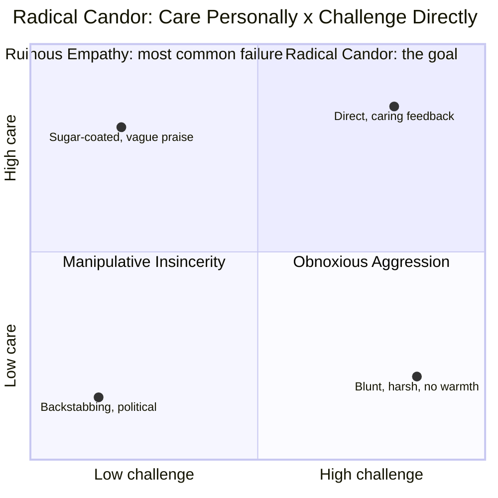
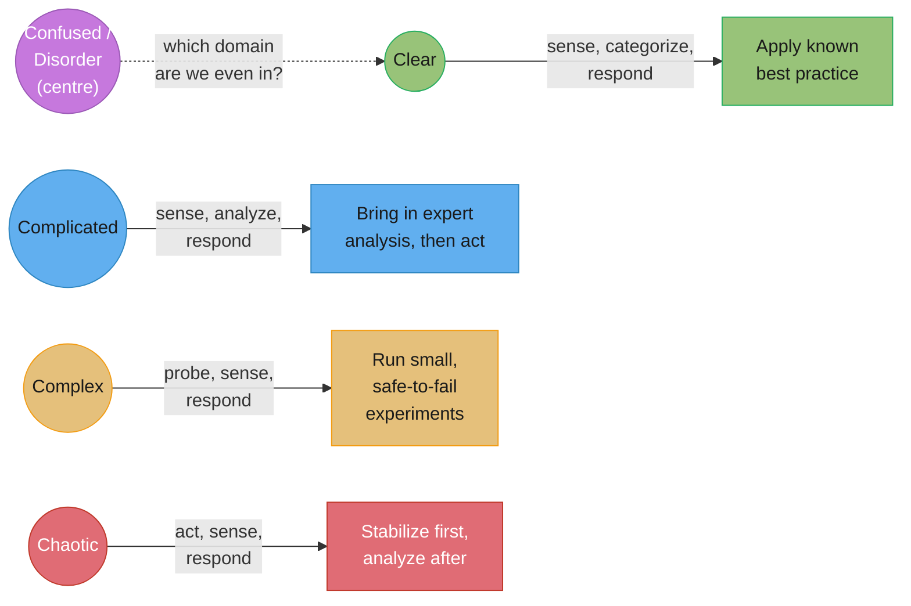
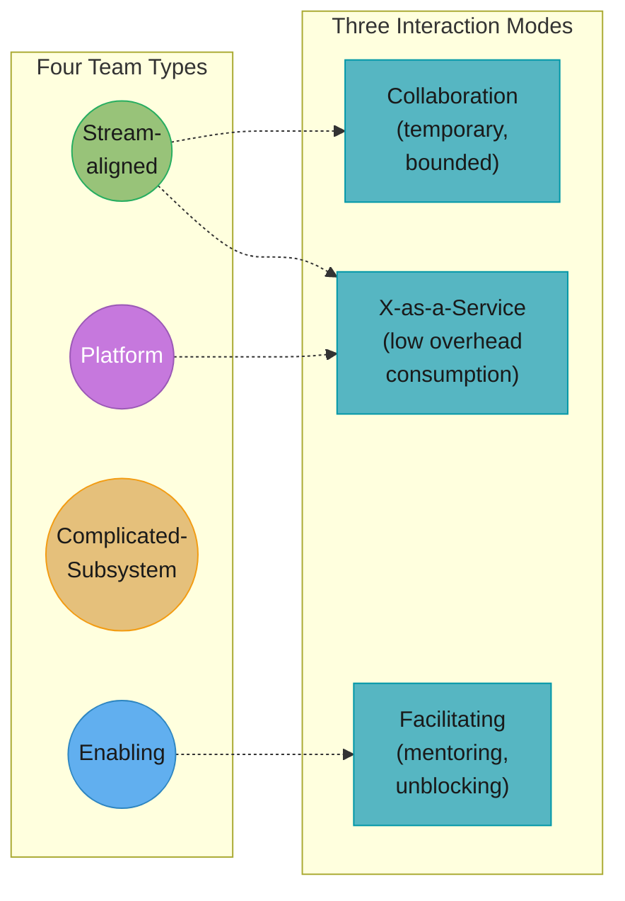

# Leadership & Organisational Vocabulary

## 1. Concept Overview

Leadership vocabulary is not jargon for its own sake — it is a set of named distinctions
that let two people mean the same thing when they say "let's align on this" or "I want to
delegate this." Without the vocabulary, an engineer conflates a mentor with a sponsor,
calls a RACI chart done when it has two Accountables, or hands off a decision without
saying who actually owns it — and each of those failures has a specific, well-documented
name and a specific fix. This module is a working lexicon of the terms a senior-to-staff
engineer needs to lead without formal authority: growing people, delegating work,
structuring a decision, escalating well, shaping a team, building a safe culture, matching
a response to how well-understood a problem is, and giving feedback that lands. Every term
carries its source — a named researcher, a named framework, a specific book — because this
domain is unusually easy to hallucinate confidently in, and a wrong quadrant name costs
more than an admitted gap.

The organizing idea is that most of these terms exist because engineers reach for a vaguer
word first. "Alignment" instead of naming who disagrees and why. "Consensus" when the team
actually practiced concurrence. "Disagree and commit" used to mean "stop arguing" instead
of its actual, stricter meaning. Precision here is not pedantry — it is the difference
between a decision that sticks and one that quietly gets re-litigated in the hallway for
the next two months.

---

## 2. Intuition

> **One-line analogy**: a RACI chart is a seating chart for a decision — everyone in the
> room needs to know if they're the one voting, the one who has to live with the vote, or
> the one who just needs to hear the result.

**Mental model**: Every leadership word in this module answers one of three questions —
who grows whom, who decides what, or how a group of people stays coordinated without a
single person tracking every thread. Most leadership friction on a team is not a
personality clash; it is one of those three questions going unanswered, disguised as a
personality clash because nobody named which question was actually open.

**Why it matters**: A staff engineer's real lever is not more code, it is a decision made
correctly with the right people in the right roles, once, instead of three times. The
vocabulary in this module is the difference between "I ran it by the team" (who, exactly,
and with what authority) and "Priya is the Approver, I'm the Driver, the mobile and infra
leads are Contributors" — the second sentence is checkable, the first is not.

**Key insight**: Nearly every framework here has a well-documented, named failure mode —
Ruinous Empathy, the watermelon RACI with two Accountables, applying a Clear-domain
runbook to a Complex incident. Learning the framework without learning its named failure
is learning half of it; the failure mode is usually what actually shows up in an
interview question or a real incident retro.

---

## 3. Core Principles

1. **A mentor talks to you; a sponsor talks about you when you're not in the room and
   spends real credibility doing it.** Confusing the two is the single most common
   leadership-vocabulary error, and it has a measurable cost (§4.1).
2. **Every decision needs exactly one person who owns it, and "the team decided" is not an
   owner.** RACI, DACI, and RAPID all exist to force that one name onto the page — their
   failure mode is always the same shape: nobody actually named who decides.
3. **The response has to match the domain, not the org's default playbook.** A runbook is
   correct in a Clear (well-understood) situation and actively dangerous applied to a
   Complex one — Cynefin (§4.7) exists because "best practice" is not domain-general.
4. **Psychological safety is not the absence of conflict — it's the presence of high
   standards without fear of the interpersonal cost of speaking up.** The folk
   misreading of Amy Edmondson's term as "being nice" gets this backwards.
5. **A framework's failure mode is usually more instructive than its happy path.** Obnoxious
   Aggression is what harsh feedback becomes when someone thinks they're being "radically
   candid"; a two-Accountable RACI is what "clarity" becomes when nobody actually decided.
6. **Naming the register out loud is itself the leadership move.** Saying "this needs
   consensus, not just concurrence" or "I need you as Approver, not just Contributor"
   resolves more friction than any amount of additional discussion in the vaguer terms.

---

## 4. Types / Levels / Modes

### 4.1 Growing people

#### `Sponsorship vs Mentorship vs Coaching vs Allyship`

**Definition.** Sylvia Ann Hewlett's formula, cited widely in this literature: "mentors
advise; sponsors act." A *mentor* gives advice from their own experience — Herminia
Ibarra's HBR research (2019, "A Lack of Sponsorship Is Keeping Women from Advancing into
Leadership") describes mentorship as largely a one-way, advice-giving relationship. A
*sponsor* is a senior, powerful person who spends their own political capital to
advocate for, name, and place a more junior person in a visible or high-stakes role —
Ibarra's research found that having a mentor predicted promotion for men two years later
but had no such effect for women, largely because women's mentors tended to be less
senior and lacked the clout to actually advocate. *Coaching*, per the International
Coaching Federation's definition, is "partnering with clients in a thought-provoking and
creative process that inspires them to maximize their personal and professional
potential" — the coach draws the answer out of the person rather than supplying it, unlike
a mentor. *Allyship* has no single canonical definition as tight as the other three; it is
generally used for someone using their own position or privilege to support someone from
a less-represented group, without necessarily the direct advocacy sponsorship implies —
treat the term as real but less precisely defined than its neighbors.
**Misuse.** "I mentor her, so I'm supporting her career." Mentorship alone predicts little
for advancement without sponsorship attached — advice without a name being spent on your
behalf in a room you're not in rarely moves a promotion decision, which is exactly the gap
Ibarra's research documents.
**Correct use.** "I can mentor you on the technical side, but what you actually need for
this promotion is a sponsor — someone senior enough to put your name forward for the
platform-lead role before it's even posted."

### 4.2 Delegation

#### `The Seven Levels of Delegation`

**Definition.** Jurgen Appelo's model (Management 3.0): **1. Tell** — you decide, a
discussion is neither desired nor assumed. **2. Sell** — you decide, but you try to bring
people along. **3. Consult** — you ask for input first, then decide. **4. Agree** — group
discussion, group consensus. **5. Advise** — you offer your opinion, but it's their
decision. **6. Inquire** — you let them decide, then ask them to explain their reasoning
to you afterward. **7. Delegate** — you hand over the decision and deliberately don't
want the details. Levels 1 and 7 are deliberate mirror poles of one autonomy axis, and the
model is explicitly symmetrical — it works manager-to-report, report-to-manager, or
peer-to-peer. Appelo's own practice, Delegation Poker, negotiates the level *per decision*,
not per role: the same manager can sit at level 2 on hiring and level 6 on architecture
with the same report, simultaneously.
**Misuse.** Picking one delegation level for a person and applying it to everything they
do. The whole point of the seven-level model is that delegation is per-decision, not a
fixed trait of the relationship — a report you delegate fully on implementation details
may still need you at level 3 (Consult) on anything customer-facing, and that's not
inconsistency, it's the model working correctly.
**Correct use.** "I'm at level 7 with you on how you implement this — full delegate. I'm
still at level 4 on which vendor we pick, because that's a company-level commitment I need
us to agree on together."

### 4.3 Decisions

#### `Commitment vs Concurrence vs Consensus vs Consent`

**Definition.** Four different bars for "the team agreed," most often confused with each
other. *Concurrence* means most people are fine with a decision, without every objection
being resolved. *Consensus* means everyone actively agrees — a genuinely high bar most
teams that say "we reached consensus" have not actually cleared. *Consent* (from
sociocracy) is a distinct, lower bar than consensus: a proposal proceeds if no one has a
paramount, reasoned, substantive objection — the test is "can I live with this," not "do I
prefer this," and mere preferences don't have to be resolved. *Commitment* is what happens
after any of the above — publicly acting as if the decision were your own idea, regardless
of which bar produced it.
**Misuse.** Calling a decision "consensus" when it was actually concurrence. Most teams
that claim consensus mean "nobody loudly objected," which is concurrence — the distinction
matters because a decision made by claimed consensus that was really concurrence is
vulnerable to a quiet reversal the moment the unheard objector gets more leverage.
**Correct use.** "We don't need full consensus here — I'm using consent: does anyone have
a reasoned, substantive objection to shipping this Friday, not just a preference for a
different date?"

#### `Disagree and Commit`

**Definition.** The discipline of voicing a real objection through the decision process,
then acting fully in support of whatever gets decided, without residual sabotage or
withheld effort. Commonly traced to Andy Grove's *High Output Management* (1983, Intel) —
a near-contemporaneous variant is sometimes attributed to Sun Microsystems' Scott McNealy,
and sources conflict on exact priority. Amazon made it an explicit Leadership Principle,
"Have Backbone; Disagree and Commit," whose current published wording is: "Leaders are
obligated to respectfully challenge decisions when they disagree, even when doing so is
uncomfortable or exhausting. Leaders have conviction and are tenacious. They do not
compromise for the sake of social cohesion. Once a decision is determined, they commit
wholly."
**Misuse.** Using "disagree and commit" to mean "stop arguing and do what you're told."
This inverts the principle: it explicitly *requires* that the challenge happened and was
genuinely heard first — a leader who skips straight to "commit" without ever inviting or
tolerating the "disagree" half is not practicing this principle, they're suppressing
dissent under its name.
**Correct use.** "I disagree with shipping without the offline mode, and here's the specific
risk — but if we decide to ship anyway after hearing that out, I'm fully committing, no
foot-dragging."

#### `RACI and RASCI`

**Definition.** RACI assigns one of four roles to each person on a decision or
deliverable: **Responsible** (does the work), **Accountable** (owns the outcome — must be
exactly one person), **Consulted** (two-way input before the decision), **Informed**
(told after). RASCI adds **Supportive** — someone providing resources or assistance to the
Responsible party without owning the work themselves. The near-universal failure mode
with RACI, common enough to be the standard cautionary example in the format, is listing
two people as Accountable — which defeats the entire purpose of the framework, since a
decision with two owners has none.
**Misuse.** A RACI chart with two names in the Accountable column, "because they're
co-leading this." Two Accountables means neither can be held to the outcome without the
other pointing at them — when something goes wrong, the chart itself becomes the argument
for why it's not clearly anyone's fault, which is precisely the failure RACI exists to
prevent.
**Correct use.** "Priya is the single Accountable on this migration — I'm Responsible for
the implementation, infra and security are Consulted, and the rest of the org is
Informed once we ship."

#### `DACI and RAPID`

**Definition.** DACI names **Driver** (runs the process of reaching the decision —
schedules the discussion, gathers input, keeps it moving), **Approver** (has final
authority), **Contributors** (provide input, data, expertise), **Informed** (told the
outcome). The genuinely distinct feature versus RACI is the Driver role: RACI has no
process-owner separate from the person doing the work or the person accountable for it.
Bain's RAPID (Rogers and Blenko, *Harvard Business Review*, January 2006) assigns
**Recommend** (proposes, gathers input), **Agree** (must sign off — an effective veto in
their domain), **Perform** (implements once decided), **Input** (consulted, not
obligated to be adopted), **Decide** (one person, the formal and final call). The letters
in "RAPID" are deliberately not the order the roles are actually used in — the real
sequence is Recommend, then Input, then Agree, then Decide, then Perform, but "RIADP"
doesn't spell anything.
**Misuse.** Treating DACI's Driver as the same role as RAPID's or RACI's decision-owner.
The Driver runs the *process*; the Approver (DACI) or the Decide role (RAPID) holds the
actual authority — collapsing the two back into one role reintroduces the ambiguity these
frameworks exist to remove.
**Correct use.** "I'll Drive this — schedule the reviews, collect the Contributors'
input — but Priya is the Approver; I'm not the one who gets to say yes."

#### `Accountability vs Responsibility`

**Definition.** Responsibility is the obligation to do the work, and it transfers freely
on delegation — you can hand a task to someone else and they're now responsible for it.
Accountability is ownership of the outcome, and it typically does *not* transfer the same
way — a manager who delegates a task remains accountable for its outcome even though
someone else is now responsible for doing it.
**Misuse.** "I delegated it, so it's not on me anymore." Delegating responsibility for the
work does not delegate accountability for the result — a manager who assigns a migration
to a report and it goes badly is still accountable for that outcome, even though the
report was the one responsible for the execution.
**Correct use.** "You're responsible for building this — that's fully yours to execute.
I'm still accountable for the outcome to the org, so keep me looped in on anything that
changes the risk picture."

### 4.4 Escalation

#### `A Good Escalation`

**Definition.** A well-formed escalation names five things: the context (what's happening
and since when), the impact (scope, severity, blast radius), what's already been tried,
an explicit ask (a decision, a resource, a specific unblock — never a bare "FYI"), and why
it needs attention now rather than later. Escalating is a service to the organization, not
an admission of failure — an escalation that surfaces a real blocker early is cheaper for
everyone than one discovered at the deadline. The one social rule that governs all of it:
tell the person or team you're escalating past *before* you escalate, not after, so it
never reads as going over someone's head.
**Misuse.** "Just flagging this is stuck" with no ask attached. A message that states a
problem without naming what the reader should do about it isn't an escalation, it's a
status update wearing an escalation's urgency — the reader is left to guess whether this
needs their intervention or is just for awareness, and the default guess is the latter.
**Correct use.** "The fraud-scoring review has been stuck on Priya's queue for 4 days,
this is 6 of our 12 remaining critical-path days, I've asked her directly twice with no
response — I need you to ping her manager today, not because I've failed, but because I
don't have the standing to escalate a peer's queue myself."

### 4.5 Org shape

#### `Span of Control`

**Definition.** The number of people reporting directly to one manager. A narrow span
(3-5 reports) supports deep, frequent 1:1 involvement; a wide span (8-15+) forces a
manager toward less individual attention and more delegated, self-directed teams — neither
is universally correct, and the right span depends on how much coaching versus autonomy
the reports actually need.
**Misuse.** Treating a wide span as automatically a sign of a lean, efficient
organization. A manager stretched across 15 reports with high coaching needs produces
worse outcomes for those reports than a narrower span would, even though the org chart
"looks" efficient — span of control has to match the actual coaching load, not just
headcount efficiency.
**Correct use.** "This team is mostly senior engineers who need autonomy, not coaching —
a span of 10 works here. The new-grad-heavy team next door needs a span closer to 5."

#### `Conway's Law and the Inverse Conway Maneuver`

**Definition.** Melvin Conway's 1968 paper "How Do Committees Invent?" (*Datamation*,
volume 14, issue 5 — rejected by *Harvard Business Review* before finding a publisher
elsewhere) states, verbatim: "Organizations which design systems... are constrained to
produce designs which are copies of the communication structures of these organizations."
Fred Brooks later named it "Conway's Law" in *The Mythical Man-Month*. The practical
reading: your system's architecture will end up mirroring your org chart whether you plan
it or not, because interfaces between components tend to form wherever two teams need to
coordinate. The **Inverse Conway Maneuver** — commonly associated with ThoughtWorks'
Technology Radar writing, though not tied to one single primary citation — flips this
deliberately: restructure the teams first, in the shape you want the architecture to end
up in, and let the architecture follow.
**Misuse.** Designing a target architecture and assuming teams will naturally converge to
match it without any change to the org chart. Conway's Law predicts the opposite — the
existing communication structure will keep reasserting itself into the design regardless
of the diagram, unless the team structure itself changes.
**Correct use.** "If we want a clean platform-API boundary, we should split the platform
and product teams along that boundary now — the API will end up matching our org chart
either way, so let's pick the org chart on purpose."

#### `Team Topologies — Four Team Types, Three Interaction Modes`

**Definition.** Matthew Skelton and Manuel Pais's *Team Topologies* (2019) names four team
types: **Stream-aligned** (aligned to a single, valuable stream of work — a product, a
service, a user journey), **Enabling** (helps stream-aligned teams overcome obstacles and
close capability gaps), **Complicated-Subsystem** (owns a system requiring deep specialist
knowledge most teams shouldn't need to hold), **Platform** (provides the internal services
other teams consume to reduce their own cognitive load). And exactly three interaction
modes: **Collaboration** (two teams working closely together for a bounded period to
discover something new), **X-as-a-Service** (one team consumes what another provides with
minimal collaboration overhead), **Facilitating** (one team helps and mentors another
without owning their work). The book is explicit there are only three modes.
**Misuse.** Calling a permanent, standing cross-team relationship "collaboration mode."
Collaboration is meant to be temporary and bounded, used while genuine discovery is
happening — a relationship that has been "collaborating" for two years without ever
resolving into X-as-a-Service or Facilitating is a smell (usually an unowned interface or
an unresolved dependency), not a stable steady state.
**Correct use.** "Let's run this in collaboration mode for the next six weeks while we
figure out the new event schema together — once it's stable, we move to X-as-a-Service so
you're not in our sprint planning every week."

#### `Cognitive Load`

**Definition.** In Team Topologies' specific usage, the total amount a team has to know
and track to do its job effectively — domain complexity, the number of systems owned, and
operational burden all count against it. The book's central design claim is that a team's
scope should be sized to what it can hold in working cognitive load, not to whatever
headcount happens to be assigned — a platform team exists specifically to absorb
complexity that would otherwise sit as cognitive load on every stream-aligned team it
serves.
**Misuse.** Adding a new service to a team's ownership because "they have capacity"
(headcount availability) without asking whether they have cognitive *capacity* (room to
hold the new domain knowledge). A team can have free hours and still be at cognitive-load
capacity, and adding scope past that point degrades everything they already own, not just
the new piece.
**Correct use.** "This team is already at cognitive-load capacity with the payments
domain — the new fraud-detection service needs its own stream-aligned team, or a platform
team needs to absorb the shared complexity first."

#### `Dunbar's Number and the Two-Pizza Team`

**Definition.** Robin Dunbar's research proposed a cognitive limit, commonly cited around
150, on the number of stable social relationships a person can meaningfully maintain —
often invoked in org design to argue that coordination overhead grows sharply past certain
group-size thresholds, though the exact number and its direct applicability to a work team
(a much smaller, tighter context than Dunbar's original social-network research) are
debated. Amazon's "two-pizza team" rule — a team small enough to be fed by two pizzas,
commonly cited as roughly 6-10 people — is a much smaller, deliberately concrete
operationalization of the same instinct: past a certain size, a team's internal
communication overhead grows faster than its output.
**Misuse.** Citing Dunbar's 150 as if it applies directly to how big a single engineering
team should be. Dunbar's number describes a much larger, looser social network than a
tightly-coordinated work team — the two-pizza team's much smaller number is the more
directly applicable heuristic for team sizing, not Dunbar's.
**Correct use.** "We're at 14 people on this team and communication has visibly slowed —
let's split along the two natural sub-domains rather than trying to push past the
two-pizza size."

### 4.6 Culture

#### `Psychological Safety`

**Definition.** Amy Edmondson's exact definition, from her 1999 *Administrative Science
Quarterly* paper: "a shared belief held by members of a team that the team is safe for
interpersonal risk taking." It specifically concerns the interpersonal risk of
embarrassment or exclusion when voicing dissent, asking a question, admitting a mistake,
or proposing an idea — not the absence of conflict or the presence of comfort. Edmondson
pairs it explicitly with high standards: a psychologically safe team that has low
standards is not what the research describes. Google's Project Aristotle, an internal
study of what made its own teams effective, corroborated psychological safety as the
single strongest predictor of team performance among the factors they measured.
**Misuse.** "Psychological safety means being nice to each other and avoiding hard
conversations." This is the folk misreading the term is most often given, and it inverts
Edmondson's actual claim — a team that avoids hard conversations to stay comfortable is
not psychologically safe by her definition, it's conflict-avoidant, and the two produce
opposite outcomes on learning and error-catching.
**Correct use.** "We need more psychological safety here — not less bluntness in code
review, but a norm where the junior engineer who spots a real problem doesn't feel like
flagging it will cost them socially."

#### `Just Culture and Blameless`

**Definition.** Just Culture, most associated with Sydney Dekker's writing on safety
science, distinguishes between human error that deserves a system fix and genuine
recklessness or malice that warrants individual accountability — it is not "nobody is ever
responsible," it is "responsibility is assigned to the right level," which is usually the
system, not the individual who happened to be at the keyboard. "Blameless" postmortems are
the applied version of this in engineering: the process explicitly avoids naming and
punishing the individual closest to the incident, on the premise that a competent engineer
acting on the information available to them at the time rarely represents the true root
cause — the system that let that action cause an outage does.
**Misuse.** "Blameless means we never look at what anyone did." Blameless still examines
actions in detail — what someone did, and why it made sense to them at the time given the
information they had — it just refuses to punish the individual for a systemic gap,
which is a very different thing from not looking at the actions at all.
**Correct use.** "This postmortem is blameless — we're going to walk through exactly what
Jordan saw on their screen and why deploying looked safe, because that tells us what the
tooling should have warned them about, not because we're assigning blame."

### 4.7 Decision context

#### `The Cynefin Framework`

**Definition.** Dave Snowden's Cynefin framework sorts a problem into one of five domains,
each with its own correct response. The domain now most often called **Clear** was
earlier called "Simple," then "Obvious" — the naming has genuinely shifted more than once
across Cynefin Co.'s own material, and the field hasn't fully settled; treat "the domain
originally Simple, later Obvious, and in current material Clear" as the honest description
rather than picking one name with false confidence. In Clear, cause and effect are
well-understood and repeatable: **sense, categorize, respond** — apply the known best
practice. **Complicated** requires expert analysis but is still knowable: **sense,
analyze, respond** — bring in expertise, then act. **Complex** has no reliable
cause-and-effect relationship visible in advance, only in hindsight: **probe, sense,
respond** — run small, safe-to-fail experiments and adapt, rather than trusting a plan.
**Chaotic** demands immediate action to stabilize before any analysis is possible:
**act, sense, respond**. The centre domain — variously named Confusion, Disorder,
Confused, or Aporetic across different Cynefin Co. material, with no single settled
name — represents not knowing which of the other four domains you're actually in.
**Misuse.** Applying a runbook (a Clear-domain tool — a known, repeatable response) to a
genuinely novel incident whose cause is only visible in hindsight (a Complex-domain
situation). This is the classic senior-engineer error: "best practice" is a Clear-domain
concept, and using it in the Complex domain produces false confidence, not a correct
response — the correct Complex-domain move is a small, reversible probe, not a
step-by-step procedure.
**Correct use.** "This isn't a known failure mode we have a runbook for — we're in the
Complex domain here. Let's run one small, safe-to-fail experiment and see what it tells
us, rather than pattern-matching to the last incident that looked similar."

### 4.8 Feedback and management models

#### `Radical Candor`

**Definition.** Kim Scott's framework plots feedback on two axes — **Care Personally**
(vertical) and **Challenge Directly** (horizontal) — producing four named quadrants,
verified against Scott's own published material. **Radical Candor** (high care, high
challenge) is the goal. **Obnoxious Aggression** (high challenge, low care) is
challenging without care — harsh, blunt feedback that isn't actually kind. **Ruinous
Empathy** (high care, low challenge) is caring without challenging — Scott names this the
single most common manager failure, because it feels kind in the moment and withholds
exactly the information the person needs. **Manipulative Insincerity** (low care, low
challenge) is neither — backstabbing, insincere flattery, political behavior.
**Misuse.** Calling harsh, blunt feedback "radical candor." In Scott's own framework,
feedback delivered with challenge but without visible care is specifically **Obnoxious
Aggression**, a named failure quadrant, not the goal quadrant — "I'm just being radically
candid" is frequently a self-description of exactly the wrong box.
**Correct use.** "I want to give you radically candid feedback here — I care about your
growth, which is why I'm going to be direct: the design review went badly because you
didn't address the scaling question, and here's specifically what to do differently next
time."

#### `Situational Leadership, Tuckman, and Dreyfus — briefly`

**Situational Leadership** (Hersey and Blanchard) argues management style should shift by
task and by person's readiness for that specific task, not by personality: **S1
Directing** (high direction, low support — for low competence, high commitment), **S2
Coaching** (high direction, high support — building competence), **S3 Supporting** (low
direction, high support — competence is there, confidence isn't), **S4 Delegating** (low
direction, low support — full autonomy). **Misuse:** treating a report as permanently
"S2" or "S4" as a fixed trait rather than a per-task assessment — the same person can be
S4 on their core specialty and S1 on a domain they're new to. **Correct use:** "you're S4
on backend, full autonomy — but S1 on the new payments domain, so let's pair on it first."

**Tuckman's stages** (Bruce Tuckman, 1965, *Psychological Bulletin*): Forming, Storming,
Norming, Performing, with Adjourning added later (Tuckman and Jensen, 1977). **Misuse:**
treating the progression as strictly linear and one-way — teams routinely cycle back to
Storming after any membership change, a reorg, or a new high-stakes project, which is
normal, not a sign the team regressed permanently. **Correct use:** "we're back in
Storming after the reorg — expected, not a regression; let's rebuild norms deliberately."

**The Dreyfus model** of skill acquisition names five stages: Novice, Advanced Beginner,
Competent, Proficient, Expert (the original 1980 labels reportedly differed slightly;
treat these five as the now-standard terms). **Misuse:** equating "senior engineer" with
Dreyfus "Expert" — many strong senior and even staff engineers are accurately Proficient,
which is a normal, respectable place to be, not a deficiency the title should have
already fixed. **Correct use:** "being Proficient, not Expert, on this stack is normal
for two months in — it's not a reason to doubt the promotion."

### 4.9 Process words engineers hear and misread

#### `Alignment, Buy-in, and Bandwidth`

**Definition.** Three vague words that stand in for something specific and are usually
worth translating on the spot. "Alignment" means a specific set of people agree on a
specific decision — asking "aligned on what, exactly, and who hasn't signed off yet"
usually surfaces the real open question. "Buy-in" means people will actually act
differently because of a decision, not merely that they nodded in the meeting where it
was announced. "Bandwidth" is a proxy for priority, not literal time — "I don't have
bandwidth" nearly always means "this isn't prioritized above what I'm already doing," and
naming it that way produces a more useful conversation than accepting the capacity framing
at face value.
**Misuse.** Reporting "we're aligned" after a meeting where three people didn't actually
voice disagreement out loud. Silence in a meeting is not alignment — it is frequently
unvoiced disagreement waiting for the decision to fail before it surfaces, which is a
more expensive time to hear it.
**Correct use.** "Before I call this aligned — Priya, does the API contract work for your
team specifically, or are you deferring to the room?"

#### `Capacity vs Velocity`

**Definition.** Capacity is how much work a team could theoretically absorb; velocity is a
measured historical rate of throughput for a specific team using a specific estimation
scale. The two get conflated constantly in planning: velocity is not portable across
teams (one team's "5 points" is not another's), and capacity ignores the quality and
predictability velocity actually tracks over time.
**Misuse.** Comparing two teams' velocity numbers to judge which is "faster." Velocity is
a team-relative, unit-less measure calibrated to that team's own estimation habits —
comparing Team A's 40 points/sprint to Team B's 25 says nothing about relative
throughput, only about how each team sizes work.
**Correct use.** "Our velocity has been stable at 30 points for six sprints — that's a
better signal for this team's planning than raw capacity, which doesn't account for the
on-call rotation eating a fifth of our time."

#### `Commitment (Agile Sense) and North Star`

**Definition.** "Commitment" in agile planning means a team is confident enough in an
estimate to be held to it — distinct from a forecast, which is a best guess with no such
confidence attached; treating every forecast as a commitment is a common source of broken
trust when reality diverges from the guess. A "north star" is a single, stable metric or
outcome a team optimizes toward across many individual decisions — useful when it's
genuinely one thing everyone can check a decision against, and actively harmful when
leadership rotates it every quarter, because a rotating north star stops functioning as a
decision filter at all.
**Misuse.** Treating a rough forecast as a hard commitment, then treating the team as
having "failed" when reality diverged from a guess nobody actually confirmed with
confidence. The fix is naming which one you're giving before the number gets used to
plan around.
**Correct use.** "This is a forecast, not a commitment — I'd put maybe 60% confidence on
the date; if you need a hard commitment I can give you one, but it'll be later and more
conservative."

#### `OKR vs KPI`

**Definition.** An OKR (Objective and Key Results) is an aspiration paired with a
measure — a stretch goal you may not fully hit, with key results that quantify progress
toward it. A KPI (Key Performance Indicator) is a health metric you watch continuously to
know if something is going wrong, not a goal you're stretching toward. The single most
common misuse in this pair is using a KPI as an OKR — turning a number that should simply
stay in a healthy range (uptime, for instance) into a stretch target, which either
produces a meaningless "win" (uptime was already at 99.95%, "improving" it to 99.96% isn't
a stretch) or perverse incentives (chasing a vanity improvement on a metric that was never
meant to be maximized).
**Misuse.** Setting "maintain 99.9% uptime" as an OKR. Uptime is a KPI — a threshold to
stay above, not a target to stretch toward — an OKR built from a KPI either restates
business-as-usual as an "achievement" or, worse, encourages gaming a metric that exists
purely as a guardrail.
**Correct use.** "Ship the new onboarding flow that lifts activation from 40% to 55% is
an OKR — it's a stretch with a measure. Uptime staying above 99.9% is a KPI we watch, not
something we're stretching toward this quarter."

#### `Roadmap vs Backlog vs Commitment`

**Definition.** A roadmap communicates direction and rough sequencing at a level of
confidence appropriate to how far out it looks — near-term items are more certain, far-out
items are closer to intent than promise. A backlog is the full, unprioritized-to-partially-
prioritized set of everything that could be worked on, most of which will never ship. A
commitment is the narrow subset a team has actually agreed to deliver by a specific date.
Treating all three as equally certain — "it's on the roadmap" heard as "it's committed" —
is a routine and avoidable source of stakeholder frustration.
**Misuse.** A salesperson telling a customer "it's on the roadmap for Q3" when Q3 means
"we intend to, direction-wise" rather than "we have committed to a date." The customer
hears a commitment; the team gave a roadmap-level statement of intent — the gap between
those two confidence levels is where most "you promised this" escalations come from.
**Correct use.** "This is on the roadmap for later this year — direction, not a date.
Nothing is a committed date until it's been scoped and we've said so explicitly."

---

## 5. Models & Frameworks Diagrammed



Most managers who fail at feedback aren't in the bottom-left — they're in the top-left,
Ruinous Empathy, withholding a hard truth because it feels kind in the moment. The fix
isn't more bluntness alone (that risks sliding to the bottom-right, Obnoxious Aggression)
— it's adding challenge without subtracting care.



The response verb changes with the domain, and the classic senior-engineer error is
running the Clear-domain verb (apply best practice) against a Complex-domain problem —
where the correct move is a small, reversible probe, because cause and effect are only
visible there in hindsight.



A stream-aligned team typically consumes a platform team's services in X-as-a-Service
mode and collaborates temporarily with an enabling team while closing a specific
capability gap — the moment collaboration mode stops being temporary, it's a sign the
relationship should have resolved into one of the other two modes.

---

## 6. How It Works — Detailed Mechanics

### 6.1 A worked RACI, and where it breaks

```text
DECISION: Which database migrates first in the Q4 platform consolidation.

RESPONSIBLE: Two engineers (Marcus, Dana) doing the technical migration work.
ACCOUNTABLE: Priya (staff eng lead) — the single owner if this goes wrong.
CONSULTED: Security team (data classification), DBA team (migration risk),
  the two product teams whose services depend on the database.
INFORMED: The rest of engineering, via the weekly platform update.

WHERE IT BROKE THE FIRST TIME: The original chart listed both Priya and her manager as
Accountable, "since it's a big decision." When the migration slipped by three weeks,
neither felt singularly on the hook for the recovery plan, and the postmortem's first
finding was "no one owned re-planning once week one revealed the estimate was wrong."
The fix: exactly one Accountable, and the manager moved to Consulted — still informed
and able to weigh in, but not blurring who owns the outcome.
```

### 6.2 Weak version -> Strong version pairs

**An escalation message**

**Weak version**

> Hey, just flagging that the fraud-scoring review has been sitting for a while, not sure
> what's going on with it.

**Strong version**

> The fraud-scoring spec review has been on Priya's queue for 4 days with no response —
> I've asked her directly twice. This is 6 of our remaining 12 critical-path days for the
> Oct 15 cutover. I've told Priya I'm escalating this to you today. I need you to nudge
> her manager, since I don't have the standing to escalate a peer's queue myself.

**What changed:** "not sure what's going on" became a named blocker, a quantified impact,
proof the direct route was already tried, an explicit ask, and confirmation the person
being escalated past already knows. The weak version can be read as venting; the strong
one requires a specific action in response.

**A delegation handoff**

**Weak version**

> Can you take this project? Let me know if you have questions, I trust you to figure it
> out.

**Strong version**

> I'm delegating this fully — level 7, I don't want the implementation details, that's
> yours. What I do need: a decision log if you make any call that would surprise me later,
> and a heads-up before the launch date moves. I'm Consulted if you hit a security
> question, otherwise this is entirely your call.

**What changed:** "figure it out" became a named delegation level, an explicit boundary
(what still needs to loop back), and a named exception (security). The weak version
leaves the delegate guessing how much autonomy they actually have; the strong version
states it, which is what makes level 7 delegation actually safe to give.

**A decision announcement**

**Weak version**

> After talking it through, I think we're going to go with option B for the auth
> migration. Let me know if anyone has concerns.

**Strong version**

> DECISION: We're moving to option B (token-based sessions) for the auth migration.
> DECIDED BY: me, as Approver, with Consulted input from security and mobile.
> RULES OUT: the cookie-based and hybrid options discussed on the 8/15 call — both fail
> the mobile SDK's offline-refresh requirement.
> COMMIT: this is final; if you disagreed, the moment to raise it was in the 8/15 review —
> from here, I need everyone building against option B.

**What changed:** "I think we're going to go with" became a named decision, a named
decider and role, an explicit list of what's ruled out (so it isn't re-litigated), and an
explicit statement that this is the disagree-and-commit moment, not an open floor. The
weak version invites the debate to continue indefinitely; the strong version closes it on
purpose.

---

## 7. Real-World Examples

- **Amazon's Bar Raiser program and "Have Backbone; Disagree and Commit"** is a named,
  published Leadership Principle used in every hiring loop and cited internally in
  planning disputes — a real, operating instance of the principle being load-bearing
  infrastructure, not a poster on a wall.
- **Herminia Ibarra's 2019 HBR research** on sponsorship gaps for women in leadership is a
  named, dated, citable study with a specific finding (mentorship predicted promotion for
  men but not women, largely due to sponsor seniority gaps) still referenced across
  corporate DEI and leadership-development programs.
- **Team Topologies** (Skelton and Pais, 2019) has been adopted widely enough as a named
  vocabulary that "stream-aligned team" and "platform team" now appear directly in job
  postings and org-design docs at companies that have never read the book cover to cover.
- **Google's Project Aristotle**, an internal multi-year study of what made its own teams
  effective, is a named, real, corporate research effort that specifically corroborated
  psychological safety as the strongest predictor of team performance among the factors
  studied — not an outside academic claim, but the company's own internal finding.

---

## 8. Tradeoffs

| Choice | Pro | Con |
|---|---|---|
| RACI | Simple, widely known, forces one Accountable | No explicit process-owner role; easy to smuggle in two Accountables |
| DACI | Names a process-owner (Driver) separate from the decider | Less widely known; another acronym to teach a new team |
| RAPID | Explicit veto role (Agree) catches objections before the decision lands | Five roles is more overhead for a small, low-stakes decision |
| Consensus | Very high buy-in once reached | Slow; can be blocked by a single holdout indefinitely |
| Consent | Faster than consensus; still catches real objections | Requires trust that "I can live with this" is being answered honestly, not rubber-stamped |
| Full delegation (level 7) | Maximum autonomy and growth for the delegate | Risk if the delegate lacks context you assumed they had |
| Tight delegation (level 1-3) | Lower risk, faster short-term execution | Slower growth for the delegate; doesn't scale past a few reports |

---

## 9. When to Use / When NOT to Use

**Use consensus** for decisions that are hard to reverse and where buy-in itself is part
of the outcome — a team's own working agreement, for instance. **Use consent** for most
operational decisions where "can everyone live with this" is the real bar and waiting for
full agreement would cost more than it's worth. **Don't** default every decision to
consensus — it doesn't scale past a handful of people and a single holdout can freeze a
reversible, low-stakes call for no proportionate reason.

**Use RACI** for a decision or deliverable with clear functional roles and no need for a
dedicated process-owner. **Use DACI or RAPID** when the process of reaching the decision
is itself complex enough to need someone actively driving it, or when you need an
explicit veto role before the decision lands rather than after.

**Escalate** once you've tried the direct route and can name a concrete cost of the delay.
**Don't escalate** as a first move on something you haven't attempted to resolve
directly — that reads as going over someone's head even when it isn't intended that way.

---

## 10. Common Pitfalls

**A RACI chart with two Accountables "because they're co-leading."** This is the single
most common and most damaging RACI failure — when the migration slips, neither person is
unambiguously on the hook for the recovery plan, and the postmortem discovers the chart
itself is why nobody replanned in week one.

**Using "disagree and commit" to shut down dissent instead of inviting it first.** The
principle requires the disagreement to have been genuinely voiced and heard before the
commit half applies — skipping straight to "commit" and calling it disagree-and-commit is
suppression wearing a leadership-principle's name, and reports notice the difference
quickly, which corrodes trust in every future use of the actual principle.

**Treating psychological safety as "being nice."** A team that avoids hard conversations
to stay comfortable has built the opposite of what Edmondson's research describes — the
predictable cost shows up months later, when a junior engineer who spotted a real problem
stayed quiet because raising it felt too socially expensive, and the team learns about the
problem in production instead of in a code review comment.

**Applying a Clear-domain runbook to a Complex-domain incident.** A step-by-step procedure
written for a known failure mode gets pattern-matched onto a genuinely novel incident
because it's the fastest thing to reach for under pressure — and it fails silently,
because a runbook designed for known cause-and-effect gives false confidence exactly where
a probe-and-adapt response was needed instead.

---

## 11. Frameworks, Books & Further Reading

- Jurgen Appelo — *Management 3.0*, source of the Seven Levels of Delegation and
  Delegation Poker.
- Andy Grove — *High Output Management* (1983), commonly traced as the origin of
  "disagree and commit"; Amazon's Leadership Principles (aboutamazon.com) for the current
  published wording of "Have Backbone; Disagree and Commit."
- Herminia Ibarra — "A Lack of Sponsorship Is Keeping Women from Advancing into
  Leadership," *Harvard Business Review*, 2019.
- Paul Rogers and Marcia Blenko — the original RAPID framework article, *Harvard Business
  Review*, January 2006 (Bain & Company).
- Melvin Conway — "How Do Committees Invent?", *Datamation*, 1968; Fred Brooks — *The
  Mythical Man-Month*, which named Conway's Law.
- Matthew Skelton and Manuel Pais — *Team Topologies* (2019); teamtopologies.com for the
  maintained reference material.
- Amy Edmondson — "Psychological Safety and Learning Behavior in Work Teams,"
  *Administrative Science Quarterly*, 1999.
- Dave Snowden — the Cynefin framework; thecynefin.co for current domain naming.
- Kim Scott — *Radical Candor* (2017); radicalcandor.com for the maintained framework
  material.
- Bruce Tuckman — "Developmental Sequence in Small Groups," *Psychological Bulletin*,
  1965; Tuckman and Jensen (1977) for the Adjourning stage.
- [Business & Finance Vocabulary](../business_and_finance_vocabulary/business_and_finance_vocabulary.md) —
  the companion register for the numbers side of the same leadership conversations.

---

## 12. Interview Questions with Answers

**Q: What's the actual difference between a mentor and a sponsor?**
**Short:** A mentor advises you; a sponsor spends their own political capital advocating for you when you're not present.
Sylvia Ann Hewlett's formula is "mentors advise; sponsors act" — a mentor shares
knowledge and advice, while a sponsor is senior and powerful enough to advocate for,
name, and place a more junior person in a visible role, spending real credibility to do
it. Herminia Ibarra's HBR research found mentorship predicted promotion for men two years
later but had no such effect for women, largely because women's mentors tended to be less
senior and lacked the clout to actually advocate. The practical gotcha: an engineer who
has plenty of mentors and no sponsors can be well-advised and still stuck, because advice
alone doesn't put your name in a room you're not in.

**Q: What are levels 1 and 7 of Appelo's Seven Levels of Delegation, and why does the
model apply per-decision rather than per-person?**
**Short:** Level 1 is Tell (you decide, no discussion); level 7 is Delegate (you hand it over and don't want the details) — negotiated per decision, not per role.
Level 1, Tell, means you make the decision and a discussion is neither desired nor
assumed; level 7, Delegate, means you hand over the decision entirely and deliberately
don't want to know the details. Appelo's own practice, Delegation Poker, negotiates the
level per decision, not as a fixed trait of a relationship — the same manager can sit at
level 2 with a report on hiring and level 6 with the same report on architecture,
simultaneously, and that's the model working as designed, not an inconsistency.

**Q: What's the difference between consensus and consent as decision-making bars?**
**Short:** Consensus requires everyone to actively agree; consent only requires no paramount, reasoned objection.
Consensus is a genuinely high bar — everyone actively agrees — that most teams claiming
"we reached consensus" have not actually cleared; what they usually reached is
concurrence, where most people are fine with it without every objection being resolved.
Consent, from sociocracy, is a distinct and lower bar: a proposal proceeds if no one has a
paramount, reasoned, substantive objection, and the test is "can I live with this," not
"do I prefer this" — mere preferences don't have to be resolved under consent.

**Q: What's wrong with using "disagree and commit" to mean "stop arguing and comply"?**
**Short:** The principle requires the disagreement to be genuinely voiced and heard first — skipping straight to compliance inverts it.
Amazon's own published wording obligates leaders to "respectfully challenge decisions
when they disagree, even when doing so is uncomfortable" before ever reaching the commit
half — the principle requires the challenge to have actually happened and been heard.
Using it to mean "shut up and do what you're told" is suppression of dissent wearing the
principle's name, and reports notice the difference between genuine disagree-and-commit
and this inversion quickly, which corrodes trust in every future invocation of it.

**Q: What's the single most common failure in a RACI chart, and why does it defeat the
whole framework?**
**Short:** Listing two people as Accountable — which means, functionally, that no one is.
The near-universal RACI failure is two names in the Accountable column, often justified
as "they're co-leading this" — but Accountable means the single owner of the outcome, and
two owners means neither can be reliably held to it when something goes wrong. The
practical cost shows up in the postmortem, not the planning meeting: when a project slips,
a two-Accountable chart is discovered to be exactly why nobody unilaterally owned the
recovery plan in week one.

**Q: What does DACI's Driver role add that RACI doesn't have?**
**Short:** A named owner of the process of reaching the decision, separate from whoever holds final authority.
RACI has no role for actively running the process of reaching a decision — scheduling
reviews, gathering input, keeping the discussion moving — it only names who does the
work, who's accountable for the outcome, who's consulted, and who's informed. DACI's
Driver fills that specific gap, and it's genuinely distinct from the Approver, who holds
final authority — collapsing Driver and Approver back into one role reintroduces the
ambiguity DACI exists to remove.

**Q: Why doesn't Bain's RAPID spell out its own usage order?**
**Short:** The acronym's letter order (Recommend, Agree, Perform, Input, Decide) isn't the sequence the roles are actually used in.
The actual sequence in practice is Recommend, then Input, then Agree, then Decide, then
Perform — "RIADP" — but that doesn't spell a memorable word, so the published acronym
reorders the letters for memorability while the roles are genuinely used in a different
order. The gotcha for someone learning the framework: don't assume the letter order tells
you the process order, since in this specific framework it deliberately doesn't.

**Q: What's the difference between accountability and responsibility, and why does
delegating one not delegate the other?**
**Short:** Responsibility transfers on delegation; accountability for the outcome typically stays with the delegator.
Responsibility is the obligation to do the work, and it transfers freely when you hand a
task to someone else. Accountability is ownership of the outcome, and it typically does
not transfer the same way — a manager who delegates a migration to a report remains
accountable for the outcome to the organization even though the report is now responsible
for executing it, which is why "I delegated it, so it's not on me" is a category error
about which of the two actually moved.

**Q: What does a well-formed escalation contain that a bare "this is stuck" message
doesn't?**
**Short:** Context, quantified impact, what's already been tried, an explicit ask, and confirmation the escalated-past person already knows.
A good escalation names the context (what and since when), the impact (scope and
severity), what's already been tried directly, an explicit ask — a decision, a resource, a
specific unblock, never a bare FYI — and it tells the person being escalated past before
escalating, not after. A message that states a problem with no ask attached leaves the
reader to guess whether it needs their intervention, and the default guess absent an
explicit ask is "no action needed."

**Q: What does Conway's Law actually say, and what's the Inverse Conway Maneuver?**
**Short:** System designs mirror the communication structure of the org that built them — the Inverse Maneuver restructures teams first to get the architecture you want.
Melvin Conway's 1968 paper states that organizations which design systems are constrained
to produce designs that copy their own communication structures — in practice, a
system's architecture will end up matching the org chart whether or not anyone plans it,
because interfaces form wherever teams need to coordinate. The Inverse Conway Maneuver
flips this deliberately: restructure the teams into the shape you want the architecture
to end up in, and let the architecture follow, rather than drawing a target architecture
and hoping the existing team structure converges to it on its own.

**Q: In Team Topologies, what's wrong with calling a permanent cross-team relationship
"collaboration mode"?**
**Short:** Collaboration is meant to be temporary and bounded — a permanent one is a smell, not a steady state.
Team Topologies names exactly three interaction modes, and Collaboration is explicitly
meant to be a temporary, bounded period of working closely together to discover something
new — not a permanent operating state. A relationship that's been "collaborating" for two
years without ever resolving into X-as-a-Service or Facilitating usually signals an
unowned interface or an unresolved dependency, and the fix is resolving it into one of
the other two modes, not accepting indefinite collaboration as normal.

**Q: What is Amy Edmondson's actual definition of psychological safety, and why is "being
nice" a misreading of it?**
**Short:** "A shared belief held by members of a team that the team is safe for interpersonal risk taking" — paired explicitly with high standards, not comfort.
Edmondson's 1999 definition is specifically about the interpersonal risk of speaking up —
voicing dissent, asking a question, admitting a mistake — without fear of embarrassment
or exclusion, and she pairs it explicitly with high standards, not the absence of
conflict. A team that avoids hard conversations to stay comfortable is conflict-avoidant,
not psychologically safe by this definition, and the two produce opposite outcomes:
conflict-avoidance hides problems, psychological safety surfaces them early.

**Q: Why is applying "best practice" in Cynefin's Complex domain considered the classic
senior-engineer error?**
**Short:** Best practice is a Clear-domain tool that assumes known cause and effect, which the Complex domain by definition doesn't have.
Best practice belongs to the Clear domain, where cause and effect are well-understood and
repeatable, and the correct response there is sense-categorize-respond — apply the known
solution. The Complex domain has no reliable cause-and-effect relationship visible in
advance, only in hindsight, so the correct response is probe-sense-respond — run a small,
safe-to-fail experiment and adapt. Applying a Clear-domain runbook to a genuinely novel,
Complex-domain incident produces false confidence rather than a correct response, which is
exactly why an experienced engineer under pressure reaching for the familiar procedure is
the trap, not a sign of expertise.

**Q: In Kim Scott's Radical Candor, what quadrant does harsh, blunt feedback actually fall
into, and why do people misname it?**
**Short:** Obnoxious Aggression — high challenge, low care — which people frequently mislabel as radical candor itself.
Radical Candor requires both high Care Personally and high Challenge Directly; feedback
that's direct and blunt but doesn't visibly carry care lands in Obnoxious Aggression, a
named failure quadrant, not the goal quadrant. The common misuse is a manager describing
harsh, blunt feedback as "just being radically candid," which is usually a
self-description of exactly the wrong box — the fix isn't less directness, it's adding
visible care alongside it, since removing challenge instead just slides toward Ruinous
Empathy, the other named failure.

**Q: Why does a team commonly return to Tuckman's Storming stage even after reaching
Performing?**
**Short:** Any membership change, reorg, or new high-stakes project can re-trigger Storming — it isn't a one-way, permanent progression.
Tuckman's stages — Forming, Storming, Norming, Performing, with Adjourning added later —
are not strictly linear in practice; a team that has reached Performing routinely cycles
back to Storming after a new member joins, a reorg changes reporting lines, or a
high-stakes project raises the interpersonal stakes. Treating a return to Storming as a
sign the team permanently regressed misreads what's actually a normal, expected reset
triggered by a real change in team composition or context.

**Q: What's the most common misuse of the OKR/KPI distinction?**
**Short:** Turning a KPI — a metric that should just stay healthy — into an OKR, a stretch goal it was never meant to be.
An OKR is an aspiration paired with a measure, meant to be a stretch you may not fully
hit; a KPI is a health metric you watch continuously to know if something's going wrong,
not a target to maximize. Setting "maintain 99.9% uptime" as an OKR is the classic
misuse — uptime is a KPI, a threshold to stay above, and turning it into a stretch target
either produces a meaningless "win" from a metric that was already healthy, or worse,
incentivizes gaming a number that existed purely as a guardrail.

---

## 13. Best Practices

- Name which decision-making bar you actually need — concurrence, consensus, or
  consent — before a meeting, not after someone calls the outcome "aligned."
- Check every RACI or DACI chart for exactly one Accountable or Approver before it ships;
  two is the single most common and most damaging failure in either format.
- Before invoking "disagree and commit," confirm the disagree half actually happened and
  was heard — using the phrase to end debate that was never invited is suppression, not
  the principle.
- Match your response to the Cynefin domain, not to the fastest procedure you remember —
  ask whether this is genuinely Clear (known cause and effect) or Complex (only visible in
  hindsight) before reaching for a runbook.
- Give feedback with both care and challenge visible in the same conversation — dropping
  either one lands in a named failure quadrant, not a safer middle ground.
- Tell the person you're escalating past before you escalate, and never escalate without
  a specific, named ask attached.
- Translate "alignment," "buy-in," and "bandwidth" into their specific meaning on the spot
  rather than accepting the vague version — each one is standing in for a checkable fact.

---

## 14. Case Study

**Scenario.** A 9-person platform team is choosing between two approaches to a shared
authentication library: a fast, narrower fix that unblocks the two teams asking for it
this quarter, and a slower, more general rewrite the platform lead, Jordan, believes is
the right long-term investment. The decision has been discussed in three separate
meetings over five weeks with no resolution.

**What went wrong first.** Every meeting ended with "let's think about it and revisit,"
which felt like progress but was actually an unnamed decision-making bar — nobody had
said whether this needed consensus (everyone genuinely agreeing) or just concurrence
(nobody objecting), so the meetings kept restarting from the same open question instead of
converging. Jordan was also functioning as both Driver (running the process) and, by
default, sole decision-maker, without anyone having said so — which meant the two
requesting teams treated every meeting as still open for their own preferred outcome to
win, since no one had told them otherwise.

**What changes it.** A skip-level asks Jordan directly: "Who's actually deciding this,
and what do the other two teams need to feel heard versus need to actually agree?" Jordan
realizes the honest answer is that this is a DACI, not a consensus call — the two
requesting teams are Contributors whose input matters, but the decision doesn't require
their agreement, only the platform team's, since they own the long-term maintenance cost.

**The decision write-up Jordan sends:**

```text
DECISION NEEDED: Narrow fix vs general rewrite for shared auth library.
ROLES: Jordan (Approver — platform team owns long-term maintenance). Marcus (Driver —
  running this to a decision by Friday). Requesting teams A and B (Contributors — their
  input on timeline pressure is real and being weighed, but this isn't their call).
INPUT GATHERED: Team A needs the fix in 3 weeks for a customer commitment. Team B can
  wait 8 weeks. The general rewrite takes 6 weeks and removes a whole class of future
  auth bugs the narrow fix doesn't touch.
DECISION: General rewrite, with a 2-week narrow patch shipped first to unblock Team A's
  customer commitment, then the rewrite proceeds behind it.
RULES OUT: A narrow-fix-only path — it would leave the underlying issue for a third team
  to hit next quarter, which the platform team is accountable for preventing.
```

**Outcome.** Both requesting teams accept the plan within a day, not because they got
everything they wanted, but because the roles were finally explicit — they could see
their input was heard (the 2-week patch exists specifically because of Team A's
constraint) without needing to believe they'd been given a vote they were never going to
have. The five weeks of unresolved meetings resolved in under 48 hours once the actual
decision-making framework was named out loud instead of left implicit.
