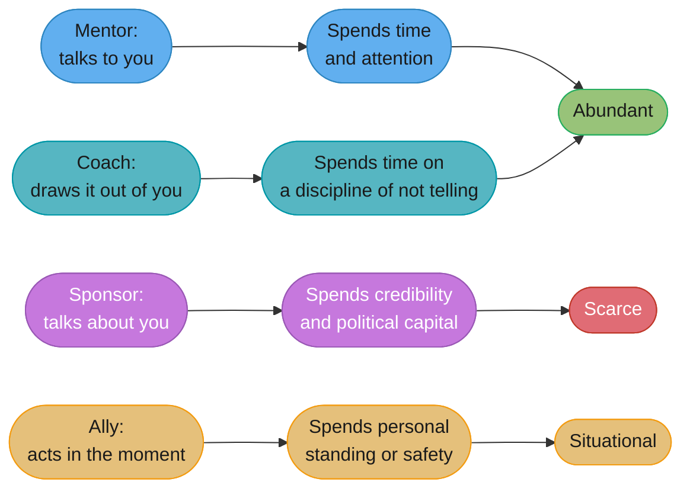
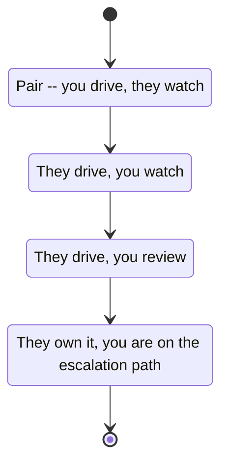
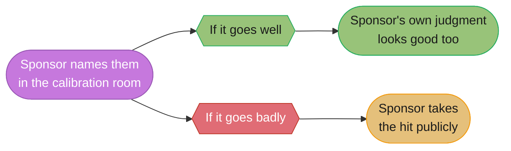

# Mentorship & Sponsorship

## 1. Concept Overview

A staff engineer's impact stops being bounded by their own hours the moment other
people's growth becomes part of how that impact is measured. Writing code and reviewing
designs scales linearly with your own time; growing five engineers who each become
capable of doing what only you could do a year ago scales your impact by five without
you writing a line of the work yourself. This module is about the specific mechanics of
that multiplication — and about a distinction that most engineers collapse into one word
("mentoring") when it is actually two entirely different acts with two entirely different
costs.

Sylvia Ann Hewlett, the economist and researcher who founded the Center for Talent
Innovation and wrote *Forget a Mentor, Find a Sponsor: The New Way to Fast-Track Your
Career* (Harvard Business Review Press, 2013), put the distinction in five words: **"in
short, mentors advise; sponsors act."** A mentor talks *to* you. A sponsor talks *about*
you, in rooms you are not in, and spends their own credibility doing it. Confusing the two
is not a small semantic error — it is the reason capable engineers plateau while less
capable, better-sponsored ones advance past them, and the reason "I have a great mentor"
so often coexists with "I keep getting passed over."

---

## 2. Intuition

> **One-line analogy**: a mentor hands you a map; a sponsor walks into a room you're not
> in and vouches that you can be trusted to drive.

**Mental model.** Mentorship is a conversation. It costs the mentor time and attention,
and it is abundant — almost anyone with more experience than you can hand some of it
over in a 1:1. Sponsorship is a transaction with the sponsor's own reputation as
collateral. It costs the sponsor political capital, and it is scarce, because a sponsor
who is wrong about you pays a real price the next time they vouch for someone.

**Why it matters.** Advice you can get from a book, a blog post, or a well-run 1:1 with
almost anyone senior. A named seat in a room where promotions, project assignments, and
layoffs get decided — decided about you, while you're elsewhere — is a completely
different resource, and it does not arrive just because someone likes talking to you
about your career. It arrives because someone with a seat in that room decided your
performance was worth spending their own standing on.

**Key insight.** You can be extensively mentored and never sponsored, and the two feel
identical from the inside — regular, warm, useful-feeling conversations — right up until
promotion season, when the person who talked to you every week says nothing on your
behalf in the room where it counted, because nobody ever asked them to and they never
volunteered.

---

## 3. Core Principles

- **Mentors advise; sponsors act** (Hewlett). If nobody is spending their own credibility
  advocating for you when you are not in the room, you are being mentored, not sponsored
  — and both are real, but only one moves a promotion decision.
- **A sponsor's action has to cost them something, or it isn't sponsorship.** Saying nice
  things about a colleague in the hallway costs nothing and helps almost nobody; putting
  your name behind theirs on a project that might fail, in front of people who will
  remember if it does, costs something specific and real.
- **Coaching is a third, different thing again** — per the International Coaching
  Federation's definition, coaching is "partnering with clients in a thought-provoking and
  creative process that inspires them to maximize their personal and professional
  potential." A coach draws the answer out of the person; a mentor supplies an answer from
  their own experience. Confusing the two produces mentors who lecture when the person
  needed to think out loud, and coaches who withhold a direct answer the person actually
  needed in the moment.
- **Allyship is a fourth thing, with a less precise canonical definition than the other
  three but a real one**: using your own position, access, or safety to reduce a cost or
  risk that falls disproportionately on someone with less structural power than you —
  speaking up when a colleague is talked over in a meeting they can't safely push back in,
  or crediting someone's idea by name when the room was about to let it pass unattributed.
  It overlaps with sponsorship but is not identical to it: allyship is often reactive, in
  the room, in the moment; sponsorship is usually proactive and ongoing.
- **The sponsorship gap is measured, not anecdotal.** Herminia Ibarra, with Nancy Carter
  and Christine Silva, found in "Why Men Still Get More Promotions Than Women" (*Harvard
  Business Review*, September 2010) that women were more likely than men to have a formal
  mentor — and less likely to have a senior leader outside their own chain of command
  advocating for their advancement. Being mentored and being sponsored are not the same
  resource, and the gap between them is exactly where careers stall.
- **Growing someone is a delegation problem with a timeline measured in months, not a
  single conversation.** The failure mode at every stage is the same temptation: taking
  the keyboard back the moment it would be faster to just do it yourself.
- **The highest-bandwidth teaching channel most engineers have is code review, used
  well.** A comment that explains why, not just what to change, teaches something that
  outlives the specific pull request it was left on.

---

## 4. Types / Levels / Modes

**Four roles, distinguished by what is spent and who it is spent on:**

| Role | What is spent | Directed at | Scarce or abundant |
|---|---|---|---|
| Mentor | Time, attention, advice | The person being mentored, directly | Abundant — many people can do this for you |
| Sponsor | Credibility, political capital | Decision-makers, on the person's behalf, in rooms they're not in | Scarce — few people have the standing to spend it |
| Coach | Time, attention, a specific discipline of not supplying the answer | The person being coached, directly, drawing out their own thinking | Abundant in principle, rare in practice as a distinct skill |
| Ally | Personal safety, standing, or access | The situation in the moment, on behalf of someone with less structural power | Situational — anyone can do it, few consistently do |

**The delegation ladder** — growing a junior engineer into an owner over months, not one
conversation:

1. **Pair** — you drive, they watch and ask questions; or you both work the same problem
   side by side.
2. **They drive, you watch** — they write the code and make the calls; you observe and
   intervene only when something would genuinely go wrong, not when you'd merely do it
   differently.
3. **They drive, you review** — they work independently and bring you the result; your
   feedback shapes the next iteration rather than the current line of code.
4. **They own it, you're on the escalation path** — the work is theirs; you are the named
   backstop if something goes seriously wrong, not the default first call.

**Sponsorship's specific verbs**, distinguished from mentorship's:

- **Mentorship verbs**: advise, explain, listen, ask questions, share what worked for me.
- **Sponsorship verbs**: nominate, name, send instead of go, vouch, defend, absorb the
  consequence if it goes wrong.

---

## 5. Models & Frameworks Diagrammed

*Four roles that get collapsed into one word in casual conversation, distinguished by
what each one actually spends and on whom — the sponsor row is the only one that spends
something scarce on your behalf while you are somewhere else entirely.*

*Four rungs, each meant to last weeks to months, not days — the failure at every rung is
the same temptation, taking the keyboard back because it would be faster to just do it
yourself (§6.4).*

*Sponsorship is a bet with a real payoff and a real downside for the sponsor, not a free
compliment — which is exactly what makes it scarce and what makes the action mean
something when it happens.*

---

## 6. How It Works — Detailed Mechanics

### 6.1 The distinction, in full

Hewlett's formula — mentors advise, sponsors act — is the whole module compressed into
five words, and it is worth unpacking why the distinction is not academic. A mentor's
advice, however good, changes nothing about what happens in a room you are not in. A
sponsor's action changes exactly that: who gets named for the stretch project, whose name
appears on the promotion slate, whose work gets described accurately versus generically
in a calibration meeting where you have no voice at all.

Hewlett's research describes concrete sponsor behaviors: making a person visible to
leaders inside and outside the company, actively connecting them to new opportunities,
providing "air cover" when something goes wrong on their watch, and — the phrase Hewlett
uses that captures the scope of it — not stopping at getting someone one promotion, but
"seeing them to the threshold of power." A single good word in a hallway is not
sponsorship under this definition; a sustained, repeated pattern of spending your own
standing on someone's behalf, across more than one decision, is. Hewlett's research also
found a concrete downstream effect: among employees who asked for a raise, nearly half of
men with a sponsor got it, versus 38% of women with a sponsor — sponsorship correlates
with the ask actually landing, but not equally for everyone who has one.

Lara Hogan, the management consultant behind Wherewithall and author of *Resilient
Management* (A Book Apart, 2019), frames the practical difference the same way from the
manager's chair: sponsors are the people who "help us find new opportunities and improve
the visibility of our work" — and she names explicitly what Ibarra's research also found,
that many people, especially women and other underrepresented engineers, are
**over-mentored and under-sponsored**: plenty of advice, very little of the credibility-
spending action that actually moves a career forward.

### 6.2 What a sponsor actually does, concretely

Each of these is a specific action, and each one has a real cost to the person doing it —
the cost is exactly what makes it sponsorship rather than encouragement:

- **Names them for the project**, in a room where the assignment is being decided, rather
  than waiting for the person to apply or ask. Cost: if the person isn't ready, the
  sponsor's judgment about readiness is now visibly on the line.
- **Puts them on the doc as an author**, when the sponsor did real work on it too and
  could have taken sole or first-author credit. Cost: a smaller, or shared, credit line
  for the sponsor.
- **Sends them to the meeting instead of going themselves.** Cost: the sponsor gives up
  direct visibility and control over how the topic is represented, and trusts someone else
  to represent it — and to represent the sponsor's own judgment about who's ready.
- **Says their name in the calibration room**, unprompted, when the person has no voice in
  that room at all — describing specific, attributed impact rather than letting the
  person's work get folded anonymously into "the team did X." Cost: political capital
  spent advocating for one person over others also being discussed in the same room.
- **Takes the hit if it goes wrong.** When the person they sent to the meeting, or put on
  the project, or vouched for in calibration, stumbles, a sponsor absorbs some of the
  consequence rather than distancing themselves from the choice. Cost: this is the
  starkest one — a sponsor's own standing is genuinely at risk, not just their time.

### 6.3 Running a useful 1:1 as an IC

Mentoring someone you don't manage means the 1:1 has none of the built-in structure a
manager's 1:1 has — no headcount decisions to make, no performance review to prepare for,
often no shared project even. The agenda has to be deliberately different.

**"How's it going?" gets nothing usable**, because it invites a status summary rather
than a real problem, and most people default to "fine, busy" whether or not it's true.
Replace it with standing questions that actually produce information:

- "What are you stuck on that you haven't asked anyone about yet?" — surfaces the thing
  people sit on because asking feels like admitting they should already know.
- "What did you decide this week, and how did you decide it?" — surfaces reasoning, not
  just outcomes, which is what you're actually there to shape.
- "What would you do differently if you had to do this again tomorrow?" — turns a
  completed piece of work into a lesson instead of letting it just be finished.

**Note-keeping across sessions** matters more than it sounds like it should: a mentor who
remembers that three sessions ago the person was stuck on the exact same category of
problem can name the pattern back to them, which is a far more useful observation than
anything either of you could generate fresh in a single conversation.

**The specific discipline of shutting up.** A mentor who talks 70% of the time in a
mentoring conversation is not mentoring — they are narrating their own experience while
the other person listens politely. The useful ratio inverts that: ask the question, let
the silence sit past the point of discomfort, and resist the urge to fill it with your own
answer before the other person has finished forming theirs.

### 6.4 Growing a junior into an owner

The delegation ladder from §4, applied to a real person over real months, with the
specific failure at each rung named:

- **Pair.** Failure: doing all the talking and none of the watching, which teaches the
  junior engineer to wait for instructions rather than to reason.
- **They drive, you watch.** Failure: intervening the moment they'd do something you
  wouldn't — correcting style, not substance — which is the single most common way this
  rung breaks, because it is genuinely faster in the moment to just say the "right" answer
  than to let someone find a slightly different, still-correct one.
- **They drive, you review.** Failure: reviewing so heavily that the review becomes a
  second authorship — rewriting their approach instead of shaping the next iteration,
  which quietly reverts this rung back to the previous one without anyone noticing.
- **They own it, you're on the escalation path.** Failure: staying the *de facto* first
  call anyway, because old habits (theirs and yours) are stickier than the org chart —
  the fix is explicit and a little uncomfortable: tell the team directly who owns this now,
  not just the two of you privately.

**The specific temptation at every rung is the same one**: taking the keyboard back
because it is faster this once. It is almost always faster this once. It is never faster
across the six months it takes to grow someone who can do this without you, and every time
the keyboard gets taken back, the ladder resets closer to the bottom than it was.

### 6.5 Teaching by review

Code review is the highest-bandwidth teaching channel most engineers have, because it
happens on real work, at the moment the person is most receptive to understanding why —
they just made the decision under review, and the reasoning is still live in their head.

**Weak version**

> Use a Map here instead of nested loops.

**Strong version**

> This is O(n*m) as written — for our current data sizes that's fine, but the customer
> table this runs against is growing about 3x a year, and at 50k rows this loop takes
> ~2.5 seconds in the profiler I just ran locally. Building a Map keyed on the id up front
> gets this to O(n+m). Worth fixing now while the fix is small, rather than when it shows
> up as a slow-endpoint alert in six months.

**What changed:** the weak version fixes this one pull request and teaches nothing that
transfers — the same author will write the same nested loop next month in a different
file. The strong version explains the mechanism (complexity), grounds it in a real,
measured number (2.5 seconds, 50k rows, 3x annual growth) rather than an abstract
"this could be slow," and gives the reasoning that generalizes: the next ten times this
author sees nested iteration over growing data, they'll recognize the shape themselves,
which is the actual difference between a comment that fixes this PR and one that fixes
the next ten.

### 6.6 The sponsorship ledger

Track, explicitly and in writing, who you have sponsored and for what — the specific
action taken, not just a feeling of having helped. It is uncomfortable to write down on
purpose: the discomfort is the signal that the ledger is doing its job.

**What it reveals, reliably, when kept honestly**: research on sponsorship (Ibarra,
Carter, and Silva, 2010, among others) has repeatedly found that sponsorship
disproportionately flows to people who resemble the sponsor — same background, same
communication style, sometimes literally the same alma mater or team of origin — not
because sponsors consciously exclude anyone, but because "who comes to mind first when a
project needs a name" is exactly the kind of judgment that unconscious pattern-matching
quietly distorts. A sponsor who has never kept a ledger cannot see this pattern in their
own behavior; a sponsor who reviews four sponsorship actions from the last year and
notices all four went to people who look and sound like they do has learned something a
feeling of general goodwill toward "helping people" would never have surfaced.

**Weak version** (a sponsorship claim made without a ledger to check it against)

> I sponsor people on my team all the time, I really believe in developing talent.

**Strong version** (the same claim, checked)

> In the last year I named Jun and Priya for the platform rewrite, put Marcus's name on
> the design doc as co-author when he did the harder half of the analysis, and vouched
> for Ada in calibration for the staff promotion. Looking at that list, all four are
> engineers on my own team who I work with daily — I haven't sponsored anyone outside my
> immediate reporting line in over a year, which is worth fixing deliberately next
> quarter.

**What changed:** the weak version is a self-assessment with nothing to verify it against
and nothing that would ever surface a blind spot. The strong version is checkable, names
the specific actions (matching §6.2's list), and — because it was written down honestly —
surfaces a pattern (sponsorship staying entirely inside one reporting line) that a vague
sense of being a generous mentor would never have revealed.

### 6.7 What you owe, and what you're owed, in a sponsorship

**What someone you sponsor owes you**: delivery. Sponsorship is a bet with the sponsor's
own credibility as the stake, and the person sponsored owes their sponsor genuine effort
and honest communication about how the bet is actually going, not a performance of
confidence that collapses only once the sponsor has already spent political capital in
public.

**What you owe someone you sponsor**: the truth, especially the uncomfortable truth, if
they are not delivering — before it becomes a problem in a room the sponsor cannot control.
A sponsor who lets a real performance gap go unaddressed, out of a reluctance to have an
awkward conversation, isn't protecting the person; they're setting up a much worse,
much more public version of the same conversation, at a moment neither of them chose.

**Withdrawing sponsorship** is sometimes the honest move, and doing it badly (silently,
without explanation) is worse than doing it visibly and directly.

**Weak version**

> [Quietly stops nominating the person for anything, says nothing, lets them find out by
> noticing the pattern themselves months later.]

**Strong version**

> I want to be straight with you: I put your name forward for the platform lead role
> last quarter, and the two commitments you made in that pitch — the migration plan and
> the on-call handoff doc — are both three weeks overdue with no update to me or the team.
> I'm not going to nominate you for the next opportunity until I see those land, because
> my name is attached to what I say about your work, and right now I can't say what I said
> three months ago. What do you need to get unstuck?

**What changed:** the weak version costs the sponsored person nothing to notice and
everything to interpret — they're left guessing whether they did something wrong, and the
sponsor's credibility erodes silently with no chance for the person to fix it. The strong
version is direct about the specific gap, honest about the consequence, and — critically —
still offers a path back, which is what separates withdrawing sponsorship honestly from
simply abandoning someone.

### 6.8 Being mentored well

The neglected other half of this module: most engineers are far more practiced at
receiving code review than at receiving mentorship, and the difference between someone who
gets real value from being mentored and someone who doesn't is almost entirely in how they
ask and how they follow up.

**"Will you be my mentor?" is a weak ask** — it's open-ended, unbounded in time and topic,
and puts the entire burden of structuring the relationship on the person being asked, who
now has to invent an agenda for a commitment they don't yet understand the shape of.

**Weak version**

> Hey, would you be willing to be my mentor? I feel like I have a lot to learn from you.

**Strong version**

> I'm trying to decide between staying deep on the infra side or moving toward more
> cross-team technical leadership, and I know you made that exact call two years ago. Could
> I get 30 minutes to hear how you thought about it? I have three specific questions I want
> to walk through.

**What changed:** the weak version asks for an open-ended, unbounded relationship from
someone who doesn't yet know what it would actually require of them, which is easy to
decline and easier still to accept and then never actually deliver on. The strong version
asks for something small, specific, and bounded — a real decision, a real question, thirty
minutes — which is far easier to say yes to and far more likely to actually happen, and it
often becomes an ongoing relationship organically, which is a better path to one than
asking for the label up front.

**Being worth mentoring** is the follow-through half, and it's where most of the value
actually gets made or lost: do the thing you were told, then come back and report what
happened — including when it didn't work. A mentor who gives advice once and never hears
whether it helped has no way to calibrate future advice to this specific person, and
quietly stops investing effort, correctly reading the silence as a sign the advice wasn't
valued.

### 6.9 Mentoring at scale

Nobody can run individual 1:1s with everyone who could benefit from their experience, and
treating 1:1 mentoring as the only channel caps a senior engineer's teaching impact at a
handful of people no matter how much time they give it.

- **The written artifact** — a design doc's "alternatives considered" section, a postmortem
  that explains reasoning and not just the timeline, a well-commented reference
  implementation — teaches everyone who reads it, indefinitely, at zero marginal cost per
  reader after it's written.
- **The internal talk or brown-bag** — one hour, delivered once, reaches a room instead of
  a person, and can be recorded and reused.
- **Office hours** — a standing, low-friction, low-commitment slot that removes the social
  cost of "asking for mentorship" entirely; people show up with a specific question rather
  than needing to negotiate an ongoing relationship first.
- **A design-review comment other people read** — the same "why," not just "what," from
  §6.5, left in a forum where it's visible to more than the PR's author, which is often
  the highest-leverage single act available in a normal week, because it was already going
  to be written regardless.

---

## 7. Real-World Examples

- **Sylvia Ann Hewlett's Center for Talent Innovation research** is the origin of the
  mentor/sponsor distinction used throughout this module, developed through large-scale
  workplace studies specifically aimed at explaining why formal mentoring programs
  correlated poorly with actual promotion outcomes.
- **Herminia Ibarra, Nancy Carter, and Christine Silva's "Why Men Still Get More
  Promotions Than Women"** (*Harvard Business Review*, September 2010) is the specific,
  named, peer-reviewed source for the "over-mentored, under-sponsored" finding cited
  throughout §6.1 and §6.6.
- **Tanya Reilly's "Being Glue"** (first delivered at LeadDev New York, 2019) names the
  category of essential, unglamorous work — onboarding new hires, unblocking colleagues,
  writing the documentation nobody assigned, holding cross-team coordination together —
  that keeps a team functioning but rarely appears in a promotion packet, and argues
  explicitly that this work is disproportionately assigned to and taken on by women and
  other underrepresented engineers, at direct cost to their advancement.
- **Google's internal mentorship and sponsorship programs**, described in public
  engineering-culture writing from current and former Googlers, distinguish formal
  mentoring matches (advice-focused, often cross-org) from the separate, less formal
  practice of a senior engineer or manager actively nominating someone for a promotion
  packet, a high-visibility project, or a talk slot — an organizational acknowledgment
  that the two are genuinely different mechanisms, not two names for the same thing.

---

## 8. Tradeoffs

| Approach | Strength | Cost |
|---|---|---|
| Mentorship (advice, 1:1s) | Abundant; low-risk to offer and receive; easy to scale slightly via office hours | Does not, by itself, move a promotion or staffing decision |
| Sponsorship (naming, vouching, credit) | Directly moves decisions made when the person isn't in the room | Scarce; costs the sponsor real credibility; wrong bets have a real cost |
| Coaching (drawing out the answer) | Builds the person's own judgment, not dependence on yours | Slower than just giving the answer; requires a discipline most engineers haven't practiced |
| Formal mentoring programs | Structured, equitable access on paper | Frequently produces advice without action — exactly the over-mentored/under-sponsored gap in §6.1 |
| A sponsorship ledger | Surfaces pattern-matching bias in who gets sponsored | Uncomfortable to keep honestly; easy to stop updating once it's inconvenient |
| Delegating via the full ladder (§6.4) | Produces a genuine owner who no longer needs you | Slower than doing it yourself, every single rung, for months |

---

## 9. When to Use / When NOT to Use

**Mentor generously and often** — it costs little, and even a single well-run 30-minute
conversation can meaningfully help someone's next decision.

**Sponsor selectively and honestly** — every sponsorship spends real credibility, so
reserve it for people whose work you have actually verified, not people you simply like
talking to; sponsoring someone who is not ready burns your own standing and, worse, burns
theirs (§10).

**Coach instead of mentor when the person already has the knowledge and needs to build
the judgment to use it themselves** — supplying an answer someone was capable of finding
on their own teaches them to keep asking instead of to keep thinking.

**Do not treat allyship as a substitute for sponsorship, or vice versa.** Speaking up in
one meeting is valuable and is not the same ongoing investment as a sustained pattern of
naming someone for opportunities over time; neither replaces the other.

**Withdraw sponsorship, visibly and directly, when delivery genuinely stops** — silently
disengaging protects nobody and teaches the person nothing about what changed.

---

## 10. Common Pitfalls

- **Mentorship as a status symbol.** Collecting mentees as a visible signal of seniority,
  without ever converting any of those relationships into the harder, scarcer act of
  sponsorship — a senior engineer who mentors a dozen people and sponsors none of them has
  built a reputation for approachability, not for developing talent that advances.
- **The mentor who solves it instead of teaching it.** Taking over a stuck problem in a
  1:1 because it's faster than walking the person through finding the answer themselves —
  the immediate problem gets solved and the person learns that the fastest way to get
  unstuck is to bring it to you rather than to think harder first, which is the opposite
  of the intended outcome.
- **Sponsoring someone who is not ready and burning them.** Naming someone for a stretch
  project mainly because you like them, without honestly verifying their readiness, risks
  a public failure that damages the sponsored person's reputation more than it would have
  been damaged by simply not getting the opportunity yet — and damages the sponsor's
  judgment in the room's eyes for the next several nominations too.
- **The "I had it hard so they should too" reflex.** Refusing to smooth a path for someone
  because nobody smoothed it for you treats a past injustice as a standard to preserve
  rather than a problem to fix — the correct response to "nobody sponsored me" is "then
  I will be the one who sponsors the next person," not "so nobody should get it easier."
- **Glue work handed disproportionately to the same people.** Tanya Reilly's "Being Glue"
  names the specific mechanism directly: onboarding, documentation, cross-team
  coordination, and unblocking others are essential, genuinely skilled work that is
  systematically undervalued in promotion cases and disproportionately assigned to women
  and other underrepresented engineers — research the talk cites found women volunteer
  for this kind of non-promotable work 48% more often than men, and are asked to take it
  on 44% more often — and a team that lets this pattern run unmanaged is quietly building
  a promotion gap it never decided to build.
- **Mistaking being liked for being useful.** A mentor whose sessions feel warm and
  affirming but never produce a specific action, a specific piece of feedback, or a
  specific sponsorship act is providing company, not mentorship — pleasant, and not the
  same thing as growth, and the difference only becomes visible at review time, when there
  is nothing concrete to point to.

---

## 11. Frameworks, Books & Further Reading

- Sylvia Ann Hewlett — *Forget a Mentor, Find a Sponsor: The New Way to Fast-Track Your
  Career* (Harvard Business Review Press, 2013). Source of the mentor/sponsor distinction
  and the "mentors advise, sponsors act" formula used throughout this module.
- Herminia Ibarra, Nancy Carter, and Christine Silva — "Why Men Still Get More Promotions
  Than Women," *Harvard Business Review*, September 2010. Source of the "over-mentored,
  under-sponsored" finding cited in §6.1 and §6.6.
- Lara Hogan — *Resilient Management* (A Book Apart, 2019) and her published writing on
  sponsorship at Wherewithall. Source of the practical framing distinguishing sponsorship
  as opportunity-and-visibility work from mentorship as advice.
- International Coaching Federation (ICF) — official published definition of coaching,
  quoted verbatim in §3, used here to distinguish coaching from mentoring precisely.
- Tanya Reilly — "Being Glue" (talk, LeadDev New York, 2019; also published as an essay).
  Source of the glue-work anti-pattern in §10 and the argument that essential
  coordination work is systematically undervalued in promotion decisions.
- Related module: [Scope, Prioritisation & Saying No](../scope_prioritization_and_saying_no/scope_prioritization_and_saying_no.md)
  — saying no downward as a teaching act (§6.7 there), which this module's delegation
  ladder (§6.4) extends into growing someone's own judgment over months.
- Related module: [Giving & Receiving Feedback](../giving_and_receiving_feedback/giving_and_receiving_feedback.md)
  — SBI and Radical Candor, the mechanics underneath every teaching-by-review comment in
  §6.5.
- Related module: [Staff+ Archetypes](../staff_plus_archetypes/staff_plus_archetypes.md)
  — how growing other people factors into the scope and impact staff-plus ladders
  actually measure.

---

## 12. Interview Questions with Answers

**Q: What's the actual difference between a mentor and a sponsor?**
**Short:** Mentors advise; sponsors act — a sponsor spends their own credibility on you when you're not in the room.

Sylvia Ann Hewlett's formula: mentors advise, sponsors act. A mentor talks to you and
costs their own time; a sponsor talks about you, in rooms you're not in, and spends their
own political capital doing it — naming you for a project, vouching for you in
calibration, taking the hit if it goes wrong. The two feel identical from the inside as
warm, useful conversations, right up until a promotion decision where only sponsorship
actually moves the outcome.

**Q: Can someone be extensively mentored and never sponsored? What does that actually look like?**
**Short:** Yes — regular helpful conversations with no one spending credibility for you when you're absent.

Yes, and it's common: someone gets consistent advice, encouragement, and useful
conversations from a mentor who never once names them for a project, puts them on a doc
as author, or advocates for them in a room they can't attend. It looks and feels like
support the whole way through, and the gap only becomes visible at promotion season, when
nobody in the room says the person's name unprompted.

**Q: What is the "sponsorship gap," and what did Ibarra, Carter, and Silva actually find?**
**Short:** Women were more likely to have a formal mentor but less likely to have a sponsor advocating for promotion.

Their 2010 *Harvard Business Review* research found women were more likely than men to
have a formal mentor, and less likely to have a senior leader outside their own chain
actively advocating for their advancement — "over-mentored, under-sponsored." It matters
because the two resources aren't interchangeable: plenty of advice does not substitute for
someone spending credibility on your behalf when a decision is actually being made.

**Q: Name three concrete things a sponsor actually does, and why each one has a real cost.**
**Short:** Names them for a project, credits them as author, vouches in calibration — each risks the sponsor's own standing.

Naming someone for a stretch project puts the sponsor's judgment about readiness on the
line; crediting a collaborator as document co-author gives up sole or first credit the
sponsor could have kept; saying someone's name unprompted in a calibration room they
can't attend spends political capital that could have gone to advocating for someone
else instead. Each action costs the sponsor something specific, which is what makes it
sponsorship rather than encouragement.

**Q: What does the ICF's definition of coaching actually say, and how does coaching differ from mentoring?**
**Short:** Coaching partners with someone to draw out their own answer; mentoring supplies an answer from experience.

The International Coaching Federation defines coaching as "partnering with clients in a
thought-provoking and creative process that inspires them to maximize their personal and
professional potential." A mentor answers from their own experience; a coach deliberately
withholds the direct answer and asks questions that help the person find it themselves —
useful when the person already has the knowledge and needs the judgment, not the
information.

**Q: You're mentoring someone but not their manager. What's wrong with opening every 1:1 with "how's it going"?**
**Short:** It invites a status summary, not a real problem — most people default to "fine, busy."

It produces a status update, not information you can act on, because most people default
to a socially safe "fine, busy" whether or not it's accurate. Better standing questions
force something usable: "what are you stuck on that you haven't asked about," or "what did
you decide this week and how did you decide it" — both surface reasoning and blockers
directly instead of relying on the person to volunteer them.

**Q: What's the single biggest mistake mentors make in how much they talk during a mentoring conversation?**
**Short:** Talking roughly 70% of the time, narrating their own experience instead of drawing the person out.

A mentor who dominates the conversation is narrating their own career while the other
person politely listens, which teaches little and surfaces nothing about what the other
person actually needs. The corrective is asking a real question, then tolerating silence
past the point of discomfort instead of filling it with your own answer before the other
person finishes forming theirs.

**Q: Describe the delegation ladder for growing a junior engineer into a full owner.**
**Short:** Pair, then they drive and you watch, then they drive and you review, then they own it fully.

Four rungs over months: pair together; they drive while you watch and only intervene for
genuine risk, not stylistic preference; they drive independently and bring you the result
for review that shapes the next iteration; they own it fully, with you only on the
escalation path as backstop. Each rung typically takes weeks to months, not a single
conversation.

**Q: What's the most common way the "they drive, you watch" rung of the delegation ladder breaks?**
**Short:** Intervening whenever they'd do something differently than you would, not when something would genuinely fail.

The mentor corrects style or preference instead of genuine risk — jumping in the moment
the junior engineer's approach diverges from what the mentor would personally do, rather
than only when the divergence would actually cause a real problem. It's the single most
common way this rung breaks, because correcting in the moment is genuinely faster than
letting someone find a slightly different, still-correct path.

**Q: Why is code review described as the highest-bandwidth teaching channel most engineers have?**
**Short:** It happens on real work at the exact moment the author's own reasoning is still live.

It happens on real work, at the exact moment the person is most receptive — they just made
the decision under review and their reasoning is still active. The difference between a
comment that fixes this one pull request and one that fixes the next ten is explaining the
mechanism and a real, measured consequence, not just prescribing the correct code.

**Q: What is a sponsorship ledger, and what uncomfortable pattern does it usually reveal?**
**Short:** A written record of who you've sponsored; it usually reveals sponsorship flowing to people like you.

It's an explicit, written record of who you've sponsored and for what specific action, kept
deliberately because the discomfort of writing it down is the point. Research on
sponsorship has repeatedly found it disproportionately flows to people who resemble the
sponsor — same background, same team, same communication style — not through conscious
exclusion but through unconscious pattern-matching on "who comes to mind first," which a
kept ledger can surface and a vague feeling of being generous never will.

**Q: What do you owe someone you've sponsored, and what do they owe you?**
**Short:** They owe you delivery and honest status; you owe them the truth if they're not delivering.

The person sponsored owes genuine effort and honest communication about how things are
actually going, not a performance of confidence that collapses only after the sponsor has
already spent credibility in public. The sponsor owes the truth, early, if delivery is
genuinely slipping — silently absorbing a real gap out of discomfort just defers a much
worse, more public version of the same conversation to a moment the sponsor can't control.

**Q: How should you withdraw sponsorship from someone who's stopped delivering, without simply abandoning them?**
**Short:** Say it directly, name the specific gap, state the consequence, and still offer a path back.

Withdraw visibly and directly rather than quietly disengaging — silence leaves the person
guessing and erodes trust with no chance to fix anything. Name the specific commitments
that slipped, state plainly that you won't nominate them again until you see delivery, and
still offer a path back; that combination is what separates an honest withdrawal from
simply abandoning someone.

**Q: What's wrong with asking "will you be my mentor?" as an opening move?**
**Short:** It's open-ended and unbounded, so it puts the entire burden of structuring the relationship on them.

It asks for an unbounded, open-ended commitment from someone who doesn't yet know what
it would actually require of them, which is easy to decline and even easier to accept and
then never follow through on. A specific, bounded ask — thirty minutes, a named decision,
a real question — is easier to say yes to and more likely to actually happen, and it often
becomes an ongoing relationship anyway.

**Q: How do you mentor effectively when you can't 1:1 with everyone who'd benefit?**
**Short:** Written artifacts, talks, office hours, and public review comments scale teaching beyond 1:1 time.

A well-reasoned design doc's alternatives-considered section, an internal talk, standing
office hours, and a code-review comment that explains the "why" in a forum other people
read all teach beyond a single 1:1's reach, often at close to zero marginal cost once
written. Office hours specifically remove the social cost of asking for mentorship, since
showing up with a question requires no negotiated ongoing relationship first.

**Q: What is "Being Glue," and why does Tanya Reilly argue it's a promotion problem, not just a fairness issue?**
**Short:** Essential coordination work that's undervalued in promotion cases and disproportionately assigned unevenly.

Tanya Reilly's talk names onboarding, documentation, unblocking colleagues, and cross-team
coordination as genuinely skilled, essential "glue work" that keeps a team functioning but
rarely shows up in a promotion packet — and argues it falls disproportionately on women and
other underrepresented engineers. It's a promotion problem specifically because a team can
let the pattern run unmanaged without ever deciding to build the resulting gap on purpose.

**Q: What's the difference between allyship and sponsorship, given neither has as tight a canonical definition as mentoring or coaching?**
**Short:** Allyship is usually reactive and in-the-moment; sponsorship is proactive and sustained over time.

Allyship spends personal standing or safety to reduce a cost falling on someone with less
power, usually reactively, in a specific moment — speaking up when someone is talked over.
Sponsorship is a sustained, repeated pattern of spending credibility on someone's behalf
across multiple decisions over time. They overlap and both matter, but one moment of
allyship in a meeting is not the same ongoing investment as sponsorship, and neither
substitutes for the other.

---

## 13. Best Practices

- Say the word "sponsor," not just "mentor," when you mean you're going to spend your own
  credibility on someone's behalf — the two are not interchangeable and conflating them
  hides the gap.
- Keep a written sponsorship ledger and actually review it for pattern-matching bias at
  least once a year.
- In a 1:1 you don't have to run, ask standing questions that surface reasoning and
  blockers, not "how's it going."
- Resist taking the keyboard back at every rung of the delegation ladder, even when it
  would be faster this once.
- Leave code review comments that explain the mechanism and a real number, not just the
  fix, so the lesson outlives the specific pull request.
- Withdraw sponsorship directly and visibly if delivery genuinely stops, never silently.
- Ask for mentorship in a specific, bounded form — a real decision, thirty minutes — not
  an open-ended relationship request.
- Scale your own teaching beyond 1:1s with written artifacts, office hours, and public
  review comments.

---

## 14. Case Study

**Scenario.** Marcus is a senior engineer, two years into a company, technically strong
but consistently passed over for the staff-track stretch projects that go to people with
less tenure than him. His manager, Sofia, has been giving him warm, regular 1:1 feedback
for a year — "you're doing great, keep it up" — and Marcus has taken that at face value.

**What's actually happening.** Sofia has been mentoring Marcus consistently and has never
once sponsored him: she has not named him in a headcount planning meeting for the
platform-rewrite lead role, has not put him forward for the cross-team incident-response
working group that two more junior engineers just joined, and has never mentioned his name
unprompted in a calibration room, because nobody has ever asked her to and she has not
thought of doing it on her own.

**The conversation that changes it.** Marcus, prompted by a conversation with a peer who
recently made the mentor/sponsor distinction explicit to him, asks Sofia directly: "I know
you think my work is strong — can you tell me the last time you put my name forward for
something in a room I wasn't in?" Sofia, genuinely caught off guard, can't immediately
name one. She had been mentoring generously and assumed that was the same as advocating.

**What Sofia does next.** She reviews the next quarter's project staffing meeting and
names Marcus specifically for the platform-rewrite lead role — a real bet, since Marcus
hasn't led a project of that size before — and tells Marcus directly that she's doing it
and why, rather than leaving it invisible. She also starts keeping the sponsorship ledger
from §6.6, and finds, reviewing it three months later, that every name on it besides
Marcus's is someone who sits within two desks of her own — a pattern she says she would
never have noticed without writing the list down.

**Resolution.** Marcus leads the platform rewrite, delivers it a week behind the original
estimate but with a defensible, well-documented reason, and Sofia backs him publicly on
the delay rather than distancing herself from the choice to staff him — the specific cost
of sponsorship from §6.2, paid in full. Marcus makes staff the following cycle, with
Sofia's calibration-room advocacy cited by name in his packet as a contributing factor. The
lesson Sofia takes into her next round of 1:1s, stated in her own words afterward: "I was
mentoring five people and sponsoring none of them, and it took someone asking me the blunt
question directly before I noticed."
