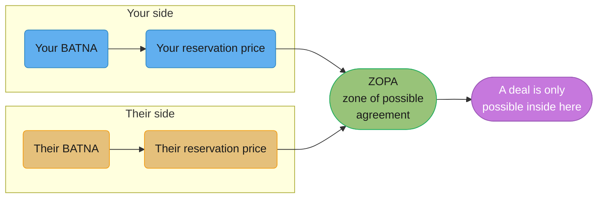
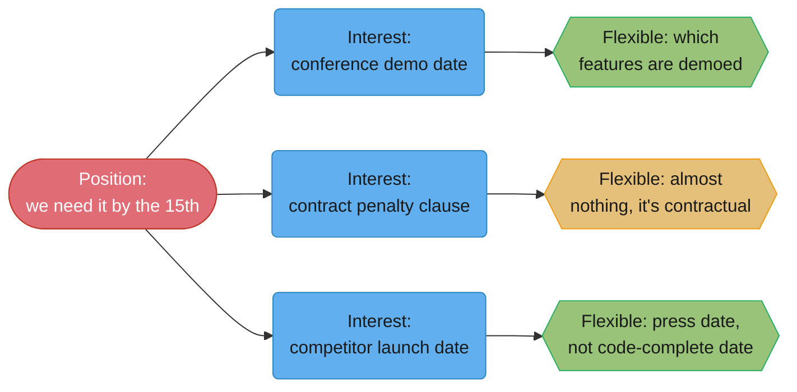
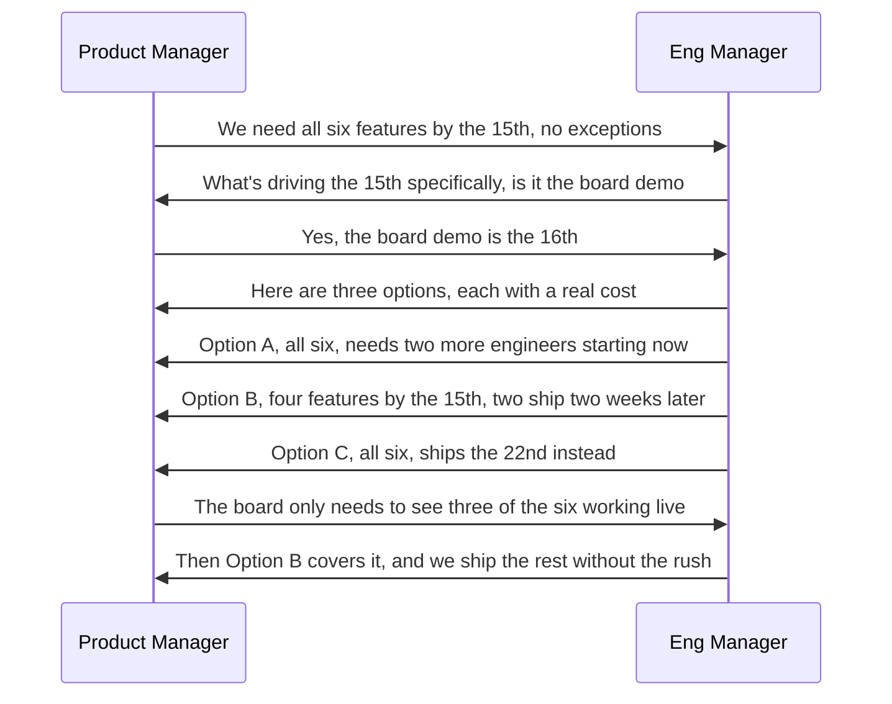

# Negotiation for Engineers

## 1. Concept Overview

Engineers negotiate constantly and almost never call it that. A negotiation is any
conversation where two parties want different things and have to land on one outcome —
which describes a deadline discussion, a scope cut, a headcount request, an on-call
rotation, a disagreement about who owns a service, how much review time a PR gets, a
title in a promotion packet, and, only occasionally, a salary. Most engineers negotiate
badly not because they lack leverage but because they don't recognize the conversation as
one: they treat "we need this by the 15th" as a fact to be absorbed rather than a position
to be understood and countered.

This module borrows from two books that between them define the modern practice: Roger
Fisher and William Ury's *Getting to Yes* (Houghton Mifflin, 1981), the principled-
negotiation framework taught in most MBA and law programs, and Chris Voss's *Never Split
the Difference* (HarperBusiness, 2016), built from Voss's career as the FBI's lead
international kidnapping negotiator. The two frameworks pull in slightly different
directions — one optimizes for a durable, mutually satisfying deal between people who
will likely deal again, the other for extracting information and moving a counterpart who
may be adversarial and one-shot — and knowing which situation you're in is most of the
skill. A deadline negotiation with your own product manager, whom you'll sit next to at
standup for the next two years, is not a hostage negotiation, and running Voss's
tactics on a long-term colleague without adapting them can win the exchange and cost the
relationship.

---

## 2. Intuition

> **One-line analogy**: a negotiation is not a tug-of-war over one number, it's two
> people drawing different-shaped boxes and looking for where they overlap.

**Mental model.** Every position ("we need it by the 15th") is the visible tip of an
interest ("the CEO is demoing this to a board investor on the 16th," or "there's a
contract penalty clause," or "a competitor announced a similar feature and marketing
wants to beat them to press"). Three different interests behind an identical-sounding
position have three completely different sets of flexible parts — find the interest and
you usually find room that the position alone hid.

**Why it matters.** Most engineers treat a stated deadline, a stated headcount number, or
a stated comp offer as fixed, because pushing back feels adversarial. It usually isn't —
the other party expects a counter, has room they haven't disclosed, and often respects the
counter more than the acceptance. Silent compliance is not goodwill; it's information the
other side never gets, about what you actually needed.

**Key insight.** You cannot negotiate well without knowing your own walk-away point
(BATNA) before the conversation starts. Without it, every offer looks equally acceptable
because you have no anchor to measure it against, and you'll agree to terms you'd have
refused if you'd done the five minutes of preparation first.

---

## 3. Core Principles

- **What you say you want (position) and what you actually need (interest) are usually
  different**, and the negotiation only gets productive once both sides are working the
  interest instead of defending the position.
- **Know your BATNA — Best Alternative To a Negotiated Agreement — before you negotiate,
  not during it.** It's the single most load-bearing piece of preparation and the one
  engineers skip most often.
- **The Zone of Possible Agreement (ZOPA)** is the overlap between what you'd accept and
  what they'd accept; a deal only exists inside it, and neither party can usually see the
  other's edge of it, which is exactly why preparation and information-gathering both
  matter.
- **A counter-offer, not a flat refusal, keeps the conversation moving.** "No" ends the
  exchange; "here's what I can do instead, and what it costs" continues it.
- **Calibrated, open-ended questions move a counterpart further than a stated position
  does**, because they make the other person do the work of solving your problem instead
  of you doing the work of defending your ask.
- **The first number anchors the range.** Whoever names a number first sets the frame the
  rest of the conversation orbits around — use market data to set that anchor, not your
  last salary or your first guess at a deadline.
- **A negotiation you win against a colleague is a negotiation you then live inside.**
  Optimizing purely for extracting the best number from someone you'll work with for years
  is a different game than optimizing against a one-shot counterpart, and playing the
  wrong game costs you the relationship for a number you'll forget in six months.

---

## 4. Types / Levels / Modes

**What engineers actually negotiate**, roughly in order of how often it happens and how
rarely it's recognized as negotiation:

| What | How it usually shows up | Why it's rarely named as negotiation |
|---|---|---|
| Deadlines | "We need this by the 15th" | Feels like a constraint, not a position |
| Scope | "Can we also add X before ship" | Feels like a requirements conversation |
| Headcount | "I need two more engineers for this" | Feels like a resourcing request |
| On-call rotation | "Can you take an extra week this quarter" | Feels like a favor, not a trade |
| Technical direction | "We're going with approach A" | Feels like a technical decision, not a deal |
| Service ownership | "Whose team owns this going forward" | Feels like an org chart fact |
| Review time / turnaround | "Can you review this today" | Feels like a small ask, not a repeated cost |
| Title / level | "I think I should be Staff" | The one everyone recognizes as negotiation |
| Compensation | Offer, refresh, raise | The one everyone recognizes as negotiation |

**By posture (from Getting to Yes):**

- **Positional bargaining** — each side stakes out a position and moves incrementally
  toward the middle. Fast to start, produces worse outcomes, and damages the relationship
  when either side feels they "lost."
- **Principled negotiation** — separate the people from the problem, focus on interests,
  generate options before deciding, and evaluate against objective criteria rather than
  willpower. Slower to start, better outcomes, more durable.

**By stakes and relationship duration:**

- **One-shot / adversarial** — a single vendor contract, a used-car-style purchase.
  Voss's tactics (§6.2) apply with the fewest caveats here.
- **Repeated / collegial** — your manager, your product counterpart, your own team. The
  same tactical moves need softening — an accusation audit that would disarm a stranger
  can read as manipulative from someone you'll be in standup with tomorrow.
- **Multi-party** — two or more teams splitting scope or headcount, where the negotiation
  isn't two-sided and the person who shows up with a written proposal usually sets the
  frame everyone else reacts to.

---

## 5. Models & Frameworks Diagrammed

*Your reservation price and theirs bound the Zone of Possible Agreement. Neither side can
usually see the other's edge of it — which is exactly why the preparation in §6.3 and the
questions in §6.2 both matter: they're how you find the ZOPA's real boundary instead of
guessing at it.*

*Three interests can hide behind an identical-sounding position, and each leaves a
different part of the deal actually flexible — a conference date can move the feature set
demoed, a contract clause usually can't move at all, and a competitor's launch is often
about the press date, not the code-complete date.*

*Asking for the interest behind the date, before accepting or rejecting the position,
turns a flat refusal into a workable option the product manager didn't know was on the
table.*

---

## 6. How It Works — Detailed Mechanics

### 6.1 Getting to Yes — the four principles, named exactly

Fisher and Ury's four principles of principled negotiation:

1. **Separate the people from the problem.** Attack the scheduling conflict, not the
   person who created it — a negotiation that turns into a character argument stops being
   solvable by either side conceding.
2. **Focus on interests, not positions.** "We need it by the 15th" is a position; the
   interest behind it — a board demo, a contract clause, a competitor's launch — is what
   actually has flexible and inflexible parts.
3. **Invent options for mutual gain before deciding.** Generate several possible
   resolutions before either side commits to one, so the conversation isn't a binary
   accept/reject on the first idea raised.
4. **Insist on objective criteria.** Settle disagreements by appeal to an external
   standard — a benchmark, a published policy, a prior comparable decision — rather than
   by whoever is more stubborn or more senior in the room.

**BATNA** — Best Alternative To a Negotiated Agreement — is the outcome you get if this
negotiation fails entirely. It is not "what I'd like," it is "what actually happens if we
don't reach a deal": for a comp negotiation, your BATNA might be a competing offer or
staying at your current job; for a deadline negotiation, it might be "the feature ships
late with an honest explanation" or "leadership descopes it themselves." Knowing your
BATNA changes everything, because it is your only real anchor for whether an offer is
worth accepting — without it, you're evaluating every offer against nothing.

**ZOPA** — the Zone of Possible Agreement — is the range between your reservation price
(the worst deal you'd still accept) and theirs, where a deal is actually possible. If your
minimum acceptable timeline is three weeks and their absolute maximum flexibility is two,
there is no ZOPA and no amount of skillful negotiating produces a deal — the honest move
at that point is to say so plainly rather than keep negotiating against a wall.

### 6.2 Never Split the Difference — Voss's tactics

Chris Voss's *Never Split the Difference* (HarperBusiness, 2016) reframes negotiation
around **tactical empathy** — understanding and vocalizing the other side's perspective,
not to be nice, but because it gets them to lower their guard and give you more
information.

- **Labelling** — naming the emotion or constraint you observe, without claiming it as
  your own: "It seems like the 15th is the part that can't move" or "it sounds like
  headcount is the real blocker here, not the design." Labels invite correction, which is
  useful — if you're wrong, they'll tell you, and you've learned something either way.
- **Mirroring** — repeating the last few words the other person said, as a question. It
  is close to free and reliably gets someone to elaborate: "...two more engineers?"
  usually produces more explanation than any question you could construct yourself.
- **Calibrated questions** — open-ended questions starting with "how" or "what" that hand
  your problem to the other person to solve, rather than stating your position and
  waiting for a reaction. **"How am I supposed to do that?"** is the single most useful
  phrase in this module — said without hostility, it forces the other side to either find
  you room or admit there genuinely isn't any, and it does both without you making a
  single demand.
- **The accusation audit** — naming the worst things the other side might think about you
  before they say it: "You're probably thinking I'm just trying to get out of the on-call
  rotation I agreed to" — said out loud, before they've accused you of it, it takes the
  air out of the accusation and usually gets a "no, it's not that" in response.
- **"That's right" versus "you're right"** — when the other person says "that's right,"
  it means you've actually captured their position accurately, and that recognition tends
  to open real movement. "You're right" usually means they want you to stop talking; it's
  agreement in form only, offered to end the exchange rather than to signal genuine
  alignment.

**Where Voss transfers badly.** Voss built these techniques as an FBI hostage negotiator
— his counterparts were often adversarial, one-shot, and had no reason to trust him
beyond the current exchange. A calibrated "how am I supposed to do that" lands very
differently from a stranger on a phone line than from a colleague you sit next to every
day; used clumsily or too often on a long-term teammate, an accusation audit can read as
manipulative rather than disarming, because the other person knows you'll still be
working together tomorrow and starts wondering what else you're managing rather than
saying directly. Use tactical empathy's spirit — understand before you push — and dial
back the theatrical version of the technique with people you have an ongoing relationship
with.

### 6.3 Preparation

Before any negotiation that matters: know your **BATNA** (what happens if this fails),
their likely **interests** (not their stated position), the **objective criteria** you'll
appeal to (a market benchmark, a prior comparable decision, a published policy, a
performance number), and your actual **walk-away point** — the line past which you'd
rather take the BATNA than the deal. Engineers negotiate unprepared more often than almost
any other professional group in the building, walking into a comp conversation or a
deadline discussion with no number in mind beyond "whatever they offer, I guess," which is
not a negotiating position, it's an absence of one.

### 6.4 Deadline and scope negotiation, worked in full

**Weak version**

> We can't hit the 15th, sorry. It's just not realistic.

**Strong version**

> Here are three ways to get you something real by the 15th: (A) all six features, but I
> need two more engineers starting this week; (B) four of the six by the 15th, the other
> two two weeks later; (C) all six, but the date moves to the 22nd. What's driving the
> 15th specifically — is there a version of that date I don't know about that changes
> which option actually works?

**What changed:** the weak version is a flat refusal with nothing to react to, so the
listener's only move is to escalate or accept a "no" they didn't ask for. The strong
version gives three costed options and asks the calibrated question that surfaces the
real interest — a board demo, a contract clause, a press date — each of which points to a
different option being the right one. Presenting the tradeoff on a shared doc, not just
in the conversation, makes the cost visible to anyone who reads it later, including
whoever eventually has to explain the timeline upward.

The "what would you like me to drop" question belongs here too, asked without sarcasm:
"if the 15th is fixed, tell me which of these six features you'd cut, because something
has to give and I'd rather you choose than I guess." Asked sincerely, it converts a
deadline fight into a scope conversation, which is usually the actual negotiation
underneath the date.

### 6.5 Compensation negotiation for engineers

**What's usually flexible:** equity refresh, sign-on bonus, level (which drives the whole
band), and start date. **What's usually not:** base salary within an already-set band —
most large tech employers set bands centrally and a recruiter has little to no room to
move base outside it, even when they have real room on sign-on or equity.

**The first number should come from market data**, not your last salary and not a guess —
levels.fyi, Glassdoor, and direct conversations with people at comparable levels at
comparable companies are the objective criteria Fisher and Ury's fourth principle asks
for. Anchoring on your previous salary anchors low if you were underpaid there, which is
common, and anchoring on a guess anchors nowhere useful at all.

**Weak version**

> Whatever you think is fair, I trust you.

**Strong version**

> Based on levels.fyi and three conversations with engineers at this level at comparable
> companies, I'm seeing total comp in the $310-340K range for this role. Your offer is
> $275K. Can we get closer to $320K, split however works for you between base, sign-on,
> and equity?

**What changed:** the weak version hands the anchor to the other side for free — whoever
speaks the first number sets the range the rest of the conversation orbits around, and
"whatever you think is fair" concedes that entirely. The strong version cites the source
of the number, states the gap plainly, and explicitly offers flexibility on which
component moves, which makes it easier for the recruiter to say yes without breaking a
band they can't touch.

**If you decline to give a number first** — "I'd rather hear your range before I share
mine" — a good recruiter will usually give one; a company that refuses to share any range
at all is itself information worth having. **Mentioning a competing offer** works best
stated as a fact rather than a threat: "I have another offer at $X — I'd genuinely rather
join here, is there room to get closer to that" reads very differently from "match this or
I walk," even though both convey the same information.

**Posted-range laws and salary-history bans.** In a growing list of places the employer
has to show the range first and may not ask what you earn now. That moves the opening of
the negotiation: you no longer fish for the range, you negotiate where in it you land.

| Jurisdiction and law | What it requires | In force |
|----------------------|------------------|----------|
| Colorado, Equal Pay for Equal Work Act | postings carry a good-faith pay range and a benefits summary | January 1, 2021 |
| New York City, Local Law 32 of 2022 | postings for NYC roles (employers with 4+ staff) show a good-faith minimum and maximum | November 1, 2022 |
| California, SB 1162 | employers with 15+ staff put the pay scale in the posting | January 1, 2023 |
| Washington, SB 5761 | employers with 15+ staff put the wage scale and benefits in the posting | January 1, 2023 |
| California Labor Code §432.3, Massachusetts pay-equity act, NYC Local Law 67 of 2017 | employer may not ask for salary history | January 1, 2018; July 1, 2018; October 31, 2017 |
| EU, Pay Transparency Directive (EU) 2023/970, Art. 5 and 7 | candidate gets the initial pay or range before the interview; employer may not ask pay history; an employee may request their own pay and the average pay by sex for the same work, answered within two months | transposition deadline June 7, 2026 |

The EU directive binds private employers only through each member state's national law.
At the June 7, 2026 deadline most of the 27 member states had not fully transposed it
(law-firm trackers counted between two and four that had), so check the law of the
country the job is in, not the directive. Gender pay-gap reports under Art. 9 start in
June 2027 for employers with 150+ staff and June 2031 for those with 100-149.

What changes in practice:

- **A posted range is the employer's own objective criterion.** Fisher and Ury's fourth
  principle hands it to you. A NYC posting that says $190-260K is not "the band is
  whatever"; the question becomes "what puts an offer at $250K rather than $190K at this
  level?", and the answer is usually level and scope, which is why level is the first
  thing on the "usually flexible" list above.
- **A ban covers the question, not your answer.** You may still volunteer your current
  pay. Do not, if you were underpaid: the number anchors the offer and the law that
  protected you no longer helps once you said it.
- **After you join, EU Art. 7 is a second negotiation tool.** An engineer in a transposed
  state can request the average pay for the same work and use the gap, with the employer's
  own data, as the objective criterion at the next review.

**Weak version** (recruiter for a California role asks your current salary)

> I'm on $148K base right now, so anything above that works.

**Strong version**

> I'd rather focus on what this role pays. The posting says $175-230K, and from
> levels.fyi and two peers at this level I'm targeting $215K base. What would put an
> offer there?

**What changed:** the weak version volunteers a low anchor the employer was not allowed
to ask for, and caps the conversation at $148K plus a bump. The strong version keeps the
history private, uses the employer's own posted range as the frame, and asks a calibrated
question about what moves an offer to the top of it.

### 6.6 Negotiating on-call and toil

This is the most commonly lost negotiation in engineering, and arguably the one with the
largest effect on whether someone is still at the company in two years — burnout from an
unsustainable on-call load is a far more common reason for a strong engineer's departure
than compensation, and it is negotiated far less often, usually because it's framed as a
team obligation rather than as a negotiable term.

**Weak version**

> I guess I can take the extra on-call week if nobody else can.

**Strong version**

> I can take this week, but I was already on call three weeks ago and I don't want this
> becoming the default whenever someone's out — can we agree that if I cover this one,
> the next uncovered week goes to someone who hasn't been on in the last month? I'll put
> the rotation history in the team doc so it's visible to everyone, not just remembered.

**What changed:** the weak version accepts an uncosted, unbounded precedent — "nobody
else can" becomes the reason every time. The strong version accepts the specific ask,
states the actual interest (not becoming the default fallback), and proposes an objective
criterion (rotation history, visible to the team) rather than relying on someone
remembering fairly next time.

### 6.7 Multi-party negotiation across teams

When two teams need to split a body of work — say, migrating a shared service — the
negotiation stops being purely two-sided and starts rewarding whoever shows up with a
written proposal first. A written split, even an imperfect one, becomes the anchor
everyone reacts to and edits rather than the blank page everyone has to fill in together;
the person who writes it controls the framing of what counts as "fair" far more than
either side's raw leverage does. This is worth doing on purpose: draft the split, share
it before the meeting, and expect edits rather than a from-scratch negotiation in the
room.

### 6.8 The "no" that keeps the relationship

Not every negotiation ends in a deal — sometimes the honest answer is that you can't
meet the ask, and the negotiation is really about how you decline. A refusal with no
reason and nothing offered back reads as a closed door and costs the same relationship
capital as a badly-run "yes." A refusal with a reason and an alternative reads as a real
answer.

**Weak version**

> I can't help with that right now, sorry.

**Strong version**

> I can't take on the migration this sprint — I'm already committed to the incident
> followups from last week, and adding this would put both at risk. I can start the
> design doc next week if that would help unblock the team in the meantime, or if it's
> urgent enough to need this sprint, I think Raj has more room than I do right now.

**What changed:** the weak version declines and stops, leaving the other person with
nothing to work with and no sense of whether you even considered it seriously. The strong
version names the specific conflict, offers a concrete alternative timeline, and points to
another real option — it closes the door on this specific ask while leaving every other
door open, which is the entire difference between a "no" that ends a working relationship
and one that doesn't.

---

## 7. Real-World Examples

- **levels.fyi and Blind** function as informal objective-criteria sources for
  compensation negotiation at scale — their existence is precisely Fisher and Ury's
  fourth principle (insist on objective criteria) made into a public good, and engineers
  who use them systematically negotiate from real market data instead of a guess.
- **GitLab's public job families** (handbook.gitlab.com/job-description-library) publish
  the expectations for Intermediate, Senior, and Staff Backend Engineer. An employer that
  publishes its level criteria pre-commits to objective criteria for a title or level
  negotiation instead of leaving it to whoever argues hardest in a room. This reduces,
  but does not remove, the positional-bargaining problem Fisher and Ury describe.
- **The FBI's Crisis Negotiation Unit**, the origin of Chris Voss's *Never Split the
  Difference* techniques, is the sourced, verifiable origin of labelling, mirroring, and
  calibrated questions — Voss's book documents specific kidnapping and barricade
  negotiations where these techniques are credited with de-escalating situations where a
  demanded ransom or ultimatum initially looked non-negotiable.
- **Y Combinator's public advice to founders on equity negotiation** with early
  engineering hires consistently recommends objective, comparable-company benchmarks over
  ad hoc offers — the same anchoring principle this module applies to an individual
  engineer's comp negotiation, from the other side of the table.

---

## 8. Tradeoffs

| Approach | Strength | Cost |
|---|---|---|
| Positional bargaining (stake a position, move incrementally) | Fast, familiar | Worse outcomes, damages the relationship, easy to "lose" publicly |
| Principled negotiation (interests, options, objective criteria) | Better outcomes, durable | Slower to start, requires prep most people skip |
| Voss's tactical empathy (labelling, mirroring, calibrated questions) | Extracts information fast, works on adversarial counterparts | Can read as manipulative with a long-term colleague if overused |
| Accepting the first offer | Zero conflict, fast | Leaves value on the table almost every time; signals no preparation was done |
| Splitting the difference reflexively | Feels fair, ends the discomfort quickly | Frequently worse than either party's actual reservation price — see §10 |
| Escalating instead of negotiating directly | Can break a genuinely stuck deadlock | Costs trust if used before a direct attempt, same as in [Difficult Conversations & Conflict](../difficult_conversations_and_conflict/difficult_conversations_and_conflict.md) |

---

## 9. When to Use / When NOT to Use

**Negotiate explicitly when:** the stakes are real (a deadline, a comp offer, an on-call
precedent) and the first offer is treated as a starting point rather than a final number —
which, absent evidence otherwise, it usually is.

**Do not run Voss's full adversarial toolkit when:** the counterpart is a long-term
colleague and the relationship afterward matters more than the marginal gain in this one
exchange — soften to plain, direct questions instead of the theatrical version of
labelling or the accusation audit.

**Escalate instead of continuing to negotiate when:** there is genuinely no ZOPA — your
floor and their ceiling don't overlap — and continuing to negotiate produces the illusion
of progress without the possibility of a deal; say that plainly rather than grinding on a
wall.

**Accept the first offer when:** you've done the preparation, the offer already clears
your reservation price by a comfortable margin, and further negotiation would cost more
in time or goodwill than the marginal gain is worth — not every negotiation is worth
running to the end just because you can.

---

## 10. Common Pitfalls

- **Negotiating against yourself.** Making a second, better offer before the other side
  has even countered your first one — "actually, we could probably do it by the 20th
  instead of the 22nd" said unprompted — gives away room nobody asked for and teaches the
  other side that your numbers move on their own.
- **The exploding "final offer" accepted out of fear.** A recruiter or a stakeholder
  saying "this offer expires Friday" is frequently a pressure tactic, not a genuine
  constraint — a real, hard deadline of that kind is rare enough that it's worth asking
  directly, "what happens on Friday specifically" before treating the pressure as real.
- **Splitting the difference reflexively.** If your ask is a 3-week timeline extension and
  theirs is zero, meeting at 1.5 weeks feels fair and is frequently arbitrary — it treats
  the midpoint of two starting positions as meaningful when neither position was
  necessarily grounded in anything. Voss's book is titled against exactly this reflex for
  a reason: the midpoint of two arbitrary numbers is itself arbitrary.
- **Treating a colleague like an opponent.** Running the full hostage-negotiation toolkit
  — accusation audits, relentless mirroring, "how am I supposed to do that" repeated three
  times in one conversation — on someone you work with daily reads as manipulation once
  they notice the pattern, and they will notice.
- **Winning a negotiation you then have to live inside for two years.** A team lead who
  successfully argues their team out of an unfair share of on-call, at the direct expense
  of a neighboring team, has won a negotiation and started a grudge that shows up as
  friction on the next five cross-team requests.
- **A real incident:** an engineering manager at a Series C startup negotiated a hard
  four-week deadline down to eight weeks by presenting three costed options instead of a
  flat refusal, and the CEO chose the middle option without complaint — the same manager
  later admitted the honest floor was six weeks, meaning two weeks of real slack were
  built into the accepted option, discovered only because the CEO never asked "why not
  four" and the manager never had to reveal a walk-away point that was never tested.

---

## 11. Frameworks, Books & Further Reading

- Roger Fisher and William Ury — *Getting to Yes: Negotiating Agreement Without Giving
  In* (Houghton Mifflin, 1981; 3rd ed. with Bruce Patton, Penguin, 2011). Source of the
  four principles, BATNA, and the interests-vs-positions distinction.
- Chris Voss with Tahl Raz — *Never Split the Difference: Negotiating As If Your Life
  Depended On It* (HarperBusiness, 2016). Source of tactical empathy, labelling,
  mirroring, calibrated questions, the accusation audit, and the "that's right" /
  "you're right" distinction.
- Deepak Malhotra and Max Bazerman — *Negotiation Genius* (Bantam, 2007). Adjacent
  academic-grounded framework covering anchoring effects and multi-party negotiation, not
  quoted directly in this module but a natural next read.
- Directive (EU) 2023/970 of the European Parliament and of the Council (May 10, 2023)
  on pay transparency. Art. 5 covers pay information before employment and the
  pay-history ban; Art. 7 the employee's right to information; Art. 9 pay-gap reporting.
- Related module: [Difficult Conversations & Conflict](../difficult_conversations_and_conflict/difficult_conversations_and_conflict.md)
  — what to do once a negotiation has broken down into a personal conflict rather than a
  productive exchange.
- Related module: [Scope, Prioritization & Saying No](../scope_prioritization_and_saying_no/scope_prioritization_and_saying_no.md)
  — the specific skill of declining scope, which overlaps heavily with §6.4's deadline
  and scope negotiation.
- Related module: [Influence Without Authority](../influence_without_authority/influence_without_authority.md)
  — moving a decision when you have no formal leverage to negotiate with at all.

---

## 12. Interview Questions with Answers

**Q: Your manager tells you a deadline is fixed and non-negotiable. What do you actually do?**
**Short:** Counter with costed options and ask what's driving the date, instead of accepting or refusing.

Treat "fixed" as a position, not a fact, and ask the calibrated question: "what's driving
the 15th specifically — is there a version of that date I don't know about?" Then bring
options, not a refusal: three ways to hit something real by that date, each with its
actual cost. Most "fixed" deadlines have an interest behind them — a demo, a contract
clause, a competitor's launch — and once you know which one, you usually find that only
part of the scope actually needs to land by that date.

**Q: How do you counter-offer on compensation without sounding entitled or aggressive?**
**Short:** Cite a market-data source, state the specific gap, and offer flexibility on which component moves.

Anchor on real numbers, not a feeling — "based on levels.fyi and conversations with peers
at this level, I'm seeing $310-340K, your offer is $275K, can we close that gap" — and
explicitly offer flexibility on how the gap closes (base, sign-on, equity, start date).
Citing a source depersonalizes the ask; it's no longer "I think I deserve more," it's "the
market says this role is worth more than this offer," which is a much easier conversation
for a recruiter to actually move on.

**Q: A recruiter for a New York City or California role asks for your current salary. How do you answer?**
**Short:** Both ban the question. Decline it politely, frame the talk on the posted range and your market data, and do not volunteer a number that anchors you low.

NYC (Local Law 67 of 2017) and California (Labor Code §432.3) bar employers from asking
salary history, and both also require a pay range in the posting (NYC Local Law 32 of
2022, California SB 1162). The ban covers the question, not your answer, so the trap is
answering anyway. Say: "I'd rather focus on what this role pays. The posting lists
$175-230K and I'm targeting $215K based on levels.fyi and peers at this level." If you
were underpaid, volunteering it costs you the protection the law gave you, because the
number now anchors the offer.

**Q: What does the EU Pay Transparency Directive (2023/970) give a candidate and an employee?**
**Short:** Before the interview, the initial pay or its range and no pay-history question. After hiring, the right to ask your own pay and the average pay by sex for the same work.

Art. 5 gives the applicant the starting pay or range before the interview and bars the
employer from asking pay history. Art. 7 lets an employee request their pay level and the
average pay, broken down by sex, for workers doing the same work or work of equal value,
with an answer within two months. The transposition deadline was June 7, 2026, and the
rules reach a private employer through national law, which many member states passed
late, so the country of employment decides what applies. Use Art. 7 data at the next
review as the objective criterion: "the average for this role is X, I'm at Y."

**Q: What is BATNA and why does knowing yours change the negotiation?**
**Short:** Best Alternative To a Negotiated Agreement — your only real anchor for whether an offer is worth taking.

BATNA is what actually happens if this specific negotiation fails — not your ideal
outcome, your genuine fallback. Without knowing it, every offer on the table looks
equally acceptable because you have nothing to measure it against; with it, you can
instantly tell whether an offer clears your real floor or whether walking away, or
invoking your BATNA, is actually the better move. Most people who "cave" in a negotiation
never worked out their BATNA beforehand and so had no way to know they were caving.

**Q: What's the difference between a position and an interest, with an engineering example?**
**Short:** A position is the stated ask; the interest is the need behind it, and it's usually more flexible.

"We need it by the 15th" is a position. The interest behind it might be a board demo
date, a contractual penalty clause, or a competitor's launch — and each of those leaves a
different part of the ask flexible: a demo date can often be satisfied by a subset of
features working live, a contract clause usually can't move at all, and a competitor's
launch is often really about the press date rather than the code being complete. Ask for
the interest before accepting or rejecting the position; the position alone doesn't tell
you which parts are load-bearing.

**Q: What is a calibrated question, and what makes "how am I supposed to do that?" so effective?**
**Short:** An open "how" or "what" question that hands your problem to the other side to solve.

A calibrated question starts with "how" or "what," is open-ended, and puts the burden of
solving your constraint onto the other person instead of you stating a demand they can
simply reject. "How am I supposed to do that?" — asked without hostility, about a genuine
constraint — forces the other side to either find real room or explicitly admit there
isn't any, and it does this without you making a single counter-demand they could push
back on. It works because refusing a question is much harder, socially, than refusing an
ask.

**Q: What's the difference between "that's right" and "you're right" in a negotiation, and why does it matter?**
**Short:** "That's right" means you've been understood accurately; "you're right" usually means stop talking.

When a counterpart says "that's right" in response to your summary of their position, it
signals you've genuinely captured what they meant, and that recognition tends to open
real movement in the conversation. "You're right" is usually agreement in form only,
offered to end an uncomfortable exchange rather than to signal alignment — hearing it is a
sign to check whether you've actually landed the point or just made them want to stop
talking about it.

**Q: When should you NOT use Chris Voss's tactics on a colleague?**
**Short:** When the relationship afterward matters more than the marginal gain in this one exchange.

Voss built these techniques for adversarial, often one-shot counterparts where extracting
information and moving a position mattered more than a durable relationship afterward. A
colleague you'll be in standup with tomorrow notices a repeated accusation audit or
relentless mirroring differently than a stranger does, and once they notice the pattern
it reads as manipulation rather than empathy. Use the underlying spirit — understand
before you push — and drop the theatrical version of the technique with anyone you have
an ongoing working relationship with.

**Q: What's actually flexible in a compensation offer, and what usually isn't?**
**Short:** Equity refresh, sign-on, level, and start date usually flex; base within a set band usually doesn't.

Base salary within an already-published band is often the least movable number, because
recruiters frequently have little to no discretion over it. Equity refresh, sign-on
bonus, level (which resets the whole band), and start date are the parts with real
negotiating room in most large-company offers — so a counter that asks to move all of
comp uniformly is fighting the wrong lever; a counter that asks specifically about
sign-on or equity is fighting a lever that's actually there to move.

**Q: How do you negotiate an on-call ask without just accepting whatever's asked of you?**
**Short:** Accept the specific ask, but attach an explicit, visible rule for what happens next time.

Accept the immediate cover if it's reasonable, but don't let it become an unstated
precedent — "I'll take this week, but I was on call three weeks ago too, can we agree the
next uncovered week goes to someone who hasn't been on recently, and I'll put the
rotation history somewhere visible." The goal isn't refusing the ask, it's replacing "you,
because nobody else can" with an objective, written criterion for who covers gaps going
forward.

**Q: What is the Zone of Possible Agreement (ZOPA), and what do you do when there isn't one?**
**Short:** The overlap between both parties' reservation prices; when it's empty, say so instead of grinding.

ZOPA is the range between your worst-acceptable outcome and theirs, where a deal is
actually possible — if your floor is three weeks and their ceiling is two, there is no
overlap and no negotiating skill produces a deal inside it. The honest, efficient move at
that point is to say plainly that the gap doesn't currently close, rather than continuing
to negotiate and producing the appearance of progress without the possibility of a real
agreement.

**Q: You have a competing offer. How do you mention it without it sounding like a threat?**
**Short:** State it as a fact and a preference, not an ultimatum — name the number and say you'd rather stay.

Frame it as information plus a stated preference: "I have another offer at $X — I'd
genuinely rather join here, is there room to get closer to that" conveys the same fact as
"match this or I walk," but reads as collaborative rather than coercive, and gives the
other side a way to say yes without feeling cornered into it. An ultimatum framing
invites a reflexive "no" even from someone who has the room to move.

**Q: Why does the person who writes the proposal usually win a multi-party negotiation between two teams?**
**Short:** A written proposal becomes the anchor everyone edits, instead of the blank page everyone fills together.

Whoever produces the first written split of work, headcount, or ownership sets the frame
the rest of the conversation reacts to — people find it easier to redline an existing
document than to generate a competing one from scratch, so the initial framing (what
counts as "even," what counts as "already decided") tends to survive largely intact even
when the other side has equal or greater raw leverage. Showing up with a draft, before the
meeting, is worth more than most people expect relative to the effort it takes.

**Q: What's wrong with splitting the difference as a default move?**
**Short:** The midpoint of two starting positions is arbitrary, not fair, unless both positions were grounded.

If your ask and their offer were both anchored in real reservation prices, meeting in the
middle can be reasonable. But most opening positions are not carefully reasoned reservation
prices — they're anchors set to leave room to move — so averaging two anchors produces a
third arbitrary number, not a principled one. The alternative is to work the actual
interests and objective criteria (§6.1) until the number that emerges is justified by
something other than "it's between the two numbers we started with."

**Q: How do you say no to a request in a way that keeps the relationship intact?**
**Short:** Decline the specific ask, name the reason, and offer what you can do instead.

A flat "no" with no reasoning and no alternative reads as a closed door; a "no, because
X, but here's what I can do instead" reads as a real answer someone can work with. "I
can't take on the migration this sprint — I'm already committed to the incident followups
— but I can start the design doc next week if that helps unblock the team in the
meantime" declines the specific thing while leaving the relationship, and the door to a
different kind of help, open.

**Q: What role does objective criteria play when the two sides simply disagree on the facts?**
**Short:** It moves the argument from whoever's more stubborn to an external standard both sides can check.

Fisher and Ury's fourth principle — insist on objective criteria — replaces "I think X"
versus "I think Y" with an appeal to something outside either party's opinion: a
published benchmark, a prior comparable decision, an agreed metric. In an engineering
context that's often a load test result, a documented SLA, or how a similar decision was
made for a comparable service last quarter — citing it converts a battle of wills into a
question both sides can independently check.

---

## 13. Best Practices

- Know your BATNA and your actual walk-away point before any negotiation that matters —
  not during it.
- Never state a first offer without market data or a comparable benchmark behind it.
- Bring options, not refusals, to a deadline or scope conversation.
- Ask the calibrated "how am I supposed to do that" before accepting an ask you can't
  actually meet.
- Soften Voss's adversarial tactics with anyone you'll be working alongside tomorrow.
- Write the proposal first in a multi-party negotiation — it sets the frame.
- Put the tradeoff on a shared artifact, not just in the conversation, so the cost is
  visible to whoever reads it later.
- Say plainly when there's no ZOPA instead of grinding a negotiation that can't close.
- Decline with a reason and an alternative, never a flat no with nothing offered back.

---

## 14. Case Study

**Scenario.** A staff engineer, Dana, is asked by her VP to commit her team to shipping a
new reporting API in four weeks, timed to a customer contract renewal. Dana's honest
estimate, with her current team, is eight weeks. She has one open headcount req that's
been stuck in approval for six weeks.

**The negotiation.** Dana doesn't accept the four weeks, and she doesn't flatly refuse it
either — she treats it as a position with an interest behind it and asks about the
interest directly: "is the four weeks about the actual contract renewal date, or is there
flexibility in what needs to be true by then?" The VP says the contract renewal is real
but the customer specifically needs three of the API's eight endpoints working for their
own integration testing, not all eight.

Dana comes back with three costed options in a shared doc, not a conversation: Option A,
all eight endpoints in eight weeks with her current team; Option B, the three endpoints
the customer actually needs in four weeks, the remaining five in six more weeks after
that; Option C, all eight in four weeks, but only if the stuck headcount req is approved
this week and the new hire is fully ramped by week two, which Dana flags as unrealistic
and includes mainly to show the VP what "yes to everything" would actually require.

**Resolution.** The VP picks Option B on the spot, and separately unblocks the headcount
req the same week — something that hadn't moved in six weeks of Dana simply waiting for
it. Dana's team ships the three endpoints in four weeks as promised. The retrospective
lesson the team takes away, stated by Dana herself in the team's next retro: "the four
weeks was never actually about all eight endpoints — nobody had asked, including me,
until the negotiation forced the question."

**What made it work.** Dana never said no to the VP's ask, which would have read as
either insubordination or as a fight the VP had no reason to expect. She never said yes
either, which would have overcommitted her team to a genuinely unrealistic scope. She
asked what the position was actually protecting, found the real interest, and made the
tradeoff visible on paper instead of arguing it out loud — which is also what got the
stuck headcount req unstuck, since the VP could now see, in writing, exactly what the
extra headcount would and wouldn't buy.

