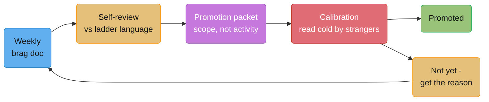
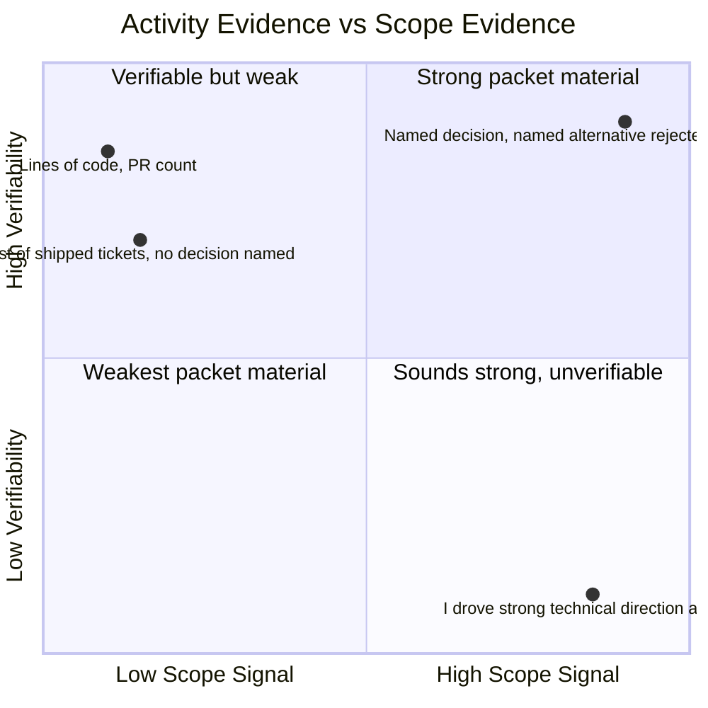

# Performance Reviews & Promotions

## 1. Concept Overview

Most engineers learn how promotion actually works by losing a cycle first — writing a
self-review from memory in the last week of the deadline, getting a "not yet" with no
specifics attached, and only then discovering that a promotion decision was never really
about the work; it was about the evidence of the work, assembled months in advance, read
by people who were never in the room. This module treats that mechanism plainly: the
weekly habit that makes the evidence exist (the brag doc), the document that turns it into
a case (the self-review), the document that turns the case into a decision (the promotion
packet), and the room where packets actually get compared (calibration).

None of this is a substitute for doing strong work. It is the machinery that determines
whether strong work becomes visible to the specific small group of people who decide
whether it counts — and that machinery rewards specificity, named scope, and evidence a
stranger can verify, and punishes vagueness, activity lists, and evidence that only makes
sense to people who already know you. The gap between "did good work" and "got promoted
for it" is almost always a gap in how the work was written down, not a gap in the work
itself.

---

## 2. Intuition

> **One-line analogy**: A promotion packet is a legal brief, not a highlight reel — it has
> to survive being read cold by a stranger who was not in the room and will not ask you a
> follow-up question.

**Mental model.** Your manager is not building your case from a complete memory of your
year; they are building it from whatever they wrote down, whatever you told them in 1:1s
they happened to retain, and whatever slack of attention they have left after doing the
same thing for five or six other people simultaneously. A self-review is not "how did I
feel about this year" — it is the one authoritative account of your year your manager
actually has, and if you don't write it, the account that survives is whatever fragments
happened to stick.

**Why it matters.** The engineer who assumes "good work speaks for itself" is making a bet
that a busy manager's incomplete memory, six months later, will reconstruct the specific
decision they made, the ambiguity they resolved, and the people they unblocked — with the
same weight and accuracy they would give it themselves. That bet loses constantly, and it
loses silently: nobody tells you your case was thin because your manager forgot the
March incident you prevented; you just get a "not yet" and are left to guess why.

**Key insight.** A packet is evidence of **scope**, not a list of **activity**. Shipping
five features says you were busy. Naming the decision you owned, how ambiguous it was when
you owned it, who else it affected, and what happened because you made the call — that says
what level you were actually operating at. Almost every weak packet is a long list of the
first kind and needs to be rewritten as the second.

---

## 3. Core Principles

- **Write for someone who does not know you and will not ask a follow-up question.**
  Calibration readers are frequently reading your packet cold. If a sentence only makes
  sense to someone who already trusts you, it will not survive contact with a stranger.
- **Evidence beats enthusiasm.** A specific artifact — a design doc, an incident you led,
  a person you grew — outweighs your manager's genuine, sincere belief that you're ready.
  Belief does not travel between rooms; artifacts do.
- **The brag doc is infrastructure, not homework.** Keep it weekly, or the exact things that
  mattered most — the incident you prevented, the design you talked someone out of — are
  precisely the things too easy to forget by review time, because prevention leaves no
  trace and being talked out of something leaves no ticket.
- **Promotion is a lagging indicator.** You are promoted for work you have already, visibly,
  been doing at the next level — not for potential, and not for a plan to start doing it.
- **A "no" has exactly three real causes**, and they require different responses; assuming
  the wrong one wastes a year (§6.7).
- **Calibration compares packets, not people.** A stronger case, better written, with named
  corroborators, beats a genuinely stronger year that was never written down.

---

## 4. Types / Levels / Modes

| Artifact | Cadence | Audience | Primary failure mode |
|---|---|---|---|
| **Brag doc** | Weekly | Yourself, later your manager | Kept sporadically or not at all, so March is gone by November |
| **Self-review** | Per cycle (often 2x/year) | Your manager, directly | Written from feelings about the year instead of against the ladder's own language |
| **Promotion packet** | Per promotion attempt | A calibration committee that mostly doesn't know you | Activity list instead of scope evidence; no named corroborators |
| **Peer / cross-functional feedback** | Solicited per packet | Calibration committee, as corroboration | Vague ("great to work with") instead of a specific, checkable example |
| **Calibration discussion** | Per cycle, live | Managers and often skip-levels, comparing packets | A strong packet loses to a louder advocate, or a weak packet wins on manager enthusiasm alone |
| **The twelve-month conversation** | Any time, ideally early | You and your manager, 1:1 | Skipped entirely, or asked too late to act on the answer |

---

## 5. Models & Frameworks Diagrammed



The pipeline from raw weekly evidence to a calibration outcome. Every stage is a
compression step — brag doc to self-review discards most detail, self-review to packet
discards more — which is exactly why the earliest stage has to capture more than you think
you'll need; you can always cut later, and you can never recover what you didn't write
down.



The two axes a calibration reader is silently applying to every bullet: does this show
*scope* (a real decision, ambiguity, blast radius) rather than mere output, and can a
stranger *verify* it (a named artifact, a named corroborator) rather than take it on
faith. The strongest packet material sits high on both; a claim of strong direction with
no named evidence sits high on the sound-impressive axis and low on the axis that
actually matters in the room.

---

## 6. How It Works — Detailed Mechanics

### 6.1 The brag doc, kept weekly

You will not remember March in November, and the specific things you forget are exactly
the ones that count most: the incident you prevented by catching a bad migration in
review, the design you talked a teammate out of before it shipped and caused damage, the
person you unblocked with a fifteen-minute Slack thread that never became a ticket. None
of these generate an artifact on their own — no PR, no ticket, no dashboard entry — which
is precisely why they are the first things lost to memory and the first things a thin
packet is missing.

Julia Evans's widely-read post "Get your work recognized: write a brag document" (2019,
`jvns.ca`) is the clearest published case for the practice: keep a running document,
updated as things happen rather than reconstructed later, that becomes both a source for
performance reviews and a tool for noticing your own patterns — what you're actually
spending your time on, what you're learning, what you'd want to be doing differently.

**Format** — one line per entry, four parts: date, what happened, the evidence, who saw it.

```text
2026-03-04 | Caught a missing idempotency key in the payments-retry PR before merge;
would have double-charged on any retry storm. | PR #4021, my review comment + the
follow-up fix commit. | Seen by: Dana (author), Marcus (approved the fix).

2026-04-18 | Talked the team out of a synchronous cross-region call in the new
notification path during design review; would have added ~400ms p99 under normal load. |
Design doc comment thread, "alt: async via SQS" section I added. | Seen by: whole design
review (6 people), doc owner Priya.

2026-05-30 | On-call for the checkout-latency sev2; identified the connection-pool
exhaustion root cause in ~20 min instead of the usual hour-plus. | Incident channel
timeline, postmortem doc (I wrote the root-cause section). | Seen by: incident channel,
postmortem reviewers.

2026-07-02 | Unblocked the mobile team on the auth-token refresh contract with a 15-minute
sync instead of the two-week async back-and-forth the ticket thread was heading toward. |
Slack thread link, mobile team's own retro notes citing it. | Seen by: mobile team lead.
```

Twelve entries like this, kept weekly rather than reconstructed in October, is a stronger
packet foundation than most engineers' entire annual self-review, because every one
already names the evidence and the witness — the two things a promotion packet needs and
memory alone cannot supply.

### 6.2 The self-review

Your manager is writing a case about five or six people from memory augmented by
whatever notes they took in 1:1s. Your self-review is not a diary entry about how the
year felt — it is the single most complete account of your year your manager will have
access to, and its job is to hand them the raw material in the shape a calibration
committee will eventually want it in: structured against the ladder's own language, not
against your feelings about the year.

Five weak self-review bullets and their strong rewrites follow. Each rewrite makes the
same move: name the decision, name the ambiguity or obstacle, name the measurable or
verifiable outcome, and where possible name who else saw it. A bullet that could describe
half the team is a bullet that has not yet done its job.

**Weak version** (bullet 1)

> Worked on the checkout redesign and helped make it successful.

**Strong version**

> Owned the checkout-redesign migration plan after the original design underestimated the
> read-replica lag; I redesigned the cutover to a dual-write/backfill approach, which
> avoided a full-catalog downtime window the original plan would have required, and I ran
> the cutover with zero customer-visible incidents.

**What changed:** the weak version claims involvement in an outcome; the strong version
names the specific problem found, the decision made to fix it, and a verifiable result.

**Weak version** (bullet 2)

> Was a good technical leader on the team this year.

**Strong version**

> Set the technical direction for the event-schema migration across three consuming teams
> by writing and driving consensus on the RFC (linked), resolving a disagreement between
> the search and billing teams about backward-compatibility guarantees that had stalled
> the project for six weeks before I got involved.

**What changed:** "good technical leader" is a character trait nobody can verify; naming
the RFC, the stalled disagreement, and the teams involved gives a reader something checkable.

**Weak version** (bullet 3)

> Helped mentor junior engineers on the team.

**Strong version**

> Mentored two new-grad engineers; one shipped their first cross-service change
> independently within eight weeks, against a team median of roughly four months, and both
> cited our weekly design-walkthrough sessions in their own self-reviews as the specific
> thing that unblocked them.

**What changed:** "helped mentor" could describe an hour of anyone's year; a measured
outcome plus the mentees' own corroborating language makes the claim verifiable.

**Weak version** (bullet 4)

> Contributed to improving our on-call situation.

**Strong version**

> Cut the backend on-call page volume from roughly 11 a week to 4-5 by auditing and
> retuning three chronically noisy alerts and rewriting the canary-rollback timeout, which
> two teammates independently raised in their own retro feedback as the biggest quality-of-
> life change of the quarter.

**What changed:** "contributed to improving" hides both the size of the problem and the
size of the fix; the number, the specific cause, and named peer corroboration restore both.

**Weak version** (bullet 5)

> Communicated well with stakeholders across the org.

**Strong version**

> Wrote and presented the platform-migration cost and timeline tradeoff directly to the VP
> of Product after the original team-level proposal was rejected without explanation; the
> reframed version, focused on customer-facing latency rather than internal architecture,
> was approved within the same week.

**What changed:** "communicated well" is unfalsifiable; naming the audience, the reframe,
and the approval outcome shows the specific judgment that made the communication work.

### 6.3 The promotion packet — the central content of this module

**The rule: a packet is evidence of scope, not a list of activity.** The single most
common failure is a packet full of shipped projects that never states what decision the
candidate owned, how ambiguous it was, or who else was affected by getting it right or
wrong. "Shipped the new caching layer" is activity. "Decided, against the initial
consensus, to build a write-through rather than write-behind cache after modeling the
data-loss window under the team's actual traffic pattern, and defended that call to two
skeptical senior engineers in design review" is scope — it shows a decision, real
ambiguity, and named stakes.

**Anatomy of a packet:**

- **The level's criteria as section headings**, not your own preferred narrative
  structure. If the ladder names "technical direction," "mentorship," and "cross-team
  influence" as senior-engineer criteria, those are your headings — a calibration reader
  scanning for evidence against the ladder should not have to hunt for it inside a
  chronological story of your year.
- **Two or three flagship pieces of evidence per criterion**, not every project you
  touched. A packet that lists everything reads as unable to distinguish signal from
  noise, which is itself evidence against the judgment the next level requires.
- **Named corroborators** — specific people who can confirm the claim if asked, not "the
  team" or "stakeholders." A calibration committee weighs "ask Priya, she owned the
  competing proposal" far higher than an unattributed assertion.
- **Artifacts**: the actual doc you wrote (linked), the incident you led (linked to the
  postmortem), the person you grew (their own words, if you can get a line from them).
  An artifact is checkable; a summary of an artifact is not.

**A full weak-vs-strong rewrite of one packet section** (criterion: "Technical Direction"):

**Weak version**

> This year I contributed significantly to technical direction across the team. I was
> involved in several major architecture discussions, including the caching layer
> redesign, the event schema migration, and the API gateway consolidation. I helped drive
> these projects forward and worked closely with other senior engineers to make sure we
> made good decisions. My contributions were well-received by the team and helped us
> deliver on our roadmap.

**Strong version**

> I drove the caching-layer redesign decision to use write-through over write-behind after
> modeling data-loss exposure under our actual peak traffic (worked example, linked doc)
> — the team's initial lean was write-behind for the latency win, and I changed the
> outcome by quantifying the data-loss window at up to 40 seconds under a node failure,
> which the team agreed was unacceptable for the payments-adjacent cache in question. I
> defended this in a design review where two senior engineers (Marcus, Priya — both can
> corroborate) initially pushed back on the added write latency; the final design shipped
> with a hybrid approach I proposed as the compromise, now in production for five months
> with zero cache-consistency incidents.

**What changed:** the weak version lists three project names and asserts involvement with
no decision, no ambiguity, and no named person who can confirm any of it — it could
describe someone who attended the meetings, not someone who drove the outcome. The strong
version names one decision, the real disagreement it resolved, a specific quantified
consequence, two named corroborators, and a verifiable production result. One well-
evidenced decision beats three name-dropped projects every time a calibration committee
reads it.

### 6.4 Calibration — what actually happens in the room

Managers present their people against a common bar, usually after an async phase where
committee members have already read packets and sorted them into rough buckets (clear yes,
potential yes, potential no, clear no). Critically, **someone in that room has frequently
never met you** — they are reading your packet cold, weighing it against packets from
people on teams they've never worked with, and they cannot ask you a follow-up question in
the moment your case is being discussed. The strongest evidence in that room is a specific
artifact or a named person willing to corroborate; the weakest is your manager's
enthusiasm, however genuine, because enthusiasm is exactly the thing that does not survive
being read by a stranger.

**The consequence for how you write:** write for someone who does not know you and will
not ask a follow-up question. Every claim needs to be either self-evidently checkable (a
link, a number, a named artifact) or attached to a specific named person, because the
version of your case that reaches the room where the decision is actually made is the
packet on the page, not the version in your manager's head.

Where **stacked ranking or forced distributions** still exist — a fixed percentage of a
group capped at each rating tier regardless of the group's actual distribution of
performance — the practical consequence is specific and often underrated: a genuinely
strong performer on a team stacked with other strong performers competes against that
team's own bar, not against the org-wide bar the ladder nominally describes. This is a
real, structural reason a strong year can still produce a "no," and it is one of the three
causes in §6.7.

### 6.5 The twelve-month conversation

The single highest-value action in this module is asking your manager, **a year before you
expect to put in a packet**, not at packet time: *"What would I have to be doing
consistently, twelve months from now, for this packet to be obvious?"*

**Weak version** (the question most engineers actually ask)

> Do you think I'm ready for promotion this cycle?

**Strong version**

> If we're sitting here in twelve months and my packet for [level] is obvious rather than
> a stretch, what am I doing consistently between now and then that I'm not doing today?

**What changed:** the weak version asks for a yes/no verdict on the present, which a
manager will often soften into vague encouragement rather than deliver as a real
diagnosis. The strong version asks for a list of *gaps*, framed forward, which is a
fundamentally easier and more useful thing for a manager to answer honestly — and the
answer you want back is specifically a list of gaps, not encouragement. If the answer you
get back is encouragement rather than a list, ask again, more narrowly: "what's the one
thing that's most obviously missing right now."

Asking this a year early, rather than during packet season, is what makes the answer
actionable — a gap named in October with a packet due in November cannot be closed in
time; the same gap named a year out can become the flagship evidence in next cycle's
packet.

### 6.6 Promotion is a lagging indicator

You are promoted for work you have already, visibly, been doing at the next level for some
meaningful stretch of time — not for potential, and not for a credible plan to start. This
has a specific, practical consequence that surprises people: **you have to find the next
level's work before anyone assigns it to you**, because nobody is going to hand a senior
engineer a staff-level problem on the strength of a promise to grow into it; the org
generally infers "ready for staff scope" from evidence of already operating at staff
scope.

Finding that work without abandoning your current commitments means looking for the
specific shape of problem the next level's criteria describe — cross-team ambiguity,
technical direction nobody has claimed, a gap between teams that isn't clearly anyone's
job — and picking it up in addition to, not instead of, what you're already accountable
for delivering. It is genuinely more hours for a stretch, which is why the twelve-month
conversation (§6.5) matters: it tells you which specific gap to spend that extra effort
closing, instead of guessing.

### 6.7 Being told no

A "not yet" has exactly three real causes, and most people assume the first one when it
was actually the third:

1. **Not yet operating at the level.** The work genuinely doesn't show next-level scope
   yet. The fix is doing more of the next level's work, per §6.6.
2. **At the level, but the evidence isn't written down.** The work happened; the packet
   didn't capture it as scope evidence (§6.3) or the brag doc simply wasn't kept (§6.1).
   The fix is almost entirely a writing problem, not a work problem, and can sometimes be
   corrected the very next cycle with the same year's work, better evidenced.
3. **At the level, evidence is solid, but there's no headcount, budget, or open slot** —
   common under stacked ranking (§6.4) or a hiring freeze. The fix has nothing to do with
   your packet at all, and re-writing it again will not change the outcome.

**Weak version** (the response to a "no" most engineers give)

> Okay, no worries, I'll just keep working hard and hope it goes better next time.

**Strong version**

> I want to understand which of these it was: was the work itself not yet at the level,
> was the work there but not clearly evidenced in the packet, or was it a constraint on
> the number of promotions this cycle rather than a judgment on my case specifically? I'd
> like a specific example either way, so I know exactly what to do differently.

**What changed:** the weak version accepts the outcome without learning anything that
changes next cycle's odds. The strong version names all three real causes explicitly and
asks which applied, which is what prevents the default failure mode of assuming cause 1
(not ready) when the real answer was cause 2 (writing problem, fixable in weeks) or cause
3 (budget constraint, not about the case at all, and unfixable by rewriting the packet
unless the underlying constraint changes).

### 6.8 Receiving the rating you disagree with

**Weak version**

> I really don't think this rating is fair given everything I did this year.

**Strong version**

> I want to understand the gap between how I saw this year and this rating — can you name
> the specific behavior or piece of evidence that would move it, so I know exactly what to
> aim at next cycle rather than guessing?

**What changed:** the weak version argues a global judgment ("fair") that is nearly
impossible for a manager to concede without seeming to reverse the whole decision. The
strong version asks for one specific, actionable thing, which a manager can answer
honestly without it becoming a negotiation over the rating itself — and it produces
something useful regardless of whether the rating changes.

**A rating is not the same thing as the relationship.** A manager can deliver a
disappointing rating while still being a genuine advocate for you, and treating every
disagreement over a rating as a referendum on the relationship itself tends to make the
manager more guarded in exactly the conversations — the twelve-month one, the honest gap-
naming one — where openness is what you actually need from them.

### 6.9 AI usage as a review criterion

Between April and November 2025 three large employers wrote AI use into the review
itself. Each changed something narrower than the headlines said.

| Company and date | Who wrote it | What changed |
|------------------|-------------|--------------|
| Shopify, April 2025 | CEO Tobi Lütke, internal memo posted publicly on X | reflexive AI use became a baseline expectation; questions on it were added to performance and peer reviews; a team asking for headcount must show why AI cannot do the work (details in [AI-Era Engineering Leadership](../ai_era_engineering_leadership/ai_era_engineering_leadership.md)) |
| Microsoft Developer Division, June 2025 | Julia Liuson, division president, reported by Business Insider | "Using AI is no longer optional"; managers told AI use "should be part of your holistic reflections on an individual's performance and impact"; a formal usage metric was reported as under consideration, not adopted |
| Meta, November 2025 | Janelle Gale, head of people, reported by Business Insider | "AI-driven impact" became a core expectation from 2026 reviews; individual AI usage metrics were kept out of the 2025 cycle, but people could list AI wins in self-reviews |

The same year Meta also showed how hard the review system itself had become: a January
2025 memo from Mark Zuckerberg announced cuts of about 5% of staff (roughly 3,600 of
72,000) labelled low performers, with notices by February 10, 2025. An AI criterion added
to a system that already cuts the bottom 5% is not a soft expectation.

**What the criterion rewards, and what it does not.** Usage counts (prompts sent, Copilot
suggestions accepted, tokens spent) are activity metrics. They are easy to inflate, and
once a count is a target it stops measuring anything (Goodhart's law; see
[Team Health & Sustainable Pace](../team_health_and_sustainable_pace/team_health_and_sustainable_pace.md)
for the engineering-metrics version). A calibration committee reading "AI-driven impact"
can only act on the same thing it acts on everywhere else in this module: an outcome, a
number, and the artifact or person that confirms it. The AI part of the entry is the
method, plus what you checked.

**Weak version** (self-review entry)

> Used AI tools heavily all year. Top 10% of the org in Copilot acceptance rate. Strong AI
> adopter.

**Strong version**

> Moved the billing service off the v1 SDK in 3 weeks against the 8-week plan. An agent
> generated 1,400 contract tests from the v1 traffic logs; I reviewed them, rejected 210
> that asserted the old bug-for-bug behaviour, and the cutover shipped with zero Sev-2s.
> The prompt set and the review checklist are in the team wiki and two other teams have
> reused them (ask Dana Ruiz, Payments).

**What changed:** the weak entry reports a usage rank, which a committee cannot connect to
any result and which anyone can raise by accepting more suggestions. The strong entry
names the outcome and its size (5 weeks saved), the verification work that made the AI
output safe (210 rejected tests), the absence of incidents, the reuse by other teams, and
a corroborator.

**If you are the manager.** Before the cycle, write down what counts: an outcome the tool
made possible, with the human check that made it safe. Say in writing that raw usage does
not count. Otherwise the team learns to optimise the dashboard, and the review rewards the
people most willing to accept unchecked suggestions.

---

## 7. Real-World Examples

- **Julia Evans's brag document practice** (`jvns.ca`, 2019) is the most widely cited
  public case for weekly, contemporaneous self-tracking as performance-review
  infrastructure rather than an annual scramble.
- **Calibration committees at large tech companies** — described across multiple public
  accounts of the process (e.g., Gergely Orosz's *The Pragmatic Engineer* newsletter
  coverage of calibration practices) — commonly sort packets into buckets (clear yes,
  potential yes, potential no, clear no) during an async phase before the live discussion,
  which is exactly why a packet has to stand on its own before anyone speaks on your
  behalf in the room.
- **Ladder frameworks like Google's and Meta's, and the public Rent the Runway engineering
  ladder and GitLab job families** all share the same underlying shape this
  module assumes: named criteria (technical direction, mentorship, cross-team scope) that
  a packet is expected to organize itself against, rather than a single undifferentiated
  "is this person good" judgment.

---

## 8. Tradeoffs

| Approach | Effort | Evidence quality | Risk |
|---|---|---|---|
| Weekly brag doc | Low, ongoing (minutes/week) | High — contemporaneous, specific | Requires a habit that's easy to let lapse under deadline pressure |
| Reconstructing a year from memory in review week | High, all at once | Low — recency-biased, missing prevention/negotiation wins | The most common approach and the weakest evidence base |
| Packet organized by project chronology | Moderate | Low-to-medium — hides scope inside a narrative | Reader has to hunt for evidence against each criterion |
| Packet organized by ladder criteria, 2-3 flagship pieces each | High, one-time | High — matches how the reader is actually scoring it | Requires deciding what to cut, which is uncomfortable but necessary |
| Asking "am I ready" at packet time | Low | N/A | Often returns vague encouragement instead of an actionable gap |
| Asking the twelve-month question a year out | Low | N/A | Requires initiating the conversation before you feel "ready" to ask it |

---

## 9. When to Use / When NOT to Use

**Start the brag doc immediately, regardless of where you are in a cycle.** There is no
wrong time to start; the only mistake is waiting for the next review cycle to begin one.

**Ask the twelve-month question as early as you're seriously considering the next level**,
not when you feel fully ready — the gaps it surfaces take months to close, so asking late
converts a fixable problem into next cycle's problem instead of this one's.

**Write the packet against the ladder's criteria, not a chronological story**, whenever
the packet will be read by anyone outside your immediate team — which in a calibration
process is almost always true.

**Do not treat a single "not yet" as proof you should leave** — see §9's counterpart in
§14; one cycle with unclear feedback is common and often recoverable. **Do treat a third
consecutive cycle with the same specific feedback, and no change in scope offered, as real
data** (§6.9 below) — that pattern is a different and more serious signal than one
disappointing cycle.

---

## 10. Common Pitfalls

**The packet written in the last week.** An engineer with a genuinely strong year spent
the two days before the packet deadline trying to reconstruct twelve months of work from
memory, PR history, and a half-remembered Slack search. The resulting packet listed nine
projects with one sentence each and no named decision in any of them. The committee's
async feedback, relayed back afterward, was "reads as busy, not as owning anything" — the
work had been strong; the six-month-old memory of it was not.

**Visibility work chosen over valuable work.** An engineer, aware that promotion depended
on a strong packet, began deliberately picking the projects most likely to produce a good
demo over the ones the team actually needed most — a flashy internal tool nobody asked for
over a boring reliability fix that would have prevented two subsequent incidents. The
packet looked good. The team's trust in the engineer's judgment, visible in later peer
feedback gathered for the *next* cycle's packet, took a specific and quantifiable hit: two
peers independently used some version of the phrase "optimizes for what looks good" in
their corroboration notes, which cost the following cycle's packet more than the flashy
project had gained the first one.

**Doing staff-level work invisibly for two years.** A senior engineer had, in substance,
been setting technical direction across three teams for nearly two years — resolving
cross-team disagreements, writing the RFCs other teams cited, mentoring two engineers who
were later promoted themselves — but had never once written any of it down as scope
evidence, assuming it "spoke for itself." When finally encouraged to put in a packet, the
material existed in full but had to be reconstructed almost entirely from other people's
memories and old Slack threads, most of which had already faded past useful specificity.
The engineer was, in their own words afterward, "genuinely stunned" that two years of real
staff-level work had produced this thin a packet — the work had never been the problem.

**Sandbagging goals to guarantee a good rating.** A team lead, wary of missing targets,
consistently set goals well below what the team could actually deliver, then reported
"exceeded expectations" every cycle. It worked for three cycles. In the fourth, a new
skip-level manager compared the team's actual output against three peer teams with
similarly-rated leads and found the sandbagging team's absolute output meaningfully lower
despite the identical ratings — the pattern became the subject of the lead's own
calibration discussion that cycle, for reasons opposite to what the sandbagging was meant
to protect against.

**Treating the annual review as the only feedback moment.** An engineer who received no
negative feedback in any 1:1 all year was blindsided by a "meets expectations" rating with
several pages of critical detail attached, none of which had surfaced earlier. Independent
of whether the rating was fair, the timing itself was the failure — feedback saved for the
one document that also determines compensation and title removes the recipient's entire
ability to act on it before it's already scored.

---

## 11. Frameworks, Books & Further Reading

| Framework / Source | What it gives you |
|---|---|
| Julia Evans, "Get your work recognized: write a brag document" (`jvns.ca`, 2019) | The clearest widely-read case for the weekly brag-doc practice |
| Publicly documented engineering ladders (e.g., organizations that publish their leveling criteria, such as Rent the Runway's public engineering ladder and GitLab's job families at handbook.gitlab.com) | Concrete examples of named, per-level criteria a packet should be organized against |
| Gergely Orosz, *The Pragmatic Engineer* newsletter, coverage of performance calibration practices at large tech companies | Practitioner-sourced detail on how calibration committees actually bucket and discuss packets |
| Tobi Lütke, "Reflexive AI usage is now a baseline expectation at Shopify" (memo posted on X, April 7, 2025) | The primary text of the first large-company memo putting AI use into performance and peer reviews |
| Business Insider reporting on Julia Liuson's Microsoft memo (June 2025) and Janelle Gale's Meta memo (November 2025) | The Microsoft and Meta wording on AI use in reviews; both memos are internal, so the reporting is the source |
| Center for Creative Leadership, SBI (Situation-Behavior-Impact) | The same construction discipline used for feedback (see [Giving & Receiving Feedback](../giving_and_receiving_feedback/giving_and_receiving_feedback.md)) applies directly to writing packet evidence |

Related modules in this section:
[Engineering Career Ladders](../engineering_career_ladders/engineering_career_ladders.md),
[Staff-Plus Archetypes](../staff_plus_archetypes/staff_plus_archetypes.md),
[Story Portfolio & STAR Frameworks](../story_portfolio_and_star_frameworks/story_portfolio_and_star_frameworks.md),
[Giving & Receiving Feedback](../giving_and_receiving_feedback/giving_and_receiving_feedback.md).

---

## 12. Interview Questions with Answers

**Q: What is the central rule this module gives for what makes a promotion packet strong?**
**Short:** A packet is evidence of scope, not a list of activity.
The most common packet failure is a long list of shipped projects that never states what
decision the candidate owned, how ambiguous it was, or who else was affected by the
outcome. Scope evidence names a specific decision, the real disagreement or ambiguity
around it, and a verifiable consequence; activity evidence just lists what got shipped.
A calibration reader is scoring for the first and will not credit the second no matter how
long the list is.

**Q: Why should a brag doc be kept weekly instead of reconstructed at review time?**
**Short:** You will not remember March in November, and the best evidence never generated an artifact.
The specific things that matter most for a packet — an incident you prevented, a design
you talked someone out of before it shipped — leave no trace on their own: no PR, no
ticket, nothing to search for later. Kept weekly, each entry captures the evidence and the
witness while both are still fresh; reconstructed months later, exactly these
no-artifact wins are the first things forgotten.

**Q: What four parts should each brag-doc entry contain?**
**Short:** The date, what happened, the evidence, and who saw it.
Date anchors it in time so it can be sequenced later. What happened is the specific
action, stated as a decision or an intervention, not a vague description. Evidence is a
link or artifact a stranger could check. Who saw it names a specific person who can
corroborate the claim if a calibration committee asks — which is the exact information a
promotion packet needs and unaided memory cannot reliably supply months later.

**Q: What is a self-review actually for, according to this module?**
**Short:** It is the one complete account of your year your manager has, since they're writing about several people from memory.
A manager typically writes cases for five or six people simultaneously, drawing on
whatever they personally retained plus whatever notes exist from 1:1s across the year.
The self-review is not a diary entry about how the year felt — it is the raw material your
manager will actually use, so its job is to hand over the year already structured against
the ladder's own language rather than your personal narrative of the year.

**Q: What's wrong with a self-review bullet like "was a good technical leader on the team this year"?**
**Short:** It names no decision, no ambiguity, and nothing a stranger could verify.
A bullet like this could describe nearly anyone on the team and gives a calibration reader
nothing to check. The strong version names the specific technical decision driven, the
disagreement it resolved, and who else was involved — for example, resolving a stalled
cross-team compatibility dispute by writing and driving consensus on a named RFC, which is
checkable and specific in a way "was a good technical leader" is not.

**Q: What does it mean to "write for someone who does not know you and will not ask a follow-up question," and why does it matter for calibration?**
**Short:** Calibration committee members frequently read your packet cold, with no chance to clarify.
Someone in the calibration room has often never worked with you directly, is comparing
your packet against others they also don't have context on, and cannot ask you anything in
the moment your case is discussed. The practical consequence is that every claim in the
packet needs to be either self-evidently checkable — a link, a number, a named artifact —
or attached to a specific named corroborator, because the packet on the page is the entire
case that reaches that room, not the version that exists in your manager's head.

**Q: In calibration, what typically carries more weight — a manager's enthusiasm or a named corroborator?**
**Short:** A named corroborator or specific artifact; enthusiasm does not survive being read by a stranger.
However genuine a manager's belief in someone is, it is not verifiable by a committee
member who has never worked with that person, while "ask Priya, she owned the competing
proposal" gives the committee something they can actually act on if they want more
confidence. This is the practical reason a packet needs artifacts and named people, not
just strong prose about the candidate's qualities.

**Q: What is the practical effect of a stacked ranking or forced distribution system on a strong performer?**
**Short:** They compete against their own team's bar, not the org-wide bar the ladder describes.
Under a fixed cap on how many people at a given rating tier a group can have, a genuinely
strong performer surrounded by other strong performers on the same team can still lose out
to a colleague with a similar case on a weaker team, purely because of the cap — which is
a real, structural cause of a "not yet" that has nothing to do with the quality of the
work or the packet.

**Q: Your company now rates "AI-driven impact". What goes in the self-review, and what does not?**
**Short:** An outcome the AI made possible, its size, and the check you did on the output. Not usage counts such as prompts sent or suggestions accepted, which measure activity.

A calibration committee acts on outcomes, numbers and corroborators, and an AI criterion
does not change that. "Top 10% in Copilot acceptance rate" is an activity count that
anyone can raise by accepting more suggestions; a committee cannot connect it to a result.
"Migrated billing in 3 weeks against an 8-week plan; an agent wrote 1,400 contract tests, I
rejected 210 that encoded the old bug, zero Sev-2s at cutover" names the outcome, the
method, and the verification. The verification is the part that shows judgment, and it is
what separates using the tool well from accepting its output.

**Q: Which large companies tied AI use to performance reviews in 2025, and what exactly did each change?**
**Short:** Shopify (April 2025) added AI use to performance and peer reviews; Microsoft's developer division (June 2025) told managers to weigh it; Meta made "AI-driven impact" a core expectation from 2026.

Shopify's April 2025 memo from Tobi Lütke made reflexive AI use a baseline expectation,
added it to performance and peer review questions, and required teams to show why AI could
not do the work before asking for headcount. Julia Liuson's June 2025 memo to Microsoft's
Developer Division said AI use is "no longer optional" and belongs in managers' assessment
of performance and impact; a formal metric was reported as only under consideration.
Meta's November 2025 memo from Janelle Gale made "AI-driven impact" a core expectation for
2026 reviews while keeping individual usage metrics out of the 2025 cycle.

**Q: What is the single highest-value question this module recommends asking your manager, and when should you ask it?**
**Short:** "What would I have to be doing consistently in 12 months for this packet to be obvious?" — ask it a year early.
Asked at packet time, "am I ready" tends to produce vague encouragement rather than a real
diagnosis. Asked a year ahead and framed forward, it becomes a much easier question for a
manager to answer honestly, and it should return a specific list of gaps rather than
reassurance — asked early enough, those gaps are still closable before the next packet is
due.

**Q: Why is promotion described as a "lagging indicator" in this module, and what does that imply practically?**
**Short:** You're promoted for next-level work you're already visibly doing, not for potential.
Organizations generally infer readiness for a level from evidence of already operating at
that level, not from a credible plan to grow into it. Practically, this means you have to
find the next level's work — cross-team ambiguity, unclaimed technical direction — before
anyone hands it to you, and take it on in addition to your current commitments rather than
waiting to be assigned it.

**Q: What are the three real reasons for being told "not yet," and why does mixing them up matter?**
**Short:** Not yet at the level, at the level but unevidenced, or at the level but no slot/budget available.
The first requires doing more next-level work; the second is almost entirely a writing
problem, sometimes fixable the very next cycle with the same year's work better evidenced;
the third has nothing to do with your case at all and no amount of rewriting the packet
will change it unless the underlying budget or headcount constraint changes. Most people
default to assuming the first when the real cause was the second or third, which sends
them fixing the wrong thing for a year.

**Q: How should you find out which of the three reasons applied to your own "not yet"?**
**Short:** Ask directly, by name, for which of the three it was, plus a specific example.
Rather than accepting a vague "not quite there yet" and guessing, ask explicitly whether
the work itself wasn't at the level, was there but not clearly evidenced, or was a
headcount/budget constraint unrelated to the case — and ask for one specific example
either way. This single question is what prevents defaulting to the wrong diagnosis and
spending the next year fixing a problem that wasn't the actual one.

**Q: What's the better response to a rating you disagree with — arguing it's unfair, or something else?**
**Short:** Ask for the specific behavior or evidence that would move the rating, not a fairness verdict.
Arguing a global judgment like "unfair" is nearly impossible for a manager to concede
without seeming to reverse the whole decision. Asking for one specific, actionable thing
that would change the outcome gives the manager an answerable question and gives you
something concrete to aim at next cycle, regardless of whether the current rating changes.

**Q: What's the difference between a rating and a relationship, and why does conflating them backfire?**
**Short:** A manager can deliver a hard rating while still genuinely advocating for you; treating every disagreement as a referendum on trust makes them more guarded.
A disappointing rating is not proof the relationship is broken, and reacting to it as if it
were tends to make the manager more cautious in exactly the conversations that actually
help — the honest twelve-month gap conversation, the direct feedback in 1:1s — because
those conversations start to feel riskier to have candidly.

**Q: What signal does this module say is worth leaving over, versus what is normal and recoverable?**
**Short:** A third consecutive cycle with the same feedback and no change in offered scope is real data.
A single disappointing cycle with unclear feedback is common and often fixable once you
know which of the three "not yet" causes applied. A pattern — the same specific gap named
three cycles running, with no next-level scope ever actually offered to close it — is a
qualitatively different signal, and so is discovering the next level genuinely doesn't
exist at the company; both are legitimate reasons to look elsewhere rather than assuming a
fourth cycle will differ from the previous three.

---

## 13. Best Practices

- Start a weekly brag doc today regardless of where you are in the review cycle; there is
  no wrong time to begin, only the mistake of waiting for the next cycle.
- Log each entry with date, what happened, the evidence, and a named witness — all four,
  every time.
- Write self-reviews against the ladder's own criteria headings, not a chronological
  narrative of the year.
- In a packet, choose two or three flagship pieces of evidence per criterion rather than
  listing everything you touched — a packet that lists everything looks unable to
  distinguish signal from noise.
- Name a specific corroborator for every major claim; an unattributed assertion is the
  weakest thing in the room.
- Ask the twelve-month question a full year before you expect to submit a packet, and ask
  again if the answer comes back as encouragement instead of a list of gaps.
- On a "not yet," ask directly which of the three causes applied and get one specific
  example — do not default to assuming it was readiness.
- When disagreeing with a rating, ask for the specific behavior that would move it, not a
  fairness verdict.
- Treat one hard cycle as data to act on, and a third identical cycle with no scope change
  offered as a different, more serious kind of data.

---

## 14. Case Study

**Scenario.** A senior backend engineer, Tomas, has been doing what he and his manager
both privately consider staff-level work for roughly eighteen months: he wrote the RFC
that two other teams now build against, resolved a months-stalled disagreement between the
search and billing teams over an API contract, and mentored a new-grad engineer who was
promoted the previous cycle. He has kept no brag doc. When packet season arrives, he
spends four days trying to reconstruct the year from PR history and memory.

**The first packet.** It lists eleven projects, one paragraph each, organized
chronologically by quarter. It mentions the RFC and the mentorship but does not name the
search/billing disagreement specifically, does not name who was on either side of it, and
does not state what the resolution actually changed. The packet goes to calibration and
comes back "not yet," with feedback relayed as "reads as a strong contributor, not clearly
staff scope yet."

**The twelve-month conversation, finally had — a cycle late.** Tomas asks his manager the
question from §6.5, a cycle later than he should have: what would make this obvious in
twelve months. The answer is specific: name the actual decisions, not the projects; get
Priya and Marcus (the search and billing leads from the stalled dispute) on record as
corroborators; and start a brag doc immediately so the next packet isn't reconstructed from
memory again.

**The rewrite.** Tomas restructures around three flagship pieces of scope evidence instead
of eleven projects: the API-contract RFC, written with the specific disagreement it
resolved and Priya and Marcus named as corroborators who can confirm the terms of the
original dispute; the mentee's promotion, with a direct quote from the mentee's own
self-review citing Tomas's design-review coaching by name; and one incident where Tomas's
architectural judgment prevented a rollout that would have broken both consuming teams'
integrations, evidenced by the design-review thread where he raised the objection before
it shipped.

**Calibration, the second time.** The committee, several of whom had never worked with
Tomas directly, cited the named corroborators specifically in the async discussion —
Priya's confirmation of the dispute's stakes carried more weight in the room than Tomas's
own description of it would have on its own. The packet is approved.

**The one-line lesson.** The work had been staff-level for eighteen months before the
first packet was ever written; the promotion was delayed by roughly two cycles not because
the work was insufficient, but because it had never been captured as scope evidence with
named corroborators until the twelve-month conversation — asked one cycle later than it
should have been — forced the rewrite.
