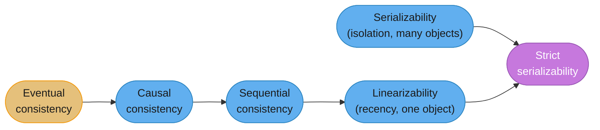
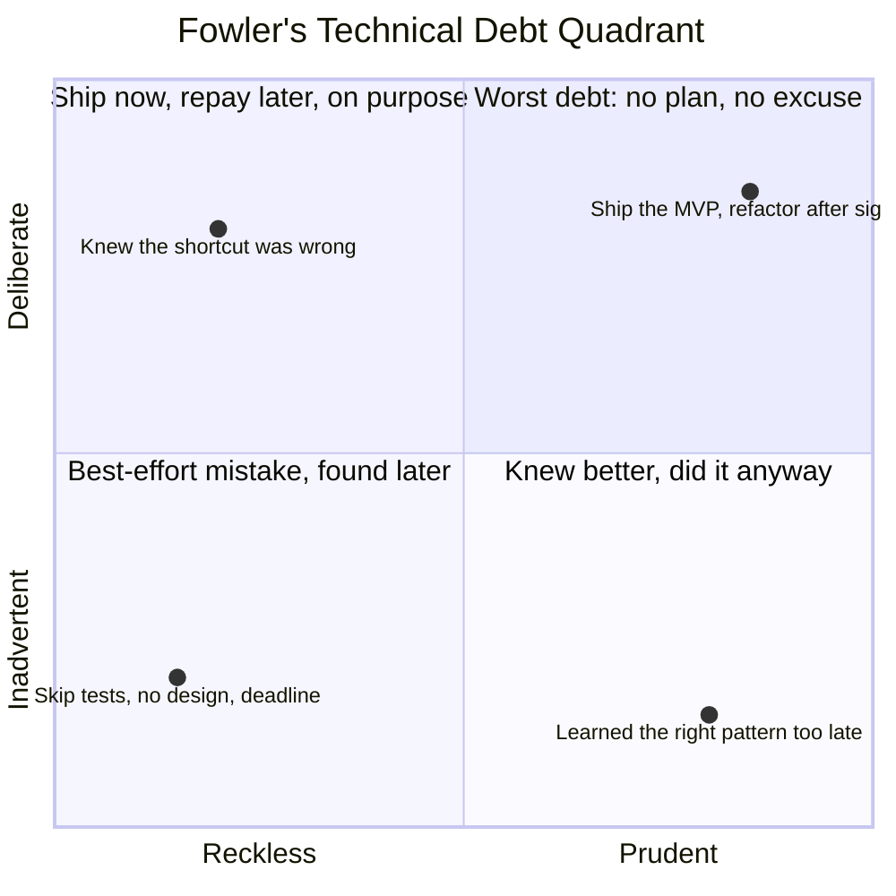
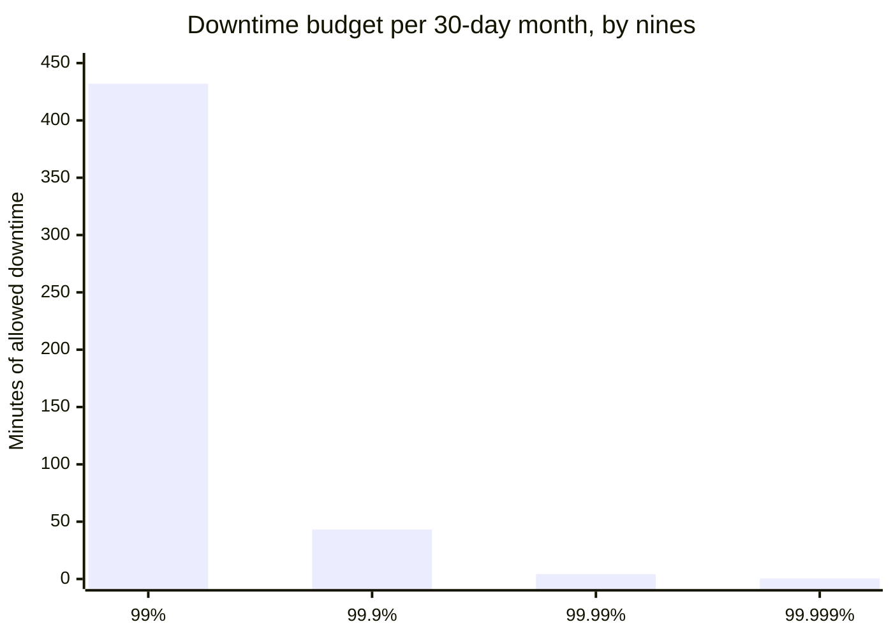

# Precise Technical Vocabulary

## 1. Concept Overview

Engineers argue in circles for a specific, mechanical reason: two people use the same
word to mean two different things, both feel understood, and neither one is. "The system
is consistent" is not a claim — it is at least three different claims wearing one
costume. "We're idempotent, retries are safe" is sometimes true and sometimes a bug
report. "S3 has eleven nines" is a true sentence about the wrong metric, repeated in
enough postmortems and vendor pitches that it has become a load-bearing misconception.

This module is a working lexicon of the terms engineers use every day and get wrong in
ways that cost a real argument, a wrong retry strategy, or forty minutes of a design
review spent discovering that "consistent" meant two different things to the two people
using it. Every term below carries four parts: a definition with a named authority, a
real misuse, a correct use, and — for the terms worth the argument — the worked
arithmetic. A definition with no misuse example is a definition nobody needed. This is
not a spelling-bee exercise: the payoff is ending an argument by naming which of three
things "consistent" means, and catching a wrong retry policy before it ships.

---

## 2. Intuition

> **One-line analogy**: A vague technical term is a shared key that opens two different
> locks — everyone in the room agrees they're using the same key, and everyone is wrong
> about which door it opens.

**Mental model**: Precision is not verbosity. "P99 latency" and "average latency" are the
same number of syllables; only one of them tells you what a real user experienced. The
job of a precise term is to compress a large, checkable claim into three or four words —
which means an imprecise term compresses nothing, it just sounds like it does.

**Why it matters**: every term here has caused a real incident, a real wrong promise, or
a real stalled argument at scale — S3's durability number gets quoted as an availability
number often enough that AWS's FAQ has to explain the difference; "idempotent" gets
invoked to justify a retry policy a 409 response then breaks.

**Key insight**: the fix is not a longer sentence, it's naming *which* of the two or three
things you mean in four extra words. "Consistent" becomes "linearizable" or "eventually
consistent" — same idea, now falsifiable.

---

## 3. Core Principles

- **A term is precise only if you can state what would make it false.** "The service is
  reliable" is unfalsifiable. "The service meets its 99.9% SLO measured over the trailing
  30 days" is falsifiable — you can check it right now.
- **Precision costs four words, not four sentences.** Naming which meaning of "consistent"
  you intend is a shorter conversation, not a longer one — it deletes the fifteen minutes
  both parties would otherwise spend discovering they disagreed.
- **Cite the authority, not the vibe.** Every definition below names where it comes from —
  an RFC section, the SRE book, a standards body, the person who coined the term — because
  "everyone knows what X means" is exactly the belief that produces the argument.
- **The misuse is the point.** A definition without a wrong sentence next to it teaches
  the word; one with it teaches the trap interviewers ask about, because the wrong
  sentence is nearly the default.
- **Precision is a leadership skill, not pedantry — see the closing section.** Knowing
  when to spend the four words, and when imprecision costs nothing, is the discipline;
  scoring a point with it in a meeting is the failure mode that gives precision a bad name.

---

## 4. Types / Levels / Modes

Eight registers, each covering a family of terms engineers reach for constantly and get
subtly wrong:

| Register | What it covers | Terms |
|----------|----------------|-------|
| Reliability | measuring and promising uptime | SLI, SLO, SLA, error budget, availability vs durability, MTTR family, toil |
| Correctness | what "works" and "behaves" actually claim | idempotent, safe, pure, deterministic, atomic, consistent, linearizable/serializable |
| Performance | what a number on a dashboard actually says | latency vs response time vs service time, percentiles, throughput vs bandwidth vs goodput |
| Robustness | six different claims about how a system fails | scalable, reliable, available, fault-tolerant, resilient, elastic |
| Concurrency | what happens when things happen at once | race condition vs data race, concurrency vs parallelism, deadlock/livelock/starvation, blocking modes |
| Failure | the vocabulary of what went wrong | bug/defect/fault/error/failure, regression, flake, heisenbug, incident/outage/degradation |
| Project | the vocabulary of planning and risk | risk vs issue vs assumption vs dependency, estimate vs commitment vs target, blocker vs impediment |
| Technical debt | the single most abused term in the field | Cunningham's original definition, Fowler's quadrant |

Each register is a `### ` heading in Section 6 below, and every substantial term inside
it is a `####` four-part record: **Definition**, **Misuse**, **Correct use**, and where
the term has real arithmetic behind it, the numbers worked out.

---

## 5. Models & Frameworks Diagrammed

*Linearizability and serializability are not two rungs of one ladder — they answer two
different questions that compose into strict serializability when you want both at once.
Causal and eventual consistency are weaker than either. Section 6 explains the
distinction this diagram exists to prevent you from flattening.*

*The quadrant is Fowler's, not Cunningham's — Cunningham coined the debt metaphor in 1992
and never used "reckless" or "prudent." See Section 6 for why conflating the two is a
common misuse.*

*Each additional nine divides the downtime budget by ten. 99% to 99.9% buys back 6.5
hours a month; 99.9% to 99.99% buys back only 39 more minutes — why the error-budget
conversation has to be about the number, not the nine-count.*

---

## 6. How It Works — Detailed Mechanics

### Reliability register

#### `SLI` / `SLO` / `SLA`

**Definition.** Per the Google SRE book (*Site Reliability Engineering*, Beyer, Jones,
Petoff & Murphy, 2016, ch. 4): an **SLI** is "a carefully defined quantitative measure of
some aspect of the level of service that is provided" — e.g., request latency. An **SLO**
is "a target value or range of values for a service level that is measured by an SLI" —
e.g., "99.9% of requests under 300ms." An **SLA** is "an explicit or implicit contract
with your users that includes consequences of meeting (or missing) the SLOs they
contain." The book's practical test, verbatim: *"ask 'what happens if the SLOs aren't
met?': if there is no explicit consequence, then you are almost certainly looking at an
SLO."*

**Misuse.** "Our SLA is 99.9% uptime" said about an internal dashboard with no contract
and no consequence for missing it — that is an SLO, and calling it an SLA implies a
commitment nobody signed.

**Correct use.** "The SLI is p99 request latency; the SLO is 300ms at p99 measured over a
trailing 28 days; the SLA promises customers a 10% credit if we miss 99.5% monthly
uptime — three different things, and only the third one has a check attached."

#### `Error budget`

**Definition.** Per the same SRE book chapter: the error budget is `1 - SLO`, the
tolerated unreliability expressed as a resource to spend rather than a number to feel bad
about. Over a 30-day month: a 99% SLO budgets 432 minutes of downtime; 99.9% budgets 43.2
minutes; 99.99% budgets 4.32 minutes; 99.999% budgets about 26 seconds. The arithmetic is
`(1 - SLO) × 30 days × 24 hours × 60 minutes`.

**Misuse.** "We're at 99.95% this month, we're fine" said without reference to the SLO —
99.95% is *worse* than a 99.99% SLO and comfortably inside a 99.9% one.

**Correct use.** "We've burned 30 of our 43.2-minute budget on one incident — 70% of the
month's error budget in one event — so we freeze feature launches per policy."

#### Availability vs. durability

**Definition.** These measure different failure modes and are not substitutable.
**Durability** is the probability a stored object is not lost, ever, independent of
whether it can be fetched right now. **Availability** is the probability a request for
the object succeeds right now. AWS's S3 FAQ states S3 Standard is "designed to provide
99.999999999% durability" (eleven nines) of objects over a year — for 10 million objects,
an expected loss of about one object every 10,000 years — and separately "designed for
99.99% availability" (four nines) as a target, with the contractual **SLA** committing to
99.9% Monthly Uptime Percentage before service credits kick in. Six to seven nines
between the headline number and the one actually promised for "can I read it right now."

**Misuse.** "S3 has eleven nines, so it's basically never down" — durability and
availability are independent axes; an object can be perfectly durable and briefly
unreachable during a regional event, and the eleven-nines figure says nothing about that.
This is, by a wide margin, the most common cloud-vocabulary error in the industry —
vendor marketing puts the durability number in 40-point font and the availability SLA in
the terms page.

**Correct use.** "S3 gives us eleven-nines durability, so we don't design for object
loss — we design for the 99.9% availability SLA instead, which means a multi-region
read path if a sub-hour outage would actually hurt us."

#### `MTTR` / `MTBF` / `MTTD` / `MTTA`

**Definition.** Four different clocks. `MTTR` is the most abused because the R is
genuinely ambiguous across organizations — Repair, Recovery, Resolve, and Respond are all
in real use and measure different intervals. **MTBF** (Mean Time Between Failures)
applies to repairable systems, the interval between one failure's resolution and the
next's start. **MTTD** (Detect) measures onset to alert. **MTTA** (Acknowledge) measures
alert to a human confirming they're on it. State which R you mean — "repair" (fix
deployed) and "resolve" (impact gone, which can lag the fix by a cache TTL) differ.

**Misuse.** Two teams compare "our MTTR is 12 minutes" against "45 minutes" and conclude
one is four times better, when one measured time-to-mitigation and the other measured
time-to-postmortem-sign-off.

**Correct use.** "Our MTTD is 90 seconds thanks to the new alert; MTTA is 3 minutes
because on-call is paged directly; MTTR-to-mitigate is 14 minutes; MTTR-to-resolve
(customer impact fully cleared, including cache expiry) is 40. Report all four, not one
number labeled MTTR."

#### `Toil`

**Definition.** Per the SRE book's "Eliminating Toil" chapter, toil is operational work
that is manual, repetitive, automatable, tactical, devoid of enduring value, and scales
linearly with service growth — the book's own worked target is keeping toil under 50% of
an SRE's time so the other half goes to engineering that reduces future toil.

**Misuse.** "This is toil" said about a one-off migration that will never recur — toil
means the *repeated, automatable* kind; a one-time painful task is just a painful task.

**Correct use.** "Manually restarting the ingest pod every OOM is toil — nine times this
month, same three commands, scales with traffic. Writing the postmortem is not toil; it's
the strategic work that gets us out of doing this by hand."

---

### Correctness register

#### `Idempotent` vs `safe` vs `pure` vs `deterministic`

**Definition.** RFC 9110 §9.2.1 defines a **safe** method as one "having no intended
effect on the origin server's state" — GET, HEAD, OPTIONS, TRACE. §9.2.2 defines an
**idempotent** method as one where "the intended effect of a single successful request is
the same as the effect of multiple identical requests" — PUT and DELETE are idempotent
but not safe; every safe method is idempotent, not vice versa. Both are about server-side
*effect*, not the response. **Pure** (a programming-language term, unrelated to HTTP) is
a function whose output depends only on its inputs with no observable side effects —
`f(x)` always equals `f(x)`. **Deterministic** is weaker: same output for the same input,
even with side effects (a deterministic function can still write a log line).

**Misuse.** "Retries are safe because the endpoint is idempotent" said about an endpoint
returning `201 Created` on the first call and `409 Conflict` on the retry — the
server-side *effect* is idempotent, but the *response* is not, and a naive retry-on-non-2xx
loop treats the 409 as a failure.

**Correct use.** "`PUT /orders/{id}` is idempotent, so the client retries on timeout
without creating a duplicate. `POST /orders` is neither safe nor idempotent, which is why
it takes an `Idempotency-Key` header — bolting idempotency onto a method without it."

#### `Atomic` — three unrelated meanings

**Definition.** The word names three concepts sharing only etymology (Greek *atomos*,
indivisible): (1) **ACID atomicity** — a transaction's writes either all commit or none
do, no partial state ever visible; (2) a **hardware atomic instruction** —
`compare-and-swap`, `fetch-and-add` — a CPU operation executing as one indivisible step
relative to other cores, the primitive lock-free algorithms are built on; (3) an
**atomic deploy** — a deployment that fully replaces the old version or doesn't happen at
all, no window where two versions serve traffic inconsistently (symlink-swap, blue-green).
None implies the others.

**Misuse.** "We made the counter increment atomic" used interchangeably for "wrapped it in
a database transaction" and "used `AtomicInteger`" in the same design doc, without
noticing these are different mechanisms at different layers.

**Correct use.** "The balance update is ACID-atomic; the request counter uses a hardware
atomic increment, no transactional rollback needed; the deploy is atomic via a symlink
swap so no request hits a half-updated binary — three unrelated mechanisms."

#### `Consistent` — three unrelated meanings

**Definition.** This is the single costliest overload in distributed-systems vocabulary
and deserves the most room in this module, because it is where senior engineers most
often talk past each other while both feeling correct. Martin Kleppmann's blunt summary
(*"Please stop calling databases CP or AP"*, 2015) states it directly: *"Consistency in
CAP actually means linearizability... [and] has got nothing to do with the C in ACID."*
Three distinct meanings travel under one word:

1. **The C in ACID** — the database's own integrity constraints hold after a transaction:
   foreign keys resolve, unique constraints hold, application invariants aren't violated.
   This is a property of *data*, not of *time* or *ordering*.
2. **The C in CAP** — per Eric Brewer's own retrospective (*"CAP Twelve Years Later"*,
   *InfoQ*, 2012), CAP's C is "equivalent to having a single up-to-date copy of the
   data," i.e. **linearizability**: every read sees the most recent write, and all
   observers agree on a single real-time order. Brewer also warns the "2 of 3" framing
   itself "was always misleading" because it oversimplifies the actual tensions.
3. **Eventual consistency** — replicas will converge to the same value *given enough
   time with no new writes*, with no guarantee about what a read sees in the meantime.
   This is a much weaker promise than either of the above and is what most
   "eventually consistent" databases (DynamoDB's default reads, most CDNs) actually
   offer.

A PostgreSQL or Oracle instance is fully ACID-consistent (meaning 1) and is *deliberately
not* linearizable across replicas (meaning 2) — enforcing linearizability across a
replica set would cost concurrency the database isn't willing to pay for. That single
fact is what makes "is Postgres consistent?" an unanswerable question until you say which
"consistent" you mean.

**Misuse.** A design review stalls for fifteen minutes because one engineer says "the
cache makes us inconsistent" (meaning 3, eventual) and another hears "the cache breaks our
data integrity" (meaning 1, ACID) and proposes schema changes for a freshness problem.

**Correct use.** "Say which C you mean: writes are ACID-consistent, primary reads are
linearizable, replica reads are eventually consistent with ~2s staleness. Three claims,
three tests — don't collapse them into 'is it consistent.'"

#### `Linearizability` vs `serializability` vs `strict serializability` vs `causal consistency`

**Definition.** These are not four rungs of one ladder — **linearizability** and
**serializability** answer two different questions and compose rather than nest.
Linearizability is a recency guarantee on a *single object*: every operation appears to
take effect atomically at a point between its start and end that respects real time.
Serializability is an isolation guarantee over *transactions*, possibly many objects: the
concurrent execution is equivalent to *some* serial ordering, but that ordering need not
respect real time — a serializable database can reorder transactions as long as the
result is equivalent to a serial run. **Strict serializability** (external consistency)
is both properties together. **Causal consistency** is strictly weaker than all three —
it only orders causally related operations. Peter Bailis notes it is "the strongest
achievable when a data store requires availability under network partitions" — the
practical ceiling for an AP system, where the other three are unreachable during a
partition.

**Misuse.** "We're serializable, so we're linearizable" — a serializable database can
still reorder two non-overlapping transactions in a way that violates real-time order,
which linearizability requires and serializability does not.

**Correct use.** "Spanner gives us strict serializability, backed by TrueTime. Our own
service only needs causal consistency — a comment appears after its post, but we don't
pay for a global real-time order across unrelated posts."

---

### Performance register

#### `Latency` vs `response time` vs `service time`

**Definition.** Gil Tene's widely cited talk *"How NOT to Measure Latency"* (QCon, 2013)
is the standard reference. **Service time** is how long the server spends doing the work
once it starts. **Response time** is service time plus every millisecond queued behind
other requests before the server even starts — what the client measures end to end.
**Latency** is the loose general term for "how long did this take," used for either,
which is the problem: a service time of 2ms and a response time of 400ms under load can
both get reported as "our latency." Tene's related "coordinated omission" point: naive
load-test harnesses that wait for a response before sending the next request
systematically *undercount* the tail, never sampling the request still queued behind it.

**Misuse.** "Our latency is 2ms" from a benchmark measuring only handler execution time,
while real users experience 400ms of queueing — the number is real, just not the one felt.

**Correct use.** "Service time is 2ms; under today's load, queueing adds 380ms, so p50
response time is 382ms. If we want to cut response time, adding capacity to cut queueing
helps far more than optimizing the 2ms of service time."

#### Percentiles — `p50` / `p95` / `p99`, and why "average" is nearly useless

**Definition.** A **percentile** answers "what value does N% of the population fall
below" — p99 latency of 400ms means 99% of requests finished in 400ms or less, and 1% took
longer. An **average** is dominated by the bulk of fast requests and hides exactly the
tail that determines whether real users have a bad time, especially because request
latencies are typically multi-modal (a fast in-cache path and a slow cold path), which
breaks the assumption behind reporting a single central-tendency number at all.

**Misuse.** "Average latency is 40ms, we're fine" reported for a service where p99 is
1200ms — with enough calls per user session, a meaningful fraction of *users*, not just
requests, experience the p99 tail at least once, and the average told nobody that.

**Correct use.** "p50 is 35ms, p99 is 210ms, p99.9 is 900ms. We track all three because
the average would hide the 0.1% of requests that are 25x slower than typical — and at our
volume that's still thousands of bad requests a day."

**Percentile-of-percentiles is meaningless.** You cannot average already-computed
percentiles from different hosts and get a valid percentile of the combined population —
a percentile is a property of the *underlying distribution*. If host A has p99=100ms and
host B has p99=900ms, the merged traffic's p99 is not 500ms; it depends on the full shape
of both and is usually much closer to the worse host than a naive average suggests. Fix:
merge the underlying histograms (HdrHistogram, Prometheus buckets, t-digest) and compute
the percentile once — a fleet dashboard that averaged per-host p99s instead understated
its real tail by roughly 3x once switched to the merged calculation.

#### `Throughput` vs `bandwidth` vs `goodput`

**Definition.** **Bandwidth** is the theoretical maximum capacity of the link, a property
of the physical medium, measured in bits per second. **Throughput** is the actual
achieved rate of data transfer, always less than bandwidth once you account for protocol
overhead, congestion, and retransmission. **Goodput** is narrower still: only the useful
application payload that arrives, excluding headers, retransmitted duplicates, and
protocol framing — goodput is always less than or equal to throughput, which is always
less than or equal to bandwidth.

**Misuse.** "We have a 10 Gbps link, so we should see 10 Gbps of throughput" — bandwidth
is the ceiling, not the observed number; TCP overhead, TLS, and retransmission under loss
routinely eat 10-30% before goodput even enters the picture.

**Correct use.** "Link bandwidth is 10 Gbps; measured throughput is 7.8 Gbps; goodput —
actual file bytes delivered, net of TLS and retransmit overhead — is 7.1 Gbps. That's the
answer when a customer asks why their 10 Gbps circuit 'only' does 7."

**"Fast" is not one goal.** "Low latency" optimizes one unit of work's completion time;
"high throughput" optimizes total volume per unit time and often *trades away* latency to
get it — batching deliberately delays individual requests to process them more
efficiently in aggregate. "Let's batch these writes to make it faster" is wrong for a
latency-sensitive path: batch the ingest pipeline (throughput), not the user-facing read
(latency).

---

### Robustness register

Six different claims, per Michael Nygard's *Release It!* (2007; 2nd ed. 2018) and common
industry usage, routinely used as if they were interchangeable synonyms for "the system
doesn't break":

#### `Scalable`

**Definition.** The system can handle more load by adding resources, without a
fundamental redesign — horizontally (more machines) or vertically (bigger machines).
Scalability says nothing about what happens *when something fails*; a system can be
perfectly scalable and fall over completely the first time a dependency times out.

**Misuse.** "We made it scalable, so it's production-ready" — scalability and resilience
are orthogonal; a horizontally-scaled fleet with no circuit breaker still cascades when
one downstream dependency slows down.

**Correct use.** "We scaled the read path with read replicas — that's the scalability
story. Separately, we added a circuit breaker so a slow dependency doesn't take the whole
fleet down — the resilience story, and a different piece of work."

**`Reliable`** means the system does the correct thing consistently, measured against its
stated SLO — unlike "robust" or "resilient," it's meant to be a number, not a vibe. "The
service is reliable" with no SLO attached is the unfalsifiable version (Section 3);
"the service has met its 99.9% SLO for two quarters" is the checkable one.

#### `Available` vs `highly available`

**Definition.** **Available** means the system currently responds to requests. **Highly
available (HA)** is a design property: built with redundancy so no single component's
failure takes the whole system down. HA is a *design choice with a cost*, not a synonym
for "usually up."

**Misuse.** "We're highly available, we've never gone down" — uptime history is not
evidence of HA design; a single-instance service that has simply never crashed yet is not
highly available, it's lucky.

**Correct use.** "We're HA — three replicas, two zones, automatic failover. Whether we've
actually stayed available is measured uptime against the SLO, a separate number."

#### `Fault-tolerant`

**Definition.** The system continues operating correctly, possibly in a degraded mode,
in the presence of a defined set of component failures — fault tolerance is scoped to
*specific, anticipated* failure modes (a disk fails, a node dies, a network partition
occurs), not to "anything that could possibly go wrong."

**Misuse.** "The system is fault-tolerant" claimed with no statement of which faults it
tolerates — fault tolerance without a fault model is a slogan, not an engineering claim.

**Correct use.** "The system tolerates the loss of any single node or zone, via 3x
replication. It does not tolerate a region-wide outage — out of scope by decision, not
oversight."

#### `Resilient` vs "robust"

**Definition.** **Resilience**, in Nygard's sense, is the capacity to *recover* from
failures nobody anticipated by containing their blast radius: circuit breakers, bulkheads,
timeouts, graceful degradation. "**Robust**" is used more loosely for "handles known bad
inputs without crashing" — input validation, defensive coding. A robust function doesn't
crash on a malformed argument; a resilient *system* doesn't cascade into total failure
when a downstream dependency it never anticipated losing goes dark.

**Misuse.** "We validated all our inputs, so the system is resilient" — input validation
makes functions robust against bad data; it does nothing for resilience to a downstream
service timing out, a blast-radius problem, not a data-validation one.

**Correct use.** "The payment-service client is robust — it rejects malformed responses
instead of crashing on them. The checkout flow is resilient — if the payment service is
down entirely, checkout degrades to 'pay later' instead of failing the whole page, per
Nygard's circuit-breaker pattern."

#### `Elastic`

**Definition.** The system automatically adjusts its provisioned capacity up and down to
match current demand, without manual intervention — elasticity is scalability *plus
automation plus the ability to shrink back down*. A system that scales up under load but
requires a human to scale it back down afterward is scalable, not elastic.

**Misuse.** "We're elastic, we auto-scale up during traffic spikes" — that's half the
definition; if nothing scales it back down when the spike passes, you're paying for peak
capacity permanently, which is exactly the cost elasticity is supposed to avoid.

**Correct use.** "The fleet is elastic: 4 to 40 instances during the morning spike, back
to 4 by evening, automatically, on a queue-depth metric — no on-call action either way."

---

### Concurrency register

#### `Race condition` vs `data race`

**Definition.** These are not synonyms, and the distinction is a classic interview
discriminator because it runs in both directions. A **data race** is a specific,
low-level condition: two or more threads access the same memory location concurrently,
at least one access is a write, and there is no synchronization ordering the accesses —
this is undefined behavior in C++ and breaks the Java Memory Model's visibility
guarantees. A **race condition** is a broader, higher-level bug: the correctness of a
result depends on the relative timing or interleaving of events, and that timing is not
controlled. Every data race is a bug. But a race condition can exist with **no data race
at all** — a check-then-act sequence where every individual read and write is correctly
locked, but the *pair* is not atomic, produces a race condition with zero unsynchronized
memory access. Conversely, a data race can exist with no observable race condition — two
threads racily incrementing a counter with a harmless outcome is still a data race (still
undefined behavior) even on a run where nothing visibly went wrong.

**Misuse.** "There's no data race here, every access is synchronized, so there's no bug"
— said about a `check-if-exists` then `create` sequence where each half is separately
locked; the pair still races, two callers can both pass the check before either creates,
and you get a duplicate despite zero unsynchronized memory access.

**Correct use.** "TSan reports no data races — good. But we still have a race condition:
`hasCapacity()` then `reserve()` isn't atomic as a pair, so two threads can both see
capacity and both reserve, overbooking by one. Fix is a single atomic `tryReserve()`."

#### `Concurrency` vs `parallelism`

**Definition.** Rob Pike's talk *"Concurrency is Not Parallelism"* (2012, Waza
conference), verbatim: *"Concurrency is about dealing with lots of things at once.
Parallelism is about doing lots of things at once."* Concurrency is a property of the
program's *structure* — independent tasks composed so they can execute in any order or be
interleaved. Parallelism is a property of *execution* — tasks literally run at the same
instant on separate cores. A single-core machine can run a concurrent program
(interleaved, never truly simultaneous); concurrency does not require parallelism.

**Misuse.** "We made it concurrent, so it'll use all our cores" — a concurrent design
(goroutines, async tasks) can still run entirely on one core if nothing schedules the
work across multiple OS threads; concurrency enables parallelism, it doesn't guarantee it.

**Correct use.** "The handler is structured concurrently — each request is an independent,
composable task. Whether that runs in parallel depends on `GOMAXPROCS` and core count; on
a single core it's still concurrent, just not parallel."

#### `Deadlock` vs `livelock` vs `starvation`

**Definition.** **Deadlock**: two or more threads each wait on a resource the other
holds, and neither can proceed — Thread A holds lock 1 and waits for lock 2 while Thread B
holds lock 2 and waits for lock 1; both blocked forever. **Livelock**: threads are
actively running, not blocked, but their state changes are all reactions to each other
with no forward progress — two people repeatedly stepping aside for each other in a
hallway. **Starvation**: a thread is perpetually denied a resource because other threads
are repeatedly prioritized ahead of it — not blocked by a cycle, just never scheduled.

**Misuse.** "The threads are deadlocked" said about a system where CPU usage is high and
threads are visibly running, just not progressing — that's livelock, not deadlock;
deadlocked threads show as blocked/waiting in a thread dump, not consuming CPU.

**Correct use.** "Two threads each `BLOCKED` waiting on a lock the other holds — that's a
deadlock, fix the lock ordering. Compaction hasn't run in six hours because write threads
keep winning the scheduler — that's starvation, fix the priority policy."

#### `Blocking` vs `non-blocking` vs `lock-free` vs `wait-free`

**Definition.** Four increasingly strict progress guarantees. **Blocking**: a thread can
be suspended indefinitely waiting for another (a mutex acquire that never returns if the
holder never releases). **Non-blocking**: no thread can be suspended indefinitely by
another's failure to progress, but the system as a whole guarantees only *some* thread
progresses — this subsumes both of the following. **Lock-free**: at every step, *at
least one* thread makes progress, even if any individual thread could be starved forever
by bad luck (CAS loops that keep losing). **Wait-free**: the strongest guarantee — *every*
thread progresses within a bounded number of steps, regardless of the others; no thread
can starve another, even adversarially.

**Misuse.** "It's lock-free, so no thread can be starved" — lock-free only guarantees
system-wide progress, not per-thread progress; a specific unlucky thread can, in
principle, keep losing every CAS race indefinitely while the system overall keeps
advancing on other threads' successful retries.

**Correct use.** "The queue is lock-free — CAS loops, no mutex, throughput never stalls
even if one thread is descheduled. It's not wait-free — an individual push can retry
unboundedly under heavy contention, a tradeoff we accepted for simplicity."

---

### Failure register

#### `Bug` / `defect` / `fault` / `error` / `failure`

**Definition.** The ISTQB glossary treats "defect," "fault," and "bug" as
near-interchangeable — worth saying plainly rather than inventing a distinction nobody
uses. The chain that *is* precisely defined: a human **error** (mistake in reasoning or
typing) introduces a **fault/defect/bug** into an artifact; when that faulty path is
*executed* under triggering conditions, it produces a **failure** — an observable
deviation from expected behavior. A fault can sit in production for years, never
executed, causing zero failures.

**Misuse.** "We have zero bugs in production" said about a codebase that has faults
sitting in rarely-executed branches — the claim conflates "no observed failures yet" with
"no faults exist," and the second is nearly never true of anything nontrivial.

**Correct use.** "The null-check omission was the fault, from a copy-paste error. It
caused zero failures for eight months because that path only executes on the leap-day
cron — exactly why it shipped unnoticed."

#### `Regression`

**Definition.** A failure in behavior that *used to work correctly* and now doesn't,
introduced by a change to something else — the defining feature is "this worked before,"
which is what distinguishes it from a plain bug in new code.

**Misuse.** "That's a regression" applied to a bug in a brand-new feature that never
worked in the first place — there's no prior working state to regress from; it's just a
bug.

**Correct use.** "Login worked last release, fails after the session-cache refactor —
that's a regression; bisect to the breaking commit rather than debugging from scratch."

#### `Flake` / `heisenbug`

**Definition.** A **flaky test** passes and fails on different runs of *identical* code
with no code change between them, usually because of a timing dependency, shared mutable
state between tests, or an unmocked external dependency. A **heisenbug** is a bug that
changes or disappears when you try to observe it — adding a debugger, a log statement, or
even a print statement changes the timing enough to make the failure stop reproducing,
named for the observer-effect pun on Heisenberg's uncertainty principle.

**Misuse.** "It's flaky, just re-run it" as the permanent fix for a test that fails 5% of
the time — a flaky test is a real bug, usually a race condition; re-running it hides the
signal, and a suite full of "just re-run it" tests eventually gets ignored entirely.

**Correct use.** "The test flakes because it asserts on a job's output without waiting for
completion — a race condition in the test, not a heisenbug; a wait-for-completion fixes it
deterministically."

#### `Incident` vs `outage` vs `degradation`

**Definition.** A **degradation** is reduced quality of service within tolerable bounds —
elevated latency, a non-critical feature disabled. An **outage** is a degradation severe
enough that a defined critical path is unavailable to users. An **incident** is the
*organizational response category* — declared for a degradation, an outage, or a
near-miss, because it describes the response process, not the technical state.

**Misuse.** "We had an outage" used for any declared incident, including ones where the
service stayed fully available and degraded gracefully — inflating every incident to
"outage" in a postmortem misrepresents customer impact to anyone reading the summary
without the detail.

**Correct use.** "We declared a SEV2 when checkout latency crossed 2 seconds — a
degradation, not an outage; checkout stayed available, just slow. 5xx to all traffic
would have made it an outage."

---

### Project register

#### `Risk` vs `issue` vs `assumption` vs `dependency`

**Definition.** The PMI/PMBOK distinction, verbatim on risk: *"An uncertain event or
condition, that if it occurs, has a positive or negative effect on a project's
objective."* The load-bearing word is *uncertain* — a risk has not happened yet. An
**issue** is what a risk becomes once it materializes: a current problem, not a
possibility. An **assumption** is something treated as true without proof, for planning
purposes — if it's wrong, the plan is silently wrong. A **dependency** is something
outside your control the plan requires on schedule. Practitioners bundle all four into a
"RAID log" precisely because conflating them hides which need contingency planning,
urgent action, validating, or someone else's commitment.

**Misuse.** "We have a risk that the migration is delayed" said the day after the
migration was, in fact, delayed — at that point it is an issue, and calling it a risk
understates the urgency; a risk goes on a watch list, an issue goes on today's standup.

**Correct use.** "Risk: the vendor might miss the API deadline — tracked, fallback ready.
Issue: they missed it, QA is blocked today. Different words, different urgency."

#### `Estimate` vs `commitment` vs `target`

**Definition.** An **estimate** is a probabilistic forecast of effort or duration, ideally
given as a range with a stated confidence. A **commitment** is a promise you are
accountable for keeping, made *after* looking at the estimate and deciding you can meet
it. A **target** is a desired date set by business needs (a launch event, a contract
deadline) that exists independent of any estimate and may or may not be achievable — a
target is not an estimate that got rounded down.

**Misuse.** "The estimate is Friday" used interchangeably with "we're committing to
Friday" — an estimate is a forecast, not a promise, and teams punished for missing
estimates learn to stop giving honest ones.

**Correct use.** "Estimate: 3-5 days at 70% confidence. I'm committing to Friday, inside
that range. Marketing's target was Wednesday — telling you now that target and
commitment don't match, not on Wednesday."

#### `Blocker` vs `impediment`

**Definition.** A **blocker** is a hard dependency that stops work entirely until
resolved — you cannot proceed by any path. An **impediment** is friction that slows work
down without fully stopping it — a broken CI pipeline that still runs, just ten times
slower.

**Misuse.** "This is blocking me" said about a slow but workable CI pipeline — that's an
impediment; calling everything a blocker dilutes the word for genuinely stopped work.

**Correct use.** "The missing API key is a blocker — I can't test integration code until
it exists. Flaky staging is an impediment — costs 20 minutes a day, but I ship around it."

---

### Technical debt — its own subsection, because it is the most abused term in the field

#### `Technical debt`

**Definition.** Ward Cunningham coined the metaphor in a 1992 OOPSLA experience report,
verbatim: *"Shipping first time code is like going into debt. A little debt speeds
development so long as it is paid back promptly with a rewrite... The danger occurs when
the debt is not repaid. Every minute spent on not-quite-right code counts as interest on
that debt."* Cunningham later corrected the popular drift from that meaning, in a video
interview, verbatim: *"A lot of bloggers have explained the debt metaphor and confused
it, I think, with the idea that you could write code poorly with the intention of doing a
good job later, and thinking that that was the primary source of debt. I'm never in
favor of writing code poorly, but I am in favor of writing code to reflect your current
understanding of a problem even if that understanding is partial."* His debt is
specifically the **gap between your current understanding of a problem and what the code
reflects** — a deliberate, understood shortcut taken to ship and learn, meant to be
repaid as understanding improves — not sloppiness, and not "messy code" as a synonym.

**Fowler's quadrant** (Section 5) is a *separate, later* framing adding a second axis to
Cunningham's conversation, and attributing it to Cunningham is itself a common error.
Fowler's axes: **Deliberate vs. Inadvertent** (did the team know) and **Reckless vs.
Prudent** (was the decision thoughtful). Deliberate-prudent is what Cunningham described;
deliberate-reckless is a knowing shortcut with no repayment plan; inadvertent-prudent is
normal engineering growth; inadvertent-reckless — not knowing enough to know you didn't
know — is the quadrant most likely to compound silently.

**Misuse.** "This is technical debt" used to mean "this code is messy" or "this code was
written badly" — that's the exact popular drift Cunningham corrected on record; messy
code from not knowing better yet is inadvertent debt at best, and calling all bad code
"debt" erases the distinction between a deliberate, tracked tradeoff and an accident.

**Correct use.** "We're taking on deliberate, prudent debt: shipping the synchronous
version now, tracked as a ticket, to learn whether customers want this feature before we
build the async version properly. That's Cunningham's debt — a bet we understand and
plan to repay. The auth module nobody planned and nobody tracks is inadvertent-reckless
debt, and it's the dangerous kind because no one decided to take it on."

---

### Why precision here is a leadership skill, not pedantry

Arguments that go in circles in design reviews are, disproportionately, the ones where
two people mean different things by "consistent," "SLA," "idempotent," or "scalable" and
neither notices. The tell: the conversation keeps restating the same two positions,
nobody lands a point, both sound increasingly certain, and nobody brings new information
— that is a vocabulary collision, not a genuine disagreement. A genuine disagreement
narrows as evidence comes in; a vocabulary collision doesn't, because there's nothing to
resolve until someone names which meaning they intend.

The move that ends it without being insufferable is naming the ambiguity as a question,
not a correction: "when you say consistent, do you mean the CAP sense or the
eventual-consistency sense?" lands differently from "well, actually, consistency means
three things." The first invites the other person to specify; the second scores a point
and makes the room defensive. The skill is noticing the collision within the first two or
three restated exchanges, before the meeting burns fifteen more minutes on a disagreement
that was never about the technical question. See
[Hedging, Commitment & the Language of Disagreement](../hedging_commitment_and_disagreement/hedging_commitment_and_disagreement.md)
for the companion skill: once vocabulary is aligned, the same discipline applies to how
confidently you state the claim itself.

---

## 7. Real-World Examples

- **AWS's own S3 FAQ explicitly disambiguates durability from availability**, because the
  eleven-nines figure is quoted often enough as an availability claim that the vendor
  documentation preempts the confusion directly.
- **Martin Kleppmann's 2015 post exists because "CP or AP" database marketing** had, by
  his account, drifted from Brewer's original CAP framing into a slide-ready label,
  collapsing the ACID/CAP distinction this module warns against.
- **PostgreSQL and Oracle are textbook ACID-consistent, non-linearizable systems** — the
  databases most engineers learned "consistency" from quietly use two meanings of the
  word in the same product, which is why the confusion is so persistent.
- **DynamoDB's API exposes the ambiguity as a parameter**: `ConsistentRead: true` requests
  a linearizable-per-item read at higher cost; the default is eventually consistent — a
  checkbox with a real bill attached.

---

## 8. Tradeoffs

| Choice | Benefit | Cost |
|--------|---------|------|
| Naming the precise term every time | no ambiguity, arguments end faster | four extra words in every sentence, can read as pedantic if overused |
| Using the loose term in casual conversation | faster, natural | the ambiguity compounds silently until it costs a real decision |
| A numeric SLO instead of "reliable" | falsifiable, trackable, drives the error-budget conversation | requires instrumentation and an agreed measurement window before you can even state it |
| Strict serializability everywhere | never have to reason about weaker consistency | real latency and availability cost; most systems don't need it for most data |
| Naming which "atomic"/"consistent" you mean | prevents the exact collision this module documents | only pays off if the other person also knows the distinction — otherwise it's noise |

---

## 9. When to Use / When NOT to Use

**Spend the precision** when the term is going into a contract, an SLA, a postmortem, an
incident-severity decision, or a design doc other teams will build against — an ambiguous
term becomes an expensive one later, and four extra words is trivial against that cost.

**Don't spend it** in a fast Slack thread where "yeah that's basically consistent enough"
correctly conveys "don't worry about this" — insisting on the CAP-vs-ACID distinction
there is pedantry, not rigor. If the conversation is moving and nobody's confused, there's
no collision to resolve.

---

## 10. Common Pitfalls

**Pitfall: quoting a vendor's headline number as if it were the number that matters.** A
team built a disaster-recovery plan around S3's eleven-nines durability figure and
treated a regional S3 outage as "shouldn't be possible" — durability was never at risk in
that outage; availability was, and the plan had never accounted for the SLA's actual
99.9% commitment. The postmortem's first action item was rewriting every internal doc
that cited "eleven nines" without specifying which metric.

**Pitfall: an SLA promise written by someone who meant SLO.** A customer-facing contract
promised "99.99% uptime" with no stated consequence for missing it, because the engineer
copied the number off the internal SLO dashboard without knowing a customer-facing SLA
needs an explicit remedy clause — legal caught it before signature, at a week's delay.

**Weak version**

> The retry logic should be fine since the endpoint is idempotent.

**Strong version**

> The endpoint is idempotent in effect — retrying `PUT /orders/{id}` never creates a
> second order — but the response on retry can be a 409 instead of a 200. Our retry loop
> needs to treat 409-on-retry as success, not failure, or it'll retry forever against an
> endpoint that already did what we asked.

**What changed:** the vague "should be fine" became a specific claim about *which* part
of the idempotency guarantee holds (effect, not response code) and a specific fix for the
gap.

**Weak version**

> We're consistent, don't worry about it.

**Strong version**

> Primary-region reads are linearizable. Cross-region replica reads lag by up to 400ms
> and are only eventually consistent. If this feature reads from a replica, a user can
> see a stale value for up to 400ms after their own write — is that acceptable for this
> use case, or does it need to read from primary?

**What changed:** "consistent" became a specific guarantee with a number attached, and
the vague reassurance became an actual question the team can answer.

**Pitfall: race-condition bugs that pass every data-race detector.** A team's
thread-sanitizer suite was green for months while a check-then-act inventory bug
overbooked warehouse capacity roughly weekly — every access was correctly synchronized,
so no tool flagged it, until someone stopped trusting "TSan is clean" and read the call
sequence.

---

## 11. Frameworks, Books & Further Reading

| Source | Covers |
|--------|--------|
| *Site Reliability Engineering* (Beyer, Jones, Petoff, Murphy; Google/O'Reilly, 2016), chapters 4 ("Service Level Objectives") and "Eliminating Toil" | SLI/SLO/SLA, error budgets, toil |
| RFC 9110, *HTTP Semantics* (IETF, 2022), §9.2.1-9.2.2 | safe and idempotent methods, precisely |
| Martin Kleppmann, *"Please Stop Calling Databases CP or AP"* (2015) | the ACID-C vs CAP-C distinction |
| Eric Brewer, *"CAP Twelve Years Later: How the 'Rules' Have Changed"*, InfoQ (2012) | CAP's own author's retrospective and caveats |
| Peter Bailis, *"Linearizability versus Serializability"* (bailis.org) | why the two are orthogonal, not nested |
| Gil Tene, *"How NOT to Measure Latency"* (QCon, 2013) | latency vs response time vs service time, coordinated omission |
| Michael Nygard, *Release It!* (Pragmatic Bookshelf, 2007; 2nd ed. 2018) | resilience patterns, the robustness-register distinctions |
| Rob Pike, *"Concurrency is Not Parallelism"* (Waza, 2012) | the source quote for that distinction |
| ISTQB Glossary of Testing Terms | bug/defect/fault/error/failure |
| PMI, *A Guide to the Project Management Body of Knowledge (PMBOK Guide)* | risk vs issue, the RAID log |
| Ward Cunningham, 1992 OOPSLA experience report + later video interview on wiki.c2.com | the original technical-debt metaphor and his own correction |
| Martin Fowler, *"TechnicalDebtQuadrant"* (martinfowler.com, 2009) | the deliberate/inadvertent x reckless/prudent quadrant |
| AWS, Amazon S3 FAQ and S3 Service Level Agreement pages | the durability vs availability numbers, verbatim |

---

## 12. Interview Questions with Answers

**Q: Your team says "we're basically never down, S3 has eleven nines." What's wrong with that sentence?**
**Short:** It quotes S3's 11-nine durability figure as if it were the 99.9% SLA availability number.

Durability is the probability an object isn't lost, ever; availability is the probability
a request for it succeeds right now. S3 Standard's durability is designed for
99.999999999% (eleven nines); its SLA credits customers below 99.9% monthly uptime — six
to seven nines lower. Conflating the two leads teams to skip availability planning
because the durability number felt reassuring. Always ask which metric a "nines" claim
describes.

**Q: An endpoint returns 201 on the first call and 409 on a retry. Is it idempotent, and is retrying it safe?**
**Short:** The effect is idempotent — one order either way — but the response isn't, so a naive 2xx-only retry loop breaks.

RFC 9110 §9.2.2 defines idempotency as the *intended effect on server state* being the
same across repeats, not the response code. A single order gets created regardless of how
many times you PUT it — the effect is idempotent. But a retry loop treating anything but
2xx as failure will see the 409 and alert falsely or retry forever. The fix: treat
409-on-retry as success, or use an `Idempotency-Key` and check the stored result.

**Q: Two engineers argue for fifteen minutes about whether the system is "consistent." What's actually happening?**
**Short:** They almost certainly mean two of the three unrelated meanings of "consistent."

"Consistent" collapses three distinct claims: ACID consistency (constraints hold), CAP
consistency (linearizability — every read sees the latest write, per Brewer), and
eventual consistency (replicas converge given time, no promise in between). A Postgres
primary is ACID-consistent and, across replicas, deliberately not linearizable — which is
why the word alone answers nothing. Naming which of the three you mean usually ends the
argument in one exchange.

**Q: What's the difference between a race condition and a data race? Can you have one without the other?**
**Short:** Yes, both directions — every data race is a bug, but a race condition can exist with zero data races.

A data race is unsynchronized concurrent access to the same memory with at least one
write — undefined behavior in C++, a JMM visibility violation in Java. A race condition
is a broader correctness bug: the result depends on uncontrolled timing. A check-then-act
sequence where both halves are individually locked has zero data races but is still a
race condition, because the *pair* isn't atomic. The reverse exists too: a
racily-incremented counter with a harmless outcome is still a data race even when no race
condition is ever observed.

**Q: What does an SLO of 99.9% actually budget you, and how is that different from an SLA?**
**Short:** 43.2 minutes of downtime per 30-day month; the SLA is the contract with a stated consequence for missing it.

The arithmetic is `(1 - 0.999) × 30 days × 24h × 60min = 43.2 minutes`. That's the error
budget: a resource to spend on risk (deploys, experiments), not a target to feel bad about
approaching. Per the Google SRE book, the practical test for SLO vs SLA is "what happens
if it's missed" — an SLO with no stated consequence is an internal target; an SLA has an
explicit remedy (a service credit, a contract breach) attached to the same number.

**Q: Rob Pike says concurrency is not parallelism. What's the actual distinction, and why does it matter?**
**Short:** Concurrency structures independent tasks; parallelism runs tasks simultaneously — one enables the other but doesn't guarantee it.

Verbatim: "Concurrency is about dealing with lots of things at once. Parallelism is about
doing lots of things at once." Concurrency is a property of program structure —
independent, composable tasks. Parallelism is a property of execution — tasks running at
the same instant on separate cores. A concurrently-structured program can run entirely on
one core, interleaved but never simultaneous. "Make it concurrent" and "make it use all
our cores" are different problems with different fixes.

**Q: Why is averaging p99 latency across ten hosts the wrong way to compute a fleet-wide p99?**
**Short:** A percentile is a property of the full distribution; you can't average pre-computed percentiles and get a valid one.

If host A's p99 is 100ms and host B's is 900ms, the fleet's true p99 depends on the full
shape of both distributions, not a midpoint — usually much closer to the worse host than
a naive average implies. The correct approach merges the underlying histograms
(HdrHistogram, t-digest, Prometheus buckets) and computes the percentile once, which is
why modern dashboards store histograms rather than pre-aggregated percentiles.

**Q: What did Ward Cunningham actually mean by "technical debt," and how is that different from the popular usage?**
**Short:** The gap between current understanding and what the code reflects, taken on purpose — not sloppiness, per Cunningham's own correction.

His 1992 OOPSLA formulation: shipping code fast is like debt, fine as long as it's repaid
promptly; the danger is unrepaid debt costing interest. He later corrected the drift on
record: never in favor of writing code poorly, the debt he meant was writing code to
reflect a *partial, evolving* understanding. Fowler's later
deliberate/inadvertent x reckless/prudent quadrant adds nuance to the same conversation;
attributing the quadrant to Cunningham is a common, avoidable error.

**Q: What's the difference between linearizability and serializability? Are they the same concept at different scopes?**
**Short:** No — they answer different questions (recency of one object vs. isolation across transactions) and compose, they don't nest.

Linearizability guarantees every operation on a *single object* appears to happen
atomically at a real-time point between its start and end. Serializability guarantees a
concurrent execution of *transactions*, possibly touching many objects, is equivalent to
some serial order — but that order need not respect real time. Strict serializability
requires both simultaneously. Causal consistency is weaker than either and, per Peter
Bailis, is roughly the strongest achievable while remaining available under a partition.

**Q: A postmortem says "we had an outage." What questions should that sentence raise?**
**Short:** Whether the service was actually unavailable, versus degraded — "incident," "outage," and "degradation" are not synonyms.

An incident is the organizational response category, declared for anything from a
near-miss to a full outage. A degradation is reduced quality within tolerable bounds —
elevated latency, a disabled non-critical feature. An outage means a defined critical
path was unavailable to users. Calling every incident an "outage" overstates customer
impact to anyone reading the summary, which matters when it drives an SLA credit or an
executive escalation.

**Q: What's wrong with saying "the deploy is atomic" and "the transaction is atomic" as if they mean the same guarantee?**
**Short:** They're two of three unrelated meanings of "atomic" — ACID atomicity, a hardware atomic instruction, and an atomic deploy share only etymology.

ACID atomicity means a transaction's writes all commit or none do, no partial state ever
visible. A hardware atomic instruction (compare-and-swap, fetch-and-add) is a CPU
primitive executing as one indivisible step relative to other cores — the basis for
lock-free algorithms. An "atomic deploy" is a deployment with no window where two
versions serve traffic at once. None implies the others.

**Q: What does MTTR actually measure, and why is it a risky number to compare across teams?**
**Short:** The R is ambiguous — Repair, Recovery, Resolve, and Respond are all in real use and measure different clocks.

Two teams reporting "12 minutes" and "45 minutes" MTTR aren't necessarily comparably fast
or slow — one may measure time-to-mitigation, the other time-to-postmortem-sign-off.
State which R you mean: repair (fix deployed) and resolve (impact fully cleared, which
can lag by a cache TTL) are different intervals both casually called "MTTR."

**Q: What's the practical difference between "fault-tolerant," "resilient," and "highly available," and why can a system be one without the others?**
**Short:** Fault tolerance is scoped to specific anticipated failures; resilience contains unanticipated ones; HA is a no-single-point-of-failure design choice.

A system can be highly available (redundant, no SPOF) yet not resilient, if a slow
downstream dependency with no circuit breaker still cascades into total failure — HA
protects against a component *dying*, not *slowing down*. Fault tolerance requires
naming which faults are covered; "fault-tolerant" with no fault model is a slogan.
Resilience, per Nygard, is about containing blast radius from unanticipated failures —
a different investment than redundancy or input validation.

**Q: What's the difference between a risk and an issue in project vocabulary, and why does it matter which word you use in a status update?**
**Short:** A risk hasn't happened yet; an issue already has — per PMBOK, calling a materialized problem a "risk" understates urgency.

PMBOK defines risk as an uncertain event that, if it occurs, affects the objective —
future tense, contingency-planning territory. An issue is what a risk becomes once it
materializes: a present problem needing action today. Reporting "we have a risk the
vendor might miss the deadline" the day after they missed it hides that the situation has
already gone from planning to urgent.

**Q: A load test reports 2ms average latency, but users complain the site feels slow. What's the likely explanation?**
**Short:** The average hides the tail — likely a queueing problem invisible in service time, or a coordinated-omission measurement flaw.

Two failure modes both fit. First, latency distributions are typically multi-modal (fast
cached path, slow cold path); an average is dominated by the fast mode and hides a real
tail that p99/p99.9 would expose. Second, per Gil Tene's "coordinated omission" problem,
naive load-test harnesses that wait for a response before issuing the next request
systematically undercount exactly the requests stuck behind a slow one. Checking p99
under sustained load with a coordinated-omission-aware tool is the fix for both.

---

## 13. Best Practices

- **State which meaning before you use an overloaded word.** "Consistent," "atomic," and
  "reliable" each carry two or three unrelated meanings — spend the four words, especially
  in a design doc, SLA, or postmortem read without the context of the room it was written in.
- **Attach a number to any reliability claim.** "Reliable" and "highly available" are
  unfalsifiable on their own; the SLO or fault model is what makes them checkable.
- **Cite the authority when defining a term for someone else.** "RFC 9110 says" lands
  differently than "I think it means" — and forces you to check before asserting.
- **Treat "idempotent" as a claim about effect, not response code**, and build retry logic
  accordingly — a status-code-only retry loop is the most common place this bites.
- **When two people restate positions with no new information, suspect a vocabulary
  collision before a genuine disagreement** — ask which meaning each person intends.
- **Don't merge a vendor's headline metric with the one contractually promised.**
  Durability and availability, SLO and SLA, throughput and goodput.
- **Say the RAID category out loud in a status update**: "risk" and "issue" carry
  different urgency, and the word itself is information the listener uses to prioritize.

---

## 14. Case Study

**Scenario.** A payments team ships a new `/refunds` endpoint. The API contract says
"idempotent," and the mobile client team builds a retry-on-timeout loop that retries on
any non-2xx response, including 4xx. Three weeks after launch, a customer support
escalation reports duplicate refund notifications (not duplicate refunds — the ledger is
correct) landing in some users' inboxes.

**Investigation.** The refund ledger shows no double-refunds — the operation really is
idempotent in the RFC 9110 sense: the *effect* on the balance is the same whether the
request lands once or five times. But the endpoint returns `201` on the first call and
`409 Conflict` with a leftover *notification-triggering* side effect on every retry. The
client's blanket "retry on non-2xx" logic treats 409 as transient and retries, re-firing
the email side effect that isn't itself idempotent even though the refund is.

**The vocabulary failure.** The contract's single word, "idempotent," was read by the
mobile team as "any number of retries is fully safe end to end" — stronger than what
idempotency promises: a guarantee about the *primary resource's* effect, not every side
effect the handler triggers. Nobody was wrong about the word in the abstract; the
contract just didn't say which effects the guarantee covered, and both teams filled the
gap with a different assumption.

**Fix.** The backend removes the email trigger from the 409 path — a notification fires
once, tied to the 201, never to a retry. The contract is rewritten precisely: "Retrying
this request is safe with respect to the refund ledger. It is not currently guaranteed
safe with respect to any other side effects" — updated, once the bug is fixed, to add
"and, as of v2, also safe with respect to notifications."

**Weak version of the fixed contract line**

> This endpoint is idempotent.

**Strong version of the fixed contract line**

> Retrying this request with the same `Idempotency-Key` never creates a second refund and
> never sends a second confirmation email, as of API version 2. Prior to v2, retries could
> trigger duplicate emails despite the ledger being correct — see CHANGELOG.

**What changed:** the contract now names *which* effects the idempotency guarantee
covers, dated to the version where that became true — the exact fix this module's
Correctness register exists to teach, applied to a real production incident.
