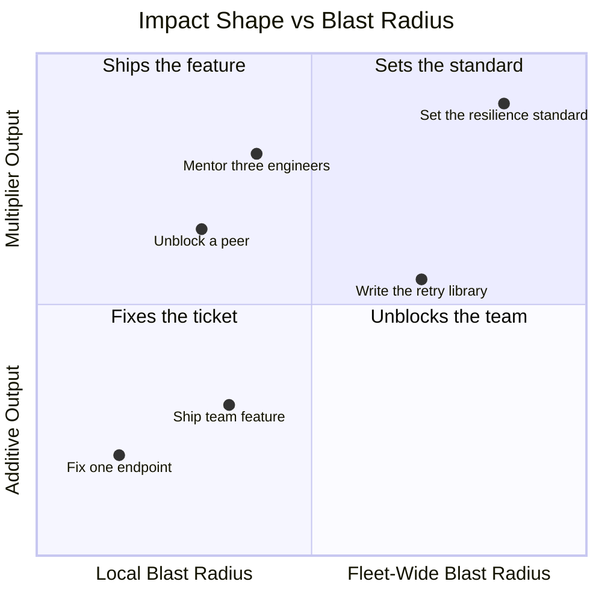
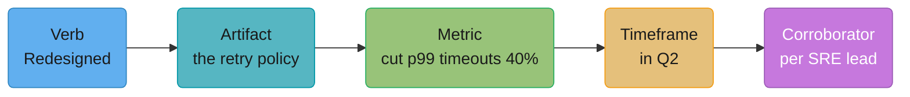
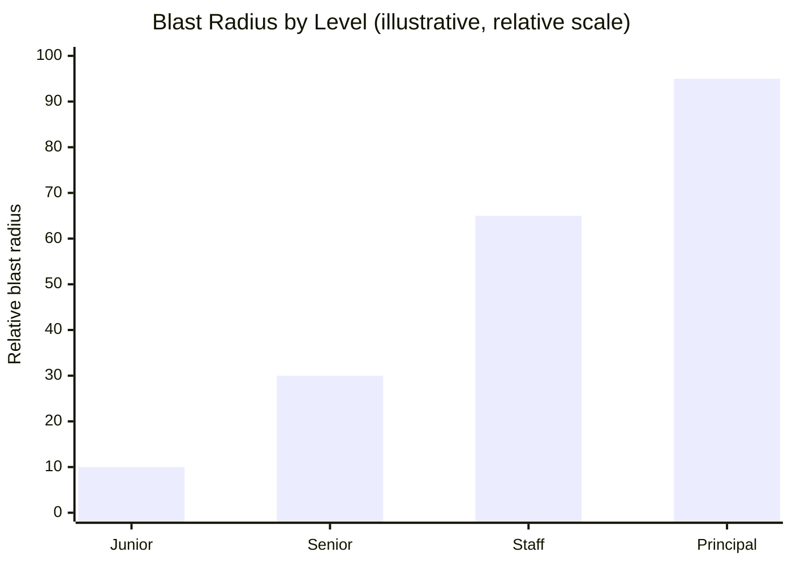
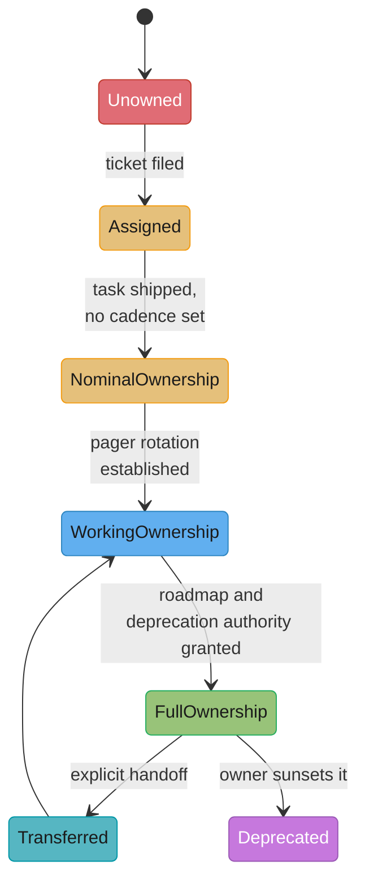
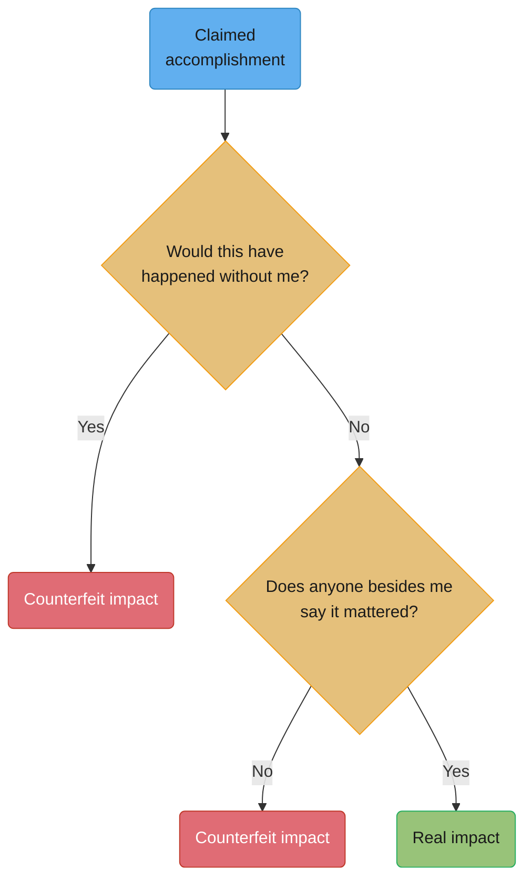

# Scope, Impact & Ownership

## 1. Concept Overview

What actually moves someone up an engineering ladder is never "harder code." A Staff Engineer's pull requests are frequently not more technically impressive than a strong Senior's — the difference is what the work was in response to, who else it affected, and how long the consequences of getting it wrong would last. This module names the three axes that do the real work — blast radius, time horizon, and ambiguity — and separates real impact from its counterfeits: the heroic weekend fix, the unrequested rewrite, the framework with one user, sheer PR volume, indispensability through hoarding information, meeting attendance mistaken for influence, and the migration that started with fanfare and never finished.

This is the companion module to [Engineering Career Ladders](../engineering_career_ladders/engineering_career_ladders.md), which covers how the levels are *named* and *calibrated*. This module covers what actually earns the evidence a calibration committee is looking for — and, just as important, how to write that evidence down before a reorg or six months of memory erases it.

---

## 2. Intuition

> **One-line analogy**: Two engineers can apply the exact same amount of force to a lever — what determines whether anything moves is where the fulcrum sits, not how hard either of them pushed.

**Mental model**: Picture "impact" not as a pile of finished work but as a lever. The length of the lever is your scope — how much of the system, how many people, how much time your decision touches. Moving the lever further out doesn't require pushing harder; it requires being positioned somewhere the push reaches further. A junior engineer pushing as hard as they possibly can on a one-file lever moves the file. A staff engineer pushing gently on a twelve-team lever moves twelve teams.

**Why it matters**: Engineers who conflate effort with impact burn out chasing the wrong variable — they work longer hours, write more code, take on more tickets, and are confused when none of it registers as growth. The fix isn't more force. It's noticing where the fulcrum currently sits and deliberately moving toward positions with more leverage — which is a different skill than technical execution, and one this module treats as a first-class, learnable thing rather than an innate trait some people just "have."

**Key insight**: Impact that doesn't survive being written down doesn't exist for promotion purposes, however real it was in the moment — which is why §6's treatment of the brag document and the impact-statement format is not administrative overhead, it's the actual mechanism by which real work becomes legible evidence.

---

## 3. Core Principles

Every unit of technical work can be described along three axes, independent of how hard it was to execute:

- **Blast radius** — who is affected if you're wrong. A change scoped to one endpoint has a blast radius of the callers of that endpoint. A change to a shared retry library has a blast radius of every service that imports it. Blast radius is not the same as "how many files you touched" — a one-line change to a widely-shared config default can have a larger blast radius than a thousand-line change confined to one service.
- **Time horizon** — how long the consequences play out. This sprint (a bug fix), this quarter (a feature that changes a metric), this year (an architecture decision competitors will still be affected by), multi-year (a platform choice the org will be migrating off of, or benefiting from, five years from now).
- **Ambiguity** — how much of the problem was handed to you already solved. A ticket with acceptance criteria carries almost none. "Payment timeouts are up" carries a named symptom with no diagnosis. "We're worried about the resilience of our payments stack" carries a worry with no symptom. "What should our reliability posture look like for the next three years" carries nothing but a mandate.

**Worked example: the same technical task at four scopes.** The task is "add retry logic to a flaky downstream API call." Read straight down the table — the code involved is comparable in difficulty at every row; what changes is everything else.

| Level | What actually happened | Blast radius | Time horizon | Ambiguity handed to them |
|---|---|---|---|---|
| Junior | Told exactly what to add — exponential backoff, 3 retries, specific error codes — reviewed line by line before merge | One endpoint; the reviewer catches mistakes before they ship | This sprint | None — a fully specified ticket |
| Senior | Notices the retry-storm risk themselves (naive retries can amplify an outage), decides the backoff policy and jitter strategy unprompted, writes the design note explaining why | One service | This quarter — the service's on-call load for the next few months | A named symptom ("we get paged for this API"), no prescribed solution |
| Staff | Recognizes the same ad hoc retry logic has been independently reinvented across twelve services owned by four teams, writes a shared retry library, gets three of the four teams to adopt it without being asked to chase them down | The fleet — a bug in the shared library now affects twelve services at once instead of one | This half-year — the migration and the library's maintenance become an ongoing commitment | A goal with no prescribed solution ("our retry behavior is inconsistent and some of it makes outages worse") |
| Principal | Decides the company shouldn't have twelve independent retry policies in the first place, sets a resilience standard covering retries, timeouts, and circuit breakers company-wide, sunsets two competing homegrown solutions other teams had already built | Every service touching an external dependency, across the whole product line | Multi-year — the standard outlives the current org chart and becomes what new hires are onboarded onto | A direction with nothing named yet ("what should reliability mean for us") |

The code complexity difference between the Junior and Principal rows in this table is small. The difference in blast radius, time horizon, and ambiguity is the entire story — and it is the entire story this module is about.

### Why these three axes, and not others

The obvious alternatives don't survive contact with a real calibration conversation. **Raw hours worked** fails immediately — a committee that rewarded hours would be rewarding poor estimation and burnout, not judgment, and no leveling document in wide circulation uses it as a criterion. **Seniority of the people in the room** fails almost as fast — being invited to a VP's staff meeting is a measure of who likes you, not of what you changed, and a person can sit in the room silently for a year and leave with nothing that survives as evidence. **Raw technical difficulty** is closer, but still wrong on its own: a genuinely hard, clever fix confined to one service and forgotten within a quarter is real skill with a short lever, and the retry-logic table above is built specifically to make that point visible — the Junior and Principal rows are not meaningfully different in coding difficulty. Blast radius, time horizon, and ambiguity survive because they map directly onto the three questions a calibration committee actually asks: *who would have been hurt if this had gone wrong, how long do we have to live with the consequences of this decision, and did this person have to figure out the problem or only the solution.*

The three axes are also independent of each other, not three names for the same thing, which matters because a real case is rarely high on all three at once. A production outage that touches every service the company runs has a huge blast radius and a short time horizon (it gets fixed and the org moves on within days) and low ambiguity (the symptom and the fix are both obvious once the root cause is found) — that is real, valuable work, but it is a different kind of evidence than a multi-year platform bet with a narrow blast radius today and an enormous one three years from now. Reading a case for promotion means checking where on each of the three axes the work actually sits, not assuming that a high score on one implies a high score on the others.

### Ambiguity alone, holding the other two axes fixed

It's worth isolating ambiguity specifically, because it's the axis most often confused with "hard." Hold blast radius (one service) and time horizon (this quarter) fixed, and vary only how much of the problem was already solved when it reached the engineer:

| Input received | What the engineer actually had to produce |
|---|---|
| "Add a p99-latency alert that fires above 400ms and pages the on-call rotation." | Implementation only — the threshold, the metric, and the escalation path were all decided already. |
| "Customers are complaining the checkout page feels slow." | A diagnosis (which of a dozen candidate causes is the real one) before there's anything to implement. |
| "Make checkout feel fast." | A definition of "fast" (a target number, whose the target belongs to, how it will be measured) before there's a diagnosis to run. |

The engineer who receives the third prompt and returns with a specific, defensible latency target, a measurement plan, and a diagnosis is doing meaningfully more senior work than the engineer who implements the first prompt correctly — even if the resulting code, in the end, looks similar. This is the reason a "did I write good code" self-assessment systematically underrates ambiguity-heavy work: the code at the end doesn't show how much of the problem the engineer had to invent before writing a line of it.

### What the four quadrants of blast radius x ambiguity actually feel like

Crossing just two of the three axes already produces four distinct jobs, and naming what each one feels like from the inside makes it easier to recognize which one you're currently doing:

| | Low ambiguity (told what to solve) | High ambiguity (must define the problem) |
|---|---|---|
| **Low blast radius** (one service) | A fully-specified ticket — the junior row in §3's table | A vague local complaint with no owner ("this feels slow") that nobody has diagnosed yet |
| **High blast radius** (the fleet) | An outage — everyone feels it, the fix is usually known once the cause is found | A standard-setting mandate with no prescribed solution — the principal row in §3's table |

The high-blast-radius, low-ambiguity cell is worth calling out specifically because it's where the heroic-fix pitfall in §10 lives: a fleet-wide outage feels like the most senior possible situation to be in, but if the cause and the fix are both well-understood once found, the actual judgment required is often closer to the junior end of the ambiguity axis — the value is in speed and calm, not invention.

Crossing blast radius against time horizon instead of ambiguity produces a second, equally useful pair of distinct jobs:

| | This sprint | Multi-year |
|---|---|---|
| **One service** | A same-day hotfix — closed, measured, forgotten within a month | A slow architectural decay nobody's tracking, that only becomes visible as a crisis years later |
| **The fleet** | An active fleet-wide incident — high-adrenaline, short-lived | A platform standard the org will still be living inside or migrating off of long after the current team has turned over |

The bottom-right cell is the one most often under-claimed in practice, precisely because nothing about it feels urgent while it's happening — a resilience standard set today produces no dramatic moment to point to, only an absence of the incidents it prevented, which is why it needs the "risk retired" evidence type from §6 more than any other kind of work in this module.

### A quick checklist for reading a piece of work against the three axes

Before writing a self-review line or accepting a new piece of scope, run it through these six questions:

- Who specifically is affected if this is wrong — a name, a team, or "everyone who calls this service"?
- Would the consequences of a mistake here surface this week, this quarter, or years from now?
- Did the request arrive as a solved problem, a named symptom, or an open-ended mandate?
- Was the blast radius granted deliberately, based on trust, or is it the accidental size of something that already broke (see the Q&A on this in §12)?
- Could someone other than you confirm that the outcome happened and that it mattered?
- If you disappeared tomorrow, would the evidence for this still exist without you narrating it?

A piece of work that scores well on the first three and poorly on the last three is real technical work with weak evidence behind it — worth doing, but worth pairing with the writing-it-down discipline in §6 before it's forgotten.

---

## 4. Types / Levels / Modes

### 4.1 Ownership vs. assignment vs. accountability

These three words get used interchangeably in casual conversation and mean structurally different things on a real team:

| Term | What it means | Duration | Who's affected if it's wrong |
|---|---|---|---|
| **Assignment** | You were given one task | Ends when the task ships | Whoever reviews or uses that one deliverable |
| **Ownership** | You are the standing point of accountability for a system, not a task | Continues after any individual task ships, until explicitly transferred | Everyone who depends on the system, indefinitely |
| **Accountability** | The specific answer to "who gets paged, who explains this in the incident review, who signs off on changing it" | Attaches to a person or a small named group, not a team in the abstract | Whoever is asking the question in the moment it matters |

A task can be assigned to someone who doesn't own the system it touches. A system can have a nominal "owning team" in a wiki page with no individual accountable when it breaks at 3 a.m. Real ownership requires all three to line up: someone was assigned the original work, someone continues to own the system after that work ships, and a specific person or small group is accountable when something goes wrong with it later.

**A concrete case where the three come apart.** A platform team is assigned a ticket to add rate limiting to an internal API gateway; an engineer on that team, Dana, builds it in two weeks and the ticket closes. Six months later the gateway starts dropping legitimate traffic under load, and the incident channel has to figure out, in real time, who to page — the ticket that created the rate limiter has long since closed, the platform team has rotated its members twice since, and the wiki page naming the platform team as "owner" hasn't been updated to name Dana or anyone else specifically. This is the exact gap the three-term distinction exists to prevent: the assignment (Dana's original ticket) ended cleanly, a diffuse "ownership" nominally continued (the platform team, in the abstract), but accountability (a specific person who can be paged, who knows the rate-limiter's tuning history, who can explain the trade-offs in the postmortem) had quietly evaporated in the gap between the two.

### 4.2 What owning a system actually obligates you to

Claiming ownership of a system is not a title you get to keep for free — it is a standing set of obligations, and the gap between claimed ownership and actual obligations honored is one of the most common sources of production incidents traced back to "well, I thought someone owned that." Owning a system means:

- **The pager.** You are the first call, directly or through an on-call rotation you built and maintain, when it breaks.
- **The roadmap.** You decide what gets built next for it, not just what gets fixed — ownership without roadmap input is really just maintenance duty wearing an ownership label.
- **The deprecation.** You are the one who decides when the system should die and executes the migration off it, rather than letting it become the thing nobody wants to touch that outlives three reorgs.
- **The people who depend on it.** You know who your callers and downstream consumers are, and you communicate breaking changes to them before they discover it in a postmortem.
- **Saying no to bad requests against it.** Real ownership includes the authority — and the obligation — to refuse a request that would make the system worse, even from someone more senior, and to say so with a reason rather than silently comply and let the system degrade.

A person who only ever does the first of these (answers pages) is running the system, not owning it. A person who does all five, even for a small system, has more real ownership than someone with a grand title and none of these obligations actually attached to their name.

### 4.3 The same system, owned to different depths

§3's worked example shows one task at four scopes. Ownership has its own version of the same idea: the identical system, with the identical title attached to whoever's responsible for it, can sit at wildly different depths depending on which of the five §4.2 obligations are actually held rather than merely claimed. Take a single notification-delivery service and follow it through four depths:

| Depth | Pager | Roadmap | Deprecation authority | Downstream comms | What actually happens when it breaks |
|---|---|---|---|---|---|
| Assignment only | None — whoever's free that day picks it up | Decided elsewhere | Decided elsewhere | None | A ticket sits until someone notices, no one is specifically on the hook |
| Nominal ownership | None — a wiki page names an "owning team" | Decided elsewhere | Decided elsewhere | None | The wiki page is stale within two quarters; the last person who touched the code gets paged informally by Slack DM |
| Working ownership | A real rotation exists | Still routed through a different tech lead | Still routed through a different tech lead | Ad hoc, after the fact | Pages get answered fast, but the service accumulates feature requests nobody has authority to prioritize or refuse |
| Full ownership | A real rotation exists | Set by the owning group | Set by the owning group | Proactive, before a breaking change ships | The service has a plan, a documented deprecation path, and downstream teams who are never surprised |

Most engineers who describe themselves as "owning" a system are actually living somewhere in the middle two rows, not the bottom or the top — and the middle rows are exactly where §4.2's gap between claimed and actual ownership hides. Working ownership in particular is a trap worth naming on its own: the pager is real, which makes ownership feel real, but without roadmap or deprecation authority the engineer is purely reactive, permanently answering for decisions someone else made. That combination — full pager responsibility with none of the other four obligations — is precisely the shape of the hoarding pitfall in §10: it looks like indispensable ownership from the outside and functions as unpaid, unauthorized maintenance labor from the inside, right up until the organization routes around it.

**Signs you're stuck in nominal or working ownership, not full ownership:**

- You've been paged for the same system more than three times this quarter and nobody has asked you what the roadmap should look like.
- A different team's tech lead, not you, made the last decision about what this system builds next.
- You don't know, off the top of your head, who the system's three biggest downstream callers are.
- The last time this system's approach changed, the people depending on it found out from a broken build, not from you.
- You've said "I don't think we should do that" about a request against this system and gotten overridden without your reasoning being addressed.
- Nobody has asked you, in the last two quarters, when this system should be replaced or shut down.

Two or more of these being true is a reliable sign that the title "owner" is ahead of the actual obligations held — worth raising directly with a manager rather than discovering it during a promo cycle.

**A short negotiation, verbatim, for closing that gap.** This is the kind of conversation that actually moves someone from working ownership to full ownership — naming the missing obligations out loud rather than waiting for them to be granted:

```text
Engineer:  I've been the de facto owner of the fraud-scoring integration for
           two quarters now — I've taken eleven pages for it. I want to
           formally own it, which means I also want the roadmap and
           deprecation call, not just the pager.
Manager:   What would that change day to day?
Engineer:  Right now if the fraud team wants a new field on that integration,
           they ask Priya, not me, because she's nominally on the ticket.
           I want that routed to me, and I want the authority to say no if a
           request would make the integration harder to operate.
Manager:   Okay — I'll tell the fraud team you're the point of contact for
           roadmap requests starting this sprint. What do you need from me
           to make the "saying no" part stick?
Engineer:  Just backing me up once, publicly, the first time I do say no to
           a request — after that it won't need repeating.
```

The manager's last question is the one most engineers forget to ask for, and the one that actually matters: authority to say no is worthless without someone senior willing to back it the first time it's exercised.

---

## 5. Models & Frameworks Diagrammed

### Impact shape vs. blast radius



Additive impact (bottom half) is work whose value is roughly your own output. Multiplier impact (top half) is work whose value comes from other people's output changing because of you. Real Staff+ growth usually moves up and to the right at the same time — see §7 for why pure top-left multiplier work (high leverage, narrow blast radius) is a trap of its own.

### The anatomy of an impact statement that survives



Drop any one of these five and the statement stops standing on its own: no verb and it's a status update ("the retry policy is better now"); no metric and it's an opinion; no corroborator and it's unverifiable six months later when nobody, including you, remembers the details.

### Illustrative blast radius growth across levels



Illustrative, not measured — the point is the shape of the curve (blast radius grows faster than technical difficulty does past Senior), not the specific numbers.

### The ownership lifecycle of a single system



Most systems get stuck in the two middle states for years, not because nobody cares but because nobody explicitly negotiated the jump from "answers the pager" to "sets the roadmap and can say no" — see §4.3 for the table version of this same progression, and §10 for what it costs when a system never leaves `WorkingOwnership`.

### The two-question test for counterfeit impact



Both questions have to clear before a claim counts. Run every item in the §10 catalog through it: the heroic fix usually fails the first branch (the process would eventually have produced a fix without the heroics), and a one-user framework usually fails the second (nobody besides its author says it mattered).

---

## 6. How It Works — Detailed Mechanics

### Leading vs lagging indicators

| | Lagging indicator | Leading indicator |
|---|---|---|
| **What it measures** | An outcome that already happened | A signal that predicts an outcome before it fully lands |
| **Example** | "Cut p99 latency from 800ms to 210ms" | "Rolled out the caching layer to 100% of traffic with zero rollback triggers in the canary" |
| **When it's available** | After the change has been live long enough to measure | As soon as the change ships, sometimes before |
| **Risk of using it alone** | You wait months to know if the work mattered | It can look good and still not translate to the outcome you actually wanted |

Use both where you can — the leading indicator tells the story while the work is fresh in memory (see the brag-doc discussion below), and the lagging indicator is the number a calibration committee ultimately trusts most. A leading indicator recorded the week it happened and a lagging indicator confirmed two months later, both attached to the same brag-doc entry, is strictly stronger than either alone: the leading indicator proves you noticed the win in real time rather than reconstructing it at review season, and the lagging indicator proves the win actually held up.

Two more pairs, to make the pattern recognizable across different kinds of work:

| Leading indicator (available immediately) | Lagging indicator (available months later) |
|---|---|
| "Runbook published and reviewed by the on-call rotation" | "Average incident resolution time for this class dropped from 45 to 12 minutes over the following quarter" |
| "Design doc got explicit sign-off from the two teams it affects" | "Neither team filed a conflicting design in the six months since" |

A leading indicator with no eventual lagging indicator attached is worth treating with some suspicion in a self-review — it means the predicted outcome was never actually checked, which is a different claim than "and it worked."

### "I built X" vs "X moved Y by Z"

The single highest-leverage rewrite an engineer can make to their own self-description is converting a description of the *work* into a description of the *outcome*:

| Weak: describes the work | Strong: describes the outcome |
|---|---|
| "I built a caching layer for the product catalog service." | "The caching layer I built cut product-catalog p99 latency from 340ms to 60ms, which took the service off the top-five slowest-endpoints list for the first time in a year." |
| "I wrote the on-call runbook for the billing service." | "The runbook I wrote cut billing's average incident resolution time from 45 minutes to 12 minutes across the six incidents since it shipped." |
| "I mentored two junior engineers this quarter." | "Both engineers I mentored this quarter shipped their first unsupervised production change within 6 weeks, versus the team's usual 12-week average." |
| "I improved our CI pipeline." | "The CI change I shipped cut the median time-to-merge from 6 hours to 90 minutes across the team, which had been the #1 complaint in the last three retro surveys." |

"I built X" is true and often difficult to accomplish, but it's unverifiable as a claim about impact — it says nothing about whether X mattered. "X moved Y by Z" is a falsifiable claim a corroborator can confirm or dispute, which is exactly why it's the stronger evidence, and it is exactly the five-part shape (verb, artifact, metric, timeframe, corroborator) from the §5 diagram written out in full sentences rather than as separate labeled boxes.

**The metric-shape itself can be gamed, and it's worth naming how before someone else names it for you.** Once "X moved Y by Z" becomes the expected format, the incentive to pick a metric that's easy to move rather than one that's actually meaningful shows up fast — an engineer who wants a latency win can chase p50 instead of p99 (much easier to move, much less representative of what users actually experience), or narrow the traffic slice a dashboard measures until the number looks good regardless of what happened everywhere else. This is the software-engineering instance of Goodhart's law: once a measure becomes a target, people optimize the measure rather than the thing it was standing in for. The defense isn't avoiding metrics, it's the same corroborator requirement that runs through the rest of this section — a metric a colleague or a dashboard can independently reproduce is far harder to quietly narrow than one only the person claiming credit ever recomputes, which is exactly why "confirmed against the data-platform on-call dashboard" (from the ingest-pipeline example below) does real work in that sentence beyond just sounding rigorous.

### When no number is available

Not every real outcome produces a clean metric — a design review that prevented an architectural mistake, or a mentoring relationship that changed someone's trajectory, rarely shows up in a dashboard. When there's no number, use one of these instead, in roughly this order of strength.

**A named person's testimony.** Not "people said this was helpful" but a specific person, saying a specific thing, that you could point back to. Worked example: Priya Nair, the SRE lead, said in the design-review thread that the caching approach under review would have doubled the fleet's memory footprint at the traffic levels projected for the following quarter — the engineer who raised that concern can cite "Priya Nair (SRE lead) flagged in the Q3 design review that this design would have doubled our memory footprint at projected traffic, and we changed the approach as a result" as evidence, because Priya Nair could confirm or dispute that sentence herself.

**A decision that changed.** Worked example: a team had budgeted six weeks to build and maintain a custom message queue in-house; after an engineer walked the team through the operational cost of running a queue themselves — the on-call burden, the missing tooling, the two engineers it would tie up for the first month alone — the team adopted the already-licensed managed queue instead. The evidence isn't "I influenced the queue decision," it's "the team reversed the plan to build a custom queue after I presented the operational-cost comparison in the Tuesday planning meeting, saving the budgeted six engineer-weeks," which anyone in that meeting could confirm.

**A risk retired.** Worked example: a particular failure mode in the ingest pipeline had generated fourteen pages a month for the on-call rotation; after the underlying cause was fixed, the on-call dashboard showed zero pages for that failure class over the following ten weeks. The evidence is "the on-call rotation went from fourteen pages a month to zero over ten weeks after I fixed the root cause of the ingest retry loop, confirmed against the on-call dashboard" — checkable by anyone with dashboard access, not dependent on anyone's memory of the fix itself.

All three share a property a vague claim doesn't: someone other than you could confirm or deny them.

| Fallback | What it names | Who could check it | Worked example above |
|---|---|---|---|
| Named testimony | A specific person's specific statement | The person themselves | Priya Nair's design-review concern |
| A decision that changed | An action the team took differently | Anyone in the room when it changed | The custom-queue reversal |
| A risk retired | A failure mode that stopped recurring | Anyone with dashboard or on-call access | The ingest-pipeline page count |

**Asking for a corroborator without it feeling like fishing for a compliment.** The honest version of this ask names the specific claim you want confirmed, not a general request for praise:

```text
Engineer:  I'm writing up the design-review feedback I gave on the caching
           proposal for my self-review. Would you be comfortable if I quoted
           you as saying the review caught the memory-footprint issue before
           it shipped? I want to make sure I'm representing it accurately,
           not overstating it.
Reviewer:  That's accurate — go ahead. If it's useful, I can also just say
           that directly in the calibration thread when it comes up.
```

Asking to confirm a specific sentence, rather than asking "can you say something nice about me," makes the corroboration both easier to give honestly and stronger as evidence, since it's tied to a checkable fact rather than a general endorsement.

### Writing it down so it survives

**The brag document.** Julia Evans's widely cited 2019 essay "Get your work recognized: write a brag document" (jvns.ca) names the exact failure this solves: review season arrives, and nobody — including the person who did the work — can reconstruct six months of accomplishments from memory. A brag document is a running log, updated weekly rather than reconstructed at review time, of what you did, who it affected, and what changed. The discipline that makes it work is the cadence: five minutes on a Friday capturing what happened this week is a fundamentally different (and vastly more accurate) exercise than trying to remember March in September.

**Why nobody remembers March.** This isn't a personal failing — it's how memory works under a normal engineering workload. By the time a semi-annual review comes around, the last six weeks of work dominate recall almost completely, and everything before that has to be reconstructed from commit history, calendar entries, and Slack search, which recovers *what* happened but rarely recovers *why it mattered* or *who it affected*, which is exactly the information a brag doc captures while it's still fresh.

**Reorgs erase context on purpose, not by accident.** A reorg routinely moves an engineer's work under a new manager who has no first-hand knowledge of what happened before the reorg, and the org chart itself stops reflecting who used to depend on what. Written evidence is the only thing that survives a reorg intact — a manager's memory of your last quarter does not transfer with them, but a dated brag-doc entry does.

**What twelve real weeks of entries actually look like.** The value of the practice is in the cadence, not any single entry — a brag doc read end to end should look like a diary, not a highlight reel written after the fact:

```text
2026-01-09 -- Diagnosed the checkout-service memory leak (OOMKilling roughly every
              6 hours); root cause was an unbounded in-process cache; fix cut
              restarts from 4/day to 0.
2026-01-16 -- Paired with Dana on the rate-limiter rollout; caught a bug in the
              token-bucket refill math in review before it shipped.
2026-01-23 -- Wrote the design doc for the shared payments-retry library; got
              sign-off from the SRE lead and the payments tech lead.
2026-01-30 -- Shipped retry library v0.1 to the payments service only, canary at
              5% traffic, zero errors after 72 hours.
2026-02-06 -- Presented the retry library at the platform brown-bag; refunds team
              asked to adopt it afterward.
2026-02-13 -- Onboarded the refunds team onto the retry library; their integration
              took 1 day and needed no changes on their side.
2026-02-20 -- On-call: handled 3 pages, all the same known ingest-pipeline issue;
              filed the postmortem action item to fix the root cause.
2026-02-27 -- Fixed the ingest-pipeline root cause (unbounded retry loop on a 4xx);
              confirmed with the data-platform lead that pages for this class
              stopped.
2026-03-06 -- Mentored Alex through their first on-call shift; they resolved 2 of
              2 incidents without escalating.
2026-03-13 -- Wrote the runbook for the fraud-scoring integration after being
              paged for it a sixth time this quarter.
2026-03-20 -- Fraud team adopted the retry library; that's three teams now
              (payments, refunds, fraud) without me chasing anyone.
2026-03-27 -- Gave feedback in the Q1 design review that changed checkout's plan
              from a custom queue to the existing managed one; avoided an
              estimated 6 engineer-weeks of build-and-maintain cost.
```

Read as a single list at review time, this is a wall of small facts. Read weekly as it's written, each entry took under five minutes and cost nothing — the ingest-pipeline pair (Feb 20 and Feb 27) alone becomes the "risk retired" evidence from earlier in this section, and the Jan 23 through Mar 20 sequence becomes the retry-library adoption story used throughout this module.

**Common brag-doc mistakes, in order of how often they actually happen:**

- Writing it monthly instead of weekly — by the time a month has passed, the specific number and the specific person's name are already gone, and the entry degrades back into "worked on X."
- Recording only the finished wins and skipping the in-progress ones — a leading indicator (§6) captured the week it happened is often the only record that a slow-feedback bet was ever on track before it finally lands.
- Writing what you did instead of what changed — "reviewed the retry PR" is a task; "caught the retry-storm bug in review before it shipped" is evidence.
- Keeping it somewhere only you can see it — a doc that never gets referenced in a 1:1 or a self-review isn't doing its job; the practice only pays off if it's actually used at review time.
- Treating a quiet week as nothing to record — "on-call, no incidents, zero pages" is itself a data point once you're trying to show a system got more stable over time.

**Weak version**

> Worked on improving the ingest pipeline's reliability throughout the quarter.

**Strong version**

> Redesigned the ingest pipeline's retry policy in Q2, cutting the dropped-event rate from 0.9% to 0.05% — roughly 1.1M fewer lost records per month — confirmed against the data-platform on-call dashboard and signed off by the data-platform lead.

**What changed:** the weak version is a description of effort with no outcome attached; the strong version supplies a metric, a scale (1.1M records, not "a lot"), a timeframe, and a corroborator who could confirm it independently — the exact five-part structure from the §5 diagram.

**Weak version (promo-packet line)**

> Was the go-to person for questions about the billing service and helped a lot of people.

**Strong version (promo-packet line)**

> Onboarded 4 new engineers onto the billing service in H1, cutting their time-to-first-production-merge from an average of 3 weeks to 6 days (per the onboarding survey), and wrote the runbook that took billing off the team's #1 page-volume source within two months of publishing it.

**What changed:** "the go-to person" and "helped a lot of people" are unfalsifiable — nobody can confirm or dispute them. The strong version names a count (4 engineers), a before/after metric, a source for the metric (the onboarding survey), and a second, independently checkable outcome (page volume actually dropped, and by when).

**Weak version (asking for feedback in a 1:1)**

> Do you think I'm doing okay? I feel like I've been pretty busy this quarter.

**Strong version (asking for feedback in a 1:1)**

> Here's what I shipped this quarter against the staff bar we discussed in March: the retry library adopted by three teams, and the ingest fix that took pages for that failure class from fourteen a month to zero. Where specifically do you still see gaps against the bar?

**What changed:** the weak version asks for reassurance and gives the manager nothing concrete to evaluate; the strong version arrives with the accomplishments already in impact-statement form and asks a targeted calibration question the manager can actually answer, which is a fundamentally different — and much shorter — conversation.

**Weak version (design-review comment)**

> I don't think this approach is right.

**Strong version (design-review comment)**

> A queue-based approach costs us roughly two engineer-weeks less to build than the polling approach and removes an ongoing on-call burden — here's the tradeoff table. Can we go with the queue instead?

**What changed:** the weak version is an unsupported objection that puts the burden of proof back on the author; the strong version names a specific alternative, a quantified cost difference, and a direct ask, which is the same "alternative plus cost" pattern the Staff row of §3's worked example and Q&A #1 in §12 both depend on.

---

## 7. Real-World Examples

**Tanya Reilly, "Being Glue" (2019 talk and essay, noidea.dog/glue; later expanded into *The Staff Engineer's Path*, O'Reilly, 2022).** Reilly, a former Staff engineer at Google and Principal engineer at Squarespace, names "glue work" as the unglamorous, high-leverage labor that holds a team together — running the design-review process, onboarding new hires, noticing two teams are about to build the same thing and getting them in a room, writing the doc nobody else will write. It is real multiplier impact: the top-left region of the §5 quadrant. Her explicit warning is that doing glue work too early, or disproportionately (she notes it's often pushed onto women more than men, with no corresponding promotion credit), can be career-limiting rather than career-building — it produces influence with no legible individual artifact a promo committee can point to, and it can crowd out the additive track record a person needs before multiplier work reads as leadership rather than as invisible labor.

**Rent the Runway's adder/multiplier framing (2015).** Independently of Reilly, Camille Fournier's Rent the Runway ladder — covered in [Engineering Career Ladders](../engineering_career_ladders/engineering_career_ladders.md) §4.1 — scored engineers on four attributes and stated explicitly that two of them (Dex, technical execution; Str, productivity) are the "adder" attributes driving early promotions, while the other two (Wis, judgment/impact; Cha, communication/leadership) become "multiplier" attributes that matter more at senior levels. The same additive-vs-multiplier split Reilly names four years later, independently arrived at from a leveling-document angle rather than an essay angle.

**Will Larson, *Staff Engineer: Leadership Beyond the Management Track* (2021).** Larson's book is the primary published taxonomy of what multiplier-shaped work actually looks like in named, distinct roles rather than one undifferentiated "leadership" blob: the Tech Lead (drives one team's technical direction), the Architect (sets technical direction across a wider area, often without owning a specific team), the Solver (goes deep on the org's hardest, most ambiguous problems wherever they appear), and the Right Hand (extends a senior leader's attention and judgment across problems that leader can't personally cover). Each archetype is a different answer to "what does my multiplier impact actually look like," and mismatching the archetype you're actually operating in against the one you're describing in a promo packet is a common, avoidable source of a confused-sounding packet.

**Will Larson, "Work on What Matters" (lethain.com, 2020).** Larson names two specific failure modes that sit directly on top of the §10 pitfall catalog below. "Snacking" is doing easy, low-impact work that produces a real feeling of accomplishment while carrying a large opportunity cost against the harder, higher-leverage work sitting untouched next to it — this is the PR-volume pitfall in different words: busy, measurable, and low-leverage all at once. "Preening" is doing highly visible work that impresses without moving anything that matters — this is the framework-with-one-user and the meeting-attendance pitfalls in different words: work chosen for how it looks rather than for what it changes. Larson's framing is useful precisely because it names the *motivation* behind the counterfeit-impact patterns in §10, not just the patterns themselves: snacking and preening both feel productive from the inside, which is exactly why they're hard to self-diagnose without an external check like the brag-doc audit in §13.

**How the four sources line up.** Each arrived at a version of the same additive/multiplier split independently, from a different angle:

| Source | Angle | Core claim |
|---|---|---|
| Tanya Reilly, "Being Glue" (2019) | An essay naming a specific labor pattern | Multiplier ("glue") work is real but career-risky if taken on too early or disproportionately |
| Camille Fournier / Rent the Runway ladder (2015) | A formal leveling document | Two named attributes (Dex, Str) drive early promotions; two others (Wis, Cha) take over later |
| Will Larson, *Staff Engineer* (2021) | A taxonomy of staff-level roles | Multiplier work has named shapes (Tech Lead, Architect, Solver, Right Hand), not one blob |
| Will Larson, "Work on What Matters" (2020) | A blog post on individual focus | Both low-leverage-but-easy (snacking) and visible-but-empty (preening) work should be actively avoided |

Four independent arrivals at the same underlying split is itself evidence the split is real and not just one author's framing.

---

## 8. Tradeoffs

| | Additive impact | Multiplier impact |
|---|---|---|
| **Legibility** | High — a shipped feature, a fixed bug, a metric that moved are all directly attributable to you | Lower — the outcome is visible, but attributing it back to your specific contribution requires someone else's testimony |
| **Ease of gaming** | Harder to fake — the artifact either shipped or it didn't | Easier to overclaim — "I influenced that decision" is a much softer claim than "I shipped that" |
| **Career risk if overdone** | Caps out — pure additive output plateaus once you're clearly capable, and stops differentiating you from other capable engineers | Can strand you with influence but no legible individual output, especially if taken on before you have an additive track record to point back to (see Reilly, §7) |
| **What a promo committee trusts most** | Verifiable numbers and shipped artifacts | Named testimony and traceable decisions — weaker on its own, much stronger paired with additive evidence |

**The heroic fix vs. the postmortem-and-process fix.** A production incident fixed by one engineer working through a weekend feels, in the moment, like the clearest possible evidence of ownership and impact. It's frequently the opposite signal to a calibration committee reading carefully: it demonstrates the *absence* of the process, on-call structure, or runbook that should have made a 3 a.m. weekend fix unnecessary in the first place. The stronger, less dramatic version of the same underlying skill is the postmortem that changes the process so the same class of incident can't recur and doesn't require a hero next time — see §10 for the full pitfall.

**Snacking vs. the important-but-hard problem.** Easy, well-scoped, quickly-closeable work is a real trap precisely because it's genuinely satisfying to finish — a cleared ticket queue produces a dopamine hit that a half-finished six-week investigation into an intermittent data-corruption bug does not, even when the investigation is worth an order of magnitude more. The tradeoff isn't "never do easy work" — small wins keep a brag doc populated between larger efforts, per §6 — it's noticing when easy work is being chosen *because* it's easy rather than because it's the highest-leverage thing available, which is Larson's "snacking" from §7 stated as a tradeoff instead of a pitfall.

| | Over-indexed on additive | Over-indexed on multiplier |
|---|---|---|
| **What a self-review from this person reads like** | A long list of shipped tickets, none of them tied to a metric bigger than the ticket itself | A long list of meetings, reviews, and "helped with," none of them tied to a named artifact |
| **What's missing** | Evidence the work mattered beyond having been finished | Evidence any of it was attributable to this specific person |
| **The §10 pitfall it resembles most** | Volume of PRs | Attending every meeting, or the framework with one user |
| **The one-line fix** | Trace three of last quarter's tickets through to an outcome metric | Name, for three of last quarter's "helped with" claims, the specific decision that changed |

**Speed of feedback vs. size of the bet.** A two-week experiment tells you whether it worked in two weeks; a multi-quarter platform migration tells you whether it worked in a year or more, and by then the org chart, the team, and sometimes the manager evaluating you may have changed. A promo case built entirely from fast-feedback work under-represents time horizon, because nothing in it demonstrates the judgment needed to commit to something whose payoff is a year away; a case built entirely from slow-feedback work risks having nothing finished to show at the actual review date. The strongest cases carry at least one item from each: a fast-feedback win that's fully closed and measured, and a slow-feedback bet that's visibly on track even if not yet complete, with a leading indicator (§6) standing in for the lagging one that isn't available yet.

**A gamed metric and a real one often look identical in a single sentence — the tell is in what's missing around it.**

| Signal | Gamed-looking version | Real version |
|---|---|---|
| Which number | p50 latency, or a narrow traffic slice | p99, or the full-traffic figure everyone already watches |
| Who can reproduce it | Only the person claiming credit | A dashboard or teammate independent of them |
| What happened to the denominator | Unstated, or changed mid-quarter | Stated explicitly and unchanged |
| Timing | Measured once, right after shipping | Measured again weeks later and still holds |

None of these prove bad faith on their own — they're just the questions worth asking of your own numbers before someone else asks them for you.

**Additive output also has a real point of diminishing returns, not just a soft plateau.** An engineer who ships twice as many tickets as their teammates in year one is clearly capable; the same engineer shipping twice as many tickets in year four, with the ticket sizes and blast radii unchanged, isn't demonstrating growth, they're demonstrating that the job hasn't changed for them — the xychart in §5 shows blast radius rising sharply past Senior precisely because additive volume stops being the differentiator at that point. The practical tell is whether this quarter's additive wins are larger in scope than last year's, not just more numerous than last quarter's.

---

## 9. When to Use / When NOT to Use

**Take on multiplier and glue work when** you already have a legible additive track record a committee can point to, when the org genuinely lacks anyone else positioned to do it (not just when it's the path of least resistance for you specifically), and when you're deliberately building the case for a title change that's explicitly gated on cross-team influence rather than individual output.

**Decline it, or actively hand it off, when** you're early enough in your track record that you still need shipped, attributable, additive wins more than you need diffuse influence — glue work with no additive foundation underneath it reads as "does a lot of things" rather than "delivers," which is a weaker packet, not a stronger one. It's also worth declining reflexively when the work is specifically visibility-raising and leverage-lowering: chairing a cross-team committee that gets you seen by leadership but produces no artifact you actually control, running the all-hands demo that's high-visibility but zero-ownership, or being the person who "helps out" on every team's on-call rotation without ever owning one outright. These feel like impact because they're visible. They frequently aren't, because nothing about them is attributable, repeatable, or something you could point to a metric for — see the counterfeit-impact catalog in §10.

**The one-question test before accepting new scope.** Before saying yes to a piece of work, ask: if I disappeared tomorrow, would this specific piece of evidence still be checkable by someone else in six months? A shipped library with named adopters passes — the adoption is checkable with or without you in the room. Being "the person everyone asks" does not pass — the moment you're gone, so is the evidence, because nothing about it was ever written down or attributable to anything other than your continued presence. This single question filters out a large fraction of the §10 counterfeit-impact catalog before you've spent any time on it.

**A quick reference for the most common offers of scope:**

| Offer | Passes the one-question test? | Why |
|---|---|---|
| Own a shared library other teams will call | Yes | Adoption is checkable by anyone, with or without you |
| Chair a new cross-team committee with no deliverable | No | Attendance leaves no artifact once you stop attending |
| Write the postmortem process for a recurring incident class | Yes | The process either keeps recurrence down or it doesn't, measurably |
| Be the "point person" other teams DM with questions | No, unless it converts to a runbook | Undocumented answers vanish with you; a written runbook doesn't |
| Lead a fully-scoped migration with a named end state and date | Yes | Finished or not-finished is checkable by anyone looking at the tracker |
| Run the demo at the all-hands | No | High visibility, but the demo itself isn't an artifact anyone depends on afterward |

**Early-career and struggling-quarter guidance differs from steady-state guidance.** A new hire in their first two quarters should decline almost all discretionary glue work and prioritize small, closed, additive wins — not because glue work is bad, but because a new hire has no track record yet for multiplier work to be read against, and a first review built entirely on "helped out a lot" with nothing shipped reads as a flight risk to a manager, not as a promising generalist. The same logic applies in reverse during a quarter where delivery has visibly slipped for reasons outside anyone's control (a reorg, a dependency team missing a deadline): that is exactly the quarter to prioritize a small number of safe, finishable, well-scoped additive wins over an ambiguous multi-quarter bet, because the bet's payoff won't land before the next calibration cycle and the safe wins will.

Two more situations worth naming specifically. A recently-promoted engineer, one or two quarters into a new title, should actively seek scope one notch past their comfort zone rather than defaulting to the pattern that earned the last promotion — repeating exactly the evidence that justified the last title change is additive proof you deserved the title you already have, not the next one. And an engineer whose manager is changing (a reorg, a manager leaving) should front-load writing down existing evidence rather than taking on new ambiguous scope in that window — a new manager with no first-hand memory of the last two quarters needs the brag doc from §6 more than they need one more thing started that they'll have no context for when it finishes.

**A verbatim decline, when scope is offered that fails the one-question test.** Declining well is a skill in itself — done badly it reads as unhelpful; done well it redirects toward something that actually produces evidence:

```text
Skip-level:  We're standing up a cross-team payments-reliability forum, monthly,
             four teams represented. Would you chair it?
Engineer:    I don't think I'm the right person to chair a standing meeting with
             no deliverable attached — I'd rather put that time into something
             checkable. What the forum's actually trying to produce, I think, is
             a shared view of where reliability stands across the four teams.
             I'd rather build a quarterly scorecard that does that, and skip the
             monthly meeting unless the data says we need to get in a room.
Skip-level:  Would that actually replace the forum, or just supplement it?
Engineer:    I'd try it as a replacement for two quarters and see if the
             scorecard alone answers the questions the forum was meant to
             answer. If it doesn't, we stand the meeting back up with a
             narrower agenda.
```

The decline isn't "no" — it's a counter-offer of a specific, checkable artifact in place of a specific, uncheckable one, which is the same "alternative plus cost" shape as the design-review pair in §6.

---

## 10. Common Pitfalls

### The heroic weekend fix

From the outside, it looks like exactly the kind of ownership a promo packet wants — someone stepped up under pressure and fixed a critical problem alone. What it usually demonstrates instead is a gap: no on-call rotation covered the issue, no runbook existed, no automated rollback caught the problem before it needed a human at 3 a.m. A packet that presents the heroic fix as the evidence, rather than the postmortem and the process change that came after it, is presenting the symptom of an ownership gap as though it were proof of ownership. Quantified consequence: an engineer who is the visible hero of three separate weekend incidents in a single quarter, with no postmortem action items closed after any of them, has generated the same failure mode three times and fixed the underlying cause zero times — the number a careful reviewer notices is not "three fixes," it's "zero root causes retired."

### The rewrite nobody asked for

An engineer notices the existing system is architecturally unpleasant and rewrites it, unprompted, over several weeks. From the outside this can look like initiative and technical leadership. It frequently isn't, because "I didn't like how it was built" is not the same claim as "here is the named business cost of the current approach and the quantified benefit of replacing it" — and an unrequested rewrite that introduces new bugs, or that quietly consumes weeks nobody budgeted for, is a liability a calibration committee reads correctly as a judgment gap, not a strength. Quantified consequence: a three-week unrequested rewrite that produces even a single new production incident in its first month has cost the team more engineer-hours (the rewrite plus the incident response) than the old, unpleasant-but-stable system would have cost left alone for that same month.

**Weak version (describing the rewrite in a packet)**

> Modernized the deployment tooling by rewriting it in a cleaner language and architecture.

**Strong version, if it can honestly be written at all**

> The old Bash deploy scripts caused an average of one failed deploy per week (per the deploy-log audit), costing roughly 2 engineer-hours per incident to diagnose and retry; after discussing the cost with the team lead and getting sign-off, I replaced them over three weeks, and deploy failures dropped to zero in the eight weeks since.

**What changed:** the weak version asserts an improvement with no named cost of the old system and no sign-off from anyone; the strong version, notably, can only be written honestly if the rewrite actually was requested or at least discussed and approved before it happened — which is the entire point of this pitfall.

### The framework with one user

Building internal tooling or a shared library is exactly the kind of multiplier work §7 and §8 describe as high-leverage — when other teams actually adopt it. A framework built to solve a problem, announced once, and adopted by nobody but its author is additive work wearing multiplier packaging: it took real effort, but the leverage it was supposed to produce (other teams' output improving because of it) never materialized, and a packet that describes it as "built a shared platform for X" without naming who else uses it is making a claim the evidence doesn't support. Quantified consequence: a framework that took eight engineer-weeks to build and has one user eighteen months later has produced a negative return relative to simply solving the original problem locally, which would have taken a fraction of that time.

**Weak version (describing adoption in a packet)**

> Built a shared platform for retry logic that the org can use going forward.

**Strong version, if it can honestly be written at all**

> Built a shared retry library; adopted by the refunds and fraud teams within six weeks of presenting it at the platform brown-bag, with no changes required to either team's integration path, confirmed by their tech leads in the adoption retro.

**What changed:** the weak version claims org-wide availability, which is a claim about potential, not adoption; the strong version names who actually adopted it, how fast, and who could confirm it — and if that sentence can't honestly be written yet, the packet item isn't ready, no matter how good the code is.

### Volume of PRs

A high PR count is easy to measure and easy to mistake for impact, but it measures throughput, not leverage or blast radius — 200 small, independently-reviewed PRs against one service can add up to less real impact than the 3-PR retry library from the §3 worked example that four other teams adopted. Using raw PR count as self-evidence in a packet invites exactly the comparison a committee will make: throughput against what, exactly, and did any of it change anything outside the PRs themselves. Quantified consequence: an engineer averaging 15 merged PRs a week against an engineer averaging 3 is not automatically the more impactful one — if the 15-PR engineer's changes are confined to one service with no metric moved and the 3-PR engineer's changes are the retry library adopted by three teams, the raw ratio (5:1 in PR count) inverts completely once blast radius is the unit being compared instead.

### Being indispensable through hoarding

An engineer who is the only person who understands a critical system, and who never quite gets around to documenting it or cross-training anyone else, can feel — and appear, in the short term — extremely high-impact: nothing ships without them. It is a liability the organization will eventually route around, either by descoping that engineer's influence deliberately (nobody wants a single point of failure with a personality) or by the system itself becoming the thing nobody wants to touch, which caps rather than grows the engineer's actual scope over time. Real ownership, per §4.2, includes documenting for and cross-training the people who depend on you — the opposite instinct from hoarding. Quantified consequence: an engineer paged eleven times in a single quarter for one legacy integration, with no runbook written after any of the eleven pages, has spent roughly the equivalent of a full extra on-call rotation's worth of pages on a system that a documented, cross-trained team of three would have absorbed without anyone individually noticing the load — see the §14 case study, where this exact pattern is diagnosed as a gap rather than a strength.

### Attending every meeting

Being in the room for every cross-team discussion can look, from the outside, like broad organizational influence. Attendance is not the same as decisions changed — a packet that lists meeting attendance as evidence of scope is substituting presence for the actual multiplier-impact evidence described in §6 (a named decision that changed, a risk that was retired), and a careful reader will notice the substitution immediately. Quantified consequence: an engineer who attends twelve cross-team meetings a week and can name zero decisions that went differently because of something they said has spent roughly a full working day a week producing no evidence at all, and — worse for their own case — has spent that day not doing the additive or multiplier work that would have produced some.

### The migration that started and never finished

An engineer announces and starts a large migration — say, moving forty services off a deprecated internal RPC framework — with real fanfare, finishes the first six services, and then the tracking doc goes quiet for a year while the engineer moves on to other things. From the outside the kickoff looked exactly like staff-level scope: a fleet-wide blast radius, a multi-quarter time horizon, real ambiguity about how to sequence forty services safely. A started-and-abandoned migration is frequently worse than never starting it, because it leaves the org in a split-brain state — two supported patterns instead of one, twice the operational surface, and every team caught mid-migration has to maintain both indefinitely. A packet that describes "led the migration off Framework X" without naming what fraction is actually done, and why the rest stalled, reads to a careful reviewer as exactly this pattern; the honest version names the stall explicitly and states a plan to either finish it or formally cancel it. Quantified consequence: thirty-four of forty services left mid-migration for a year means thirty-four teams are carrying two supported RPC patterns instead of one, and the resulting doubled on-call runbook surface is a cost the engineer who started the migration generated and did not retire — that cost accrues every month the tracking doc stays quiet, whether or not anyone is currently looking at it.

**Weak version (standup update)**

> Still working on the auth refactor, made some progress, should be done soon.

**Strong version (standup update)**

> Auth refactor: token-validation path is migrated and live in prod behind a flag at 10% traffic, zero regressions in the canary over 48 hours. Flipping to 100% Thursday — that unblocks the SSO team's launch, which was waiting on this.

**What changed:** the weak version reports effort with no verifiable state; the strong version reports a specific state (10% traffic, 48 hours, zero regressions), a specific next milestone with a date, and — critically — names who else is blocked on it, converting a personal status update into visible cross-team impact evidence in real time, not reconstructed months later.

**The catalog at a glance:**

| Pitfall | Looks like, from outside | Actually is | Quantified cost |
|---|---|---|---|
| The heroic weekend fix | Staff-level ownership under pressure | A missing runbook, rotation, or safeguard | 3 heroics, 0 root causes retired |
| The rewrite nobody asked for | Initiative and technical leadership | An unquantified personal preference | 3 weeks spent, 1 new incident, net negative |
| The framework with one user | High-leverage shared tooling | Additive effort in multiplier packaging | 8 weeks built, 1 user 18 months later |
| Volume of PRs | High throughput and output | Measured busyness, not leverage | 15 PRs/week beaten by 3 adopted ones |
| Indispensable through hoarding | Deep, valuable expertise | An unmanaged single point of failure | 11 pages, 0 runbooks written |
| Attending every meeting | Broad organizational influence | Presence with no decisions changed | ~1 day/week, 0 named decisions |
| The unfinished migration | Fleet-wide staff-level scope | A stalled, split-brain liability | 34 of 40 services left on two patterns |

---

## 11. Frameworks, Books & Further Reading

- **Tanya Reilly, "Being Glue"** (talk and essay, `noidea.dog/glue`, 2019) — the primary source on multiplier/glue work and its career-limiting trap when taken on too early or too disproportionately.
- **Tanya Reilly, *The Staff Engineer's Path* (O'Reilly, 2022)** — expands "Being Glue" into a full treatment of staff-level scope, ownership, and influence without authority.
- **Julia Evans, "Get your work recognized: write a brag document"** (`jvns.ca`, 2019) — the primary source on the brag-document practice referenced throughout §6.
- **Will Larson, *Staff Engineer: Leadership Beyond the Management Track* (2021)** — source of the Tech Lead / Architect / Solver / Right Hand archetype taxonomy in §7.
- **Will Larson, "Work on What Matters"** (`lethain.com`, 2020) — source of the "snacking" and "preening" failure modes referenced in §7 and §8, naming the motivation behind several of the §10 counterfeit-impact patterns.
- **Camille Fournier, *The Manager's Path* (O'Reilly, 2017)** and the **Rent the Runway Engineering Career Ladder (2015)** — source of the adder/multiplier attribute framing in §7; see [Engineering Career Ladders](../engineering_career_ladders/engineering_career_ladders.md) §4.1 and §11 for the full ladder context.

---

## 12. Interview Questions with Answers

**Q: Isn't shipping more code the way to get promoted?**
**Short:** No — code volume is additive output; scope, blast radius, and ambiguity are what actually move a ladder.
No — code volume is a measure of additive throughput, and it plateaus once you're clearly a capable engineer without differentiating you further. What actually moves someone up a ladder is blast radius, time horizon, and how much ambiguity was handed to them (§3) — the same technical task, done at four different scopes, produces roughly the same amount of code but very different promotion evidence, as the retry-logic worked example in §3 shows directly. The trap is that code volume is the easiest of all these to measure, which is exactly why the PR-volume pitfall in §10 exists: 200 small PRs against one service can represent less real leverage than a 3-PR library adopted by three other teams.

The practical fix is to stop counting PRs at all and instead ask, for each one, who besides you was affected by it and whether that effect is still checkable six months later.

**Q: I stayed up all weekend to fix a critical production bug alone — doesn't that prove staff-level ownership?**
**Short:** A heroic weekend fix usually proves a process gap existed, not that you have staff-level ownership.
Not on its own, and it can read the opposite way to a careful reviewer. A weekend spent single-handedly fixing a critical bug usually demonstrates that no on-call rotation, runbook, or automated safeguard existed to prevent a human from needing to do that at 3 a.m. — a gap in the process, not proof that you personally have staff-level scope. Concretely: three separate weekend heroics in one quarter with zero postmortem action items closed after any of them is evidence of a system nobody has actually fixed, not evidence of three separate wins, and a calibration committee reading carefully will count the closed action items, not the all-nighters. The stronger version of the same underlying instinct is the postmortem and the process change that stops the next incident from needing a hero at all — see §10 for the full pitfall and its quantified cost.

If you did do a heroic fix, the promotable move is writing the runbook or fixing the root cause afterward, not retelling the weekend.

**Q: I rewrote our service in a framework I preferred because the old one bothered me — that's ownership, right?**
**Short:** An unrequested rewrite is a red flag, not evidence, unless it's tied to a named, quantified business cost.
Not by itself — an unrequested rewrite is a common counterfeit-impact pattern (§10), because "I didn't like how it was built" is a personal preference, not a business case. It becomes real evidence only when it's tied to a named, quantified cost of the status quo (a specific failure rate, a specific engineer-hours-per-incident figure) and a quantified benefit of the change, ideally with sign-off from someone else before the work started rather than justification written afterward. A three-week rewrite that introduces even one new production incident in its first month has, in raw engineer-hours, likely cost more than the old system would have cost left alone — that's the number worth checking before calling it a win.

The honest packet line names the cost of the old system and the sign-off, not just the fact that the rewrite happened; if that sentence can't be written truthfully, the rewrite isn't ready to be evidence yet.

**Q: I'm in every meeting and everyone comes to me for context — doesn't that prove I have real impact?**
**Short:** Being indispensable through hoarding context is a liability the org will eventually route around.
It can look like impact in the short term and function as a liability in the medium term — an org routes around a single point of failure with a personality attached to it, either by deliberately reducing that person's influence or by the system itself becoming untouchable. Real ownership (§4.2) explicitly includes documenting for and cross-training the people who depend on you, which is the opposite instinct from being the only person who understands the system. Concretely, an engineer paged eleven times in a quarter for the same legacy integration with zero runbooks written afterward has spent roughly a full extra on-call rotation's worth of load on something a documented, cross-trained team of three would have absorbed unnoticed — that's the §14 case study's diagnosis in one sentence.

The fix isn't to be less relied on; it's to convert the reliance into a runbook and a second trained person, which is evidence a committee can check even after you personally stop being the bottleneck.

**Q: My manager told me I need "more impact" — what does that actually mean operationally?**
**Short:** 'More impact' means moving a metric, changing a decision, or retiring a risk — not just building more.
Operationally, it means converting "I built X" into "X moved Y by Z" (§6) — a metric that changed, a decision that changed because of you, or a risk that was retired, each backed by something a corroborator could confirm independently. It rarely means "build more things"; it usually means the existing work needs to be traced through to its outcome and written down in a form a calibration committee can actually check. Concretely, take last quarter's three biggest-feeling accomplishments and rewrite each one in the five-part shape from §5 — verb, artifact, metric, timeframe, corroborator — and see how many survive; the ones that don't survive are the gap your manager is actually pointing at.

The practical guidance is to start the brag-doc habit from §6 the same week you hear this feedback, because "more impact" retroactively applied to six unrecorded months is much harder to produce than "more impact" captured weekly going forward.

**Q: What are the three axes that describe the scope of the same technical task at different levels?**
**Short:** The three axes are blast radius, time horizon, and how much of the problem was handed to you.
Blast radius (who is affected if you're wrong), time horizon (how long the consequences play out — this sprint versus multi-year), and ambiguity (how much of the problem was already solved before it reached you). The worked retry-logic example in §3 walks the same task through all three axes at four different levels, with comparable code complexity at every row. These three were chosen over the obvious alternatives — raw hours worked, seniority of the people in the room, raw technical difficulty — because they map directly onto the questions a calibration committee actually asks: who would have been hurt, how long do the consequences last, and did this person have to invent the problem or only the solution.

They're independent axes, not restatements of each other, so a real case should be checked against all three rather than assumed to score high on all of them just because it scores high on one.

**Q: What's the actual difference between ownership, assignment, and accountability?**
**Short:** Ownership is a standing obligation; assignment is one task; accountability is who answers when it breaks.
Assignment is a single task with a defined end. Ownership is a standing, continuing responsibility for a system that outlives any one task. Accountability is the specific answer to "who gets paged and who explains this in the incident review" — a system can have a nominal owning team with nobody individually accountable, which is exactly the gap that produces "I thought someone owned that" incidents. §4.3 walks a single system through four depths of this distinction, from "assignment only, no cadence" up to "full ownership, all five obligations held" — most engineers who describe themselves as owning something are actually stuck in one of the two middle depths, not the extremes.

The practical test is to ask, for anything you call "yours," who decides its roadmap and who has the authority to deprecate it — if the answer to either is "someone else," the word "ownership" is doing more work than the reality supports.

**Q: What does actually "owning" a system obligate you to, beyond writing the code for it?**
**Short:** Owning a system obligates you to its pager, its roadmap, its deprecation, and saying no to bad requests against it.
Five concrete obligations (§4.2): the pager (you're the first call when it breaks), the roadmap (you decide what it builds next, not just what it fixes), the deprecation (you decide when it should die and execute the migration), knowing and communicating with the people who depend on it, and saying no to requests that would degrade it — even from someone more senior. A person doing only the first of these is running the system, not owning it, and §4.3's "working ownership" row names exactly this combination — real pager duty with none of the other four — as the depth most engineers actually sit at while believing they've reached the top.

The gap between claimed and actual ownership is a common root cause traced in postmortems back to "well, I thought someone owned that," which is why naming the obligations out loud when you take something on (§13) is worth doing explicitly rather than assuming the title covers it.

**Q: What's the actual mechanism by which a staff engineer's work is worth more than their own individual output?**
**Short:** A multiplier's work changes what other people ship, so their leverage exceeds their own individual output.
Multiplier impact — the value comes from other people's output changing because of you, not from what you personally shipped. Tanya Reilly's "Being Glue" names the clearest form of this: unblocking others, catching a design mistake in review before it ships, connecting two teams building the same thing before they duplicate the work — none of it shows up as your own commits, all of it changes what other people were able to ship. Camille Fournier's independent adder/multiplier framing from the Rent the Runway ladder (§7) arrives at the same split from a leveling-document angle: two attributes drive early promotions, two others take over as the primary driver later.

The mechanism only works, though, if the changed output is attributable and checkable — a design review that "probably helped" is not multiplier evidence, but "Priya Nair confirmed this review caught a scaling problem before it shipped" is, which is the same corroborator requirement §6 applies to every other form of impact evidence.

**Q: What's the trap in doing pure multiplier or "glue" work?**
**Short:** Pure glue work can leave you with influence but no legible individual output of your own to point to.
Reilly's own explicit warning: taken on too early, or disproportionately (she notes it's frequently pushed onto women more than men without corresponding promotion credit), glue work produces real influence with no legible individual artifact a promo committee can point to. It can crowd out the additive track record a person needs before multiplier work reads as demonstrated leadership rather than as invisible, uncredited labor. Will Larson's "preening" concept (§7) names a related but distinct trap in the opposite direction — visible glue-adjacent work chosen because it's seen, not because it's needed — and both traps share the same fix, which is deliberately balancing additive and multiplier evidence rather than accumulating whichever comes most naturally (§13).

The practical guidance for someone early in their track record is to decline discretionary glue work reflexively until there is at least one clean, shipped, attributable additive win to point back to first.

**Q: How do you write down impact so it survives a reorg or six months of not remembering?**
**Short:** A brag doc is a running weekly log of what you did, kept so review season isn't reconstructed from memory.
Julia Evans's brag document practice: a running log updated weekly, capturing what happened, who it affected, and what changed, rather than reconstructed from memory at review time. It matters because recent weeks dominate recall by the time a review actually happens, and a reorg specifically erases the informal context a new manager would otherwise have relied on — written, dated entries are the only thing that reliably survives both. §6 shows what twelve real weeks of entries actually look like — short, dated, five-minutes-each lines that individually look unremarkable but that chain together into the exact evidence used elsewhere in this module, including the ingest-pipeline "risk retired" example and the retry-library adoption story.

The practical guidance is to start the habit before you need it: a brag doc started the week a manager says "I need more impact evidence from you" has already lost the six months that would have made the conversation easy.

**Q: What's the anatomy of a strong, self-contained impact statement?**
**Short:** A strong impact statement names a verb, an artifact, a metric, a timeframe, and a corroborator.
Five parts, from §5: a verb (what you did), an artifact (the specific thing you did it to), a metric (what changed, quantified), a timeframe (when), and a corroborator (who else could confirm it). Drop the metric and it's an opinion; drop the corroborator and it's unverifiable once time has passed and nobody, including you, remembers the specifics clearly. §6's "I built X" versus "X moved Y by Z" table is this same five-part shape written out as full sentences rather than as a labeled diagram, and the weak-to-strong pairs throughout §6 and §10 are worked examples of adding the missing parts back into a sentence that started without them.

The practical test before writing any accomplishment into a packet or a brag-doc entry is to check off all five parts explicitly — if any one is missing, the sentence isn't finished yet, it's a draft.

**Q: When there's no clean metric available for an outcome, what do you use instead?**
**Short:** Without a number, use a named person's testimony, a decision that changed, or a risk that was retired.
Three fallbacks, in roughly decreasing order of strength (§6): a named person's specific testimony (not "people found this helpful" but who, specifically, said what), a decision that changed as a direct result of your input, or a risk that was retired — each of which is independently checkable by someone other than you, which is the property that actually matters. §6 works a full example of each: Priya Nair's specific concern in a design review, a team's reversal of a plan to build a custom queue after a cost walkthrough, and an on-call rotation whose page count for one failure class went from fourteen a month to zero.

The common thread across all three, and the test to apply before writing any of them down, is whether someone besides you could confirm or dispute the sentence exactly as written.

**Q: Should you ever decline scope that's offered to you?**
**Short:** Yes — decline scope that raises your visibility but lowers your leverage over what you actually ship.
Yes — specifically scope that raises your visibility without giving you leverage over an outcome you actually control: chairing a cross-team committee that gets you seen by leadership but produces no artifact, running the all-hands demo, "helping out" across every team's on-call rotation without owning one outright. These read as impact because they're visible, but they're rarely attributable, repeatable, or backed by a metric — see §9 for when to take this kind of work versus decline it. The one-question test from §9 makes the decision mechanical rather than a judgment call in the moment: if you disappeared tomorrow, would this specific piece of evidence still be checkable by someone else in six months — a shipped, adopted artifact passes, being "the person everyone asks" does not.

Early-career engineers should decline almost all of this reflexively in favor of small closed additive wins; the calculus flips only once there's an additive track record already established to build the multiplier case on top of.

**Q: Give a concrete example of the same task expressing four different scopes.**
**Short:** The same retry-logic fix expresses as a told-what-to-do ticket at junior and a fleet-wide standard at staff.
The retry-logic worked example in §3: a fully-specified backoff ticket at junior level, a self-initiated backoff design covering one service at senior, a shared retry library adopted across twelve services at staff, and a company-wide resilience standard replacing multiple competing homegrown solutions at principal — with comparable underlying code complexity at every step, and blast radius, time horizon, and ambiguity doing all the actual differentiating work. §4.3 pairs this with the ownership-side version of the same idea — the identical system, held at four different depths of actual obligation rather than four different task scopes — which is useful for describing not a single deliverable but a standing responsibility over time.

Both tables exist because "the same work, described at different scopes" is easy to say and easy to nod along to, and much clearer once it's written out row by row with the differences named explicitly rather than left implicit.

**Q: Is a large blast radius always a sign of good scope?**
**Short:** No — blast radius from an unmanaged mistake is risk, not the trusted authority that real scope means.
No — blast radius from an unreviewed mistake that happens to touch a lot of systems is risk, not scope; real scope is trusted authority deliberately extended to you, not accidental exposure from something going wrong at scale. A one-line config change that breaks every service because nobody reviewed it is a large, uncontrolled blast radius; a shared retry library twelve teams deliberately adopted is a large, trusted one — the distinction matters enormously to a calibration committee even though both technically "affect the fleet." The migration-that-never-finished pitfall in §10 is a related failure of the same idea from a different angle: a migration that touches forty services but stalls at six, leaving the org running two supported patterns indefinitely, has a large blast radius that is a liability rather than an asset.

The practical check is to ask whether the blast radius was granted deliberately, based on demonstrated judgment, or whether it's simply the accidental scale of something that went wrong.

**Q: How do additive and multiplier impact actually differ in what gets measured?**
**Short:** Additive impact is your own output; multiplier impact is other people's output changing because of you.
Additive impact measures roughly your own output — a feature you shipped, a bug you fixed. Multiplier impact measures other people's output changing because of something you did — a design review that prevented a mistake, a runbook that cut someone else's incident-resolution time, a mentee shipping unsupervised sooner because of you. Additive is easier to verify and harder to fake; multiplier requires a corroborator, which is exactly why §6's fallback evidence types (testimony, a changed decision, a retired risk) exist. §8's tradeoff table lays out the full comparison — legibility, ease of gaming, career risk if overdone, and what a committee trusts most differ meaningfully between the two.

The practical guidance from §13 is to deliberately track both columns rather than accumulate whichever comes naturally, since an engineer who only has one kind eventually plateaus or, in the multiplier-only case, strands themselves without an individually attributable foundation.

**Q: What's the single biggest tell that a claimed accomplishment is counterfeit impact rather than real impact?**
**Short:** Ask whether it would have happened without you and whether anyone besides you says it mattered.
Ask two questions of it: would this outcome have happened without you specifically, and does anyone besides you say it mattered? A heroic fix, an unrequested rewrite, a one-user framework, a high PR count, meeting attendance, and an unfinished migration all tend to fail at least one of these two checks — either the underlying process would have produced the same or a better outcome without the heroics, or nobody besides the person claiming the impact can corroborate that it actually changed anything. §10's catalog works through each pattern with a quantified consequence attached — zero postmortem action items closed, one new incident costing more than the rewrite saved, one user eighteen months after an eight-week build, thirty-four services left on a stalled migration — precisely because a quantified cost is harder to wave away in the moment than a general warning.

The practical guidance is to run this two-question test on your own biggest-feeling accomplishments before anyone else does, which is exactly the audit §13 recommends doing quarterly rather than only at review time.

---

## 13. Best Practices

**Convert every accomplishment to the five-part impact-statement shape before it goes stale.** Verb, artifact, metric, timeframe, corroborator (§5, §6). Do this weekly, in a running document, not retroactively at review time — the metric and the corroborator's name are both far easier to capture the week something happened than six months later.

**Audit your own work quarterly against the counterfeit-impact catalog in §10.** Before writing a self-review, check your last quarter's biggest-feeling accomplishments against each pattern: was this a heroic fix that should have been a process fix? Was this rewrite requested, or did I decide on my own that the old thing bothered me? Did anyone besides me actually adopt what I built? Is this migration actually finished, or did the tracking doc just go quiet? A genuinely honest answer to each question is worth more to your actual case than a longer list of unaudited claims.

**A five-minute version of that audit, as a literal checklist to run against your brag doc:**

- Any entry describing a solo weekend or late-night fix — is there a linked postmortem action item, closed?
- Any entry describing a rewrite — is there a named cost of the old system and a sign-off, both dated before the work started?
- Any entry describing a tool or library you built — does it name at least one team other than your own that adopted it?
- Any entry that's really a PR count or a ticket count — does it name what changed outside the PRs themselves?
- Any entry describing being "the person who knows X" — is there a runbook or a second trained person attached to it yet?
- Any entry describing a meeting or a committee — does it name a decision that went differently because you were there?
- Any entry describing a migration — does it state a completion percentage, not just a start date?

Anything that fails its question isn't disqualified from the packet — it's this quarter's actual to-do list, exactly as §14's case study treats Marcus's failed items.

**Deliberately balance additive and multiplier evidence, not just accumulate whichever comes naturally.** An engineer who only ever has additive evidence (shipped features, fixed bugs) will plateau against a ladder that expects multiplier impact past Senior; an engineer who only has multiplier evidence (glue work, mentoring, unblocking) risks the exact trap Reilly names — real influence with nothing individually attributable underneath it. Track both columns of the §8 table deliberately, especially early in a Staff-track case where the additive foundation still needs to exist.

**Say the ownership obligations out loud when you take on a system, not just the code.** Naming the five obligations in §4.2 explicitly when you take ownership of something — "I'm taking the pager, I'll own the roadmap discussion, I'll flag when this needs to be deprecated" — turns an implicit, easily-disputed claim into an explicit one that's much easier to point back to later, and much harder for a reorg or a memory gap to quietly erase.

**Run the one-question test before accepting any new piece of visible scope.** If you disappeared tomorrow, would this specific piece of evidence still be checkable by someone else in six months (§9)? A shipped, adopted artifact passes. Chairing a committee, running a demo, or being the person everyone asks does not. Applying this test at the moment scope is offered, rather than after months have already been spent on it, is far cheaper than discovering the answer during a self-review.

**Pressure-test snacking and preening the way Larson names them, not just in the abstract.** At the end of a week, look honestly at what filled it: was any of it chosen because it was easy and closeable rather than because it was the highest-leverage thing available (snacking), and was any of it chosen because it was visible rather than because it changed anything (preening)? Neither is disqualifying occasionally — small closed wins keep a brag doc populated, and some visibility is unavoidable — but a week that's entirely one or the other is a week worth noticing before it becomes a quarter.

---

## 14. Case Study

**Scenario.** Marcus is a Senior Software Engineer on a 6-person payments team. Over the last two quarters he: (1) spent a weekend fixing a critical checkout outage alone after the on-call engineer escalated to him personally; (2) rewrote the team's deployment tooling in a language he preferred, over about three weeks, because the old Bash scripts "bothered him"; (3) built a shared idempotency-key library that two other teams have since adopted after he presented it at a brown-bag; (4) is the only person who fully understands the legacy fraud-scoring integration and has been the first call for it eleven times this quarter.

**Step 1 — sort the quarter's work against the counterfeit-impact catalog.** Marcus goes through §10 line by line against his own list. The weekend outage fix: no runbook existed for that failure mode beforehand, and nobody has written one since — this is closer to a process gap than proof of ownership, on its own. The deployment tooling rewrite: nobody asked for it, no cost of the old Bash scripts was ever quantified, and it introduced one new deploy failure in its first month — a red flag, not clean evidence, however much better Marcus believes the new tooling actually is. The idempotency-key library: two other teams adopted it unprompted — this is the one item in the list with a corroborator and a repeatable outcome behind it. Being the sole point of contact for the fraud-scoring integration eleven times this quarter: this reads as indispensability through hoarding, not ownership, since nothing has been documented or cross-trained in that time.

| Item | §10 pattern it matches | Verdict |
|---|---|---|
| Weekend outage fix | The heroic weekend fix | Process gap, not evidence — no postmortem action item closed |
| Deployment tooling rewrite | The rewrite nobody asked for | Red flag — unrequested, unquantified, introduced a new incident |
| Idempotency-key library | (none — this is the real one) | Passes — named adopters, a corroborator, repeatable |
| Fraud-scoring "point person" | Indispensable through hoarding | Liability — 11 pages, 0 runbooks |

**Step 2 — convert what survives into impact-statement shape.** Only the idempotency library clearly passes. Marcus writes it as: "Built a shared idempotency-key library in Q1; adopted by the fraud and refunds teams within 6 weeks of the brown-bag with no changes required to their integration path, per their tech leads' confirmation in the adoption retro." Verb, artifact, metric (two teams, six weeks, no changes required), timeframe, corroborator — all five parts present.

**Step 3 — turn the failures into next-quarter actions, not next-quarter excuses.** Rather than trying to reframe the weekend fix and the hoarded fraud-scoring knowledge as evidence in this cycle's packet, Marcus treats them as the actual next-quarter work: write the runbook that would have prevented the weekend fix from needing to happen at all, and document and cross-train a second engineer on the fraud-scoring integration so he's no longer the only first call. Both of these, done and written down with a metric next quarter (pages avoided, a second engineer successfully handling an incident solo), become exactly the kind of evidence the deployment-rewrite and weekend-fix items failed to be this time.

**Step 4 — apply the one-question test to what's left on his plate going into next quarter.** Marcus has also been asked to chair a new cross-team "payments reliability forum" — a recurring meeting with representatives from four teams, no specific deliverable attached, that would put him in front of two directors monthly. Run against the §9 one-question test — would this still be checkable evidence in six months if he stepped back — the honest answer is no: the forum has no artifact, only attendance, which is precisely the "attending every meeting" pattern from §10 wearing a title. Marcus declines the standing chair role and instead offers to write the one artifact the forum was actually trying to produce, a quarterly cross-team reliability scorecard, which is checkable with or without him personally in the room.

**Outcome.** Marcus's actual promo packet for the quarter is shorter than his working list of "things I did" — three items instead of five, one of them backed by real evidence, two converted into a concrete plan for the next cycle, and one piece of offered scope declined outright in favor of something that would actually produce evidence. The calibration committee reading it sees a smaller number of claims, all of them checkable, rather than a longer list with an unclear ratio of real evidence to counterfeit.

**Questions the calibration committee is likely to ask, and how Marcus is now positioned to answer them:**

- "Was the checkout fix really a one-person effort?" — Marcus doesn't defend it as evidence at all; he points to the runbook he wrote afterward instead.
- "Who else actually uses the idempotency library?" — he names the fraud and refunds tech leads directly, matching the corroborator in his own impact statement.
- "Why did the deployment rewrite take three weeks?" — he states plainly that it wasn't requested and that he wouldn't present it as a packet item this cycle.
- "Is the fraud-scoring integration still a single point of failure?" — he can point to a specific second engineer now trained on it, not just a stated intention to fix it eventually.

Each answer is short because the underlying evidence was sorted honestly in Step 1 rather than being discovered under questioning — which is the entire operational payoff of running the §10 audit before the packet is written, not after a committee asks.

**What this demonstrates:** the counterfeit-impact catalog from §10 applied to a realistic quarter including its newest pattern (the stalled or hollow scope offer), the ownership obligations from §4.2 and the depth table from §4.3 used to correctly diagnose the fraud-scoring situation as a gap rather than a strength, the one-question test from §9 used prospectively rather than only in hindsight, and the five-part impact-statement structure from §5 through §6 used to make the one real accomplishment fully load-bearing on its own.
