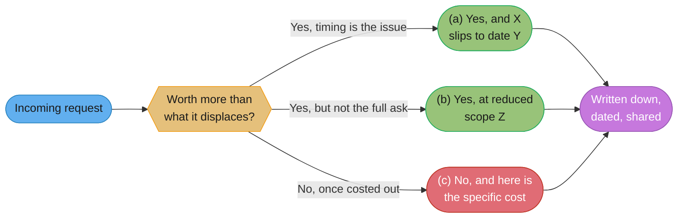
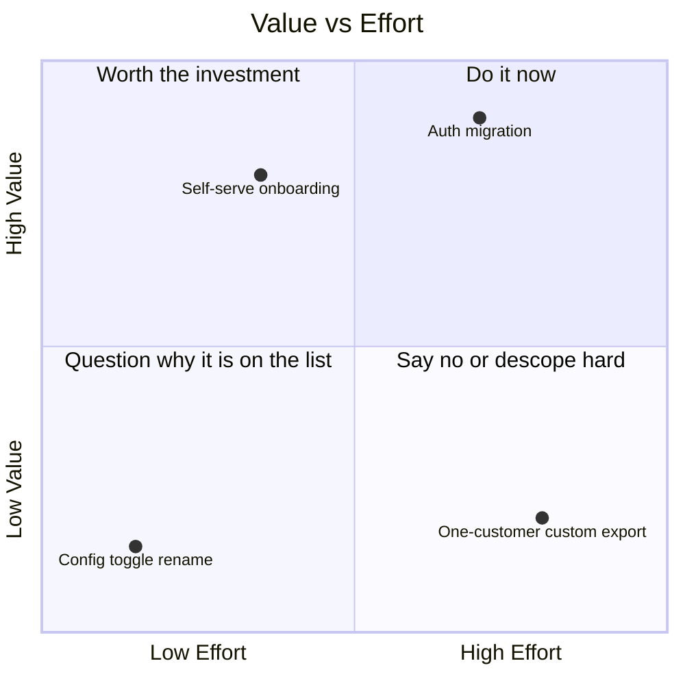
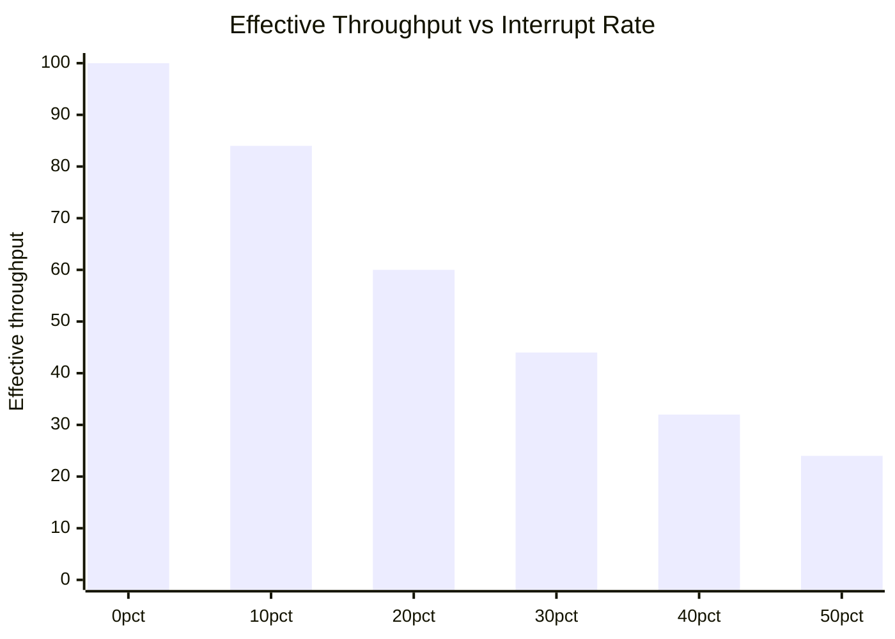

# Scope, Prioritisation & Saying No

## 1. Concept Overview

Every engineer past their first year has more requests than hours. A staff engineer has
more requests than hours by an order of magnitude larger than an IC's, because the
requests scale with how many people know your name. The skill this module teaches is not
"time management" — it is deciding, out loud, in front of the person who asked, what does
not happen, and doing it in a way that leaves the relationship and your reputation intact
on the other side of the conversation.

Most engineers never learn this explicitly. They learn to build things, and they absorb
"be a team player" as an unexamined default, which quietly becomes "say yes to everything
and let the schedule absorb the damage." The schedule cannot absorb unlimited damage. What
actually happens is one of three things: the original commitment slips silently, quality
degrades in ways nobody chose on purpose, or the engineer burns out doing the work of two
roles at the pace of one. None of those are decisions. They are what happens when nobody
made the decision on purpose. This module is about making it on purpose, and saying it out
loud in a sentence the other person can actually act on.

---

## 2. Intuition

> **One-line analogy**: every yes is a loan against a budget you cannot see, and the
> interest comes due on a project that has nothing to do with the person you said yes to.

**Mental model.** Capacity is fixed over any short window and every commitment is a claim
against it. A request that sounds free — "can you just take a quick look," "can you add
one more field," "can you sit on this working group" — is never actually free; it is a
claim against the same finite pool of hours as the roadmap item with a customer's name on
it. The claim is invisible at the moment you say yes and completely visible six weeks
later, when the roadmap item slips and nobody can point to a single decision that caused
it.

**Why it matters.** The gap between senior and staff-plus engineers is rarely technical
skill at that point — it is almost entirely the ability to see and communicate this
invisible ledger before it becomes a visible failure. An engineer who can build anything
but cannot say no to anything has a throughput ceiling equal to whoever is loudest, not
whoever matters most.

**Key insight.** The word "no" is almost never the actual tool. The actual tool is a
counter-offer: a specific, costed alternative that gives the other person something to
react to. "No" ends a conversation with nothing on the table; a counter-offer keeps it
moving and usually gets a better outcome for both sides than either the full yes or the
flat refusal would have.

---

## 3. Core Principles

- **Every yes is a no to something else, whether or not anyone says the something-else out
  loud.** The unstated no is where scope creep and burnout both come from — not from any
  single bad decision, but from a hundred yeses that never named their opportunity cost.
- **Refusing a request and refusing a person are different acts, and conflating them is
  why engineers over-commit.** You can decline the ask and still respect the asker; the
  fear of the opposite is what drives silent overcommitment.
- **A counter-offer beats a refusal almost every time.** "No" is a dead end the other
  person has to route around alone; "yes, and here's what moves" gives them something to
  work with immediately.
- **Opportunity cost only persuades when it is specific.** "We have other priorities"
  convinces nobody, because it could be said about anything. "This is six engineer-weeks,
  the same six weeks that retires the auth migration blocking two other teams" is a
  sentence a VP can act on in the next five minutes.
- **A framework only launders a guess into a number if every input to it was also a
  guess.** RICE, MoSCoW, and Cost of Delay are communication tools that make a judgment
  legible to other people, not calculators that remove the judgment from the room.
- **Protecting a team's focus is a leadership act with a mechanism, not a personality
  trait.** "Protect the team" without an interrupt budget or a rotation is a slogan; with
  one, it is a policy someone can actually run.
- **Being overruled and being wrong are different events**, and conflating them is why
  engineers either sandbag their objections in advance or refuse to let go afterward.
  Naming your objection clearly, then committing fully once the call is made, is the
  entire skill.

---

## 4. Types / Levels / Modes

**The three shapes of counter-offer**, which cover nearly every prioritisation
conversation an engineer has:

| Shape | What it says | When it fits |
|---|---|---|
| (a) Yes, and it slips | "Yes, and X moves to date Y" | The work is worth doing and nothing else needs to be cut, only re-sequenced |
| (b) Yes, at reduced scope | "Yes, at reduced scope Z, which gets you most of the value" | The full ask is more than the actual need; a smaller version ships faster and satisfies the real interest |
| (c) No, and here is the cost | "No, and here is the specific thing I would have to stop doing, which costs more than this is worth" | The ask is real but the tradeoff, once named, is not worth taking |

**Three directions of "no," each with a different currency owed:**

- **Upward** (to your manager, a VP, a director) — you owe **options and a
  recommendation**. The person above you has less context on the work than you do and
  more context on the business than you do; your job is to translate your context into
  their decision, not to make the decision unilaterally or hand them a bare refusal.
- **Sideways** (to a peer team, a PM, another engineer at your level) — you owe **an
  alternative and a timeline**. Nobody outranks anyone in this conversation, so a refusal
  with nothing attached reads as a power move even when it is not meant as one.
- **Downward** (to a report, a more junior engineer who asked you to take something on) —
  you owe **the reasoning, not just the answer**. This is the one conversation where the
  goal is partly teaching: a junior engineer who only ever hears "no" from you learns
  nothing about how to make the call themselves next time.

**Two kinds of prioritisation input**, which most frameworks conflate:

- **Legible judgment** — a human weighing tradeoffs and writing the reasoning down in a
  form someone else can inspect and argue with.
- **A number that looks objective but is actually five guesses multiplied together** —
  which is what happens when a scoring framework's inputs (reach, impact, confidence) are
  all estimated by the same person in the same five minutes with no data behind any of
  them. The framework did not remove the guessing; it hid it behind a decimal point.

---

## 5. Models & Frameworks Diagrammed



*Every incoming request routes to one of exactly three answers — never a bare yes and
never a bare no — and every answer gets written down where the asker and anyone above
them can see it, which is what makes the decision durable past the meeting it was made
in.*



*Plotting a backlog on effort against value makes the department-of-no trap visible: the
top-right item (high value, high effort) is the one worth a real yes, and the
bottom-right item (high effort, low value) is the one a specific counter-offer should
kill outright rather than quietly absorb.*



*Throughput does not fall linearly with the interrupt rate — it falls faster, because
every interruption costs the resumption time on top of the interruption itself; the
mechanism behind this curve is in §6.6.*

---

## 6. How It Works — Detailed Mechanics

### 6.1 Why engineers say yes to everything

The incentives are lopsided in a specific, structural way, not a personality-flaw way.
Saying yes costs nothing today — it is a sentence, said once, that feels generous and
ends the conversation on good terms. The cost of that yes shows up six weeks later, spread
across a slipped date, a degraded review, or a weekend someone worked, and by then it is
attributed to "the schedule" or "scope creep" rather than to the specific yes that caused
it. Saying no, by contrast, costs something immediately and visibly: an awkward pause, a
disappointed face, a Slack message that sits unanswered for twenty minutes while the other
person decides how to react. Humans are extremely good at avoiding a small certain cost
paid now in exchange for a larger uncertain cost paid later by someone else, including a
later version of themselves. That asymmetry, not a lack of backbone, is why "just say no"
as advice fails almost every time it is given without a replacement behavior attached.

The second piece is that refusing a request often feels, wrongly, like refusing the
person who asked. A PM who hears "we can't take that on this sprint" flinches the same way
whether the "we" means "the team's capacity is fully committed" or "I personally do not
want to do this," and most engineers, correctly reading that the PM cannot tell the
difference from the outside, avoid saying either one. The fix is not more confidence — it
is separating the refusal from the relationship explicitly, in the words used, every
single time (§6.7).

### 6.2 The iron triangle, and the fourth variable nobody names

Project management has a durable if slightly tired shorthand: **scope, time, and
resources** are three sides of a triangle, and fixing any two determines the third.
Ship a fixed scope on a fixed date and you need the resources (headcount, budget, tooling)
that combination requires; fix the resources and the date and the scope that survives is
whatever those resources can build by then; fix the scope and the resources and the date
falls out as a consequence, not a choice.

**What the triangle leaves out is quality**, and that omission is not an accident — it is
exactly where the damage goes when someone insists on fixing all three of the named sides
at once. "We need the full scope, by the original date, with the team we already have" is
a request to hold three sides of a triangle fixed and still get a valid shape, which is
geometrically impossible; what actually happens is the fourth, unnamed variable absorbs
the impossibility invisibly — tests get skipped, code review gets rubber-stamped, the
on-call load spikes the following quarter, and nobody wrote any of that down as a decision
because nobody framed the request as requiring one.

**"We'll just work harder" is the semi-fourth variable that people reach for instead of
naming quality's collapse honestly.** It works exactly once, for exactly one sprint, at
the cost of the same team's capacity the sprint after — a debt against future throughput
that is real, has interest, and comes due whether or not anyone tracked it. Treat "we'll
work harder" as a specific, time-boxed, costed loan against next quarter's capacity, not
as a free fourth lever, and say that plainly when someone proposes it as the answer to an
impossible triangle.

### 6.3 The counter-offer, not the refusal

This is the single most useful move in this module. The three shapes from §4, in full,
as complete messages you can send close to verbatim:

**(a) Yes, and it slips.**

> Yes, I can build the export feature. Taking it on means the dashboard redesign moves
> from this sprint to the one after — same team, same total capacity, just resequenced.
> If that tradeoff works for you, I will start on the export tomorrow.

**(b) Yes, at reduced scope.**

> Yes, and here is a version that ships this week instead of in three: CSV export of the
> three fields your team actually uses in the demo, not the full six-format exporter with
> scheduling. That gets you unblocked for Thursday. If you need the full version later, it
> is a separate two-week piece of work I can scope properly once the deadline pressure is
> off.

**(c) No, and here is the specific cost.**

> I can't take this on without pulling someone off the payments reconciliation bug, which
> is the thing three customers are actively escalating about. If reconciliation can wait a
> week, I can do both. If it can't, this has to wait — and I'd rather tell you that now
> than in two weeks when neither one is done well.

Every one of these does the same three things: it names what happens to the thing being
displaced, it puts a real number or a real name on the cost, and it gives the other person
something concrete to react to instead of an abstract "no." Notice that (a) and (b) are
not really refusals at all — most requests that feel like a yes/no decision are actually
asking for one of these two, and jumping straight to (c) when (a) or (b) would have worked
is its own failure mode, covered in §10.

### 6.4 Making opportunity cost concrete

**The general argument never wins**, because it is unfalsifiable and unmemorable in the
same sentence: "we have other priorities" could justify declining literally anything, so
it persuades nobody and is forgotten five minutes after it is said. **The specific
argument does the work the general one cannot**, because it can be checked, argued with,
and remembered.

**Weak version**

> We can't take on the reporting dashboard right now, we have other priorities this
> quarter.

**Strong version**

> The reporting dashboard is roughly six engineer-weeks. Those same six weeks retire the
> auth migration, which is currently blocking two other teams from shipping their own
> features — Payments has been stuck on it since March 3rd, and Growth flagged it as their
> top blocker in last week's planning. If the dashboard is more urgent than unblocking two
> teams, I want to hear why, because right now the arithmetic says it isn't.

**What changed:** the weak version names no number, no alternative, and no consequence — it
can be agreed with, filed away, and revisited never. The strong version puts a size on the
ask (six engineer-weeks), names the specific thing that size buys instead (retiring a
blocker with two named downstream teams and a date), and explicitly invites disagreement
on the comparison rather than asserting it as final. A stakeholder who hears the strong
version has an actual decision to make; a stakeholder who hears the weak version has
nothing to push back on and nothing to agree to either — the conversation simply evaporates
and the request resurfaces unchanged in two weeks.

### 6.5 Prioritisation frameworks, used honestly

None of the frameworks below produce a decision. They produce a **shared, inspectable
representation of a judgment**, which is a different and more modest claim than the one
most teams implicitly make when they adopt one. A framework whose every input is a guess
does not stop being a guess when it is multiplied by three other guesses and rounded to
two decimal places — it becomes a guess that looks precise, which is worse than a guess
that looks like one, because it stops getting questioned.

**RICE** (Reach, Impact, Confidence, Effort), created by Sean McBride at Intercom and
published on Intercom's product blog, scores a candidate feature as:

```
RICE score = (Reach x Impact x Confidence) / Effort
```

- **Reach** — how many people (or events) this touches in a fixed period, e.g. "customers
  per quarter."
- **Impact** — Intercom's own scale is discrete, not continuous: Massive = 3, High = 2,
  Medium = 1, Low = 0.5, Minimal = 0.25.
- **Confidence** — a percentage, typically banded at 100% (high confidence, backed by
  data), 80% (medium), or 50% (a real guess, stated as one rather than disguised as one).
- **Effort** — person-months of work, estimated by the people who would do it.

RICE's actual value is not the sorted list it produces; it is that it forces four
separate, named conversations (how many people, how much does it move the needle, how
sure are we, how expensive is it) instead of one vague argument about priority, and it
makes each of those four inputs visible and arguable on its own rather than buried inside
a single "gut feeling" score.

**MoSCoW**, created by Dai Clegg at Oracle around 1994 and adopted into the Dynamic
Systems Development Method (DSDM), sorts requirements into exactly four buckets, named
this precisely:

- **Must have** — the release fails without it.
- **Should have** — important, painful to omit, but the release survives without it.
- **Could have** — desirable, cut first if time runs out.
- **Won't have (this time)** — explicitly out of scope for this release, not forever.

The last bucket's exact wording — "this time," not a flat no — is the part teams drop
when they adopt MoSCoW informally, and it is the part that matters most: it converts a
scope argument into a sequencing argument, which is a much easier conversation to have
with a stakeholder than an argument about whether their request has any merit at all.

**The Eisenhower matrix** traces to a 1954 speech in which Dwight Eisenhower quoted an
unnamed university president: *"I have two kinds of problems, the urgent and the
important. The urgent are not important, and the important are never urgent."* Stephen
Covey popularized the two-axis version as the "Time Management Matrix" in *The 7 Habits
of Highly Effective People* (Free Press, 1989). Plotting work on urgency against
importance surfaces four kinds of demand: the urgent-and-important crisis that must be
handled now; the important-but-not-urgent work — planning, architecture reviews,
relationship-building, the auth migration nobody is yet screaming about — that Covey
argues is where the actual leverage lives and where most teams under-invest because
nothing forces attention to it; the urgent-but-unimportant interruption that feels
important only because it is loud; and the neither-urgent-nor-important item that should
simply be declined. (There is no single, universally cited canonical wording for the four
quadrant names beyond Covey's numbering — treat the axes and the four categories of
demand as the durable part, not any particular four-word label you may see attached to
them online.)

**Cost of Delay and Weighted Shortest Job First (WSJF)** are the pair that changes actual
engineering decisions rather than merely organizing a backlog, because they convert
"which one first" from a ranking argument into arithmetic. Donald Reinertsen's *The
Principles of Product Development Flow* (Celeritas, 2009) is the origin, and the line
worth remembering is Reinertsen's own: *"If you only quantify one thing, quantify the
Cost of Delay."* The Scaled Agile Framework (SAFe) operationalizes it as:

```
WSJF = Cost of Delay / Job Size
Cost of Delay = User-Business Value + Time Criticality + Risk Reduction / Opportunity Enablement
```

Job Size is a relative estimate of the effort, the same as any other estimate a team
already produces. The result of dividing Cost of Delay by Job Size is not "the highest-
value job first," which is the mistake teams make when they skip the division — it is
**the highest value per unit of time invested first**, which is a materially different and
usually better answer: a smaller job that unblocks two teams can rank above a larger job
that delivers more raw value but ties up the team for three times as long doing it.

**The honest caveat, stated plainly**: every one of these frameworks takes as input
numbers a human estimated, and none of them can tell you whether those numbers were any
good. A RICE score computed from five minutes of gut-feel reach, impact, and confidence
numbers is not more objective than the gut feeling it replaced — it is the same gut
feeling wearing a decimal point, and the decimal point's only real effect is to make the
number harder to argue with, which is the opposite of what a good prioritisation tool
should do. Use these frameworks to force the right conversations into the open, not to
outsource the judgment those conversations require.

### 6.6 Protecting the team's focus

**The interrupt budget** is a stated, agreed ceiling on how much of a team's capacity goes
to unplanned work — Slack questions, "quick" reviews for other teams, on-call, ad hoc
debugging requests — versus planned roadmap work, made explicit rather than absorbed
silently. A team that has never stated its interrupt budget usually discovers it only
retroactively, when a sprint's committed work slips and someone asks why, and "why" turns
out to be forty Slack threads that never individually looked large enough to push back on.

**Why a 20% interrupt rate costs far more than 20% of throughput** is a mechanism, not an
opinion: every interruption carries a resumption cost on top of the interruption's own
duration — the time to reload the mental state of the task you were doing before the
interruption, which for genuinely complex engineering work is commonly cited at several
minutes to tens of minutes depending on how deep the context was, not zero. A five-minute
Slack question that arrives mid-debugging can cost thirty minutes of actual throughput
once the reload is counted, and a team fielding interruptions all day never accumulates
the long uninterrupted blocks that hard problems actually require — which is why the
xychart in §5 shows throughput falling faster than the interrupt rate itself: the damage
compounds, it does not merely add up.

**The interrupt rotation is the mechanism, not the aspiration.** One person per week (or
per sprint) is designated the interrupt-catcher: they take the Slack questions, the
"can someone just look at this" requests, the small unplanned asks, while everyone else's
calendar stays genuinely protected. The rotation makes the interrupt budget real instead
of a value statement, because it gives every interruption a single named owner instead of
letting it land on whoever answers Slack fastest, which in practice is usually the same
one or two people every time.

**A staff engineer's specific job here is absorption, not just advocacy.** Being the
person who fields the incoming asks from other teams, pre-filters which ones actually
need the team's attention versus which ones the staff engineer can answer or redirect
alone, and only escalates the genuinely team-worthy ones, is a direct, measurable way a
single senior person increases a whole team's effective throughput without writing any of
the code themselves.

### 6.7 Saying no upward, sideways, and downward

Three different conversations, three different currencies owed (§4), shown as complete
weak-to-strong pairs.

**Upward — to a VP or director.**

**Weak version**

> I don't think we can hit that date, it's just not realistic with the current team.

**Strong version**

> Here are three ways to get you something real by the 15th. Option A ships all eight
> endpoints in eight weeks with the current team. Option B ships the three endpoints your
> customer actually needs for integration testing in four weeks, the rest six weeks after
> that. Option C ships all eight in four weeks, but only if the open headcount req gets
> approved this week and the hire ramps in two — which I don't think is realistic, and I'm
> flagging it mainly so you can see what "everything, by the 15th" would actually require.
> I recommend Option B.

**What changed:** the weak version is a flat assessment with no path forward, which forces
the VP to either overrule it or escalate further without new information either way. The
strong version supplies options and a recommendation — the specific currency owed upward
— so the VP's actual decision is a five-second choice among three named tradeoffs instead
of an open-ended argument about whether the date is real.

**Sideways — to a peer team's lead.**

**Weak version**

> We can't help with your migration right now, sorry, we're slammed.

**Strong version**

> We can't join the migration this sprint — we're mid-incident-followup on last week's
> payments issue, and splitting focus now risks both. I can commit one engineer starting
> the week after next, or if it's more urgent than that, I think the platform team has
> more slack than we do right now. Either way I'll put our answer in the migration doc so
> it's not just verbal.

**What changed:** the weak version offers nothing and implicitly asks the other team to
just wait and hope. The strong version names the real constraint, offers a concrete
alternative timeline, and points to a second real option — the alternative and timeline
owed sideways, where neither party outranks the other and a bare refusal reads as a power
move even when none was intended.

**Downward — to a report or a more junior engineer.**

**Weak version**

> No, we're not doing that, focus on your current tickets.

**Strong version**

> Not this sprint, and here's why: that refactor is real and worth doing, but it touches
> the same files as the migration you're already on, and running both at once risks
> merge conflicts that cost more time than either saves separately. Once the migration
> ships, I want you to actually pick this back up — file it as a follow-up ticket now so
> it doesn't just disappear, and let's talk about sizing it properly then.

**What changed:** the weak version gives an answer with no reasoning, which teaches a
junior engineer nothing about how to make this call themselves next time and reads as an
arbitrary exercise of authority. The strong version explains the actual reasoning (file
overlap, real cost of parallel work), commits to revisiting it rather than burying it, and
treats the junior engineer's instinct as correct even while declining the timing — the
explanation-of-reasoning owed downward is the one direction of "no" that is partly a
teaching act.

### 6.8 The no you should not say

Not every "no" protects the team's priorities — some protect the speaker's territory
instead, and the two feel identical from the inside. **Watch for this specific tell**: if
the honest reason for declining a piece of work is "that's not my area" or "that's not
what my team does," rather than "we genuinely have something more valuable to do with the
time," the no is defending a boundary, not a priority, and the work may well be more
valuable than anything currently on the roster.

The corrective is not to say yes to everything that crosses a boundary; it is to run the
same opportunity-cost arithmetic from §6.4 on the work being declined as on the work
already committed. If a request that "isn't mine" is genuinely worth more than the lowest-
value thing currently on the roadmap, the honest answer is to take it and drop the lower-
value item — even though doing so requires admitting that something already committed to
should not have been. That admission is uncomfortable in a specific, recognizable way that
is worth naming to yourself as a signal: discomfort at admitting a prior commitment was
wrong is not the same discomfort as genuinely being at capacity, and confusing the two is
how territory gets defended under the flag of prioritisation.

### 6.9 When you are overruled

Disagreeing and then being overruled is a normal, healthy outcome of a functioning
decision process, not a failure of the process or of the engineer who lost the argument.
What separates a team that recovers well from a decision that turns out wrong from one
that does not is almost entirely what happens in the five minutes after the decision is
made, not whether the decision itself was correct.

**Weak version**

> Fine, we'll do it your way, but don't say I didn't warn you.

**Strong version**

> Understood — we're going with the four-week timeline. For the record, I think the risk
> is the three cut corners in testing, and I want that written down so we can revisit it
> fast if it bites us, not so I can say I told you so. I'm fully in on making this work;
> what do you need from me first?

**What changed:** the weak version commits in words only and plants a landmine for later —
the sentiment "don't say I didn't warn you" telegraphs that the speaker is rooting for the
decision to fail, which corrodes trust and effort simultaneously. The strong version
commits genuinely (the offer to help, asked immediately and concretely) while still
preserving the one thing worth preserving: **the specific tradeoff named, in writing,
dated, without editorializing** — not to win an argument later, but so that if the risk
does materialize, the team can see quickly which known risk it was rather than re-
litigating the whole decision from scratch under pressure. This is the entire content of
"disagree and commit," done properly: disagree once, clearly, on the record; then commit
fully, with no residue.

### 6.10 Scope creep — the version of this nobody notices

Scope creep almost never arrives as one obviously-too-big request that a person can push
back on cleanly. It arrives as a "small addition" in a design review, a requirement that
surfaces after the estimate was already given, a feature that grew 40% across a string of
individually reasonable-sounding review comments, none of which felt, on its own, worth
fighting over. By the time the total is visible, there is no single moment anyone can
point to as the decision that caused it, because there wasn't one — there were forty
small ones, each too small to trigger the counter-offer machinery in §6.3.

**The mechanism that actually stops it is a written scope with an explicit "not in
scope" list**, not vigilance or willpower. A scope document that only states what a
project will do leaves every addition looking like a small, reasonable extension of
something already agreed; a scope document that also states, explicitly, what it will
**not** do turns each new ask into a visible amendment to a written agreement, which is a
different and much higher-friction thing to propose than an offhand comment in a review
thread.

**Weak version** (a design-review comment that quietly expands scope)

> While we're in here, can we also make this handle the bulk-import case? Shouldn't be
> much extra work.

**Strong version** (the pushback, in the same review thread)

> Bulk import is a real need, but it's not in this doc's scope — the "Not in scope"
> section explicitly calls out batch operations as a follow-up. Adding it here means
> re-estimating the whole piece, not just this corner of it. I'd rather file it as its own
> ticket and scope it properly than fold it in now under "shouldn't be much extra work,"
> which is exactly the sentence every scope-creep postmortem quotes afterward.

**What changed:** the weak framing treats the addition as self-evidently small, which is
precisely the framing that makes it hard to refuse in the moment. The strong version
points to the written boundary that already exists, names the real cost (re-estimating,
not just adding), and offers the legitimate path (a separate ticket) instead of either a
bare yes or a bare no — the same counter-offer shape from §6.3, applied to a review
thread instead of a planning meeting.

---

## 7. Real-World Examples

- **Basecamp's "Shape Up" methodology** (Ryan Singer, self-published, 2019) fixes both
  time and team size for every project — six-week cycles, a small fixed team — and treats
  scope as the only variable allowed to flex, which is the iron triangle from §6.2 run
  deliberately in one specific direction rather than left to whichever side quality
  silently absorbs the pressure.
- **Intercom's own product blog** documents RICE (§6.5) as it uses it internally,
  including the exact Impact scale and the explicit acknowledgment that RICE scores are a
  starting point for a conversation among the product team, not a final ranking to be
  followed mechanically.
- **The Scaled Agile Framework's WSJF adoption** (Dean Leffingwell, Scaled Agile Inc.,
  first published circa 2011) is the widest enterprise deployment of Cost of Delay
  thinking, used explicitly to sequence Program Increment planning across dozens of teams
  at large regulated companies where "which team's work goes first" is a genuinely
  contentious, high-stakes question that benefits from a shared, inspectable arithmetic.
- **Amazon's internal "single-threaded owner" model**, described in Colin Bryar and Bill
  Carr's *Working Backwards* (St. Martin's Press, 2021), assigns one accountable owner to
  a major initiative specifically so that scope and priority tradeoffs have a single named
  decision-maker rather than being negotiated ambiently across a committee, which is a
  structural answer to the "department of no" failure mode in §10.

---

## 8. Tradeoffs

| Approach | Strength | Cost |
|---|---|---|
| Counter-offer (yes-and, yes-reduced, no-and-cost) | Keeps the conversation moving; usually lands closer to the real need | Requires knowing your own capacity numbers well enough to cost the offer honestly |
| Flat refusal | Fast, unambiguous | Reads as unhelpful or territorial; gives the asker nothing to work with |
| RICE / MoSCoW / WSJF scoring | Makes judgment legible and arguable across a team | Only as good as its inputs; can launder guesses into false precision |
| Ad hoc gut-feel prioritisation | Fast, no process overhead | Invisible to anyone not in the room; impossible to audit later or hand off |
| Interrupt rotation | Protects the rest of the team's focus; makes the cost of interrupts visible | Whoever is on rotation absorbs a genuinely worse week |
| Silent absorption ("we'll work harder") | Feels like a yes with no visible cost today | Debt against next quarter's capacity, with interest, paid by people who did not agree to the loan |
| Written scope with a "not in scope" list | Converts scope creep from ambient drift into a visible amendment | Takes real time to write well; a vague "not in scope" list is nearly as useless as none |

---

## 9. When to Use / When NOT to Use

**Use the counter-offer machinery whenever a request has any real cost** — which is nearly
every request that touches engineering time, even ones that feel too small to formalize.
The instinct to skip it for "quick" asks is exactly how scope creep in §6.10 happens.

**Use a scoring framework (RICE, WSJF) when you have more than a handful of candidate
items and need a shared, arguable representation** — not when you have two items and an
obvious answer, where running a framework just delays a decision everyone already agrees
on.

**Do not run a scoring framework when its inputs are pure guesses made in the room in five
minutes** — either go get real data first, or skip the framework and say plainly "this is
a judgment call, here is my reasoning," which is more honest and no less useful than a
fabricated-precision score.

**Escalate rather than continue absorbing when the interrupt rate has genuinely exceeded
the stated budget for more than one cycle** — a team that has quietly normalized a 40%
interrupt load has stopped running the team it thinks it's running, and the fix is a
conversation with whoever controls the incoming requests, not more individual heroics.

**Take work that "isn't yours" when the opportunity-cost arithmetic genuinely favors it**
(§6.8) — territory is not a valid reason to decline something more valuable than what you
are already doing.

---

## 10. Common Pitfalls

- **The silent no.** Accepting a request out loud and then quietly not doing it, hoping
  it gets forgotten or reprioritized without a conversation — a mid-size fintech's
  platform team tracked its own backlog after a reorg and found eleven "committed"
  items that had silently rolled for two quarters with no one ever formally declining any
  of them; the stakeholders had assumed progress the entire time and the resulting trust
  repair took longer than simply saying no up front ever would have.
- **The martyr yes.** Saying yes to everything and absorbing the cost personally through
  unpaid overtime, which looks like heroism for one or two sprints and reads, in hindsight,
  as the reason nobody ever learned the team was over capacity — the cost was real, it was
  just invisible to everyone except the person paying it, until they quit.
- **The department of no.** A team or reviewer who declines nearly everything on
  principle, without ever running the specific opportunity-cost arithmetic in §6.4,
  becomes a bottleneck other teams route around rather than a filter that improves what
  gets built — one platform team at a mid-size company earned an internal reputation as
  "impossible to get anything through," and the eventual fix was measured: every review
  request had to get a counter-offer within 48 hours, never a bare rejection, which cut
  the routing-around behavior within a quarter.
- **Passive-aggressive estimate inflation.** Padding an estimate to make an unwanted
  request quietly go away instead of declining it directly — this reads as competence to
  everyone who doesn't know it's happening and destroys the estimator's credibility the
  moment anyone compares two of their estimates for similar work and notices the pattern.
- **Renegotiating after committing.** Agreeing to a scope and date in the room, then
  raising new objections a week later once the discomfort of disagreeing in the moment has
  faded — this is the opposite failure from §6.9's "disagree and commit," and it costs
  more trust than raising the objection honestly the first time would have, because it now
  looks like bad faith rather than honest disagreement.
- **Saying no without ever asking why they asked.** Declining a request based on its
  literal content without ever asking what problem it's actually solving for the requester
  — an engineering team once spent two sprints resisting a "make the dashboard refresh
  faster" request as low-value polish, only to discover in a five-minute follow-up
  conversation that the real ask was "the on-call engineer needs this number correct
  within thirty seconds during an incident, not fast for its own sake" — a completely
  different, much higher-priority problem hiding behind a request that sounded cosmetic.

---

## 11. Frameworks, Books & Further Reading

- Sean McBride / Intercom — "RICE: Simple Prioritization for Product Managers" (Intercom
  product blog). Source of the RICE formula and Intercom's Impact scale.
- Dai Clegg — originator of MoSCoW at Oracle (circa 1994), adopted into the Dynamic
  Systems Development Method (DSDM Consortium). Source of the Must/Should/Could/Won't
  categories.
- Donald G. Reinertsen — *The Principles of Product Development Flow: Second Generation
  Lean Product Development* (Celeritas Publishing, 2009). Source of Cost of Delay as the
  central economic quantity in sequencing decisions.
- Dean Leffingwell / Scaled Agile Inc. — the Scaled Agile Framework (SAFe), source of the
  WSJF formula and its Cost of Delay sub-components as used in enterprise Program
  Increment planning.
- Stephen R. Covey — *The 7 Habits of Highly Effective People* (Free Press, 1989). Source
  of the popularized urgent/important Time Management Matrix.
- Ryan Singer — *Shape Up: Stop Running in Circles and Ship Work that Matters*
  (Basecamp, self-published, 2019). Six-week cycles with fixed time and team, variable
  scope, as a deliberate iron-triangle policy.
- Colin Bryar and Bill Carr — *Working Backwards: Insights, Stories, and Secrets from
  Inside Amazon* (St. Martin's Press, 2021). Source of the single-threaded-owner model
  referenced in §7.
- Related module: [Negotiation for Engineers](../negotiation_for_engineers/negotiation_for_engineers.md)
  — BATNA, ZOPA, and the counter-offer as a negotiating move, which §6.3 here specializes
  for scope and prioritisation specifically.
- Related module: [Influence Without Authority](../influence_without_authority/influence_without_authority.md)
  — moving a decision, including a scope decision, when you have no formal authority to
  say no unilaterally.
- Related module: [Mentorship & Sponsorship](../mentorship_and_sponsorship/mentorship_and_sponsorship.md)
  — the specific case of saying no downward as a teaching act (§6.7), extended into
  growing someone's own judgment over months.

---

## 12. Interview Questions with Answers

**Q: Your manager asks you to commit to a deadline you believe is unrealistic. What do you actually say?**
**Short:** Bring costed options and a recommendation instead of a flat "that's not realistic."

Never answer with a bare assessment — bring three costed options and a recommendation:
"here's what all-scope-by-that-date requires, here's a reduced scope that hits the date,
here's the full scope at a later date; I recommend the second." A flat "not realistic"
forces your manager to either overrule you with no new information or escalate blind;
options with a recommendation give them an actual five-second decision to make, which is
the specific currency you owe upward (§4, §6.7).

**Q: A peer team asks for help you genuinely can't give this sprint. How do you decline without it reading as a power move?**
**Short:** Name the real constraint, offer a concrete alternative timeline, and point to another real option.

State the actual conflict ("we're mid-incident-followup"), commit to a specific future
date rather than a vague "later," and if you know of one, name another team with more
slack. A bare "we're slammed, sorry" gives a peer nothing to plan around and reads as
dismissive precisely because nobody outranks anyone in a sideways conversation — the
alternative and timeline are what you owe (§4, §6.7).

**Q: What's wrong with just telling a stakeholder "we have other priorities" when declining their request?**
**Short:** It's unfalsifiable and forgettable, so it convinces nobody and gets revisited unchanged.

It could justify declining literally anything, so it persuades nobody and gets forgotten
the moment the meeting ends, which is why the same request resurfaces two weeks later
unchanged. The fix is arithmetic: "this is six engineer-weeks, the same six weeks retires
the auth migration blocking two named teams" — a claim that can be checked, argued with,
and remembered, unlike a vague appeal to unnamed priorities.

**Q: What is the RICE framework, and what does each letter actually score?**
**Short:** Reach, Impact, Confidence, Effort — RICE score = (Reach x Impact x Confidence) / Effort.

Reach is how many people or events something touches in a fixed period; Impact uses
Intercom's discrete scale (Massive 3, High 2, Medium 1, Low 0.5, Minimal 0.25); Confidence
is a percentage reflecting how much data backs the estimate (100/80/50% bands are typical);
Effort is person-months. The score is (Reach x Impact x Confidence) / Effort, and its real
value is forcing four separate, arguable conversations rather than one vague priority
argument.

**Q: What is Cost of Delay, and why does Reinertsen call it the one thing worth quantifying?**
**Short:** The economic cost of NOT shipping something sooner; it turns "which first" into arithmetic.

Cost of Delay is what it costs, per unit time, to not have shipped something yet — lost
revenue, blocked teams, accumulating risk. Reinertsen's line, "if you only quantify one
thing, quantify the Cost of Delay," matters because most prioritisation debates argue
about value in isolation and ignore time; dividing Cost of Delay by job size (WSJF) reveals
that a smaller job unblocking two teams can beat a larger, higher-value job that ties up
the team three times as long.

**Q: What are the exact four MoSCoW categories, and what does the last one actually mean?**
**Short:** Must have, Should have, Could have, Won't have (this time) — the last is a sequencing call, not a rejection.

Must have (release fails without it), Should have (important but survivable to omit),
Could have (desirable, cut first under time pressure), and Won't have this time —
explicitly not "never," which converts a scope argument into a sequencing argument, an
easier and more honest conversation to have with a stakeholder than a flat rejection.

**Q: When should you take on work that "isn't yours to take"?**
**Short:** When the opportunity-cost arithmetic genuinely favors it over something already on your roster.

Run the same specific-cost comparison you'd run on any competing request: if the work is
genuinely worth more than the lowest-value item already committed, take it and drop the
lower-value item, even though that means admitting the prior commitment was wrong. The
tell that you're instead defending territory is reaching for "that's not my area" rather
than "we have something more valuable to do with this time" — the first is a boundary
claim, the second is a priority claim, and only the second is a legitimate reason to say
no.

**Q: You argued against a decision and got overruled. What do you do in the next five minutes?**
**Short:** Commit fully and immediately, and write down the risk you named, dated, without an I-told-you-so.

Commit out loud and mean it — ask what's needed from you first, not "we'll see." Separately,
write down the specific risk you flagged, dated, in the doc — not to win an argument later,
but so the team can see quickly which known risk it was if it does materialize, instead of
re-litigating the whole decision under pressure. What you must not do is commit in words
only while quietly rooting for the decision to fail; that reads clearly to everyone within
weeks.

**Q: What's the difference between saying no upward, sideways, and downward?**
**Short:** You owe options and a recommendation upward, an alternative and timeline sideways, reasoning downward.

Upward, the other person has less project context and more business context than you, so
you owe options plus a recommendation that translates your context into their decision.
Sideways, nobody outranks anyone, so you owe a concrete alternative and timeline or a bare
refusal reads as a power move. Downward, the conversation is partly a teaching act, so you
owe the actual reasoning, not just the answer, or the junior engineer learns nothing about
making this call themselves next time.

**Q: What is scope creep, mechanically, and what actually stops it?**
**Short:** Dozens of individually-small additions with no single moment to push back on; a written "not in scope" list stops it.

It rarely arrives as one big, refusable ask — it's forty small "while we're in here" review
comments, none of which individually triggers a counter-offer. A scope document that states
what a project explicitly will NOT do converts each new ask from a self-evidently-small
extension into a visible amendment to a written agreement, which is much higher friction to
propose casually than a comment in a review thread.

**Q: What is the interrupt budget, and why does a 20% interrupt rate cost more than 20% of throughput?**
**Short:** A stated ceiling on unplanned work; each interruption also costs a resumption penalty, so damage compounds.

The interrupt budget is an explicit, agreed cap on how much capacity goes to unplanned
asks versus planned work, made visible instead of silently absorbed. It costs more than
its raw share because every interruption also costs the time to reload the mental state of
the interrupted task — a five-minute Slack question mid-debugging can cost thirty real
minutes once the reload is counted — so interrupted teams lose the long uninterrupted
blocks that hard problems require, not just the interruption's own duration.

**Q: What's the actual mechanism of an interrupt rotation, and why does it work better than "everyone just be more disciplined"?**
**Short:** One named person absorbs interrupts per cycle, so everyone else's calendar stays genuinely protected.

One person per week or sprint is the designated interrupt-catcher, fielding the Slack
questions and small unplanned asks so the rest of the team's blocks of focused time stay
intact. Naming a single owner makes the interrupt budget an enforceable policy instead of
an aspiration, because otherwise interruptions land on whoever answers fastest — usually
the same one or two people every time, invisibly and unfairly.

**Q: What's genuinely wrong with prioritisation frameworks like RICE, MoSCoW, or WSJF, honestly stated?**
**Short:** They're communication tools that make judgment legible, not calculators that remove the judgment.

Every input — reach, impact, confidence, job size — is a human estimate, and multiplying
several guesses together and rounding to two decimal places does not make the result more
objective; it makes a guess look precise, which is worse, because a precise-looking number
stops getting questioned. Use these frameworks to force the separate conversations they
require into the open, not to outsource the actual judgment to an equation.

**Q: What is the "iron triangle," and what happens if someone insists on fixing scope, time, and resources all at once?**
**Short:** Fixing all three is geometrically impossible; the pressure lands invisibly on quality instead.

Scope, time, and resources are three sides of a triangle where fixing any two determines
the third; insisting on holding all three fixed forces the unnamed fourth variable —
quality — to silently absorb the impossibility: skipped tests, rubber-stamped review,
spiking on-call load, none of it decided on purpose. "We'll work harder" is not a real
fourth lever either — it's a costed, time-boxed loan against next quarter's capacity that
comes due whether or not anyone tracked it.

**Q: What's the difference between the "silent no" and an honest no, and why is the silent one worse?**
**Short:** The silent no is accepting a request and then quietly not doing it, which wastes the stakeholder's trust.

A silent no is agreeing out loud to a request and then not delivering, letting it roll
unaddressed rather than declining directly — the stakeholder assumes progress the entire
time, and by the time the gap is discovered, both the deliverable and the trust are gone.
An honest no, even an unwelcome one, at least lets the stakeholder route around the gap
immediately; the silent version costs strictly more, later, with no offsetting benefit.

**Q: What's the "department of no" anti-pattern, and what's the actual fix?**
**Short:** Declining nearly everything on principle instead of running real opportunity-cost arithmetic per request.

A reviewer or team that reflexively declines most requests without costing each one out
individually becomes a bottleneck people route around instead of a useful filter. The
practical fix is procedural, not attitudinal: require every rejection to arrive with a
counter-offer within a fixed window (say, 48 hours) rather than a bare no — it forces the
opportunity-cost arithmetic to actually happen instead of substituting a reflex for it.

**Q: Someone asks for a "small addition" during a design review. Why is this the moment scope creep actually happens?**
**Short:** Because it's framed as self-evidently small, which is exactly what makes it hard to refuse in the moment.

The framing "shouldn't be much extra work" pre-empts the counter-offer machinery that a
larger, obviously-costly ask would trigger automatically. The fix is to point at the
written scope's "not in scope" list if one exists, name the real cost (re-estimating, not
just adding), and route the addition to its own ticket — treating even a small ask with the
same yes-and/yes-reduced/no-and-cost structure as a large one, rather than waving it
through because it sounded small.

**Q: How do you tell whether you're protecting the team's priorities or just defending your own territory when you say no?**
**Short:** Check whether your reason is "that's not my area" versus "we have something more valuable to do."

If the honest reason is "that's not what my team does," it's a boundary claim, not a
priority claim, and the work in question may genuinely be worth more than what's already
committed. Run the opportunity-cost arithmetic on it the same way you would on any
competing request — the discomfort of admitting a prior commitment should be dropped is a
different, recognizable feeling from genuinely being at capacity, and conflating the two is
exactly how territory gets defended under the label of prioritisation.

---

## 13. Best Practices

- Never answer a real request with a bare yes or a bare no — answer with one of the three
  counter-offer shapes (§6.3) every time.
- Cost every "no" in a specific number and a specific name, never a generic appeal to
  "other priorities."
- Treat a scoring framework's output as the start of a conversation, never the end of one.
- Write the scope document's "not in scope" list as carefully as the in-scope list — it is
  the entire mechanism that stops creep.
- Run an interrupt rotation with a single named owner per cycle rather than leaving
  unplanned work to land on whoever answers first.
- After being overruled, commit fully within minutes and write down the risk you named,
  dated, without editorializing.
- Before declining a request, ask what problem it's actually solving — the literal ask is
  frequently not the real one.
- Audit your own recent refusals for the territory tell: "not my area" versus "not the
  best use of our time" are different claims, and only one of them is a valid no.

---

## 14. Case Study

**Scenario.** Priya is a staff engineer on a payments platform team. Three weeks before
quarter-end, the VP of Product asks her team to add real-time fraud scoring to checkout —
a genuinely valuable feature — on top of the team's existing quarter commitment: a
PCI-compliance migration with a regulator-set deadline that cannot move.

**The instinct to avoid.** Priya's first draft response, which she catches herself
writing and deletes, is "we're slammed this quarter, can this wait until next quarter" —
the generic-priorities move from §6.4, which she knows from experience gets escalated
rather than accepted, because it gives the VP nothing to evaluate.

**What she does instead.** She sizes the fraud-scoring work at roughly four engineer-weeks
and checks it against the compliance migration's actual slack, which is close to zero —
the regulator deadline is fixed and the team is already at full capacity against it. She
writes a short doc with three options: (A) fraud scoring this quarter, compliance
migration slips past the regulator deadline — flagged explicitly as not viable; (B) a
scoped-down version of fraud scoring — rule-based flagging on the three highest-risk
transaction types, not the full ML-scored version — shippable in one engineer-week without
touching the compliance work; (C) full fraud scoring next quarter, once compliance is
done, with a named engineer already assigned to start week one.

**The conversation.** The VP's actual interest, once Priya asks about it directly, turns
out to be a specific fraud pattern the support team has been escalating weekly, not
comprehensive fraud coverage — which Option B addresses almost entirely on its own. The VP
picks B for this quarter and C for the rest, in the room, without any further back-and-
forth, because the tradeoff was visible and costed rather than something to argue about
in the abstract.

**What made it work.** Priya never said the deadline was unreasonable and never said yes
to the full ask either. She translated a vague, high-stakes-sounding request into three
specific, costed paths, asked one question that surfaced the actual interest behind the
ask, and let the VP make a five-second decision instead of forcing a debate. The
compliance migration shipped on the regulator's date; the highest-value slice of fraud
scoring shipped inside the same quarter anyway — an outcome the generic "we're slammed"
version of this conversation would never have reached, because nobody would have known
Option B existed to offer.
