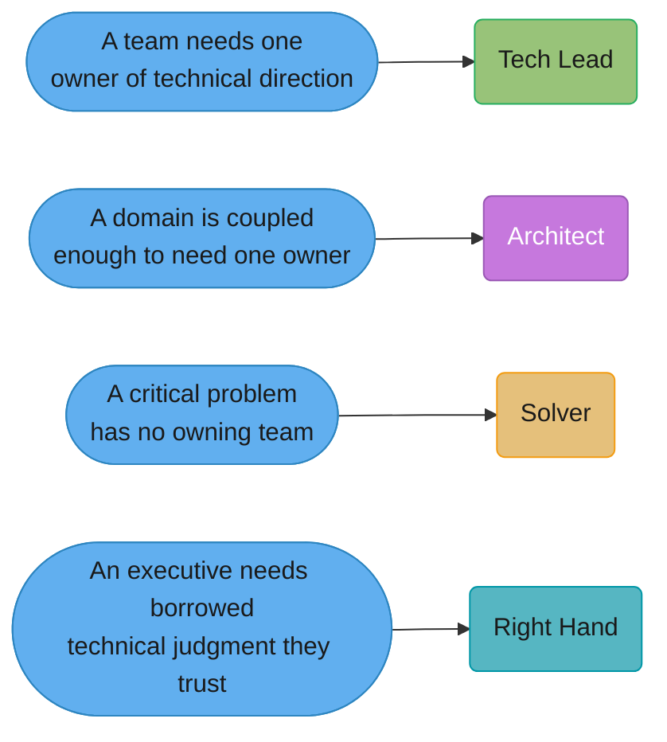
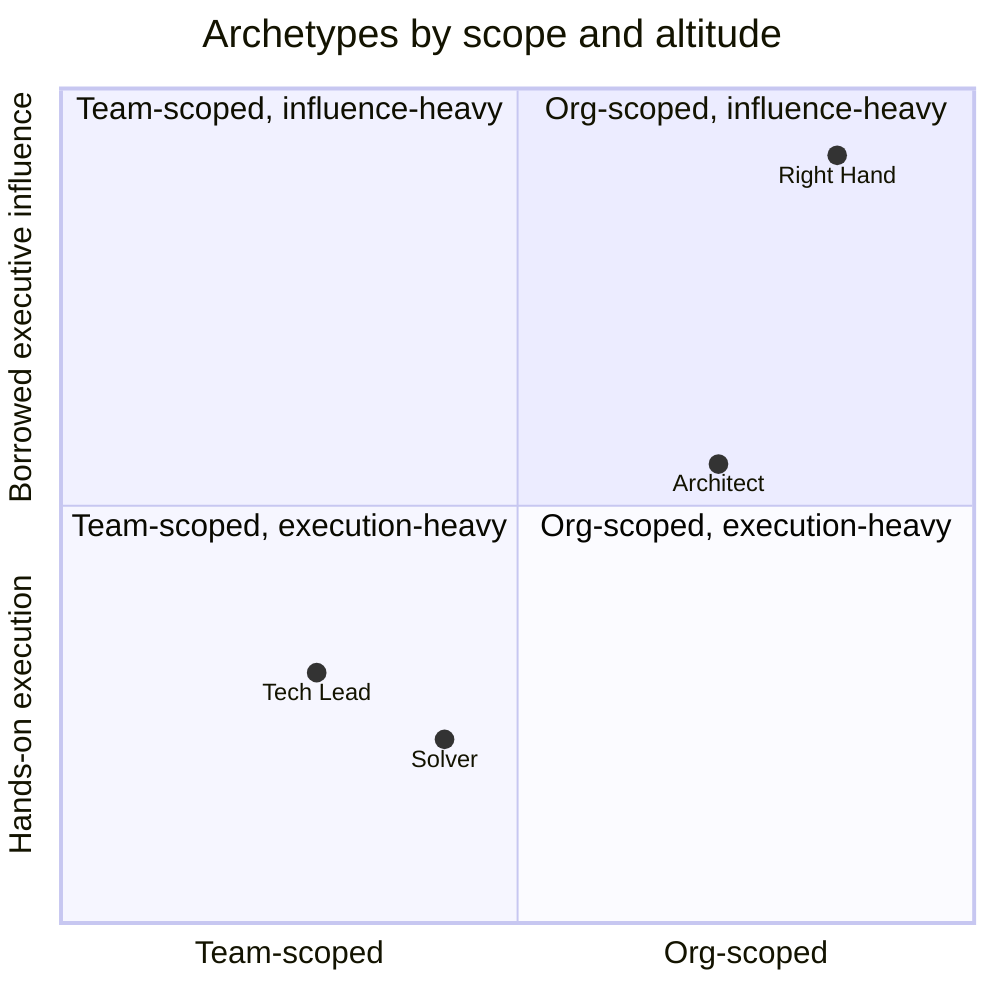
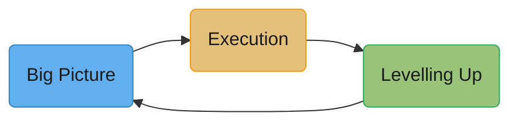

# Staff-Plus Archetypes

## 1. Concept Overview

"Staff engineer" is not one job. It is a level, and the level gets filled with whatever
shape of work the organization is missing. Two staff engineers at the same company, same
level, same pay band, can have almost no overlap in what they do day to day — one spends
the week in a single team's design reviews, the other spends it in a VP's staff meeting
carrying a problem nobody else can touch. Both are doing the job correctly. Confusing them,
or expecting one to behave like the other, is where staff-level performance reviews go
wrong.

The clearest published taxonomy is Will Larson's, in *Staff Engineer: Leadership Beyond
the Management Track* (2021): four archetypes — **Tech Lead**, **Architect**, **Solver**,
**Right Hand** — each defined not by what the engineer is good at but by what
organizational gap they are filling. Tanya Reilly's *The Staff Engineer's Path* (O'Reilly,
2022) gives the complementary answer to "what do you actually do with the job once you
have it": three pillars — **big picture**, **execution**, **levelling up** — that apply
regardless of which archetype you are. This module covers both books, Reilly's 2019 essay
"Being Glue," StaffEng.com's collected interviews, and the failure modes each archetype
produces when the org support it needs is missing.

The single most useful fact in this module is also the least intuitive one: which
archetype you become is mostly not a choice. It is a vacancy. You do not decide to be an
Architect; a company with a coupled, undocumented, six-year-old core system decides it
needs one, and whoever fills that gap becomes one.

---

## 2. Intuition

> **One-line analogy**: A staff engineer is not a bigger senior engineer any more than a
> chief of staff is a bigger analyst — the job changes shape to fill whatever hole the
> organization has at the top, and the hole is different at every company.

**Mental model**: Ask "what would happen if this person's job simply did not exist for
one quarter?" A senior engineer's absence shows up as slower delivery on their team. A
Tech Lead's absence shows up as a team making a wrong technical call it did not know it was
making. An Architect's absence shows up eighteen months later as three teams building
incompatible things. A Solver's absence shows up as the one cross-team fire nobody has the
standing to fight. A Right Hand's absence shows up as an executive making a bet with bad
technical information. Each archetype exists because a specific kind of gap opens up when
it is missing.

**Why it matters**: Engineers who try to become "a staff engineer" in the abstract chase a
personality trait — more visionary, more senior-sounding, more present in meetings — and
plateau. Engineers who ask "which of these four gaps is open at my company, and can I
credibly fill it" have something concrete to build toward and a concrete answer when a
promotion committee asks what they actually did.

**Key insight**: The archetypes are a diagnostic, not a personality quiz. Two people with
identical skills become different archetypes at different companies, and the same person
can become a different archetype after a reorg, without changing anything about themselves.

---

## 3. Core Principles

- **Scope, ambiguity, and organizational leverage replace "more of the same."** A Staff
  engineer is not a Senior who writes more code faster. Larson and Reilly agree on this
  even though they organize the rest of their books differently: the axis that moves
  between Senior and Staff is not skill depth, it is the size and fuzziness of the problem
  you are trusted to define, not just solve.
- **The archetype is a function of the organization, not the person.** A Tech Lead needs a
  team that needs technical direction. An Architect needs a domain complex enough that one
  person owning its coherence is worth a full-time job. A Solver needs an org that treats
  hard, nameless problems as first-class work items rather than something a team absorbs.
  A Right Hand needs an executive who has run out of technical judgment they trust and
  needs to borrow someone else's. Remove the organizational precondition and the archetype
  cannot exist, no matter how good the engineer is.
- **The three pillars (Reilly) are cross-cutting, not archetype-specific.** Big picture,
  execution, and levelling up are not three more archetypes — every archetype needs all
  three, in different proportions. A Tech Lead leans hardest on execution; an Architect
  leans hardest on big picture; all four need levelling up or they become a bottleneck
  instead of a multiplier.
- **Influence without authority is the shared mechanism.** None of the four archetypes come
  with people reporting to you. The entire job is getting other engineers, who you cannot
  order, to do the right thing because you made it clear, made it easy, or made it theirs.
  See [Influence Without Authority](../influence_without_authority/influence_without_authority.md).
- **Glue work is unavoidable and non-promotable at the same time.** Reilly's 2019 LeadDev
  talk "Being Glue" names the coordination, unblocking, and reviewing work that makes a
  project succeed but produces no artifact with your name on it — and the paradox that a
  Staff engineer refusing all glue work fails their team, while an engineer who is *only*
  doing glue work before they have Staff scope stalls their own promotion.

---

## 4. Types / Levels / Modes

### Tech Lead

Larson's most common archetype — he reports it as showing up in every company he studied,
at roughly **one Tech Lead for every eight engineers** once an organization is large enough
to have more than one team. A Tech Lead "guides the approach and execution of a particular
team" and is, in Larson's phrase, "the person defining their team's technical vision." The
day is: scope the next quarter's hard problems before they land on someone's desk,
coordinate with two or three adjacent teams so the work doesn't collide with theirs, sit in
on-call and design review, and delegate the parts of the project that will grow the
engineers under them rather than doing everything personally.

**What the org needs for this role to exist**: a team, and enough technical ambiguity in
that team's mandate that someone needs to own resolving it. This is the most accessible
Staff archetype because almost every company with more than one engineering team has this
gap somewhere — it is usually the first Staff role to open.

**Failure mode**: a Tech Lead who is actually doing a manager's job — headcount planning,
performance calibration, 1:1s about career growth — without the title, the training, or the
authority that comes with it. This produces burnout and a team that is quietly leaderless
on the people side, because the Tech Lead has no standing to act on what they see.

### Architect

An Architect is "responsible for the success of a specific technical domain," per Larson,
which in practice means holding "intimate understanding of the business's needs, their
users' goals, and the relevant technical constraints" well enough to advocate for one
coherent approach across teams that do not report to each other. This role generally
appears once an organization passes roughly **100 engineers** — small enough that a single
person can still hold the whole domain in their head, large enough that no one team's
interests can be trusted to represent the whole domain's health.

**What the org needs for this role to exist**: enough technical surface area — a large,
coupled, or heavily-in-debt codebase, or a domain (payments, identity, data platform) that
many teams depend on — that inconsistency between teams becomes an expensive, structural
problem rather than an occasional annoyance.

**Failure mode**: the "architecture astronaut," a term Joel Spolsky coined in a 2001 essay
for someone who designs increasingly abstract, general-purpose systems detached from any
team that has to ship on top of them. The tell is a design that solves problems nobody
brought to the Architect, reviewed by nobody who has to operate it, with no mechanism for
the Architect to be held to the outcome. Accountability is the entire fix: an Architect who
is not on the hook for what happens after the diagram is approved is not doing the job.

### Solver

A Solver "goes deep into knotty problems, continuing to work on them until they're
resolved," in Larson's phrasing — then hands the resolved problem to a team for ongoing
ownership and moves to the next one leadership has identified as critical. This archetype
is more common in organizations that treat individuals, not teams, as the unit of planning,
and it becomes rarer as a company matures into strict sprint-based, team-owned planning,
where "assign this to a person, not a team" stops being how work gets routed.

**What the org needs for this role to exist**: a supply of genuinely hard, ambiguous,
cross-cutting problems that do not have an obvious owning team, and enough organizational
trust to hand one of those problems to an individual rather than form a task force.

**Failure mode**: a Solver who is perpetually mid-problem. Because the archetype's whole
value is closure — a resolved fire, a shipped fix, a problem that stops being a problem —
a Solver who collects half-finished investigations produces the appearance of constant
important work with nothing to show a promotion committee. The tell in performance reviews
is a list of problems "engaged with" rather than problems closed.

### Right Hand

A Right Hand "operates with the borrowed authority of a senior leader" — sitting in
leadership meetings, taking the most important ill-defined problem off an executive's plate,
diving into a fire, changing the plan, then delegating the execution. Larson describes it
as the **least common** archetype and the one requiring the largest organization, typically
appearing once a company reaches the **low thousands of engineers**, because it depends on
an executive who has both the scale of problem to need this and the trust to hand it to one
individual.

**What the org needs for this role to exist**: an executive — not a role, a specific
person — who has run out of technical judgment they can personally supply and has decided
to borrow someone else's, repeatedly, in public. This is the only archetype that cannot be
grown into unilaterally; it is granted.

**Failure mode**: the Right Hand who becomes a proxy nobody trusts — because they speak
"with the authority of" the executive without checking back often enough, or because they
start being seen by other engineers as a political conduit rather than a technical one,
their word stops being useful evidence to the executive and stops being trusted by peers.
The fix Larson gives is discipline about scope: take the problem, not a standing seat at
every table the executive sits at.

---

## 5. Models & Frameworks Diagrammed

*The four archetypes as answers to four different organizational gaps. There is no
"upgrade path" between them left to right — a Tech Lead does not graduate into a Right
Hand; a different gap opens, or it doesn't.*

*Tech Lead sits low and narrow: one team, mostly execution. Right Hand sits high and wide:
company-scale scope, almost pure borrowed influence. Architect and Solver sit between them
on different axes — Architect trades scope for domain depth, Solver trades scope for
problem depth.*

*Reilly's three pillars, cross-cutting every archetype. Big picture without execution is
just opinion. Execution without levelling up makes the org depend on you personally, which
does not scale past one project. Levelling up feeds the next big-picture read, because the
people you grew now see things you would have missed.*

---

## 6. How It Works — Detailed Mechanics

### Reilly's three maps

From *The Staff Engineer's Path*, Part One (Big Picture): three maps, each answering a
different question.

- **Locator map** — "where are you?" Your team's scope, borders, and who is around you.
  Reilly's point is that most engineers, even senior ones, cannot accurately draw their own
  team's borders: what they own, what they merely touch, and who owns the thing next door.
- **Topographic map** — "how hard is it to get from here to there?" The friction between
  teams: which handoffs are smooth, which require three approvals and a quarter of lead
  time, where the actual (not org-chart) communication paths are. This is the map that
  reveals Conway's Law problems before they show up as a shipped bug.
- **Treasure map** — "where is it worth going?" Not the roadmap — the treasure map marks
  what actually matters, so that when priorities conflict you know which direction the
  org's real gravity is pulling, independent of what the last planning doc said.

A staff engineer draws all three, mostly informally, before proposing anything that spans
more than one team. Skipping the topographic map is the single most common reason a
technically correct proposal dies in cross-team review — the proposer never mapped the
friction they were about to hit.

### Choosing your archetype — a script, not a decision

Because the archetype is mostly assigned by what the org lacks, "choosing" one looks like
running a short diagnostic rather than picking a lane:

1. **Where does ambiguity currently sit unresolved?** If it sits inside one team's
   backlog, undirected, that is a Tech Lead gap. If it sits between teams as
   inconsistency, that is Architect. If it sits as a named, unowned fire, that is Solver.
   If it sits inside an executive's head as "I don't have anyone I trust to check this,"
   that is Right Hand.
2. **Ask directly.** The honest version of this conversation with your manager or skip is:
   "Which of these four is the gap here — and is it open?" Larson's own guides recommend
   this literally, because guessing wastes a year and the answer is usually already known
   by the people one level up.
3. **If the archetype you want is not open, do not manufacture it.** Trying to be an
   Architect in an org with no coupling problem produces exactly the astronaut failure mode
   above — a solution without a customer. Wait for the gap, take the one that is actually
   open, or move to a company where the one you want is open.

### Weak version -> Strong version — describing your role in a 1:1

**Weak version**

> Yeah, I've been helping out with a bunch of stuff across the team — unblocking people,
> in a lot of meetings, generally keeping things moving I guess.

**Strong version**

> I moved the checkout-latency migration from stalled to a committed Q4 date by writing
> the alternatives doc that got Payments and Platform to agree on one approach. Three
> teams had been blocked on that decision for six weeks before it existed.

**What changed:** a named artifact (the alternatives doc), named teams, a duration the
problem existed, and a concrete before/after (stalled -> committed date). The weak version
is true and says nothing a manager can act on; the strong version is a data point for a
calibration conversation.

### Weak version -> Strong version — the promotion-packet "what I work on" answer

**Weak version**

> I am a strong technical contributor who is well respected by my peers and helps out
> wherever needed across the organization.

**Strong version**

> I am the Tech Lead for Checkout. In the last two quarters I designed and drove adoption
> of the idempotency-key standard now used by 14 services, cutting duplicate-charge
> incidents from six per quarter to zero.

**What changed:** the archetype is named, the artifact is named, the adoption number is
given, and the impact is a before/after metric a calibration committee can compare against
another candidate's. "Well respected by peers" cannot be compared against anything.

---

## 7. Real-World Examples

- **Will Larson** wrote *Staff Engineer* after roles that map cleanly onto three different
  archetypes at three companies: founding Stripe's Foundation Engineering organization
  (Architect-shaped — domain coherence across a large payments platform), leading platform
  engineering strategy at Uber (spanning Tech Lead and Architect work at very large scale),
  and later serving as CTO at Calm. StaffEng.com, the companion site he runs, is a
  collected set of interviews with staff-plus engineers at named companies (Google, Slack,
  Squarespace, Dropbox, Stripe among them) describing which archetype they actually are —
  the site's throughline, across very different companies, is that almost nobody describes
  themselves with a job title that matches their actual day.
- **Tanya Reilly** was a Staff Engineer at Google working on some of its largest
  distributed systems, then Senior Principal Engineer at Squarespace working on
  architecture and technical strategy — a visible Tech-Lead-to-Architect arc across two
  companies with very different scale. She organizes and hosts LeadDev's StaffPlus
  conference, which exists specifically because this level was underserved by
  conference content built for either ICs or people managers.
- **Dropbox's public engineering career framework** names explicit archetypes for its
  senior ICs (its framework is public at `dropbox.github.io/dbx-career-framework`) — one of
  several companies that have taken Larson's taxonomy, or one close to it, and encoded it
  directly into a leveling document rather than leaving it as informal folklore.
- **Being Glue**, Reilly's May 2019 talk at LeadDev New York, is cited across the industry
  (Mike Crittenden's widely shared 2022 post "Glue work is career limiting" is one example)
  as the essay that gave a name to work — reviewing every design doc, onboarding every new
  hire, running the retro nobody else will run — that keeps a team functioning and shows up
  nowhere in a promotion packet.

---

## 8. Tradeoffs

| Archetype | Scope | Primary lever | What it costs you | Org precondition |
|---|---|---|---|---|
| Tech Lead | One team | Direct technical judgment | Least visibility outside the team | Any team with unresolved technical ambiguity |
| Architect | One domain, many teams | Coherence and standards | Slow, hard to show quarter-by-quarter impact | Large or heavily coupled codebase (roughly 100+ engineers) |
| Solver | One problem at a time, anywhere | Closure on hard, ambiguous fires | No standing team, no durable ownership | Org that plans around individuals, not only teams |
| Right Hand | Whatever the executive needs | Borrowed authority | Entirely dependent on one relationship | An executive who has run out of trusted technical judgment (typically 1,000+ engineers) |

| Choice | Gives you | Takes from you |
|---|---|---|
| Staying an IC at Staff+ | Depth, direct technical credibility, no headcount responsibility | Organizational leverage that comes from owning people decisions |
| Moving into management | Formal authority, budget and hiring leverage | Hands-on technical depth; most managers' coding time shrinks toward zero within a year |
| Doing glue work at Senior | A team that runs better today | Time that should go to the technical artifact your next promotion needs |
| Chasing an archetype the org has not opened | A self-directed sense of scope | A proposal or design nobody asked for and nobody is accountable to fund |

---

## 9. When to Use / When NOT to Use

**Lean into the archetype the org actually has open when:**
- You can name the specific gap (a team without technical direction, a domain drifting
  incoherent, an unowned cross-cutting fire, an executive without a trusted technical
  advisor) and you can point to evidence, not a guess.
- Your manager or skip-level, asked directly, agrees the gap exists and is unfilled.
- You are willing to do the boring majority of the work that archetype requires — most of
  a Tech Lead's week is not vision-setting, it is unglamorous coordination and review.

**Do not force an archetype when:**
- The gap you want to fill does not exist yet — you will produce architecture-astronaut or
  self-appointed-Solver work with no customer and no accountability.
- You are trying to skip the IC/management fork rather than resolve it — some engineers use
  "I'll be a Right Hand" as a way to avoid deciding whether they actually want to manage
  people, and end up doing a diluted version of both.
- The company is small enough (roughly under 50-100 engineers) that most of these
  archetypes have no organizational precondition to stand on yet — at that size, "Staff
  engineer" is usually just "the most senior engineer who also does a bit of everything,"
  and forcing Larson's taxonomy onto it produces confusion, not clarity.

---

## 10. Common Pitfalls

- **The architecture astronaut with no accountability.** An Architect ships a
  cross-cutting redesign — new service boundaries, a new data model — that no implementing
  team was consulted on. Six months later two of the four teams have quietly built
  workarounds because the design did not account for their actual constraints, and the
  Architect has moved on to the next domain. The cost is not the redesign; it is the two
  workarounds now permanently in production, each one undoing the coherence the redesign
  was supposed to buy.
- **The Solver who never closes.** A Solver spends a year "deep in" four different hard
  problems, each genuinely important, none resolved to the point a team can own it. At
  calibration, the packet lists four investigations and zero shipped outcomes, and the
  committee cannot tell the difference between hard work and unfinished work — because
  from the outside they look identical. The fix Larson gives is blunt: pick fewer problems
  and finish them, because "engaged with" is not evidence.
- **The Tech Lead who is a manager without the title or the support.** A Tech Lead starts
  running informal 1:1s about career growth, giving informal performance feedback, and
  making informal headcount input — all without manager training, without the standing to
  act on any of it, and without it counting toward their own promotion case because it is
  invisible manager-shaped work sitting inside an IC role. The team ends up with someone
  doing 60% of a manager's job with 0% of a manager's authority, and the engineer burns out
  roughly a year in, at which point the team loses both the technical direction and the de
  facto people support at once.
- **The Right Hand who becomes a proxy nobody trusts.** A Right Hand starts speaking "on
  behalf of" the executive in more rooms than the executive actually delegated, because it
  is easier than checking back every time. Within a couple of quarters, other engineers
  stop bringing the Right Hand real technical concerns — because raising something with
  them now feels like raising it with the executive directly, with all the political
  weight that carries — and the Right Hand loses the peer-level technical signal the role
  depends on to be useful in the first place.
- **Being Glue, permanently, before Staff scope.** A Senior engineer becomes the person who
  reviews every design doc, runs onboarding, and keeps every retro on track — genuinely
  valuable, genuinely necessary, and, per Reilly's talk, disproportionately assigned to
  women and engineers from underrepresented groups in the industry's actual practice. None
  of it produces a promotable artifact, and two years later the engineer is still Senior
  while a peer who wrote fewer meetings and one good design doc is Staff. The fix is not
  "stop being glue" — teams fall apart without it — it is naming the glue work explicitly
  in a promotion packet as leadership, and refusing to let it be the *only* thing in the
  packet.

---

## 11. Frameworks, Books & Further Reading

- Will Larson, *Staff Engineer: Leadership Beyond the Management Track* (2021) — the
  Tech Lead / Architect / Solver / Right Hand taxonomy in full, with the collected
  interviews that became StaffEng.com.
- Tanya Reilly, *The Staff Engineer's Path* (O'Reilly, 2022) — the three pillars, the three
  maps, and the execution playbook for large ambiguous projects.
- Tanya Reilly, "Being Glue" (LeadDev New York, May 2019; slides and essay at
  `noidea.dog/glue`) — the essential-and-career-limiting paradox of coordination work.
- StaffEng.com — Larson's collected interviews with staff-plus engineers across companies,
  organized by archetype.
- Joel Spolsky, "Don't Let Architecture Astronauts Scare You" (2001) — the origin of the
  term this module uses for the unaccountable-Architect failure mode.
- Dropbox Engineering Career Framework (public, `dropbox.github.io/dbx-career-framework`)
  — one company's leveling document that names archetypes explicitly.
- [Engineering Career Ladders](../engineering_career_ladders/engineering_career_ladders.md)
  — the scope/ambiguity/autonomy axes these archetypes sit on top of.
- [Influence Without Authority](../influence_without_authority/influence_without_authority.md)
  — the mechanism all four archetypes run on, in more depth.

---

## 12. Interview Questions with Answers

**Q: What's the difference between a Tech Lead and an Architect, and how would you
mistake one for the other?**
**Short:** A Tech Lead owns one team's direction; an Architect owns coherence across teams that don't report to each other.
A Tech Lead is scoped to a single team's roadmap and technical decisions; an Architect is
scoped to a domain that spans multiple teams and is judged on whether those teams stay
consistent with each other, not on any one team's delivery. The mistake happens when a Tech
Lead starts making cross-team calls without the mandate — teams outside their own start
treating the guidance as optional, because it is coming from someone with authority over
one team, not the domain. The practical tell: ask who is accountable if two teams build
incompatible things. If the answer is "no one, really," the org has an Architect gap, not a
Tech Lead surplus.

**Q: What is "being glue," and why is it explicitly career-limiting according to the
person who coined the term?**
**Short:** Glue work is coordination and unblocking that keeps a project alive but produces no artifact a promotion packet can point to.
Reilly's 2019 talk names it directly: reviewing every design doc, running onboarding,
chasing the status update nobody else will chase — work a team cannot function without and
a promotion committee cannot see. It is career-limiting specifically at Senior, before an
engineer has banked enough visible technical wins, because it consumes the hours that would
otherwise go to the artifact — the design, the migration, the standard — that a Staff case
is actually built from. The gotcha in interviews: the correct answer is never "stop doing
glue work," it's "name it as leadership in the packet and make sure it isn't the only
thing in there."

**Q: An Architect ships a redesign and, six months later, two teams have quietly built
workarounds around it. What's the anti-pattern and what was actually missing?**
**Short:** Architecture-astronaut work — a design with no accountability to the teams that had to live with it.
The anti-pattern is Joel Spolsky's "architecture astronaut" — a design detached from the
constraints of the teams that must implement it, built by someone with no mechanism to be
held to the outcome. What was missing was not technical skill; it was Reilly's topographic
map — the friction between teams — never getting drawn, so the redesign solved a coherence
problem on paper while creating two new implementation problems the teams had to solve
themselves. The fix is not "review more"; it's making the Architect accountable for what
happens after the diagram ships, not just for the diagram.

**Q: You want to be a Right Hand, but there is no executive who trusts you yet. What do
you actually do?**
**Short:** Nothing — the Right Hand role is granted by an executive, not built unilaterally; work a different open archetype instead.
Larson is explicit that this is the one archetype you cannot grow into on your own,
because it requires a specific senior leader who has run out of technical judgment they
trust and has decided to borrow yours, repeatedly, in public — that trust is granted, not
self-declared. Trying to manufacture the role by inserting yourself into executive
conversations without being asked reads as overreach, not initiative, and damages the
credibility you would need if the role ever did open. The practical answer: work whichever
archetype gap actually is open, and let a track record of judgment be the thing an
executive eventually notices — chasing the title directly is the failure mode, not the
strategy.

**Q: What's wrong with an engineering manager who still writes most of the code for
their team?**
**Short:** It signals the manager hasn't shifted from doing the work to multiplying the team, and it starves the team's own growth.
The trap is not that the code is bad; it's that every hour the manager spends writing code
they trust more than delegating is an hour not spent on the things only a manager can do —
calibration, unblocking, growing the team's next Tech Lead. It also quietly signals to the
team that the manager doesn't trust their output, which erodes the delegation that both
Reilly's "levelling up" pillar and basic management theory depend on. The gotcha: this
looks like a virtue ("still hands-on!") in a 1:1 and reads as a red flag in a skip-level,
because it usually means the team's growth is capped at what the manager personally has
time to review.

**Q: A Solver keeps getting reassigned to a new fire before finishing the last one — whose
failure is that?**
**Short:** Usually the org's, unless the Solver is the one abandoning problems before they're closed.
If leadership keeps pulling the Solver off before closure, that is an organizational
failure to protect the archetype's core mechanism — closure is the entire value Larson
attributes to a Solver, and an org that treats them as an all-purpose firefighter without
ever letting a fire go fully out gets none of that value. If instead the Solver is the one
choosing to jump to the next interesting problem before handing off the last one to an
owning team, that is the Solver's own failure mode, and it produces a packet that reads as
four half-finished investigations rather than four closed problems. Distinguishing the two
requires asking, concretely, who moved the Solver off each problem and whether a
receiving team existed to take the handoff.

**Q: What ratio does Larson give for how common each archetype is?**
**Short:** Tech Lead is most common, roughly one per eight engineers; Right Hand is least common, needing 1,000+ engineers.
Tech Lead is the archetype Larson found in every company he studied, at roughly one Tech
Lead per eight engineers once a company has more than one team — making it the most
accessible first Staff role. Architect tends to appear once an org passes roughly 100
engineers, when a domain becomes complex enough for inconsistency to be a real cost. Right
Hand is the rarest, typically requiring an organization in the low thousands of engineers,
because it depends on a specific executive relationship rather than a team or domain size
threshold. Solver's frequency depends less on headcount and more on whether the company
plans work around individuals or strictly around teams.

**Q: What is a "topographic map" in Reilly's framework, and what problem does skipping it
usually cause?**
**Short:** It maps the friction between teams; skipping it is why technically correct cross-team proposals die in review.
The topographic map answers "how hard is it to get from here to there" — which handoffs
between teams are smooth and which require three approvals and a quarter of lead time,
independent of what the org chart implies. A proposal that is technically sound but never
accounted for that friction typically stalls in cross-team review, because the proposer
did not anticipate which team would resist and why. Drawing it before proposing anything
cross-team is the single highest-leverage habit Reilly attributes to successful big-picture
work.

**Q: What's the difference between mentorship and sponsorship as levers inside "levelling
up"?**
**Short:** Mentorship gives advice in private; sponsorship spends your credibility on someone's behalf in a room they're not in.
Mentorship is advice given directly to the person — how to approach a design, how to word
a promotion packet. Sponsorship is action taken on their behalf when they are not present —
naming them for a stretch project in a staffing meeting, vouching for their readiness in a
calibration room. Levelling up requires both, but sponsorship is the one Staff engineers
underuse, because it costs personal credibility and does not feel like "doing work" the
way writing a mentoring doc does. See
[Mentorship and Sponsorship](../mentorship_and_sponsorship/mentorship_and_sponsorship.md)
for the full mechanics.

**Q: What do StaffEng.com's collected interviews have in common across very different
companies?**
**Short:** Almost nobody's actual day matches their job title, and the archetype is visible only from what they did, not what they're called.
Across companies as different as Google, Slack, Squarespace, Dropbox, and Stripe, the
interviews converge on the same pattern: the engineer's actual week — whose problems they
solve, whose meetings they sit in, what artifact they produce — maps cleanly to one of the
four archetypes even when the company's internal title says nothing about it. The
interviews are useful precisely because they describe the day, not the title, which is the
same diagnostic this module recommends running on your own week.

**Q: Why might moving from IC to management and back hurt or help a career, depending on
how it's done?**
**Short:** It helps if each move is a deliberate scope change with a stated reason; it reads as indecision if it isn't.
Going IC-to-manager-to-IC is a change of job, not a demotion or a failed experiment, and
companies with a real dual ladder (Larson and most published career frameworks assume one)
treat it as legitimate. It helps a career when each transition is framed around a specific
reason — "I wanted to build the org's IC track because there wasn't one" — and it hurts
when it looks reactive, like leaving management because a reorg went badly, with no stated
intent behind the next move. The practical guidance: a return to IC should come with a
clear archetype target, not a vague "I want to code again."

**Q: What organizational precondition does the Right Hand archetype specifically depend
on that none of the other three do?**
**Short:** A specific executive who has run out of trusted technical judgment and has chosen to borrow someone else's.
Tech Lead, Architect, and Solver all depend on structural conditions — a team, a domain, a
supply of hard unowned problems — that can exist independent of any one person's
preferences. Right Hand depends on an individual relationship: a specific senior leader
who has decided, repeatedly and visibly, to route a class of problem through one engineer's
judgment. That is why it is the only archetype Larson describes as granted rather than
grown into, and why "become a Right Hand" is not an achievable independent goal the way the
other three are.

**Q: Give an example of a sentence that correctly identifies a Staff engineer's archetype
from a promo packet, versus one that doesn't.**
**Short:** A correct one names the archetype and a metric; "strong technical contributor" names neither.
"I am the Tech Lead for Checkout; I drove the idempotency-key standard now used by 14
services, cutting duplicate-charge incidents from six per quarter to zero" names the
archetype, the artifact, and a before/after number a calibration committee can weigh
against another candidate. "I am a strong technical contributor who is well respected by my
peers" contains no archetype, no artifact, and no number — it could describe almost any
engineer at almost any level, which is exactly the failure this module's weak/strong pair
in §6 is built to fix.

**Q: What's the difference between describing your role in a 1:1 with your manager versus
in a formal promotion packet?**
**Short:** A 1:1 can carry more context and tone; a packet has to stand alone with numbers, because the reader wasn't in the room.
A 1:1 answer can lean on shared context and ongoing conversation — "still chipping away at
the migration thing" works because your manager already knows what that means. A packet is
read by a calibration committee that was never in the room, sometimes at a different
company office, sometimes months later, so it has to be fully self-contained: named
artifact, named archetype, quantified before/after. The most common promotion-packet
failure is writing it in 1:1 register — assuming context the reader does not have.

**Q: When is a company too small for Larson's four-archetype taxonomy to be useful?**
**Short:** Below roughly 50-100 engineers, where "Staff engineer" is usually just the most senior generalist, not one of the four shapes.
Below that rough size, most companies have not yet accumulated the organizational
preconditions any of the four archetypes depend on — no domain big enough to need a
dedicated Architect, no executive layer complex enough to need a Right Hand. Forcing the
taxonomy onto a 30-person startup's most senior engineer usually produces a title in search
of a definition rather than clarity, and the more useful frame at that size is simply
"most senior generalist, doing whatever the company currently lacks."

**Q: What single question diagnoses which archetype gap is actually open at your
company right now?**
**Short:** Where does ambiguity currently sit unresolved — inside one team, between teams, as an unowned fire, or in an executive's head?
Ambiguity sitting inside one team's backlog, undirected, is a Tech Lead gap. Ambiguity
sitting between teams as growing inconsistency is an Architect gap. Ambiguity sitting as a
named, unowned, urgent problem is a Solver gap. Ambiguity sitting inside an executive's
head as "I don't have anyone I trust to check this" is a Right Hand gap. Larson's own
guidance is to ask this question directly of a manager or skip-level rather than guess,
because the answer is usually already known one level up and guessing wrong wastes a year
building the wrong case.

---

## 13. Best Practices

- **Name the gap before you name the archetype.** Write down, concretely, what breaks if
  you stop doing your current work for a quarter. That answer tells you which archetype you
  already are, whether or not your title says so.
- **Draw the three maps before any cross-team proposal.** Locator (where you stand),
  topographic (where the friction is), treasure (what actually matters) — in that order,
  informally, before you write the doc.
- **Convert glue work into a named leadership line, do not eliminate it.** A packet that
  reads "ran onboarding for 6 new hires, which cut ramp-to-first-PR from 5 weeks to 2" is
  glue work made visible, not glue work avoided.
- **Ask directly, don't infer.** "Which of the four gaps is open here, and is it mine?" is
  a legitimate question for a manager or skip-level, and the direct answer is faster than a
  year of guessing.
- **Close problems before starting the next one, if you are Solver-shaped.** A shipped fix
  with a receiving team beats three engaged-with investigations, every time, in a
  calibration room.
- **If the archetype you want is not open, say so out loud and pick a different one that
  is** — rather than manufacturing scope nobody asked for.
- **Every artifact you produce should be namable in one sentence with a number attached.**
  If it can't be, it's not ready for a packet yet, even if it was real, useful work.

---

## 14. Case Study

**Scenario**: A 400-engineer payments company has three product teams (Checkout, Payouts,
Risk) each shipping independently against a shared ledger service. Duplicate-charge
incidents have climbed to six per quarter, each one a support escalation and, twice, a
regulatory inquiry. No single team owns the ledger's consistency guarantees; each team has
its own retry logic, and none of it agrees.

**What actually happened**: A senior engineer on Checkout, Priya, had been quietly fixing
her own team's retry bugs for two quarters — real work, invisible outside Checkout. Her
manager, in a skip-level, asked the diagnostic question directly: "Is this a Tech Lead
problem or something bigger?" Priya drew Reilly's three maps. The locator map showed her
own team's actual scope was narrower than she assumed — Checkout owned its API, not the
ledger. The topographic map showed all three teams reached the ledger through different,
undocumented paths, with no team owning consistency end to end. The treasure map showed
leadership's actual priority, buried in a strategy doc nobody had reread in six months, was
"zero regulatory incidents," not "ship faster" — which reframed the whole problem's
urgency.

This was not a Tech Lead gap — it was an Architect gap: three teams needed one owner of
ledger consistency, and no one currently had the mandate. Priya wrote an alternatives doc
(the artifact, not a status update) proposing a single idempotency-key standard, with the
cost of migrating each team's retry logic and the cost of doing nothing (the regulatory
exposure) both stated in the first paragraph — BLUF, see
[Technical Writing for Engineers](../technical_writing_for_engineers/technical_writing_for_engineers.md).
She got explicit sign-off from all three team leads before writing a line of migration
code, having mapped the topographic friction in advance instead of discovering it during
review.

**Outcome**: 14 services adopted the standard over two quarters. Duplicate-charge
incidents went from six per quarter to zero. Priya's promotion packet named the archetype
she had become (Architect, not Tech Lead — a title change nobody had proposed until the
scope made it obvious), named the artifact, and led with the number.

**What would have gone wrong with a weaker approach**: If Priya had built the standard
unilaterally and pushed it to the other two teams without their sign-off — architecture
astronaut behavior — at least one team would likely have built a workaround the moment the
standard didn't fit an edge case only they knew about, and the coherence the standard was
meant to buy would have been undone within a quarter, exactly as described in this module's
§10 pitfall of the same name.

**Discussion prompts** (not part of the quiz — see the section CLAUDE.md on why
case-study Q&As are excluded from the bank):
- Was this genuinely an Architect gap, or could a strong-enough Tech Lead have closed it
  without the title change?
- What would you have done differently if one of the three team leads had refused to sign
  off?
- How would you write the same promotion packet if the initiative had only closed two of
  the three teams?
