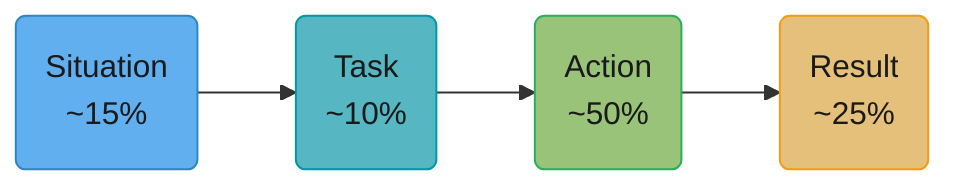
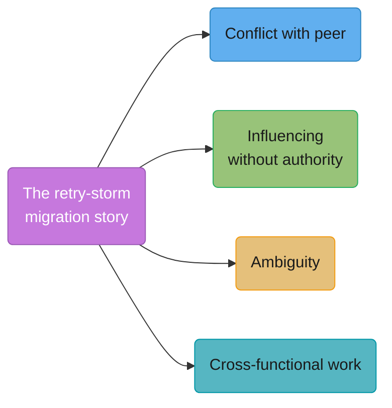
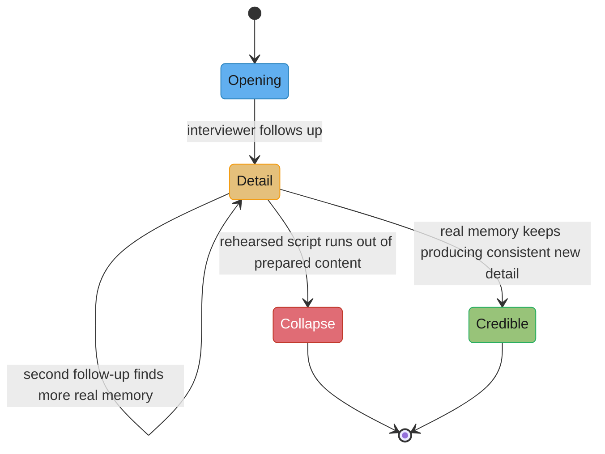

# Story Portfolio & Answer Frameworks

## 1. Concept Overview

A behavioural interview framework — STAR, SBI, CARL — is a container, not an answer.
Reciting "Situation, Task, Action, Result" without a real story inside it produces a
sentence that is technically compliant and completely worthless as evidence, which is why
[Behavioural Interview Systems](../behavioral_interview_systems/behavioral_interview_systems.md)
spends its entire length on what happens to your answer after you say it, and this module
spends its entire length on the craft of the answer itself: which container fits which
question, how to build a small set of real stories that covers a large set of questions,
what numbers a story needs to be usable as evidence, and — because a description of a
framework teaches nothing — full worked rewrites of real stories, weak and then strong.

This module is mostly worked examples on purpose. You already know, roughly, what STAR
stands for. What you don't have yet is twelve real stories, precisely told, mapped to the
questions that will actually get asked.

---

## 2. Intuition

> **One-line analogy**: A framework is a recipe's steps, not the meal — memorizing "add
> flour, mix, bake" produces nothing if there's no flour in the kitchen.

**Mental model.** Treat interview prep as building a small, reusable inventory, not
writing a script for each possible question. Twelve well-chosen stories, each told with
enough precision that they can be shaped to answer several different question types,
outperform forty shallow one-off answers prepared question-by-question — because the
actual loop will ask questions in a form you didn't predict, and a deep story flexes to a
new angle in a way a memorized script does not.

**Why it matters.** Most candidates prepare answers to questions. The stronger move is
preparing *stories* and *facts* — a specific situation, specific numbers, a specific
decision — and only shaping them into a framework's structure live, in response to
whatever the actual question turns out to be. A framework is how you organize the telling;
it is never a substitute for having something true and specific to tell.

**Key insight.** The follow-up probe is where every rehearsed-answer strategy collapses
and every real-story strategy gets easier. A memorized paragraph has no depth beneath it;
a real memory has an almost unlimited amount, because the candidate was actually there.
That asymmetry is the entire argument for building a portfolio of real stories over
polishing a set of scripted answers, and it has gotten more important, not less, as
LLM-polished scripted answers have become common and easier for trained interviewers to
spot (see §10).

---

## 3. Core Principles

- **The framework organizes the telling; the story is the evidence.** Never spend prep
  time perfecting the acronym and none on the underlying facts — that is backwards.
- **Action is the answer; Situation is the setup.** An interviewer scoring you is grading
  what you decided and did, not the backstory. Time budgets in §4 make this concrete.
- **A story with no number is an anecdote, not evidence.** Scale, time, people, money,
  errors, latency — pick at least one and know it cold.
- **One good story covers several competencies.** The twelve-story portfolio in §7 exists
  precisely so you never have to invent a new story mid-interview.
- **Never fabricate the story you don't have.** §9 gives the exact honest alternative,
  because the probe that catches a fabrication is the same probe that rewards a true
  story told well, and interviewers who do this a lot can tell the difference.
- **Practise the facts, not the sentences.** A sentence memorized word-for-word breaks the
  instant a follow-up asks about anything the sentence didn't cover; a fact recalled from
  memory answers a follow-up from any angle.

---

## 4. Types / Levels / Modes

### 4.1 The frameworks, precisely

**STAR — Situation, Task, Action, Result.** Introduced by Development Dimensions
International (DDI) in 1974 as the structural backbone of its "Targeted Selection"
behavioural-interviewing methodology, built on the premise that specific past behaviour
predicts future behaviour better than a hypothetical or a personality claim. STAR's most
common and specific failure mode: candidates spend the majority of their time on
Situation — scene-setting, org-chart context, backstory — and arrive at Action, the part
that is actually evidence, with barely any time left. A target time budget by part, and
why:

| Part | Target share | Why |
|------|--------------|-----|
| Situation | ~15% | Just enough for the interviewer to understand the stakes — one or two sentences, not a paragraph |
| Task | ~10% | What specifically you were responsible for — often foldable into Situation in one sentence |
| Action | ~50% | This is the evidence. Specific decisions, specific steps, specific moments of judgment |
| Result | ~25% | The number, the outcome, and — critically — what you'd do differently |

Action gets the most time because it is the only part of the four that is actually about
you as an individual decision-maker; everything before it is context, and everything
after it is outcome. An interviewer who has to ask "but what did YOU do" after your
Situation and Task have already eaten ninety seconds has already downgraded the answer
before you've said anything they can score.

**SBI — Situation, Behavior, Impact.** Developed by the Center for Creative Leadership
(CCL) as a feedback-delivery tool, not originally an interview-answer framework — it is
designed to describe one specific behaviour and its concrete impact, cleanly, in a short
span. It is better suited to a short answer or to giving feedback in the moment than to
carrying a full interview story: it has no explicit "what you'd do differently" beat the
way CARL does, and it compresses "what you actually decided" (STAR's Action) into a
single "Behavior" step, which is fine for a thirty-second answer and thin for a
three-minute one.

**CARL — Context, Action, Result, Learning.** A widely used interview-prep variant of
STAR; this module could not verify a single confirmed original author or date for the
interview-specific CARL acronym (there is a distinct, differently-purposed "CARL
Reflection Model" in academic reflective-practice literature, which is not the same
framework and should not be conflated with it). What makes interview-CARL specifically
useful: the explicit **Learning** step, which forces the same "what would you do
differently" content that STAR leaves implicit in Result. For a failure question, this
matters — "what would you do differently" is the follow-up you will get from a STAR
answer anyway, so a framework that makes you build it in from the start produces a
tighter, more complete answer the first time.

**SOAR — Situation, Obstacle, Action, Result.** A STAR variant that separates out the
specific obstacle from the general situation, useful when the question is explicitly
about overcoming something (a blocker, a constraint, a piece of resistance) rather than
about a general accomplishment.

**PAR — Problem, Action, Result.** The condensed cousin of STAR, useful for a short answer
or a resume bullet where there is no room for a separate Situation/Task split — Problem
folds both into one clause.

### 4.2 Which framework for which question type

| Question type | Best framework | Why |
|---|---|---|
| A failure, or a mistake you made | **CARL** | The explicit Learning step pre-empts the "what would you do differently" follow-up |
| A conflict (peer or manager) | **STAR** | Needs a full Situation/Task setup so the stakes and positions are clear before Action |
| Influencing without authority | **STAR**, heavy on Action | The Action section needs the most room — this is a multi-step story (see §8) |
| Ambiguity, no clear requirements | **STAR** | Situation and Task carry real weight here, since "what even was the task" is often the point |
| Leadership (formal or informal) | **STAR** or **CARL** | CARL if the story is really about a lesson learned while leading; STAR if it's about a clean outcome |
| Prioritisation / saying no | **PAR** or short **SBI** | Often a shorter answer; doesn't need a full narrative arc |
| A time you were wrong | **CARL** | Same logic as failure — the Learning step is the actual point of the question |
| "Tell me about yourself" | None of the above, structurally | This is a narrative arc, not a single story — see §8.6 |

---

## 5. Models & Frameworks Diagrammed

Action is half the clock on purpose. It is the only section that is evidence of what you,
specifically, decided and did — Situation and Task are context the interviewer needs once,
briefly, to understand why Action mattered.

One well-built story, told with different emphasis, is legitimate evidence for several
different competencies — see §7 for the full portfolio-to-competency matrix this single
diagram is a small example of. The move is choosing which two sentences to foreground, not
inventing a new story for each question type.

A rehearsed script and a real memory look identical for the first follow-up and diverge
sharply on the second — a script has a fixed depth and a memory does not. This is exactly
the mechanism trained interviewers are listening for in 2026 (see §10).

---

## 6. How It Works — Detailed Mechanics

### 6.1 The opening line

Most candidates waste the first thirty to forty-five seconds of every answer on windup —
restating the question, apologizing for needing a moment to think, or starting three
sentences into the actual Situation before the listener knows what kind of story this is.
The fix is a single orienting sentence that tells the interviewer, immediately, what the
story is about and what your role in it was, before you say anything else.

**Weak opening**

> So, um, let me think of a good example... okay, I think I have one. So there was this
> project a while back, it was kind of complicated, let me give you some background first.

**Strong opening**

> This is about a migration where I got the sequencing wrong and we lost a week — I was
> the tech lead, and the mistake was mine.

**What changed:** the strong version orients the listener in one sentence — what kind of
story (a mistake), what the stakes were (lost a week), and the candidate's role (tech
lead, and the mistake was theirs) — before a single detail of Situation has been spoken.
The interviewer now knows what to listen for in everything that follows, which makes the
rest of the answer easier to follow and easier to write down accurately.

### 6.2 Handling the follow-up probe

Prepare these five before the interview, because they are where a rehearsed answer
collapses and a real one gets stronger:

- **"What was your specific contribution?"** — have the individual action ready even if
  your first pass through the story used "we"; know exactly which sentence is yours.
- **"What did the other person think, at the time?"** — a real conflict or influence
  story has a real other party with a real, specific reaction; if you cannot say what they
  thought, the story may be too thin or too one-sided to have picked.
- **"What would you do differently?"** — see §6.3's rewrites; this should never be
  invented live, it should be a fact you already know about the story.
- **"What data did you have at the time?"** — distinguishes a decision made with real
  information from one made on instinct dressed up afterward as analysis.
- **"How do you know it worked?"** — the number, or the named alternative when there
  isn't one (see §7.3).

### 6.3 Six full weak-to-strong story rewrites

This is the core of the module. Each pair shows the story a candidate actually tells the
first time they try it out loud, and the version after a real rewrite pass, with a note on
exactly what changed.

**1. A failure**

**Weak version**

> We had a project that didn't go super well — we were building a new feature and the
> timeline slipped a bit, there were some technical challenges we ran into along the way,
> but we eventually shipped it and learned some lessons from the experience.

**Strong version**

> I was the tech lead on a payments-migration project with a hard Q3 deadline. I sequenced
> the work so the riskiest piece — cutting over the write path — happened last, reasoning
> that we'd have the most confidence by then. That was backwards: by the time we got to
> it, we had the least slack left to absorb a surprise, and the write-path cutover hit an
> edge case with partial-failure retries that we hadn't tested, which cost us a full week
> and forced us to slip the date. What I'd do differently: sequence the riskiest,
> least-understood piece first, when there's still slack to absorb a surprise, not last.
> I've applied that reversed sequencing on two migrations since, and both had their worst
> surprise land with three weeks of buffer left instead of zero.

**What changed:** the weak version names no specific decision, so there is nothing for an
interviewer to write down as "the mistake." The strong version names the exact sequencing
decision, the exact reasoning that made it seem right at the time, the exact cost, and a
specific, since-applied change in how the candidate now works — which is also evidence the
lesson is real rather than performed for the interview.

**2. A conflict with a manager**

**Weak version**

> My manager and I didn't always see eye to eye on priorities, but we always found a way
> to work through it professionally and stay on the same page.

**Strong version**

> My manager wanted to ship a pricing change without a feature flag, to hit a board
> deadline. I disagreed — we'd had two unflagged-change rollback incidents that quarter —
> and told her directly I thought the risk to revenue-critical code outweighed a two-day
> delay. She held the deadline was firm. I asked for 24 hours to build the flag in
> parallel rather than instead of hitting the date, showed her a working version the next
> day, and she agreed to ship with it in place. We hit the deadline, and when a real bug
> surfaced two weeks later, we killed it with the flag in under a minute instead of an
> emergency rollback.

**What changed:** the weak version resolves before any real position or stake appears. The
strong version names the actual disagreement, the actual pushback the candidate got, a
concrete counter-offer instead of just an objection, and a result that demonstrates the
disagreement mattered and was resolved through a specific action, not through vague
professionalism.

**3. An influence story**

**Weak version**

> I convinced another team to adopt our approach by explaining the benefits clearly and
> building a good relationship with them over time.

**Strong version**

> Checkout carried a forked retry library because the shared resilience library hadn't
> supported idempotency keys two years earlier. That gap closed, but nobody had gone back
> to migrate checkout off the fork. I mapped the stakeholders, talked to checkout's tech
> lead first — she was the most likely objector — and asked what would make her say no.
> She raised a real gap: the fork capped retries differently during partial outages,
> something checkout added after a 2024 payments incident the shared library didn't have.
> I proposed adding that as a configurable ceiling to the shared library instead of
> dropping it, built it with her reviewing the PR, and only then brought the migration to
> review. It passed in four minutes with zero new objections, and an engineer on her team
> volunteered to do the migration the same week.

**What changed:** the weak version describes the outcome of influence ("I convinced them")
without showing the actual mechanism. The strong version shows the specific pre-wire
conversation, the specific objection surfaced and addressed, and a result — a fast,
objection-free review and a volunteer, not an assigned migration — that is evidence the
influence, not just the persuasion attempt, actually worked.

**4. An ambiguity story**

**Weak version**

> The requirements weren't very clear when I started, so I had to figure things out as I
> went and just used my best judgment to move forward.

**Strong version**

> I was handed a one-line ask — "make search faster" — with no target latency, no budget,
> and no owner on the product side to ask. Rather than guess, I pulled the previous
> quarter's support tickets that mentioned search, found the actual complaint was timeout
> errors above 2 seconds, not slowness in general, and proposed a concrete target: p99
> under 1.5 seconds within six weeks, framed as the smallest change that would resolve the
> actual complaints on file. I sent that framing to the nearest product stakeholder I could
> find, got a one-line "yes, that's the goal," and had a target the rest of the team could
> plan against within two days instead of the two weeks the vague ask would have cost in
> back-and-forth.

**What changed:** the weak version claims "used my best judgment" without showing any
judgment being exercised. The strong version shows a specific method for converting
ambiguity into a concrete target (mining support tickets for the real complaint), a
specific proposed number, and a specific fast confirmation loop — evidence of a repeatable
skill, not a vague claim of comfort with ambiguity.

**5. A mentoring story**

**Weak version**

> I mentored a junior engineer on my team and helped them grow a lot over the year, giving
> them guidance whenever they needed it.

**Strong version**

> A junior engineer on my team was technically strong but avoided any code review comment
> that felt like disagreement — she'd silently implement whatever a senior reviewer
> suggested even when her original approach was better. I started doing something
> specific: whenever she got a review comment she quietly complied with, I'd ask her
> privately afterward, "did you actually agree with that, or did it just feel easier to
> take it?" The first four times the honest answer was "easier to take it." By the fifth
> review cycle, she pushed back on a senior engineer's comment in the PR thread itself,
> with a specific technical reason, and the senior engineer changed their suggestion. She's
> since become the person junior engineers on the team go to when they're unsure whether
> to push back on a review comment.

**What changed:** the weak version has no specific method and no observable change. The
strong version names the specific coaching intervention, the specific number of cycles it
took, a concrete first instance of the changed behaviour, and a lasting downstream effect
(the mentee now mentors others on exactly this) — the kind of detail that survives a "how
do you know it worked" follow-up.

**6. "Tell me about yourself"**

**Weak version**

> So I started out doing full-stack development, and then I moved into more backend work,
> and over time I've taken on more leadership responsibilities, and now I'm looking for a
> role where I can keep growing and take on new challenges.

**Strong version**

> I'm a backend engineer who's spent the last five years specifically on systems that
> can't silently drop data — payments and billing. I started as an IC fixing a duplicate-
> charge bug that turned into rebuilding our idempotency layer; that got me pulled onto a
> migration where I first led cross-team work, coordinating four teams off a shared retry
> pattern. Most recently I've been the de facto tech lead for our resilience platform,
> which is the kind of scope I'm looking to make official — I'm interviewing because I want
> a role where the technical leadership I've been doing informally is the actual job, not
> a side effect of being the person who happened to notice the bug first.

**What changed:** the weak version is a generic career-arc summary that could describe
thousands of engineers. The strong version has a specific throughline (systems that can't
silently drop data), a specific originating story (the duplicate-charge bug), a specific
scope progression (IC to cross-team lead to de facto tech lead), and a specific, honest
reason for interviewing now — giving the interviewer a concrete, memorable hook rather than
a résumé read aloud.

### 6.4 The numbers a story needs

Every story in the portfolio should carry at least one hard number: scale before, scale
after, time taken, number of people involved, or a cost figure (money, latency, error
rate). When the real number is confidential — common with revenue, headcount, or exact
incident costs — use a ratio or an order of magnitude instead of omitting it entirely:
"we cut error rate by roughly 80%" survives a confidentiality concern that "our exact
error count was X" does not, and it is still real evidence. When there genuinely is no
number — a purely qualitative story, like a mentoring or feedback story — substitute one
of two things: a named person's observably changed behaviour ("she started pushing back on
review comments in the thread itself, which she hadn't done before"), or a decision that
visibly got made or a risk that visibly got retired because of what you did. A story with
neither a number nor either substitute is not ready to use.

---

## 7. Real-World Examples

- **DDI's Targeted Selection**, introduced in 1974, remains one of the most widely licensed
  structured-interviewing methodologies in corporate hiring more than fifty years later —
  STAR is the public-facing piece of a larger commercial interviewer-training product still
  sold today, which is part of why it is the framework almost every candidate has already
  half-heard of.
- **The Center for Creative Leadership's SBI model** is taught primarily as a
  feedback-delivery tool in leadership-development programs, not originally as an interview
  framework — its adoption for short interview answers is a secondary use of a tool built
  for a different purpose, which is exactly why it works better for brief answers than for
  a full narrative.
- **A twelve-story portfolio approach**, rather than per-question memorization, is the
  explicit prep method taught by most professional interview-coaching services for
  staff-plus and principal-level candidates specifically because senior loops ask more
  questions per candidate (often 15-20 across a full onsite) than any one-story-per-question
  strategy can realistically cover.

---

## 8. Tradeoffs

| Approach | Prep time | Robustness to unexpected follow-ups | Robustness to an unpredicted question angle |
|---|---|---|---|
| Memorize a scripted answer per likely question | Lower upfront, but scales linearly with question count | Low — a follow-up outside the script produces visible hesitation | Low — a question phrased differently than expected has no matching script |
| Build a 12-story portfolio, shape live | Higher upfront, one-time cost | High — real memory produces consistent new detail under any follow-up | High — any of the twelve stories can be reshaped to fit an unexpected angle |
| Improvise from real experience with no prep | Lowest upfront | Medium — real memory is robust, but recall is slow and unstructured under pressure | Medium — same story, but the delivery is disorganized without a framework to shape it |
| LLM-polished, heavily rehearsed answers | Low, fast to generate | Very low — depth runs out at the second follow-up (see §5's state diagram) | Low — fluent but generic, and generic answers apply to almost any question equally badly |

The honest tradeoff is upfront time. A twelve-story portfolio costs several hours of real
reflection and rewriting before the first interview. What it buys is an answer bank that
degrades gracefully under any follow-up, in any order, across an entire loop — which no
amount of last-minute cramming on a per-question basis can match.

---

## 9. When to Use / When NOT to Use

**Build the full twelve-story portfolio when:** you have a real onsite loop coming,
especially at a company running a rubric-mapped process (see the companion module) where
15-20 questions across 4-6 interviews is typical — a shallow, per-question prep strategy
runs out of material fast in that format.

**A framework alone (STAR, CARL) is enough, no full portfolio needed, when:** it's a
lower-stakes screen with one or two behavioural questions, or you already have deep,
readily-recalled experience and the risk is disorganized delivery rather than thin
material — in that case the framework's only job is pacing (§4.1's time budget), not
providing content you don't have.

**Do not use a framework to disguise a story you don't actually have.** STAR, CARL, or any
other acronym applied to an invented or heavily exaggerated story produces exactly the
kind of answer that collapses under the follow-up probes in §6.2 — the framework organizes
the telling, it does not manufacture the substance, and interviewers who ask a lot of
these questions can tell the difference between recalled detail and invented detail under
a second or third follow-up.

---

## 10. Common Pitfalls

**The "only competent person in the story" trap.** A candidate's every story featured
themselves solving a problem their manager, teammates, or a partner team had allegedly
missed or gotten wrong — technically consistent stories, individually, but heard back to
back across a loop they produced a specific negative note: "candidate positions themselves
as uniquely competent in every story; either a very unusual run of teammates or a
credibility issue with self-assessment." The fix used successfully by the same candidate
in a later loop was deliberately including at least one story where someone else made the
key call and the candidate executed on it well — which reads as more credible, not less
impressive.

**Blaming a former employer.** A candidate, asked about a project that failed, spent the
answer describing organizational dysfunction at their previous company — no budget, no
support, an indecisive manager — with no mention of any specific action they personally
took given those constraints. The interviewer's note: "candidate externalizes the failure
entirely; no evidence of what candidate did within the constraints they describe." The
constraints may have been entirely real; the story still needs the candidate's own
decisions inside them to count as evidence about the candidate.

**The conflict story with no conflict.** Covered directly with a full rewrite in §6.3 —
included again here because it remains, across every company's loop, one of the single
most common ways candidates unintentionally give an interviewer nothing to score.

**The failure story where the failure was someone else's.** Similar to the blame pattern
but subtler: a candidate describes a project failing due to a colleague's specific
mistake, framed as their own "failure" story because they were nominally involved. An
interviewer probing "what was YOUR mistake" gets an answer describing someone else's — a
mismatch that reads as either a misunderstanding of the question or an unwillingness to
own a real mistake of their own.

**A result with no baseline.** "We improved performance by 40%" sounds concrete until a
follow-up asks "40% of what starting number, over what December" and the candidate cannot
answer — a percentage with no baseline is not actually a number, it just has the shape of
one, and a trained interviewer will ask the baseline question specifically because this
pattern is common.

**A story so old it predates the candidate's current level.** A staff-level candidate
whose strongest, most detailed story is from a junior role five years earlier signals that
nothing at their current scope has produced comparably strong material — even when the
story itself is well told, its age becomes the note: "best evidence is five years and two
levels old; limited recent evidence at current scope."

---

## 11. Frameworks, Books & Further Reading

| Source | What it gives you |
|--------|--------------------|
| Development Dimensions International (DDI), "Targeted Selection" and the STAR method | The original 1974 structured-interviewing methodology STAR comes from |
| Center for Creative Leadership, the SBI (Situation-Behavior-Impact) feedback model | The origin and intended feedback-delivery use of SBI, and why it suits short answers |
| John Flanagan, "The Critical Incident Technique," *Psychological Bulletin* (1954) | The earlier academic technique (specific, recalled incidents as data) that structured behavioural interviewing broadly descends from |

Related modules in this section:
[Behavioural Interview Systems](../behavioral_interview_systems/behavioral_interview_systems.md),
[Giving & Receiving Feedback](../giving_and_receiving_feedback/giving_and_receiving_feedback.md).

---

## 12. Interview Questions with Answers

**Q: What is the single most common mistake candidates make with the STAR framework?**
**Short:** Spending most of the time on Situation, leaving almost none for Action.
STAR does not allocate equal time to each part — a working budget is roughly 15% Situation,
10% Task, 50% Action, 25% Result — and Action is where the actual evidence lives, since it
is the only part that shows what the candidate specifically decided and did. Candidates
who scene-set for ninety seconds and then rush the actual decision into fifteen seconds
have inverted the framework's purpose, and the fix is almost always mechanical: cut
Situation to one or two sentences and let Action run long.

**Q: What is CARL, and what does the Learning step give you that STAR doesn't make explicit?**
**Short:** Context, Action, Result, Learning — Learning pre-builds the "what would you do differently" answer.
CARL is Context, Action, Result, Learning — a STAR variant widely used in interview
preparation, though this module could not verify a single confirmed original author for
the interview-specific version. Its distinguishing feature is the explicit Learning step,
which forces the same content a STAR answer would otherwise only produce reactively when
an interviewer asks "what would you do differently" — for a failure or "time you were
wrong" question, that follow-up is close to guaranteed, so building it in from the start
produces a tighter answer the first time through.

**Q: What is SBI, who developed it, and why is it usually a worse choice for a full interview story than STAR?**
**Short:** Situation-Behavior-Impact, from the Center for Creative Leadership; built for feedback, not full narrative.
SBI — Situation, Behavior, Impact — was developed by the Center for Creative Leadership
primarily as a tool for delivering clean, specific feedback, not as an interview-answer
framework. It compresses what STAR splits into Task and Action into a single "Behavior"
step and has no explicit "what would you do differently" beat, which makes it well suited
to a short answer or real-time feedback and comparatively thin as the structure for a
full, multi-minute interview story.

**Q: Why is "one strong story usually covers three or four competencies" the single most efficient idea in interview prep?**
**Short:** A well-built story flexes to different angles instead of needing a new story per question.
A deep, specific, well-told story — like a cross-team retry-library migration — can be
told as evidence of influence without authority (emphasize the pre-wire), conflict
handling (emphasize the objection from checkout's tech lead), ambiguity (emphasize the
unclear ownership of the retry-ceiling gap), or cross-functional work (emphasize the
handoff to the checkout team), depending on which two sentences get foregrounded. Building
twelve such stories, each flexible across three or four competencies, produces coverage
that trying to prepare one story per possible question type cannot realistically match in
the same amount of prep time.

**Q: A candidate has no real example for a question — say, "tell me about a time you mentored someone" — and has never formally mentored anyone. What should they say?**
**Short:** Say so honestly, then offer the closest real analog rather than inventing one.
The honest move is to say directly that formal mentoring isn't something they've done,
then offer the closest real analog they do have — informally helping a newer teammate
debug something repeatedly, or onboarding a new hire — rather than dressing up something
thin as if it were the exact thing asked for, or worse, fabricating an example. Interviewers
who ask a lot of these questions are specifically trained to probe past a fabricated
answer with follow-ups about details a real memory would have and an invented one won't,
so fabrication is the highest-risk answer available, not a safe filler.

**Q: What is the actual mechanism by which a rehearsed, LLM-polished answer fails under live follow-up?**
**Short:** A script has fixed depth; a real memory has consistent new detail at every follow-up.
A rehearsed script and a real memory sound identical for the first follow-up, because both
can produce one additional prepared sentence. They diverge sharply on the second or third
follow-up: a script runs out of prepared content and the candidate either repeats
themselves or visibly starts inventing, while a real memory keeps producing new, consistent
detail because the underlying event actually happened and has far more detail in it than
any single answer used. This is precisely the mechanism interviewers are now trained to
probe for as AI-assisted answer prep has become common.

**Q: What number should you use in a story when the real figure is confidential?**
**Short:** A ratio or order of magnitude — "roughly 80% reduction" — instead of omitting a number.
Use a ratio or an order of magnitude rather than dropping the number entirely: "we cut
error rate by roughly 80%" or "on the order of a few thousand users" survives a
confidentiality concern that citing an exact revenue or headcount figure would not, while
still giving the interviewer something concrete enough to write down. Omitting the number
entirely and saying "significantly" or "a lot" gives up real evidentiary value for no
actual confidentiality benefit, since the qualitative claim usually isn't the sensitive
part.

**Q: What should you substitute for a number in a story that is genuinely qualitative, like a mentoring or feedback story?**
**Short:** A named person's observably changed behaviour, or a decision or risk that visibly changed.
Two acceptable substitutes: a specific, named change in someone else's behaviour you can
point to (a mentee who started pushing back on review comments in the thread itself,
something they hadn't done before), or a decision that visibly got made, or a risk that
visibly got retired, as a direct result of what you did. A story with neither a number nor
one of these two substitutes is not yet ready to use — it's still an anecdote, not
evidence, regardless of how meaningful the underlying experience actually was.

**Q: Why should the opening line of a story name your role and the stakes before any Situation detail?**
**Short:** It orients the interviewer immediately, so every following detail is heard in context.
An opening like "this is about a migration where I got the sequencing wrong and we lost a
week — I was the tech lead, and the mistake was mine" tells the listener in one sentence
what kind of story this is (a mistake), what the stakes were (a week lost), and the
candidate's specific role — before a single detail of backstory has been spoken. Without
that sentence, the interviewer has to hold every subsequent detail in suspension until
they can work out what kind of story they're hearing, which makes the whole answer harder
to follow and easier to mis-transcribe.

**Q: What's wrong with a conflict story where the disagreement resolves in under a minute with no real friction?**
**Short:** It gives the interviewer no evidence of how you actually handle real disagreement.
A conflict question is asking specifically for evidence of how a candidate handles genuine
disagreement under real stakes — two people who actually wanted different things, where
someone had to move. A story that resolves before any real position or pushback appears is
technically responsive to the question's words but gives the interviewer nothing to
evaluate, and trained interviewers will either discount the answer or re-ask with a harder
prompt for a "real" one.

**Q: What is the "keeper test" of a good result — the thing that distinguishes a real result from a fake one?**
**Short:** A real result has a number, a baseline, or a named, verifiable change — not just an adjective.
A real result is a number with a stated baseline ("errors dropped from roughly 40 a week
to 6"), a decision that visibly got made, or a specific person's specific behaviour that
visibly changed. A fake result is an adjective doing the work of a number — "it went really
well," "things got a lot better" — which sounds like an outcome but gives an interviewer
nothing concrete to write down, and a percentage cited with no baseline ("we improved
performance by 40%") is a common disguised version of the same problem.

**Q: Give an example of a story that legitimately maps to more than one interview competency, and explain the mapping.**
**Short:** A cross-team migration story maps to influence, conflict, ambiguity, and cross-functional work.
A cross-team retry-library migration can answer "influence without authority" by
foregrounding the stakeholder pre-wire and the objector's concern getting folded in; it can
answer a conflict question by foregrounding the specific disagreement with checkout's tech
lead about dropping the retry ceiling; it can answer an ambiguity question by foregrounding
that ownership of the gap wasn't assigned to anyone before the candidate stepped in; and it
can answer a cross-functional question by foregrounding the handoff and shared PR review
with the other team. Same underlying facts, four different two-sentence emphases.

**Q: What is the difference between STAR's "Task" and "Action," and why do many strong answers fold Task into Situation instead of treating it separately?**
**Short:** Task is what you were responsible for; Action is what you actually did about it.
Task names the specific responsibility or goal the candidate had going into the story;
Action is the sequence of specific decisions and steps taken to address it. Many strong
answers fold Task into a single clause at the end of the Situation sentence ("...and I was
the tech lead responsible for the cutover") rather than giving it a separate beat, simply
because a distinct Task section often adds length without adding new evidence — the
responsibility is usually implicit in what Action then goes on to show.

**Q: A candidate's "tell me about yourself" answer is a chronological résumé read aloud. What's the fix, structurally?**
**Short:** Replace chronology with a throughline — one thread that explains the whole arc.
The fix is finding a single specific thread that explains the progression, rather than
listing roles in order — for example, "systems that can't silently drop data," with a
specific originating incident, rather than "I did full-stack, then backend, then more
leadership." A throughline gives the interviewer one memorable hook to hold onto and
implicitly explains *why* the candidate is interviewing now, which a chronological list
never does on its own.

**Q: Why is practising "the facts and the decisions" different from practising "the sentences," and why does that difference matter more in 2026 than it used to?**
**Short:** Facts survive any follow-up angle; memorized sentences only survive the one they were written for.
Practising facts means knowing the underlying numbers, decisions, and sequence of events
deeply enough to answer a follow-up from any angle, in any order; practising sentences
means rehearsing a fixed script that only holds up if the interviewer's next question
happens to match what the script anticipated. This distinction has gotten more important
specifically because LLM-polished, heavily scripted answers have become common enough that
interviewers are now trained to probe past a fluent first thirty seconds — a candidate who
only rehearsed sentences collapses at exactly the follow-up a fact-based candidate handles
easily.

**Q: What's the risk of a portfolio where every story features the candidate as the only competent person involved?**
**Short:** It reads as either an unusual run of bad teammates or a self-assessment problem.
Heard individually each such story can sound fine; heard back to back across a full loop's
worth of questions, a portfolio where the candidate is always the one who caught what
everyone else missed produces a specific, damaging pattern note from interviewers who
compare stories at debrief. The fix is deliberately including at least one story where
someone else made the key call and the candidate executed on it well, which reads as more
credible self-awareness, not as a weaker story.

**Q: Why does citing "we improved performance by 40%" without a baseline actually hurt more than helping?**
**Short:** It invites the exact follow-up question the candidate then can't answer.
It sounds concrete, which raises the interviewer's expectation that a follow-up like
"40% of what starting number, measured over what period" will get a clean answer. When it
doesn't, the moment reads worse than if the candidate had never cited a number at all,
because it now looks like the number was decorative rather than remembered — always know
the baseline behind any percentage before using it, or don't use the percentage.

**Q: What should a candidate say when they realize, mid-interview, that the story they're telling doesn't actually have a good answer to "what would you do differently"?**
**Short:** Name a real, smaller, honest lesson rather than forcing a bigger one that isn't true.
Resist the urge to invent a dramatic lesson on the spot to fill the gap — a small, honest,
specific lesson ("I'd have looped in their on-call before shipping, not after") is far more
credible than a large, vague one manufactured live ("I'd approach the whole project
differently"), and trained interviewers can usually tell the difference between a lesson
that was actually learned and one being constructed in real time to satisfy the question.

**Q: Why is a story "so old it predates your current level" a real weakness, even if it's a genuinely good story?**
**Short:** It signals a lack of comparably strong evidence at your current scope, not just an old story.
A staff-level candidate whose single best-told story is from a junior role several years
earlier implicitly signals that nothing at their current level and scope has produced
comparably strong material — even a well-told old story earns the note "best evidence is
years and levels old; limited recent evidence at current scope," which is a different and
more damaging read than the story simply being less polished.

---

## 13. Best Practices

- Build twelve stories before you need any of them — a conflict with a peer, a conflict
  with a manager, a failure that was yours, ambiguity with no clear requirements,
  influencing without authority, mentoring someone, saying no, delivering bad news, a
  decision you reversed, working across functions, a technical call under pressure, and
  something you're proud of that nobody noticed.
- Match the framework to the question type from §4.2 rather than forcing every answer
  into STAR by default — CARL for failure and "time you were wrong" questions in
  particular.
- Give every story at least one hard number, or one of the two acceptable substitutes from
  §6.4, before you ever tell it out loud in an interview.
- Open every answer with one orienting sentence naming the kind of story and your role in
  it, before any Situation detail.
- Prepare the five follow-up probes in §6.2 for every story in your portfolio, not just
  the ones you expect to be asked.
- When a story doesn't exist, say so honestly and offer the closest real analog — never
  fabricate one.
- Practise recalling facts and decisions from memory, not reciting a fixed script — the
  second one collapses on the second follow-up, the first one doesn't.
- Review your full portfolio before a loop and check for the "only competent person"
  pattern and for stories that are secretly the same incident reskinned.

---

## 14. Case Study

**Scenario.** A senior engineer preparing for a staff-level loop has one strong story —
the retry-library migration described throughout §6.3 — and, two weeks out, realizes it is
the only story detailed enough to survive a hard follow-up. Every other candidate story in
their notes is a one-line bullet with no number and no remembered specific decision.

**What they did.** Rather than trying to invent eleven new impressive projects, they went
back through eighteen months of their own 1:1 notes, PR history, and calendar, looking
specifically for moments that matched the twelve-story competency grid — not "impressive
achievements," but "a moment I made a specific decision under some kind of pressure or
disagreement." This surfaced several stories they hadn't considered interview-worthy: a
minor but real disagreement with a manager about a feature flag, a mentoring interaction
they'd forgotten about, a moment they'd said no to a stakeholder's request. None were as
outwardly impressive as the migration story. Each was rewritten using the weak-to-strong
process in §6.3 — adding the specific decision, the specific number or substitute, and the
specific "what I'd do differently" — until each one could survive three layered follow-ups
without running out of real detail.

**What happened in the loop.** The migration story got used exactly once, for an influence
question, foregrounding the pre-wire. The feature-flag disagreement, rewritten from a
one-line bullet into a full story with the manager's actual pushback and the candidate's
actual counter-offer, answered a conflict question the migration story would have been a
worse fit for. The mentoring story, similarly rewritten, answered a leadership question.
By the end of a five-interview loop, no two answers were the same underlying incident, and
every one survived at least two rounds of follow-up without the candidate visibly
searching for content.

**The one-line lesson.** The candidate did not need eleven new achievements — they needed
eleven ordinary moments, rewritten with the same rigor as the one story they already
thought was interview-worthy. A twelve-story portfolio is built from a career's worth of
real decisions, not from a career's worth of unusually impressive projects.
