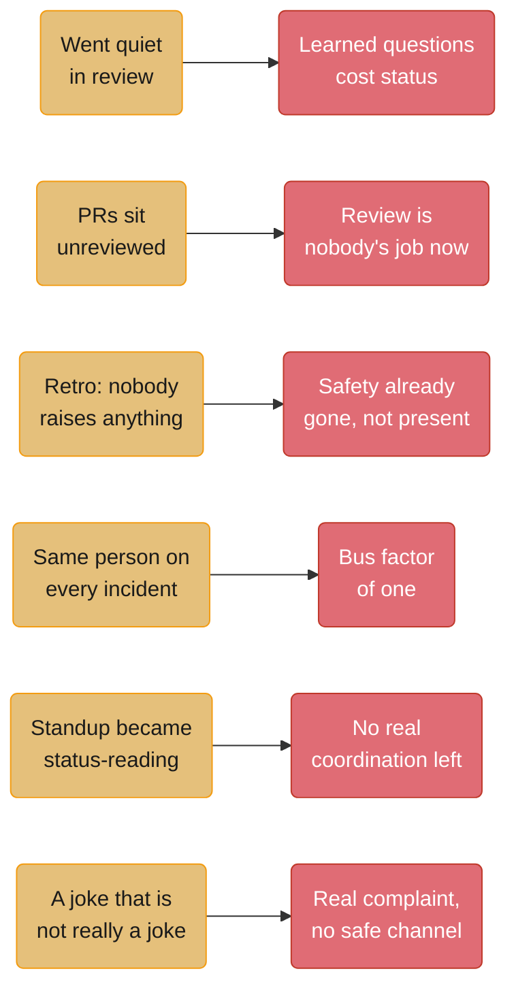
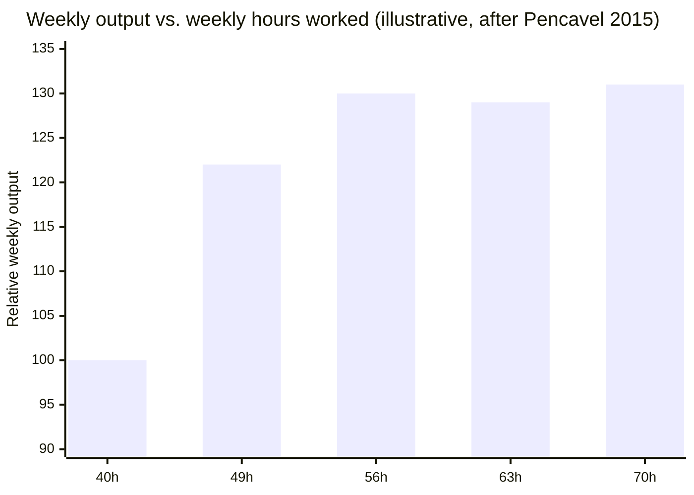
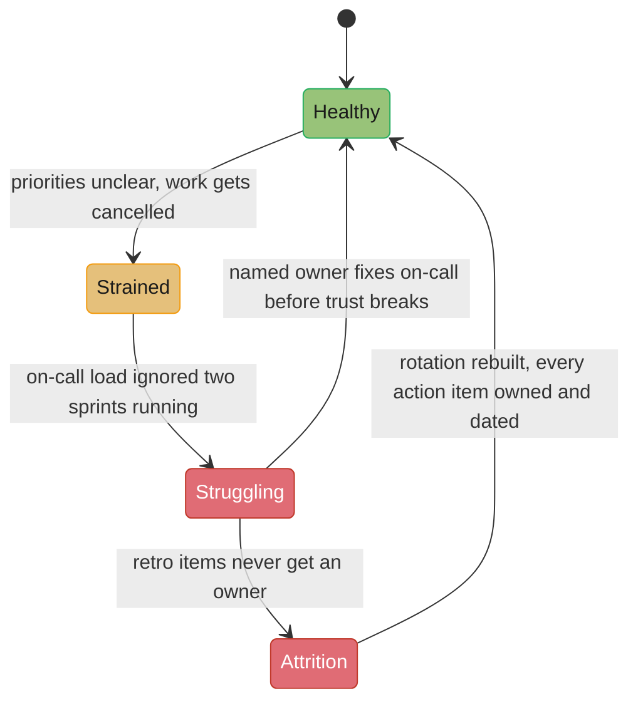
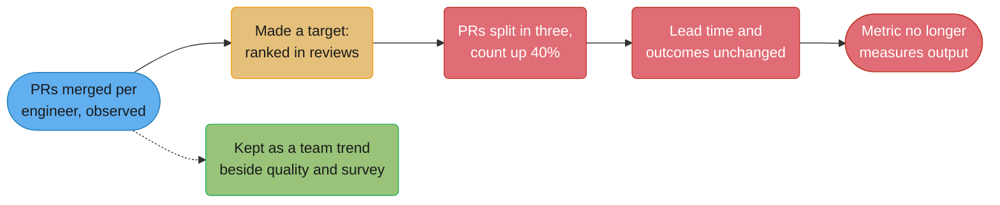

# Team Health & Sustainable Pace

## 1. Concept Overview

Team health is not a survey score and not a vibe — it is a set of measurable conditions
(page volume, review latency, toil hours, retro follow-through) plus one unmeasurable one
(whether people believe they can take a risk in front of their teammates) that together
predict whether a team ships well six months from now or loses half its senior engineers
first. This module is written from the position of a staff-plus individual contributor,
not a manager: someone with no formal authority to change compensation, headcount, or
reporting lines, but with real leverage over on-call load, review norms, retro quality,
and the standards set in design review. That leverage is larger than most senior engineers
realize and smaller than most staff engineers wish it were, and confusing the two is how a
capable IC burns out trying to fix things that were never theirs to fix.

The center of the module is Amy Edmondson's construct of **psychological safety** — precise,
sourced, and explicitly *not* a synonym for niceness — paired with the operational
machinery that actually produces or destroys it day to day: on-call load, toil, and the
retro. Burnout is treated as a systems failure with named causes, not a personal
resilience gap, following the WHO's own classification. And because "sustainable pace" is
an old idea that gets rediscovered and reforgotten every few years, the module traces it
back to its origin and gives the arithmetic for why "just this once" crunch does not do
what people think it does.

---

## 2. Intuition

> **One-line analogy**: A team's health is a bank account, not a mood — on-call debt, toil
> debt, and unacknowledged retro items are withdrawals, and nobody notices the balance
> until the day a withdrawal bounces and your best engineer quits.

**Mental model.** Every unfixed thing that erodes a team — the alert nobody has time to
tune, the retro item with no owner, the on-call rotation that pages twice a week — behaves
like compound interest on a debt, not like a static cost. It does not stay the same size
while you ignore it; the alert fires again next week, the same item gets raised a third
sprint running, the on-call engineer who got paged Tuesday and Thursday starts screening
pages on Saturday because Tuesday and Thursday taught them the page might not be real. The
debt is invisible on any dashboard that measures output, because output looks normal right
up until the resignation letter.

**Why it matters.** A senior engineer who only reads velocity, story points, or deploy
frequency is reading the wrong instrument — those numbers stay flat or even improve for
months while a team quietly empties out, because the people still there are covering for
the ones who checked out, and covering looks like throughput from the outside. The actual
leading indicators are behavioral and easy to miss unless you are looking for them: who
stopped talking in review, whose PRs sit longest, what the retro produces besides a
transcript.

**Key insight.** Psychological safety and sustainable pace are the same lever pointed at
two different failure modes. Safety is what lets a team surface a problem before it becomes
an incident; pace is what gives them the capacity to actually fix it once surfaced. A team
with safety and no capacity knows exactly what is wrong and cannot do anything about it,
which is its own kind of demoralizing; a team with capacity and no safety has the time to
fix things nobody will admit are broken. You need both, and a staff-plus IC without
positional authority can move both — safety by what you say and admit out loud, pace by
what you fix in the on-call rotation, the review queue, and the retro.

---

## 3. Core Principles

- **Psychological safety is paired with high standards, not a substitute for them.** A team
  where mistakes are safe to admit but nobody is held to a bar is a comfort zone, not a
  high-performing team — Edmondson's own later work names this explicitly (see §5).
- **Read behavior, not sentiment.** What people say in a survey and what they do in a
  retro or a review thread diverge, and the divergence itself is the signal — a team that
  rates psychological safety 4/5 on a survey but has had zero substantive retro items in
  eight weeks is telling you the safety score is the polite answer, not the true one.
- **On-call load is a system property, not a person property.** A rotation that wakes
  someone twice in one week is a signal that the alerting, the runbooks, or the
  architecture is broken — the fix is never "toughen up," because toughening up the human
  does not reduce the number of pages the system generates.
- **Toil that never gets budgeted time never gets fixed**, because it always loses the
  prioritization fight against a dated feature commitment, one sprint at a time, forever.
- **Burnout has a known, three-part shape** (exhaustion, cynicism, reduced efficacy — see
  §6.4) and known engineering-specific causes, which means it is diagnosable and, in the
  causes that are actually engineering-controllable, fixable — not a mysterious mood.
- **A staff-plus IC's authority over team health is real but bounded.** You can fix a
  rotation, a review queue, and a retro's follow-through. You cannot fix compensation, a
  bad manager, or a reorg, and treating those as yours to fix is the fastest path to
  becoming the next burnout case (§9).

---

## 4. Types / Levels / Modes

| Mode | Who reads it | What it actually measures | Where it lies |
|------|--------------|----------------------------|----------------|
| **Engagement survey** | HR / leadership, quarterly | Self-reported sentiment | High-scores-while-quietly-leaving is common; a survey cannot see behavior |
| **Velocity / story points** | Managers, sprint over sprint | Throughput, not sustainability | Stays flat or rises while the strongest performers absorb everyone else's slack |
| **Page volume per rotation** | The on-call engineer, every week | Actual operational load | Rarely aggregated anywhere a manager looks by default |
| **Review latency (time-to-first-comment, time-to-merge)** | Nobody, usually, unless someone builds the dashboard | Whether the team is actually collaborating or just co-located | A silent, compounding tax that never shows up as an incident |
| **Retro action-item completion rate** | Nobody, usually | Whether the team's stated process for fixing itself works at all | The single cheapest number to start tracking and the one teams most avoid tracking |
| **Attrition and internal-transfer requests** | Manager, after the fact | The lagging, unambiguous truth | By the time this moves, the earlier signals have been ignored for months |

None of these alone is sufficient. A team that looks fine on velocity and terrible on
review latency and retro completion is a team in the early stages of the degradation this
module is written to catch before it becomes attrition.

---

## 5. Models & Frameworks Diagrammed

Six quiet signals a staff-plus engineer should notice before a manager does, and the
condition each one usually indicates underneath it — see §6.1 for what to do about each.
None of these appear on a dashboard; all six are visible to anyone paying attention in
review, standup, and retro.

Illustrative curve, not the literal historical data — it shows the *shape* of Stanford
economist John Pencavel's finding (§6.5): output rises roughly with hours up to about 49
per week, then the marginal return collapses, to the point that total weekly output at 70
hours differed little from output at 56. Two extra days a week bought almost nothing.

A team's health does not fail in one step. Each transition in this diagram is a decision
point where an IC without formal authority can still intervene — the earlier the
intervention, the fewer steps it takes to reverse.

---

## 6. How It Works — Detailed Mechanics

### 6.1 Psychological safety, precisely

Amy Edmondson's original 1999 definition, from *Administrative Science Quarterly* 44(2):
psychological safety is "a shared belief held by members of a team that the team is safe
for interpersonal risk taking." It is a **team-level** property, not an individual trait —
Edmondson measured it across 51 work teams in a manufacturing company and found it
predicted *learning behavior* (asking questions, admitting errors, proposing untested
ideas), and learning behavior in turn predicted team performance. Google's Project
Aristotle — a two-year internal study of 180 teams (115 engineering, 65 sales) run by
Google's People Analytics team — later measured five team dynamics and found psychological
safety the largest differentiator between the highest- and lowest-performing teams, ahead
of dependability, structure and clarity, meaning, and impact.

**What it is not.** Edmondson has been explicit, in later work, that psychological safety
paired with low standards produces a "comfort zone" — pleasant, low-conflict, and
mediocre. The combination that actually produces a high-performing team is high
psychological safety **and** high standards together; safety is what makes it possible to
tell someone their work does not meet the bar without the conversation becoming about
their worth as a person, not a replacement for having a bar at all.

**What a senior IC without a manager's title can actually do:**
- **Be the first to say "I don't know."** In a design review, the highest-status person in
  the room saying "I'm not sure, let's find out" gives everyone junior in the room
  permission to say the same thing later without it costing them anything.
- **Admit a mistake in public, specifically.** Not "mistakes were made," but "I approved
  that migration plan and I missed that it didn't account for the read replica lag — that's
  on my review, not just the author's PR."
- **Answer a junior engineer's question generously in front of an audience.** Twenty
  people watching how you respond to an obvious or basic question learn, in that moment,
  whether asking a question here is safe or costly — far more efficiently than any stated
  team value ever teaches it.

### 6.2 Reading the quiet signals

These are the things a staff engineer should notice before a manager does, because a
manager's view of the team is mediated by status updates and 1:1s, while an IC's view is
mediated by the actual work — review threads, standup, retro, incident channels.

| Signal | What it usually means | What to do |
|--------|------------------------|------------|
| Someone who used to ask questions in review has gone quiet | They learned, somewhere, that asking cost them status or time | Ask them a direct, easy-to-answer technical question in the next review, publicly, and respond warmly regardless of the answer |
| PRs sit unreviewed for days | Review has quietly become nobody's explicit job | Name an owner or rotation out loud, even informally — "I'll take first pass on anything untouched after 24 hours this week" |
| A retro where nobody raises anything | Safety is already gone, not merely low — silence in a retro is a stronger signal than a complaint | Bring your own real, moderately uncomfortable item first, and make it about a process, not a person |
| The same person answers every incident | A single point of failure the org has stopped noticing because it "just works" | Explicitly pair them with a second responder on the next three incidents, framed as redundancy, not as doubt in their competence |
| Standup has become status-reading | The team stopped needing standup for coordination and nobody canceled the meeting | Ask, out loud, whether standup is still solving a real problem, and be willing to hear "no" |
| Jokes that are not really jokes ("guess who's on-call again," said with an edge) | A real grievance with no channel that feels safe enough to use directly | Follow up privately and specifically — "that landed like it wasn't really a joke, what's going on" |
| The quiet resignation, decided months earlier | The person has already left mentally; the notice is a formality | Usually too late to reverse by the time you see it — the lesson is in the signals that preceded it, not the recovery |

The retro-silence signal deserves emphasis because it is the one people misread most
often: a team that raises nothing in retro is not a team with nothing wrong, it is a team
that has concluded raising things does not change anything, or is not safe. Treat retro
silence as a worse sign than a retro full of complaints.

### 6.3 On-call as the biggest single lever on retention

Google's *Site Reliability Engineering* book caps aggregate operational work — tickets,
on-call, manual tasks — at **50%** of an SRE's time, with an explicit sub-budget: no more
than **25%** of total time on-call, leaving up to another 25% for other non-project
operational work. When the operational load exceeds the cap, the book's prescribed
response is to redirect the excess back to product development — reassigning tickets,
re-integrating developers into the pager rotation — until the load drops back under 50%,
not to simply ask the SRE team to absorb more. Within a shift, the book targets a maximum
of roughly **two incidents per on-call shift**, specifically to leave enough slack for
proper follow-up on each one rather than triage-and-move-on.

**Actionable vs. non-actionable pages** is the distinction that determines whether a
rotation is sustainable or corrosive. An actionable page has a clear, human-necessary
response — something only a person can decide or do. A non-actionable page — one that
resolves itself, that the runbook says to ignore, that nobody has ever actually acted on —
is pure cost with no offsetting value, and every one that fires trains the responder,
correctly, that pages are not to be trusted. That training is **alert fatigue**, and it is
rational: once a responder has been burned by non-actionable 3 a.m. pages often enough,
delaying or half-attending to the next page is the locally sensible response to a system
that has taught them pages lie. The fix is never "respond faster despite the fatigue" — it
is tuning or deleting the alert that is not actionable.

A rotation that wakes someone twice in a single week is not a person having a bad week;
it is a system generating twice the load the SRE book's own guidance treats as a
functioning ceiling. Treat it as an incident about the on-call system itself, with the
same seriousness as a production incident, because unaddressed it produces the same
outcome production incidents do when ignored — someone eventually leaves.

**Weak version** (an on-call load escalation)

> On-call has been kind of rough lately, might be worth looking into at some point when
> things calm down.

**Strong version**

> The backend rotation paged 11 times last week against a target of roughly 2 per shift
> per the SRE guidance we're using — 3 of those were the same non-actionable disk-alert
> firing at 40% headroom, which the runbook says to ignore. I can raise that threshold and
> silence the redundant alert in about an hour. I'd like that prioritized this sprint,
> ahead of the reporting-UI polish, because at this rate someone on the rotation is going
> to start ignoring pages within a month, and one of those will eventually be real.

**What changed:** a number against a named target, the specific cause identified rather
than a vague mood, a concrete fix with a time estimate, an explicit priority ask against a
named competing item, and a stated consequence with a timeframe.

### 6.4 Toil

The SRE book defines toil as operational work that is **manual**, **repetitive**,
**automatable**, **tactical** (triggered by an external event rather than chosen),
**devoid of enduring value** (the system is in exactly the state it was in before the work
started once the work is done), and that **scales linearly with service growth** — twice
the traffic means twice the toil, with no engineering leverage applied. The book's
stated target is to keep toil under roughly half of an engineer's time, for the same
reason as the on-call cap: time not spent on toil is the only time available to build the
automation that reduces future toil, and a team with zero slack for that work is a team
whose toil load only grows as the service does.

**The specific failure** is a team that is aware exactly which manual task is eating them —
everyone can name it in the retro — and never gets the sprint capacity to fix it, because
every planning cycle it loses the prioritization fight against a dated feature commitment.
Toil that never gets budgeted time compounds the same way on-call debt does: the manual
process gets run more times as the service scales, and each of those runs is time that
could have paid down the automation debt but instead added to the transaction volume of
the debt itself.

### 6.5 Sustainable pace and the arithmetic of crunch

"Sustainable pace" originates in Kent Beck's Extreme Programming, first codified in
*Extreme Programming Explained* (1999) as one of the original thirteen practices under the
name **"40 hour week."** Beck's original rule was specific and modest: plan for a 40-hour
week, and if overtime is genuinely required, never work it two weeks in a row — a direct
reaction to the software industry's then-common "death march" culture of open-ended
crunch. The practice was later renamed **sustainable pace** as the idea generalized beyond
a literal hour count to the broader claim: a team's throughput over a quarter is higher
under a pace it can hold indefinitely than under a pace it periodically collapses from.

Stanford economist John Pencavel's 2014/2015 study in *The Economic Journal*, using
historical output data from WWI-era munitions workers, found the relationship between
hours and output is nonlinear: output rises close to proportionally with hours up to
roughly **49 hours a week**, after which marginal productivity per additional hour falls
sharply — to the point that total output at **70 hours a week differed little from output
at 56**. Fourteen extra hours a week bought almost nothing, and other research on sustained
overtime (surveyed on the same general question by Stanford's own crunch-mode economics
review) has found no study showing extended overtime — beyond roughly 50 hours a week for
months on end — producing higher total output in any field. The mechanism behind "just
this once" crunch turning structural is straightforward: a release pulled forward by two
weeks of crunch typically arrives with a defect rate high enough that the following weeks
are spent fixing what crunch broke, which is why the team that crunched rarely nets out
ahead of the team that didn't.

**The specific counterintuitive part worth saying to a skeptical stakeholder:** sustained
overtime does not just fail to help past a few weeks, it produces measurably *less* total
output than the shorter week would have, once error correction and the following weeks'
recovery are counted — not merely flat output at a higher hourly cost.

### 6.6 Burnout as a systems failure

Christina Maslach's model, operationalized in the Maslach Burnout Inventory, defines
burnout across three independent dimensions: **emotional exhaustion** (resources depleted,
nothing left to give), **cynicism / depersonalization** (a negative, detached stance
toward the work and the people affected by it), and **reduced professional efficacy** (a
persistent, negative self-evaluation of one's own competence). The dimensions are
statistically separable and respond to different interventions — a team can be high on
exhaustion and low on cynicism, or the reverse, and the fix differs accordingly.

The WHO's ICD-11 (effective 2022) classifies burn-out as an **occupational phenomenon**,
explicitly **not a medical condition**, listed under "factors influencing health status"
rather than as a disease. Its official description names the same three dimensions in its
own words: "feelings of energy depletion or exhaustion; increased mental distance from
one's job, or feelings of negativism or cynicism related to one's job; and reduced
professional efficacy," and states explicitly that burn-out "should not be applied to
describe experiences in other areas of life" — it is scoped to the occupational context by
definition, not a general term for exhaustion.

**Engineering-specific causes**, roughly in order of how often they show up in practice:
unclear priorities that change without explanation; work that gets built and then
cancelled before shipping; low autonomy over how the work gets done; a broken on-call
rotation (§6.3); and the one most often underrated — **sustained effort with no visible
result**, which is corrosive in a specific way distinct from being merely overworked,
because it removes the sense of professional efficacy directly, the third Maslach
dimension, even when hours are normal.

**What not to do:** resilience training, mindfulness workshops, or "wellness days" aimed
at individuals, delivered into a system that is still producing the same unclear
priorities, cancelled work, and broken on-call that caused the burnout in the first place.
This treats a systems failure as a personal deficiency, and it is recognizable to the
people receiving it as exactly that — which itself becomes a new source of cynicism, the
second Maslach dimension, on top of whatever caused the original exhaustion.

### 6.7 The retro that changes something

Most retros are theatre for a specific, mechanical reason: an action item gets raised, has
no named owner and no date, and is not looked at again until the next retro raises the
same item — at which point it is treated as a new discovery rather than a repeat, because
nobody tracked that it was ever "closed." Esther Derby and Diana Larsen's *Agile
Retrospectives: Making Good Teams Great* (2006) structures a retrospective in five stages
— set the stage, gather data, generate insights, decide what to do, close the
retrospective — and the "decide what to do" stage is exactly where most teams' retros
collapse into a wish list instead of a decision.

**The one mechanical fix:** every action item gets a **name and a date**, and the very
first thing the next retro does — before generating any new items — is review the status
of the last one's items. This alone converts a retro from a venting session into a
process with memory. It is a small process change with an outsized effect, because it is
the mechanism that makes raising something in retro *worth doing* — the moment an item
survives to be checked on next time, the team learns that speaking up in retro produces a
real outcome, which is itself a psychological-safety-building act.

The harder, cultural fix underneath the mechanical one: the team has to actually believe
raising a hard item won't be held against the person who raised it, which loops back to
§6.1 — a retro with no follow-through is very often a retro with no safety either, and
fixing the process alone will not fix a team that does not trust it will be safe to use.

**Weak version** (a retro action item)

> Action item: improve deploy reliability.

**Strong version**

> Action item: Priya rewrites the canary-rollback script to auto-halt on a >2% error-rate
> spike, done by next Friday's retro. Reviewed first thing at that retro before any new
> items are raised.

**What changed:** a named owner, a specific and testable outcome instead of a vague goal,
a date, and an explicit commitment to review it — the weak version can be agreed with by
everyone in the room and then forgotten by everyone in the room, which is the actual
mechanism by which most retro action items die.

### 6.8 Escalating a team-health concern to a manager

A staff-plus IC frequently notices a health problem before the manager does (§6.2), and
the instinct is either to say nothing (it's not my job) or to say something too vague to
act on ("the team seems kind of stressed lately"). Neither works; the second is
particularly common and particularly useless, because a manager cannot act on a mood.

**Weak version**

> Just wanted to flag that the team seems a bit burned out lately, might be worth checking
> in with people.

**Strong version**

> Three things over the last month, together: on-call paged the rotation 9-11 times a week
> against a target of roughly 2, two retro items about deploy flakiness have gone unowned
> for three sprints running, and Marcus hasn't spoken in design review since the
> auth-service postmortem where his design was the one that had the gap. I think those are
> connected — the on-call load is eating the capacity that would fix deploy flakiness, and
> Marcus specifically may be reading that postmortem as bigger than it was. I'd like to
> take the on-call fix myself this sprint, and I think it's worth you checking in with
> Marcus directly, soon.

**What changed:** three specific, named, connected data points instead of a mood word,
a proposed fix the speaker is already offering to own, and a specific, bounded ask of the
manager rather than a generic "maybe look into it."

### 6.9 Measuring engineering productivity without wrecking the team

Productivity metrics are a team-health topic because the fastest way to destroy
psychological safety is to rank people on a number they can game. **Goodhart's law**:
Charles Goodhart's 1975 observation about monetary targets, in Marilyn Strathern's 1997
phrasing, "When a measure becomes a target, it ceases to be a good measure." A metric
used to learn about the system stays honest. The same metric used to rank people gets
gamed, and then it measures the gaming.

*Goodhart's law on an engineering metric. The dashed path is the use that stays honest:
a team-level trend read beside a quality metric and a perceptual one.*

Four frameworks are in common use, and they measure different things:

| Framework | Source | What it measures | Unit of analysis |
|-----------|--------|------------------|------------------|
| DORA software delivery metrics | Forsgren, Humble and Kim, *Accelerate* (2018); the annual DORA reports at dora.dev | the delivery pipeline: change lead time, deployment frequency, failed deployment recovery time (throughput); change fail rate, deployment rework rate (instability) | an application or service, never a person |
| SPACE | Forsgren, Storey, Maddila, Zimmermann, Houck and Butler, *ACM Queue* 19(1), February 2021 | five dimensions: Satisfaction and well-being, Performance, Activity, Communication and collaboration, Efficiency and flow | individual, team, or system, chosen per metric |
| DevEx | Noda, Storey, Forsgren and Greiler, *ACM Queue*, 2023 | developer friction in three dimensions: feedback loops, cognitive load, flow state; mostly from surveys, supported by workflow data | the developer's experience, aggregated to team |
| DX Core 4 | Abi Noda and Laura Tacho (DX), December 2024 | Speed (diffs per engineer), Effectiveness (Developer Experience Index), Quality (change failure rate), Impact (percentage of time on new capabilities) | organisation and team |

Points that are easy to get wrong:

- **DORA has five metrics, not four.** The original four keys came from *Accelerate*. The
  2023 report renamed MTTR to failed deployment recovery time and limited it to failures
  caused by a change; the 2024 report added deployment rework rate, the share of
  deployments that are unplanned and caused by a production incident.
- **SPACE is a menu, not a scorecard.** Its authors argue for several metrics across at
  least three dimensions, including at least one perceptual measure such as a survey,
  so no single number stands in for productivity. Activity (commits, PRs, lines) is one
  dimension of five, and the one most open to gaming.
- **Core 4's speed metric carries its own warning.** DX's launch post says diffs per
  engineer must never be used at the individual level or tied to performance
  evaluations, and must be read against the Developer Experience Index.
- **None of them measures an individual's contribution.** Staff work (unblocking, design
  review, the migration plan) does not show up in diffs; a ranking on diffs pushes your
  best multipliers to stop multiplying.

Rules that keep the numbers honest: measure teams and services, not people; pair every
throughput metric with a quality metric and a survey result; publish the definitions
before the first dashboard; compare a team with its own trend, not with other teams; and
keep these numbers out of individual performance reviews, where the review's own evidence
standard applies (see [Performance Reviews & Promotions](../performance_reviews_and_promotions/performance_reviews_and_promotions.md)).

**Weak version** (a director announcing the dashboard)

> Starting next quarter we'll track PRs merged per engineer and share the leaderboard in
> the monthly all-hands to celebrate our most productive people.

**Strong version**

> Starting next quarter each team gets a dashboard with its DORA metrics, change fail rate
> and rework rate next to lead time, plus a quarterly DevEx survey. It is per team, compared
> only with that team's own last quarter, and none of it feeds individual reviews. The
> first use is finding where builds and reviews slow us down, not ranking anyone.

**What changed:** the weak version makes an activity count into a target attached to
public status, which guarantees PR splitting and punishes the people doing review and
design. The strong version measures the system at team level, pairs speed with stability
and perception, rules out individual use in writing, and states what the numbers are for.

---

## 7. Real-World Examples

- **Google's Project Aristotle** (2012–2015, Google People Analytics) studied 180 internal
  teams and found psychological safety the strongest predictor of team effectiveness among
  five measured dynamics — the finding that is now the standard citation for why safety is
  a performance lever, not merely a comfort one, and it is Google's own engineering culture
  the finding was drawn from.
- **Google's Site Reliability Engineering book** operationalizes on-call and toil budgets
  as hard organizational policy — the 50% operational-work cap and the redirect-to-dev
  mechanism when it's exceeded (§6.3) — rather than as guidance a team can quietly ignore
  under deadline pressure.
- **37signals (Basecamp)** runs a public, standing four-day, 32-hour summer work week (May
  through August) as a deliberate constraint on pace, and has reported that roughly the
  same amount of work gets done as in a five-day week — the company's own evidence for the
  claim that removing capacity forces better prioritization rather than costing output.
- **Jason Fried and David Heinemeier Hansson's *It Doesn't Have to Be Crazy at Work***
  (2018) documents Basecamp's broader "calm company" practices — protected attention,
  fewer and smaller meetings, a standing 40-hour week — as a direct, named rejection of the
  crunch-as-necessary-for-ambition narrative common in the industry.
- **Amy Edmondson's *The Fearless Organization*** (2019) extends the original 1999 research
  into the "Learning Zone" model — high safety paired with high standards — the explicit
  answer to the most common misreading of psychological safety as license for low
  standards (§6.1).

---

## 8. Tradeoffs

| Approach to a strained team | Speed to relief | Durability | Risk |
|---|---|---|---|
| Fix the specific alert / on-call issue yourself | Fast — hours to days | Low alone, but compounds with other fixes | Treats a symptom; underlying priority-clarity problem may remain |
| Escalate the pattern to the manager with data (§6.8) | Slower — depends on the manager's bandwidth | High if acted on | The manager may lack authority too (comp, headcount) — see §9 |
| Push a mechanical retro fix (owner + date) | Fast to introduce, slow to show results | High once habit forms | Cultural safety problem underneath can quietly defeat the process fix |
| Individual "resilience" support (EAP, wellness day) | Fast, visible | Very low | Does not touch the system producing the exhaustion — can read as dismissive |
| Say nothing and hope it resolves | None | None | The default outcome, and the one this module argues against throughout |

---

## 9. When to Use / When NOT to Use

**Act directly, as an IC, when the problem is inside your actual leverage:** on-call load
and alert quality, review latency and norms, retro mechanics and follow-through, the
standard you personally hold in design review, and what you personally say and admit in
front of the team. All of these are fixable by a staff-plus engineer with zero managerial
authority, using the mechanics in §6.

**Escalate with data rather than fix yourself when** the problem requires authority you
don't have — reassigning headcount, changing a deadline set above your manager, addressing
another individual's underperformance directly. Escalating vaguely ("things feel off") is
close to useless; escalating with the specific data pattern from §6.8 is not.

**Do not attempt to personally absorb** a compensation problem, a bad manager, or a
reorg's fallout by working harder to compensate for what the org isn't providing. This is
the single most common way a strong staff engineer becomes the next burnout case — see §9
below and §10's second pitfall.

**Do not treat a survey score as sufficient evidence of health**, in either direction — a
good score can mean genuine safety or can mean people have learned the survey doesn't
matter and are giving the answer that ends the conversation fastest. Cross-check it against
the behavioral signals in §6.2.

---

## 10. Common Pitfalls

**The hero who becomes the single point of failure.** A payments team's most senior
engineer was the only person who fully understood the reconciliation job's retry logic. He
answered every related incident personally for two years — nights, weekends, vacations —
because it was genuinely faster than teaching someone else while also fighting the fire.
When he finally took a real two-week vacation, a reconciliation edge case surfaced that
took the covering team four days to resolve instead of the twenty minutes it would have
taken him, and it cost the company a multi-day reporting discrepancy with finance. The
postmortem's actual root cause was not the edge case; it was two years of a bus factor of
one that nobody had treated as an incident until it became one.

**Absorbing an organizational failure as a personal responsibility.** A staff engineer,
frustrated that his team's roadmap kept getting overridden by a VP with no engineering
context, responded by personally working nights and weekends to hit the VP's dates anyway
— reasoning that if he just delivered, the team wouldn't have to feel the churn. He hit the
dates for roughly two quarters. In the third, he was hospitalized for stress-related chest
pain that turned out not to be cardiac. The roadmap-override problem was never his to fix
alone — it needed his manager's manager pushing back on the VP — and every quarter he
absorbed it instead of escalating it taught the org that the current process was fine,
because from the outside, it kept working.

**A health survey with no visible follow-through.** An engineering org ran a quarterly
pulse survey for six consecutive quarters. Scores on "I feel comfortable raising concerns"
declined steadily from quarter two onward, and nothing about the survey's results was ever
shared back to the teams that filled it out. By quarter six, the response rate had dropped
from 85% to 34%. The exit interviews that followed a subsequent wave of departures cited
"nobody does anything with the feedback" specifically and repeatedly — the survey itself
had become evidence *against* safety rather than a measure of it.

**Treating a retention problem as a hiring problem.** A team lost three of five engineers
in four months. Leadership's response was to open three new reqs at market-competitive
comp. The two remaining original engineers, both interviewed as part of a later
retrospective, independently named the same root cause — an on-call rotation that had
effectively become a two-person rotation once the departures started, each departure
making the remaining load worse for whoever stayed, a spiral nobody addressed because
"we're hiring for it" felt like an action. The three new hires inherited the same broken
rotation and two of them left within a year.

**Measuring team health by velocity.** A team's sprint velocity held steady or even rose
for the two quarters immediately preceding a wave of four departures. The explanation,
visible only in hindsight, was that the team's two most senior engineers had quietly
absorbed the slack from three quietly-checked-out teammates for months, which kept the
number the dashboard showed unchanged right up until the two absorbers left as well,
at which point velocity did not decline gradually — it collapsed in a single sprint.

---

## 11. Frameworks, Books & Further Reading

| Framework / Source | What it gives you |
|---|---|
| Amy Edmondson, "Psychological Safety and Learning Behavior in Work Teams," *Administrative Science Quarterly* 44(2), 1999 | The original, precise definition and the team-level learning-behavior mechanism |
| Amy Edmondson, *The Fearless Organization* (2019) | The Learning Zone model — safety paired with high standards, and the naming of the "comfort zone" misreading |
| Google People Analytics, Project Aristotle (2012–2015) | The empirical ranking of psychological safety as the top predictor among five team dynamics |
| Google, *Site Reliability Engineering* (2016), chapters on being on-call and eliminating toil | The 50% operational-work cap, the on-call sub-budget, and the six-part definition of toil |
| Esther Derby & Diana Larsen, *Agile Retrospectives: Making Good Teams Great* (2006) | The five-stage retrospective structure and the mechanics of a retro that actually decides something |
| Kent Beck, *Extreme Programming Explained* (1999; 2nd ed. 2004) | The origin of "40 hour week," renamed sustainable pace in the second edition |
| John Pencavel, "The Productivity of Working Hours," *The Economic Journal* 125(589), 2015 | The empirical case that output per hour collapses well before 70 hours, and total output at 70 barely beats output at 56 |
| Christina Maslach & Susan Jackson, the Maslach Burnout Inventory and its three-dimension model | Exhaustion, cynicism, and reduced professional efficacy as separable, measurable dimensions |
| World Health Organization, ICD-11 (2022), "Burn-out" | The occupational-phenomenon classification and its own three-dimension description |
| Nicole Forsgren, Jez Humble & Gene Kim, *Accelerate* (2018), and the DORA reports at dora.dev (2023 and 2024 for the metric changes) | The DORA software delivery metrics, the 2023 rename of MTTR, and the 2024 addition of deployment rework rate |
| Nicole Forsgren et al., "The SPACE of Developer Productivity," *ACM Queue* 19(1), 2021 | The five SPACE dimensions and the case against any single productivity metric |
| Abi Noda, Margaret-Anne Storey, Nicole Forsgren & Michaela Greiler, "DevEx: What Actually Drives Productivity," *ACM Queue*, 2023 | Feedback loops, cognitive load and flow state as the three dimensions of developer experience |
| Abi Noda, "Introducing the DX Core 4" (Engineering Enablement newsletter, December 10, 2024) | The four Core 4 dimensions, their key metrics, and the warning against individual use of diffs per engineer |
| Marilyn Strathern, "'Improving ratings': audit in the British University system," *European Review* 5(3), 1997 | The common phrasing of Goodhart's law |
| Jason Fried & David Heinemeier Hansson, *It Doesn't Have to Be Crazy at Work* (2018) | A named, public rejection of crunch culture from a company that runs a standing sustainable-pace policy |

Related modules in this section:
[Giving & Receiving Feedback](../giving_and_receiving_feedback/giving_and_receiving_feedback.md),
[Difficult Conversations & Conflict](../difficult_conversations_and_conflict/difficult_conversations_and_conflict.md),
[Incident Communication & Postmortems](../incident_communication_and_postmortems/incident_communication_and_postmortems.md).

---

## 12. Interview Questions with Answers

**Q: What is Amy Edmondson's precise definition of psychological safety, and what is it most often confused with?**
**Short:** A shared team belief that interpersonal risk-taking is safe — not niceness or low standards.
Edmondson's 1999 *Administrative Science Quarterly* definition is "a shared belief held by
members of a team that the team is safe for interpersonal risk taking." It is a
team-level property, not an individual trait or a mood. It is most often confused with
simple niceness or a low-conflict culture — Edmondson's later work is explicit that safety
paired with low standards produces a comfort zone, not a high-performing team; the useful
combination is safety paired with high standards held at the same time.

**Q: Your VP wants to rank engineers by PRs merged per week. What do you say?**
**Short:** That ranking turns an activity count into a target, so people split PRs, the count rises and output does not. Measure teams on DORA and survey data, never individuals.

Goodhart's law: when a measure becomes a target, it stops being a good measure. A
leaderboard of PRs per engineer rewards splitting one change into three, penalises the
people doing review, design and unblocking, and teaches the team that asking for help
costs rank. Even DX, whose Core 4 includes diffs per engineer, says it must never be used
at the individual level or tied to performance evaluations. Offer the alternative: per-team
DORA metrics with change fail rate and rework rate beside lead time, a quarterly
developer-experience survey, and each team compared only with its own trend.

**Q: What are DORA's five software delivery metrics?**
**Short:** Throughput: change lead time, deployment frequency, failed deployment recovery time. Instability: change fail rate and deployment rework rate, the fifth, added in 2024.

The four keys came from *Accelerate* (Forsgren, Humble, Kim, 2018). The 2023 report
renamed MTTR to failed deployment recovery time and limited it to failures caused by a
change to production. The 2024 report added deployment rework rate: the share of
deployments that are unplanned and made because of a production incident. All five
describe an application's delivery system and are meant to be read together, since speed
gained by shipping more broken changes shows up in the two instability metrics.

**Q: How do SPACE, DevEx and the DX Core 4 differ from the DORA metrics?**
**Short:** DORA measures the delivery pipeline. SPACE is a five-dimension menu for choosing balanced metrics, DevEx measures friction through surveys, and Core 4 packages them into four dimensions.

DORA's five metrics cover throughput and instability of deployments. SPACE (Forsgren et
al., 2021) names five dimensions (satisfaction and well-being, performance, activity,
communication and collaboration, efficiency and flow) and asks for metrics across at least
three of them, including a perceptual one. DevEx (Noda et al., 2023) narrows to what slows
developers down: feedback loops, cognitive load and flow state, mostly measured by survey.
DX Core 4 (December 2024) picks one key metric each for speed, effectiveness, quality and
impact. Choose by question: "is delivery healthy" is DORA, "where is the friction" is
DevEx, "what do we report to leadership" is usually a Core 4 style set.

**Q: What did Google's Project Aristotle find, and why is that finding notable?**
**Short:** Psychological safety was the top predictor of team effectiveness among 180 teams studied.
Google's People Analytics team studied 180 internal teams over roughly two years and
measured five team dynamics; psychological safety differentiated the highest- and
lowest-performing teams more than dependability, structure and clarity, meaning, or
impact. It is notable because it moved psychological safety from an academic construct
into a business-performance claim backed by one of the largest internal studies of its
kind at a major engineering company.

**Q: A team scores well on a quarterly engagement survey but nobody has raised a real issue in retro for two months. Which signal do you trust?**
**Short:** Trust the retro silence — a good survey score can mean people learned the survey doesn't matter.
A survey measures self-reported sentiment at a single moment and is easy to answer with
the safe, generic response. Silence in retro over an extended period is a stronger and
more troubling signal than a retro full of complaints, because it usually means the team
has concluded that raising things does not produce a change, or is not safe to do — treat
retro silence as evidence safety has already eroded, not as evidence there is nothing
wrong.

**Q: What is the specific cap Google's SRE book places on operational work, and what happens when a team exceeds it?**
**Short:** 50% aggregate operational work, with a 25% sub-cap specifically on time spent on-call.
The book caps aggregate ops work — tickets, on-call, manual tasks — at 50% of an SRE's
time, with no more than 25% of total time specifically on-call. When a team exceeds the
cap, the prescribed response is to redirect the excess load back to product development —
reassigning tickets, adding developers to the pager rotation — until the load returns
under 50%, rather than asking the team to simply absorb more.

**Q: Why does a rotation paging someone twice in one week count as a system failure rather than a person problem?**
**Short:** Twice a week exceeds the guidance ceiling and reflects a broken alert or architecture, not a weak responder.
Google's own SRE guidance targets roughly two incidents per on-call *shift*, with the
explicit goal of leaving time for real follow-up on each one — a rotation generating that
volume in a single week is running well past a level the industry's own reference
treats as sustainable. The fix is never telling the person to toughen up, because the
person did not generate the pages — the alerting configuration, runbooks, or underlying
architecture did, and only fixing those reduces the count.

**Q: What is alert fatigue, and why is it a rational response rather than a discipline failure?**
**Short:** Learned, reasonable distrust of pages after enough of them turn out to be non-actionable.
An actionable page requires a human decision or action; a non-actionable one resolves
itself or has a runbook that says to ignore it, and it is pure cost with no offsetting
value. Once a responder has been burned by enough non-actionable pages, delaying or
half-attending to the next one is the locally sensible response to a system that has
already taught them pages often lie — the fix is tuning or deleting the alert, not asking
for faster responses to alerts that shouldn't have fired.

**Q: What are the six defining characteristics of toil in the SRE book's definition?**
**Short:** Manual, repetitive, automatable, tactical, devoid of enduring value, and scaling linearly with growth.
Manual means a human runs it; repetitive means it recurs predictably; automatable means a
machine could do it just as well; tactical means it's triggered by an external event
rather than chosen; devoid of enduring value means the system is unchanged once it's done;
and it scales linearly, meaning twice the service traffic produces twice the toil with no
engineering leverage applied. A team aware of exactly which task fits this description and
never given sprint time to automate it will watch that task's cost grow with the service
indefinitely.

**Q: Where does "sustainable pace" originate, and what was its original, more specific name?**
**Short:** Kent Beck's Extreme Programming, originally called the "40 hour week" practice.
Kent Beck's *Extreme Programming Explained* (1999) codified it as one of the original
thirteen XP practices under the literal name "40 hour week," with a specific rule: plan
for 40 hours, and if overtime is genuinely necessary, never work it two weeks running. It
was renamed sustainable pace as the idea generalized past a literal hour count to the
broader claim that a pace the team can hold indefinitely outproduces one it periodically
collapses from.

**Q: What did Pencavel's research find about the relationship between hours worked and total output?**
**Short:** Output rises with hours to about 49/week, then marginal productivity collapses sharply.
John Pencavel's 2015 *Economic Journal* study of historical output data found the
relationship nonlinear: output tracks hours reasonably closely up to roughly 49 hours a
week, after which each additional hour returns much less, to the point that total weekly
output at 70 hours differed little from output at 56 hours — fourteen extra hours bought
almost nothing once the curve had already flattened.

**Q: Why does "just this once" crunch tend to become structural rather than staying a one-time exception?**
**Short:** Crunch-driven work ships with a higher defect rate, and fixing those defects consumes the following weeks.
A release pulled forward by crunch typically carries more bugs than the same release built
at a sustainable pace, and the weeks immediately after the crunch get spent finding and
fixing what the crunch introduced — which is why the team that crunched frequently does
not net out ahead of the team that didn't, even measured over the following month, not
just the crunch week itself.

**Q: What are the three dimensions of the Maslach model of burnout?**
**Short:** Emotional exhaustion, cynicism (depersonalization), and reduced professional efficacy.
Exhaustion is the depletion of emotional and physical resources; cynicism is a negative,
detached stance toward the work and the people it affects; reduced professional efficacy
is a persistent negative self-evaluation of one's own competence. The three are
statistically separable and respond to different interventions, so a diagnosis needs to
identify which dimension is actually elevated rather than treating "burnout" as one
undifferentiated state.

**Q: How does the WHO's ICD-11 classify burn-out, and what is the significant part of that classification?**
**Short:** As an occupational phenomenon, explicitly not a medical condition, and scoped only to work.
ICD-11 (effective 2022) lists burn-out under factors influencing health status rather than
as a disease, describing it as resulting from chronic unmanaged workplace stress with the
same three dimensions the Maslach model names, and states explicitly that the term "should
not be applied to describe experiences in other areas of life." The significant part is
the framing as a work-caused, work-scoped phenomenon rather than an individual medical
diagnosis — which supports treating it as a systems problem, not a personal one.

**Q: Which specific engineering cause of burnout is most often underrated compared to raw hours worked?**
**Short:** Sustained effort with no visible result — it erodes professional efficacy directly, independent of hours.
Unclear priorities, cancelled work, low autonomy, and broken on-call are the more visible
causes, but sustained effort producing no visible outcome is distinct and often missed
because hours can be entirely normal while it happens — it removes the sense of
professional efficacy, the third Maslach dimension, directly, which is a different and
sometimes faster route to burnout than exhaustion from long hours alone.

**Q: Why is resilience training aimed at individuals the wrong intervention for engineering burnout, even when well-intentioned?**
**Short:** It treats a systems failure as a personal deficiency while the causal system stays unchanged.
If unclear priorities, cancelled work, and a broken on-call rotation are the actual causes,
training individuals to be more resilient does not change any of them — the same causes
keep producing the same exhaustion. Recipients often recognize the mismatch, which can add
a new grievance (being blamed, implicitly, for a systemic problem) on top of whatever
caused the original exhaustion, worsening the cynicism dimension rather than helping it.

**Q: What is the single mechanical fix that makes a retrospective actually change something, according to this module?**
**Short:** Every action item gets a named owner and a date, reviewed first at the next retro.
Most retro items die because nobody owns them and nobody checks whether they happened —
the same issue then resurfaces sprint after sprint as if newly discovered. Requiring a
name and a date, and opening every subsequent retro by reviewing the last one's items
before raising new ones, converts the retro from a venting exercise into a process with
memory, which is also what makes raising something in retro feel worth doing in the first
place.

**Q: What can a staff-plus IC with no managerial authority actually fix about team health, and what can they not?**
**Short:** Can fix on-call, review latency, and retro follow-through; cannot fix comp, a bad manager, or a reorg.
An IC has real, direct leverage over on-call load and alert quality, review norms and
latency, the retro's mechanics, and the standard they personally hold and model in design
review. They have no leverage over compensation, another person's management quality, or
organizational restructuring — pretending otherwise, and trying to personally compensate
for those with more hours or more absorbed stress, is a common route by which a strong
staff engineer becomes the next burnout case.

**Q: What is the specific test this module proposes for whether a staff engineer has become an unsustainable single point of failure?**
**Short:** If they were away for two weeks, what actually stops — if the honest answer is "a lot," that's the problem.
The test is concrete rather than a feeling: name what specifically would not get resolved,
answered, or unblocked if this person were fully offline for two weeks. A "not much"
answer indicates healthy redundancy; an honest "quite a bit" answer identifies a bus-factor
problem the person needs to actively reduce — by documenting, teaching, or deliberately
stepping back from being the answer — well before that gap gets tested by an actual
emergency rather than a planned vacation.

---

## 13. Best Practices

- Read behavioral signals — review silence, PR latency, retro participation — as more
  reliable than survey sentiment, and cross-check the two against each other.
- Track page volume per rotation per week against a stated target (roughly two per shift,
  per SRE guidance) and treat exceeding it as an incident about the system, not the person.
- Distinguish actionable from non-actionable pages explicitly, and delete or tune anything
  in the second category before it teaches the team to distrust every page.
- Give toil a named budget in planning, the same way a feature gets one, or it will always
  lose the prioritization fight one sprint at a time, forever.
- Require a named owner and a date on every retro action item, and review the previous
  retro's items first, before raising anything new.
- Be the first, visibly, to say "I don't know" or admit a mistake in a review or design
  discussion — it is the cheapest, highest-leverage psychological-safety action available
  to someone with no formal authority.
- When escalating a team-health concern, bring specific, connected data points and a
  proposed first move, not a mood word.
- Periodically apply the two-week absence test to yourself, and treat "a lot would stop"
  as a problem to actively fix, not a compliment about your indispensability.
- Escalate what genuinely requires authority you don't have — compensation, a bad manager,
  a reorg — instead of trying to personally absorb the gap with more hours.

---

## 14. Case Study

**Scenario.** A seven-person platform team supports a shared internal deploy pipeline used
by several product teams. Over one quarter: page volume on the platform on-call rotation
has crept from roughly 3 pages a week to 9-12; two retro items about the flakiest step in
the pipeline have gone unowned for three sprints running; and a normally vocal senior
engineer, Wei, has stopped speaking in the team's weekly design reviews since a postmortem
where a rollback script she wrote failed to halt a bad deploy in time, causing forty
minutes of customer-visible downtime.

**Reading the signals.** Individually, each fact looks survivable — on-call is "a bit
heavy," a couple of retro items are "still open," one person is "just quieter lately." A
staff engineer on the team, Amir, who has no management authority over anyone, connects
the three: the on-call load is consuming the sprint capacity that would otherwise go to
the pipeline flakiness the retro items name, and the postmortem's blast radius likely
landed harder on Wei than the write-up itself suggested, because nobody has said anything
to her about it directly since.

**What Amir does, in order.** First, he audits the on-call alerts himself and finds that
5 of the last quarter's roughly 30 pages came from a single disk-headroom alert that fires
at 45% usage and self-resolves within ten minutes every time — a textbook non-actionable
page. He retunes the threshold in an afternoon, which alone should cut weekly volume by
roughly a third. Second, in the next retro, he personally takes ownership of the
pipeline-flakiness item with a specific, dated deliverable — "I'll have the canary step
rewritten with a proper timeout by Friday, and we review it first thing next retro" —
rather than leaving it to compete unowned against new items again. Third, he talks to Wei
directly and specifically, referencing the postmortem by name: "The rollback-timing gap in
the postmortem was a genuine gap in the tooling, not a mistake in your judgment — the
script did exactly what it was written to do, the timeout was just too generous. I want to
pair with you on rewriting it, and I want your take on this in the next design review,
because we lost something when you stopped talking there."

**What Amir does not do.** He does not personally start covering the extra on-call load to
"take pressure off the team" — that would remove the visible symptom that made the
underlying alert problem worth fixing at all, and it would put him on the same track as
the case in §10's second pitfall. He also does not escalate to the team's manager with a
vague "team seems stressed" — by the time he talks to the manager, he has the specific
data (§6.8's strong version) and a fix already partly in motion, so the manager's role
becomes deciding whether Wei needs anything further, not diagnosing the problem from
scratch.

**Outcome, six weeks later.** Weekly page volume settles at roughly 4-5, close to the
target ceiling. The pipeline-flakiness fix ships on the date Amir committed to, and the
retro's next item gets an owner and a date without anyone having to be asked twice — the
team has learned, by seeing it happen once, that the process actually produces an outcome.
Wei speaks up in the following design review for the first time in seven weeks, proposing
the exact timeout-handling pattern from the fix she and Amir paired on.

**The one-line lesson.** None of Amir's three moves required managerial authority — an
alert threshold, an owned retro item, and a direct, specific conversation — and all three
were available to him because he read the quiet signals in §6.2 as data rather than mood,
weeks before the situation would have otherwise reached his manager as an attrition risk
instead of a fixable pattern.
