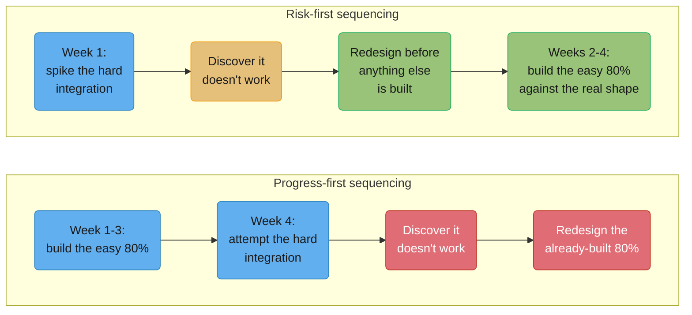
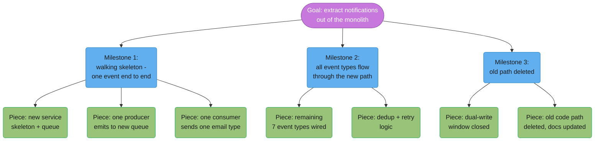
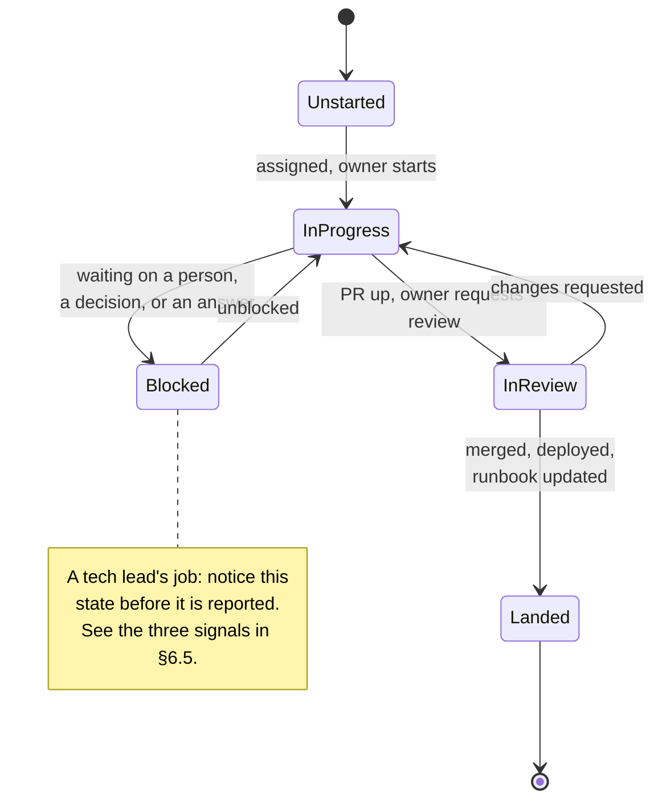

# Technical Leadership & Execution

## 1. Concept Overview

Technical leadership is running a project you have no formal authority over: no headcount
to hire or fire, no compensation lever, nobody's performance review runs through you — and
the project still has to land. This is the most common staff-plus job in the industry and
the least written about, because it produces no artifact of its own the way a design doc or
an architecture does. What it produces is a project that shipped on a defensible timeline,
with a team that is not burned out and still wants to work with you again.

What the tech lead owns that nobody else in the room owns: the **sequencing** (what gets
built in what order, and specifically what gets built first to retire the biggest unknown),
the **interfaces between people's work** (so two engineers building adjacent pieces do not
discover in week five that their assumptions about each other's API disagree), the
**decisions nobody else has standing to make** (which of two reasonable technical
approaches, when the tradeoff is judgment rather than fact), and **honest status** (what is
actually true about where the project stands, as opposed to what would be comfortable to
report). None of those four is "take the hardest ticket yourself" — that is the single most
common way a strong individual contributor fails at this job, because it substitutes the one
thing they are already good at for the four things nobody else on the team can do.

This module covers the concrete mechanics: breaking a goal into an assignable plan,
sequencing to retire risk before visible progress, the vertical-slice milestone, honest
estimation, the standing artifacts that keep a project legible, unblocking as the highest-
leverage use of a tech lead's time, delegating outcomes instead of tasks, the keyboard-time
tradeoff, handing a project to someone else, and landing it — the unglamorous last mile that
most treatments of "leadership" skip entirely.

---

## 2. Intuition

> **One-line analogy**: A tech lead is an air-traffic controller, not the pilot flying the
> hardest approach — the job is sequencing, separation and unblocking every aircraft in the
> stack, and a controller who takes over one plane's controls has, for that duration, stopped
> controlling the other nine.

**Mental model**: a project is not a bag of tickets to be picked up in any order by whoever
is free. It is a graph of dependencies and unknowns, and the tech lead's job is to walk that
graph before anyone starts typing — deciding which unknown is scariest, which piece blocks
the most other pieces, and which piece can be handed to which person without that person
needing to ask you a question every day. Everything else in this module is a mechanism for
doing that walk well and keeping it visible to everyone downstream of it.

**Why it matters**: a team of five strong engineers with no sequencing plan will
independently choose to build the parts they find most interesting first, which are rarely
the parts carrying the most risk. The project looks great for three weeks and then hits the
one integration nobody derisked, at which point the "great for three weeks" work is often
partially wasted because it was built against assumptions the failed integration
invalidates. This is not a hypothetical; it is the default outcome of an unled project, and
it is the single most avoidable failure mode this module exists to prevent.

**Key insight**: the tech lead's authority is entirely earned, moment to moment, through
being right about sequencing and honest about status — not granted by a title. The moment a
tech lead's status reports stop being trusted, or their sequencing calls stop being followed
without an argument, the authority is gone even if the title stays on the org chart.

---

## 3. Core Principles

- **You own sequencing, interfaces, judgment calls and honest status — not the hardest
  ticket.** Taking the hardest ticket yourself is the trap that looks like leadership and is
  actually abdication of the other four.
- **Retire the biggest unknown first, even though it demos worst.** The piece you are least
  sure will work is the piece to build first, not last.
- **A plan is not real until it is a numbered sequence with one owner per piece.** "We'll
  figure out the auth piece and the migration piece in parallel" is not a plan; it is a
  description of two unstarted pieces of work.
- **An estimate without a stated assumption is a promise, not an estimate.** "Three weeks"
  means nothing without "assuming the schema is what we think it is."
- **Status that lists activity is not status.** "Worked on the migration this week" answers
  a different question than "are we going to hit the date."
- **The highest-leverage thing you do most days is remove one blocker, not write one line of
  code.** A day spent unblocking three engineers is worth more than a day spent shipping one
  PR yourself.
- **Delegate the outcome and the decision rights with it, not just the task.** A task
  handed over without authority to make the calls inside it just relocates the bottleneck to
  whoever now has to ask you every question.
- **The last 10% of a project is not 10% of the work.** Landing — the runbook, the
  dashboards, the on-call handover, the deleted deprecated thing — routinely takes as long
  as the feature did.

---

## 4. Types / Levels / Modes

| Mode | What's different | Primary artifact | Failure mode if run wrong |
|---|---|---|---|
| Solo-IC lead (1-2 people) | You write most of the code yourself; leadership is mostly sequencing your own work | A short numbered plan | Sequencing gets skipped because "it's just me" — then the risky part still gets discovered late |
| Team lead, single workstream (3-6 people) | You sequence and unblock; you code the interfaces and the riskiest spike, not the bulk | Weekly status doc + risk list | You become the bottleneck by reviewing/approving everything, or lose context by coding nothing |
| Multi-workstream lead (6-15 people, several sub-teams) | You no longer track individual tickets; you track dependencies between workstreams and their leads | Dependency map + decision log | Losing the interface between two sub-teams' assumptions until integration week |
| Crisis / incident lead | Compressed time horizon; the standing artifact updates in minutes, not weeks; authority to reassign people in real time is assumed, not requested | The incident channel + a live timeline | Treating an incident like a normal project — waiting for a status meeting that is a day away |
| Handoff lead | You are transferring ownership, not driving; your output is someone else's context, not code | Handover doc + shadowing schedule | Handing off the task list and not the relationships or the "why," so the next lead re-learns everything by breaking it |

The axis underneath all five is **how much of the work you personally touch versus how much
you sequence and unblock for other people** — as team size grows, the right answer shifts
hard toward the latter, and the modes above are checkpoints on that curve, not free choices.

---

## 5. Models & Frameworks Diagrammed



*Same discovery, two different weeks. Progress-first sequencing looks better for three
weeks and then pays for three weeks of rework; risk-first sequencing looks worse for one
week and never pays that cost at all.*



*A one-line goal decomposed into three milestones and seven assignable pieces. Milestone 1
is a thin vertical slice through every layer, not a complete piece of any single layer —
see §6.3 for why that ordering is deliberate.*



*The state a tech lead actually watches for is Blocked — not because it is rare, but because
it is the only state on this diagram where the person inside it cannot move themselves out
of it alone.*

---

## 6. How It Works — Detailed Mechanics

### 6.1 Breaking work down: a real decomposition

The concrete skill is turning a one-line goal into a numbered sequence where every piece is
**(a)** shippable or at least mergeable on its own, **(b)** assignable to exactly one owner,
and **(c)** small enough that being wrong about it costs a week, not a quarter. Below is the
decomposition behind the diagram in §5, for the goal "extract notifications out of the
monolith":

```text
GOAL: Notifications run as an independent service, monolith no longer sends them directly.

MILESTONE 1 (walking skeleton — 1 week, 2 engineers)
  1.1 Stand up the new notifications service skeleton and a message queue    [owner: A]
  1.2 Wire ONE event type (password-reset email) from monolith to the queue [owner: A]
  1.3 New service consumes that one event and sends that one email          [owner: B]
  -> proves the path end to end before any of the other 7 event types exist

MILESTONE 2 (breadth — 2 weeks, 3 engineers)
  2.1 Wire the remaining 7 event types through the same path                [owner: B, C]
  2.2 Add dedup + retry so a queue redelivery doesn't double-send            [owner: A]
  2.3 Add per-event-type dashboards and alerting                            [owner: C]

MILESTONE 3 (cutover — 1 week, 2 engineers)
  3.1 Run dual-write (old and new path) for 3 days, diff the output          [owner: A]
  3.2 Flip the monolith's direct-send code path off                         [owner: B]
  3.3 Delete the old code path, update the on-call runbook                  [owner: A]
```

Each numbered line is small enough to estimate in days, has exactly one name next to it, and
either merges independently (1.1) or has an explicit, named dependency (1.3 needs 1.2). A
plan phrased as "figure out the queue stuff and the event-wiring stuff" fails all three
tests at once — no size, no owner, no way to tell if it is late until it already is.

### 6.2 Sequencing to retire risk first

The specific failure this rule exists to prevent: a team builds the straightforward 80% of a
project in the first three weeks because it is the most obviously actionable work, and only
in week four attempts the one integration nobody was confident about — at which point it
does not work, and the three weeks of "done" work now has to be partially redesigned because
it was built against an assumed shape of that integration that turned out to be wrong.

**The arithmetic.** A 4-engineer team spends 3 weeks building the easy 80%, then discovers in
week 4 that the hard integration needs a different data model than assumed. Redoing the parts
of the 80% that depended on the old model costs roughly half of that work again — say 1.5
engineer-weeks per engineer, 6 engineer-weeks total — on top of the integration fix itself.
Discover the same fact in week 1 instead, by spiking the integration first, and the cost is
the spike (2-3 engineer-days) plus building the 80% once, correctly, against the real shape.
The rule is not "always do the scary thing first because scary things are important" — it is
that **late discovery is strictly more expensive than early discovery of the identical fact**,
because early discovery is free of rework and late discovery never is.

### 6.3 The vertical slice

Milestone 1 in §6.1 touches every layer — queue, service, consumer, one email — thinly,
rather than completing any single layer fully. This is the **walking skeleton**, a term
coined by Alistair Cockburn (used in his *Writing Effective Use Cases*, 2000, and *Crystal
Clear*, 2004): a minimal, functioning path through the entire architecture, built before any
individual piece is fleshed out. Andy Hunt and Dave Thomas describe the same discipline as a
**tracer bullet** in *The Pragmatic Programmer* (1999) — you fire a thin round through the
whole system to see where it actually lands before investing in a fully-loaded one.

The reason to do this before completing any one layer: a fully-built queue with no consumer
proves nothing about whether the design works end to end, and a fully-built consumer with no
real events flowing into it is being tested against fake data the whole time it's built.
A thin path through all three surfaces every integration assumption in week one, when it is
still cheap to change, instead of in week four when three engineers have each built out a
layer in isolation against an assumption that turns out to be wrong.

### 6.4 Estimation, honestly

Engineers' estimates are systematically low, and the mechanisms are specific, not vague bad
luck:

- **The planning fallacy** — Daniel Kahneman and Amos Tversky's term (from their 1979 work on
  intuitive prediction, popularized in Kahneman's *Thinking, Fast and Slow*, 2011) for the
  tendency to estimate a task's duration by imagining the smoothest plausible path through
  it, rather than by looking at how long similar tasks have actually taken in the past.
- **Estimating the happy path.** The three-day estimate covers writing the code that works.
  It does not cover the day spent on the edge case nobody thought of, the half-day the
  reviewer is out, or the afternoon lost to a flaky CI environment.
- **Forgetting review, deploy, migration and the second bug.** "The feature" is coded in
  three days; then it needs a reviewer's attention (which is not instant), a deploy window,
  a data migration if the schema changed, and — reliably — a follow-up fix for whatever the
  first deploy revealed. None of those four is "the feature," and all four are real time.
- **Steve McConnell's Cone of Uncertainty** (*Software Estimation: Demystifying the Black
  Art*, 2006) — the earlier in a project an estimate is made, the wider its true error bars
  are, narrowing only as the project proceeds; a single point estimate made at kickoff
  carries an error range McConnell puts at roughly 0.25x-4x of the eventual actual, and
  treating that point estimate as precise is the error, not the estimate itself.
- **Systemic underestimation is not unique to software.** Bent Flyvbjerg, Mette Skamris Holm
  and Søren Buhl's study of transport infrastructure projects ("How Common and How Large Are
  Cost Overruns in Transport Infrastructure Projects?", *Transport Reviews*, 2003) found 9 of
  10 projects overrun their budget, with rail projects overrunning by an average of 44.7%,
  bridges and tunnels by 33.8%, and roads by 20.4% — and the overrun did not shrink across
  the 70 years of projects they studied. The mechanism generalizes past software.

**Ranges over points, with the assumption stated.** "Three weeks" is a promise; "two to four
weeks, assuming the schema migration doesn't need a backfill — if it does, add two weeks" is
an estimate a listener can actually reason about, because it names the thing that would move
the number.

**The premortem question.** Before committing to a number, ask "what would have to be true
for this to take three weeks — and what would have to be true for it to take six?" This is a
scoped version of Gary Klein's premortem technique ("Performing a Project Premortem",
*Harvard Business Review*, September 2007): imagine the bad outcome has already happened and
work backward to what caused it, before it happens for real.

**Reforecasting is not a failure event.** A plan revised in week 3 because a stated
assumption turned out false is the plan working as designed — the assumption was named,
tested, and found wrong, which is exactly what naming it was for. The failure is not
revising an estimate; it is discovering the wrong assumption silently, in week 7, with no
record that it was ever named as a risk.

### Weak version -> Strong version: an estimate

**Weak version**

> The auth migration should take about three weeks.

**Strong version**

> Two to four weeks. Three is the middle case, assuming the token format doesn't need to
> change for the mobile clients — if it does, add roughly two weeks for the client-side
> rollout coordination on top. I'll know which case we're in by Wednesday, after the spike.

**What changed**: a range instead of a point, the specific assumption that moves the number,
a named consequence if the assumption is wrong, and a date by which the uncertainty
resolves. The weak version invites a silent slip in week three; the strong one tells the
listener exactly what to watch for before then.

### 6.5 Running the project: the standing artifact

The artifact is a doc, not a meeting — anyone should be able to read it and know where
things stand without scheduling time with you. A real one, trimmed:

```text
NOTIFICATIONS EXTRACTION — status as of 2026-08-24 (updated weekly, Mondays)

STATUS: YELLOW — on track for the Sept 12 cutover date, one risk below.

MILESTONES
  [x] M1 Walking skeleton (done 2026-08-10)
  [~] M2 Breadth — 6 of 8 event types wired, on track for 2026-08-28
  [ ] M3 Cutover — scheduled 2026-09-08 to 2026-09-12

THIS WEEK / LAST WEEK
  Last week: wired 3 more event types (billing, password-reset, invite);
             dedup logic merged and load-tested at 2x normal volume.
  This week: remaining 2 event types (digest emails, admin alerts);
             start dual-write dashboards.

RISKS (reviewed every Monday, not just added to)
  R1 [OWNER: Priya] Digest emails currently batch-send from a cron job with no
     per-event boundary; wiring them through the new queue needs a design decision,
     not just code. Deciding by 2026-08-27 or M2 slips 3-4 days.
  R2 [OWNER: Dev] Dual-write window needs a diffing script we haven't built yet;
     low risk, tracked, not yet started.

DECISION LOG
  2026-08-11  Chose at-least-once delivery + idempotency keys over exactly-once
              queue semantics (cheaper, and every consumer already needs to be
              idempotent for retries anyway). — decided by Priya, tech lead
  2026-08-18  Digest emails deferred from M1 walking skeleton to M2 breadth after
              scoping revealed the cron-job boundary problem (see R1).
```

Four parts do the work: a **status color** with a one-line reason, **milestones** with real
dates (not "in progress"), a **risk list that is reviewed weekly, not just appended to** —
the difference between a risk list and a risk list nobody reads is whether R1 from three
weeks ago is still R1 or has been resolved or escalated — and a **decision log**, so nobody
re-litigates a call three weeks later because the reasoning was never written down anywhere.

### 6.6 Unblocking

Unblocking is the highest-value thing a tech lead does most days, and the skill is noticing
a block **before** it is reported, not responding well after someone flags it. Three
concrete signals to watch for, checked in the standing artifact or the board, not by asking
people how they're doing:

1. **A task hasn't moved in three days.** Not "isn't done" — hasn't *moved*: same status, no
   new commits, no new comments. Three days of silence on an in-progress item is a block
   with no name yet.
2. **A person has gone quiet.** Someone who was posting updates, asking questions, or
   showing up in the channel and then stops for two-plus days is very often stuck and either
   doesn't want to say so or doesn't yet realize they're stuck rather than "still working."
3. **A PR has no reviewer after 24 hours.** This is a block the author often doesn't escalate
   because asking "can someone review my PR" feels like nagging — it is the tech lead's job
   to notice the aging PR and assign a reviewer, not wait for the author to ask twice.

### Weak version -> Strong version: raising a block

**Weak version**

> Just an FYI, I've been a bit stuck on the payments integration, might take a bit longer
> than expected.

**Strong version**

> I'm blocked on the payments integration: their sandbox has returned a 500 on every test
> call since Tuesday. I've filed a ticket with their support (#4521, no response in 18
> hours) and I need either a faster response from them or someone with access to their
> on-call to unblock me — otherwise this slips M2 by however long their fix takes.

**What changed**: a named cause, what's already been tried, a specific ask, and the
consequence if the ask isn't met. The weak version is easy to read past; the strong one
requires the reader to either act or explicitly decide not to.

### 6.7 Delegating outcomes, not tasks

"Own the migration for service X, including the rollback plan, and tell me what you need"
delegates an outcome. "Write the migration script" delegates a task — and the difference is
that the second one still routes every decision inside the work back to you, because the
person doing it was never given the authority to make those calls.

What a delegated outcome must come with, or it silently degrades back into a task:

- **Context** — why this matters, what it's for, what "good" looks like when it's done.
- **Constraints** — the things that are not up for negotiation (a deadline, a compliance
  requirement, a system it must not touch) stated explicitly, so everything not on that list
  is understood to be the owner's call.
- **Decision rights** — which calls the owner can make alone and which need a check-in;
  stated up front, not discovered by the owner guessing wrong and getting corrected.
- **Who to ask** — a named person for each kind of question the owner will hit (a domain
  expert, a stakeholder, you) so "I don't know who to ask" never becomes the reason a
  decision stalls.

The hardest part is letting someone do it a way you would not have. A different rollback
strategy, a different order of migration steps, a different naming convention — none of
these are wrong just because they are not what you would have chosen, and correcting every
one of them teaches the owner that "own the outcome" secretly meant "do it exactly my way,"
which is the fastest way to make delegation stop working the second time you try it.

### Weak version -> Strong version: a delegation handoff

**Weak version**

> Can you write the script that migrates the old payment records to the new schema?

**Strong version**

> Own the payment-records migration end to end, including the rollback plan — that's the
> whole outcome, not just the script. Constraint: it has to run during the Tuesday 2-4am
> maintenance window, and it can't touch the fraud-detection tables, those are frozen until
> Q4. Everything else — batch size, whether you do it in one pass or several, how you verify
> correctness — is your call. If you hit a question about the fraud tables, ask Marcus; for
> anything else, come to me only if you're actually stuck, not to check in.

**What changed**: an outcome instead of a task, explicit constraints instead of implied
ones, named decision rights, and a named person for the one class of question the owner
can't resolve alone. The weak version keeps every decision routed through the delegator; the
strong one hands the decisions over with the work.

### 6.8 Keeping your hands on the keyboard, or not

The real tradeoff at staff level: a tech lead who codes the critical path becomes the
bottleneck, because every other piece of work now waits on their availability; a tech lead
who codes nothing loses the hands-on context that makes their sequencing and review calls
good, and starts making judgment calls based on a two-week-old mental model of the codebase.

Where the line sits, in practice: code **the risky spike** (the walking skeleton, the
uncertain integration — see §6.2 and §6.3), **the interface** other people's pieces plug
into (getting this wrong costs every downstream piece, so it is worth the tech lead's own
hands), and **the specific thing currently blocking three people** (see §6.6 — unblocking
sometimes literally means writing five lines yourself rather than waiting for the right
person to be free). Do not code the straightforward 80% that anyone on the team can pick up
— every hour spent there is an hour not spent on sequencing, unblocking and honest status,
which nobody else on the team is positioned to do instead.

### 6.9 Handing a project off

A handoff that transfers only the task list and not the context and relationships fails
predictably: the new lead inherits a board of tickets with no memory of why R1 was deferred
in week 3, no relationship with the stakeholder who needs a weekly update, and no sense of
which two team members do not work well in the same workstream. The handover artifact should
carry the same four things the standing artifact does (status, milestones, risks, decisions)
plus a fifth section the standing artifact doesn't need: **the map of people** — who the
stakeholders are, who tends to need extra context, who is quietly carrying more load than
their ticket count shows.

A **shadowing period** — the outgoing lead sits in on the new lead's first two status
updates and one stakeholder conversation, present but not driving — catches the gaps a
written doc alone cannot: a stakeholder relationship the doc didn't think to mention, a
Slack channel the new lead wasn't added to, a Tuesday standing meeting that exists for a
reason nobody wrote down. A handoff with no shadowing period routinely rediscovers, badly,
in week two, something the outgoing lead knew on day one.

### 6.10 Landing a project

The last 10% of a project — the runbook, the dashboards, the on-call handover, deleting the
thing being replaced — routinely takes something close to as long as the feature work did,
which surprises teams that budgeted it as a rounding error. This has a name in the software
folklore: the **90-90 rule**, attributed to Tom Cargill of Bell Labs and popularized by Jon
Bentley's *Programming Pearls* column in *Communications of the ACM* (1985): "the first 90%
of the code accounts for the first 90% of the development time — the remaining 10% of the
code accounts for the other 90% of the development time." Applied to a project rather than a
single piece of code, the same shape holds: the feature working in a demo is not the same
milestone as the feature being safe to leave unattended.

A project is not landed until: there is a **runbook** an on-call engineer who did not build
it could follow at 3am, there are **dashboards** someone would actually look at before being
paged, there has been an explicit **on-call handover** (not "it's in the runbook, they'll
find it"), and the **thing being replaced is actually deleted** — not commented out, not
left running "just in case," which is how a system ends up maintaining two payment paths
indefinitely because nobody ever did the unglamorous work of turning the old one off.

---

## 7. Real-World Examples

- **Amazon's single-threaded owner (STO)** model, documented in Colin Bryar and Bill Carr's
  *Working Backwards: Insights, Stories, and Secrets from Inside Amazon* (2021), assigns one
  person full accountability for one initiative with no other competing responsibility — a
  structural answer to the same problem this module addresses from the individual
  contributor's side: a project with no single owner of sequencing and status drifts.
- **Will Larson's Tech Lead archetype**, from *Staff Engineer: Leadership Beyond the
  Management Track* (2021), is the most common staff-plus archetype Larson found across the
  companies he surveyed — roughly one Tech Lead per eight engineers once an organization has
  more than one team — and is the organizational slot this entire module is written for; see
  [Staff-Plus Archetypes](../staff_plus_archetypes/staff_plus_archetypes.md) for the full
  taxonomy this archetype sits inside.
- **Camille Fournier's *The Manager's Path*** (O'Reilly, 2017) devotes a chapter to the tech
  lead role specifically as a distinct skill set from management — sequencing, delegation and
  unblocking, not headcount and performance reviews — which is the same distinction §1 opens
  with.
- **The walking skeleton / tracer bullet pattern** (§6.3) is standard practice in agile and
  XP-derived shops for exactly the reason given there: proving the architecture end to end
  before any layer is built out fully, so integration risk surfaces in week one instead of
  week four.

---

## 8. Tradeoffs

| Approach | Upside | Downside |
|---|---|---|
| Risk-first sequencing | Retires the biggest unknown while there's still time to redesign around it | Looks worse in the first status update than progress-first would |
| Progress-first sequencing | Early demos build stakeholder confidence | The riskiest unknown is discovered latest, when it's most expensive to fix |
| Delegating outcomes | Scales the tech lead past what they could do alone; grows the delegate | Slower the first time, because context transfer takes real time up front |
| Delegating tasks | Fast to hand out, no context transfer needed | Every decision still routes back to the delegator; doesn't scale, doesn't grow anyone |
| Tech lead codes the critical path | Keeps hands-on context sharp; the hardest piece gets the most experienced hands | The tech lead becomes the bottleneck every other piece waits on |
| Tech lead codes nothing | Maximizes time for sequencing, unblocking, status | Judgment calls start running on a stale mental model of the codebase |
| Written standing artifact | Anyone can get status without a meeting; survives the tech lead being out sick | Requires real weekly discipline to keep current, or it becomes actively misleading |

---

## 9. When to Use / When NOT to Use

**Use risk-first sequencing** whenever a project has one or more genuinely uncertain
integrations, dependencies on another team, or unproven technical approaches — which is most
non-trivial projects. **Progress-first is acceptable** only when every piece of the project
is well-understood and the actual goal of the early milestone is stakeholder confidence
rather than risk retirement — a genuinely low-risk project earns the right to sequence for
visibility instead.

**Delegate the outcome** when the person receiving it has enough context and judgment to
make the calls inside the work, even if you'd make some of them differently. **Keep it as a
task, explicitly, and say so** when the person genuinely lacks the context to make those
calls yet — handing over decision rights someone isn't ready for is not empowering, it's
setting them up to guess wrong and get corrected, which teaches the opposite lesson.

**Write the standing artifact** for any project running more than roughly two weeks, or
touching more than one person's work — below that size a quick sync often suffices, and a
full status doc is more process than the project needs. **Don't run a project of any real
size without one** — a project whose status lives only in the tech lead's head is one person
away from losing all of its shared context.

---

## 10. Common Pitfalls

**The tech lead who is a manager without the title or support.** An engineer is made tech
lead on a struggling team and starts doing 1:1s, informal performance feedback, and PTO
approvals — none of which they have the standing, training, or HR support to do well, and
all of which pull hours away from the four things they actually own (§3). Six months later
the team's actual manager discovers a teammate has been quietly performance-managed by a
peer with no authority to do it, and has to unwind a mess neither party intended to create.

**The plan that exists only in one head.** A tech lead sequences a project correctly and
keeps every risk, decision and status update in their own head because writing it down feels
slower than just knowing it. The tech lead goes on a two-week vacation; the team has no
record of why the digest-email work was deferred, whether R1 was ever resolved, or what the
actual cutover date is, and loses most of a week reconstructing context that already existed
and was simply never externalized.

**Status that is a list of activity.** "This week we worked on the migration scripts and had
some good discussions about the schema" answers "what did people type," not "are we going to
hit the date." A stakeholder reading three consecutive weeks of activity-shaped status has no
way to tell the project is actually two weeks behind until the date itself slips, at which
point the miss looks sudden even though it was visible the whole time to anyone tracking
milestones against dates instead of activity against effort.

**Heroics in the last week.** A project scoped without slack runs "on track" for six weeks
because the tech lead and two senior engineers quietly work nights and weekends to absorb
every slip, and the team learns nothing about what actually threatened the date because it
never became visible. The project ships on time; the same three people are exhausted, the
next project inherits no lessons about where the real risk was, and the pattern repeats.

**The project that never formally ends.** A migration is "basically done" for four months —
the new path works, but the old path is still running "just in case," nobody deleted the
deprecated code, and the on-call runbook still references both systems. The team is
maintaining two systems indefinitely while believing they've already finished one project,
which is a direct instance of skipping §6.10's landing checklist.

**Taking every hard task yourself and starving the team of growth.** A tech lead who
personally handles every gnarly bug and every ambiguous piece of scope, because it's faster
than delegating and explaining, produces fast short-term output and a team that never
develops the judgment to handle ambiguity — so eighteen months later the team still can't
run without the same tech lead doing the same thing, which is the opposite of what a good
tech lead should have produced.

### Weak version -> Strong version: a project status line

**Weak version**

> Made good progress on the notifications migration this week, team's been heads down,
> should be wrapping up soon.

**Strong version**

> Notifications migration: YELLOW. 6 of 8 event types wired, on track for the Aug 28
> breadth milestone. One open risk: digest emails need a design decision on the cron-job
> boundary by Wednesday or the milestone slips 3-4 days. Owner: Priya, deciding by Aug 27.

**What changed**: a status color, a fraction against the actual milestone, a named risk with
an owner and a deadline, and a stated consequence if the risk isn't resolved in time. The
weak version could describe a project that's on time or three weeks late; the strong one
cannot be misread either way.

---

## 11. Frameworks, Books & Further Reading

- Will Larson, *Staff Engineer: Leadership Beyond the Management Track*, 2021 — the Tech
  Lead archetype this module is written for; see
  [Staff-Plus Archetypes](../staff_plus_archetypes/staff_plus_archetypes.md).
- Camille Fournier, *The Manager's Path*, O'Reilly, 2017 — the tech lead chapter, and the
  broader distinction between technical leadership and people management.
- Colin Bryar and Bill Carr, *Working Backwards: Insights, Stories, and Secrets from Inside
  Amazon*, St. Martin's Press, 2021 — the single-threaded owner model.
- Andy Hunt and Dave Thomas, *The Pragmatic Programmer*, Addison-Wesley, 1999 — the "tracer
  bullet" pattern behind §6.3's vertical slice.
- Alistair Cockburn, *Writing Effective Use Cases*, Addison-Wesley, 2000, and *Crystal
  Clear*, Addison-Wesley, 2004 — the "walking skeleton" term.
- Daniel Kahneman, *Thinking, Fast and Slow*, Farrar, Straus and Giroux, 2011 — the planning
  fallacy, originally identified with Amos Tversky in their 1979 work on intuitive
  prediction.
- Steve McConnell, *Software Estimation: Demystifying the Black Art*, Microsoft Press, 2006
  — the Cone of Uncertainty.
- Bent Flyvbjerg, Mette Skamris Holm and Søren Buhl, "How Common and How Large Are Cost
  Overruns in Transport Infrastructure Projects?", *Transport Reviews*, 2003 — the
  cross-domain cost-overrun figures cited in §6.4.
- Gary Klein, "Performing a Project Premortem", *Harvard Business Review*, September 2007 —
  the premortem technique behind the "what would have to be true" question in §6.4.
- Jon Bentley, *Programming Pearls*, *Communications of the ACM*, 1985 — the 90-90 rule
  (attributed to Tom Cargill of Bell Labs) cited in §6.10.

---

## 12. Interview Questions with Answers

**Q: A project is behind schedule and the easy 80% is done, but the one uncertain
integration hasn't been attempted yet. What went wrong, and what would you have done
differently?**
**Short:** The uncertain piece should have been built first; discovering it fails in week 4 costs the rework the easy 80% now needs.
This is progress-first sequencing, and it fails in a specific, predictable way: the team
gets three weeks of visible progress, then hits the integration nobody derisked and finds it
doesn't work as assumed — which forces rework on some of the "done" work that was built
against the wrong assumption. The fix is sequencing, not effort: spike the riskiest unknown
in week one, even though it demos worse, because a failure discovered in week one costs the
spike alone, while the identical failure discovered in week four costs the spike plus
redesigning whatever was already built on top of the wrong assumption.

**Q: What does a tech lead own that an individual contributor on the same team doesn't?**
**Short:** Sequencing, the interfaces between people's work, decisions nobody else has standing to make, and honest status.
Not the hardest ticket — that's the trap. A tech lead owns deciding what gets built in what
order and specifically what gets derisked first, keeping the assumptions two people's
adjacent work depend on from silently diverging, making the judgment calls where the
tradeoff is a matter of taste or risk tolerance rather than fact, and reporting what's
actually true about the project's status rather than what would be comfortable to say.

**Q: How do you turn a one-line goal into an executable plan?**
**Short:** Decompose into milestones, then pieces that are shippable, singly-owned, and small enough to be wrong about cheaply.
Break the goal into milestones, and each milestone into numbered pieces where every piece
is mergeable or shippable on its own, has exactly one named owner, and is small enough that
a wrong estimate on it costs a matter of days rather than a quarter. "Figure out the queue
stuff" fails every one of those three tests; "stand up the service skeleton and a queue,
owner: A, 2 days" passes all three, and that's the concrete difference between a plan and a
description of unstarted work.

**Q: Why should the first milestone be a thin slice through every layer instead of one layer built completely?**
**Short:** A thin end-to-end path surfaces every integration assumption in week one, while it's still cheap to fix.
A fully-built queue with no consumer, or a fully-built consumer tested only against fake
data, proves nothing about whether the design works end to end — every integration
assumption between the layers is still untested. Alistair Cockburn's "walking skeleton" and
the "tracer bullet" from Hunt and Thomas's *The Pragmatic Programmer* are the same idea: a
thin, functioning path through the whole architecture, built first, so the assumptions
between layers get tested in week one rather than after each layer is independently
finished.

**Q: Why are engineers' estimates systematically low?**
**Short:** The planning fallacy, estimating only the happy path, and forgetting review, deploy, migration and the second bug.
Kahneman and Tversky's planning fallacy describes estimating by imagining the smoothest
plausible path rather than by looking at how similar work has actually gone before. On top
of that, engineers routinely estimate the code working, not the edge case, the reviewer's
availability, the deploy window, the migration step, and the near-certain follow-up fix —
none of which is "the feature," and all of which is real elapsed time that a happy-path
estimate never accounted for.

**Q: How do you give an estimate that's actually useful to the person receiving it?**
**Short:** A range, with the specific assumption that would move the number and a date by which it resolves.
State a range rather than a point — "two to four weeks" rather than "three" — and name the
specific assumption that determines which end of the range you land on, plus when you'll
know which case you're in. A point estimate with no stated assumption is a promise the
listener can't reason about; a range with a named assumption tells them exactly what to
watch for and when the uncertainty resolves.

**Q: A milestone slips because an assumption you flagged turned out to be false. Is that a failure?**
**Short:** No — the assumption was named, tested, and found wrong, which is what naming it was for.
Reforecasting off a named, tested assumption is the estimate working as designed, not a
failure of it. The actual failure mode is the opposite: an assumption never named as a risk,
discovered wrong silently in week seven with no record it was ever flagged — that's the case
that damages trust, because nobody could have watched for something that was never written
down.

**Q: What does the standing project artifact actually need to contain?**
**Short:** A status color with a reason, milestones with real dates, a weekly-reviewed risk list, and a decision log.
A status color with a one-line reason, milestones tracked against actual dates rather than
vague "in progress," a risk list that gets reviewed every week rather than just appended to
— so a three-week-old risk is visibly still open or resolved — and a decision log, so a
technical choice made in week two doesn't get silently re-litigated in week five by someone
who wasn't there for the original reasoning.

**Q: How do you notice a team member is blocked before they report it?**
**Short:** Watch for a task unmoved for three days, a person gone quiet, or a PR with no reviewer after 24 hours.
Three concrete signals, checked against the board rather than by asking people how they're
doing: a task that hasn't changed status or gotten a new commit in three days, someone who
was actively posting and has gone quiet for two-plus days, and a PR sitting with no reviewer
assigned after a day. None of these require the blocked person to say anything — noticing
them before they're reported is specifically the tech lead's job, not a courtesy.

**Q: What's the difference between delegating a task and delegating an outcome?**
**Short:** An outcome comes with context, constraints, decision rights and a named person to ask; a task keeps every call routed back to you.
"Write the migration script" is a task — every decision inside the work still routes back to
the delegator, because the person doing it was never given authority to make those calls.
"Own the migration, including the rollback plan, and tell me what you need" is an outcome,
and it only works if it also comes with context on why it matters, explicit constraints on
what isn't negotiable, clarity on which decisions the owner can make alone, and a named
person for the questions the owner can't resolve solo.

**Q: You delegated an outcome and the person is doing it differently from how you would have. What do you do?**
**Short:** Let it stand unless it violates a stated constraint — correcting a different-but-valid approach undoes the delegation.
Check it against the constraints you actually stated up front, not against your personal
preference — a different rollback order, a different naming scheme, or a different batching
strategy that still satisfies the real constraints is not wrong, it's just not what you'd
have chosen. Correcting every stylistic difference teaches the person that "own the outcome"
secretly meant "do it exactly my way," which makes them stop trying to exercise judgment the
next time, defeating the entire point of delegating the outcome in the first place.

**Q: When should a tech lead still be writing code, and when should they stop?**
**Short:** Code the risky spike, the shared interface, and the thing currently blocking three people — not the straightforward bulk.
Code the part where being wrong is expensive and hands-on context helps most: the risky
spike or walking skeleton, the interface other people's work plugs into, and whatever is
literally blocking multiple people right now. Don't code the straightforward 80% anyone on
the team could do — every hour there is an hour not spent sequencing, unblocking and keeping
status honest, which is work nobody else on the team is positioned to do in the tech lead's
place.

**Q: What goes wrong when a tech lead codes the entire critical path themselves?**
**Short:** They become the bottleneck every other piece of the project has to wait on.
Every downstream piece of work now depends on the tech lead's personal availability, which
doesn't scale past a very small team and defeats the purpose of having a tech lead sequence
work across multiple people in the first place — the team's actual throughput becomes capped
at one person's typing speed on the hardest problem, while the sequencing, unblocking and
status work that only the tech lead can do goes undone.

**Q: What belongs in a project handover, beyond the task list?**
**Short:** The map of people — stakeholder relationships, who needs extra context, who's quietly overloaded — plus a shadowing period.
The task list alone loses everything that made the project navigable: which stakeholders
need a weekly update and why, who tends to need extra context on a given kind of decision,
and who is quietly carrying more load than their ticket count suggests. A shadowing period —
the outgoing lead present but not driving for the new lead's first status update and one
stakeholder conversation — catches the gaps a written doc alone misses, like a relationship
or a standing meeting nobody thought to write down.

**Q: Why does the last 10% of a project routinely take as long as the other 90%?**
**Short:** Landing means a runbook, dashboards, an on-call handover and the deprecated thing actually deleted — not a demo.
This is the "90-90 rule" (attributed to Tom Cargill, popularized by Jon Bentley's
*Programming Pearls*, 1985): the feature working in a demo is not the same milestone as the
feature being safe to leave unattended. Landing means an on-call engineer who didn't build it
could run the runbook at 3am, there are dashboards someone would actually check before being
paged, there's been an explicit on-call handover, and the thing being replaced is actually
deleted rather than left running "just in case."

**Q: What's the failure mode of a tech lead who acts like a manager without the title?**
**Short:** They spend authority and hours on 1:1s and informal performance management they have no standing or support to do.
An engineer made tech lead on a struggling team starts running informal 1:1s and giving
performance feedback with no HR training, no standing to act on what they hear, and no
mandate from the actual manager — which both pulls hours away from sequencing and
unblocking, and eventually surfaces as a mess the real manager has to unwind when they
discover a teammate has been quietly managed by a peer with no authority to do it.

**Q: Why is "we worked on the migration this week" not useful status?**
**Short:** It answers what people typed, not whether the project will hit its date.
Activity-shaped status describes effort, not progress against a milestone with a real date —
three consecutive weeks of "good progress" can describe a project that's on time or one
that's quietly two weeks behind, with no way for the reader to tell which until the date
itself slips. Status tied to milestones and dates, with an explicit risk list, makes a
slipping project visible while there's still time to do something about it.

**Q: What's the danger of a project plan that only exists in the tech lead's head?**
**Short:** The team loses the project's context the moment the tech lead is unavailable.
Every deferred decision, every named risk, every reasoning behind a technical choice
disappears the moment the tech lead is out sick or on vacation, because none of it was ever
externalized to a shared artifact — the team then spends real time reconstructing context
that already existed once, which is strictly worse than the modest ongoing cost of writing
the standing artifact down in the first place.

---

## 13. Best Practices

- Sequence to retire the biggest unknown first, even when it demos worse than the easy work
  would.
- Decompose every goal into pieces that are shippable, singly-owned, and small enough to be
  wrong about cheaply.
- Build the vertical slice — a thin path through every layer — before completing any single
  layer.
- Give ranges with named assumptions, never bare point estimates.
- Treat a reforecast off a named, tested assumption as the plan working, not as a failure.
- Keep the standing artifact current every week: status color, milestones against real
  dates, a reviewed risk list, a decision log.
- Watch for the three unblocking signals — stalled task, quiet person, unreviewed PR —
  rather than waiting to be told about a block.
- Delegate outcomes with context, constraints, decision rights and a named person to ask —
  never a bare task.
- Let a delegated outcome be done a way you wouldn't have chosen, as long as it meets the
  stated constraints.
- Code the risky spike, the shared interface, and whatever is actively blocking people — not
  the straightforward bulk of the work.
- Hand off the map of people and a shadowing period, not just a task list.
- Treat landing — runbook, dashboards, on-call handover, deleted deprecated code — as real
  scope, not a rounding error at the end.

---

## 14. Case Study

**The migration that looked done for four months.** A payments team completed a migration
off a deprecated queueing system in June, on schedule, with a demo that impressed the org: the
new path handled 100% of live traffic, correctly, under load. The tech lead, Marcus, marked
the project complete in the quarterly review and moved the team onto the next initiative.

In October, an on-call engineer paged for an alert from the *old* queueing system — the one
everyone believed had been retired in June — and spent forty minutes confused about why a
system nobody had touched in months was still emitting alerts before discovering it was still
running, still processing a residual 2% of traffic that a handful of legacy internal tools
had never been migrated off, silently, because nobody had gone back to check.

**What was actually missing.** The migration had completed §6.1 through roughly §6.9 of this
module's mechanics — a real plan, correct risk-first sequencing (the hardest queue-semantics
question was solved first), honest status throughout, and a clean handoff of the *feature*
work. What never happened was §6.10, landing: nobody wrote a runbook for the small number of
legacy internal callers still on the old path, nobody set an explicit deadline for migrating
them, nobody deleted the old queueing infrastructure, and the "it's basically done, just a
couple of stragglers" status was never written into the risk list as an actual open item with
an owner and a date — it lived only as a shared, undocumented understanding that it would
"get cleaned up eventually."

**What changed afterward.** Marcus added an explicit landing checklist to the team's project
template: the old system does not get decommissioned from any dashboard or status report
until it is *actually deleted*, not merely "no longer the primary path," and any residual
caller gets its own numbered risk-list line with an owner and a date, the same as any other
open risk. The next migration the team ran carried "old path deleted" as its own milestone
with its own date on the standing artifact, rather than an implicit assumption riding along
inside "cutover complete" — and it was the milestone that revealed, two weeks before the
project would otherwise have been called done, that one more internal tool still needed to
move.

**The lesson**, as Marcus put it afterward: a migration is not done when the new path works.
It is done when the old path no longer exists to page anyone — and the gap between those two
facts is exactly the 90-90 rule's remaining 90%, hiding inside a project everyone had already
mentally filed as finished.
