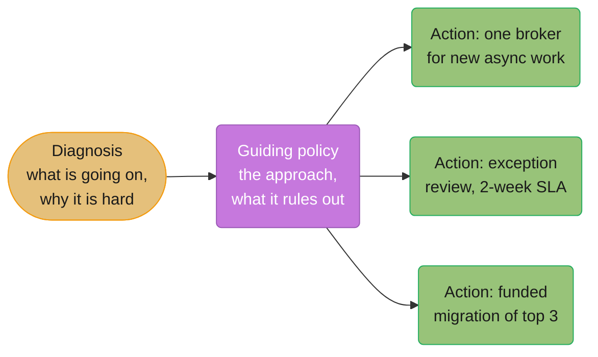
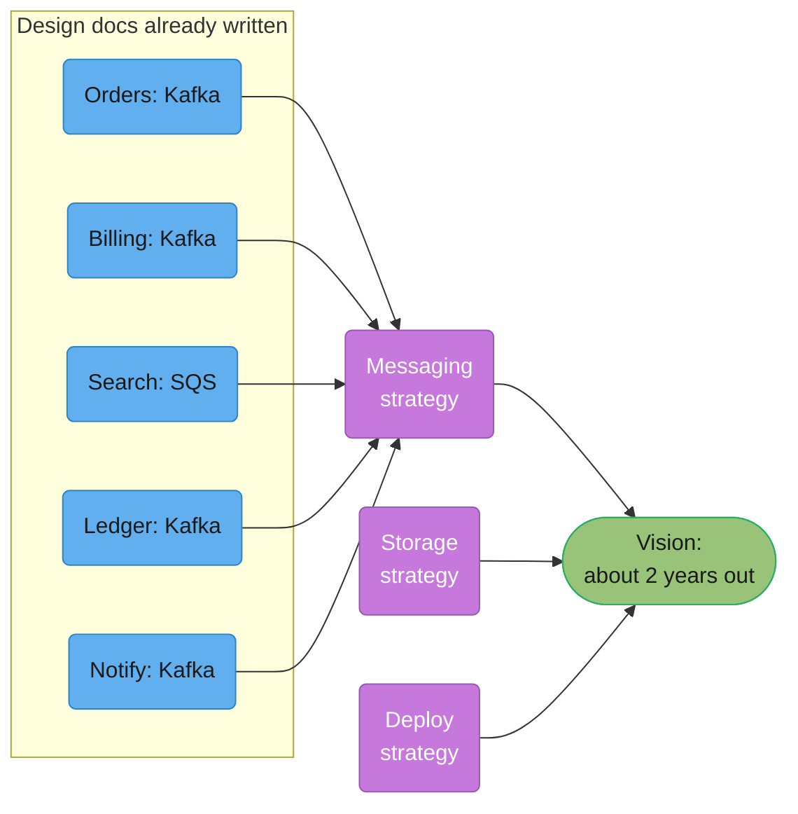
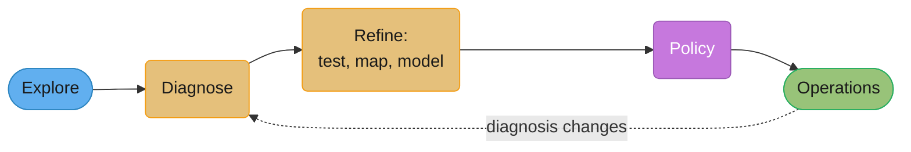

# Technical Strategy & Vision

## 1. Concept Overview

A technical strategy is a written set of decisions that tells many teams how to act on a
recurring class of problems, and why. A technical vision is a written description of
where those decisions lead, two or more years out, told as if the work were already done.
Both are different documents from a design doc, which decides one system's shape once.

Most engineering organisations have none of the three written down for anything bigger
than one service. They have a roadmap (a list of projects and dates), OKRs (goals), and a
pile of design docs that each made a local decision. Nobody can answer "what is our
storage strategy?" except by pointing at whichever team argued loudest last quarter.
Staff and principal engineers are the people expected to fix that, and in interviews they
are asked to show they can.

This module covers the three sources that matter. Richard Rumelt's *Good Strategy/Bad
Strategy* (2011) gives the kernel every strategy needs: diagnosis, guiding policy,
coherent actions. Will Larson gives the engineering method: write five design docs and
synthesise the strategy from them (*Staff Engineer*, 2021), and in *Crafting Engineering
Strategy* (O'Reilly, October 2025) the five steps of explore, diagnose, refine, policy and
operations. Tanya Reilly's *The Staff Engineer's Path* (O'Reilly, 2022), chapter 3,
"Creating the Big Picture", gives the vision-versus-strategy distinction and the work of
getting either one adopted.

---

## 2. Intuition

> **One-line analogy**: A design doc picks a route for one trip. A strategy is the
> standing rule for every trip of that kind ("we take the train under 500 km"). A vision
> is the postcard from the destination.

**Mental model.** A strategy turns many future arguments into one past decision. Every
week, some team asks "should we add another queue technology?", "do we write this in Go
or Kotlin?", "can we call the payments database directly?". Without a strategy, each
question is argued from scratch, decided by whoever is in the room, and decided
differently next time. A strategy answers the whole class once, writes down the reasoning
and the cost accepted, and lets the next team act without a meeting.

**Why it matters.** At staff level and above, the work that matters most is not one
system; it is the direction many systems drift in. A company with eleven teams each
choosing their own message broker is paying for eleven sets of on-call runbooks, eleven
upgrade paths, and the integration work between them. No design doc can fix that, because
each design doc is locally correct. Only a decision made above the level of one system
can.

**Key insight.** The value of a strategy is in what it rules out. The test is
whether the document makes choices that someone could reasonably disagree with. "We will
build reliable, scalable systems" rules out nothing and therefore decides nothing. "We
will run one message broker (Kafka) for all new asynchronous work, and teams that need
another must get an exception from the architecture group" rules out a great deal, has a
cost, and saves every future argument it covers.

---

## 3. Core Principles

1. **Diagnosis first.** A strategy starts with a plain account of what is actually going
   on and why it is hard. A strategy whose problem statement is "we need to be faster" has
   skipped diagnosis.
2. **Policy, not goals.** "Cut lead time 50%" is a goal. "All services deploy through the
   shared pipeline; no team-owned deploy scripts after Q3" is a policy. Rumelt's third
   hallmark of bad strategy is mistaking goals for strategy.
3. **Every policy states its cost.** If no one loses anything, nothing was decided.
4. **Coherent actions make it real.** A policy with no mechanism (a review gate, an
   exception process, a migration budget) is a wish.
5. **Write from precedent.** Larson's "write five design docs, then pull out the
   similarities" grounds the strategy in decisions the organisation has already made and
   lived with, which is what makes it enforceable without authority.
6. **A vision describes an end state, not a plan.** Reilly: write the future as if the
   work were done, concrete enough that an engineer can tell whether today's design moves
   toward it.
7. **Scope to what you can enforce.** A strategy for your own org, backed by your
   director, beats a company-wide strategy nobody with authority signed.
8. **Date it and refresh it.** A strategy is written against a diagnosis; when the
   diagnosis changes, the strategy is stale.

---

## 4. Types / Levels / Modes

The documents in this family differ by what they decide and how long they live:

| Document | What it decides | Typical scope | Lifetime | Who approves |
|----------|-----------------|---------------|----------|--------------|
| Design doc | the shape of one system or change | one team, one system | read at review, then archived | the team and its reviewers |
| ADR | one decision, recorded | one system | permanent, superseded not edited | the team |
| Technical strategy | how a class of recurring decisions is made, and why | an org or company | 1-2 years, refreshed when the diagnosis changes | the leader who can enforce it, after review by the teams bound by it |
| Technical vision | the end state many strategies point toward | an org or company | 2-3 years | the same leader, usually with peers |
| Roadmap | which projects happen when | an org | a quarter to a year | product and engineering leadership |
| OKRs | what result counts as success this period | team to company | a quarter or a year | leadership |

Three modes of strategy work, by how the strategy gets written:

| Mode | Who writes | Source of authority | Typical failure |
|------|-----------|--------------------|-----------------|
| **Bottom-up synthesis** (Larson's write five) | a staff engineer | precedent: the policy already worked five times | stops at describing the past; never chooses where precedents conflict |
| **Top-down directive** | a CTO or VP | the org chart | policy without diagnosis; teams comply, then route around it |
| **Sponsored working group** (Reilly) | a small core group with an executive sponsor | the sponsor plus the group's buy-in | scope creep; tries to fix the whole company at once |

Levels of scope: a team strategy ("our service's data model evolves only through
expand-and-contract migrations"), an org strategy ("all customer data lives in the
regional Postgres fleet"), and a company strategy ("we build on one cloud provider"). The
higher the level, the more the strategy needs an executive sponsor, because the people it
binds do not report to its author.

---

## 5. Models & Frameworks Diagrammed



*Rumelt's kernel of good strategy (Good Strategy/Bad Strategy, 2011). Diagnosis
constrains the policy; the policy constrains the actions; the actions must support each
other. A document missing the diagnosis is a goal; one missing the actions is a wish.*



*Larson's bottom-up method from Staff Engineer (2021): write five design docs and pull the
similarities out into a strategy; extrapolate five strategies about two years forward into
a vision. Here four of five docs chose Kafka, so the strategy writes that down and decides
what happens to the SQS outlier.*



*Larson's five steps of engineering strategy (lethain.com, March 2025; expanded in Crafting
Engineering Strategy, October 2025). Exploration and refinement are the steps most
strategies skip; operations is what turns a policy into behaviour.*

---

## 6. How It Works — Detailed Mechanics

### 6.1 Diagnosis

Larson defines diagnosis as "your attempt to correctly recognize the context that the
strategy needs to solve". Rumelt's later book *The Crux* (2022) adds the selection step:
find the one challenge that matters most and that you can actually do something about.
A diagnosis is a short list of facts, each with a number or a source, ending in the crux.

**Weak version**

> Our infrastructure has grown organically and lacks consistency. We need to modernise our
> messaging layer to improve developer velocity and reliability.

**Strong version**

> Eleven teams run four message brokers: Kafka (6 teams), SQS (3), RabbitMQ (1) and a
> Redis list used as a queue (1). In the last 12 months, 9 of 23 Sev-2 incidents involved
> a broker, and 6 of those 9 were in the two systems with a single team supporting them.
> Each new broker costs about one engineer of upkeep (upgrades, on-call runbooks, client
> libraries). The crux: we cannot staff four brokers well, and the two we staff worst
> carry the most incidents.

**What changed:** the weak version is fluff in Rumelt's sense: "organically",
"modernise" and "velocity" could describe any company. The strong one counts the brokers,
ties incidents to them, puts a staffing cost on each, and names one crux the policy can
act on.

Tools for refining the diagnosis, from Larson's "refine" step: **test** a candidate
policy on one team before rolling it out; **map** the system (Wardley maps are his
example) to see what is commodity and what is differentiating; **model** the dynamics
(for example, a spreadsheet of broker count against upkeep headcount over three years).

### 6.2 Guiding policy

A policy is a rule that tells a team what to do in a situation the author did not see.
Each one names what it rules out and what it costs.

**Weak version**

> We will standardise on best-in-class messaging technologies where appropriate.

**Strong version**

> All new asynchronous work uses Kafka on the shared platform cluster. SQS stays allowed
> for AWS-native event sources (S3, EventBridge) only. RabbitMQ and Redis-as-queue are
> frozen: no new topics or queues, and both are retired by end of Q4 next year. Teams that
> need anything else file an exception; the architecture group answers within two weeks.
> Cost we accept: Search loses SQS's simpler operations for new work and spends about 3
> engineer-weeks on the Kafka client.

**What changed:** "best-in-class" and "where appropriate" let every team keep doing what
it does. The strong version names the default, the narrow allowed exception, the frozen
systems with a retirement date, the exception route with a response time, and the cost
the strategy accepts so nobody discovers it later.

Rumelt's four hallmarks of bad strategy, as a review checklist for any policy section:

| Hallmark | What it looks like in an engineering strategy |
|----------|----------------------------------------------|
| Fluff | "leverage cloud-native, best-in-class platforms to drive velocity" |
| Failure to face the challenge | a storage strategy that never mentions the 40 TB legacy MySQL shard everyone is afraid of |
| Mistaking goals for strategy | "achieve 99.99% availability and halve lead time" with no approach |
| Bad strategic objectives | twelve objectives, or objectives no team can act on ("be the best engineering org") |

### 6.3 Coherent actions and operations

Larson calls the operational mechanisms "the concrete implementation of your policy".
Without them a strategy is read once and forgotten. The usual mechanisms:

- **A review gate**: the design-doc template asks "which strategy applies, and do you
  comply?", and the architecture review checks the answer.
- **An exception process** with an owner and a response time. A strategy without a
  documented way to break it gets broken quietly.
- **Funded migration**: if a policy retires a system, someone's roadmap carries the
  migration, with a date. A retirement nobody is funded to do is not a policy.
- **A default that is easiest**: a project template, a paved-road library, a Terraform
  module. The cheapest compliance is making the strategy the path of least effort.
- **A metric and a review date**: "broker count is 2 by end of Q4; we review the strategy
  in 12 months or when a third team requests an exception for the same reason".

### 6.4 The strategy document

A template that fits on three to five pages:

```text
Title: Messaging strategy, 2026-2027          Status: approved      Owner: <name>
Sponsor: <VP who will enforce it>             Review by: 2027-10-01
Applies to: all teams in Commerce Engineering (11 teams)

1. Diagnosis (half a page)
   Facts with numbers and sources. Ends with the crux in one sentence.

2. Guiding policies (one page)
   3-7 numbered policies. Each: the rule, what it rules out, the cost accepted.

3. Actions and operations (one page)
   Review gate, exception process (owner, SLA), funded migrations with dates,
   paved-road defaults, the metric and review date.

4. What this strategy does not decide
   Explicit non-goals, so readers stop looking for answers it never gave.

5. Precedents
   Links to the design docs and ADRs the policies were drawn from.

6. Open questions and dissent
   Disagreements raised in review, and how each was resolved or left open.
```

Two parts most drafts leave out. **What this does not decide** stops a messaging strategy
being read as a ruling on stream processing. **Dissent** records the strongest objection
and why it was overruled, which is what lets a reader six months later tell whether a new
fact reopens the decision.

### 6.5 Writing a vision

Reilly's definition: a technical vision describes the future as if all the work to get
there were done. It is not a plan and has no dates inside it. A good vision is concrete
enough that an engineer reviewing a design can tell whether the design moves toward it,
and a smaller-scope vision should fit inside the larger one above it.

**Weak version**

> Our platform will be world-class, developer-friendly and cloud-native, enabling teams to
> innovate faster.

**Strong version**

> A new service goes from `create-service` to production in one day, on the paved road,
> with no ticket to another team. Every service publishes events to one Kafka platform and
> owns its own Postgres schema; no service reads another's database. On-call for a typical
> product team is under two pages a week, because platform failures page the platform
> team.

**What changed:** the weak version could be any company's and no design can be checked
against it. The strong one describes observable facts about the end state (one day to
production, one event platform, no cross-service database reads, a page budget), each of
which a design review can test today.

Larson's ordering is useful as a sanity check: a vision written before any strategy
exists is a guess; a vision extrapolated from a handful of working strategies is a
forecast the organisation already half-believes.

### 6.6 Getting it adopted

The steps, in order, drawn from Reilly's chapter 3 and the pre-wiring practice in
[Influence Without Authority](../influence_without_authority/influence_without_authority.md):

1. **Find a sponsor** whose problem the strategy solves and who can enforce it. A
   strategy without one is advice.
2. **Form a small core group**, including at least one likely opponent. An opponent
   inside the group improves the diagnosis; outside it, they block the result.
3. **Agree who breaks ties** before the first draft, so the last week is not spent
   relitigating.
4. **Talk before writing.** Interview the affected teams before the first draft, so it
   already reflects their constraints, and flag the parts you are unsure of.
5. **Pre-wire every team the policy binds** (nemawashi): nobody's first sight of a
   policy that costs them work should be the approval meeting.
6. **Give it a one-line summary** people can repeat ("one broker for new async work"),
   because a strategy nobody can recall is not followed.
7. **Publish it where design docs link to it**, and add the review-gate question to the
   design-doc template the same week.

### 6.7 Refreshing and retiring

A strategy is written against a diagnosis. Re-run the diagnosis on the review date, or
earlier when the exception queue shows the same request three times, a key assumption
fails (the platform team loses half its headcount), or the business changes (an
acquisition brings a second cloud). Update the policies, or mark the strategy superseded
with a link to its replacement, the same way an ADR is superseded. A strategy that is
silently ignored is worse than one that is formally retired, because new hires still read
it.

---

## 7. Real-World Examples

- **Netflix's move to AWS (2008-2016).** In August 2008 a major database corruption
  stopped DVD shipping for three days. Netflix's diagnosis was that vertically scaled
  single points of failure in its own data centres were the risk, and its policy was to
  move to horizontally scalable, distributed systems in the public cloud, rebuilding
  applications cloud-native instead of lifting and shifting them. Yury Izrailevsky's post
  "Completing the Netflix Cloud Migration" (February 11, 2016) reports the migration took
  seven years. The policy ruled something out (no lift-and-shift), and that rule is why
  it took seven years.
- **Shopify's modular monolith (2017 onward).** Rather than split its Rails monolith into
  microservices, Shopify's policy was to keep one deployable and enforce component
  boundaries inside it. Kirsten Westeinde's "Deconstructing the Monolith" (Shopify
  Engineering, February 2019) describes the diagnosis and the choice; the open-source
  Packwerk tool (2020) is the coherent action that enforces the boundaries in CI.
- **Amazon's service-interface mandate (about 2002).** As recounted secondhand in Steve
  Yegge's 2011 "Google Platforms Rant", Jeff Bezos required every team to expose its data
  and functionality only through service interfaces, with no direct database reads or
  other back doors. Treat the wording as Yegge's memory, not a primary source. As a
  strategy it is pure policy: one rule, a large class of decisions settled, a heavy cost
  accepted.
- **Larson's own published strategies.** *Crafting Engineering Strategy* (O'Reilly, October
  2025) and lethain.com work through full example strategies, each with explore,
  diagnose, refine, policy and operations sections, which makes them the closest thing to
  a public corpus of engineering strategy documents.

---

## 8. Tradeoffs

| Choice | Option A | Option B | How to decide |
|--------|----------|----------|---------------|
| How it is written | bottom-up from precedent (Larson's write five) | top-down from an executive | bottom-up when you lack authority or the area already has working practice; top-down when the org must change direction faster than precedent allows |
| Scope | narrow (messaging for one org) | broad (all infrastructure, company-wide) | narrow until the narrow version has worked once; broad strategies without enforcement become fluff |
| Horizon | 1 year | 3+ years | longer horizons suit vision; strategies need a review date inside 18 months because diagnoses age |
| Prescriptiveness | hard rules with an exception process | defaults with "comply or explain" | hard rules where incompatibility is expensive (data stores, auth); defaults where teams' contexts differ |
| Visibility | published org-wide | shared with affected teams only | publish when you want new teams to inherit it; keep narrow while the policy is still being tested |

---

## 9. When to Use / When NOT to Use

**Write a strategy when:**

- the same decision has been argued three or more times across teams in a year;
- teams are making locally sensible choices that are expensive together (four brokers,
  three ORMs, two deploy systems);
- a new hire asks "how do we do X here?" and gets three different answers;
- leadership is about to fund a large migration and nobody has written why.

**Write a vision when:**

- several strategies exist and teams cannot see how they fit together;
- a multi-year platform investment needs a picture people can check designs against.

**Do not write one when:**

- the problem is one system's design: write a design doc;
- you have no sponsor and no precedent: start by writing the design docs, or by
  collecting the existing ones, and come back when the pattern is visible;
- the area is changing faster than a strategy could be refreshed (a three-month-old
  product line), where an ADR per decision is cheaper;
- the real problem is a missing owner, not a missing decision. A strategy cannot staff a
  team.

---

## 10. Common Pitfalls

- **The goal dressed as a strategy.** A 2-page doc titled "Reliability Strategy" that says
  "achieve 99.95% availability" and lists six projects. Teams read it as the roadmap,
  nothing tells them what to do in new situations, and the next incident review argues
  the same questions again. Cost: a quarter of the author's time for a document that
  decided nothing.
- **Policy without diagnosis.** A CTO mandates "everything moves to Kubernetes" with no
  stated reason. Teams with batch jobs that ran fine on managed services spend two
  quarters migrating, and when the reasoning turns out to be "the platform team wanted one
  scheduler", nobody can tell which exceptions would have been fine. The org loses trust
  in the next mandate too.
- **No exception process.** A database strategy bans everything except Postgres. A team
  that needs a time-series store for 2 billion points a day has no way to ask, builds on
  Postgres anyway, and the resulting outage costs more than an exception review would
  have. Or the team quietly runs its own InfluxDB, and the strategy is now fiction.
- **The unfunded retirement.** "RabbitMQ retired by Q4" with no team carrying the
  migration. Q4 passes, RabbitMQ is still running, and every other date in the strategy
  stops being believed.
- **Writing alone.** A staff engineer spends six weeks on a perfect strategy and presents
  it finished. The two teams that lose the most see it for the first time in review and
  block it on details. Pre-wiring in week one would have surfaced those details as
  diagnosis input.
- **Never refreshed.** A 2022 strategy mandating a self-hosted CI system is still in the
  wiki in 2026, after the company moved to a hosted one. New hires follow it and file
  tickets for a system that no longer exists.
- **Vision as fluff.** "World-class developer experience" on a slide. It cannot be
  checked against any design, so it guides no decisions and is quietly forgotten.

---

## 11. Frameworks, Books & Further Reading

| Source | What it gives you |
|--------|-------------------|
| Richard Rumelt, *Good Strategy/Bad Strategy: The Difference and Why It Matters* (Crown Business, 2011) | The kernel (diagnosis, guiding policy, coherent actions) and the four hallmarks of bad strategy: fluff, failure to face the challenge, mistaking goals for strategy, bad strategic objectives |
| Richard Rumelt, *The Crux: How Leaders Become Strategists* (PublicAffairs, 2022) | Choosing the one challenge that is both important and addressable |
| Will Larson, *Crafting Engineering Strategy: How Thoughtful Decisions Solve Complex Problems* (O'Reilly, October 2025) | The five steps (explore, diagnose, refine, policy, operations) and worked engineering strategies |
| Will Larson, "Components of engineering strategy" (lethain.com, March 27, 2025) | The short form of the five steps, with his one-line definition of each |
| Will Larson, *Staff Engineer: Leadership Beyond the Management Track* (2021) | "Write five design docs, then pull the similarities out"; five strategies extrapolated into a vision |
| Tanya Reilly, *The Staff Engineer's Path* (O'Reilly, 2022), chapter 3, "Creating the Big Picture" | Vision versus strategy, finding a sponsor, the core group, deciding tie-breaks early, nemawashi |
| Yury Izrailevsky, "Completing the Netflix Cloud Migration" (Netflix, February 11, 2016) | A diagnosis-to-policy example with a seven-year operations phase |
| Kirsten Westeinde, "Deconstructing the Monolith" (Shopify Engineering, February 2019) | A strategy that chose against the industry default, and the tooling that enforced it |

Related modules in this section:
[Design Docs, RFCs & ADRs](../design_docs_rfcs_and_adrs/design_docs_rfcs_and_adrs.md),
[Staff-Plus Archetypes](../staff_plus_archetypes/staff_plus_archetypes.md),
[Influence Without Authority](../influence_without_authority/influence_without_authority.md),
[Executive Communication](../executive_communication/executive_communication.md).

---

## 12. Interview Questions with Answers

**Q: What is the difference between a technical strategy and a list of goals?**
**Short:** Goals say what result you want; a strategy diagnoses the problem, sets a policy for how to get there, and names the actions, so it tells teams what to do in cases nobody listed.

"Halve lead time and reach 99.95% availability" is two goals. A strategy starts with a
diagnosis (why lead time is long: four deploy systems, two owned by one person each),
sets a guiding policy (all services deploy through the shared pipeline, team scripts
retired by Q3), and lists coherent actions (migration funded, review gate added). Rumelt
names "mistaking goals for strategy" as one of the four hallmarks of bad strategy. The
practical test: can a team facing a new situation read the document and know what to do?
A goal list cannot answer that.

**Q: How is a strategy document different from a design doc?**
**Short:** A design doc decides one system's shape once, for its reviewers; a strategy decides how a whole class of recurring decisions gets made across many teams, with policies and an exception process.

A design doc is scoped to one system or change, compares alternatives to persuade
reviewers, and is archived after approval. A strategy covers a class of decisions ("which
broker for new async work") for every team it binds, states policies with their costs,
lives for one to two years, and has mechanisms: a review gate, exceptions, funded
migrations. Larson's method connects them: write five design docs, find what they agree
on, and that agreement is the first draft of the strategy.

**Q: What are the three parts of Rumelt's kernel of good strategy?**
**Short:** Diagnosis (what is going on and why it is hard), guiding policy (the overall approach, including what it rules out), and coherent actions (coordinated steps that carry out the policy).

From *Good Strategy/Bad Strategy* (2011). The diagnosis simplifies a messy situation to
its critical aspects; the guiding policy is the approach to that challenge and works by
ruling options out; coherent actions are steps that support each other rather than a
list of unrelated initiatives. In an engineering strategy: "four brokers, the two worst
staffed carry the most incidents" is a diagnosis, "one broker for new async work" is the
policy, and "freeze RabbitMQ, fund the migration, add an exception review" are the
actions.

**Q: What does Larson mean by "write five design docs, then synthesise"?**
**Short:** Build a strategy from decisions the organisation has already made: collect five design docs in an area, write down what they agree on, and decide what to do where they disagree.

In *Staff Engineer* (2021) Larson argues a staff engineer usually lacks the authority to
impose a strategy, but can document the precedent that already exists. Five design docs
that all chose Kafka are a strategy waiting to be written down; the outlier that chose SQS
is the one real decision the strategy has to make. Precedent gives the strategy authority
without an org chart, because teams are asked to keep doing what already worked. Five
strategies extrapolated about two years forward then become a vision.

**Q: What are Rumelt's four hallmarks of bad strategy, in engineering terms?**
**Short:** Fluff ("leverage best-in-class cloud-native platforms"), failing to face the challenge, mistaking goals for strategy, and bad strategic objectives such as too many or unactionable ones.

Fluff is buzzwords that sound like strategy and decide nothing. Failure to face the
challenge is a storage strategy that never mentions the 40 TB legacy shard everyone fears.
Mistaking goals for strategy is "99.99% availability" with no approach. Bad strategic
objectives are twelve priorities, or objectives no team can act on. Use the four as a
review checklist: a draft that trips any of them needs another pass before it goes to the
sponsor.

**Q: A strategy bans every database except Postgres. What is it missing if a team quietly runs InfluxDB anyway?**
**Short:** An exception process with an owner and a response time. Without a legitimate way to break a policy, teams break it silently and the strategy stops describing reality.

Every policy meets cases its author did not foresee: here, 2 billion time-series points a
day. If the only options are comply or defy, the team defies and nobody learns. An
exception route ("file a request, the architecture group answers within two weeks") turns
the edge case into data: one exception is approved and recorded; three similar ones mean
the policy itself needs changing. It also keeps the strategy honest, because the list of
approved exceptions is the true picture of what runs.

**Q: What is the difference between a technical vision and a technical strategy?**
**Short:** A vision describes the end state as if the work were done, with no plan inside; a strategy is the plan for getting past the obstacles, built on a diagnosis, policies and actions.

Reilly, *The Staff Engineer's Path*, chapter 3. The vision answers "what will be true in
two or three years", concretely enough that a design can be checked against it ("a new
service reaches production in one day with no ticket to another team"). The strategy
answers "how do we get there from here, given what is hard". A vision with no strategy is
a wish; strategies with no vision can each be right and still point in different
directions.

**Q: How do you get a strategy adopted when you have no authority over the teams it binds?**
**Short:** Find a sponsor who can enforce it, write from existing precedent, include a likely opponent in the core group, pre-wire every affected team, and add a review-gate question to the design-doc template.

Authority comes from three places for a staff engineer: a sponsor who owns the problem,
precedent (teams already did this five times), and the buy-in built while writing. Reilly
recommends a small core group with an executive sponsor and an agreed tie-breaker.
Pre-wiring means no team sees a policy that costs it work for the first time in the
approval meeting. Then operationalise it: the design-doc template asks which strategy
applies, so the strategy is checked at the moment decisions are made.

**Q: Why must every policy in a strategy state its cost?**
**Short:** A policy that costs no one anything has not ruled anything out, so it decides nothing; stating the cost also stops the losing team from discovering it later and reopening the decision.

"All new async work uses Kafka" costs the Search team its simpler SQS operations and
about 3 engineer-weeks of client work. Writing that down shows the author saw the cost
and judged it worth paying, which is what makes the decision stick. An unstated cost
surfaces six months later as "nobody told us", and the strategy gets relitigated by the
team that pays. Rumelt's point that strategy is choice applies directly: a choice has a
price.

**Q: What should a strategy's diagnosis contain?**
**Short:** A few facts with numbers and sources about the current situation, why it is hard, and one crux: the most important challenge that can actually be acted on.

Larson defines diagnosis as recognising the context the strategy must solve. Concretely:
"eleven teams run four brokers; 9 of 23 Sev-2s in 12 months involved a broker; each broker
costs about one engineer of upkeep; the crux is that we cannot staff four well." Rumelt's
*The Crux* (2022) adds the selection: pick the challenge that matters most and is
addressable. A diagnosis of adjectives ("organic growth", "lacks consistency") lets the
policy say anything.

**Q: What are the five steps in Larson's Crafting Engineering Strategy?**
**Short:** Explore the problem and solution space, diagnose the context, refine with tests, maps and models, set policy, then build operations, the mechanisms that make the policy real.

Larson's outline (lethain.com, March 2025; the O'Reilly book, October 2025). Exploration
looks at how others solved the problem; diagnosis states the context; refinement checks
which parts of the diagnosis matter (testing a policy on one team, Wardley mapping,
systems modelling); policy translates diagnosis into rules; operations are the concrete
mechanisms, such as review gates, exception handling and metrics. Most drafts jump from a
thin diagnosis straight to policy and never write the operations, which is why they are
ignored.

**Q: When should you not write a technical strategy?**
**Short:** When the problem is one system (write a design doc), when nothing has been decided yet to draw precedent from, when the area changes faster than you could refresh it, or when the real gap is a missing owner.

A strategy pays off when the same class of decision recurs across teams. For one system,
a design doc is the right tool. With no precedent and no sponsor, a strategy is an
opinion; write the design docs first. For a product line three months old, record each
decision as an ADR until a pattern emerges. And if the problem is that nobody owns the
ledger, a strategy about the ledger cannot fix it; that needs a staffing decision.

**Q: How long should a technical strategy live, and what triggers a refresh?**
**Short:** One to two years with a review date written into it; refresh early when the same exception is requested three times, a key assumption fails, or the business changes.

A strategy is only as good as the diagnosis it was written against. Put a review date in
the header and re-run the diagnosis then. Earlier triggers: repeated exception requests
for the same reason (the policy no longer fits), a broken assumption (the platform team
lost half its staff), or a business change such as an acquisition. When replaced, mark
the old one superseded with a link, like an ADR, so new hires do not follow it.

**Q: What makes a technical vision useful rather than decorative?**
**Short:** It states observable facts about the end state that a design review can check today, such as "a new service reaches production in one day with no ticket to another team".

"World-class, developer-friendly, cloud-native" cannot be checked against any design, so
it guides nothing. Concrete end-state statements (one event platform, no cross-service
database reads, under two pages a week for a product team's on-call) let any reviewer ask
"does this design move us toward that or away?" Smaller visions should also fit inside
larger ones, so a team's vision cannot contradict the org's.

**Q: How do you present a technical strategy to an executive sponsor?**
**Short:** Lead with the crux and its cost in business terms, then the one-line policy, the price you are asking them to accept, and the specific enforcement you need from them.

Executives approve trade-offs, not architectures. "We run four brokers; the two we staff
worst caused 6 Sev-2s last year and cost about two engineers of upkeep. Policy: one broker
for new work, two retired by next Q4. Cost: Search spends 3 weeks moving, and the
migration needs one engineer for two quarters. What I need from you: the migration on the
platform roadmap, and backing when a team asks for an exception that is not justified."
See [Executive Communication](../executive_communication/executive_communication.md) for
the BLUF structure.

**Q: What goes in a strategy's "dissent" section, and why include it?**
**Short:** The strongest objections raised in review and how each was resolved or left open, so a later reader can tell whether a new fact reopens the decision or the same argument is being repeated.

A strategy that hides its disagreements looks unanimous until the dissenting team
re-argues it. Recording "Search argued SQS's lower operational load outweighs consistency;
overruled because the platform team supports Kafka on-call and not SQS" shows the
objection was heard, gives the dissenter a face-saving record, and sets the bar for
reopening: new information, not repetition. It is the same discipline as an ADR's
consequences section, applied to policy.

---

## 13. Best Practices

- Start from the design docs and ADRs that already exist in the area; cite them in a
  precedents section.
- Write the diagnosis with numbers and end it with one crux sentence.
- Keep policies to three to seven, each with what it rules out and the cost accepted.
- Ship the operations with the policy: review-gate question, exception owner and SLA,
  funded migrations with dates.
- Add a "does not decide" section and a dissent section.
- Get a sponsor who can enforce it before the first draft, and agree the tie-breaker.
- Put one likely opponent in the core group.
- Give it a one-line summary people can repeat.
- Put a review date in the header, and supersede rather than silently abandon.
- Write the vision as checkable end-state facts, after at least a few strategies exist.

---

## 14. Case Study

**Scenario.** A 140-engineer commerce company has eleven product teams and a platform
team of six. Over two years teams adopted Kafka (6 teams), SQS (3), RabbitMQ (1) and a
Redis list used as a queue (1). In the last year 9 of 23 Sev-2 incidents involved a
broker. The VP of Engineering asks Mei, a staff engineer on the platform team, "do we need
a messaging strategy?"

**What Mei did.**

1. **Collected precedent.** She found seven design docs and four ADRs that chose a broker,
   and read why each chose what it did. Six cited "the platform team runs Kafka";
   Search's SQS choice cited operational simplicity; the RabbitMQ and Redis choices had
   no doc at all.
2. **Wrote the diagnosis with numbers**: four brokers, incident counts per broker, about
   one engineer of upkeep each, and the crux: "we cannot staff four brokers well, and the
   two we staff worst carry the most incidents."
3. **Formed a core group of three**: herself, a Kafka-heavy Orders engineer, and the
   Search tech lead, the most likely opponent. Agreed with the VP that the VP breaks ties.
4. **Pre-wired** all eleven team leads in one-on-ones before drafting policies. Search's
   input produced the narrow SQS exception for AWS-native event sources.
5. **Wrote four policies**: Kafka for all new async work; SQS only for AWS-native sources;
   RabbitMQ and Redis-as-queue frozen and retired by next Q4; exceptions answered in two
   weeks. Each named its cost.
6. **Shipped operations with it**: a design-doc template question ("which messaging policy
   applies?"), an exception form owned by the architecture group, and one platform
   engineer funded for two quarters to migrate the two retiring systems.
7. **Recorded dissent**: Search's argument for SQS for all new work, and why it was
   overruled.

**Outcome.** The VP approved it in one meeting because every lead had already seen it.
Within twelve months broker count went from four to two, broker-related Sev-2s fell from
9 to 2, and the exception process received three requests, approving one (an IoT ingest
path that needed MQTT). At the twelve-month review the diagnosis still held and the
strategy was renewed with one new policy on schema registry use.

**What would have gone wrong with a weaker approach.** A top-down "standardise on Kafka"
memo with no diagnosis, no exception route and no funded migration would have produced
compliance from the six Kafka teams, quiet resistance from Search, and a RabbitMQ cluster
still running two years later, because nobody's roadmap carried its retirement. The
eventual MQTT need would have arrived as an unapproved side system rather than a recorded
exception.
