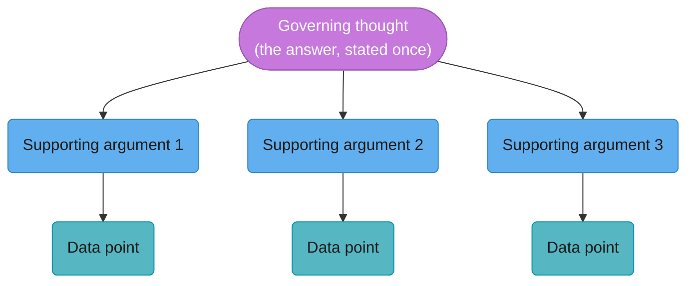
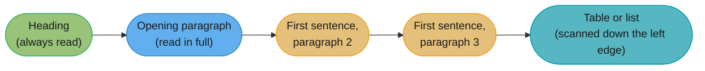
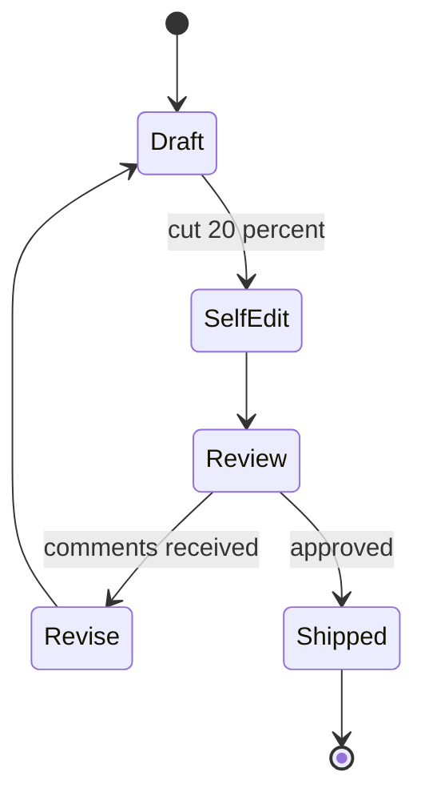

# Technical Writing for Engineers

## 1. Concept Overview

Most engineering documents are read by people who did not write them, months after they
were written, by someone deciding something with real consequences — approve the design,
fund the migration, page the on-call, close the postmortem. The document's job is not to
prove the author understood the problem. It is to let a busy, skeptical, possibly
disagreeing reader get to the right decision faster than if the document did not exist.

This module is sentence-level and structure-level craft: the US Army's BLUF standard
(AR 25-50), Barbara Minto's Pyramid Principle and its SCQA opening, the MECE test for a
list of options, Nielsen Norman Group's F-pattern research on how people actually read a
page, and eight specific sentence-level failures with a rewrite for each. It is the module
this section's own CLAUDE.md singles out as the one the rest of the section leans on, and
it holds itself to the standard it teaches — if a sentence in this file would survive being
pasted into a generic listicle, it should not be here.

---

## 2. Intuition

> **One-line analogy**: A technical document is not a transcript of your thinking. It is
> the compressed, reordered, load-bearing 10% of your thinking that someone else needs in
> order to act — everything else is a rough draft you happen to be showing them.

**Mental model**: Write for the reader who opens the document once, skims it in ninety
seconds deciding whether it's worth their full attention, and — if it survives that cut —
reads maybe 20-28% of the words before making a call. That reader is real; Nielsen Norman
Group's eyetracking research puts the number at roughly that range for an average page
view. A document written as if the reader will patiently absorb every sentence in order is
written for a reader who does not exist.

**Why it matters**: Engineers are trained to be exhaustive — cover every edge case, show
every step of the reasoning, defend every decision inline. That instinct, applied to
prose, produces a document where the one sentence that mattered (the ask, the number, the
risk) is indistinguishable from forty sentences of context, and a reader skimming in
ninety seconds has no way to find it.

**Key insight**: Good technical writing is not good technical writing skill applied to
engineering content. It is the same skill that makes a good API: put the thing the caller
actually needs at the top of the interface, make the common case obvious, and do not make
the reader parse the whole implementation to find out what it returns.

---

## 3. Core Principles

- **Put the conclusion first, always.** This is BLUF (Bottom Line Up Front), formalized in
  the US Army's AR 25-50, "Preparing and Managing Correspondence." AR 25-50 distinguishes a
  BLUF from a topic sentence explicitly: "This memo addresses the proposed budget revision"
  states the subject; "I recommend we cut the Q3 marketing budget by $200,000 to cover the
  facilities overrun" states the decision. Every other section of the document — background,
  evidence, method, caveats — comes after the reader already knows what you want.
- **The governing thought comes before the supporting arguments, which come before the
  data.** This is Barbara Minto's Pyramid Principle, developed at McKinsey and published in
  *The Pyramid Principle: Logic in Writing and Thinking* — the reverse of how most people
  actually think a problem through (data first, arguments second, conclusion last), and the
  reverse of how it should be written.
- **A list of options is only honest if it is MECE** — Mutually Exclusive, Collectively
  Exhaustive. Mutually exclusive means the options don't overlap; collectively exhaustive
  means there isn't an obvious fifth option you left out because it was less convenient to
  argue against. A three-option list where two options are strawmen and the third is the
  one you wanted is not a decision document, it's a sales pitch wearing a decision
  document's clothes.
- **Readers skim in a predictable shape, and the shape is not top-to-bottom.** NNG's
  eyetracking research found readers scan in an F-shaped pattern: a full horizontal sweep
  near the top, a shorter horizontal sweep further down, then a vertical scan down the left
  margin — meaning most of a page's words are never read at all, and what does get read is
  disproportionately headings, first sentences, and the left edge of bullet lists.
  Structure has to survive being read in that shape, not the shape you wrote it in.
- **Every sentence should be checkable.** A number can be verified. A name can be
  contacted. "Significant," "several," and "soon" cannot — they are unfalsifiable, and a
  skeptical reader (the one you are actually writing for, per §9) treats an unfalsifiable
  claim as a claim you were not confident enough to commit to.

---

## 4. Types / Levels / Modes

Not every document needs the same structure. Matching the mode to the ask is itself a
craft decision, and getting it wrong (a status update dressed as a decision doc, or a
decision doc dressed as a status update) is a common failure this module treats separately
in §10.

- **The decision document** — asks the reader to approve, fund, or choose between named
  options. Structure: BLUF stating the recommendation, then Minto's pyramid (governing
  thought, supporting arguments, data), then a MECE options table, then risks. The ask is
  in the first sentence, not the last paragraph.
- **The status update** — informs without asking for a decision. Structure: what changed
  since the last update, what's blocked, what's next — three short sections, no burying a
  decision request inside what looks like a status update (the "buried ask" failure in
  §6).
- **The incident/postmortem write-up** — a timeline of fact, separated cleanly from
  analysis and from recommended follow-ups, written for a reader who was not there. See
  [Incident Communication and Postmortems](../incident_communication_and_postmortems/incident_communication_and_postmortems.md)
  for the full template; this module covers the sentence-level craft that write-up depends
  on.
- **The reference document** — a runbook, an API doc, a glossary entry — optimized purely
  for skim and lookup, not narrative. Headings must be independently meaningful because
  most readers will never read the surrounding prose at all.
- **The narrative memo** — the mode Amazon is best known for: full prose, no bullet points,
  read silently by the room before discussion starts. Higher up-front writing cost, but it
  forces the writer to make the logical connections between claims explicit instead of
  hiding them in bullet-point juxtaposition.

---

## 5. Models & Frameworks Diagrammed

*Minto's Pyramid Principle. The reader gets the governing thought before any argument, and
each argument before its supporting data — the reverse of the order the writer usually
discovered it in. A document organized bottom-up (data, then argument, then conclusion) is
a research trail, not a pyramid.*

*The reading path NNG's eyetracking research actually observed: headings and the opening
paragraph get full attention, later paragraphs get only their first sentence, and lists get
scanned down the left margin rather than read word for word. Every paragraph's first
sentence has to be a self-contained claim, because for most readers it is the only sentence
of that paragraph they will see.*

*The revision loop from §6. Most documents cycle through this once or twice before
shipping; a document that goes straight from Draft to Shipped with no self-edit pass is
almost always the one with the buried ask or the throat-clearing opener still in it.*

---

## 6. How It Works — Detailed Mechanics

### SCQA — the opening four moves

Situation, Complication, Question, Answer — Minto's recommended shape for a document's
opening paragraph, before the pyramid's supporting arguments begin.

- **Situation**: one sentence of shared, uncontroversial context. "Checkout processes 40M
  transactions a month through a single ledger service."
- **Complication**: the thing that changed or the problem that emerged. "Duplicate-charge
  incidents have risen from one per quarter to six, including two regulatory inquiries."
- **Question**: the question the complication raises, stated explicitly. "Should we adopt
  a shared idempotency-key standard across the three teams that write to the ledger?"
- **Answer**: the governing thought — your BLUF. "Yes: a single idempotency-key standard,
  adopted by all three teams over one quarter, at an estimated cost of three engineer-weeks
  per team."

Four sentences, and a reader who stops after the first paragraph already has the whole
document's shape.

### The MECE test, applied

A weak options section: "We could improve caching, or maybe look at the database, or
possibly just add more replicas." These overlap (a cache improvement and adding replicas
both address read load through different means) and are not exhaustive (nothing addresses
write load, which turns out to be the actual bottleneck). A MECE version partitions the
problem space first — read-path latency, write-path latency, availability — and only then
lists one option per partition, which also makes it obvious when a partition has been
silently left out.

### Writing for skim — the first-sentence-of-every-paragraph test

Read only the first sentence of every paragraph in a draft, in order, ignoring everything
else. If that sequence of sentences forms a coherent, mostly complete argument, the
document survives an F-pattern skim. If it reads as disconnected fragments, the argument is
hiding inside paragraphs rather than leading them — and per NNG's research, that argument
will not be found by most readers.

### Sentence craft — eight failures, with the fix

**1. Passive voice hiding the actor**

**Weak version**

> The decision was made to deprecate the v1 endpoint.

**Strong version**

> Platform decided to deprecate the v1 endpoint; I made the call after the Q2 incident
> review.

**What changed:** the actor is named. "The decision was made" lets a reader wonder who
made it, who to ask about it, and who to hold to it — three questions the passive
construction quietly avoids answering.

**2. Nominalization — turning a verb into a noun**

**Weak version**

> We performed an evaluation of three caching strategies.

**Strong version**

> We evaluated three caching strategies.

**What changed:** the verb is a verb again. "Performed an evaluation of" adds three words
and zero information over "evaluated" — nominalization is the single most common way
engineering prose gets bloated without getting more precise.

**3. Hedges that cost credibility**

**Weak version**

> I think maybe we should probably increase the timeout at some point.

**Strong version**

> Increase the timeout from 200ms to 500ms. p99 latency is 340ms, and we are timing out
> real requests today.

**What changed:** every hedge word is gone, replaced by two numbers and a stated
consequence. A reader cannot act on "maybe... probably... at some point" without first
extracting the actual recommendation buried inside it.

**4. The sentence with no subject that survives review**

**Weak version**

> Was rolled back after the alerts fired.

**Strong version**

> SRE rolled back the deploy at 2:14am after the error-rate alert fired.

**What changed:** who acted, what they acted on, and when. The weak version reads fine in
isolation because the writer knew who "was rolled back" referred to — the failure only
shows up for the reader who wasn't in the incident channel, which in a postmortem is
everyone reading it later.

**5. Vague quantifiers instead of numbers**

**Weak version**

> Several customers reported significant slowdowns.

**Strong version**

> 14 customers reported page loads over 8 seconds, up from a 1.2s baseline.

**What changed:** "several" and "significant" became a count and a measurement. A
skeptical reader treats an unquantified claim as a claim the writer could not or did not
bother to verify, whether or not that's true.

**6. The buried ask**

**Weak version**

> [Six paragraphs of background about the migration, its history, and the teams
> involved.] ...so it would be good if we could get budget sign-off by Friday.

**Strong version**

> I need budget sign-off by Friday to hit the Q3 migration date. Here's why: [background
> follows].

**What changed:** the ask moved from paragraph seven to sentence one. A reader skimming in
the F-pattern shape described in §5 reads the opening in full and the rest in fragments —
an ask buried past paragraph two is statistically unlikely to be seen by a reader who is
running late to the meeting where they were supposed to grant it.

**7. Throat-clearing openers**

**Weak version**

> As you may know, in today's fast-paced engineering environment, teams are increasingly
> relying on distributed systems to deliver value to customers at scale.

**Strong version**

> Ingest drops 0.4% of events under peak load.

**What changed:** the first two sentences were deleted and nothing was lost. Throat-
clearing openers ("as you may know," "in today's environment") signal that the writer has
not yet found the actual first sentence — the fix is almost always to delete the opener,
not to improve it.

**8. The run-on that is really three claims**

**Weak version**

> The service is slow and we think it's the database but it could also be the network and
> someone should look into it soon.

**Strong version**

> The service is slow. Query latency doubled after Tuesday's index change — the most
> likely cause. I need a DBA to confirm by Thursday.

**What changed:** one run-on sentence, conjoining an observation, a guess, an alternative
guess, and a vague request, became three sentences — each one claim, the third one an
owner and a date. A run-on rarely hides one complex idea; it usually hides several simple
ones the writer didn't stop to separate.

---

## 7. Real-World Examples

- **Amazon's six-page narrative memo, banning slide decks.** Amazon's practice, described
  publicly by Jeff Bezos in shareholder letters and widely reported since, replaces
  PowerPoint presentations with a full-prose memo read silently by the room for the first
  20-30 minutes of a meeting before discussion starts. The stated reason: bullet points let
  a writer juxtapose ideas without stating the logical connection between them, while full
  sentences force the writer to commit to the connection — a structural enforcement of
  Minto's pyramid, since a memo cannot hide a missing argument behind a bullet.
- **Amazon's PR/FAQ format** for new products, also public practice, opens with a mock
  press release and a customer-facing FAQ written before a line of code — a working
  BLUF-and-SCQA discipline applied to product decisions, forcing the "so what does the
  customer get" answer to exist before the internal debate about how to build it does.
- **Google's design doc culture** — internally documented and widely echoed outside Google
  by former engineers writing about it publicly — standardizes an "Alternatives Considered"
  section as a first-class part of every design doc, which is a MECE requirement applied
  structurally: a design doc without alternatives cannot demonstrate it considered the
  option space rather than just its author's first idea.
- **GitLab's public handbook**, one of the largest published examples of an
  async-writing-first company, treats the handbook itself as the source of truth over any
  meeting — a practice that only works because the writing inside it is held to a skimmable,
  self-contained standard; a handbook page that requires the reader to already know context
  from a meeting they weren't in defeats the entire model.
- **Nielsen Norman Group's F-shaped pattern research**, first published by Jakob Nielsen in
  2006 and revisited in later NNG eyetracking studies, remains the most cited empirical
  basis for "write your key point first" advice in technical and web writing broadly — not
  a stylistic preference, a measured description of where readers' eyes actually go.

---

## 8. Tradeoffs

| Structure | Best for | Cost |
|---|---|---|
| BLUF / decision doc | Getting an approval or a resource commitment | Requires you to have a firm recommendation before writing, not while writing |
| Narrative memo (Amazon-style) | Complex tradeoffs with real interdependencies | High up-front writing time; slow to produce under real time pressure |
| Bullet-point deck | Fast production, live narration by the author | Hides missing logical connections; unreadable without the author present |
| Reference doc / runbook | Lookup under time pressure (an on-call incident) | Poor for building a persuasive case; wrong tool for a decision doc |
| Status update | Low-stakes, frequent cadence | Wrong tool for a buried decision request — see §6's buried-ask failure |

| Choice | Gives you | Costs you |
|---|---|---|
| Writing the conclusion first | A reader who can stop after paragraph one and already act | Forces you to actually reach a conclusion before you start writing |
| A verbatim transcript over a description | Precision, a record a disagreeing reader can check against | Longer document; harder to skim if not curated |
| Cutting 20% in revision | A tighter document that survives an F-pattern skim | Real editing time, which is usually skipped under deadline pressure |
| A table over a prose list | Fast comparison, MECE-forcing structure | Loses nuance a caveat sentence could carry; can oversimplify |

---

## 9. When to Use / When NOT to Use

**Use BLUF and the pyramid structure when:**
- You are asking for a decision, a budget, or a headcount commitment — anything where the
  reader needs to act, not just absorb information.
- The reader is senior to you, cross-functional, or otherwise unlikely to read past the
  first paragraph without a compelling reason to continue.
- You already have a firm recommendation. If you genuinely don't yet — you're still
  exploring options — say so explicitly rather than faking a BLUF you don't believe.

**Use a narrative memo (full prose, no bullets) when:**
- The tradeoffs are genuinely interconnected and a bullet list would hide the connections
  between them (Amazon's stated reasoning).
- You have the lead time to write and, critically, revise it — a rushed narrative memo is
  worse than a rushed bullet deck, because prose hides its own gaps more easily than a
  bullet list does.

**Do not apply full BLUF/pyramid structure when:**
- You are genuinely thinking out loud and labeling it as such — a scratch doc, an
  exploratory note. Forcing a governing thought onto unfinished thinking produces false
  confidence, not clarity.
- The audience is purely a reference lookup (a runbook, an API doc) — those need
  self-contained headings and searchable structure, not a persuasive arc.
- The stakes are genuinely low and the overhead of full structure would cost more time than
  it saves — a two-line Slack update to your own team does not need an SCQA opening.

---

## 10. Common Pitfalls

- **The six-paragraph design doc with the actual decision in paragraph seven.** A staff
  engineer wrote a migration proposal that opened with two paragraphs of system history,
  two of prior art, and two of stakeholder acknowledgments before finally asking, in
  paragraph seven, for three engineers for one quarter. Two reviewers approved it having
  skimmed only the opening and missed the ask entirely; the request sat unfunded for six
  weeks until someone reread the whole thing and escalated it directly in a meeting. The
  cost was not the six weeks alone — it was that the eventual migration missed the release
  window it had been timed against, adding a full quarter to the schedule.
- **A postmortem written entirely in passive voice.** "Requests were dropped. Retries were
  attempted. The service was eventually restored." A postmortem in this voice reads as
  blameless on the surface and useless underneath, because a reader six months later trying
  to prevent a repeat cannot tell which team owns which step, so the follow-up actions have
  no assigned owner and none of them ship. Blameless does not mean anonymous — see
  [Incident Communication and Postmortems](../incident_communication_and_postmortems/incident_communication_and_postmortems.md)
  for the distinction.
- **A status update that was actually a budget request, and got read as a status update.**
  An engineer's weekly update included, in the fourth paragraph, "we may need to revisit
  the infra budget for Q4 given current growth" — a real ask, formatted exactly like every
  other routine observation in the update. Nobody responded to it for five weeks, not out
  of neglect but because nothing in the document signaled it required a response rather
  than an acknowledgment; by the time it was escalated verbally, the Q4 planning cycle it
  needed to land in had already closed.
- **A three-option decision doc where two options were strawmen.** A proposal listed
  "Option A: do nothing (unacceptable)," "Option B: a six-month rewrite (too slow)," and
  "Option C: the incremental migration the author wanted." A sharp reviewer noticed the
  MECE violation immediately — there was an obvious Option D (a partial rewrite of just the
  hot path) that would have taken half the time of Option B, and its absence made the whole
  document read as advocacy dressed as analysis. The proposal was sent back for a full
  options pass, costing a week the author had been trying to save by skipping it.
- **A first sentence that opened with a code fence.** A Q&A-style internal FAQ entry
  answered "How do we handle idempotency?" by opening directly with a code block, no prose
  sentence before it. Extracted anywhere out of its original page — a search result, a
  linked reference, a summary — the answer was unreadable without the surrounding context
  that never traveled with it. The fix generalizes: the first sentence of any answer has to
  stand alone as prose, because you cannot control where it gets read out of context.

---

## 11. Frameworks, Books & Further Reading

- Barbara Minto, *The Pyramid Principle: Logic in Writing, Thinking, and Problem Solving*
  — the governing-thought-first structure, SCQA, and MECE, developed originally at
  McKinsey & Company.
- US Army Regulation 25-50, "Preparing and Managing Correspondence" — the formal source of
  BLUF; first published 1988, with the specific "bottom line up front" phrasing added in
  the 2001 revision.
- Jakob Nielsen / Nielsen Norman Group, "F-Shaped Pattern for Reading Web Content" (original
  eyetracking research, first published 2006, revisited in later NNG studies) — the
  empirical basis for writing-for-skim structure.
- Amazon's narrative-memo and PR/FAQ practices, as described by Jeff Bezos in Amazon
  shareholder letters and widely documented since — the fullest public example of BLUF and
  MECE enforced as a company-wide writing standard.
- [Design Docs, RFCs and ADRs](../design_docs_rfcs_and_adrs/design_docs_rfcs_and_adrs.md)
  — where this sentence-level craft gets applied to a full document template.
- [Executive Communication](../executive_communication/executive_communication.md) — BLUF
  and the buried-ask failure at their highest-stakes application.
- [Upward and Async Communication](../upward_and_async_communication/upward_and_async_communication.md)
  — the status-update mode from §4, and when it silently becomes a decision doc.

---

## 12. Interview Questions with Answers

**Q: What's wrong with "the decision was made to deprecate the v1 endpoint"?**
**Short:** Passive voice hides who made the call, so no one knows who to ask or hold accountable.
The sentence is grammatically fine and factually true, and it still fails the reader,
because it deletes the one piece of information — who decided — that a reader would need
to follow up, escalate, or hold someone to the decision. The fix is never "add more detail"
in general; it's specifically naming the actor: "Platform decided to deprecate the v1
endpoint; I made the call after the Q2 incident review." Passive voice is not always wrong
— see the dedicated Q&A below on when it's fine — but hiding an actor who exists and
matters is the specific failure.

**Q: What is BLUF, and why does most engineering writing violate it?**
**Short:** Bottom Line Up Front — state the conclusion or ask first; most docs bury it because writers think in discovery order.
BLUF, formalized in the US Army's AR 25-50, requires the main point, recommendation, or
requested action in the first paragraph, with everything else — background, evidence,
caveats — as supporting detail that comes after. Most engineering docs violate it because
they are written in the order the author discovered the answer: background, then
investigation, then finally the conclusion at the end, which is also usually the most
important sentence and the one a skimming reader is least likely to reach. The gotcha AR
25-50 is explicit about: a BLUF is not a topic sentence — "this memo addresses the proposed
budget revision" describes the subject, not the decision.

**Q: What's a nominalization, and why does it weaken a sentence?**
**Short:** A verb turned into a noun ("performed an evaluation of" instead of "evaluated") that adds words without adding information.
"We performed an evaluation of three caching strategies" buries the verb "evaluated" inside
a noun phrase, adding length and a layer of abstraction without adding precision. The fix
is almost always mechanical: find the noun ending in -ion, -ment, or -ance that used to be
a verb, and put the verb back. Nominalization is common in engineering writing because it
sounds more formal, which is exactly backwards — formality in this domain should come from
precision, not from noun density.

**Q: How do you fix a sentence with no clear subject that "everyone in the room" assumes
someone else understood?**
**Short:** Name who acted and when — the ambiguity is invisible to the writer and real to any reader who wasn't there.
"Was rolled back after the alerts fired" reads as complete to the person who wrote it,
because they know who did the rolling back. It is genuinely ambiguous to anyone who
wasn't in the incident channel — which, in a postmortem, is most of the eventual audience.
The fix is always the same: name the actor and the time — "SRE rolled back the deploy at
2:14am after the error-rate alert fired." This failure survives code review and document
review disproportionately often, because reviewers who were also in the room share the
same missing context the writer had.

**Q: What is the Pyramid Principle, and how does it differ from how engineers naturally
structure a document?**
**Short:** Governing thought, then supporting arguments, then data — the reverse of how most people discover an answer.
Barbara Minto's Pyramid Principle puts the conclusion at the top, the two or three
arguments that support it next, and the underlying data last — reader-first order.
Engineers, and most people generally, discover an answer in the opposite order: gather
data, notice a pattern, form an argument, reach a conclusion — and then, without
restructuring, write the document in that same discovery order. The practical test: if you
had to delete everything after the first paragraph, would a reader still know your
recommendation? If not, the pyramid is inverted.

**Q: What is SCQA, and when do you use it?**
**Short:** Situation, Complication, Question, Answer — a four-sentence opening that gets a reader from context to your answer fast.
Situation states shared, uncontroversial context in one sentence; Complication states what
changed or what's broken; Question makes explicit the question the complication raises;
Answer is your BLUF. It's the standard opening for a decision document because it gets a
skimming reader from zero context to your recommendation in four sentences, which matters
given that NNG's research shows most readers absorb only the opening paragraph in full. It
is overkill for a routine status update with no decision attached — see §4 on matching
structure to document type.

**Q: What does MECE test for, and what does a non-MECE options list look like?**
**Short:** Mutually Exclusive, Collectively Exhaustive — options don't overlap and nothing plausible was left out.
A MECE list has no overlap between options (mutually exclusive) and no obvious missing
option (collectively exhaustive). A classic violation: "Option A: do nothing, Option B: a
six-month rewrite, Option C: the incremental migration I want" — two of the three are
strawmen and an obvious fourth option (a partial rewrite of just the hot path) is missing,
which makes the whole document read as advocacy rather than analysis the moment a sharp
reviewer notices. The test is mechanical: can two options both be true at once (not
mutually exclusive), or can you name a fifth option the list conveniently skipped (not
collectively exhaustive)?

**Q: What is the F-pattern, and what does it imply for how you write headings?**
**Short:** An eyetracking-observed reading shape — full attention near the top, fragments below — so headings must stand alone.
Nielsen Norman Group's eyetracking research found readers scan a page in a roughly F-shaped
path: a full horizontal read near the top, a shorter horizontal read further down, then a
vertical scan down the left margin — with only 20-28% of a page's words getting read at
all in an average view. The implication for headings: a reader who reads only the headings,
skipping every paragraph, must still walk away with the document's actual shape and
conclusion — a heading like "Background" fails that test; "Migration adds 3 weeks, saves
$40K/month" passes it.

**Q: What's the "buried ask," and why does it kill decisions?**
**Short:** A real request for action placed deep in a document formatted like routine information, so no one responds.
The buried ask is a genuine decision request — budget, headcount, sign-off — placed in
paragraph five or seven of a document that otherwise reads as background or status, with
nothing signaling that this particular sentence needs a response rather than an
acknowledgment. Per the F-pattern research in §5, a reader skimming the document is
statistically unlikely to read that deep, so the request goes unanswered not from neglect
but because it was never actually seen as a request. The fix is structural, not
cosmetic: move the ask to the first sentence, or set it apart with its own heading if it
must stay embedded.

**Q: What's wrong with "As you may know, in today's fast-paced engineering
environment..."?**
**Short:** Throat-clearing — it delays the actual first sentence and can usually be deleted with nothing lost.
Openers like this signal that the writer has not yet reached the sentence that actually
carries information; "as you may know" tells the reader nothing they don't already know,
and "in today's fast-paced environment" is true of every year since roughly the invention
of the telegraph. The fix is deletion, not rewriting — cut the throat-clearing sentences
entirely and start with the first sentence that contains a fact, a number, or a claim
specific to this document.

**Q: How do you know a sentence is really three claims stapled together?**
**Short:** Each independent clause joined by "and" or "but" is doing separate work — an observation, a guess, a request.
"The service is slow and we think it's the database but it could also be the network and
someone should look into it soon" contains an observation, a hypothesis, a competing
hypothesis, and a vague, unowned request, joined only by conjunctions. The test: try to
assign each clause a different verb tense or a different owner — if they naturally split
apart, they were never one claim. The fix is splitting into separate sentences, each with
a stated confidence level and, for the request, a named owner and a date.

**Q: Why do vague quantifiers like "significant" or "several" cost you credibility with a
skeptical reviewer?**
**Short:** They're unfalsifiable — a skeptical reader reads an unquantified claim as one the writer couldn't or didn't verify.
"Several customers reported significant slowdowns" cannot be checked, disputed, or
compared against a threshold; "14 customers reported page loads over 8 seconds, up from a
1.2s baseline" can be checked against support tickets and compared against an SLO. A
skeptical reviewer — the reader this module assumes in §9 — treats the unquantified version
as evidence the writer either doesn't have the number or is rounding up, and either reading
costs the document credibility whether or not it's fair.

**Q: What's the revision-pass checklist for turning a first draft into something worth
sending?**
**Short:** Cut 20%, move the ask to paragraph one, delete every adverb, and check every number against its source.
The mechanical pass: cut roughly a fifth of the words, because a first draft almost always
restates points it already made; confirm the ask is in the first paragraph, not
discoverable only by reading to the end; delete adverbs, which usually signal a claim the
writer wasn't confident enough to state plainly ("significantly," "arguably," "somewhat");
and re-verify every number against its source rather than trusting the number as
remembered from an earlier draft. Skipping this pass is why most of §6's eight failures
survive into a shipped document — they are easy to write and easy to miss without a
dedicated re-read for exactly them.

**Q: How does a bad name — a variable, a service, a doc title — cost future
conversations?**
**Short:** Every ambiguous name forces every future conversation about it to first re-derive what it means.
A service named `worker2` or a doc titled "Notes" forces every person who encounters it
later to first figure out what it actually does or contains before they can discuss it at
all — a tax paid repeatedly, by different people, for as long as the name persists. A name
like `payout-retry-orchestrator` or a doc titled "Idempotency-Key Migration: Decision and
Rollout Plan" answers that question on sight, which is the same skim-first principle this
module applies to sentences applied to naming instead.

**Q: When is passive voice actually the right choice?**
**Short:** When the actor is genuinely unknown, irrelevant, or the object is what matters more than who acted.
"The vulnerability was disclosed to us on March 3rd" is fine in passive voice if who
disclosed it is confidential or genuinely not the point — the object (the disclosure and
its date) is what the reader needs. The failure this module targets is specifically passive
voice used to *hide* an actor who exists, is known, and matters to the reader's next
action — not passive voice used because the actor is truly beside the point. The test:
would naming the actor change what the reader does next? If yes, name them.

**Q: When does a diagram replace three paragraphs, and when is that a bad trade?**
**Short:** When the shape of a relationship is the point; it's a bad trade when the diagram merely restates numbers the prose already gave.
A diagram earns its place when the concept is genuinely structural — a decision flow, a
state machine, a hierarchy — where prose would have to describe spatial or sequential
relationships a picture shows directly, which is why this section's own diagrams (Minto's
pyramid, the F-pattern reading path) are structural rather than decorative. It's a bad
trade when the diagram is added on top of a table that already gives the same two numbers
in a comparison — a diagram that restates data the prose already stated adds a second
representation to maintain without adding new information for the reader.

---

## 13. Best Practices

- **Write the BLUF sentence last, put it first.** You often don't know your actual
  conclusion until you've drafted the argument — draft in discovery order if you need to,
  then move the conclusion to the top before anyone else reads it.
- **Run the first-sentence-of-every-paragraph test on every draft** before sending it. If
  that sequence alone doesn't carry the argument, the argument is hiding inside paragraphs
  instead of leading them.
- **Every options list gets the MECE check**: do any two options overlap, and is there an
  obvious option missing that you didn't want to argue against?
- **Delete before you add.** The revision pass in §12 (cut 20%, kill throat-clearing
  openers, delete adverbs) produces more improvement per minute than any additional
  section you could write.
- **Every number gets checked against its source in the final pass**, not trusted from
  memory or an earlier draft — this is the single most common way a technically excellent
  document loses credibility over one wrong figure.
- **Name the actor whenever the actor matters to the reader's next action.** Passive voice
  is a tool, not a defect, but check every instance against that test.
- **Write the title like you'll search for it in six months with no other context** — a
  bad title is a tax every future reader pays before they can even open the right
  document.

---

## 14. Case Study

**Scenario**: A platform team needs sign-off from three product teams and one VP to adopt
a shared idempotency-key standard across their services, following the same
duplicate-charge problem described in
[Staff-Plus Archetypes](../staff_plus_archetypes/staff_plus_archetypes.md)'s case study.
The engineer driving it, Marcus, has a technically sound proposal and three weeks before
the quarter's planning cycle closes.

**First draft**: Marcus's first draft opened with a full page of background — the history
of the ledger service, prior incidents going back two years, and a paragraph
acknowledging each of the three teams' past contributions — before reaching, on page two,
"so it seems like it might make sense to consider standardizing on idempotency keys."
Passive voice throughout ("incidents have been experienced," "workarounds were
implemented"), no numbers beyond "several incidents," and the actual ask — sign-off by a
specific date — never stated at all. Two of the three team leads skimmed it, saw no clear
request, and did not respond within the week Marcus needed.

**Revision pass**: Marcus ran the checklist from §13. He wrote an SCQA opening: Situation
("the ledger service processes 40M transactions/month across three teams' write paths"),
Complication ("duplicate-charge incidents rose from 1/quarter to 6, including two
regulatory inquiries"), Question ("should we adopt one idempotency-key standard across all
three teams"), Answer ("yes — here is the standard, the cost, and the date I need
sign-off"). He replaced "several incidents" with the actual count and a customer-impact
number, named which team owned which current workaround instead of writing "workarounds
were implemented," and moved the ask — sign-off by Friday, to hit the quarter's planning
cycle — into the first paragraph. The whole background section moved below the fold,
compressed to three sentences with a link to the fuller incident history for anyone who
wanted it.

**Outcome**: All three team leads responded within two days. One raised a real objection —
their retry logic had an edge case the standard didn't originally cover — which Marcus
could address specifically because the objection arrived early enough to fold into the
design rather than after implementation had started. The VP's sign-off email was three
sentences, referencing the number from Marcus's BLUF directly: "approved — the 6-incidents-
to-0 case is clear, go ahead."

**What the revision actually changed**: not the technical content, which was correct in
both drafts. What changed was whether a reader skimming in the F-pattern shape described in
§5 could find the ask, verify the numbers, and know who to hold to the plan — exactly the
three things this module's sentence-craft rules in §6 are built to guarantee survive a
skim.

**Discussion prompts** (not part of the quiz — case-study Q&As are excluded from the bank
by the section's own rule):
- Which of the eight §6 failures were present in Marcus's first draft, specifically?
- Would a narrative-memo structure (full prose, Amazon-style) have served this proposal
  better or worse than the SCQA-and-BLUF structure he used, given a three-week deadline?
- How would you rewrite the VP's three-sentence approval if it needed to also serve as a
  record for a later audit?
