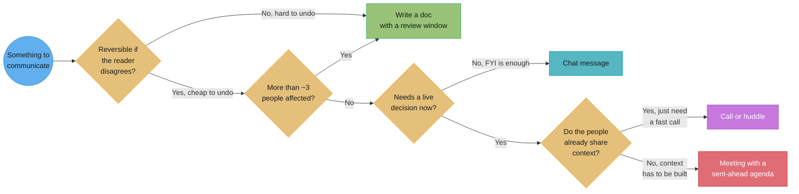
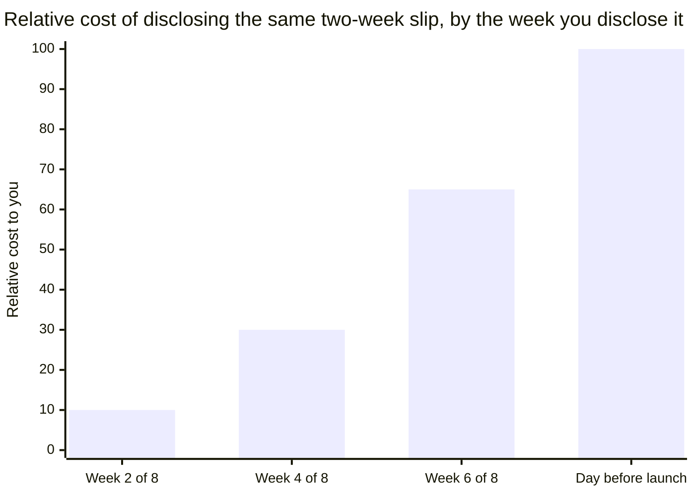
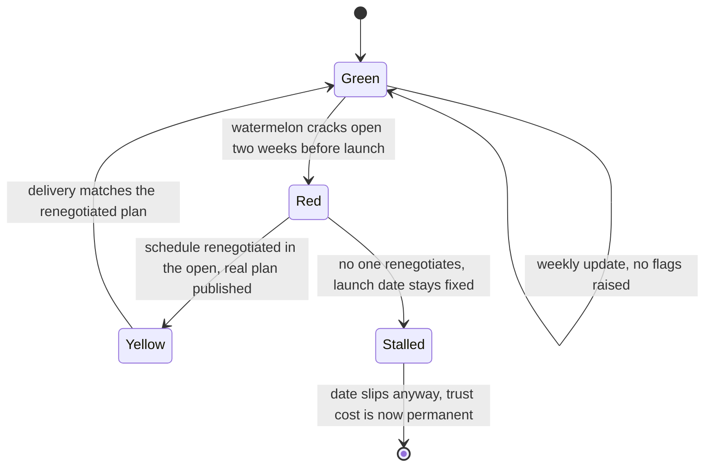

# Upward & Async Communication

## 1. Concept Overview

Upward and async communication is the communication that happens between the moments
anyone is watching. Performance reviews, launches, and incidents are graded on their own
terms; the weekly update, the status colour, the 1:1 agenda, and the written decision are
graded on whether they let other people act without you in the room. Most engineers treat
these as overhead — filler between the real work — and that is exactly why most engineers
plateau at the level where someone else has to translate their work upward for them. The
skill has two halves. Upward communication is telling your manager, and through them their
manager, the truth about status, risk, and need in a form they can repeat without you
present. Async-first communication is writing so that someone in a different timezone, or
reading three weeks later, can understand a decision and act on it with no live
conversation at all. Companies that scaled fully distributed — GitLab, Automattic, Doist —
did not invent a new communication style so much as make explicit and mandatory what good
engineers already did informally: write the decision down once, in the place people will
look, instead of relaying it live to whoever happens to be online.

The two halves share one root cause. Both fail for the same reason: the writer optimizes
for how the message feels to send (vague, hedged, deferring to a future conversation)
instead of how it functions after they have logged off. A weekly update that lists what
you did feels honest and effortful to write. A weekly update that states what is blocked
and who owns unblocking it feels exposed to write, because it puts a name on the risk. The
second one is the only one anyone downstream can act on.

---

## 2. Intuition

> **One-line analogy**: a good status update is a diff, not a commit log — it tells the
> reader what changed and what they need to do about it, not everything that happened.

**Mental model.** Every message you send upward or across timezones is read once, by
someone who was not in the room when the context formed, who has thirty seconds and a
dozen other messages competing for the same thirty seconds. Write for that reader, not for
the version of them who already knows what you know.

**Why it matters.** Engineers are evaluated on two channels that rarely coincide: the work
itself, and the story other people tell about the work when you are not there to tell it
yourself. Your manager repeats your status to their manager, in a skip-level, in a
headcount review, using only what you gave them in writing. If what you gave them was
"things are progressing," that is the sentence that reaches the VP, and it is a sentence
that survives being wrong for a very long time before anyone notices.

**Key insight.** Ambiguity in a status update is not neutral — it is a transfer of risk
from the writer to the reader. "We might be a little behind" quietly hands the reader the
job of figuring out how behind, by when, and what it costs, work the writer was already
better positioned to do. Every rule in this module is a way of refusing that transfer:
put a number, a date, and a name on the thing instead of a feeling.

---

## 3. Core Principles

1. **Status is a summary of risk, not a log of activity.** "Migrated 3 of 12 services" is
   activity. "On track for the Oct 15 cutover; risk is the auth service, which needs a
   design review we haven't scheduled" is status. The reader needs the second one to do
   their job; the first one is for your own memory.
2. **No surprises, in either direction.** A bad number disclosed early is a data point; the
   same number disclosed late is a credibility event. The rule exists because organizations
   consistently under-punish an early yellow and severely punish a late red, and yet
   engineers consistently under-report early and over-report late — the opposite of what
   the incentive actually rewards.
3. **Write once, for the reader who wasn't there.** A decision, an update, or an answer
   exists exactly once in writing, in a place with a stable link, and gets referenced
   rather than retyped. If you find yourself re-explaining the same decision in a third
   Slack thread, the decision was never actually written down — it was only said.
4. **Match the medium to the cost of being wrong.** A reversible, single-reader question is
   a chat message. An irreversible, multi-team decision is a document with a review period.
   Defaulting everything to a meeting, or everything to a DM, is a category error, not a
   personality trait.
5. **Ask for what you need; do not make your manager infer it.** "I'd like your read on
   whether this is worth pre-empting the roadmap for" gets an answer. Mentioning the
   problem and waiting to see if your manager offers help does not — most managers read
   that as "handled," because that is the default assumption unless told otherwise.
6. **Give your manager the reusable version of the story.** Anything you tell your manager
   that they cannot repeat verbatim to their own manager — because it is missing a number,
   a scope, or a next step — will get diluted into something vaguer by the time it moves up
   one more level, and vaguer status is read as worse status.

---

## 4. Types / Levels / Modes

**Modes of upward communication**, by how much interpretation the reader has to do:

| Mode | What it costs the reader | When it is right |
|---|---|---|
| Raw activity ("worked on X") | Reader must infer status | Never, on its own |
| Status without ask ("X is at risk") | Reader must infer what you need | When you are still diagnosing |
| Status with ask ("X is at risk; I need a decision on Y by Friday") | Nothing — reader can act | The default for anything blocked |
| Pre-negotiated decision ("X is at risk; I'm doing Y unless you object by Friday") | Nothing, and no round trip | Reversible calls, high trust |

**Modes of async writing**, by durability:

- **Ephemeral** — a chat message. Correct for a quick, reversible, single-reader question.
  Wrong the moment a third person needs to find the answer later.
- **Living document** — a wiki page, a handbook entry, an RFC. Correct for anything that
  will be read more than three times or by more than three people. GitLab's handbook is
  the extreme version of this mode applied to an entire company.
- **Point-in-time record** — a decision log entry, a postmortem, a meeting's written
  outcome. Correct for anything that needs to be citable later ("we decided this on
  March 3 and here is why"), even after the living document around it has moved on.

**Levels of "no surprises,"** by how far in advance the bad news travels:

- **Real-time** — you say it the day you know it. Costs you nothing but the discomfort of
  saying it.
- **Batched** — you say it at the next scheduled update. Costs a few days of the reader's
  planning time.
- **Forced** — the reader finds out because the deadline arrived and the work wasn't done.
  Costs trust, and it is the only one of the three that does.

---

## 5. Models & Frameworks Diagrammed



The decision runs on two axes, reversibility and audience size, before it ever asks
whether the conversation needs to be synchronous. A meeting is the most expensive medium on
the tree — it is the answer only when the reader needs a live decision AND doesn't yet
share your context, which is a narrower case than most calendars suggest.



Same fact — the project is two weeks behind — at four different disclosure points. In
week 2 it is a schedule change: move the date, tell the three stakeholders who care, done.
The day before launch it is identical information but costs ten times as much, because now
it also costs the credibility of everyone who repeated your "on track" status upward in
the meantime. The slip did not get worse by waiting; the bill for hiding it did.



The watermelon path (green, green, green, then Red) and the honest path (green, then
Yellow, then Green again) start from the same underlying schedule risk. The difference is
not the risk — it is whether the colour changed while there was still time to do something
about it.

---

## 6. How It Works — Detailed Mechanics

### 6.1 The weekly update format

A weekly update that gets read has four fields, in this order, and nothing else:

```text
STATUS: [Green / Yellow / Red] — <one sentence, the headline>
CHANGED SINCE LAST WEEK: <2-4 bullets, deltas only, no repeats of last week's content>
BLOCKED ON: <what, and who specifically can unblock it — or "nothing" if true>
NEED FROM YOU: <a specific decision, a review, an intro — or "nothing this week">
```

**A complete real one:**

```text
STATUS: Yellow — checkout-v2 migration is on track for the Oct 15 cutover, but the
fraud-scoring integration is the long pole and has no committed reviewer yet.

CHANGED SINCE LAST WEEK:
- Payment-token service fully migrated; load test passed at 2x peak traffic.
- Fraud-scoring integration spec is written but unreviewed — sent to @priya Tuesday,
  no response yet.
- Found a schema mismatch in the refunds path; fix is a 1-day change, already scoped.

BLOCKED ON: Fraud-scoring spec review, owned by @priya. Without it we can't start that
integration, which is 6 of the remaining 12 working days on the critical path.

NEED FROM YOU: Can you ping @priya's manager if the review isn't done by Wednesday? I
don't have the standing to escalate a peer's queue myself.
```

**Weak version**

> This week I worked on the checkout migration, wrote the fraud-scoring spec, fixed a bug
> in refunds, and had a few syncs with the payments team. Things are moving along. Will
> keep you posted.

**Strong version**

> STATUS: Yellow — checkout-v2 migration is on track for the Oct 15 cutover, but the
> fraud-scoring integration is the long pole and has no committed reviewer yet.
> BLOCKED ON: fraud-scoring spec review, owned by @priya — 6 of the remaining 12
> critical-path days. NEED FROM YOU: ping @priya's manager if it's not reviewed by
> Wednesday.

**What changed:** activity became risk assessment, "moving along" became a colour with a
named cause, and the vague "keep you posted" became a specific ask with an owner and a
deadline. The weak version can be nodded at and forgotten; the strong one requires a reply.

Both versions are true. Only the strong one lets the reader do anything with the
information — assess risk, decide whether to intervene, know exactly who to nudge. The
weak one is a diary entry addressed to the wrong audience.

**Weak version**

> Blocked on the fraud team, hopefully they get to it soon.

**Strong version**

> Blocked on @priya's review of the fraud-scoring spec, sent Tuesday — no response yet. If
> it's not reviewed by Wednesday, we lose 6 of our remaining 12 critical-path days. I need
> you to escalate to her manager if that happens; I don't have the standing to.

**What changed:** "the fraud team" became a named owner, "hopefully soon" became a
deadline with the cost of missing it quantified, and "blocked" turned into a specific
request for what the reader should do about it. The weak version reports a feeling; the
strong version reports a fact with a lever attached.

### 6.2 Red / Yellow / Green, and why it collapses to green

A three-colour system only works if all three colours are safe to report. In most
organizations, exactly one of them is: green gets a thumbs-up in the channel, yellow gets a
pile-on of "what's the plan," and red gets you added to a recovery meeting you didn't ask
to be in. Faced with that asymmetry, a rational reporter reports green until the evidence
against it is undeniable — which is precisely the watermelon failure mode: green outside,
red inside, discovered only when someone cuts it open. Estimates of how common this is vary
by source, but the pattern is well-documented enough to have its own name across the
project-management literature, and every engineer who has shipped more than a few projects
has seen at least one.

**What makes yellow safe to report** is a manager who visibly does two things with a yellow
status: asks "what do you need," not "why is it yellow," and does not repeat the yellow
upward as a red. If the first yellow anyone reports gets treated as a confession instead of
information, no one reports a second one — they wait until the project is red, because at
that point the truth is unavoidable anyway and there is no early-warning cost left to save.

**The org behaviours that guarantee dishonest status**, all observable and all self-
inflicted:
- Status meetings where red status is discussed in front of the reporter's skip-level.
- A PM who edits "yellow" to "green" before it reaches leadership, "to keep things
  positive." This is the single most reliable way to manufacture a watermelon project —
  it does not remove the risk, it removes the only channel that could have surfaced it.
- Rewarding the person who reports green and ships late over the person who reports
  yellow and ships on time, because the green report *felt* better for eight weeks.

### 6.3 "No surprises" — the arithmetic

Take a real shape: an 8-week project slips by 2 weeks. Disclosed in week 2, the fix is a
plan change — move the date, tell the handful of downstream teams, absorb a schedule
conversation that costs maybe half a day of meetings. Disclosed the week before launch, the
same 2-week slip now also costs: every commitment made against the old date (marketing,
sales, dependent teams who built their own plans on top of yours), the credibility of every
status report that said "on track" in between, and — this is the part that doesn't reset —
the default level of trust your next "on track" gets from that point on. The information
content of the slip is identical in both cases. The cost is not about the slip; it is about
how long the organization operated on a false premise before finding out.

**Disclosing a slip and keeping the conversation on the plan, not on you:**

```text
Bad: "Sorry, we're going to be late, I should have caught this sooner."

Better: "The auth-migration piece is going to take 2 more weeks than planned — the
schema change touches more call sites than we scoped. I have two options: slip the
whole launch 2 weeks, or ship without auth-migration and follow up in a fast-follow.
I'd recommend the fast-follow; it keeps the customer-facing date and the risk is
contained to an internal service. Which do you want me to plan around?"
```

The better version has no apology in it, not because the slip doesn't matter, but because
an apology invites the reader to evaluate you instead of the plan. It states the fact,
gives two real options with a recommendation, and asks for a decision. That is the entire
craft of disclosing bad news without making yourself the subject of the conversation.

### 6.4 Managing up, concretely

Managing up is not flattery; it is doing for your manager what you'd want a report to do
for you: reduce the translation work between what you did and what they have to say about
it. Three concrete practices:

**Learn what your manager is measured on, and what their manager is measured on.** A
manager measured on team velocity cares about a different fact from a manager measured on
customer escalations. Ask directly: "What's the thing your manager is going to ask you
about this quarter?" Most managers will tell you, because the answer helps you help them.

**Send a pre-1:1 agenda**, even three bullet points, an hour before the meeting:

```text
1. Fraud-scoring review is stuck — need you to unblock with priya's manager.
2. Want your read: is the Q4 infra migration worth pulling into Q3?
3. FYI: interviewing for the platform-eng req Thursday, no action needed.
```

This does two things a live-only 1:1 cannot: it lets your manager think before answering
instead of improvising, and it puts a written trail on the ask, so "I asked about this in
our 1:1" is checkable later rather than a claim either of you has to trust from memory.

**What belongs in the 1:1 versus in writing.** The 1:1 is for anything that needs a back-
and-forth — negotiating a tradeoff, reading tone, career conversations, disagreement that
needs to be worked through rather than announced. Anything with a single clean answer —
status, a yes/no decision, an FYI — belongs in writing, both because it's faster and
because writing it creates the record the live conversation doesn't.

**Ask for what you need instead of hinting.**

**Weak version**

> I've been picking up a lot of on-call lately.

**Strong version**

> I've covered 3 of the last 4 on-call rotations for the team. I'd like us to rebalance
> the rotation starting next month, and I want the extra coverage reflected in my Q3
> review under scope — can we agree on that in this 1:1?

**What changed:** a fact with no request became a fact, a number, a concrete action, a
deadline (next month), and a direct ask for a yes/no answer in the room. The weak version
leaves your manager to guess between sympathy, a schedule change, or credit at review
time — and the default guess, absent any of those being asked for, is "handled, no action
needed."

**Give your manager the repeatable version.** Before a skip-level or a headcount review,
send your manager one paragraph they could read verbatim: what shipped, the number that
proves it, what's next, what you need. A manager who has to reconstruct that from memory
under time pressure will reconstruct it worse than you would have written it.

### 6.5 Async-first written communication — what four companies actually do differently

**GitLab** runs handbook-first: a single public handbook (2,700+ pages) is the source of
truth for how the company operates, editable by anyone through a merge request, and the
default answer to "how do we do X" is "it's in the handbook" rather than "let me explain."
The mechanism that makes this work is not the writing itself — it's that a decision made
once in the handbook does not need to be re-explained to the next person who asks, because
the handbook, not a person, is the interface.

**Automattic** runs on P2, an internal blogging tool built on WordPress that replaced email
entirely; work is posted, discussed as threaded comments, and searchable by anyone in the
company, across a network that grew to more than a thousand internal P2 spaces. The
mechanism: a decision discussed on a P2 post is visible to someone who joins the team two
years later, in a way a Slack thread from two years ago effectively is not.

**Doist** (Todoist, Twist) reports roughly 70-95% of internal communication as async and
transcript-based rather than live, built around the idea that async-first means
writing-first: you write a complete thought, not a live back-and-forth, because a complete
thought survives being read by someone nine hours out of sync with you. Their product,
Twist, is explicitly built to discourage the always-on presence indicators that make chat
tools feel like they demand an immediate reply.

**Basecamp / 37signals** treats meetings as the last resort, not the first option, and
runs a daily async check-in ("what did you work on today," answered in writing by every
employee, visible to the company) instead of a daily standup meeting. Their stated
principle is that writing solidifies and chat dissolves — a decision made in chat has to be
re-decided the next time someone asks, while a decision made in a written doc gets
referenced instead of re-litigated.

What the four share is not a tool — it is a bias: **the default for anything worth knowing
twice is to write it once, in a place with a permanent address, rather than explain it
live to whoever asks.**

### 6.6 Writing a decision someone three timezones away can act on without you

A decision write-up that survives your absence has six fields:

```text
DECISION: We're moving the auth service to token-based sessions.
MADE BY: @rutik (eng lead), with sign-off from @priya (security)
DATE: 2026-08-20
RULES OUT: cookie-based sessions, and the "hybrid" option discussed on the 8/15 call —
  both were considered and rejected because they don't support the mobile SDK's
  offline-refresh requirement.
NEXT STEPS: @dev-team ships the token issuer by 9/1; @mobile-team migrates the SDK by
  9/15; rollback plan is documented in the linked RFC if the 9/1 date slips.
DISCUSSION: <link to the RFC and the thread where this was debated>
```

Someone reading this at 3am their time, who was not on the 8/15 call, can act on it: they
know what was decided, that it's final (not a proposal), what it explicitly rejects (so
they don't re-propose the hybrid option), who is doing what by when, and where to go if
they want the "why." Strip any one field and the reader has to either guess or interrupt
someone's night to ask.

**Weak version**

> Talked it over and I think we're going with tokens for the sessions thing, seems like
> the best option. Will follow up with details.

**Strong version**

> DECISION: We're moving the auth service to token-based sessions. MADE BY: @rutik, with
> sign-off from @priya (security), 2026-08-20. RULES OUT: cookie-based sessions and the
> hybrid option from the 8/15 call — both fail the mobile SDK's offline-refresh
> requirement. NEXT STEPS: token issuer ships 9/1 (@dev-team), SDK migration by 9/15
> (@mobile-team). DISCUSSION: linked RFC and 8/15 thread.

**What changed:** "I think" became a dated, attributed, final decision; "the best option"
named the two alternatives it rules out and why, so no one re-proposes them; and "will
follow up with details" became named owners against named dates. The weak version requires
a live conversation to become actionable; the strong version already is.

### 6.7 Meeting hygiene, from the participant's side

- **Before**: send an agenda, even three lines, with what decision you need out of the
  meeting. "Syncing on the migration" is not an agenda; "need a decision on whether we
  cut the fraud-scoring integration from v1" is.
- **After**: write the outcome in the same channel the agenda went to, within the hour,
  while it's still cheap to correct: "Decided: cutting fraud-scoring from v1, follow-up
  ships by 10/1, owner is @priya." This is the artifact that makes the meeting count as
  async communication instead of a synchronous event that only the attendees remember.
- **At the end of the meeting itself**, restate the decision out loud and ask "did I get
  that right" before anyone leaves the room. This catches the case — more common than it
  should be — where two people in the same meeting walked out having heard two different
  decisions.

---

## 7. Real-World Examples

- **GitLab's handbook-first model** is public at handbook.gitlab.com and runs the company
  itself, not just engineering — HR policy, marketing process, and engineering RFCs all
  live in the same handbook, editable via merge request by anyone, including, by design,
  people outside the company.
- **Automattic's P2** carried the company's internal communication for over a decade
  before being productized and sold externally, at a scale of 1,000+ internal spaces used
  by 1,200+ employees across a fully distributed workforce with no central office.
- **Doist** built its own chat product, Twist, specifically to remove the presence
  indicators and always-on expectation that Slack encourages, on the argument that a tool
  optimized for "read now, reply now" is the wrong tool for a team spread across 30+
  countries.
- **37signals/Basecamp's** "What did you work on today" daily check-in replaces a
  synchronous standup with an async, written, company-wide-visible equivalent, collected
  automatically at a fixed time each workday and posted to a shared page.
- **The watermelon status pattern** is documented widely enough in the project-management
  literature to have converged on the same name across independent sources — the term
  itself is the evidence that this failure mode is common enough to need a name.

---

## 8. Tradeoffs

| Choice | Pro | Con |
|---|---|---|
| Async-first (write, don't meet) | Scales across timezones; creates a searchable record; forces clearer thinking | Slower for genuinely urgent, ambiguous decisions; loses tone and rapport |
| Sync-first (meet, don't write) | Fast for high-ambiguity problems; builds relationship | Doesn't scale past the room; nothing survives past the attendees' memory |
| Reporting every yellow honestly | Early warning; keeps trust intact over years | Short-term discomfort; requires a manager who won't punish it |
| Reporting green until certain | Feels safer week to week | Watermelon risk; the eventual correction costs more than the sum of the early discomforts |
| Hinting at a need | Feels less demanding | Usually read as "no action needed"; the need goes unmet |
| Asking directly for what you need | Gets answered | Requires naming the ask, which some engineers experience as exposure |

---

## 9. When to Use / When NOT to Use

**Use written, async-first communication when:** the audience spans timezones; the content
needs to be found again later; more than a handful of people need the same information;
the decision is not yet final and benefits from a review window before it's locked.

**Use synchronous communication (call or meeting) when:** the problem is genuinely
ambiguous and needs a back-and-forth to converge; the news is sensitive enough that tone
matters more than speed (a layoff, a performance conversation, a conflict); the group
sharing context is small and already assembled.

**Do not** default a reversible, single-reader question to a meeting — that is calendar
theft. **Do not** default an irreversible, multi-team decision to a chat thread — that is
how a decision made by three people in a DM becomes "official" without the fourth
stakeholder ever getting a vote or even a notification.

---

## 10. Common Pitfalls

**The activity list masquerading as status.** A report that lists what you did, with no
sentence answering "are we on track," forces the reader to compute status themselves from
raw activity — most won't, and the ones who do will get it wrong in whichever direction
their mood that day biases them.

**"Quick question" DMs that cost twenty minutes.** A DM that reads "quick q — got a sec?"
externalizes the cost of context-switching onto the reader before they even know what the
question is. The asker spent ten seconds; the receiver loses the next twenty minutes of
focus reconstructing what they were doing before they can resume it. The fix is not "never
ask quick questions" — it's asking the actual question up front, so the reader can judge
urgency and answer async if it isn't.

**The status meeting that exists because nobody writes.** A recurring meeting whose entire
content is "let's go around and say what everyone's working on" is a symptom, not a
process: it exists because no one trusts that a written update would get read, so the
organization pays a synchronous tax on everyone's calendar to compensate for a writing gap
that a four-field template would close for free.

**Over-communicating to look busy.** A daily wall of updates trains the reader to skim, and
skimming is exactly the failure mode that causes a real blocker to get missed inside the
noise. Cadence matters as much as content — weekly for steady-state, immediate for
anything that changes the plan, and nothing in between.

**The 400-word Slack message that should have been a doc.** A message long enough to need
scrolling, with no headings, sent into a channel where it will be pushed below the fold by
the next unrelated message within the hour, is a document wearing the wrong medium. If it
took more than two paragraphs to write, it needed a title, a stable link, and a place
someone could find it in six months — a chat client is not that place, however it feels
in the moment of typing it.

**Deciding something in a chat thread nobody can find later.** A real and specific failure:
three people debate an approach in a DM or a private channel, converge on an answer, and
ship against it. Two months later a fourth person asks "why did we do it this way," and
the honest answer is "there was a conversation about it, ask around" — because the decision
was never written to a place with a link. The fix from §6.6 exists specifically to prevent
this: whoever makes the call writes the six fields down, in the team's shared doc space,
before anyone starts building against it.

---

## 11. Frameworks, Books & Further Reading

- GitLab — public company handbook, handbook.gitlab.com, the reference implementation of
  handbook-first, all-remote operating.
- Automattic — P2, the internal (later productized) async communication platform that
  replaced email at the company for over a decade.
- Doist — public "how we work" writing on async-first practice at Todoist/Twist; Amir
  Salihefendić (CEO) has spoken and written extensively on scaling a fully async company.
- 37signals/Basecamp — "The 37signals Guide to Internal Communication," the company's
  published internal-communication playbook, and the REWORK podcast episodes on writing
  culture and meeting-reduction.
- The "watermelon project" pattern — widely documented across independent project-
  management sources under the same name, describing status reported green while the
  underlying project is red.

---

## 12. Interview Questions with Answers

**Q: Your project is going to be two weeks late. When do you tell your manager?**
**Short:** Immediately, in the same week you know it — the cost of a slip only grows the longer it's hidden.
The moment you have reasonable confidence in the slip, not the moment you're certain — a
week-2 disclosure is a plan change, a week-7 disclosure is a credibility event. Bring the
number, the cause, and two options with a recommendation, not just the bad news. The
mechanism is that hidden risk compounds: every "on track" update sent in between the slip
happening and it being disclosed becomes a second, separate failure once the truth comes
out. Disclosing early keeps the conversation about the plan; disclosing late makes it about
you.

**Q: Your manager asks for a status update and you genuinely don't know if you're on
track. What do you say?**
**Short:** Say exactly that you don't know yet, name what you're checking, and give a date you'll know by.
"I don't have a confident read yet — I'm checking X, and I'll have a real answer by
Thursday" is a legitimate status, and it is categorically better than guessing green to
avoid looking uncertain. Guessing green and being wrong costs credibility; saying "I don't
know yet, here's my plan to find out" costs nothing and is often exactly true. The failure
mode this avoids is reporting confidence you don't have, which reads as certainty to
everyone downstream who repeats it.

**Q: Why do Red/Yellow/Green status systems collapse to all-green in most
organizations?**
**Short:** Because only green is safe to report — yellow gets pile-ons and red gets you added to a recovery meeting.
The three colours are not equally costly to report: green is free, yellow invites scrutiny,
red triggers intervention, so a rational reporter under-reports risk until it's undeniable.
This is the mechanism behind the "watermelon project" — green outside, red inside — and it
is a property of the incentive structure, not of any individual's honesty. The fix is
structural: a manager has to visibly reward an early yellow, by responding with "what do
you need" instead of "why is it yellow," or the colour system will keep collapsing no
matter how earnest the reporters are.

**Q: What is the difference between a status update and an activity log?**
**Short:** Status answers "are we on track"; an activity log just lists what got done.
An activity log ("migrated 3 of 12 services") requires the reader to compute risk
themselves from raw output; a status update ("on track for Oct 15; risk is the
unreviewed fraud-scoring spec") delivers the computed answer. The reader has thirty
seconds and a dozen competing messages — activity logs get skimmed and the actual risk
gets missed inside them. The practical test: if the reader has to do arithmetic to know
whether to worry, it's an activity log, not status.

**Q: Give an example of "managing up" that isn't flattery.**
**Short:** Sending a pre-1:1 agenda so your manager can think before answering instead of improvising live.
Managing up means reducing the translation work between what you did and what your
manager has to say about it upward — learning what they're measured on, sending a written
agenda before the 1:1, and handing them a repeatable paragraph before a skip-level rather
than making them reconstruct your work from memory under time pressure. None of this is
flattery; it's doing for your manager what you'd want a strong report to do for you. The
gotcha: engineers who skip this assume competence alone gets recognized upward, but a
manager can only repeat what you gave them in a form they can repeat.

**Q: When should you escalate a peer's blocked review instead of waiting it out?**
**Short:** When the blocked item is on the critical path and you've already asked the owner directly with no response.
Escalate once you've tried the direct ask and named the cost of the delay — "this is 6 of
12 remaining critical-path days" — not the moment something feels slow. Escalating too
early with no attempt at the direct route reads as going over someone's head; escalating
too late means the delay has already eaten the schedule. The specific ask matters too: ask
your manager to nudge the blocker's manager, not to solve the technical problem, since
that's usually the actual bottleneck — organizational priority, not technical difficulty.

**Q: Why is "hinting" at a need less effective than asking for it directly?**
**Short:** A hint requires the listener to guess the ask, and the default guess is "no action needed."
"I've been picking up a lot of on-call" states a fact but not a request; the listener has
to infer whether you want sympathy, a schedule change, or credit, and most default to
assuming it's already handled unless told otherwise. "I've covered 3 of 4 rotations, I
want the rotation rebalanced, and I want it reflected in my review under scope" removes
the guesswork. The gotcha: engineers avoid direct asks because they feel like exposure,
but an unmet hinted need costs more credibility over time than a direct ask that gets a
"no."

**Q: What belongs in a 1:1 versus in writing?**
**Short:** Anything needing back-and-forth goes in the 1:1; anything with a clean single answer goes in writing.
Tradeoff negotiation, tone-sensitive topics, and career conversations belong in the 1:1
because they need a real back-and-forth to converge. Status, yes/no decisions, and FYIs
belong in writing because writing is faster and creates a record the live conversation
doesn't. The trap is using the 1:1 as a dumping ground for status that a four-line written
update would have covered, which burns the 1:1's actual value — the parts that need a
human conversation — on things that didn't.

**Q: How do you pick between a chat message, a document, and a meeting for a given
decision?**
**Short:** Reversibility and audience size decide it before synchrony ever enters the choice.
Ask first whether the decision is reversible and how many people it affects: irreversible
or multi-team goes to a document with a review window regardless of urgency; reversible
and single-reader can be a chat message. Only within "needs a live decision now" does the
question become call versus meeting, and that split is decided by whether the participants
already share context — shared context means a quick call, no shared context means a
meeting with a sent-ahead agenda. The common error is defaulting everything ambiguous to a
meeting, which is the most expensive medium on the tree and should be the last resort, not
the first reflex.

**Q: What's wrong with deciding something important in a Slack thread?**
**Short:** The decision has no stable, findable link, so it gets re-litigated by the next person who asks.
A Slack thread is searchable in theory and unfindable in practice — it scrolls out of
view, the channel may not be the one a future reader checks, and there's no single URL
anyone hands around as "the decision." Two months later, someone new asks why a system
works a certain way, and the honest answer becomes "ask around" instead of a link. The fix
is writing the six-field decision record (decision, made by, date, rules out, next steps,
where the discussion lives) to a place with a permanent address before anyone builds
against it.

**Q: What does GitLab's "handbook-first" model actually mean in practice?**
**Short:** The handbook, not a person, is the answer to "how do we do X" — and anyone can edit it via merge request.
GitLab maintains a single public handbook of 2,700+ pages covering how the company
operates, and the operating norm is that when someone asks how something works, the answer
is a link to the handbook rather than a live explanation, with changes made through a
merge request like any other GitLab change. The mechanism this creates is that a decision
written once does not need to be re-explained to the next person who asks — it scales the
explaining work to zero marginal cost per new reader. It only works because editing the
handbook is treated as a first-class engineering task, not an afterthought.

**Q: What did Automattic's P2 replace, and why does that matter for a distributed
company?**
**Short:** P2 replaced email entirely, making internal discussion threaded, searchable, and visible company-wide.
P2 is an internal blogging tool built on WordPress that Automattic used in place of email
for internal communication, scaling to over a thousand internal spaces used by more than
1,200 employees. The mechanism that matters: a decision discussed on a P2 post remains
visible and searchable to someone who joins the team two years later, unlike an email
thread that dies in one person's inbox. This is the structural difference between async
communication that creates an organizational record and async communication that merely
avoids a live meeting.

**Q: What does it mean that Doist is "writing-first," not just "async-first"?**
**Short:** Async-first at Doist specifically means composing a complete written thought, not a live back-and-forth in text.
Doist reports roughly 70-95% of internal communication happening asynchronously, and their
own framing is that async-first, for them, functionally means writing-first — sending one
complete thought rather than a rapid-fire chat exchange that just delays a live
conversation by a few seconds per message. Their product Twist is deliberately built
without the always-on presence indicators that push chat tools toward expecting an
immediate reply. The distinction matters because a lot of "async" communication is really
just a slow-motion live conversation, which keeps the interruption cost of chat without
gaining the durability of a document.

**Q: Why does 37signals say meetings are "the last resort, not the first option"?**
**Short:** Because writing solidifies and scales to everyone, while a meeting's outcome only lives in the attendees' memory.
37signals argues that speaking helps only the people in the room, while writing helps
everyone, including people who couldn't attend and people who join the company years
later — so anything substantial should start and end as writing, with meetings used only
when a genuine back-and-forth can't be replaced by an exchange of complete written
thoughts. Their daily async check-in, answered in writing by every employee at a fixed
time, replaces the standard synchronous standup meeting with the same information
captured once, in writing, for everyone. The practical test they apply: if it's important
enough to write up, write it up; don't chat it down.

**Q: What's the actual failure mechanism in a "watermelon" status report?**
**Short:** The reported colour reflects what's safe to report, not the true state of the project, until reality forces a correction.
A watermelon project reports green because green is the only colour with no social cost to
report, while the underlying risk — schedule, quality, scope — accumulates unreported
until it becomes undeniable, at which point the status flips straight to red with no
warning. The mechanism is not dishonesty in the usual sense; it's a rational response to an
organization that punishes yellow and red more than it rewards the information they
convey. The fix has to change the incentive, not lecture the reporter — a manager who
treats an early yellow as useful information rather than a confession is the only thing
that reliably prevents the pattern.

**Q: How do you write a decision so someone in a different timezone can act on it without
talking to you?**
**Short:** State the decision, who made it, the date, what it rules out, the next steps with owners, and where the debate lives.
A decision write-up needs six fields to be self-sufficient: the decision itself stated
plainly, who made the call, when, what alternatives it explicitly rules out (so they
aren't re-proposed), the concrete next steps with named owners and dates, and a link to
where the discussion happened for anyone who wants the "why." The "rules out" field is the
one people skip most often, and it's the one that prevents the same debate from
restarting every time someone new encounters the decision. Strip any field and the remote
reader either has to guess or has to interrupt someone's night to ask.

---

## 13. Best Practices

- Send status in the four-field format (status, changed, blocked, need) every week, same
  day, same channel — predictability is part of what makes it get read.
- Disclose bad news the week you're confident in it, not the week you're certain, and
  always with two options and a recommendation, never a bare apology.
- Treat every yellow you receive from a report as useful information, and say so out
  loud, or you will train your team to stop sending you yellows.
- Send a written agenda before every 1:1 and every meeting you organize; write the
  outcome down within the hour after every meeting you attend.
- Before writing a decision, ask "could someone three timezones away act on this with no
  further conversation with me" — if the answer is no, add the missing field.
- Default reversible, single-reader, low-context questions to chat; default irreversible
  or multi-team calls to a written doc with a review window; reserve meetings for genuine
  ambiguity that needs a live back-and-forth.
- Ask directly for what you need, with a specific ask attached, instead of describing the
  problem and hoping someone offers.

---

## 14. Case Study

**Scenario.** A 12-person platform team is migrating a monolith's auth system to a new
token-based service. The project lead, Dana, has been sending weekly one-line Slack
updates: "Migration progressing, no blockers." In week 6 of an 8-week plan, Dana discovers
the token issuer doesn't support the mobile app's offline-refresh flow — a design gap that
will take three extra weeks to close, discovered while integrating the first real mobile
client against the new service.

**What Dana does wrong first.** Dana spends four days trying to find a way to avoid
admitting the slip — exploring a workaround that would keep the date but ship a degraded
offline experience — without telling anyone a decision point exists. This is the
watermelon mechanic in miniature: the project has been reporting green for six weeks, and
admitting yellow now feels like admitting the first five "no blockers" updates were
optimistic rather than accurate.

**What changes it.** A peer engineer, not Dana's manager, asks directly in a 1:1-style
check-in: "Is the mobile offline case actually solved, or are we hoping it resolves
itself?" Dana admits it isn't solved. The peer's next question — "what does your manager
need to know today, not in four days" — reframes the problem from "how do I avoid saying
this" to "what does the write-up say."

**The write-up Dana sends that afternoon:**

```text
STATUS: Red — mobile offline-refresh isn't supported by the new token issuer; discovered
integrating the first real client. This wasn't caught earlier because we tested the web
client first, and web doesn't have an offline mode.

CHANGED: Web migration is fully done and stable. Mobile integration surfaced a design gap
in the token issuer's refresh flow.

BLOCKED ON: A decision, not a person. Option A: extend the timeline 3 weeks to build
proper offline-refresh support. Option B: ship mobile without offline support for v1 and
fast-follow within a month. I recommend B — offline mode affects roughly 8% of mobile
sessions per our analytics, and the fast-follow risk is contained to that slice.

NEED FROM YOU: A decision on A vs B by Thursday, so I can tell the mobile team which path
to build against.
```

**Outcome.** Dana's manager picks option B within the hour, tells the two stakeholders
who had planned around the original date, and the launch proceeds on schedule with a
documented fast-follow. The four days spent hiding the gap cost nothing structurally
because the eventual disclosure still arrived two weeks before the original deadline — but
it is the closest the project came to becoming a watermelon, and the lesson the team took
from it was procedural: Dana's weekly update format changed the next week to include a
line that didn't exist before, "confidence in current plan: high / medium / low," specifically
so a dropping confidence level would be visible before it became a four-day secret again.
