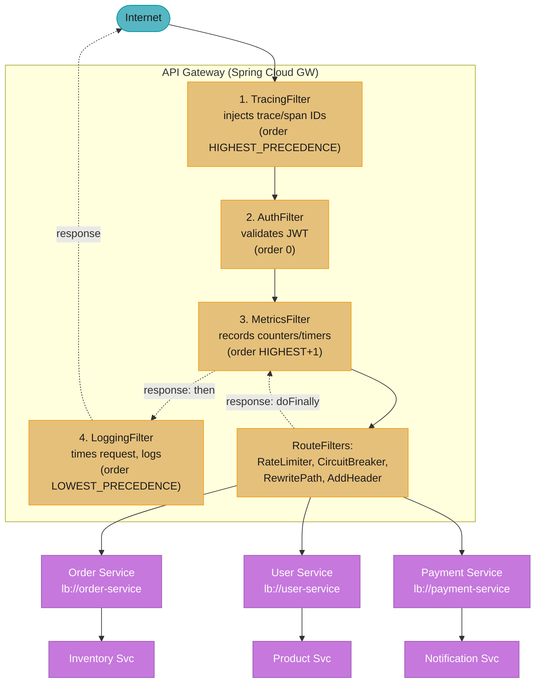

# Design: API Gateway for Microservices with Spring Cloud Gateway
> "An API gateway is the post office for a microservices city — it accepts every incoming
> envelope, stamps it (auth, trace ID, rate-limit token), routes it to the right address,
> and returns the reply. The city runs fine without a post office, but nothing outside can
> reach it cleanly."

**Key insight:** A gateway's correctness guarantee is that it must never be the *cause* of a
request failure. Its dependencies (Redis for rate limiting, service discovery) must be
treated as optional accelerators, not required correctness paths. Fail-open with loud
alerts, not fail-closed with silent outages.

See also: [Resilience4j patterns](./cross_cutting/resilience4j_patterns.md),
[OTel observability for Spring](./cross_cutting/otel_observability_for_spring.md)

---

## Intuition

Picture the gateway as the reception desk of a large office building with twenty separate
companies (services) inside. Every visitor enters through the same lobby, shows ID (JWT),
gets a visitor badge (trace ID and forwarded headers), and reception directs them to the
right floor. Reception does not do any of the companies' actual work — it does not process
orders or handle payments — it only decides which door to open and how fast to let people
through. If reception itself is slow or falls over, no visitor reaches any company, no
matter how healthy each company is inside.

The mental model that keeps a gateway design honest is: every filter in the chain runs on
the same tiny pool of threads that serves every request in the building. With Reactor Netty
this pool is `max(cores, 4)` threads, not one thread per visitor — so a single filter that
blocks (a synchronous JWKS fetch, a blocking DB call) does not just slow one visitor down,
it stops the reception desk itself, and every visitor behind them, regardless of which
company they were headed to. This is why the design keeps circling back to "never block the
event loop" — it is not a style preference, it is the one invariant a reactive gateway
cannot survive violating.

The second half of the mental model is where failure should land. A gateway sits between
the internet and services that are actually valuable — orders, payments, inventory. Its own
dependencies (the Redis rate limiter, service discovery) are conveniences that make the
building run smoother, not requirements for the building to open. So the design treats
every gateway-side dependency as something that should degrade to "let more traffic through
and page someone" rather than "stop letting anyone in" — fail-open with alerts, never
fail-closed with silence. A gateway that trades a temporarily loose rate limit for a hard
outage has made the wrong trade every time.

---

## 1. Requirements Clarification

**Functional requirements:**
- Single entry point routing to 20+ backend services based on path, host, and headers.
- JWT validation; forward user identity (`X-User-ID`, `X-User-Roles`) to backends.
- Rate-limit each client to 6,000 req/min (100 req/sec sustained, burst 200) via Redis token bucket.
- Per-route circuit breakers with service-specific fallback responses.
- Structured request/response logging with timing; distributed trace propagation (B3/W3C).

**Non-functional requirements:**
- 50,000 req/sec peak; ≤10ms gateway overhead at P99.
- Single gateway failure must not cascade to backend services.
- Route changes without restart (`RefreshRoutesEvent`).
- Sub-30s recovery from Redis rate-limiter outage (fail-open).

**Constraints:** Spring Cloud Gateway 5.x on Spring Boot 4.1 (reactive, WebFlux/Netty —
the `spring-cloud-starter-gateway-server-webflux` artifact), Redis 8 for rate limiting,
Resilience4j 2.3 circuit breakers, Java 25 (virtual threads inapplicable — fully reactive
model).

**Out of scope:** API versioning strategy for backends, GraphQL gateway, service mesh
(Istio/Envoy) integration.

---

## 2. Scale Estimation

**Traffic math:**
```
Sustained:           20,000 req/sec
Peak (2.5×):         50,000 req/sec
Filter chain per request: 5 filters (tracing, auth, rate-limit, circuit-breaker, logging)

Netty event-loop threads: max(CPU cores, 4)   [reactor.netty.ioWorkerCount]
  -> 16-core node: 16 event-loop threads
  -> 16 threads is the ENTIRE concurrency of the node. If a filter blocks for 1 ms,
     ceiling = 16 / 0.001s = 16,000 req/sec, a third of the 50,000 target.
```

Note the count is `max(cores, 4)`, not `2 x cores` — Reactor Netty runs one worker per core
because the loop is never supposed to block, so doubling it would only add context switching.
That makes the "never block the event loop" rule twice as sharp as it first appears.

**Redis rate limiter sizing:**
```
Rate limit key per user: 1 request per token per Redis operation
Unique active users/sec: ~10,000 (20% of 50k req/sec are unique user windows)
Redis ops/sec for rate limiter: ~10,000 EVAL (Lua script) ops/sec
Redis single-thread throughput: ~100,000 ops/sec -> comfortable headroom

Key size: "rate_limit:{userId}:{windowMs}" ~60 bytes + counter (8 bytes) + expiry
Total Redis memory for limiter: 10,000 users × ~200 bytes = ~2 MB (negligible)
```

**Connection pool sizing:**
```
Required in-flight connections (Little's Law):
  throughput × downstream latency = 50,000 × 0.020s = 1,000 in-flight
Gateway's default pool type is ELASTIC — it grows on demand and max-connections is ignored.
To cap it you must switch to a fixed pool, or you have no backpressure toward backends:
  spring.cloud.gateway.server.webflux.httpclient.pool.type=fixed
  spring.cloud.gateway.server.webflux.httpclient.pool.max-connections=1500
  spring.cloud.gateway.server.webflux.httpclient.pool.acquire-timeout=5000
```

The property lives under `spring.cloud.gateway.server.webflux.*` — Gateway 5 namespaced
every server property by flavour (`server.webflux` vs `server.webmvc`), so the old
`spring.cloud.gateway.httpclient.*` form binds to nothing and fails silently.

**Horizontal scaling:**
```
50,000 req/sec target at 50% CPU: 2 × 16-core nodes
  (Reactor Netty saturates ~50-100k req/sec per node when fully non-blocking)
Rate-limiter Redis: per-region cluster, NOT shared across regions (no cross-region latency on hot path)
```

---

## 3. High-Level Architecture



**Component inventory:**

| Component | Responsibility |
|---|---|
| `TracingFilter` (GlobalFilter, HIGHEST_PRECEDENCE) | Extract/inject B3 trace context into all downstream headers |
| `JwtAuthenticationFilter` (GlobalFilter, order=0) | Validate JWT; set `authenticated-user-id` attribute |
| `RequestLoggingFilter` (GlobalFilter, LOWEST_PRECEDENCE) | Record method/path/status/latency in structured logs |
| `GatewayRoutesConfig` | Route DSL: path/host predicates, per-route rate limiter and circuit breaker |
| `RateLimiterKeyResolver` | Compute rate-limit bucket key: `user:{id}` or `ip:{addr}` |
| `FallbackController` | Service-specific 503 responses with `retryAfterSeconds` hint |
| Resilience4j CB config (`application.yml`) | Per-route sliding-window, failure threshold, half-open probes |

---

## 4. Component Deep Dives

### 4.1 Route Configuration

```java
@Configuration
public class GatewayRoutesConfig {

    @Bean
    public RouteLocator routeLocator(RouteLocatorBuilder builder,
                                      RateLimiterKeyResolver keyResolver) {
        return builder.routes()
            .route("order-service", r -> r
                .path("/api/v1/orders/**")
                .filters(f -> f
                    .rewritePath("/api/v1/orders/(?<segment>.*)", "/orders/${segment}")
                    .requestRateLimiter(config -> config
                        .setRateLimiter(defaultRateLimiter())
                        .setKeyResolver(keyResolver)
                        .setDenyEmptyKey(false)
                        .setEmptyKeyStatus(HttpStatus.TOO_MANY_REQUESTS.name()))
                    .circuitBreaker(config -> config
                        .setName("order-service-cb")
                        .setFallbackUri("forward:/fallback/orders"))
                    .addRequestHeader("X-Gateway-Source", "api-gateway")
                    .retry(r2 -> r2.setRetries(2)
                        .setStatuses(HttpStatus.BAD_GATEWAY, HttpStatus.SERVICE_UNAVAILABLE)))
                .uri("lb://order-service"))

            .route("payment-service", r -> r
                .path("/api/v1/payments/**")
                .filters(f -> f
                    .rewritePath("/api/v1/payments/(?<segment>.*)", "/payments/${segment}")
                    .requestRateLimiter(config -> config
                        .setRateLimiter(strictRateLimiter())  // 20 req/sec, burst 30
                        .setKeyResolver(keyResolver))
                    .circuitBreaker(config -> config
                        .setName("payment-service-cb")
                        .setFallbackUri("forward:/fallback/payments")))
                .uri("lb://payment-service"))

            .route("user-service", r -> r
                .path("/api/v1/users/**")
                .filters(f -> f
                    .rewritePath("/api/v1/users/(?<segment>.*)", "/users/${segment}")
                    .circuitBreaker(config -> config
                        .setName("user-service-cb")
                        .setFallbackUri("forward:/fallback/users")))
                .uri("lb://user-service"))
            .build();
    }

    @Bean
    public RedisRateLimiter defaultRateLimiter() {
        return new RedisRateLimiter(100, 200, 1); // 100 req/sec, burst 200
    }

    @Bean
    public RedisRateLimiter strictRateLimiter() {
        return new RedisRateLimiter(20, 30, 1);   // 20 req/sec, burst 30
    }
}
```

### 4.2 JWT Authentication Global Filter

```java
@Component
public class JwtAuthenticationFilter implements GlobalFilter, Ordered {

    private static final List<String> PUBLIC_PATHS = List.of(
        "/api/v1/auth/login", "/api/v1/auth/refresh", "/actuator/health");

    @Override
    public Mono<Void> filter(ServerWebExchange exchange, GatewayFilterChain chain) {
        String path = exchange.getRequest().getURI().getPath();
        if (PUBLIC_PATHS.stream().anyMatch(path::startsWith)) return chain.filter(exchange);

        String authHeader = exchange.getRequest().getHeaders().getFirst(HttpHeaders.AUTHORIZATION);
        if (authHeader == null || !authHeader.startsWith("Bearer ")) {
            return unauthorized(exchange, "Missing Authorization header");
        }

        try {
            Claims claims = parseJwt(authHeader.substring(7));
            String userId = claims.getSubject();
            String roles  = claims.get("roles", String.class);

            exchange.getAttributes().put("authenticated-user-id", userId);
            ServerHttpRequest mutated = exchange.getRequest().mutate()
                .header("X-User-ID", userId)
                .header("X-User-Roles", roles != null ? roles : "")
                .build();
            return chain.filter(exchange.mutate().request(mutated).build());

        } catch (io.jsonwebtoken.ExpiredJwtException e) {
            return unauthorized(exchange, "Token expired");
        } catch (io.jsonwebtoken.JwtException e) {
            return unauthorized(exchange, "Invalid token");
        } catch (Exception e) {
            // Key service unavailable — fail open; backend services validate independently
            log.error("JWT validation error, failing open: {}", e.getMessage());
            return chain.filter(exchange);
        }
    }

    @Override public int getOrder() { return 0; }
}
```

### 4.3 BROKEN/FIX — Blocking Call in Reactive Filter

Spring Cloud Gateway runs on Netty's event loop: `max(cores, 4)` threads handle all requests.
A single blocking call stalls an entire event-loop thread.

```java
// BROKEN: blocking JWKS fetch on the event-loop thread stalls all traffic
public Mono<Void> filter(ServerWebExchange exchange, GatewayFilterChain chain) {
    String key = jwksClient.fetchKeyBlocking(kid); // blocks event-loop thread for ~50ms
    // 16 threads / 0.050s = 320 req/sec ceiling against a 50,000 req/sec target.
    // Not "slower" — a 150x collapse, and every route dies together.
    return chain.filter(exchange);
}
```

```java
// FIX: reactive JWKS fetch with in-process key cache — never blocks event loop
public Mono<Void> filter(ServerWebExchange exchange, GatewayFilterChain chain) {
    return jwksCache.getKey(kid)              // returns Mono, non-blocking, cached 5 min
        .flatMap(key -> {
            Claims claims = validateToken(exchange, key);
            exchange.getAttributes().put("authenticated-user-id", claims.getSubject());
            return chain.filter(exchange);
        });
}
// jwksCache: Caffeine with expireAfterWrite(5m), refreshAfterWrite(4m) to avoid TTL spike
```

The rule: every line inside a `GlobalFilter.filter()` must return a `Mono` or complete
synchronously in sub-millisecond time. Move all I/O to `Schedulers.boundedElastic()` at
minimum; key lookups must be cached in-process.

### 4.4 Rate Limiter Key Resolver

```java
@Component
public class RateLimiterKeyResolver implements KeyResolver {

    @Override
    public Mono<String> resolve(ServerWebExchange exchange) {
        String userId = exchange.getAttribute("authenticated-user-id");
        if (userId != null) return Mono.just("user:" + userId);

        String forwarded = exchange.getRequest().getHeaders().getFirst("X-Forwarded-For");
        if (forwarded != null) return Mono.just("ip:" + forwarded.split(",")[0].trim());
        var addr = exchange.getRequest().getRemoteAddress();
        return Mono.just("ip:" + (addr != null ? addr.getAddress().getHostAddress() : "unknown"));
    }
}
```

### 4.5 BROKEN/FIX — Rate Limiter Fail-Closed

```java
// BROKEN: Redis failure propagates and 503s ALL traffic (fail-closed)
@Bean
public RedisRateLimiter redisRateLimiter() {
    return new RedisRateLimiter(100, 200); // throws if Redis down -> 503 for every request
}
```

```java
// FIX: wrap limiter so Redis failure degrades to allow + alert (fail-open)
@Bean
public RateLimiter<RedisRateLimiter.Config> resilientRateLimiter(
        RedisRateLimiter delegate, MeterRegistry meters) {
    return new RateLimiter<>() {
        @Override
        public Mono<Response> isAllowed(String routeId, String id) {
            return delegate.isAllowed(routeId, id)
                .onErrorResume(ex -> {
                    meters.counter("gateway.ratelimit.failopen").increment();
                    log.warn("Rate limiter Redis unavailable, failing open", ex);
                    return Mono.just(new Response(true, Map.of()));
                });
        }
        // delegate remaining methods...
    };
}
```

### 4.6 Circuit Breaker Configuration and Fallback

```yaml
resilience4j:
  circuitbreaker:
    instances:
      order-service-cb:
        sliding-window-size: 10
        failure-rate-threshold: 50       # open when 50% of last 10 calls fail
        wait-duration-in-open-state: 30s
        permitted-number-of-calls-in-half-open-state: 3
        register-health-indicator: true
      payment-service-cb:
        sliding-window-size: 10
        failure-rate-threshold: 30       # stricter for payment route
        wait-duration-in-open-state: 60s
        permitted-number-of-calls-in-half-open-state: 2
```

```java
@RestController
@RequestMapping("/fallback")
public class FallbackController {

    // One method, both verbs: stacking @GetMapping and @PostMapping does NOT work.
    // Spring logs "Multiple @RequestMapping annotations found ... only the first will be
    // used" and registers GET only, so every POST that trips the breaker gets a 405
    // instead of the fallback body.
    @RequestMapping(value = "/orders", method = {RequestMethod.GET, RequestMethod.POST})
    public Mono<ResponseEntity<Map<String, Object>>> ordersFallback(ServerWebExchange exchange) {
        return Mono.just(ResponseEntity.status(HttpStatus.SERVICE_UNAVAILABLE).body(Map.of(
            "error", "ORDER_SERVICE_UNAVAILABLE",
            "message", "Order service is temporarily unavailable. Please retry in 30 seconds.",
            "retryAfterSeconds", 30,
            "timestamp", Instant.now().toString())));
    }

    @RequestMapping(value = "/payments", method = {RequestMethod.GET, RequestMethod.POST})
    public Mono<ResponseEntity<Map<String, Object>>> paymentsFallback(ServerWebExchange exchange) {
        return Mono.just(ResponseEntity.status(HttpStatus.SERVICE_UNAVAILABLE).body(Map.of(
            "error", "PAYMENT_SERVICE_UNAVAILABLE",
            "message", "Payment service is temporarily unavailable. Your payment has NOT been processed.",
            "retryAfterSeconds", 60,
            "timestamp", Instant.now().toString())));
    }
}
```

### 4.7 BROKEN/FIX — Widening Retry to POST Without Idempotency

`RetryGatewayFilterFactory` defaults `methods` to `{GET}` for exactly this reason —
retrying a write is dangerous unless the write is idempotent. The order-service route in
§4.1 never calls `.setMethods(...)`, so it silently inherits the safe GET-only default even
though at a glance it looks incomplete. The failure mode is when someone "fixes" that.

```java
// BROKEN: added .setMethods(...) to also retry POST, reasoning "we want checkout retries
// too" -- but a BAD_GATEWAY can mean the backend processed the write and only the
// response was lost, so the retry replays an already-successful charge
.route("payment-service", r -> r
    .path("/api/v1/payments/**")
    .filters(f -> f
        .circuitBreaker(config -> config.setName("payment-service-cb")
            .setFallbackUri("forward:/fallback/payments"))
        .retry(r2 -> r2.setRetries(2)
            .setMethods(HttpMethod.GET, HttpMethod.POST)   // POST added "for completeness"
            .setStatuses(HttpStatus.BAD_GATEWAY, HttpStatus.SERVICE_UNAVAILABLE)))
    .uri("lb://payment-service"))
```

```java
// FIX: keep POST out of the retry filter's methods; require callers to send an
// Idempotency-Key so the BACKEND can safely dedupe if the CLIENT retries instead
.route("payment-service", r -> r
    .path("/api/v1/payments/**")
    .filters(f -> f
        .circuitBreaker(config -> config.setName("payment-service-cb")
            .setFallbackUri("forward:/fallback/payments"))
        .retry(r2 -> r2.setRetries(2)               // methods left at default: GET only
            .setStatuses(HttpStatus.BAD_GATEWAY, HttpStatus.SERVICE_UNAVAILABLE))
        .filter((exchange, chain) -> {
            var req = exchange.getRequest();
            if (req.getMethod() == HttpMethod.POST
                    && req.getHeaders().getFirst("Idempotency-Key") == null) {
                exchange.getResponse().setStatusCode(HttpStatus.BAD_REQUEST);
                return exchange.getResponse().setComplete();
            }
            return chain.filter(exchange);
        }))
    .uri("lb://payment-service"))
```

Retries are safe for GET because re-fetching is free; for a write, the only safe retry is
one the backend can recognize and deduplicate, which is what `Idempotency-Key` buys — the
gateway itself has no way to know if a lost response means "not processed" or "processed,
ack lost."

### 4.8 Global Default Filters and CORS

Route-specific filters (§4.1) apply per-route; `default-filters` apply to every route
without repeating them, and `globalcors` centralizes CORS instead of scattering
`@CrossOrigin` across 20 backend services:

```yaml
spring:
  cloud:
    gateway:
      server:
        webflux:
          default-filters:
            - AddResponseHeader=X-Frame-Options, DENY
            - DedupeResponseHeader=Access-Control-Allow-Origin
          httpclient:
            connect-timeout: 2000
            response-timeout: 10s
          globalcors:
            cors-configurations:
              '[/**]':
                allowedOrigins: "https://app.example.com"
                allowedMethods: [GET, POST, PUT, DELETE]
                allowCredentials: true
```

`response-timeout: 10s` matters more than it looks: it is the gateway's own ceiling on how
long it will hold a connection open waiting for a backend, independent of anything the
backend's own timeout is configured to. Without it, a hung backend holds a gateway
connection (and the caller's connection) open indefinitely — a slow-leak toward the pool
exhaustion scenario in §8's Runbook 5, not a fast failure.

### 4.9 Custom GatewayFilterFactory

Gateway ships no built-in request-body-size limit for the WebFlux flavour; writing one is a
five-minute `AbstractGatewayFilterFactory` subclass, and it is the template for any
route-configurable custom behavior:

```java
@Component
public class RequestSizeLimitGatewayFilterFactory
        extends AbstractGatewayFilterFactory<RequestSizeLimitGatewayFilterFactory.Config> {

    public RequestSizeLimitGatewayFilterFactory() { super(Config.class); }

    @Override
    public GatewayFilter apply(Config config) {
        return (exchange, chain) -> {
            long contentLength = exchange.getRequest().getHeaders().getContentLength();
            if (contentLength > config.getMaxSizeBytes()) {
                exchange.getResponse().setStatusCode(HttpStatus.PAYLOAD_TOO_LARGE);
                return exchange.getResponse().setComplete();
            }
            return chain.filter(exchange);
        };
    }

    @Override
    public List<String> shortcutFieldOrder() { return List.of("maxSizeBytes"); }

    public static class Config {
        private long maxSizeBytes = 5_242_880; // 5 MB default
        public long getMaxSizeBytes() { return maxSizeBytes; }
        public void setMaxSizeBytes(long v) { maxSizeBytes = v; }
    }
}
```

```yaml
# usage: shortcut notation resolves against shortcutFieldOrder
filters:
  - RequestSizeLimit=1048576   # 1 MB for this route
```

The factory name is derived by convention: `RequestSizeLimitGatewayFilterFactory` registers
as `RequestSizeLimit` in route YAML — Gateway strips the `GatewayFilterFactory` suffix.
Component-scan picks it up automatically; no manual registration needed.

---

## 5. Design Decisions & Tradeoffs

| Decision | Choice | Alternative | Rationale |
|---|---|---|---|
| Gateway model | Reactive (WebFlux/Netty) | Servlet (Tomcat) | 50k req/sec on 16 event-loop threads, because a proxied request holds no thread while it waits; the servlet model would need a thread per in-flight request |
| Auth failure mode | Fail-open (key service down → pass through) | Fail-closed → 401 | Backend services also validate JWTs; key-service blip should not cause full API outage |
| Rate-limiter failure mode | Fail-open → allow + alert | Fail-closed → 503 all traffic | Rate limiting is protective, not correctness; losing it briefly is safer than total outage |
| Redis vs in-memory rate limiting | Redis (shared) | Per-JVM counter | N gateway instances with per-JVM counters allow N× the configured limit; Redis enforces one global bucket |
| Route config | Code DSL | YAML | Java DSL enables conditional logic and type safety; YAML is simpler for ops but less composable |
| Route ordering | Most-specific first | Any order | First-match-wins semantics; wildcard before specific swallows the specific route silently |

### Spring Cloud Gateway vs Kong vs Nginx

| Gateway | Customization | Language | Spring Integration | Ops cost |
|---|---|---|---|---|
| Spring Cloud Gateway (chosen) | Excellent — Java code | Java | Native | Low — same JVM |
| Kong | Good — Lua plugins | Lua/Go | API-only | Medium |
| Nginx + OpenResty | Limited — Lua scripts | Lua | None | Low, very fast |
| AWS API Gateway | Config only | N/A | None | Zero ops |

### Operational reality: the train supports a range; the BOM manages one version

The 2025.1 "Oakwood" train supports Spring Boot **4.0.x and 4.1.x**, the latter from
2025.1.2 onward, so a Gateway on Boot 4.1 GA (2026-06-10) is a supported combination.
What each patch is *built against* is a single Boot patch — 2025.1.3 (2026-08-20) is
based on Boot 4.0.8 — and that is what `spring-cloud-dependencies` manages, so BOM
import order decides which Boot version you actually run. Two official sources currently
disagree here: the `spring-cloud-release` wiki lists Oakwood against 4.0.x alone, while
the project page's compatibility matrix lists both; the wiki is stale. See §8(d) for the
operational check this forces before any Boot version bump.

---

## 6. Real-World Implementations

**Netflix (Zuul 1 → Zuul 2):** Zuul 1 was servlet-based and blocking — one thread per connection — which broke down under long-lived and long-polling connections, exactly the thread-exhaustion arithmetic in §2. Zuul 2 was rewritten on Netty with async, non-blocking I/O so a connection costs a file descriptor rather than a thread. That is the same architectural bet Spring Cloud Gateway makes, and it comes with the same bill: everything on the path must be non-blocking, which is why §4.3 is a whole section rather than a footnote. Zuul's other durable idea is dynamically loadable filters — Groovy filters pushed to a running fleet without redeploying, the ancestor of `RefreshRoutesEvent` and `RouteDefinitionRepository` in §11.

**Cloudflare Workers (edge gateway):** the closest analogue to a `GlobalFilter` chain running at the edge. Each Worker is a **V8 isolate** executing JavaScript or WebAssembly — Cloudflare deliberately moved off Lua because Lua did not sandbox untrusted customer code, and an isolate starts in single-digit milliseconds where a container does not. The lesson that transfers: an isolate has no filesystem, no threads and a hard CPU budget, which forces the same discipline this design enforces by convention — cache the JWKS in-process, never make a blocking network call on the request path.

**Stripe — "Scaling your API with rate limiters":** Stripe published the design this section's limiter is modelled on: token buckets held in Redis, and *four different* limiter types layered together — a request-rate limiter, a concurrent-request limiter, a fleet-usage load shedder, and a worker-utilization load shedder. The point worth stealing is the last two: rate limits protect against one noisy client, but load shedding protects against *everyone* being reasonable at once, which no per-client limit can catch. This design only implements the first.

**AWS API Gateway + Lambda authorizers:** the counterexample to §4.2's fail-open choice. A Lambda authorizer that errors or exceeds its 10-second limit produces `AUTHORIZER_FAILURE` and a 500 — the request is rejected, never forwarded. That is fail-**closed**, and it is the right default for a managed service that cannot know whether your backend re-validates. Fail-open is only defensible here because §4.2 explicitly assumes backends validate the JWT independently; drop that assumption and the fail-open branch becomes an authentication bypass.

**Envoy (Lyft):** Envoy began inside Lyft to solve exactly this class of problem — dozens of services, no consistent place to apply routing, retries, and observability — and was open-sourced in 2016, later becoming a CNCF graduated project and the default data plane for Istio. Its defining idea is the xDS API family (LDS/RDS/CDS/EDS): configuration is pushed to a running fleet of proxies over a streaming gRPC API rather than reloaded from a file, so routes update in milliseconds with zero connection drops. `RouteDefinitionRepository` + `RefreshRoutesEvent` (§11) is the same idea at much smaller scale — a database-backed route source and an in-process refresh event instead of a dedicated control-plane protocol. A team that outgrows polling a database for route changes is, in effect, rebuilding a narrow slice of xDS.

**Finagle (Twitter/X):** Twitter's protocol-agnostic RPC framework popularized a filter-chain model strikingly close to Gateway's `GlobalFilter`/`GatewayFilter` split — a `Service` wraps a `Filter` stack where each filter can short-circuit, transform, or forward, and cross-cutting concerns (retries, timeouts, load balancing, circuit breaking) compose as filters rather than being baked into the transport. Finagle's `Future`-based composition is also one of the lineages that popularized the "never block the request thread" discipline this design leans on so heavily in §4.3.

---

## 7. Technologies & Tools

| Component | Spring Cloud Gateway | Kong | Nginx + Lua | Traefik |
|---|---|---|---|---|
| Routing model | Reactive (Reactor/Netty) | Nginx-based | Nginx event loop | Go goroutines |
| Auth plugin | Custom `GlobalFilter` | Built-in JWT plugin | lua-resty-jwt | Forward Auth middleware |
| Rate limiting | Redis Lua via `RedisRateLimiter` | Redis + Lua | lua-resty-limit-traffic | Redis-based traefik plugin |
| Circuit breaker | Resilience4j integration | None built-in | None built-in | None built-in |
| Service discovery | Eureka/Consul `lb://` | DNS / Consul | Upstream DNS | Docker/K8s labels |
| Config hot-reload | `RefreshRoutesEvent` | Admin API | `nginx -s reload` (process restart) | K8s Ingress controller |
| Observability | Micrometer native | Kong Vitals plugin | Nginx logs + Prometheus | Micrometer |

---

## 8. Operational Playbook

### (a) Metrics to Monitor

- `gateway.request.duration` (timer, by route + status): alert if P99 > 50ms
- `gateway.request.rate_limited` (counter, by route): alert if >1% of traffic is 429
- `gateway.ratelimit.failopen` (counter): alert immediately — Redis limiter is degraded
- Resilience4j `resilience4j.circuitbreaker.state`: alert if any CB in OPEN state > 60s

### (b) Distributed Trace Propagation Check

Every request must have a `traceparent` (W3C) or `X-B3-TraceId` (Zipkin) header injected
by `TracingFilter`. Verify in Grafana Tempo/Jaeger: filter spans by `service.name=gateway`
and confirm every span has a downstream child span in the target service.

### (c) Incident Runbooks

**Runbook 1: Redis rate limiter degraded (failopen counter rising)**
- Symptom: `gateway.ratelimit.failopen` counter nonzero; all clients getting through regardless of configured limits
- Diagnose: `redis-cli ping` against rate-limit Redis; check `gateway.ratelimit.failopen` counter trend; check Redis Sentinel logs for leader election
- Mitigate: traffic is flowing (fail-open); downstream circuit breakers protect backends; notify Redis oncall; do NOT restart gateway (would lose existing token bucket state)
- Resolve: once Redis primary is healthy, verify limiter counter stops incrementing; spot-check 429 responses by triggering threshold with curl

**Runbook 2: Circuit breaker in OPEN state for critical route**
- Symptom: all requests to `/api/v1/payments` return 503 from fallback; `resilience4j.circuitbreaker.state{name=payment-service-cb} == OPEN`
- Diagnose: resolve the instance from discovery and hit it directly (`curl http://<pod-ip>:8080/actuator/health` — `lb://` is a Spring Cloud scheme, not something curl can resolve); check `payment-service-cb` failure rate in last sliding window (10 calls)
- Mitigate: if payment service is recovering, wait for half-open probe (3 allowed calls after `wait-duration-in-open-state=60s`); if backends are healthy but gateway has wrong target, refresh routes via `POST /actuator/gateway/refresh`
- Resolve: verify CB transitions HALF_OPEN → CLOSED; confirm 200s from payment service

**Runbook 3: Route ordering regression (health checks returning 401)**
- Symptom: load balancer marks all gateway instances unhealthy; all `GET /actuator/health` return 401; upstream 503 storm
- Diagnose: `curl -v /actuator/health` from outside — 401 response with `X-Auth-Error` header indicates auth filter matched before the public-path exclusion
- Mitigate: immediate rollback to previous route configuration (GitOps); if rollback unavailable, add `/actuator/health` to `PUBLIC_PATHS` list and restart
- Resolve: add integration test asserting `GET /actuator/health` returns 200 without Authorization header; add to CI pipeline

**Runbook 4: Gateway OOM from response body buffering**
- Symptom: JVM OOM on gateway; heap dumps show `DataBuffer` or `byte[]` objects dominating; triggered by large file download traffic
- Diagnose: check if any filter decorates `ServerHttpResponse.writeWith()` without a size guard; use MAT or heap dump analysis for `DataBuffer` retention roots
- Mitigate: identify and disable the buffering filter; add a `contentLength > 8192` guard to any body-reading filter; set JVM `-Xmx` with 2-3× headroom above expected reactive steady-state heap
- Resolve: load test with file download traffic before re-enabling the filter

**Runbook 5: Upstream connection pool exhaustion**
- Symptom: `reactor.netty.connection.provider.pending.connections` rising past 0 sustained; P99 latency climbing without a corresponding CPU or backend latency increase
- Diagnose: check `pool.max-connections` against the Little's Law math in §10; check whether a single slow backend (elevated `gateway.request.duration` for one route) is holding connections open longer than expected
- Mitigate: temporarily raise `pool.max-connections` via a config bump (requires restart unless externalized) or shed load on the slow route by tightening its circuit breaker `sliding-window-size`; verify `pool.type=fixed` is actually set — an accidental revert to `elastic` masks the symptom by silently removing the backpressure signal
- Resolve: after the slow backend recovers, confirm pending connections return to 0; add an alert on `pending.connections > 0 for 2m` so this is caught before P99 degrades

**Runbook 6: JWKS key rotation causes a wave of 401s**
- Symptom: `gateway.request.rate_limited` unaffected but 401 rate spikes across all authenticated routes simultaneously, correlated with an identity-provider key rotation event
- Diagnose: check `jwksCache` (§4.3) TTL — `expireAfterWrite(5m)` / `refreshAfterWrite(4m)` means a rotation can be visible for up to 5 minutes before the cache refreshes; confirm the new key ID (`kid`) appears in gateway logs at TRACE
- Mitigate: nothing to do operationally if within the 5-minute window — this is expected staleness, not an outage; if the IdP rotated without publishing the new key to JWKS in advance, escalate to the IdP team rather than restarting the gateway, which would not fix a genuinely missing key
- Resolve: confirm 401 rate returns to baseline within 5 minutes of rotation; if it does not, the JWKS endpoint itself may be unreachable — check `jwksCache` refresh failures in logs

### (d) Pre-Deployment Version Compatibility Check

Before bumping either Spring Boot or the Spring Cloud release train, confirm the pairing
against the Spring Cloud compatibility matrix (not just Boot's release notes) — Gateway
5.x ships inside the Cloud train, and the train declares a *range* of supported Boot
generations while each patch is built against one of them (§5). Assert on the **resolved**
Boot version, not the declared one, since BOM import order is what changes it. A green
build on a mismatched pair still fails at runtime with
`NoSuchMethodError`/`NoClassDefFoundError` on classes Gateway's autoconfiguration expects,
because the mismatch is binary, not source, incompatibility. See War Story 4 for what this
looks like in canary.

---

## 9. Common Pitfalls & War Stories

### War Story 1: Route Ordering Sends Health Checks Through Auth — Fleet Drained

A wildcard `/api/**` route with JWT auth was declared before the `/api/health` path in the route DSL. Spring Cloud Gateway uses first-match-wins. Health checks returned 401, the load balancer marked all instances unhealthy, and the entire fleet was pulled from rotation — a self-inflicted outage.

```yaml
# BROKEN: wildcard route declared first, matches /api/health -> 401
routes:
  - id: api
    uri: lb://backend
    predicates:
      - Path=/api/**           # matches EVERYTHING, including /api/health
    filters:
      - JwtAuthentication
  - id: health
    uri: lb://backend
    predicates:
      - Path=/api/health       # never reached
```

```yaml
# FIX: most-specific paths declared first
routes:
  - id: health                 # specific, no auth
    uri: lb://backend
    predicates:
      - Path=/api/health
  - id: api                    # wildcard last
    uri: lb://backend
    predicates:
      - Path=/api/**
    filters:
      - JwtAuthentication
```

**Impact:** 12 minutes of full outage. Resolution: route ordering fix + CI integration test asserting `GET /actuator/health` returns 200 without a token.

### War Story 2: Unbounded Response Buffering — OOM Takes Down All Routes

A custom logging filter accumulated the full `Flux<DataBuffer>` body for every response to log it. When a batch export API returned 50 MB ZIP files, the gateway heap filled with DataBuffer objects and JVM OOM-killed — taking all routes down simultaneously.

```java
// BROKEN: joins entire response body into heap for every request
@Override
public Mono<Void> writeWith(Publisher<? extends DataBuffer> body) {
    return DataBufferUtils.join(Flux.from(body)) // buffers 50 MB in heap!
        .flatMap(buf -> { logBody(buf); return super.writeWith(Mono.just(buf)); });
}
```

```java
// FIX: only buffer small bodies; stream large ones untouched
public Mono<Void> filter(ServerWebExchange exchange, GatewayFilterChain chain) {
    long contentLength = exchange.getRequest().getHeaders().getContentLength();
    if (contentLength < 0 || contentLength > 8_192) {
        return chain.filter(exchange); // do not buffer — stream through
    }
    // ... bounded buffering only for small bodies with DataBufferUtils.release()
    return chain.filter(exchange);
}
```

**Impact:** 8 minutes of outage during peak hours; 3 customer SLA violations. Resolution: size guard, plus a cap on Netty's pooled direct memory (`-Dio.netty.maxDirectMemory`) so a buffering regression trips an allocation failure on one request instead of an OOM that kills the process.

### War Story 3: In-Memory Rate Limiting Across Multiple Gateway Instances

Early design used a per-JVM `AtomicLong` token bucket instead of Redis. With 4 gateway instances and a configured limit of 6,000 req/min, clients could actually send 24,000 req/min — each instance maintained its own independent counter, and a round-robin load balancer handed every client all four of them. A scraping bot discovered this and hammered the product search endpoint, causing N+1 query storms in the database.

Fix: move to Redis-backed `RedisRateLimiter` which uses a Lua script to atomically decrement a shared counter. Per-instance counters are fundamentally broken for distributed rate limiting regardless of how precise they are locally.

### War Story 4: Boot Bumped Ahead of the Spring Cloud Train — Gateway Would Not Start

A team upgraded `spring-boot-starter-parent` to a newer Boot patch during a routine dependency-bump sprint, without checking whether the pinned `spring-cloud-dependencies` BOM supported it. The build compiled clean — the mismatch is a runtime binary-compatibility issue, not a compile-time one — but every gateway instance failed to start in the canary environment with `NoSuchMethodError` inside `RouteLocatorBuilder`, because the newer Boot's autoconfiguration classes had shifted in ways the older Cloud release did not expect.

**Impact:** 40-minute delayed rollout (caught in canary, never reached production) plus most of a day tracking down that the fix was a Cloud BOM version bump, not a code change. **Fix:** pin Boot and Cloud versions together from the Spring Cloud release train's compatibility table (§5, §8(d)) rather than the Boot release notes alone, and add a CI check that fails the build if the two BOM versions are not a documented-compatible pair.

### War Story 5: Retry Filter Widened to POST — Duplicate Payment Charges

During an incident-response cleanup, an engineer noticed `payment-service` returned occasional `BAD_GATEWAY` errors during backend deploys and added `.setMethods(HttpMethod.GET, HttpMethod.POST)` to the retry filter so checkout requests would "retry through" the blip, without adding an idempotency check (§4.7). Over the following two weeks, 340 customers were charged twice for the same order — the backend had processed the original request and returned a slow response that the gateway's connection timeout treated as `BAD_GATEWAY`, triggering a retry that reached a now-healthy backend instance and processed the charge again.

**Impact:** 340 duplicate charges, roughly $28,000 in refunds, and a week of manual reconciliation against payment-processor logs to identify every affected order. **Fix:** reverted the retry filter to GET-only per §4.7, and required an `Idempotency-Key` header on all payment POST requests, checked at the gateway before forwarding and deduplicated by the backend using the key as a database unique constraint.

---

## 10. Capacity Planning

### Filter latency budget

```
Event-loop threads:   max(16 cores, 4) = 16 threads
Target throughput:    50,000 req/sec
Time per request on event loop: 50,000 / 16 = 3,125 req/thread/sec = 0.32ms max per request

5 filters each must complete in < 0.064ms (64 microseconds) to stay under the 0.32ms budget.
Any filter doing I/O must be reactive (Mono-returning); blocking I/O stalls the thread.
```

### Throughput and thread math

```
Non-blocking request: occupies an event-loop thread only for nanoseconds of CPU per hop
Effective throughput: ~50,000-100,000 req/sec per 16-core node (TLS + JSON overhead)
Horizontal scale:     2-3 nodes for 50k req/sec target + HA failover
```

### Connection and memory budget

```
Upstream pool (Gateway):        type=elastic by default -> unbounded growth, no backpressure
Required (Little's Law):        50,000 x 0.020s = 1,000 in-flight
                                -> pool.type=fixed, pool.max-connections=1500

JVM heap:                       2-4 GB handles 50k req/sec in reactive model
                                Watch for DataBuffer leaks (not heap size per se)

Redis memory for rate limiter:  10,000 active users x 200 bytes = ~2 MB (negligible)
Redis connections (Lettuce):    single multiplexed connection by default; use small pool
                                (8-16) for pipelined workloads at 50k+ ops/sec
```

### TLS termination overhead

```
TLS handshake (session resumption, TLS 1.3, 1-RTT): ~1-2ms CPU per new connection
Steady-state connections (Little's Law, above): ~1,000 in-flight, mostly HTTP/1.1
  keep-alive or HTTP/2 multiplexed -> handshake cost amortizes across many requests
  per connection, not paid per-request
New-connection rate (rough estimate, 5% of requests open a fresh TCP+TLS session):
  50,000 x 0.05 = 2,500 new connections/sec
TLS CPU budget: 2,500 x 1.5ms = 3.75 core-seconds/sec of handshake work -> ~4 cores of
  a 16-core node just for handshakes if session resumption ever regresses; monitor
  `tls.handshake.duration` and treat a rising rate of full (non-resumed) handshakes as
  a client-population or load-balancer config problem, not gateway capacity
```

### GC pause budget

```
P99 gateway overhead target (§1): <= 10ms
G1GC default target pause: 200ms -- unacceptable if it lands inside the P99 window
Gateway JVM flag: -XX:MaxGCPauseMillis=50 keeps worst-case pause under half the P99
  budget, paid for in slightly more frequent minor collections (cheap on a 2-4 GB
  reactive heap that is mostly short-lived DataBuffers)
```

### Netty direct memory budget

```
Reactor Netty pools DataBuffers off-heap (direct memory) by default for zero-copy I/O
Default -XX:MaxDirectMemorySize: matches -Xmx if unset -- easy to exhaust silently,
  since a direct-memory OOM (OutOfDirectMemoryError) does not show up in a heap dump
  or an -Xmx alert the way the leak in War Story 2 did
Per-connection buffer estimate: ~64 KB (Netty's default ByteBufAllocator chunk slice)
At 1,500 max-connections (pool.max-connections, §2): 1,500 x 64 KB = ~96 MB direct
  memory floor just for connection buffers, before any request/response body buffering
Set explicitly: -XX:MaxDirectMemorySize=512m and alert on `netty.direct.memory.used`
  approaching it -- this is the guard that turns a buffering regression into a bounded,
  visible allocation failure on one request instead of a process-killing crash
```

---

## 11. Interview Discussion Points

**Q: How does the Redis rate limiter handle a Redis cluster failure?**

A: By default `RedisRateLimiter` throws and propagates the error as a 503. The fix is to wrap it with `onErrorResume` that returns an allow-response on Redis failure (fail-open), increment a `gateway.ratelimit.failopen` counter, and alert on it. Rate limiting is a protective measure, not a correctness requirement — a brief lapse is far less harmful than rejecting all traffic. Downstream circuit breakers and connection limits still protect services during the window.

**Q: How do you prevent circuit breakers from tripping on client errors (4xx)?**

A: You get this for free — Resilience4j counts only *exceptions* (network errors, timeouts) as failures, and a 4xx response is a perfectly successful HTTP exchange, so nothing records it. The trap is the reverse: 5xx responses are *also* not exceptions, so by default a backend returning 500 to every request never opens the breaker. The knob is on Gateway's filter, not on Resilience4j: `.circuitBreaker(c -> c.setName("order-service-cb").addStatusCode("500").addStatusCode("503"))` (`statusCodes` in YAML) makes the filter raise an exception for those statuses so the breaker sees them. On the Resilience4j side the properties are `record-exceptions`, `ignore-exceptions` and `record-failure-predicate` — there is no HTTP-status property, because Resilience4j has no idea it is wrapping HTTP.

**Q: Why does filter latency arithmetic understate the real risk in a reactive gateway?**

A: Spring Cloud Gateway runs on Netty's event loop with `2 × cores` threads. Summing per-filter CPU time (5 × 0.1ms = 0.5ms) ignores the failure mode: a single blocking call occupies an event-loop thread for the full I/O duration, and at 50k req/sec the small thread pool saturates instantly, stalling all routes. The correct rule: every filter must be strictly non-blocking; unavoidable blocking work goes on `Schedulers.boundedElastic()`.

**Q: Why does route ordering matter, and how do you prevent ordering bugs?**

A: Route predicates are evaluated in declaration order; the first match wins. A broad wildcard (`/api/**`) declared before a specific path (`/api/health`) will match health checks and apply auth filters, returning 401 and causing the load balancer to drain the fleet. Always declare routes from most-specific to least-specific, and add an integration test asserting critical paths (`/actuator/health`) resolve to the intended route without auth.

**Q: How do you implement route discovery — loading routes from a database at runtime?**

A: Implement `RouteDefinitionRepository` backed by a database and call `context.publishEvent(new RefreshRoutesEvent(this))` after a route change. Spring Cloud Gateway reloads all routes from the repository without a restart. The `/actuator/gateway/refresh` endpoint triggers this from outside. Combined with `/actuator/gateway/routes` (lists all current routes) and `/actuator/gateway/routefilters` (available filter factories), this makes route changes a database update + HTTP call rather than a deployment.

**Q: How do you handle WebSocket upgrades through the gateway?**

A: Spring Cloud Gateway supports WebSocket proxying natively via `WebsocketRoutingFilter`. A route with a `ws://` URI handles the HTTP upgrade handshake. JWT validation in `JwtAuthenticationFilter` applies to the initial HTTP upgrade — the authenticated session is maintained for the WebSocket connection lifetime. Rate limiting applies to connection establishment, not individual frames.

**Q: How do you size the upstream connection pool?**

A: Use Little's Law: `in-flight = throughput × latency`. For 50,000 req/sec with 20ms downstream P99, in-flight is 50,000 × 0.020 = 1,000 connections. Add 50% headroom → `max-connections=1500`. The catch is that Gateway's pool defaults to `type: elastic`, where `max-connections` is ignored entirely — the pool just grows, so a slow backend converts into unbounded connection growth against it rather than backpressure at the gateway. Set `pool.type=fixed` with an `acquire-timeout` to get a bounded pool that fails fast. Monitor `reactor.netty.connection.provider.pending.connections`; a rising pending count means either the pool is exhausted or backends have slowed.

**Q: How does the architecture change for multi-region deployment?**

A: Front regional gateway fleets with a global anycast layer (AWS Global Accelerator) that routes clients to the nearest healthy region and fails over in tens of seconds. Each region runs an independent gateway with region-local rate-limiter Redis (no cross-region calls on the hot path), resolves `lb://` to region-local services only, and uses a globally replicated JWKS so JWT validation needs no cross-region traffic. Route configuration is GitOps-managed and identical per region. A failed region is drained at the global accelerator; clients reconverge on the next-nearest region.

**Q: Should the gateway strip the JWT before forwarding to backends, or keep it?**

A: It depends on the trust model. In a gateway-only auth model, the gateway validates and strips the JWT, forwarding only `X-User-ID` and `X-User-Roles` headers — backends trust these headers implicitly and skip their own JWT validation. This is simpler but creates a trust boundary: any service that can make internal network calls can forge `X-User-ID`. In a zero-trust model, the gateway forwards the original JWT and backends validate independently — more secure but every backend needs JWT validation logic. The design here uses gateway-only auth (strips JWT, adds headers) which is appropriate when internal network access is already controlled.

**Q: How do you debug why a specific request is being routed incorrectly?**

A: Enable `logging.level.org.springframework.cloud.gateway=TRACE` to log every predicate evaluation and route match decision. In production where TRACE is too verbose, add a `GlobalFilter` that logs the matched route ID (`exchange.getAttribute(ServerWebExchangeUtils.GATEWAY_ROUTE_ATTR)`) at INFO level. Hit `/actuator/gateway/routes` to inspect all configured routes and their predicates. Hit `/actuator/gateway/globalfilters` to see all active global filters and their execution order.

**Q: Why does Gateway's retry filter default to GET-only, and when is it safe to widen it?**

A: Because a retried write can duplicate a side effect the backend already applied — a `BAD_GATEWAY` can mean the response was lost after the write succeeded, not that the write never happened. `RetryGatewayFilterFactory.RetryConfig` defaults `methods` to `{GET}` for this reason; widening it to include POST/PUT/DELETE is only safe when the backend can deduplicate, typically via a client-supplied `Idempotency-Key` that the backend stores and checks before processing (§4.7). Without that, a widened retry filter is a "why did the customer get charged twice" incident waiting to happen (War Story 5).

**Q: Why is the httpclient connection pool's default `type` dangerous at scale, and how would you catch it in review?**

A: `pool.type` defaults to `elastic`, under which `pool.max-connections` is silently ignored and the pool grows on demand instead of providing backpressure. A slow backend then converts into unbounded connection growth toward it rather than a bounded queue at the gateway, which is the precursor to the pending-connections symptom in §8's Runbook 5. Catch it by grepping route/property config for an explicit `pool.type=fixed` and failing review if it is absent — the property namespace is also easy to get wrong (`server.webflux.httpclient.pool.*`, not the old unnamespaced form, §2), so a config that "looks right" can still bind to nothing.

**Q: What operational risk does upgrading Spring Boot independently of the Spring Cloud release train create?**

A: A release train declares a *range* of supported Boot generations — 2025.1 "Oakwood" supports 4.0.x and 4.1.x from 2025.1.2 onward (§5) — while each of its patches is built against one specific Boot patch, 2025.1.3 against Boot 4.0.8. Two distinct risks follow. Inside the supported range the risk is silent: `spring-cloud-dependencies` manages the Boot version it was built against, and Maven honours the first BOM that declares an artifact, so importing it ahead of `spring-boot-dependencies` runs 4.0.8 while the project believes it is on 4.1. Outside the supported range the risk is real breakage, and it compiles cleanly — binary incompatibility is a runtime concern, not a compile-time one — then fails at startup with `NoSuchMethodError`/`NoClassDefFoundError` inside Gateway's autoconfiguration (War Story 4). The guard for both is a CI check that fails the build when the resolved Boot and Cloud BOM versions are not a documented-compatible pair (§8(d)), asserting on the *resolved* version rather than the declared one, since that is precisely what BOM ordering changes.

**Q: How do you test gateway route matching and filter behavior without standing up real backend services?**

A: Bind `WebTestClient` to the running `RouteLocator`/application context (`@SpringBootTest(webEnvironment = RANDOM_PORT)`) and stub the backends with WireMock or `MockWebServer`, asserting on the resolved status code, forwarded headers, and rewritten path rather than on real service behavior. For filter logic in isolation — a `KeyResolver`, a custom `GatewayFilterFactory` like §4.9's — unit-test the class directly against a `MockServerWebExchange`, which needs no HTTP server at all and runs in milliseconds. Reserve a full Testcontainers-backed integration test for the handful of paths where the route DSL, a real Redis rate limiter, and a real circuit breaker all need to be exercised together.

**Q: How would you change §4.4's `RateLimiterKeyResolver` to rate-limit per tenant instead of per user?**

A: Resolve the key from a tenant identifier instead of (or in addition to) the user ID — typically a claim already present in the JWT (`claims.get("tenantId")`) rather than a separate lookup, so the resolver stays a pure, non-blocking `Mono.just(...)` and does not reintroduce the blocking-call trap from §4.3. Compose the key as `tenant:{tenantId}` for a shared tenant-wide budget, or `tenant:{tenantId}:user:{userId}` for per-user limits within a tenant's overall envelope — the latter needs two `RedisRateLimiter` checks (tenant bucket and user bucket) chained in the filter, since Gateway's built-in filter only checks one bucket per route. The routing decision (which plan/tier a tenant is on) is a config lookup, not a code change, if the per-tenant limit values live in a database the `RateLimiterKeyResolver` can read from a cached, periodically-refreshed map rather than querying per request.

**Q: Does rate limiting stay correct while the gateway fleet itself is scaling up or down during a rolling deploy?**

A: Yes, and this is precisely why §5 chose Redis over a per-JVM counter (War Story 3): the token bucket lives in Redis, not in any one gateway instance, so the configured limit (100 req/sec, burst 200) is enforced against the shared bucket regardless of whether 2 instances or 6 are currently serving traffic. A per-JVM counter would have made this worse during a rolling deploy, not just steady-state — each new pod starts with its own fresh counter, so a deploy would transiently multiply the effective limit by however many old-and-new instances briefly coexist. The one thing that *does* need attention during a rolling deploy is in-flight requests on terminating pods: configure a graceful shutdown period (`server.shutdown=graceful` with a `spring.lifecycle.timeout-per-shutdown-phase`) so Kubernetes stops routing new traffic to a pod before it stops accepting the requests already in its Netty accept queue.

**Q: Why can't the fallback controller in §4.6 just return the same body shape for every route's failure?**

A: A generic `{"error": "SERVICE_UNAVAILABLE"}` loses information the caller needs to act correctly: whether a retry is safe (it usually is for a read-only order-status lookup, almost never for a payment charge), how long to back off (`retryAfterSeconds`, tuned per route to that backend's typical recovery time), and whether the operation might have partially succeeded (the payments fallback in §4.6 explicitly states the payment was NOT processed, because a generic message would leave the caller unsure whether to retry a checkout and risk a double charge). The fallback response is part of each route's contract with its caller, not boilerplate — it deserves the same route-specific thought as the route's rate limit or circuit-breaker threshold.
