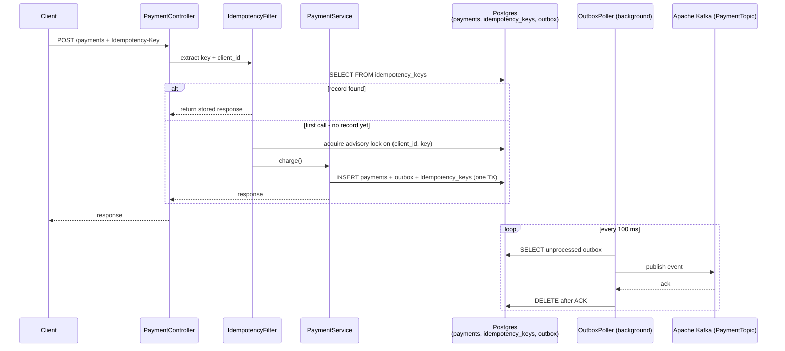

# Design: Idempotent Payment API (Spring Boot + Outbox Pattern)
> **"A post office that refuses to deliver the same letter twice."**
> Network retries are inevitable — mobile clients drop connections, load balancers time out,
> and deployments cause brief unavailability. Without idempotency, every retry risks a duplicate
> charge. An idempotency key is the client's contract: "this is my first attempt; any subsequent
> call with the same key is a retry, not a new payment."
>
> **Key insight:** Idempotency in a payment API is not a cache — it's a protocol contract.
> The first execution determines the canonical outcome; all subsequent executions with the same
> key return that outcome without re-executing business logic. The hardest part is ensuring
> the database write and the downstream event publication happen as a single atomic unit.

---

## Intuition

Think of idempotency as a post office that stamps every letter with a serial number before it
memorizes what it did with that number. The first time a stamped letter arrives, the post
office delivers it and writes down what happened. Every subsequent letter with the *same*
stamp is not delivered again — the post office just reads back what it already wrote down and
hands the sender that same receipt. The stamp is the client's promise ("this is attempt N of
one logical payment"), and the write-down is the server's promise back ("I will honor that,
even if you ask me five times because your phone lost signal"). Nothing about this requires
the post office to be fast; it requires the post office to never forget, and to never let two
letters with the same stamp both get delivered at once.

The mental model that resolves most of this design's hard questions: idempotency is a
concurrency problem wearing a caching costume. A naive read-then-write ("check if the key
exists, then charge") looks like a cache lookup, but two retries racing each other hit the gap
between the read and the write and both charge the card — that's a mutual-exclusion failure,
not a caching failure, and it needs a mutual-exclusion primitive (the advisory lock in §4.3),
not a faster cache. The second hard question — how to tell a downstream consumer about a
payment without a distributed transaction — is really the same shape one level out: the
database write and the Kafka publish must not be allowed to race each other into an
inconsistent pair, so the outbox pattern turns "publish an event" into "commit a row," which is
a problem the database already knows how to solve atomically.

One more thing worth holding onto while reading §4 onward: every "broken" example in this file
is not a contrived mistake — it is the code you get by implementing the *stated requirement*
literally and stopping one step short of the concurrency and failure-mode analysis. "Check for
an existing key, if none charge and save" is exactly what the requirements ask for in plain
English; it is also a double-charge bug under concurrent retries. The gap between
correct-sounding prose and a correct implementation is where the advisory lock, the outbox,
and the request-hash check in §4 all live.

---

## 1. Requirements Clarification

### Functional Requirements
- Process payment requests identified by a client-supplied idempotency key (UUID or string up to 64 chars).
- Return the same response (success or failure) for all retries with the same idempotency key, within a 24-hour window.
- On the first call with a new key: validate, charge the payment method, and publish a `PaymentProcessed` event.
- On retry with an existing key (same client ID + key): return the stored response without re-charging.
- On key collision (different client ID, same key): return a distinct error (`IDEMPOTENCY_KEY_CONFLICT`).
- Publish `PaymentProcessed` / `PaymentFailed` events to Kafka using the outbox pattern.

### Non-Functional Requirements
- **Exactly-once charge:** A payment must be executed at most once per idempotency key, even under concurrent retries.
- **Latency:** P99 < 200 ms for payment processing (excluding payment provider round-trip).
- **Availability:** 99.99%; continue accepting requests during brief outbox poller outages (Kafka optional on critical path).
- **Durability:** Idempotency records persist for 24 hours; payment records persist indefinitely.

### Out of Scope
- Payment provider integration (Stripe/Braintree API calls).
- Fraud detection.
- Currency conversion.

---

## 2. Scale Estimation

### Traffic
```
Peak payments:         10,000 req/min = 167 req/s
Retry rate:            20% of requests are retries (idempotency cache hits)
Net new payments:      134 req/s
Outbox events:         134 PaymentProcessed events/s
```

### Storage
```
Idempotency keys:  24-hour TTL; at 134/s × 86,400 s = 11,577,600 records/day
Record size:       ~500 bytes (key + client_id + response JSON + timestamps)
Daily storage:     11,577,600 × 500 = 5.8 GB (indexed by (client_id, key))
Partitioned:       drop partitions older than 25 hours; steady-state ~6 GB
Outbox table:      events older than 5 minutes deleted after ACK; < 50,000 rows at any time
```

### Database Load
```
New payment path:     1 idempotency INSERT + 1 payment INSERT + 1 outbox INSERT (same TX)
Retry path:           1 idempotency SELECT (no write)
Reads:    167 req/s × 1 SELECT = 167 reads/s (trivial; index on (client_id, idempotency_key))
Writes:   134 req/s × 3 INSERTs in one TX = 134 TX/s (lightweight for Postgres)
```

---

## 3. High-Level Architecture



### Component Inventory
| Component | Role |
|-----------|------|
| `IdempotencyFilter` | Checks existing keys; acquires advisory lock for concurrent requests |
| `PaymentService` | `@Transactional` method wrapping payment + outbox + idempotency writes |
| `IdempotencyRepository` | JPA repository for `idempotency_keys` table |
| `OutboxRepository` | JPA repository for `outbox` table |
| `OutboxPoller` | `@Scheduled` every 100 ms; publishes events to Kafka; deletes after ACK |
| `PaymentProviderClient` | HTTP client wrapping external payment API (Stripe/Braintree) |

---

## 4. Component Deep Dives

### 4.1 Idempotency Key Schema

```sql
CREATE TABLE idempotency_keys (
    client_id       VARCHAR(64)  NOT NULL,
    idempotency_key VARCHAR(64)  NOT NULL,
    status          VARCHAR(16)  NOT NULL,  -- IN_PROGRESS, COMPLETED, FAILED
    request_hash    VARCHAR(64)  NOT NULL,  -- SHA-256 of request body
    response_body   TEXT,                   -- stored JSON response (nullable until complete)
    http_status     INT,
    expires_at      TIMESTAMPTZ  NOT NULL DEFAULT NOW() + INTERVAL '24 hours',
    created_at      TIMESTAMPTZ  NOT NULL DEFAULT NOW(),
    PRIMARY KEY (client_id, idempotency_key)
);

CREATE INDEX idx_idempotency_expires ON idempotency_keys (expires_at);
```

### 4.2 Outbox Table Schema

```sql
CREATE TABLE outbox (
    id             BIGSERIAL    PRIMARY KEY,
    aggregate_type VARCHAR(64)  NOT NULL,   -- "Payment"
    aggregate_id   UUID         NOT NULL,   -- payment_id
    event_type     VARCHAR(64)  NOT NULL,   -- "PaymentProcessed"
    payload        JSONB        NOT NULL,
    created_at     TIMESTAMPTZ  NOT NULL DEFAULT NOW(),
    published      BOOLEAN      NOT NULL DEFAULT FALSE
);

CREATE INDEX idx_outbox_unpublished ON outbox (published, created_at) WHERE published = FALSE;
```

### 4.3 IdempotencyService

```java
@Service
@Transactional
public class IdempotencyService {

    private final IdempotencyRepository repo;
    private final EntityManager em;

    public Optional<IdempotencyRecord> findExisting(String clientId, String key) {
        return repo.findByClientIdAndIdempotencyKey(clientId, key);
    }

    public void acquireAdvisoryLock(String clientId, String key) {
        // PostgreSQL advisory lock: prevents two concurrent requests from both
        // proceeding to INSERT simultaneously. Lock is released at end of transaction.
        long lockId = (long) clientId.hashCode() << 32 | (key.hashCode() & 0xFFFFFFFFL);
        em.createNativeQuery("SELECT pg_advisory_xact_lock(:lockId)")
          .setParameter("lockId", lockId)
          .getSingleResult();
    }

    public IdempotencyRecord saveInProgress(String clientId, String key, String requestHash) {
        IdempotencyRecord record = IdempotencyRecord.builder()
            .clientId(clientId)
            .idempotencyKey(key)
            .status(IdempotencyStatus.IN_PROGRESS)
            .requestHash(requestHash)
            .expiresAt(Instant.now().plus(24, ChronoUnit.HOURS))
            .build();
        return repo.save(record);
    }

    public void markCompleted(IdempotencyRecord record, String responseBody, int httpStatus) {
        record.setStatus(IdempotencyStatus.COMPLETED);
        record.setResponseBody(responseBody);
        record.setHttpStatus(httpStatus);
        repo.save(record);
    }
}
```

### 4.4 Broken Pattern: Idempotency Check Outside the Transaction

```java
// BROKEN: check and insert are in separate transactions
public ResponseEntity<PaymentResponse> charge_broken(
        String idempotencyKey, PaymentRequest request) {

    // Transaction 1: check
    Optional<IdempotencyRecord> existing = idempotencyRepo.findByKey(idempotencyKey);
    if (existing.isPresent()) {
        return ResponseEntity.ok(existing.get().getStoredResponse());
    }

    // [Window of vulnerability: two concurrent requests BOTH pass the check above]

    // Transaction 2: insert + charge
    PaymentResponse response = paymentProvider.charge(request);
    idempotencyRepo.save(new IdempotencyRecord(idempotencyKey, response));
    return ResponseEntity.ok(response);
}
```

**Failure mode:** Two concurrent retries both pass the `findByKey` check (key not yet in DB),
both call `paymentProvider.charge()`, and both succeed — double charge.

**Fix:** Acquire a PostgreSQL advisory lock on `(clientId, key)` before the check. Only one
thread holds the lock at a time; the second waits, then finds the record on re-check.

### 4.5 PaymentService (Transactional Outbox)

```java
@Service
public class PaymentService {

    private final PaymentRepository paymentRepo;
    private final OutboxRepository outboxRepo;
    private final IdempotencyService idempotencyService;
    private final PaymentProviderClient providerClient;

    @Transactional
    public PaymentResponse charge(String clientId, String idempotencyKey,
                                  String requestHash, PaymentRequest request) {
        // Acquire advisory lock — ensures only one concurrent call proceeds per (clientId, key)
        idempotencyService.acquireAdvisoryLock(clientId, idempotencyKey);

        // Double-check after lock acquisition
        Optional<IdempotencyRecord> existing =
            idempotencyService.findExisting(clientId, idempotencyKey);
        if (existing.isPresent() && existing.get().getStatus() == IdempotencyStatus.COMPLETED) {
            return deserialize(existing.get().getResponseBody());
        }

        // Mark IN_PROGRESS. Note this row is invisible to other transactions until commit,
        // so within THIS design the advisory lock is what excludes the concurrent retry --
        // IN_PROGRESS only earns its keep if written in its own REQUIRES_NEW transaction,
        // which is exactly what creates the stale-record problem in §9 Pitfall 1.
        IdempotencyRecord inProgress =
            idempotencyService.saveInProgress(clientId, idempotencyKey, requestHash);

        // The provider call sits INSIDE the transaction, which means the DB connection and the
        // advisory lock are both held for the full external round trip. §8 Runbook 4 shows how
        // to hoist it out; keep it here only while provider latency is well under the lock
        // contention you can tolerate. Always pass a provider-side idempotency key too.
        PaymentResult result = providerClient.charge(request);

        // Write payment record
        Payment payment = paymentRepo.save(Payment.from(result, request));

        // Write outbox event (same transaction as payment INSERT)
        outboxRepo.save(OutboxEvent.builder()
            .aggregateType("Payment")
            .aggregateId(payment.getId())
            .eventType("PaymentProcessed")
            .payload(toJson(new PaymentProcessedEvent(payment.getId(), result.chargeId())))
            .build());

        // Mark idempotency record complete
        PaymentResponse response = PaymentResponse.from(payment);
        idempotencyService.markCompleted(inProgress, toJson(response), 200);

        return response;
        // All three INSERTs committed atomically
    }
}
```

### 4.6 OutboxPoller

```java
@Component
public class OutboxPoller {

    private final OutboxRepository outboxRepo;
    private final KafkaTemplate<String, String> kafkaTemplate;
    private static final int BATCH_SIZE = 100;

    @Scheduled(fixedDelay = 100)  // every 100 ms
    @Transactional
    public void pollAndPublish() {
        // findUnpublished MUST be "... ORDER BY created_at FOR UPDATE SKIP LOCKED LIMIT ?".
        // Without SKIP LOCKED every pod selects the same rows and publishes every event N
        // times; with it, each pod claims a disjoint batch and the others move on rather
        // than blocking behind the row locks.
        List<OutboxEvent> events = outboxRepo.findUnpublished(BATCH_SIZE);
        for (OutboxEvent event : events) {
            try {
                kafkaTemplate.send(
                    "payments." + event.getEventType().toLowerCase(),
                    event.getAggregateId().toString(),
                    event.getPayload()
                ).get(5, TimeUnit.SECONDS);         // CompletableFuture — block for broker ACK
                outboxRepo.delete(event);           // delete only after broker ACK
            } catch (Exception e) {
                log.error("Failed to publish outbox event id={}", event.getId(), e);
                // Do NOT delete — will be retried on next poll
            }
        }
    }
}
```

### 4.7 Request Body Mismatch Detection

```java
// Detect conflicting retries: same key, different request body
String incomingHash = sha256(objectMapper.writeValueAsBytes(request));
if (existing.isPresent()) {
    if (!existing.get().getRequestHash().equals(incomingHash)) {
        throw new IdempotencyConflictException(
            "Idempotency key reused with different request body");
    }
}
```

This prevents a client bug where the same key is accidentally reused for two different payments.

### 4.8 BROKEN/FIX — Session-Scoped Advisory Lock Leaks Across a Pooled Connection

```java
// BROKEN: pg_advisory_lock is SESSION-scoped, not transaction-scoped -- it is held
// until explicitly unlocked, not released at commit/rollback.
public void acquireAdvisoryLock_broken(String clientId, String key) {
    long lockId = deriveLockId(clientId, key);
    em.createNativeQuery("SELECT pg_advisory_lock(:lockId)")
      .setParameter("lockId", lockId)
      .getSingleResult();
    // ... charge, insert, commit ...
    // If an exception is thrown before an explicit pg_advisory_unlock(), OR if the
    // JPA transaction simply commits without ever calling unlock, the lock stays
    // held on the physical connection for as long as HikariCP keeps that connection
    // alive -- potentially hours, across dozens of unrelated future requests that
    // happen to be handed the same pooled connection.
}
```

**Failure mode:** HikariCP returns physical connections to the pool after each transaction;
`pg_advisory_lock` locks are tied to the *session* (the physical connection), not the
transaction. A connection that leaked a lock keeps holding it for every future borrower until
someone calls `pg_advisory_unlock` on that same session or the connection is physically closed.
Under load, this exhausts the effective lock namespace one connection at a time: eventually
every pooled connection is "poisoned" with a stale lock, and every new request for that
`(clientId, key)` — or any lock ID that happens to collide with a poisoned one — blocks
forever, indistinguishable from a hung database.

**Fix:** use `pg_advisory_xact_lock`, exactly as §4.3 does. It is released automatically at
transaction commit or rollback, tying the lock's lifetime to the unit of work instead of the
physical connection. There is no corresponding unlock call to forget, which is precisely why
it is the correct primitive here and not a stylistic preference.

```java
// FIX (same as §4.3): xact-scoped lock, released automatically at commit/rollback
em.createNativeQuery("SELECT pg_advisory_xact_lock(:lockId)")
  .setParameter("lockId", lockId)
  .getSingleResult();
// No unlock call needed -- and none is possible to forget.
```

### 4.9 Fail-Fast Lock Variant — Returning 409 Instead of Queuing

```java
@Service
public class IdempotencyService {
    // ... existing methods from §4.3 ...

    /**
     * Fail-fast variant of acquireAdvisoryLock (§4.3): returns immediately instead of
     * blocking. Used when a queued retry would rather see a fast 409 than wait out
     * another in-flight attempt's provider round trip -- see §9 Pitfall 6 and the
     * Q&A in §11 on retry-storm protection.
     */
    public boolean tryAcquireAdvisoryLock(String clientId, String key) {
        long lockId = deriveLockId(clientId, key);
        Boolean acquired = (Boolean) em.createNativeQuery(
                "SELECT pg_try_advisory_xact_lock(:lockId)")
            .setParameter("lockId", lockId)
            .getSingleResult();
        return Boolean.TRUE.equals(acquired);
    }
}
```

```java
// PaymentController: fail-fast path returns 409 instead of blocking the request thread
if (!idempotencyService.tryAcquireAdvisoryLock(clientId, idempotencyKey)) {
    return ResponseEntity.status(HttpStatus.CONFLICT)
        .body(new ErrorResponse("IDEMPOTENCY_KEY_IN_PROGRESS",
            "A request with this idempotency key is already being processed. Retry shortly."));
}
```

The trade-off against §4.5's blocking `pg_advisory_xact_lock`: fail-fast never lets one slow
request hold up another thread waiting on the same key, at the cost of pushing the retry
decision back to the client. For a mobile client with its own backoff logic, that is the
better trade; for a synchronous checkout flow where the caller has no retry loop of its own,
blocking briefly (bounded by the provider's timeout) is usually the friendlier default. Pick
per endpoint, not globally — this is exactly the choice Stripe and Shopify made differently in
§6, and both are defensible for their own client population.

---

## 5. Design Decisions & Tradeoffs

### Decision 1: PostgreSQL Advisory Locks vs Redis Distributed Lock (Redisson)

| Approach | Overhead | Requires | Lock scope |
|----------|----------|----------|-----------|
| `pg_advisory_xact_lock` (chosen) | ~0.1 ms | Same DB connection | Released at TX end |
| Redis SETNX (Redisson) | ~0.5 ms | Redis + retry logic | Manual release; TTL needed |
| DB unique constraint + upsert | ~0.2 ms | Nothing extra | Constraint enforced by DB |

**Decision:** Advisory lock within the same transaction. The payment already requires a DB
transaction; the advisory lock adds minimal overhead and is automatically released on commit
or rollback. No additional infrastructure needed.

### Decision 2: Outbox vs Direct Kafka Publish in @Transactional

Dual write (DB commit + Kafka publish in the same transaction) is not atomically possible without
XA/2PC, which is slow and not supported by modern Kafka clients. Options:
- **Direct publish inside @Transactional**: Kafka publish could succeed but DB rollback follows, or
  vice versa — guaranteed inconsistency.
- **Outbox pattern** (chosen): Write to outbox inside the DB transaction. A separate poller publishes
  outbox events to Kafka and deletes them after ACK. Kafka failure = events stay in outbox, retry on
  next poll. DB commit = event guaranteed to be published eventually.

### Decision 3: Soft-Delete vs Physical Delete of Idempotency Records

Soft-delete (`deleted_at` timestamp) allows audit queries but complicates the idempotency lookup
(must filter `deleted_at IS NULL`). Physical delete with a time-partitioned table is cleaner:
drop the partition after 25 hours. Spring Data JPA's `@Query` for lookup is simpler with physical delete.

### Decision 4: 24-Hour vs 7-Day Idempotency Window

Stripe documents that keys may be purged once at least 24 hours old, and this design matches it. A 7-day window increases storage 7× and creates
a larger attack surface for replay attacks with stale keys. 24 hours covers realistic retry patterns
(mobile apps retrying for hours) without excessive storage cost.

### Decision 5: Polling vs Change Data Capture (Debezium) for Outbox

| Approach | Latency | Complexity | DB load |
|----------|---------|------------|---------|
| `@Scheduled` polling (chosen) | ~100 ms | Low | 1 SELECT + N DELETEs per 100 ms |
| Debezium CDC (WAL-based) | < 10 ms | High (a Kafka Connect cluster to run and monitor) | Reads the WAL; no polling query at all |

**Decision:** Polling for payments (100 ms latency is acceptable; simpler ops). Debezium for
high-frequency events (> 1000 events/s) where polling lag is unacceptable.

---

## 6. Real-World Implementations

**Stripe:** the reference implementation of the client-facing contract. An `Idempotency-Key` header
on every mutating endpoint; keys removable after 24 hours, which is where this design's window comes
from. Two details are worth copying exactly. Stripe stores and compares the original *parameters*,
not just the key, and errors when a key returns with different ones — the `request_hash` check in
§4.7 is the same guard. And a second request that arrives while the first is still in flight gets a
**409 Conflict** rather than being queued behind it, which is a real alternative to this design's
advisory lock: reject the concurrent duplicate and let the client retry, instead of making it wait
out the provider round trip.

**Shopify — "Building Resilient GraphQL APIs Using Idempotency":** the closest published account of
the design in this file, and it differs in two instructive ways. First, Shopify made the idempotency
key a **first-class field in the GraphQL mutation** rather than an HTTP header, so it is validated by
the same schema machinery as every other argument and cannot be silently omitted by a client that
forgot the header. Second, and more interesting, their handler does not just replay a stored
response — it records which *steps* an attempt completed, and a retry runs recovery steps to rebuild
that state before continuing. That is the answer to the failure this design leaves open in §11: a
crash between the provider call and the commit. Like this design, they take a lock keyed on client
plus idempotency key, and reject a concurrent duplicate with a 409.

**Square:** the Payments API's `CreatePayment` endpoint requires an `idempotency_key` on every
call, documented behavior identical to this design's contract — retrying with the same key
returns the original result rather than creating a second payment. Square scopes the key
uniqueness per application credentials rather than per customer, a narrower and simpler scope
than this design's `(client_id, idempotency_key)` composite, workable because Square's clients
are merchants (few, well-identified) rather than end consumers (many, less trusted to generate
good keys) — the same reasoning behind this design's decision to validate UUID v4 format
(§9 Pitfall 3) rather than trust arbitrary client-supplied strings.

**Adyen:** identifies payments by a merchant-supplied `reference` in addition to an idempotency key,
which gives a second, business-level deduplication axis that survives the idempotency window — worth
having when reconciliation happens days later and the 24-hour keys are long gone.

---

## 7. Technologies & Tools

| Technology | Role | Notes |
|------------|------|-------|
| PostgreSQL | Payment + idempotency + outbox storage | Advisory locks, JSONB for outbox payload, partitioning for expiry |
| Spring Data JPA | `@Transactional` wrapping 3 INSERTs | `EntityManager.createNativeQuery` for advisory lock |
| Apache Kafka | Event bus for PaymentProcessed/Failed events | At-least-once from outbox poller; deduplicate at consumer |
| `spring-kafka` `KafkaTemplate` | Synchronous publish with ACK | `.get(5, SECONDS)` blocks poller thread until broker ACK |
| Micrometer | `payment.charge.duration`, `idempotency.cache.hit_rate` | Gauge on outbox table size for lag monitoring |
| Debezium (alternative) | CDC-based outbox relay | Lower latency than polling; higher operational complexity |

---

## 8. Operational Playbook

### Runbook 1: Duplicate Charge Detected

**Symptom:** Customer reports two charges for the same transaction. `payments` table has two rows
with same `(client_id, external_reference)`.

**Diagnosis:**
1. Query idempotency_keys for the customer's client_id and expected key: `SELECT * FROM idempotency_keys WHERE client_id = ? AND idempotency_key = ?`
2. If two records exist: advisory lock failed (race condition) or the client used two different keys.
3. If one record exists with `status=COMPLETED` but two payment rows: the outbox fired twice or
   the payment provider was called twice.

**Mitigation:** Issue a refund via payment provider API for the duplicate charge. Add compensation
record to `payments` table.

**Resolution:** Reproduce with a load test hitting the same idempotency key at high concurrency.
Verify advisory lock is being acquired (`pg_locks` during the test). Ensure `acquireAdvisoryLock()`
is called before the `findExisting()` check.

---

### Runbook 2: Outbox Backlog Growing — Kafka Unreachable

**Symptom:** `outbox` table size growing (> 10,000 unpublished rows); `OutboxPoller` logs
`Failed to publish outbox event` in a loop.

**Diagnosis:**
1. `kafka-topics.sh --describe --topic payments.paymentprocessed` — check broker availability.
2. Check Kafka connect: `kafka-broker-api-versions.sh --bootstrap-server <host>:9092`.

**Mitigation:** Payments continue to be accepted (outbox pattern decouples Kafka from the hot path).
Downstream consumers (notifications, analytics) are delayed but not blocked. Alert after 5 minutes
of Kafka unavailability; SLA for event delivery is best-effort (no hard SLA for Kafka consumers).

**Resolution:** Restore Kafka; outbox poller automatically drains the backlog. Verify event ordering
is preserved (outbox rows are polled in `created_at ASC` order).

---

### Runbook 3: Idempotency Key Collision — Client Bug

**Symptom:** `IdempotencyConflictException` spike in logs; clients receiving 409 errors.

**Diagnosis:**
1. Check which `client_id` is generating the collisions.
2. Compare `request_hash` of stored vs incoming: `SELECT request_hash FROM idempotency_keys WHERE client_id = ? AND idempotency_key = ?`.

**Resolution:** The client is generating non-random keys (e.g., using a constant UUID or a user-visible
order number). Require clients to use UUID v4 for idempotency keys; add documentation and SDK
code that generates the key per request, not per user.

---

### Runbook 4: Advisory Lock Causing P99 Latency Spike

**Symptom:** `payment.charge.duration` P99 increases from 100 ms to 800 ms under traffic spike.

**Diagnosis:**
1. `SELECT * FROM pg_locks WHERE locktype = 'advisory'` — count concurrent advisory locks.
2. `pg_stat_activity` — check sessions waiting on advisory lock.
3. Payment provider round-trip time: if provider response is 700 ms P99, the lock is held for 700 ms,
   queuing subsequent retries for the same key.

**Mitigation:** Separate the payment provider call from the DB transaction: call provider first
(with provider-side idempotency key), then begin transaction. This shortens the advisory lock hold time.

```java
// Optimized: call provider outside the transaction, then commit atomically
PaymentResult result = providerClient.charge(request);  // outside @Transactional
paymentService.recordAndPublish(clientId, idempotencyKey, requestHash, result);  // @Transactional
```

---

### Runbook 5: Rolling Back a Bad Deploy That Changed Lock or Outbox Behavior

**Symptom:** shortly after a deploy, `payment.charge.duration` P99 spikes, or
`idempotency.cache.hit_rate` drops to near zero (retries are no longer matching stored
records — a sign the lock-key derivation or the lookup query changed), or `outbox.lag` climbs
steadily instead of draining.

**Diagnosis:**
1. Confirm the deploy timestamp against the metric inflection point in the dashboard.
2. Diff the deployed commit against the previous release for changes touching
   `IdempotencyService`, `PaymentService.charge()`, or `OutboxPoller` — these three own every
   correctness guarantee in this design, so a regression almost always originates in one of
   them.
3. Check for in-flight `IN_PROGRESS` idempotency records created by the bad build — these are
   the records a rollback must not silently orphan (see §9 Pitfall 1's stale-timeout logic).

**Mitigation:** roll back to the previous artifact via the standard rolling/blue-green deploy
path. Because idempotency state lives in Postgres, not in application memory, a rolled-back
pod resumes serving retries correctly the instant it is healthy — there is no in-process cache
to warm or invalidate.

**Resolution:** after rollback, verify `payment.in_progress.stale_count` returns to zero within
the 5-minute stale window and `outbox.lag` resumes draining. File a postmortem action to add a
canary check on `idempotency.cache.hit_rate` and `outbox.lag` to the deploy pipeline, since both
metrics catch a correctness regression faster than an error-rate alert would.

### Rollback Procedure Summary

1. Confirm via metrics + code diff which of the three correctness-critical components
   regressed (advisory lock derivation, transaction boundaries, or outbox publish/delete
   ordering).
2. Roll back the application artifact; no data migration is needed since idempotency and
   outbox tables are additive-only during normal operation.
3. Verify `stale_timeout` reclaims any `IN_PROGRESS` records the bad build left behind rather
   than manually deleting them — manual deletion risks a race with a client retry that arrives
   mid-cleanup.
4. Resume monitoring `idempotency.cache.hit_rate`, `outbox.lag`, and `payment.charge.duration`
   P99 for 30 minutes before declaring the incident closed.

### Alert Thresholds Reference

| Metric | Threshold | Action |
|---|---|---|
| `idempotency.cache.hit_rate` | > 30% sustained 10 min | Investigate client retry storm; check for missing exponential backoff |
| `idempotency.cache.hit_rate` | drops to ~0% after a deploy | Roll back — lock/lookup logic likely regressed (Runbook 5) |
| `outbox.lag` | > 5,000 rows for > 5 min | Page on-call; check Kafka broker health (Runbook 2) |
| `payment.in_progress.stale_count` | > 0 | Page on-call; crash-recovery gap, verify stale-timeout job is running (§9 Pitfall 1) |
| `payment.charge.duration` P99 | > 500 ms | Check `pg_locks` for advisory-lock contention before assuming provider latency (Runbook 4) |
| `hikaricp.connections.pending` | > 0 for > 30 s | Pool exhaustion — check for a retry storm before resizing the pool (§9 Pitfall 6) |

---

## 9. Common Pitfalls & War Stories

**Pitfall 1: IN_PROGRESS Records Never Cleaned Up After Crash (fintech startup, 2021)**
The payment service crashed after writing `IN_PROGRESS` to `idempotency_keys` but before
committing the payment. On restart, those keys were stuck in `IN_PROGRESS`. Client retries returned
neither success nor failure — they hit the `IN_PROGRESS` guard and returned 409 for 24 hours.
Impact: $45K in delayed payments that required manual intervention. Fix: add a `stale_timeout`
check — if `status=IN_PROGRESS` and `created_at < NOW() - INTERVAL '5 minutes'`, treat as failed
and allow the retry to re-execute.

---

**Pitfall 2: Outbox Published But Idempotency Record Not Committed (payment platform, 2022)**
An exception between the payment INSERT and the idempotency INSERT caused the DB transaction to
roll back. However, the developer had accidentally called `kafkaTemplate.send()` inside the
`@Transactional` block, not from the outbox poller. Kafka published `PaymentProcessed` but
the payment row was rolled back — downstream services thought the payment succeeded but no
payment record existed. 37 fraudulent fulfillments before caught. Fix: never call Kafka directly
inside `@Transactional`; always use the outbox pattern.

---

**Pitfall 3: Client Reusing Keys Across Payment Attempts (e-commerce, 2023)**
A mobile app developer mistakenly used the user's session ID (unchanged across sessions) as the
idempotency key. After a failed payment, the customer tried a different card. The retry returned
the original failed payment result (same key → same stored response). The second charge attempt
was silently dropped. Fix: idempotency keys must be generated per-attempt, not per-session.
Added validation: reject keys that don't match UUID v4 format.

---

**Pitfall 4: Outbox Poller Deleted Events Before Consumer Acknowledged (message bus migration, 2022)**
The `OutboxPoller` called `outboxRepo.delete()` after `kafkaTemplate.send()` returned, but `send()`
hands back a `CompletableFuture<SendResult<K,V>>` that was never `.get()`-ed. The future completed asynchronously;
if the broker was slow, `delete()` ran before the message was durably written to Kafka.
On broker restart, 2,400 payment events were lost (deleted from outbox but not written to Kafka).
Impact: 2,400 unfulfilled orders. Fix: call `kafkaTemplate.send().get(5, SECONDS)` to block
until the broker ACKs before deleting the outbox row.

---

**Pitfall 5: Hash Collision in Advisory Lock Key Computation (load test finding, 2023)**
The advisory lock ID was computed as `clientId.hashCode() << 32 | key.hashCode()`. Java's
`String.hashCode()` is 32-bit, so within a single client only the key's 32 bits vary — two
different keys that hash alike share a lock and serialize unrelated payments. Do the birthday
arithmetic before deciding whether this matters: for 10,000 live keys under one client in a
2^32 space, the expected number of colliding pairs is `C(10000,2) / 2^32 = 0.012`, i.e. about a
1.2% chance that *any* two of them collide at all. It takes ~77,000 concurrent keys per client
to reach even odds. So this is a latency curiosity, not a correctness bug — a collision costs
one request a wait, never a double charge, because the lock is only ever too coarse and never
too fine. Fix if you care: derive the lock id from a 64-bit hash of the concatenated pair
(`Hashing.murmur3_128().hashString(clientId + '\0' + key).asLong()`), which pushes even odds out
past five billion keys.

---

**Pitfall 6: Advisory Lock Contention During a Flash Sale (retailer, 2023)**
A promotional flash sale drove a 40x spike in retry traffic from a mobile client with an
aggressive backoff-free retry loop — the same idempotency key resubmitted every 200 ms while
the first attempt was still waiting on a slow payment provider (provider P99 hit 1.4s under its
own load spike). Each retry blocked on the advisory lock rather than failing fast, so requests
queued behind the lock instead of behind the provider, and the connection pool filled with
threads waiting on `pg_advisory_xact_lock` rather than doing useful work. HikariCP timed out
borrowers pool-wide, and unrelated payments (different clients, different keys) started failing
with connection-acquisition timeouts even though their own keys had no contention at all.
**Impact:** 11 minutes of degraded checkout availability (elevated 5xx rate) across all
merchants on the platform, not just the one running the flash sale, until the misbehaving
client's traffic was rate-limited at the edge. **Fix:** two changes, not one — first, the
fail-fast `pg_try_advisory_xact_lock` variant from §4.9 instead of the blocking lock, returning
409 immediately to a retry that would otherwise queue (matching Stripe's documented behavior in
§6); second, a per-client rate limit ahead of the payment endpoint so one client's retry storm
cannot exhaust the shared connection pool that every other client depends on.

---

## 10. Capacity Planning

### Database Sizing

```
Write throughput:
  New payments:       134 TX/s × 3 INSERTs = 402 row writes/s
  Idempotency lookup: 167 SELECT/s (EVERY request does one; 33/s of them are hits)
  Outbox deletes:     134 DELETE/s
  Total:              ~703 ops/s (comfortable on a gp3 volume's 3,000 IOPS baseline)

Storage growth:
  Idempotency table:  134 rows/s × 86,400 s × 500 bytes = 5.8 GB/day (partitioned; drop after 25h)
  Payments table:     134 rows/s × 86,400 s × 200 bytes = 2.3 GB/day (retained indefinitely)
  Outbox table:       ~50,000 rows maximum × 1 KB = 50 MB steady-state
```

### Kafka Sizing
```
Events per second:   134 PaymentProcessed/s
Message size:        ~2 KB
Throughput:          134 × 2 KB = 268 KB/s (trivial for Kafka; single partition is fine initially)
Retention:           7 days × 134 × 2 KB × 86,400 = 162 GB (single partition; replicate 3×)
```

### HikariCP pool sizing formula

```
Concurrent in-flight requests at peak: 167 req/s x avg hold time
  Avg hold time per request (advisory-lock path, §8 Runbook 4 baseline): ~120 ms
  -> 167 x 0.12 = ~20 connections held concurrently at steady state

Pool formula (same shape as the batch pipeline's, applied to a web tier):
  required = concurrent_holders + retry_headroom + metadata_overhead
           = 20 + 8 (absorb short provider-latency spikes without pool exhaustion)
           = 28 -> round up to hikari.maximum-pool-size: 30

Undersized pool risk (this file's version of the batch job's connection-starvation trap):
  if pool < concurrent_holders, requests queue for a CONNECTION before they even
  reach the advisory-lock line, and the P99 spike in Runbook 4 is misdiagnosed as
  lock contention when it is actually connection-pool contention -- check
  hikaricp.connections.pending BEFORE pg_locks when P99 spikes.
```

### Traffic growth projection (Black Friday / flash-sale scaling)

```
Baseline peak:          167 req/s  (§2)
5x flash-sale peak:     835 req/s  -> 835 x 0.12s hold = ~100 concurrent holders
  -> HikariCP pool must scale to ~130 for the SAME latency profile; if it doesn't,
     Pitfall 6 (§9) is what happens: contention masquerades as an outage.
10x Black-Friday peak:  1,670 req/s -> at this point vertical pool scaling stops
  working (Postgres itself has a practical connection ceiling well under 1,000
  without a pooler in front of it) -- this is the threshold where sharding by
  client_id (§11 Q&A) stops being optional.
```

### When to shard (capacity trigger)

```
Single Postgres instance connection ceiling (practical, with pgbouncer in front): ~500
Required connections at 10x peak (above):                                        ~260-300
  -> still under the ceiling, but with zero headroom for a second traffic spike
     layered on top (a second promotion, a provider slowdown extending hold time).
Sharding trigger: shard by client_id % N BEFORE required connections cross 60% of
  the practical ceiling, not after -- migrating a hot idempotency table under live
  traffic is the operation this threshold exists to avoid needing urgently.
```

---

## 11. Interview Discussion Points

**Q: What is the outbox pattern and why does it solve the dual-write problem?**
The outbox pattern inserts an event record into an `outbox` table within the same database
transaction as the business state change. A separate poller reads unpublished outbox rows and
publishes them to Kafka, deleting them only after the broker ACKs. The atomic DB commit ensures
the event exists if and only if the state change succeeded — no separate Kafka transaction needed.
The trade-off is eventual consistency: the event reaches consumers 100–500 ms after the DB commit,
not synchronously. Use when message order and at-least-once delivery matter; add consumer-side
deduplication for exactly-once semantics.

**Q: Why is the advisory lock acquired before the idempotency key lookup, not after?**
The advisory lock + re-check pattern is a double-check with mutual exclusion. Without the lock,
two concurrent requests both pass the initial `findExisting` check (key not found), both proceed
to charge the payment provider, and both insert — causing a duplicate charge. The advisory lock
ensures that only one thread can proceed past the check. The second thread waits for the lock,
re-checks, and finds the COMPLETED record — COMPLETED specifically, because the first thread's
IN_PROGRESS write was never visible to it: an uncommitted row is invisible under any isolation
level, and by the time the lock is released that same transaction has already committed the
terminal status. The second thread returns the stored response.
This is the distributed equivalent of DCL (double-checked locking) with the advisory lock as
the synchronization primitive.

**Q: What happens to in-flight payments if the service crashes between the payment provider call and the DB commit?**
The payment provider has charged the card (the charge succeeded externally), but the DB transaction
never committed — so there's no `payment` row and no `idempotency_keys` record. On the client's
next retry, the idempotency key is not found (no committed record), the service calls the payment
provider again, and (if the provider is idempotent by provider-side reference) the second call
may return the same charge ID. If the provider is NOT idempotent, there is a second charge.
Mitigation: always pass a stable provider-side idempotency key (e.g., `"pmt-" + clientId + "-" + idempotencyKey`)
to Stripe/Braintree so the provider deduplicates at their level.

**Q: How would you implement exactly-once semantics end-to-end (charge + event delivery)?**
Exactly-once end-to-end requires: (a) idempotent charge at the provider level (provider-side
idempotency key), (b) atomic write of payment + outbox in one DB transaction, (c) Kafka producer
EOS transactions (idempotent producer + transactional API), and (d) idempotent consumer
(deduplicate at consumer side using payment ID as deduplication key). Even with all four, the
consumer must be able to handle replays from Kafka. Full exactly-once is a contract across all
four layers, not a single mechanism.

**Q: What is the 24-hour idempotency window and what happens when a client retries after the window expires?**
After 24 hours, the idempotency record is deleted (partition drop or TTL expiry). A retry with
the same key is treated as a new payment — the idempotency guard doesn't match an existing record.
This is intentional: a retry 24 hours later is almost certainly not a network retry but a
human re-attempt. The client should generate a new idempotency key for genuinely new payment
attempts. If a 72-hour window is needed (e.g., batch reconciliation), increase the TTL and
partition rotation accordingly.

**Q: How does request body hashing protect against idempotency key reuse across different payments?**
The `request_hash` (SHA-256 of the canonical request body) stored with the idempotency record
is compared against the incoming request body hash. If they differ (same key, different amount or
recipient), the service returns HTTP 409 with a `IDEMPOTENCY_KEY_CONFLICT` error. This catches
client bugs where the same key is mistakenly used for two distinct operations. Without this check,
the second payment silently returns the first payment's result — a correctness hazard.

**Q: How would you scale the idempotency key storage beyond a single Postgres instance?**
Partition the `idempotency_keys` table by `client_id % N` (horizontal sharding) across N Postgres
instances. Route each request to the correct shard deterministically by `client_id`. Advisory
locks only need to be cross-pod within the same shard (same DB). Alternatively, use Redis with
a `SETNX` lock: `SET rl:{clientId}:{key} IN_PROGRESS NX EX 86400`. The first caller wins the
SETNX; retries read the stored value. Redis TTL replaces table partitions. Downside: Redis data
loss on restart requires Redis persistence (`AOF+fsync`) or Redis Cluster with replicas.

**Q: What monitoring metrics are essential for an idempotency + outbox system?**
Critical metrics: (a) `idempotency.cache.hit_rate` — percentage of requests that are retries
(should be < 30%; high rate indicates client retry storm); (b) `outbox.lag` — count of unpublished
outbox rows (should be < 1,000 at steady state; spike indicates Kafka issue); (c) `payment.in_progress.stale_count` — count of IN_PROGRESS records older than 5 minutes (should be 0; non-zero
indicates crash-recovery gap); (d) `payment.provider.latency.p99` — controls advisory lock hold
time. Alert if outbox lag > 5,000 rows for > 5 minutes.

**Q: What is the difference between provider-side idempotency (Stripe idempotency key) and API-side idempotency (your own idempotency_keys table), and do you need both?**

A: Provider-side idempotency (Stripe's `Idempotency-Key` header) prevents double-charging at the payment processor level — if your service crashes after calling Stripe but before committing to your DB, the retry sends the same header and Stripe returns the original charge ID without re-charging. API-side idempotency (your `idempotency_keys` table) prevents calling the payment provider at all on retries that arrive after a successful commit — protecting against double-charging when the provider call succeeded and your DB commit also succeeded. You need both: Stripe idempotency covers the crash-after-provider-call gap; your table covers the crash-after-commit gap and the "same client key, different network path" case.

**Q: How would you test concurrent duplicate payment submissions in a Spring integration test?**

A: Use `Testcontainers` with `PostgreSQLContainer` (real advisory lock) and fire two `CompletableFuture.runAsync()` calls with the same idempotency key simultaneously. Assert that exactly one `payment` row exists in the database after both complete, and that the second call returned the same response body as the first. This is the only reliable way to verify the advisory lock works — mocking the database would not test the actual lock acquisition. Use `@Transactional(propagation=NOT_SUPPORTED)` on the test method to avoid wrapping both threads in the same outer transaction, which would defeat the lock test.

**Q: Why is the advisory lock acquired inside the same database transaction as the check, instead of as a separate distributed lock (Redis, Zookeeper)?**

A: Locking inside the same transaction ties the lock's lifetime to the unit of work automatically — `pg_advisory_xact_lock` releases at commit or rollback with no separate release call, no TTL to tune, and no risk of a lock outliving its holder because a process crashed before calling unlock (see §4.8's broken/fixed pair, where using the session-scoped `pg_advisory_lock` instead reproduces exactly that failure). A separate system like Redis adds a second point of failure and requires its own consistency story — what happens if Redis is unavailable but Postgres is fine, or if the lock expires via TTL while the transaction is still legitimately in progress. Since the payment already requires a Postgres transaction, reusing that transaction's boundary for the lock is strictly less machinery, not just a cheaper one.

**Q: How do you stop a burst of retries for the same idempotency key from queuing behind the advisory lock and degrading the whole service, as in §9 Pitfall 6?**

A: Fail fast instead of blocking. `pg_advisory_xact_lock` blocks the caller until the lock is free; the fail-fast alternative is `pg_try_advisory_xact_lock` (§4.9), which returns immediately with a boolean instead of waiting. A request that cannot acquire the lock returns 409 (matching Stripe's documented behavior in §6) rather than occupying a connection and a thread for the duration of another request's provider round trip. Combine this with a per-client rate limit ahead of the payment endpoint, since the fail-fast lock protects the connection pool from one client's retry storm but does nothing to stop the client from generating the storm in the first place.

**Q: Under what isolation level does the "double-check after lock acquisition" in §4.5 actually need to run, and would READ COMMITTED break it?**

A: READ COMMITTED (Postgres's default) is sufficient, not because the isolation level does the work but because the advisory lock does. Once the second thread holds the lock, it re-reads `idempotency_keys` and sees whatever the first thread committed, because a `SELECT` under READ COMMITTED always sees the latest committed data at the moment it runs — the lock is what serializes the two threads so that "latest committed" is unambiguous. A higher isolation level like REPEATABLE READ would change nothing here since there is no long-lived read snapshot being reused across the lock wait; it would only add cost (higher serialization-failure rate) for no correctness benefit specific to this flow.

**Q: How would you evolve the `idempotency_keys` table's schema (e.g., add a column) without downtime, given it takes a write on every new payment?**

A: Postgres can add a nullable column or one with a constant default without rewriting the table (`ADD COLUMN ... DEFAULT NULL` is metadata-only since Postgres 11), so that half is safe at full traffic. What actually risks downtime is adding a `NOT NULL` constraint or a new index on a hot table — both take a lock that can queue behind in-flight writes. The safe sequence: add the column nullable, backfill it in batches with `WHERE column IS NULL LIMIT n` (never a single unbounded `UPDATE`), then add the `NOT NULL` constraint with `NOT VALID` followed by `VALIDATE CONSTRAINT` (Postgres validates without holding the write-blocking lock for the whole scan). Building the index with `CREATE INDEX CONCURRENTLY` follows the same principle — slower, but it never blocks the writes this table depends on for correctness.

**Q: This design uses a stale-timeout (5 minutes) to reclaim orphaned IN_PROGRESS records after a crash (§9 Pitfall 1). What's the risk of setting that timeout too short, and how would you choose it?**

A: Too short, and a legitimately slow-but-still-running request (a provider call stuck at 4 minutes during a provider-side incident) gets reclaimed while it is still in flight — a second attempt then races the first, exactly the double-charge scenario the lock was built to prevent, except now triggered by the reclaim logic itself rather than by client retries. The timeout must be set safely above the provider's worst realistic P99.9 latency, with margin — if the provider's documented timeout is 30 seconds, a 5-minute stale window has roughly 10x headroom, which is the right side to err on, since the cost of a slow reclaim is a delayed retry (annoying) while the cost of a fast reclaim is a duplicate charge (expensive, and the exact failure this whole design exists to prevent).

---

## Cross-Cutting References

- [Zero-Downtime Deploys and Config](cross_cutting/zero_downtime_deploys_and_config.md) — rolling deploys without leaving orphaned IN_PROGRESS idempotency records; `spring.lifecycle.timeout-per-shutdown-phase=30s` allows in-flight transactions to commit.
- [OTel Observability for Spring](cross_cutting/otel_observability_for_spring.md) — distributed trace spanning payment controller, PaymentService, and OutboxPoller; `@Observed` on `charge()` for latency metrics.
- [Testcontainers and Test Strategy](cross_cutting/testcontainers_and_test_strategy.md) — integration tests with `PostgreSQLContainer` + `KafkaContainer` verifying exactly-once outbox delivery and idempotency under concurrent retries.
- [Resilience4j Patterns](cross_cutting/resilience4j_patterns.md) — circuit breaker wrapping payment provider call; prevents cascade failure if Stripe/Braintree is slow.
