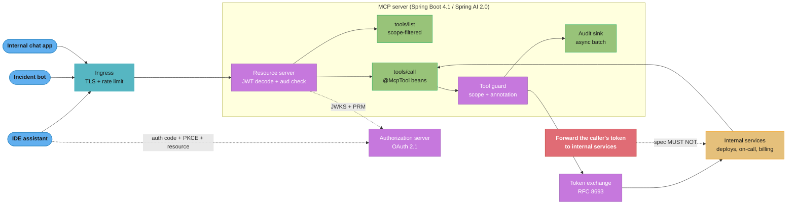
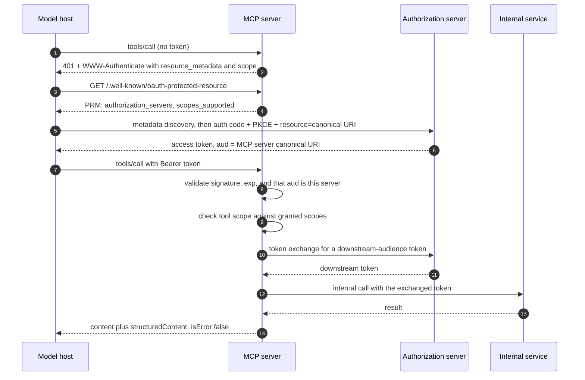

# Design: Internal MCP Tool Platform (Spring AI 2.0)

> **"A tool catalogue is an API whose only client is a language model — and the model reads
> the whole menu before it orders."**
> An MCP server turns ordinary Spring beans into capabilities any model host can call. The
> hard part is not the annotations; it is that the catalogue itself is prompt text, the
> caller is a model that can be talked into things, and the token it presents was minted for
> *you* and must not be forwarded anywhere else.
>
> **Key insight:** every decision here follows from two facts — **tool schemas cost context**
> (340 tools at ~250 tokens each is ~85,000 tokens spent before the user's question is read),
> and **an MCP server is an OAuth 2.1 resource server** sitting between an
> attacker-influenced model and your real internal APIs.

---

## Intuition

Think of the platform as a **restaurant pass**, not an API gateway. A gateway routes a
request that somebody already decided to make. A pass hands a menu to someone who has not
decided yet, and everything they order comes from what the menu said. That inverts the usual
cost model: in a REST API the *response* is expensive and the docs are free, because the docs
live on a wiki nobody's runtime reads. In MCP the **menu is the expensive part**, because
every tool's name, description and JSON Schema is serialized into the model's context on
every session, whether or not it gets used.

The one-line mental model: **`tools/list` is a prompt, and `tools/call` is an RPC.** Treat
the first as a context-budget problem and the second as an authorization problem, and the
whole design falls out. Filtering `tools/list` by the caller's granted scopes is not a nice
security touch — it is simultaneously the cheapest context optimisation you have and the
correct access-control boundary, which is a pleasant coincidence you should lean on hard.

The recurring interview trap is treating MCP as "REST with a different envelope." Four things
make it not that. The **catalogue is model-visible**, so its size is a latency and cost line
item. The **caller is persuadable**: a document your `@McpResource` returns is untrusted text
that lands in the model's context looking exactly like instructions from you. The **token
boundary is sharp** (§4.5). And there is **no protocol-level session**, so anything stateful
has to be an explicit, authorized, expiring handle — designs that assume a session work
perfectly against one pod (§4.7).

---

## 1. Requirements Clarification

### Functional Requirements

1. **Expose existing internal services as MCP tools** without rewriting them — deploy status,
   on-call rota, incident timeline, customer lookup, refund issuance, feature-flag toggles.
2. **One endpoint, many hosts.** An IDE assistant, an incident-response bot and an internal
   chat app all speak to the same server over Streamable HTTP.
3. **Per-user authorization.** A tool call runs as the human behind the model host, not a
   platform service account: an engineer who cannot issue refunds in the web app cannot issue
   one through a model either.
4. **Scope-filtered discovery.** `tools/list` returns only what the caller's granted scopes
   permit, so the catalogue a host sees is the one that user can actually use.
5. **Progressive disclosure.** With hundreds of tools registered, the client must be able to
   search the catalogue rather than load all of it.
6. **Read-only resources and reusable prompts** alongside tools — runbooks as `@McpResource`,
   incident-summary templates as `@McpPrompt`.
7. **Full audit trail.** Who, what, which arguments, from which host, and what came back.

### Non-Functional Requirements

| Requirement | Target | Why |
|---|---|---|
| `tools/call` P99 | < 400 ms excluding the downstream call it wraps | The model is blocked; the user is watching a spinner |
| `tools/list` P99 | < 80 ms | Runs on every session start on every host |
| Availability | 99.9% | Degraded to "the assistant cannot see your tools", not data loss |
| Token audience validation | 100% of requests, fail closed | Spec `MUST`; the whole trust model rests on it |
| Catalogue context cost | < 6,000 tokens for a default session | Leaves the context budget to the actual conversation |
| Audit retention | 400 days, tamper-evident | Refunds and flag toggles are financially material |
| Blast radius of a compromised host | One user's granted scopes | No service-account tokens anywhere in the path |

### Out of Scope

- **Building the model host.** We serve MCP; we do not ship the IDE plugin or the chat client.
- **Running an authorization server.** The company already runs one; see
  [OAuth2 Authorization Server](design_oauth2_authorization_server.md) for that design.
- **stdio transport.** Every consumer here is network-reachable. stdio is covered only as the
  contrast case in §5.
- **Model hosting and inference.** The platform never calls an LLM; it is called *by* hosts
  that do. Model-side concerns live in [`llm/`](../../llm/README.md), and the client-side
  `@McpSampling` / `@McpElicitation` callbacks are named in §7 but not designed here.

### Clarifying Questions Worth Asking Out Loud

- *"Does the tool list vary per user, or is it the same for everyone?"* The spec's answer —
  never per-connection, but **MAY** vary by the authorization presented — is the licence for
  scope-filtered discovery (§4.3), and worth quoting because interviewers expect candidates
  to assume the catalogue is static.
- *"Who is liable when the model calls `issue_refund` incorrectly?"* This decides whether
  destructive tools exist at all, or whether every mutation returns a proposal the human
  confirms out-of-band.
- *"What is the model host's context budget?"* Sets the catalogue ceiling in §10.

---

## 2. Scale Estimation

### Traffic

```
Engineers with a model host configured        900
Sessions per engineer per working day           6   (IDE restarts, new chats, bot threads)
  -> tools/list requests/day                5,400
  -> peak tools/list (3x average over 8h)    ~0.6 rps
Tool calls per session (median 3, p95 40)      ~5 average
  -> tools/call requests/day               27,000
  -> peak tools/call (5x burst)             ~4.7 rps sustained, ~25 rps spikes
Incident-bot storms: one Sev-1 fans out to
  ~12 concurrent threads x 30 calls/min        ~6 rps added, bursty
```

Peak design point: **40 rps of `tools/call`** and **5 rps of `tools/list`** — small, and
*supposed* to be. The scale problem here is not requests per second; it is **tokens per
catalogue** and **fan-out per tool call**, because each `tools/call` becomes one or more calls
into internal services sized for human traffic.

### The Real Scale Number: Catalogue Tokens

```
Tools registered across the estate                        340
Median serialized tool definition (name+title+
  description+inputSchema, JSON, no whitespace)      ~1,000 bytes  ~= 250 tokens
Unfiltered catalogue                        340 x 250  = 85,000 tokens

After scope filtering (median engineer holds 9 of 41 scopes)
                                             ~62 tools = 15,500 tokens
After progressive disclosure (search tool + 8 pinned)
                                              ~9 tools =  2,250 tokens
```

**85,000 tokens is the whole design problem in one number.** On most hosts it does not fit
alongside a working conversation. Scope filtering removes 82% of it for free, because it is
access control you owed anyway; progressive disclosure removes another 85% of what is left.

### Storage

```
Audit record per tool call (who, tool, args hash, args JSON,
  result size, latency, host, trace id)              ~1.4 KB
27,000 calls/day x 1.4 KB                            ~38 MB/day
400-day retention                                    ~15 GB    (trivial; keep it in Postgres)
  Args JSON can carry customer ids -> encrypted column, not plain JSONB.

Tool-catalogue metadata (definitions, scope map, owning team, annotations)
                                              340 rows, < 2 MB   (in-memory, rebuilt on deploy)
```

### Pod Sizing

| Component | Replicas | CPU req/limit | Memory | Note |
|---|---|---|---|---|
| MCP server (WebMVC, virtual threads) | 3 | 500m / 2 | 1 Gi | Stateless; `STATELESS` protocol mode |
| Audit writer (async, batched) | 2 | 200m / 1 | 512 Mi | Drains an in-process queue to Postgres |
| Postgres (audit + catalogue) | 1 primary + 1 replica | — | 8 Gi | Existing cluster, new schema |

Three replicas is availability, not throughput: 40 rps of I/O-bound work on virtual threads
fits comfortably in one pod (§10).

---

## 3. High-Level Architecture



The one edge drawn in red is the one everybody draws first. Forwarding the inbound token to an
internal service is the confused-deputy vulnerability the specification forbids by name
(§4.5); the exchange step is not optional plumbing, it is the whole reason the boundary
exists.

### Data Flow: An Authorized Tool Call



Note the two distinct tokens. The token in step 7 is for the MCP server and travels no
further; the one in step 10 has a different audience and is obtained on the strength of the
first — the specification's "separate token, issued by the upstream authorization server."

---

## 4. Component Deep Dives

### 4.1 An MCP Server Built From Beans You Already Have

Spring AI 2.0 merged MCP into the core project: the annotations live in
`org.springframework.ai.mcp.annotation` and a scanner picks them up from any Spring bean.
Nothing about the underlying service changes.

```xml
<!-- Streamable HTTP over the servlet stack -->
<dependency>
    <groupId>org.springframework.ai</groupId>
    <artifactId>spring-ai-starter-mcp-server-webmvc</artifactId>
</dependency>
```

```yaml
spring:
  ai:
    mcp:
      server:
        name: platform-tools
        type: SYNC              # SYNC (McpSyncServer, default) or ASYNC (McpAsyncServer)
        protocol: STATELESS     # STREAMABLE | STATELESS | SSE (deprecated since 2.0.0)
```

```java
@Service
class DeploymentTools {

    private final DeploymentClient deployments;   // the SAME client the web UI uses

    DeploymentTools(DeploymentClient deployments) {
        this.deployments = deployments;
    }

    @McpTool(
        name = "get_deploy_status",
        description = """
            Current deployment status for one service: the running version, when it \
            was deployed, and whether a rollout is in progress. Read-only.""")
    DeployStatus getDeployStatus(
            @McpToolParam(description = "Service name, e.g. 'billing-api'", required = true)
            String service) {
        return deployments.status(service);
    }
}
```

Three things are load-bearing and easy to get wrong.

**The description is prompt text, not Javadoc.** It is the only thing the model reads when
deciding whether this tool answers the question; "Gets deploy status" loses to the version
above every time, and the difference shows up as wrong-tool selection, not as an error.

**Return a record, not a `String`.** Spring AI generates the `outputSchema` from the return type
and populates `structuredContent`, which the spec pairs with a `MUST`. A `String` return throws
that away and forces the model to re-parse prose on every follow-up (§9, war story 4).

**Tool-name uniqueness is server-scoped only.** Names are 1-128 characters and case-sensitive,
but clients aggregating several servers "**MAY** encounter naming collisions (for example, two
servers each exposing a `search` tool)", and `serverInfo.name` is "not guaranteed to be unique
across servers." Prefix deliberately.

### 4.2 Transport Choice: Why `STATELESS`

`spring.ai.mcp.server.protocol` takes `STREAMABLE`, `STATELESS` or `SSE`, and
`spring.ai.mcp.server.stdio=true` selects the local-subprocess transport instead.

| Mode | What it gives you | Cost |
|---|---|---|
| `STATELESS` | Plain request/response over HTTP; any pod answers any request | No server-initiated notifications |
| `STREAMABLE` | Streamable HTTP with an optional SSE channel back to the client | Per-connection affinity for the stream |
| `SSE` | Compatibility with pre-Streamable hosts | **Deprecated since Spring AI 2.0.0**; the security module does not support it on the server side |
| stdio | A local tool the host spawns as a child process | No network surface, and no authorization story — credentials come from the environment |

We pick `STATELESS`. The design has no server-pushed notifications, and statelessness is what
lets three replicas sit behind a plain round-robin ingress with no sticky sessions. If you
later need `notifications/tools/list_changed`, you move to `STREAMABLE` and accept that a
client holds an open stream to one pod — a real availability change, since a rolling deploy
now drops every open stream.

The `SSE` row is the one to say out loud in an interview. It is **deprecated, not removed** —
a Boot 4.1 service with `protocol: SSE` still starts and still serves, which is precisely why
it survives in estates until the security module turns out not to support it (§9).

### 4.3 Broken → Fixed: The Unbounded Tool Catalogue

**Broken.** Every team registers its tools on the shared server. Six months in, 26 teams have
contributed 340 `@McpTool` methods, all visible to every caller, and `tools/list` returns all
340 definitions on every session start.

The symptom is not an error. It is that the assistant gets *worse* — it picks
`restart_canary` when the user asked about a rollback, because 340 descriptions arrived as
one undifferentiated wall and the relevant one was 200 tools down. Measured on this platform:
**85,000 tokens of catalogue**, `tools/list` P99 at **310 ms** because every response
serialized 340 schemas, and wrong-tool selection on **19%** of multi-step tasks.

**Fix, part one — filter discovery by the caller's scopes**, which the spec permits: the tool
set "**MAY** vary by the authorization presented on the request, since credentials are
per-request input, not connection state."

```java
@Component
class ScopeFilteredToolFilter implements McpServerFeatures.ToolFilter {

    private final ToolScopeRegistry scopes;   // tool name -> required scope

    @Override
    public boolean test(McpTransportContext ctx, McpSchema.Tool tool) {
        String required = scopes.requiredScope(tool.name());
        return required == null || grantedScopes().contains(required);
    }

    private Collection<String> grantedScopes() {
        Authentication auth = SecurityContextHolder.getContext().getAuthentication();
        if (auth == null) {
            return List.of();          // fail closed: no auth, no tools
        }
        return auth.getAuthorities().stream().map(GrantedAuthority::getAuthority)
                .filter(a -> a.startsWith("SCOPE_")).map(a -> a.substring(6)).toList();
    }
}
```

`return List.of()` on a null `Authentication` is the whole safety property. The natural mistake
— returning every tool when authentication is absent so "the anonymous case still works" —
publishes the full catalogue to any unauthenticated caller.

**Fix, part two — progressive disclosure.** Spring AI 2.0's `ToolSearchToolCallingAdvisor`
does this client-side: the model gets a search tool plus a small pinned set and pulls
definitions in as it needs them.

```java
@Bean
ChatClient assistantClient(ChatClient.Builder builder, ToolCallbackProvider mcpTools) {
    return builder
            .defaultAdvisors(new ToolSearchToolCallingAdvisor(mcpTools))
            .build();
}
```

**Result.** 340 tools → ~62 after scope filtering → ~9 loaded per session. Catalogue cost
**85,000 → ~2,250 tokens (-97%)**, `tools/list` P99 **310 → 24 ms**, wrong-tool selection
**19% → 4%**. The deterministic-ordering rule matters here too: servers "**SHOULD** return
tools in a deterministic order," which lets clients cache the list and "improves LLM prompt
cache hit rates when tools are included in model context." Sorting by name is one line.

### 4.4 Authorization: The Server Is an OAuth 2.1 Resource Server

MCP's authorization specification is an OAuth 2.1 profile, and it puts four `MUST`s on a
server operator:

1. **Implement RFC 9728 Protected Resource Metadata** "to indicate the locations of
   authorization servers", with an `authorization_servers` field naming at least one.
2. **Answer an unauthenticated request with a `WWW-Authenticate` challenge** carrying the
   metadata URL, and **SHOULD** include a `scope` parameter so the client knows what to ask for.
3. **Validate the audience.** Servers "**MUST** validate that access tokens were issued
   specifically for them as the intended audience", per RFC 8707.
4. **Never transit somebody else's token.** "MCP servers **MUST NOT** accept or transit any
   other tokens."

```java
@Configuration
@EnableWebSecurity
class McpSecurityConfig {

    @Value("${mcp.canonical-uri}")            // e.g. https://mcp.internal.example.com/mcp
    private String canonicalUri;

    @Bean
    SecurityFilterChain mcpChain(HttpSecurity http, JwtDecoder decoder) throws Exception {
        http
            .securityMatcher("/mcp/**")
            .authorizeHttpRequests(a -> a.anyRequest().authenticated())
            .csrf(csrf -> csrf.disable())      // no browser, no cookies, bearer only
            .sessionManagement(s -> s.sessionCreationPolicy(SessionCreationPolicy.STATELESS))
            .oauth2ResourceServer(o -> o
                .jwt(jwt -> jwt.decoder(decoder))
                .authenticationEntryPoint(this::challenge));
        return http.build();
    }

    /** The 401 that bootstraps the whole discovery flow. */
    private void challenge(HttpServletRequest req, HttpServletResponse res,
                           AuthenticationException ex) throws IOException {
        res.setStatus(HttpStatus.UNAUTHORIZED.value());
        res.setHeader(HttpHeaders.WWW_AUTHENTICATE,
                "Bearer resource_metadata=\"https://mcp.internal.example.com"
                        + "/.well-known/oauth-protected-resource\", scope=\"tools:read\"");
    }

    /**
     * Audience validation is the one check that cannot be skipped: without it this server
     * accepts any token the same issuer minted for any other service.
     */
    @Bean
    JwtDecoder jwtDecoder(@Value("${mcp.issuer}") String issuer) {
        NimbusJwtDecoder decoder = JwtDecoders.fromIssuerLocation(issuer);
        decoder.setJwtValidator(new DelegatingOAuth2TokenValidator<>(
                JwtValidators.createDefaultWithIssuer(issuer),
                new JwtClaimValidator<List<String>>(JwtClaimNames.AUD,
                        aud -> aud != null && aud.contains(canonicalUri))));
        return decoder;
    }
}
```

```java
@RestController
class ProtectedResourceMetadata {

    @GetMapping(path = "/.well-known/oauth-protected-resource",
                produces = MediaType.APPLICATION_JSON_VALUE)
    Map<String, Object> metadata() {
        return Map.of(
            "resource", "https://mcp.internal.example.com/mcp",
            "authorization_servers", List.of("https://auth.internal.example.com"),
            "scopes_supported", List.of("tools:read"),          // minimal set, by design
            "bearer_methods_supported", List.of("header"));
    }
}
```

`scopes_supported` deliberately lists only `tools:read` — the spec's "minimal set of scopes
necessary for basic functionality," with everything else requested incrementally through §4.6's
step-up flow. Listing all 41 would ask every new user to consent to refunds on day one.

**Where Spring's own support ends.** MCP-specific OAuth 2.0 and API-key protection lives in
`org.springaicommunity:mcp-server-security` (0.1.x), which states plainly that it "is a
community-driven project and is not officially endorsed by Spring AI or the MCP project" and
carries sharp limits (§7). The configuration above is plain Spring Security instead: an MCP
endpoint is an HTTP endpoint, and `oauth2ResourceServer` does not care what rides on top.

### 4.5 Broken → Fixed: Token Passthrough (the Confused Deputy)

**Broken.** The obvious implementation, and the one every gateway reflex produces:

```java
@McpTool(description = "Issue a refund for an order")
RefundResult issueRefund(String orderId, long amountMinor) {
    Jwt caller = (Jwt) SecurityContextHolder.getContext()
            .getAuthentication().getPrincipal();

    // BROKEN: forwards the token minted for the MCP server to the billing service.
    return billing.post()
            .uri("/refunds")
            .header(HttpHeaders.AUTHORIZATION, "Bearer " + caller.getTokenValue())
            .body(new RefundRequest(orderId, amountMinor))
            .retrieve()
            .body(RefundResult.class);
}
```

Two failures at once. The billing service receives a token whose `aud` is the MCP server, so if
billing validates the audience it rejects every call — and if it does *not*, it has accepted a
token minted for somebody else, which is the vulnerability rather than the bug. The spec is
unambiguous: the upstream access token "is a separate token, issued by the upstream
authorization server. The MCP server **MUST NOT** pass through the token it received."

**Fixed.** Exchange the inbound token for a downstream-audience token (RFC 8693), preserving
the human's identity without reusing their credential.

```java
@Service
class DownstreamTokenService {

    private final RestClient auth;
    private final Cache tokens;   // Caffeine, TTL = token exp minus 30s

    /** Exchanges the caller's MCP token for one whose audience is the downstream service. */
    String exchangeFor(String audience, Jwt callerToken) {
        return tokens.get(audience + '|' + callerToken.getId(), () -> {
            MultiValueMap<String, String> form = new LinkedMultiValueMap<>();
            form.add("grant_type", "urn:ietf:params:oauth:grant-type:token-exchange");
            form.add("subject_token", callerToken.getTokenValue());
            form.add("subject_token_type", "urn:ietf:params:oauth:token-type:access_token");
            form.add("audience", audience);
            form.add("resource", audience);
            return auth.post().uri("/oauth2/token")
                    .contentType(MediaType.APPLICATION_FORM_URLENCODED)
                    .body(form).retrieve().body(TokenResponse.class).accessToken();
        });
    }
}
```

```java
@McpTool(description = """
        Issue a refund against an order. Money movement. The caller must hold the \
        billing:refund scope and the amount must not exceed the order total.""")
RefundResult issueRefund(
        @McpToolParam(description = "Order id", required = true) String orderId,
        @McpToolParam(description = "Refund amount in minor units", required = true)
        long amountMinor) {

    String downstream = tokens.exchangeFor("https://billing.internal.example.com",
                                           currentToken());
    return billing.post().uri("/refunds")
            .header(HttpHeaders.AUTHORIZATION, "Bearer " + downstream)
            .body(new RefundRequest(orderId, amountMinor))
            .retrieve().body(RefundResult.class);
}
```

The exchanged token carries the human's subject and the billing service's audience, so
billing's existing authorization rules apply unchanged and both audit trails name the same
person. The Caffeine cache keeps the exchange off the hot path: at 40 rps with a 5-minute
token TTL the authorization server sees roughly **0.13 exchanges per second**, not 40.

### 4.6 Scope Enforcement and the Step-Up Flow

Filtering `tools/list` hides a tool; it does not stop a caller who knows the name. Enforce at
the call too — an `@Around` advice on `@annotation(...McpTool)` that looks the required scope
up in the same registry the filter uses and throws `InsufficientScopeException`. One registry,
two consumers: discovery and enforcement can never disagree.

```java
@ControllerAdvice
class InsufficientScopeAdvice {

    /**
     * 403 + WWW-Authenticate triggers the client's step-up flow. Emit ALL scopes the
     * operation needs in ONE challenge -- incremental challenges cost a round trip each.
     */
    @ExceptionHandler(InsufficientScopeException.class)
    ResponseEntity<Void> handle(InsufficientScopeException ex) {
        return ResponseEntity.status(HttpStatus.FORBIDDEN)
                .header(HttpHeaders.WWW_AUTHENTICATE,
                        "Bearer error=\"insufficient_scope\", scope=\"" + ex.required()
                                + "\", resource_metadata=\"https://mcp.internal.example.com"
                                + "/.well-known/oauth-protected-resource\"")
                .build();
    }
}
```

The client's obligation on receiving this is a **union**, not a replacement: it re-authorizes
with "the union of the client's previously requested scope set and the scopes from the current
challenge," so previously granted permissions survive. A client that requests only the
challenged scope thrashes between two operations, each stripping the other's grant. On the
status codes and why 401 here is a slow loop that looks like a broken login, see §11.

### 4.7 There Is No Session: Stateful Tools Need Handles

MCP has no protocol-level session — "a server cannot rely on implicit per-connection state to
relate one tool call to the next." A design that assumes otherwise passes every single-pod
test and fails the moment a second replica exists.

```java
@McpTool(description = "Begin a bulk refund batch. Returns a batch handle valid for 1 hour.")
BatchHandle createRefundBatch() {
    String id = "rfb_" + UUID.randomUUID();          // opaque, high entropy, no structure
    batches.create(id, currentSubject(), Duration.ofHours(1));
    return new BatchHandle(id, "expires after 1 hour of inactivity");
}

@McpTool(description = "Add an order to an open refund batch. Requires the batch handle.")
BatchState addToBatch(
        @McpToolParam(description = "Handle from create_refund_batch", required = true)
        String batchId,
        @McpToolParam(description = "Order id", required = true) String orderId) {

    // A handle is a NAME, not a capability: re-authorize the caller against it every time.
    Batch batch = batches.find(batchId)
            .orElseThrow(() -> new ToolExecutionException(
                    "Batch " + batchId + " does not exist or has expired. "
                            + "Create a new one with create_refund_batch."));
    if (!batch.owner().equals(currentSubject())) {
        throw new InsufficientScopeException("billing:refund");
    }
    return batches.add(batch, orderId);
}
```

Three rules, all from the spec's own guidance on handles: **authorize on every call** ("for
authenticated servers, a handle is a name, not a capability"); **keep it opaque** ("handles
that encode internal structure invite parsing or guessing"); and **state the lifetime in the
tool description** so the model can see it when it decides to create state. The expiry message
is deliberately actionable — an expired handle is a tool execution error, not a protocol one
(§11).

### 4.8 Audit and Observability

Every tool call is a business event before it is a technical one.

```java
@Aspect
@Component
@Order(Ordered.LOWEST_PRECEDENCE)     // inside the scope aspect: only real invocations land here
class ToolAuditAspect {

    private final BlockingQueue<AuditRecord> queue;   // drained by a batched writer
    private final ObservationRegistry observations;

    @Around("@annotation(org.springframework.ai.mcp.annotation.McpTool)")
    Object audit(ProceedingJoinPoint pjp) throws Throwable {
        String tool = registry.toolNameFor(pjp.getSignature());
        long start = System.nanoTime();
        String outcome = "success";
        try {
            return Observation.createNotStarted("mcp.tool.call", observations)
                    .lowCardinalityKeyValue("tool", tool)          // bounded: 340 values
                    .highCardinalityKeyValue("subject", currentSubject())
                    .observe(() -> proceed(pjp));
        } catch (Throwable t) {
            outcome = t instanceof InsufficientScopeException ? "denied" : "error";
            throw t;
        } finally {
            queue.offer(new AuditRecord(currentSubject(), tool, hashArgs(pjp.getArgs()),
                    encryptArgs(pjp.getArgs()), outcome,
                    Duration.ofNanos(System.nanoTime() - start), currentTraceId()));
        }
    }
}
```

`lowCardinalityKeyValue` for the tool name and `highCardinalityKeyValue` for the subject is
the distinction that keeps the metrics backend alive: low-cardinality tags become metric
dimensions (340 series is fine), high-cardinality ones ride on the span only. Invert them and
900 engineers times 340 tools is 306,000 time series from one aspect (§9). Spring AI 2.0
already emits Micrometer spans and OTel-compatible metrics for MCP interactions, so this
aspect adds the *business* record rather than duplicating protocol timing; wiring in
[OTel Observability for Spring](cross_cutting/otel_observability_for_spring.md).

---

## 5. Design Decisions & Tradeoffs

### Decision 1: One Shared MCP Server vs One Per Team

| | Shared server | Per-team servers |
|---|---|---|
| Catalogue size | One list, needs filtering | Naturally small per server |
| Tool-name collisions | Impossible within the server | Likely; the host must disambiguate |
| Authorization | One resource server, one PRM document, one audience | 26 resource identifiers, 26 consent screens |
| Blast radius of a bad deploy | All 340 tools | One team's tools |
| Ownership | Platform team owns the endpoint everyone shares | Each team owns its own |

**Chosen: one shared server, tools contributed as libraries.** The decisive factor is the
authorization surface, not the code. Each additional server is another canonical URI, another
Protected Resource Metadata document, another `resource` value the client must request a token
for, and another consent prompt — twenty-six of those is a user-experience disaster that
manifests as engineers turning the assistant off. Collisions are solved cheaply by a
`team_verb_object` naming convention enforced at startup. The honest cost is deploy coupling,
bought back with the startup gate in §8 and by keeping tool methods thin wrappers over clients
that already have their own circuit breakers
([Resilience4j Patterns](cross_cutting/resilience4j_patterns.md)).

### Decision 2: `STATELESS` vs `STREAMABLE`

**Chosen: `STATELESS`** (mechanics and the mode table in §4.2). No feature in scope needs a
server-initiated message, and statelessness buys round-robin load balancing, rolling deploys
with no dropped streams, and scaling by replica count alone. Deferring `STREAMABLE` is the
right call precisely because it is reversible: a client that works against `STATELESS` works
against `STREAMABLE` unchanged. `SSE` is not considered — starting on a deprecated transport
means migrating on someone else's schedule.

### Decision 3: Token Exchange vs a Platform Service Account

| | Token exchange (RFC 8693) | Service account |
|---|---|---|
| Downstream identity | The human | The platform |
| Downstream authz rules | Reused unchanged | Must be rewritten to trust the platform |
| Audit on the downstream side | Names the human | Names a robot |
| Blast radius of a stolen MCP token | That user's scopes | Every permission the account holds |
| Latency added | One cached exchange (~0.13/s at 40 rps) | Zero |
| Spec compliance | Required shape | Not forbidden, but hides the caller |

**Chosen: token exchange.** A service account makes the MCP server the most powerful principal
in the company, and the first incident review asks who actually issued the refund; its latency
argument evaporates once the exchange is cached.

### Decision 4: Scope-Filtered Discovery vs a Static Catalogue

**Chosen: filtered.** It does two jobs with one mechanism: correct access control *and* the
single largest context saving available (85,000 → 15,500 tokens before any other technique).
The cost is that two engineers debugging together see different tool lists — confusing the
first time, and worth a line in the platform docs.

The rule not to break: filtering must depend **only** on the credential presented on the
request. The spec forbids the set varying "per-connection or as a side effect of other
requests on the connection", so a tool list that changes because of something a previous call
did is non-conformant and will break clients caching on the returned `ttlMs` and `cacheScope`.

### Decision 5: Destructive Tools — Expose, Propose, or Refuse

| Approach | Example | Risk |
|---|---|---|
| Expose directly | `issue_refund` executes | A persuaded model moves money |
| Propose-and-confirm | Returns a signed proposal; a human approves in Slack | Two-step, slower, much safer |
| Refuse | Read-only tools only | The assistant is a search engine |

**Chosen: propose-and-confirm above a threshold.** Refunds under a small ceiling execute
directly; anything larger returns a proposal handle a human approves out-of-band. The spec's
trust-and-safety guidance points the same way — "there **SHOULD** always be a human in the
loop with the ability to deny tool invocations" — but places that obligation on the *client*,
and you cannot audit a client you do not ship.

---

## 6. Real-World Implementations

**Anthropic** authored and open-sourced the Model Context Protocol and donated it to a
community specification process; the spec's versioning page, revision registry and deprecation
policy are public, which is why a design like this can cite normative `MUST`s rather than
vendor documentation — and why the deprecation window in §9 is a published number rather than
a guess.

**GitHub** ships an official MCP server exposing repositories, issues and pull requests as
tools, authenticated with the caller's own GitHub credentials — the clearest public example of
§4.5's identity model: the server acts for the human, not for itself.

**Cloudflare** publishes remote MCP servers reached over HTTP with OAuth rather than a local
subprocess — the same STATELESS-plus-resource-server shape as this design, and the reason the
"MCP means stdio" assumption is now wrong more often than right.

**Atlassian, Sentry, Stripe and AWS** all publish MCP servers over their existing APIs. The
pattern across all four is the one this design starts from: **the tools are a thin projection
of an API that already exists**, with the real work in scoping, naming and description quality.

**Block** was among the first companies to adopt MCP in an internal agent platform and
open-sourced the host side; **JetBrains and Microsoft** wired MCP into IDEs (IntelliJ-family
assistants; VS Code and Copilot). Between them they are why "one endpoint, many hosts" is
realistic rather than aspirational, and why §4.3's catalogue cost lands on someone else.

---

## 7. Technologies & Tools

| Technology | Role | Note |
|---|---|---|
| Spring Boot 4.1.x | Application platform | GA 2026-06-10; Framework 7.0.8, Java 17–26 |
| Spring AI 2.0.0 | MCP server + client, ChatClient | GA 2026-06-12; requires Boot 4.0/4.1 on Framework 7.0 |
| `spring-ai-starter-mcp-server-webmvc` | Streamable/stateless HTTP MCP server | `spring-ai-starter-mcp-server` for stdio; `-webflux` for reactive |
| MCP Java SDK 2.0.0 | Protocol implementation | Bundled by Spring AI 2.0; targets the 2025-11-25 spec revision |
| `org.springframework.ai.mcp.annotation` | `@McpTool`, `@McpToolParam`, `@McpResource`, `@McpPrompt`, `@McpComplete` | Relocated into core from the community `org.springaicommunity.mcp.*` packages in 2.0 |
| Spring Security 7.1 | Resource server, JWT decode, audience validation | `oauth2ResourceServer` — MCP endpoints are ordinary HTTP endpoints |
| `org.springaicommunity:mcp-server-security` | MCP-specific OAuth2/API-key helpers | 0.1.x, community-driven, **not officially endorsed**; no SSE, no opaque tokens, WebFlux limited to origin validation |
| Spring Authorization Server 7.1 | Token issuance + RFC 8693 exchange | See [OAuth2 Authorization Server](design_oauth2_authorization_server.md) |
| Micrometer 1.17 / Tracing 1.7 | `mcp.tool.call` observations, OTLP export | `spring-boot-starter-opentelemetry` |
| Caffeine | Exchanged-token cache | TTL = token `exp` minus 30 s |
| PostgreSQL 17 | Audit store | Encrypted argument column; 400-day retention ≈ 15 GB |
| Testcontainers | Integration tests against a real Postgres and a real authorization server | [Testcontainers and Test Strategy](cross_cutting/testcontainers_and_test_strategy.md) |

---

## 8. Operational Playbook

### Runbook 1: A Team Ships a Tool That Breaks the Catalogue

**Symptom.** `tools/list` P99 jumps, or hosts report the server returning malformed
definitions. **Cause, nearly always:** a new tool whose `inputSchema` is invalid — the spec
requires it to be "a valid JSON Schema object (not `null`)", and a tool with no parameters
must still declare `{"type": "object", "additionalProperties": false}`.

1. `curl -H "Authorization: Bearer $TOKEN" https://mcp.internal.example.com/mcp` with a
   `tools/list` body; find the definition that fails schema validation.
2. Roll back the owning team's tool library version; the shared server redeploys in ~4 min.
3. Add the offending shape to the startup validator so it fails the build, not the catalogue.

**Prevention.** Validate every registered tool's `inputSchema` at context refresh and refuse to
start (Runbook 5). A server that will not start is a page; a server serving a broken catalogue
is a week of "the assistant is dumb today."

### Runbook 2: Audience Validation Rejecting Everything After an Issuer Change

**Symptom.** 100% 401s immediately after an authorization-server change. **Cause:** the `aud`
claim no longer contains this server's canonical URI, usually because the client stopped sending
the RFC 8707 `resource` parameter or sent a non-canonical form of it.

1. Decode a rejected token: `jwt decode $TOKEN | jq .aud`.
2. Compare against `mcp.canonical-uri`. The classic mismatch is a trailing slash — the spec
   notes implementations "**SHOULD** consistently use the form without the trailing slash."
3. Fix the client's `resource` parameter. **Do not** relax the validator; that is the check the
   entire trust model rests on. If a fix must ship before the clients can, add the old audience
   as a second accepted value with a dated comment, and delete it on that date.

### Runbook 3: Token-Exchange Endpoint Degradation

**Symptom.** `tools/call` P99 climbs while downstream services look healthy.

1. Check the exchange cache hit rate (`cache.gets{result=miss}` on `downstream-tokens`).
   Expected steady state is >99%; a cold pod after deploy is the usual transient dip.
2. If the hit rate is fine and the authorization server is slow, the exchange is on the
   critical path for every distinct (audience, caller) pair. Widen the cache TTL toward the
   token's own `exp` before adding capacity.
3. Fail open is **not** an option: a call that cannot obtain a downstream token returns
   `isError: true`, never a fallback to the caller's own token.

### Runbook 4: Suspected Prompt Injection Through a Resource

**Symptom.** A model performs an action nobody asked for, shortly after reading a document
through an `@McpResource`.

1. Pull the audit trail for that subject over the preceding 10 minutes; the injected
   instruction almost always appears as an unexpected tool call between two expected ones.
2. Identify the resource URI and who can edit its content. Resource content is untrusted
   input regardless of which of your beans served it.
3. Immediate mitigation: mark the resource `audience: ["user"]` so it is presented to the
   human rather than folded into the model's working context, or withdraw the resource.
4. Structural mitigation: propose-and-confirm on destructive tools (§5, Decision 5).

### Runbook 5: Startup Validation Gate

Run at every context refresh; a failure fails the deploy.

```java
@Bean
ApplicationRunner toolCatalogueGate(List<Object> beans, ToolScopeRegistry scopes) {
    return args -> {
        List<String> problems = new ArrayList<>();
        for (McpToolDefinition t : discoverTools(beans)) {
            if (t.description() == null || t.description().length() < 40) {
                problems.add(t.name() + ": description too short to steer tool selection");
            }
            if (scopes.requiredScope(t.name()) == null) {
                problems.add(t.name() + ": no scope mapping; it would be visible to everyone");
            }
            if (!t.name().matches("[a-z][a-z0-9_]{2,63}")) {   // team_verb_object convention
                problems.add(t.name() + ": bad tool name");
            }
            if (!t.inputSchema().isValidJsonSchemaObject()) {
                problems.add(t.name() + ": inputSchema is not a valid JSON Schema object");
            }
        }
        if (!problems.isEmpty()) {
            throw new IllegalStateException("Tool catalogue rejected:\n"
                    + String.join("\n", problems));
        }
    };
}
```

The missing-scope check is the important one: an unmapped tool is visible to every caller under
the §4.3 filter — a hole introduced by omission rather than by a wrong decision, which is
exactly the shape that survives code review (§9, war story 3).

---

## 9. Common Pitfalls & War Stories

**1. The 85,000-token catalogue.** Unfiltered `tools/list` across 340 tools spent ~85,000
tokens of every session's context before the user said anything, and wrong-tool selection ran
at 19% on multi-step tasks. Scope filtering plus progressive disclosure took the catalogue to
~2,250 tokens and wrong-tool selection to 4%; `tools/list` P99 fell from 310 ms to 24 ms.
Nobody noticed for months because it degrades quality rather than raising an error.

**2. Token passthrough shipped for six weeks.** The first refund tool forwarded the caller's
MCP token to the billing service, which at the time did not validate `aud`, so nothing failed.
A routine audit found that **every one of 1,240 refund calls in that window was authorized by a
token minted for a different service**, with billing's log naming the MCP server rather than
the human. Fix: one token-exchange service and a cache. Incident review: two weeks and a
control gap on the SOC 2 report.

**3. Tools with no scope mapping.** Three tools shipped without an entry in the scope registry.
Under a filter that returns a tool when no scope is required, they were visible and callable by
all 900 engineers, including `toggle_feature_flag` in production; detection was accidental. The
startup gate in Runbook 5 now fails the deploy — the fix is not to be careful, it is to make
carelessness un-deployable.

**4. A `String`-returning tool cost 4x the tokens.** `get_incident_timeline` returned a formatted
text block instead of a record. With no `outputSchema` there is no `structuredContent`, so the
model re-parsed prose on every follow-up and a typical timeline consumed **~3,100 tokens versus
~780** structured. Changing the return type was a two-line diff.

**5. Assuming a session across two replicas.** The first bulk-refund implementation kept batch
state in a field keyed by connection. It passed every test — one pod. In production with three
replicas, roughly **two thirds of `add_to_batch` calls hit a pod that had never seen the
batch** and returned "unknown batch." The fix is the explicit handle in §4.7; the bug is common
because it looks like a load-balancer problem rather than a protocol misunderstanding.

**6. Metric cardinality from the subject tag.** Tagging the `mcp.tool.call` timer with the
caller's subject as a low-cardinality key produced **306,000 time series** (900 users × 340
tools) and pushed the metrics backend into ingestion backpressure within an hour. Subject
belongs on the span, not on the metric.

**7. Deprecated SSE stayed because it worked.** Two internal servers were started on
`protocol: SSE` before Streamable HTTP existed. Nothing ever failed, so nothing was migrated —
until they needed the MCP security module, which does not support SSE server-side, and the
"small config change" became a transport migration under deadline. **Deprecated is a schedule,
not an opinion**; the spec guarantees at least twelve months before removal.

**8. The `x-mcp-header` foot-gun.** A team marked a customer identifier with `x-mcp-header` so a
WAF could route on it, not realising the value is mirrored into an `Mcp-Param-*` HTTP header
visible to every intermediary — developers "**SHOULD NOT** mark sensitive parameters (passwords,
API keys, tokens, PII) with `x-mcp-header`." Caught in review; it would have put customer ids
into three proxies' access logs.

---

## 10. Capacity Planning

### Context Budget (the binding constraint)

```
Catalogue tokens = tools_visible x tokens_per_definition     (see the §2 ladder:
                                                              85,000 -> 15,500 -> 2,250)

Budget rule: keep the catalogue under 5% of the host's context window.
For a 128k-token host that is 6,400 tokens -> ~25 visible tools.
```

The design ceiling is therefore **~25 tools loaded at once, not 340 registered**. Registration
is cheap; visibility is what costs.

### Throughput, Exchange Load and Audit Store

```
tools/call peak                                40 rps
Time in the tool method (p50 / p99)      35 ms / 380 ms   (dominated by the downstream call)
Little's Law: concurrency = 40 x 0.380  =  15.2 concurrent requests at p99
  Virtual threads: 15 concurrent blocking calls is nothing. The real limit is the
  downstream pool -> 30 connections per service, 3 replicas = 90. Sized 3x headroom.

Distinct (audience, caller) pairs per 5-min token TTL:
  ~120 users active in any 5-min window x 4 audiences = 480 pairs / 300 s = 1.6/s worst case
  Steady-state cache hit rate >99%                    ->  ~0.13 exchanges/s observed
  Authorization-server headroom: 3 orders of magnitude. Not a bottleneck.

Audit (§2 sizing): batched inserts, 200 rows/batch, ~2.3 batches/s at peak
  Index (subject, occurred_at DESC) and (tool_name, occurred_at DESC); monthly partitions
```

This is the standard trap that virtual threads relocate rather than remove: unbounded virtual
threads simply move the queue from the thread pool to the connection pool
([`spring_performance`](../spring_performance/spring_performance.md)). At 15 GB the only real
question on the audit store is encryption of the argument column, not volume.

### Scaling Triggers

| Signal | Threshold | Action |
|---|---|---|
| `tools/list` P99 | > 80 ms | Catalogue has grown; tighten progressive disclosure before adding pods |
| Downstream pool wait time | > 10 ms p99 | Raise pool size, not replicas |
| Exchange cache hit rate | < 95% | Widen TTL toward token `exp` |
| Tools registered | > 400 | Split by domain into a second resource identifier and accept the second consent |
| Audit queue depth | > 5,000 | The batched writer is behind; check Postgres, never drop records |

---

## 11. Interview Discussion Points

**Q: Why is the size of an MCP tool catalogue a design constraint rather than a detail?**
Because the catalogue is prompt text. Every tool's name, description and JSON Schema is
serialized into the model's context on every session, whether or not the tool is used, so 340
tools at roughly 250 tokens each is ~85,000 tokens spent before the user's question is read —
unlike a REST API, where documentation costs the runtime nothing. The failure is also silent:
nothing errors, the assistant just gets worse at choosing tools. The two fixes are
scope-filtered discovery, which the specification explicitly permits since the tool set may
vary by the authorization presented, and progressive disclosure via a search tool; together
they take 340 tools to about nine visible definitions.

**Q: The MCP server needs to call an internal billing API on the user's behalf. Can it forward the caller's token?**
No, and this is the single most-failed question about MCP security. The specification says the
server "MUST NOT pass through the token it received from the MCP client," because that token
was minted with the MCP server as its audience. Forwarding it produces one of two bad outcomes:
a downstream service that validates `aud` rejects every call, and one that does not has
accepted a credential issued for somebody else — the confused-deputy problem. The correct shape
is that the MCP server acts as an OAuth client upstream and obtains a separate token, in
practice via an RFC 8693 exchange that changes the audience while preserving the human.

**Q: How does an MCP client discover how to authenticate against a server it has never seen?**
Through a 401. The server answers an unauthenticated request with `WWW-Authenticate` carrying a
`resource_metadata` URL and, ideally, a `scope` hint. The client fetches the RFC 9728 Protected
Resource Metadata document — which servers MUST implement and which MUST name at least one
`authorization_servers` entry — discovers that server's metadata via RFC 8414 or OIDC
Discovery, and runs an OAuth 2.1 code flow with PKCE. The one MCP-specific step: an RFC 8707
`resource` parameter naming the canonical URI in both requests, making the token audience-bound.

**Q: What is the difference between a protocol error and a tool execution error, and why does it matter?**
A protocol error is a JSON-RPC `error` object — unknown tool, malformed request, server
failure — which the specification notes models "are less likely to be able to fix." A tool
execution error is a successful JSON-RPC response whose result carries `isError: true` plus
explanatory content: an invalid date, a value out of range, a business rule violation. It
matters because clients SHOULD hand the latter to the model so it can self-correct. Return
`isError: true` with a message telling the model what to do differently ("Batch rfb_x has
expired; create a new one"), and reserve JSON-RPC errors for what no argument change can fix.

**Q: MCP has no session. What breaks, and how do you design around it?**
Anything that assumes two tool calls from the same conversation share server state. A server
"cannot rely on implicit per-connection state to relate one tool call to the next," so a field
keyed by connection works perfectly against one replica and fails roughly (n-1)/n of the time
against n. The pattern is an explicit handle: a creation tool returns an opaque, high-entropy
identifier with a bounded lifetime that subsequent tools take as an ordinary argument, under
§4.7's three rules — authorize on every call, keep it opaque, state the expiry.

**Q: How do you stop the model calling a tool the user is not allowed to use?**
Two layers, and you need both. Filtering `tools/list` by granted scopes hides the tool from
discovery, which is where most of the benefit is and simultaneously the biggest context saving.
But filtering is not enforcement — a client that knows the name can still call it — so every
tool also checks its required scope at invocation and returns 403 with `WWW-Authenticate:
error="insufficient_scope"`, triggering the client's step-up flow. The trap is the filter's
default: returning every tool when no scope mapping exists turns an omission into a silent
authorization hole, so deny is safe and the startup gate fails the deploy on an unmapped tool.

**Q: Why 403 rather than 401 for a valid token with insufficient scope?**
Because they trigger different client behaviour. 401 means "no usable credential" and sends
the client back through the full discovery and authorization flow. 403 with
`error="insufficient_scope"` means "your credential is fine, it just lacks these scopes," and
triggers a step-up: the client re-authorizes for the **union** of what it had and what the
challenge names. Returning 401 for the scope case costs a full round trip through discovery
and looks like a broken login. The companion rule is to name every scope the operation needs
in one challenge — challenging incrementally forces a re-authorization per missing scope.

**Q: What is prompt injection through a resource, and can the server prevent it?**
An `@McpResource` returns content — a runbook, a ticket description, a customer note — that
lands in the model's context looking exactly like text you authored. If an attacker can edit
that content they can write instructions into it, and the fact that your bean served it does
not make its contents yours. The server cannot prevent this at the content layer; sanitising
prose against an instruction-following model is not solvable. What it can do is make injection
unprofitable at the **action** layer: propose-and-confirm on destructive tools, narrow scopes,
an audit trail. The spec puts the human-in-the-loop obligation on the client, but you cannot
audit a client you do not ship, so put the confirmation in the tool's own contract.

**Q: What is the version story here, and where does it bite?**
Three independent version lines at once. Spring AI 2.0.0 (GA 2026-06-12) requires Spring Boot
4.0 or 4.1 on Framework 7.0. It bundles MCP Java SDK 2.0.0, which targets the **2025-11-25**
protocol revision — while the spec's current revision is **2026-07-28**, which replaced the
initialization handshake with a per-request protocol version in `_meta` plus a mandatory
`server/discover` RPC. So the SDK is one revision behind, deliberately and with a documented
backward-compatibility path. And MCP-specific security lives in
`org.springaicommunity:mcp-server-security` at 0.1.x, community-driven and explicitly not
endorsed — which is why this design's authorization layer is plain Spring Security instead.

**Q: How would you test this without a model in the loop?**
Treat it as two independent surfaces. The protocol surface is ordinary HTTP: drive `tools/list`
and `tools/call` with `RestTestClient` against a real Testcontainers Postgres and authorization
server, asserting that an unauthenticated call returns 401 with a parseable `WWW-Authenticate`,
that a wrong-`aud` token is rejected, that a caller without `billing:refund` gets 403 with the
scope named, and that `tools/list` returns exactly what that caller's scopes permit. The
business surface is the beans, tested as plain unit tests with no MCP involved. The test people
forget: assert every tool has a scope mapping and a long-enough description — both failures are
invisible at runtime.

---

## Cross-Cutting References

- [OTel Observability for Spring](cross_cutting/otel_observability_for_spring.md) — tag
  cardinality and OTLP export behind §4.8.
- [Resilience4j Patterns](cross_cutting/resilience4j_patterns.md) — circuit breakers belong on
  the downstream client, not the tool method.
- [Testcontainers and Test Strategy](cross_cutting/testcontainers_and_test_strategy.md) —
  `@ServiceConnection` wiring behind §11's protocol-surface tests.
- [Zero-Downtime Deploys](cross_cutting/zero_downtime_deploys_and_config.md) — why `STATELESS`
  makes a rolling deploy a non-event.

## Related / See Also

- [`spring_ai`](../spring_ai/spring_ai.md) — `ChatClient`, advisors, MCP primitives.
- [`spring_security_jwt_oauth`](../spring_security_jwt_oauth/spring_security_jwt_oauth.md) —
  resource server, audience validation, DPoP beyond bearer.
- [`spring_http_clients`](../spring_http_clients/spring_http_clients.md) — pooling and the
  `InetAddressFilter` SSRF guard for any tool taking a URL.
- [OAuth2 Authorization Server](design_oauth2_authorization_server.md) — §4.5's issuance side.
- [`llm/agents_and_tool_use`](../../llm/agents_and_tool_use/agents_and_tool_use.md) — tool
  selection as a modelling problem rather than a wiring problem.
