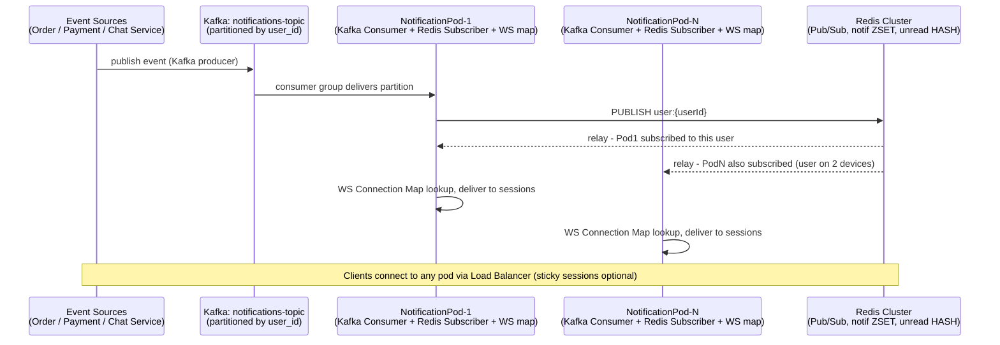

# Design: Real-Time Notification Service (Spring Boot + WebSocket + Redis Pub/Sub)
> **"A digital PA system where every speaker knows which room to broadcast to."**
> A real-time notification service must solve two problems simultaneously: maintain long-lived
> connections efficiently, and route incoming events to exactly the right connections —
> even when those connections are spread across 20 pods.
>
> **Key insight:** WebSocket connections are stateful and pod-local. Events (a user's order shipped)
> arrive at a random pod. Redis Pub/Sub is the switchboard that lets any pod publish to a per-user
> channel and lets the pod holding that user's connection deliver the message instantly.

---

## Intuition

Picture a stadium PA system where every seat has its own private earpiece, and the
announcer's booth doesn't know which cable each earpiece is plugged into. The announcer just
needs to say "seat 4F, your car is ready" into a system that finds the wire — even if the wire
runs through a different room than the one the announcer is standing in. That is the whole
shape of this problem: an event is produced somewhere, the connection that should receive it
is held somewhere else (a random pod out of twenty), and the two need to find each other in
under 100 ms without anyone remembering to wire them together by hand.

The one-line mental model: **Kafka is the durable record of what happened; Redis Pub/Sub is
the switchboard that finds who's listening right now; the WebSocket map is the last local
hop.** Three different jobs, three different tools, and the design breaks if any one of them
tries to do another's job — durability in Pub/Sub (it has none), routing in Kafka (technically
possible, but §5 Decision 2 shows why it costs 17× more Redis-shaped traffic), or delivery
guarantees in the WebSocket map (a closed socket is just gone, no retry).

The recurring interview trap is forgetting that a WebSocket connection is *pod-local state*.
Nothing about Spring, Kafka, or Redis makes that fact go away — it has to be designed around,
which is why §4.4's subscription manager exists at all: a pod only subscribes to the Redis
channels for users it is currently holding a socket open for, and unsubscribes the moment that
socket closes. Get that lifecycle wrong and you either leak Redis subscriptions forever (§9
Pitfall 4's cousin) or miss messages for users who reconnected to a different pod.

---

## 1. Requirements Clarification

### Functional Requirements
- Push real-time notifications to connected web/mobile clients over WebSocket (primary) and SSE (fallback).
- Support notification types: order updates, payment confirmations, chat messages, system alerts.
- Store the last 50 notifications per user; deliver unread notifications on reconnect.
- Clients can acknowledge notifications (read receipts); unread count shown in UI badge.
- Fan-out to all active sessions of a user (same user logged in on multiple devices).

### Non-Functional Requirements
- **Connections:** 500,000 concurrent WebSocket connections per region.
- **Latency:** P99 < 100 ms from event generation to browser display.
- **Throughput:** 50,000 notification events/sec at peak (flash sales, order updates).
- **Delivery guarantee:** At-least-once delivery; clients deduplicate by notification ID.
- **Backpressure:** Slow consumers must not cause memory OOM on the server.

### Out of Scope
- Push notifications to mobile apps (APNS/FCM — separate service).
- Email/SMS notifications (separate batch service).
- In-app notification content storage beyond 50 messages.

---

## 2. Scale Estimation

### Connections
```
500,000 WebSocket connections / region
Per pod:     25,000 connections (20 pods)
Memory/connection (Spring WebSocket + OS buffer): ~10 KB
Memory for connections: 25,000 × 10 KB = 250 MB per pod
Total threads: virtual threads (one per connection, ~few KB stack) — 25,000 virtual threads = ~50 MB
```

### Redis Pub/Sub
```
Channels:      500,000 (one per user with active connections)
Events/sec:    50,000 published
Subscribers:   average 1.2 pods per channel (a user connected to one or two pods)
Messages relayed by Redis: 50,000 × 1.2 = 60,000 msg/s
Pub/Sub payload: ~300 bytes (compact JSON — the full ~500-byte record lives in the ZSET)
Redis bandwidth: 60,000 × 300 bytes = 18 MB/s — see §10 for the headroom calculation
```

### Notification Storage
```
50 notifications/user × 100,000 active users = 5,000,000 notifications in Redis
Notification size: ~500 bytes (JSON)
Total Redis storage: 5,000,000 × 500 bytes = 2.5 GB
TTL: 7 days for each notification; 30-day TTL for the user's list (ZSET)
```

---

## 3. High-Level Architecture



### Component Inventory
| Component | Role |
|-----------|------|
| `WebSocketHandler` | Spring WebSocket handler; maintains `ConcurrentHashMap<userId, Set<WebSocketSession>>` |
| `SseController` | Fallback `SseEmitter` for clients that don't support WebSocket |
| `NotificationKafkaConsumer` | Reads `notifications` topic; stores to Redis ZSET; publishes to Redis Pub/Sub |
| `RedisSubscriptionManager` | Subscribes to Redis channels for users with active connections |
| `NotificationRepository` | `RedisTemplate` ZSET operations for notification history |
| `UnreadCountService` | Manages `HINCRBY` / `HSET` for per-user unread counts |

---

## 4. Component Deep Dives

### 4.1 WebSocket Handler with Connection Registry

```java
@Component
public class NotificationWebSocketHandler extends TextWebSocketHandler {

    // userId -> set of active sessions (multiple devices).
    // ConcurrentHashMap.newKeySet(), not CopyOnWriteArraySet: a reconnect storm mutates this
    // set 25,000 times in seconds, and COW copies the whole array on every add (§9 Pitfall 4).
    private final ConcurrentHashMap<String, Set<WebSocketSession>> sessions =
        new ConcurrentHashMap<>();

    private final RedisSubscriptionManager subscriptionManager;
    private final NotificationRepository notificationRepo;

    @Override
    public void afterConnectionEstablished(WebSocketSession session) {
        String userId = extractUserId(session);

        sessions.computeIfAbsent(userId, k -> ConcurrentHashMap.newKeySet()).add(session);

        // Subscribe to Redis channel for this user if this pod is now the first session holder
        subscriptionManager.subscribeIfAbsent(userId);

        // Deliver unread notifications on reconnect
        List<Notification> unread = notificationRepo.getUnread(userId, 50);
        unread.forEach(n -> sendToSession(session, n));
    }

    @Override
    public void afterConnectionClosed(WebSocketSession session, CloseStatus status) {
        String userId = extractUserId(session);
        Set<WebSocketSession> userSessions = sessions.get(userId);
        if (userSessions != null) {
            userSessions.remove(session);
            if (userSessions.isEmpty()) {
                sessions.remove(userId);
                subscriptionManager.unsubscribe(userId);  // Clean up Redis subscription
            }
        }
    }

    public void deliverToUser(String userId, Notification notification) {
        Set<WebSocketSession> userSessions = sessions.get(userId);
        if (userSessions == null) return;  // User not connected to this pod

        for (WebSocketSession session : userSessions) {
            sendToSession(session, notification);
        }
    }

    private void sendToSession(WebSocketSession session, Notification notification) {
        if (!session.isOpen()) return;
        try {
            session.sendMessage(new TextMessage(toJson(notification)));
        } catch (IOException e) {
            log.warn("Failed to send to session userId={}", extractUserId(session), e);
        }
    }
}
```

### 4.2 Broken Pattern: Direct Redis Pub/Sub Without Connection Check

```java
// BROKEN: publishes to Redis channel without checking if any pod has the user connected
@KafkaListener(topics = "notifications")
public void handle_broken(NotificationEvent event) {
    redisTemplate.convertAndSend("user:" + event.userId(), toJson(event));
    // If no pod has this user connected, the message is silently dropped by Redis Pub/Sub.
    // Redis Pub/Sub is fire-and-forget — no persistence, no replay on reconnect.
    // User misses the notification completely.
}
```

**Failure mode:** Redis Pub/Sub is ephemeral — messages published to channels with no subscribers
are dropped permanently. A user reconnecting after 1 second misses all notifications fired during
the disconnection window.

**Fix:** Always persist the notification to `Redis ZSET notif:<userId>` FIRST, then publish to
the Pub/Sub channel. The ZSET serves as the durable store; Pub/Sub is the live delivery hint.
On reconnect, `afterConnectionEstablished` reads unread notifications from the ZSET.

### 4.3 Kafka Consumer + Redis Dual-Write

```java
@Component
public class NotificationKafkaConsumer {

    private final NotificationRepository notifRepo;
    private final UnreadCountService unreadCountService;
    private final RedisTemplate<String, String> redisTemplate;

    @KafkaListener(
        topics = "notifications",
        groupId = "notification-service",
        concurrency = "4"  // 4 consumer threads; one per Kafka partition
    )
    public void consume(ConsumerRecord<String, String> record) {
        NotificationEvent event = parseEvent(record.value());
        Notification notification = Notification.from(event);

        // Step 1: Persist to Redis ZSET (durable store) — score = timestamp
        notifRepo.save(notification);

        // Step 2: Increment unread count
        unreadCountService.increment(event.userId());

        // Step 3: Pub/Sub delivery hint (fire-and-forget; drop if no subscriber)
        redisTemplate.convertAndSend(
            "user:" + event.userId(),
            toJson(notification)
        );
    }
}
```

### 4.4 Redis Subscription Manager

```java
@Component
public class RedisSubscriptionManager {

    private final RedisConnectionFactory connectionFactory;
    private final NotificationWebSocketHandler wsHandler;

    // ONE container for the whole pod, not one per user. A container owns a task executor
    // and a dedicated Redis connection; 25,000 of them would mean 25,000 Redis connections
    // and 25,000 thread pools on a pod budgeted at 250 MB. addMessageListener/
    // removeMessageListener on a single running container is the intended API.
    private final RedisMessageListenerContainer container;   // singleton bean
    private final ConcurrentHashMap<String, MessageListener> listeners = new ConcurrentHashMap<>();

    public void subscribeIfAbsent(String userId) {
        listeners.computeIfAbsent("user:" + userId, channel -> {
            MessageListener listener = (message, pattern) ->
                wsHandler.deliverToUser(userId, parseNotification(message.getBody()));
            container.addMessageListener(listener, new ChannelTopic(channel));
            return listener;
        });
    }

    public void unsubscribe(String userId) {
        MessageListener listener = listeners.remove("user:" + userId);
        if (listener != null) {
            container.removeMessageListener(listener, new ChannelTopic("user:" + userId));
        }
    }
}
```

### 4.5 Notification Repository (Redis ZSET)

```java
@Repository
public class NotificationRepository {

    private final RedisTemplate<String, String> redisTemplate;
    private static final int MAX_STORED = 50;
    private static final Duration TTL = Duration.ofDays(7);

    private String key(String userId) { return "notif:" + userId; }

    public void save(Notification notification) {
        double score = notification.getCreatedAt().toEpochMilli();
        String key = key(notification.getUserId());

        redisTemplate.opsForZSet().add(key, toJson(notification), score);
        // Keep only the latest MAX_STORED; remove oldest if overfull
        redisTemplate.opsForZSet().removeRange(key, 0, -(MAX_STORED + 1));
        redisTemplate.expire(key, TTL);
    }

    public List<Notification> getUnread(String userId, int limit) {
        Set<String> jsons = redisTemplate.opsForZSet().reverseRange(key(userId), 0, limit - 1);
        if (jsons == null) return List.of();
        return jsons.stream().map(this::parseNotification).collect(Collectors.toList());
    }
}
```

### 4.6 Backpressure: Slow Consumer Handling

Without backpressure, a slow WebSocket client blocks the thread delivering messages, eventually
causing memory overflow from a build-up of queued messages.

`WebSocketSession` has no `isWritePossible()` — its whole API is `sendMessage`, `isOpen` and
`close`, so there is nothing to poll for writability. Spring's answer is a decorator that owns the
buffer for you:

```java
// Wrap every session at registration time; the decorator is what goes in the sessions map.
@Override
public void afterConnectionEstablished(WebSocketSession rawSession) {
    WebSocketSession session = new ConcurrentWebSocketSessionDecorator(
        rawSession,
        /* sendTimeLimit  */ 10_000,   // ms a single send may take
        /* bufferSizeLimit*/ 512 * 1024 // bytes of queued outbound messages
    );
    sessions.computeIfAbsent(extractUserId(session), k -> ConcurrentHashMap.newKeySet())
            .add(session);
}
```

The decorator does three jobs the hand-rolled version cannot. It serialises concurrent
`sendMessage` calls — required, because the WebSocket spec forbids interleaving partial messages
and two pods delivering to the same session would otherwise corrupt the frame stream. It queues
messages when a send is already in progress. And when either limit is breached it closes the
session with `SESSION_NOT_RELIABLE` instead of growing the queue forever, which is the actual
backpressure: a slow client is disconnected and reconnects to replay from the ZSET.

Set `spring.threads.virtual.enabled=true` so a session blocked on a slow network write parks its
virtual thread instead of holding a platform thread — 25,000 connections cost ~25,000 virtual
threads rather than 25,000 platform threads (~25 GB of stack).

### 4.7 SSE Fallback Controller

```java
@RestController
public class SseController {

    private final Map<String, List<SseEmitter>> emitters = new ConcurrentHashMap<>();
    private final NotificationRepository notificationRepo;

    @GetMapping(value = "/notifications/stream", produces = MediaType.TEXT_EVENT_STREAM_VALUE)
    public SseEmitter stream(@AuthenticationPrincipal String userId) {
        // No-arg constructor sets NO timeout of its own (§9 Pitfall 5) -- always set one
        SseEmitter emitter = new SseEmitter(60_000L);

        emitters.computeIfAbsent(userId, k -> new CopyOnWriteArrayList<>()).add(emitter);

        emitter.onCompletion(() -> removeEmitter(userId, emitter));
        emitter.onTimeout(() -> removeEmitter(userId, emitter));
        emitter.onError(e -> removeEmitter(userId, emitter));

        // Replay unread notifications immediately, same as the WebSocket path (§4.1)
        notificationRepo.getUnread(userId, 50).forEach(n -> sendEvent(emitter, n));
        return emitter;
    }

    public void deliverToUser(String userId, Notification notification) {
        List<SseEmitter> userEmitters = emitters.get(userId);
        if (userEmitters == null) return;
        userEmitters.forEach(e -> sendEvent(e, notification));
    }

    private void sendEvent(SseEmitter emitter, Notification n) {
        try {
            emitter.send(SseEmitter.event().id(n.getId()).name("notification").data(toJson(n)));
        } catch (IOException e) {
            removeEmitter(n.getUserId(), emitter);
        }
    }

    private void removeEmitter(String userId, SseEmitter emitter) {
        List<SseEmitter> list = emitters.get(userId);
        if (list != null) {
            list.remove(emitter);
            if (list.isEmpty()) emitters.remove(userId);
        }
    }
}
```

`CopyOnWriteArrayList` is the right structure here — unlike §4.1's WebSocket session set, a
user's SSE emitter list mutates rarely (one add per tab opened) and is iterated on every
delivery, exactly the read-mostly profile `CopyOnWrite` is built for. That is a different
access pattern from the WebSocket registry's reconnect-storm churn (§9 Pitfall 4), not a
contradiction of it.

### 4.8 Unread Count Service

```java
@Service
public class UnreadCountService {

    private final RedisTemplate<String, String> redisTemplate;

    private String key(String userId) { return "unread:" + userId; }

    public void increment(String userId) {
        redisTemplate.opsForValue().increment(key(userId));
    }

    public void markRead(String userId, int count) {
        // Never let the counter go negative -- a race between two devices acking
        // the same batch must not push it below zero
        redisTemplate.execute((RedisCallback<Long>) conn -> {
            long current = Optional.ofNullable(conn.stringCommands().get(key(userId).getBytes()))
                .map(b -> Long.parseLong(new String(b))).orElse(0L);
            long next = Math.max(0, current - count);
            conn.stringCommands().set(key(userId).getBytes(), String.valueOf(next).getBytes());
            return next;
        });
    }

    public long getCount(String userId) {
        String value = redisTemplate.opsForValue().get(key(userId));
        return value == null ? 0 : Long.parseLong(value);
    }
}
```

A plain `INCR`-then-read has a well-known race: two pods reading the count, both decrementing
based on a stale read, and the final value overcounting. The `execute` block above uses a
single Redis connection to read-then-write atomically from the client side; the more scalable
fix at higher throughput is a Lua script (`EVAL`) so the read-modify-write happens inside Redis
itself and survives concurrent callers without a client-side lock.

### 4.9 Broken Pattern: Blocking Redis Publish on the Kafka Consumer Thread

```java
// BROKEN: no timeout, no circuit breaker, on the thread that also commits Kafka offsets
@KafkaListener(topics = "notifications", concurrency = "4")
public void handle_broken(ConsumerRecord<String, String> record) {
    Notification n = Notification.from(parseEvent(record.value()));
    notifRepo.save(n);
    redisTemplate.convertAndSend("user:" + n.getUserId(), toJson(n));  // blocks here
    // If Redis is slow or partially down, this call blocks the consumer thread.
    // With manual offset commit, the offset never advances -- consumer lag grows
    // unbounded and Kafka rebalances the partition away after max.poll.interval.ms.
}
```

**Failure mode:** During a Redis maintenance window with elevated latency (200 ms instead of
0.3 ms), all 4 consumer threads per pod spent their poll interval blocked on
`convertAndSend()`. `max.poll.interval.ms` (30 s default) was exceeded, Kafka's consumer group
coordinator declared the consumers dead and triggered a rebalance — which paused consumption
entirely for the ~15 seconds the rebalance took, compounding the very lag it was reacting to.

**Fix:** Wrap the Redis publish in a Resilience4j `TimeLimiter` (short timeout, e.g. 200 ms)
and treat a publish failure as non-fatal — the notification is already durably in the ZSET
(`notifRepo.save()` happened first), so a dropped Pub/Sub hint only delays delivery until the
next reconnect; it does not lose the notification. Never let a best-effort delivery hint block
the durable write path or the Kafka offset commit.

---

## 5. Design Decisions & Tradeoffs

### Decision 1: WebSocket vs SSE vs Long Polling

| Protocol | Bidirectional | Browser support | Reconnect | Proxy compatibility |
|----------|--------------|----------------|-----------|-------------------|
| WebSocket | Yes | All modern | Manual | Variable (some proxies strip Upgrade) |
| SSE | Server→client only | All modern | Automatic | Good (plain HTTP/1.1 or HTTP/2) |
| Long polling | No | Universal | Yes | Excellent |

**Decision:** WebSocket primary + SSE fallback. WebSocket supports bidirectional messaging
(read receipts from client). SSE is simpler and reconnects automatically — used for clients
behind corporate proxies that block WebSocket upgrades.

### Decision 2: Redis Pub/Sub vs Kafka for Cross-Pod Delivery

| Approach | Latency | Persistence | Fan-out |
|----------|---------|-------------|---------|
| Redis Pub/Sub (chosen) | < 1 ms | No | Subscribe/channel |
| Kafka (second consumer group) | 5–50 ms | Yes, configurable | Consumer group |
| gRPC streaming between pods | < 2 ms | No | Direct pod mesh |

**Decision:** Redis Pub/Sub for intra-pod fan-out (fast, simple), Kafka for durability and
replay. The two work in tandem: Kafka is the durable source; Redis Pub/Sub is the delivery mechanism.

### Decision 3: Per-User Channels vs Broadcast Channels

Per-user channels (`user:<userId>`) isolate subscriptions — each pod only subscribes to channels
for users currently connected to that pod. A single broadcast channel would fan-out every message
to every pod, requiring each pod to filter locally. With 500,000 users and 50,000 events/sec,
broadcast causes 50,000 × 20 pods = 1,000,000 Redis delivers/sec. Per-user channels: 50,000 × 1.2 =
60,000 Redis delivers/sec — 17× fewer Redis operations.

### Decision 4: ZSET vs List for Notification History

| Structure | Random access | Time-ordered | Size limiting |
|-----------|--------------|-------------|--------------|
| Redis ZSET | O(log N) | Score = timestamp | `ZREMRANGEBYRANK` |
| Redis List | O(N) pop/push | Order of insertion | `LTRIM` |

ZSET (chosen): supports `ZRANGEBYSCORE` for time-range queries, range-based size trimming, and
deduplication by `notificationId` as the member key. List would require scanning to deduplicate.

### Decision 5: Sticky Sessions vs Stateless Pods

Sticky sessions (load balancer routes user to same pod) reduce Redis Pub/Sub overhead — no
cross-pod channel needed for that user. But sticky sessions require L4 load balancer support,
complicate rolling deploys (connections on the old pod must migrate), and create pod imbalance
(one user with many devices loads one pod). Stateless pods (chosen) with Redis Pub/Sub
fan-out are simpler, more resilient, and balance load naturally.

---

## 6. Real-World Implementations

**Discord — "How Discord Scaled Elixir to 5,000,000 Concurrent Users" (2017):** the canonical
account of this problem, and it solves the routing step without Redis at all. Discord's gateways are
Elixir/Erlang processes and cross-node fan-out rides the BEAM's own distribution rather than a
broker. Two findings transfer directly. First, the bottleneck they actually hit was not connection
count but the *fan-out* message rate into a single process — the same reason §5 Decision 3 rejects a
broadcast channel. Second, their fix was to shard the fan-out across a pool of workers, which is the
per-user-channel idea here expressed as processes instead of Redis channels.

**The presence problem is the hard part, not the sockets.** Every design in this space converges on
the same two-layer split this file uses: a durable store of what should be delivered, plus an
ephemeral routing layer that knows *where* a user currently is. Redis Pub/Sub is one implementation
of the second layer; a session registry keyed by user with the owning pod's address is another, and
it trades Redis fan-out for a directory lookup plus a direct pod-to-pod call. Pick by fan-out ratio:
Pub/Sub wins when a message goes to many connections, a directory wins when it goes to one.

**SSE is the underrated option.** For a server-to-client-only feed, `text/event-stream` gives you
automatic browser reconnection with `Last-Event-ID` replay for free — the reconnect-and-replay logic
that §4.1 hand-writes against the ZSET. This design keeps WebSocket as primary only because read
receipts flow client-to-server; drop that one requirement and SSE removes the upgrade handshake, the
proxy incompatibility, and the custom reconnect protocol in a single stroke.

**Build vs. buy — PubNub, Ably, Pusher:** the managed alternative to this entire design is a
hosted pub/sub-as-a-service product, which sells exactly the two-layer split above as an API
call: publish to a channel, and the vendor handles connection scaling, geographic distribution,
and presence. The tradeoff is the same one that shows up everywhere in this space — a managed
service removes the WebSocket registry, the Redis Pub/Sub layer, and the reconnect/replay logic
this file builds, at the cost of per-connection or per-message pricing and a dependency on the
vendor's own fan-out architecture during an incident. Teams building notification delivery as a
small piece of a larger product often reach for one of these rather than operating §3's
architecture themselves; teams for whom real-time delivery *is* the product (chat apps, trading
platforms, multiplayer games) tend to own it, the same way this design does.

---

## 7. Technologies & Tools

| Technology | Role | Notes |
|------------|------|-------|
| Spring WebSocket (STOMP over WS) | WebSocket protocol layer | STOMP adds message routing; simpler client-side API |
| Spring Messaging + STOMP | Message broker integration | In-process STOMP broker or external ActiveMQ/RabbitMQ |
| Redis Pub/Sub (`spring-data-redis`) | Cross-pod delivery | `RedisMessageListenerContainer`; synchronous delivery |
| Redis ZSET | Notification history | O(log N) insert; range-based pagination |
| Apache Kafka | Durable event stream | `@KafkaListener`; partitioned by `user_id` for ordering |
| `SseEmitter` (Spring MVC) | SSE fallback | Auto-reconnect by browser; simpler than WebSocket |
| Micrometer | `websocket.connections.active`, `notification.delivery.latency` | Gauge on active connections per pod |

---

## 8. Operational Playbook

### Runbook 1: Notification Delivery Latency Spike

**Symptom:** `notification.delivery.latency.p99` increases from 50 ms to 2 seconds.

**Diagnosis:**
1. Check Redis Pub/Sub lag: `redis-cli --latency -h <host>` — baseline RTT elevated?
2. Check Kafka consumer lag: `kafka-consumer-groups.sh --describe --group notification-service` —
   is the consumer group falling behind the producer offset?
3. Check GC pause: `jcmd <pid> VM.info | grep GC` — if G1GC pauses are > 200 ms, connections are
   paused during GC.

**Mitigation:** Add another pod (auto-scaling based on Kafka consumer lag metric). Connections
are distributed across all pods; new pod picks up Kafka partitions automatically.

**Resolution:** If GC is the root cause, switch to ZGC (`-XX:+UseZGC`) for sub-1 ms pauses with
25,000 live WebSocket session objects.

---

### Runbook 2: Connection Leak — Active Connection Count Growing Without Bound

**Symptom:** `websocket.connections.active` grows steadily; pod memory increases 10 MB/min;
never decreases even after traffic drops.

**Diagnosis:**
1. `sessions` map size: add a Micrometer gauge `gauge("websocket.sessions.map.size", sessions, Map::size)`.
2. Check `afterConnectionClosed` is being called: add a counter for close events.
3. Check if sessions are being removed from the map: log at `TRACE` level when a session is removed.

**Resolution:** WebSocket sessions that close abnormally (network drop without clean close handshake)
trigger `afterConnectionClosed` with `CloseStatus.NO_STATUS_CODE`. Verify this path removes
the session from the set. Add a periodic cleanup job that sweeps sessions where `!session.isOpen()`.

---

### Runbook 3: Redis Pub/Sub Channel Count Explosion

**Symptom:** Redis `PUBSUB CHANNELS` returns 500,000+ channels; Redis memory grows 200 MB/day.

**Diagnosis:**
1. `redis-cli PUBSUB NUMSUB | wc -l` — count active subscribed channels.
2. Check if `unsubscribe()` is being called on connection close: look for `RedisMessageListenerContainer.stop()` in logs.
3. Verify `subscriptions` ConcurrentHashMap size matches `sessions` map size.

**Mitigation:** If channels are leaking (subscriptions not cleaned up), manually clean up:
`redis-cli PUBSUB CHANNELS "user:*" | head -1000 | while read ch; do redis-cli UNSUBSCRIBE $ch; done`
(this only removes channels with no active subscribers — safe).

**Resolution:** Ensure `afterConnectionClosed` reliably calls `subscriptionManager.unsubscribe()`.
Add a test: verify `subscriptions.size() == sessions.size()` invariant after random connection
close simulation.

---

### Runbook 4: Kafka Consumer Lag — Notification Delivery Delayed During Flash Sale

**Symptom:** During a flash sale, Kafka consumer group lag grows to 50,000 messages; notifications
are delayed 30 seconds.

**Diagnosis:**
1. `kafka-consumer-groups.sh --describe` — which partitions have highest lag?
2. `notification-service` pods: are they saturated? Check CPU and thread pool metrics.
3. Is the bottleneck Redis Pub/Sub publish rate or WebSocket delivery rate?

**Mitigation:** Scale up the notification-service pod count. With `@KafkaListener(concurrency="4")`,
each pod handles 4 partitions. 20 pods × 4 = 80 consumers for an 80-partition topic.

**Resolution:** Pre-scale during planned high-traffic events (scheduled K8s HPA override).
Add Kafka consumer lag as an HPA custom metric for event-driven auto-scaling.

---

### Runbook 5: STOMP/Redis Split-Brain After Network Partition

**Symptom:** Some users report missing notifications while `notification.delivery.latency.p99`
looks normal — the metric only measures deliveries that happened, so a partial partition is
invisible to it. `websocket.sessions.map.size` summed across pods does not match
`redis-cli PUBSUB NUMPAT` count of active channel patterns.

**Diagnosis:**
1. Check for a network partition between a subset of pods and the Redis cluster
   (`redis-cli --latency` from each pod, not just one).
2. Compare `sessions.map.size` (local, per pod) against the subscription count
   (`subscriptionManager`'s `listeners` map size) — they should be equal by the invariant
   Runbook 3 already tests. A pod that reconnected to Redis but did not re-subscribe existing
   users breaks that invariant silently.
3. Check Lettuce's reconnect log (`io.lettuce.core.protocol.ReconnectionHandler`) for repeated
   reconnect attempts, which indicate the partition is intermittent rather than resolved.

**Alert thresholds:** page when `abs(sessions_size - subscriptions_size) > 100` sustained for
2 minutes on any pod; warn on Lettuce reconnect events exceeding 5/minute.

**Mitigation:** Force a full re-subscribe on any Redis reconnect event rather than assuming
existing subscriptions survived — Lettuce's connection object is the same Java object across a
reconnect, but the underlying TCP session and therefore the server-side subscription state is
not. Register a `RedisConnectionFactory` listener that calls
`subscriptionManager.resubscribeAll(sessions.keySet())` on reconnect.

**Rollback:** None needed — this is a runtime resync, not a deploy. If it recurs, the durable
fix is the one above (resubscribe-on-reconnect), not a rollback.

---

## 9. Common Pitfalls & War Stories

**Pitfall 1: Redis Pub/Sub Drop During Redis Restart (social platform, 2022)**
During a Redis failover (primary failed, replica promoted), all active Redis Pub/Sub subscriptions
were dropped. All 25,000 active WebSocket connections on the affected pod stopped receiving Redis
events. Notifications were generated (stored in ZSET) but never delivered until the user reconnected.
Impact: 100,000 users missed real-time updates for 3 minutes. Fix: add Redis subscription health
check — if `RedisMessageListenerContainer` reports disconnected, reconnect and re-subscribe all
active users. Spring's `RedisConnectionFactory` with Lettuce handles automatic reconnection, but
subscriptions must be explicitly re-registered in the `onMessage` error handler.

---

**Pitfall 2: Reaching for the Pinning Explanation That No Longer Applies**
On Spring Boot 3.2 with an early virtual-thread JDK, a `synchronized` block that blocked on network
I/O pinned its carrier thread, and a WebSocket send path full of `synchronized` could starve the
small carrier pool. That failure mode is gone: **JEP 491 (Java 24) reimplemented monitors so a
virtual thread blocking inside `synchronized` unmounts and releases its carrier**, and the
`-Djdk.tracePinnedThreads` flag people used to diagnose it was removed in the same release. On this
design's Java 25 baseline, blaming `synchronized` for latency is a dead end — and "rewrite it in
WebFlux" is an expensive answer to a problem the JDK already solved.

What still pins a virtual thread is a native or VM frame on the stack — a JNI call, or a class
initializer. Diagnose it with the JFR event `jdk.VirtualThreadPinned`, which was expanded to cover
park, monitor-enter and `Object.wait` while pinned, not with the deleted flag. If P99 spikes under
load, look first at the actual culprit here: an unbounded outbound queue on a slow session, which
is what the `ConcurrentWebSocketSessionDecorator` limits in §4.6.

---

**Pitfall 3: Thundering Herd on Reconnect (e-commerce flash sale, 2023)**
When a pod was restarted during deployment, 25,000 clients reconnected simultaneously within
2 seconds (WebSocket client default reconnect: 1 second). The reconnect handler loaded unread
notifications from Redis for each user — 25,000 ZRANGE calls hit Redis in 2 seconds, saturating
Redis for 8 seconds. Impact: all real-time features degraded across all pods. Fix: add jittered
reconnect in the client (`reconnectDelay = 1000 + Math.random() * 9000`); rate-limit the Redis
ZRANGE reads with a Semaphore(500) in the reconnect handler.

---

**Pitfall 4: CopyOnWriteArraySet Allocation Storm (high-throughput notification service, 2022)**
`CopyOnWriteArraySet.add()` copies the internal array on every mutation. At 25,000 connection
events per deploy (reconnects after rolling restart), the GC was collecting 25,000 temporary
arrays of growing sizes. G1GC paused for 800 ms every 30 seconds during reconnect storms.
Fix: replace `CopyOnWriteArraySet` with `ConcurrentHashMap.newKeySet()` — same set semantics and
still safe for concurrent iteration, but O(1) add/remove with no array copy. §4.1 uses the fixed
form. `CopyOnWriteArraySet` is for read-mostly sets; a session registry is write-heavy by nature.

---

**Pitfall 5: SSE Connection Leak on Client Timeout (customer portal, 2021)**
`SseEmitter` created with the no-arg constructor sets no timeout of its own — it inherits the MVC
async timeout, which falls through to the servlet container's default (30 s on Tomcat) unless
`spring.mvc.async.request-timeout` is set. After the timeout fires, the
`SseEmitter` is "completed" internally, but the `HttpServletRequest` connection is only closed
when the client disconnects or when the server sends a completion event. Corporate proxies that
buffer responses kept the TCP connection open for 300 seconds after the SSE emitter expired.
The pod accumulated 10,000 "zombie" connections holding threads. Fix: set explicit `SseEmitter`
timeout to 60 seconds; register `onTimeout()` and `onCompletion()` callbacks that clean up the
user session registry and close the response.

---

**Pitfall 6: Kafka Message Key Omitted — Out-of-Order Delivery for the Same User (order tracking service, 2022)**
The Kafka producer published order-status events keyed by `orderId` instead of `userId`, so a
user's three status updates (`placed` → `shipped` → `delivered`) landed on three different
partitions with no ordering guarantee between them. Under normal load they arrived in order by
luck (partition assignment plus timing); under partition rebalancing during a broker restart,
`delivered` was consumed and pushed to the user's browser 400 ms before `shipped`, and the UI
briefly showed a status regression. Fix: partition by `userId`, not by the business entity's
own ID — Kafka only guarantees order within a partition, and the ordering guarantee this
design actually needs is per-user, not per-order (§7 already documents "partitioned by
user_id"; this incident is what happens when a producer doesn't honor it).

---

**Pitfall 7: Notification Storm From a Retried Batch Job Mistaken for Real-Time Traffic (marketing platform, 2023)**
A batch job re-sending a promotional notification to 2,000,000 users retried its entire run
after a partial failure, without checking which users had already received it — doubling the
Kafka publish volume to 100,000 events/sec for 40 minutes, well past the 50,000/s peak this
design is sized for (§2). Consumer lag climbed to 4,000,000 messages; real-time order and
payment notifications queued behind the promotional flood and were delayed up to 6 minutes.
Fix: give bulk/batch notification producers a separate Kafka topic and consumer group from
real-time events, so a marketing flood cannot starve the partitions real orders depend on;
add idempotency keys to the batch job so a retry skips already-sent users instead of resending
the whole run.

---

## 10. Capacity Planning

### WebSocket Connection Capacity per Pod

```
Memory per connection (virtual thread + OS socket buffer + session state): ~10 KB
Target connections per pod: 25,000
Memory for connections: 25,000 × 10 KB = 250 MB
Pod heap: 512 MB (250 MB connections + 262 MB application heap)
Instance type: 2 vCPU / 1 GB RAM (room for GC overhead)

Platform threads (without virtual threads): 25,000 connections × 1 MB stack = 25 GB — impossible
Virtual threads: 25,000 × ~2 KB stack = 50 MB — feasible
```

### Redis Pub/Sub Sizing

```
Active channels:     500,000 (all connected users)
Events published/s:  50,000
Subscribers per channel: 1.2 average (users on one or two pods)
Messages relayed/s:  50,000 × 1.2 = 60,000 msg/s
Message size:        ~300 bytes (compact JSON notification)
Redis bandwidth:     60,000 × 300 bytes = 18 MB/s
ElastiCache r6g.large: supports ~1 Gbps = 125 MB/s — 6.9× headroom at peak
```

### Kafka Throughput

```
Notification events:  50,000 msg/s × 1 KB = 50 MB/s producer throughput
Partitions needed:    20 pods × 4 consumers = 80 partitions
Retention: 50 MB/s × 86,400 s × 3 days = 12.96 TB (compressed to ~4 TB with LZ4)
Kafka broker: 3 brokers × 4 TB storage = sufficient; m5.xlarge (3 Gbps network)
```

### Redis Connection Pool Sizing (Lettuce)

```
Lettuce uses a small number of multiplexed connections, not one per subscription --
  a single connection can carry thousands of concurrent subscriptions
Recommended: 1 shared connection for Pub/Sub (RedisMessageListenerContainer's own
  connection) + a separate pool (default 8) for ZSET/HASH command traffic
Command traffic: 50,000 events/s x (1 ZADD + 1 ZREMRANGEBYRANK + 1 EXPIRE + 1 INCR)
  = 200,000 Redis ops/s from the write side alone
A single-threaded Redis node processes ~100,000-200,000 simple ops/s -- this design is
  at the edge of a single node's budget, which is why Redis Cluster (sharding by key
  hash) is load-bearing here, not optional, at this traffic level
```

### JSON Serialization CPU Cost

```
Jackson serialize+deserialize a ~500-byte notification: ~15-20 microseconds per op
  (typical JVM, POJO with 6-8 fields)
Peak: 50,000 events/s x 2 (serialize on publish, deserialize on each of 1.2 deliveries)
  = ~110,000 JSON ops/s x 18us = ~2 seconds of CPU-time per second
  -> roughly 2 cores dedicated to JSON alone at peak, spread across 20 pods is
  negligible per pod, but real enough to show up in a flame graph on an
  under-provisioned pod
```

---

## 11. Interview Discussion Points

**Q: Why is Redis Pub/Sub used instead of just having all pods consume from Kafka directly?**
All pods consuming from Kafka would require all pods to be in separate consumer groups (one per pod),
meaning every event is delivered to every pod. Each pod then checks if the user is connected locally,
discarding most messages. This creates O(events × pods) Kafka message deliveries — at 50,000 events/s
across 20 pods, that's 1,000,000 Kafka deliveries/s, with 19/20 discarded. Redis Pub/Sub delivers
only to pods that have the user connected (subscribed to that channel) — at 50,000 × 1.2 average
subscribers = 60,000 deliveries/s. Kafka remains the durable source; Redis Pub/Sub is the efficient
routing layer.

**Q: What happens to notifications for users who are not currently connected?**
Notifications are always persisted to the Redis ZSET (`notif:<userId>`) before publishing to
Pub/Sub. When no pod has the user subscribed (no active WebSocket connection), the Pub/Sub message
is silently dropped by Redis — this is expected and handled. When the user reconnects, `afterConnectionEstablished` reads the last 50 notifications from the ZSET and delivers them.
The ZSET is the reliability layer; Pub/Sub is the live delivery optimization.

**Q: How do you handle a user with active WebSocket connections on two different pods?**
Both pods subscribe to the Redis channel `user:<userId>`. When an event is published to that
channel, Redis delivers it to all subscribers — both pods receive the message. Both pods then
deliver it to all WebSocket sessions for that user on their respective pods. The client receives
the notification on all active sessions (e.g., browser + mobile web). This fan-out is intentional.
The client can deduplicate by `notificationId` if needed (though duplicate delivery across devices
is usually the desired behavior for notifications).

**Q: What is the memory cost of 500,000 WebSocket connections and how do virtual threads help?**
Each platform thread has a 1 MB stack. 500,000 platform threads would require 500 GB of stack
space — impossible. Virtual threads have a ~2 KB initial stack (expandable but parked when
blocked). 500,000 virtual threads use ~1 GB of stack, plus ~10 KB per connection for OS socket
buffers and session state = ~5 GB total — manageable on 20 pods × 256 MB. This is the core
reason virtual threads enable WebSocket servers to handle orders of magnitude more concurrent
connections than traditional thread-per-connection models.

**Q: How would you prevent a slow consumer from causing OOM on the notification server?**
Three layers of backpressure: (a) WebSocket session-level: wrap each session in
`ConcurrentWebSocketSessionDecorator` with a `sendTimeLimit` and `bufferSizeLimit` — there is no
`isWritePossible()` on `WebSocketSession` to poll, so the decorator's bounded queue is the
mechanism, and it closes the session once either limit is breached. (b) Pod-level:
cap the number of queued outbound messages per user session at N; drop oldest if full (notifications
are low-value; dropping is preferable to OOM). (c) Kafka consumer-level: `max.poll.records=500`
and `max.poll.interval.ms=30000` ensure the consumer doesn't pull faster than it can deliver.
If delivery is blocked, the consumer group falls behind in Kafka (backpressure propagates upstream),
and the HPA scales up pods.

**Q: What is STOMP over WebSocket and when would you use it?**
STOMP (Simple Text Oriented Messaging Protocol) is a lightweight messaging protocol layered over
WebSocket. It adds routing primitives (SUBSCRIBE, SEND, destination addresses) that map naturally
to a message broker. Spring's `@EnableWebSocketMessageBroker` with STOMP allows clients to
subscribe to destinations like `/topic/notifications/123` (pub-sub) or `/queue/user/session` (point-to-point).
Use STOMP when you need room-based subscriptions (group chat, live dashboards) rather than
per-user push. For simple per-user push notifications, raw `TextWebSocketHandler` (as in §4.1) is
simpler and has less overhead.

**Q: How does the notification service ensure at-least-once delivery without exactly-once?**
At-least-once comes from two sources: (a) Kafka consumer with `enable.auto.commit=false` +
manual offset commit after processing — if the consumer crashes after writing to Redis but before
committing the offset, the event is re-consumed and re-processed (duplicate notification in ZSET).
The ZSET stores by `notificationId` as the member — `ZADD` is idempotent for the same member.
(b) Redis Pub/Sub may deliver the same message twice on reconnect if the subscription is re-created
during network blip. Clients deduplicate by `notificationId`. Exactly-once would require
Kafka EOS transactions for the outbox, adding complexity for marginal benefit (duplicate notifications
are visible but harmless for read-receipt use cases).

**Q: How would you add rate limiting to the notification service to protect against event storms?**
At the Kafka consumer level: limit `max.poll.records` to 500 and the polling interval to 100 ms
— effective maximum 5,000 events/s per consumer thread, 20,000/s per pod (4 threads). At the Redis
publish level: use `RateLimiter` (Resilience4j or `java.util.concurrent.Semaphore`) wrapping
`redisTemplate.convertAndSend()` to cap Redis Pub/Sub publish rate. At the WebSocket delivery level:
per-user send-rate limiting via a `ConcurrentHashMap<userId, RateLimiter>` — cap delivery to 100
notifications/s per user to prevent a single chatty user from consuming disproportionate bandwidth.

**Q: What tradeoffs come with using SSE over WebSocket for this use case?**
SSE advantages: automatic reconnection (built into `EventSource` browser API); works over plain
HTTP/1.1 and HTTP/2; no Upgrade handshake — friendlier to corporate proxies and CDNs; simpler
than WebSocket for server-push-only use cases. SSE limitations: unidirectional (server to client
only) — read receipts (client to server) require a separate HTTP POST; HTTP/1.1 limits to 6 SSE
connections per browser per domain (mitigated by HTTP/2 multiplexing); connection teardown on
some proxies drops the SSE stream. For this notification service (read receipts needed),
WebSocket is primary and SSE is a proxy-compatibility fallback.

**Q: How would you implement read receipts (marking a notification as seen) in this architecture?**

A: Read receipts are client-to-server messages, so WebSocket's bidirectionality is needed (SSE cannot handle this without a separate HTTP POST). The client sends `{"type":"ACK","notificationId":"<uuid>"}` as a WebSocket text message. The `NotificationWebSocketHandler.handleTextMessage()` parses the ACK, calls `notificationRepo.markRead(userId, notificationId)` which updates the ZSET member's metadata or a separate `read:<userId>` Redis set, and decrements the unread counter via `UnreadCountService`. On reconnect, the unread count is re-computed as `ZCARD notif:<userId>` minus `SCARD read:<userId>`. This avoids scanning all notifications to compute the badge count on every reconnect — both Redis operations are O(1).

**Q: How do you guarantee per-user message ordering when Kafka partitions and Redis Pub/Sub are both in the delivery path?**
Ordering is guaranteed only within a Kafka partition, so the producer must partition by
`userId` (§7), never by an unrelated key like `orderId` (see §9 Pitfall 6 for what happens
otherwise). Within one partition, a single consumer thread processes events in offset order,
persists to the ZSET, then publishes to Redis. Redis Pub/Sub itself preserves publish order to
a given channel's subscribers on a single connection, so end-to-end ordering holds as long as
the partitioning key is right and a single pod's delivery path doesn't fan a user's events out
across multiple threads.

**Q: How would you extend this design to multiple regions?**
Run the full stack (Kafka, Redis, notification pods) per region, with events routed to the
region where the user's active connection lives — a global directory (a globally-replicated
table or a Redis Cluster with cross-region replication) maps `userId` to region. Cross-region
Redis Pub/Sub is not viable at WebSocket latency budgets (§1's 100 ms P99), so the fan-out
layer stays region-local; only the durable Kafka event and the ZSET history need any
cross-region consideration, and even those are usually kept region-local with the event source
publishing to whichever region currently owns the user.

**Q: How do you avoid dropping connections during a rolling deployment?**
Kubernetes sends `SIGTERM` and starts a grace period before killing the pod. A `preStop` hook
(referenced in the cross-cutting zero-downtime doc) sleeps briefly to let the load balancer
stop routing new connections, while existing WebSocket sessions are given a chance to drain:
the pod stops accepting new sessions but keeps serving existing ones until
`terminationGracePeriodSeconds` elapses or they close naturally. Clients reconnect with
jittered backoff (§9 Pitfall 3) to a different pod and replay unread notifications from the
ZSET — the ZSET is what makes a mid-flight disconnect safe rather than lossy.

**Q: Why does the design use a Redis ZSET rather than a dedicated notification database table (e.g., Postgres)?**
Notification history here is a bounded, time-ordered, per-user list with a short TTL (7 days)
and high write volume (every event writes) but low query complexity (fetch the last 50, mark
some read) — exactly Redis's sweet spot, and a workload that would otherwise generate 50,000
writes/sec of Postgres row churn for data nobody needs after a week. A relational table earns
its cost when notifications need durable long-term storage, complex queries (search, joins to
other entities), or transactional consistency with other business data — none of which apply
here. If audit-grade permanent history were a requirement, the design would add a Postgres or
data-warehouse sink fed from the same Kafka topic, in addition to the Redis ZSET, not instead
of it.

**Q: How would you test that a notification published from pod A reaches a user connected to pod B?**
An integration test with `KafkaContainer` and `RedisContainer` (Testcontainers, per the
cross-cutting test-strategy doc) starts two instances of the notification service in-process,
opens a WebSocket client against instance B, publishes a Kafka event, and asserts the message
arrives on B's WebSocket within a timeout. This exercises the real cross-pod path — Kafka
consumer on A, Redis publish from A, Redis delivery to B's subscription, WebSocket send from B
— rather than mocking any of the three systems, which is the only way to catch a bug like §9
Pitfall 1 (subscriptions not re-registered after a Redis reconnect) before production.

---

## Cross-Cutting References

- [OTel Observability for Spring](cross_cutting/otel_observability_for_spring.md) — distributed trace from Kafka consumer through Redis Pub/Sub to WebSocket delivery; `@Observed` on `deliverToUser()`.
- [Resilience4j Patterns](cross_cutting/resilience4j_patterns.md) — circuit breaker protecting Redis Pub/Sub publish; bulkhead limiting concurrent Kafka consumer threads.
- [Zero-Downtime Deploys and Config](cross_cutting/zero_downtime_deploys_and_config.md) — graceful pod shutdown draining WebSocket connections before termination; `preStop: sleep 5` + client reconnect jitter.
- [Testcontainers and Test Strategy](cross_cutting/testcontainers_and_test_strategy.md) — integration tests with `RedisContainer` + `KafkaContainer` verifying end-to-end notification delivery and reconnect replay.
