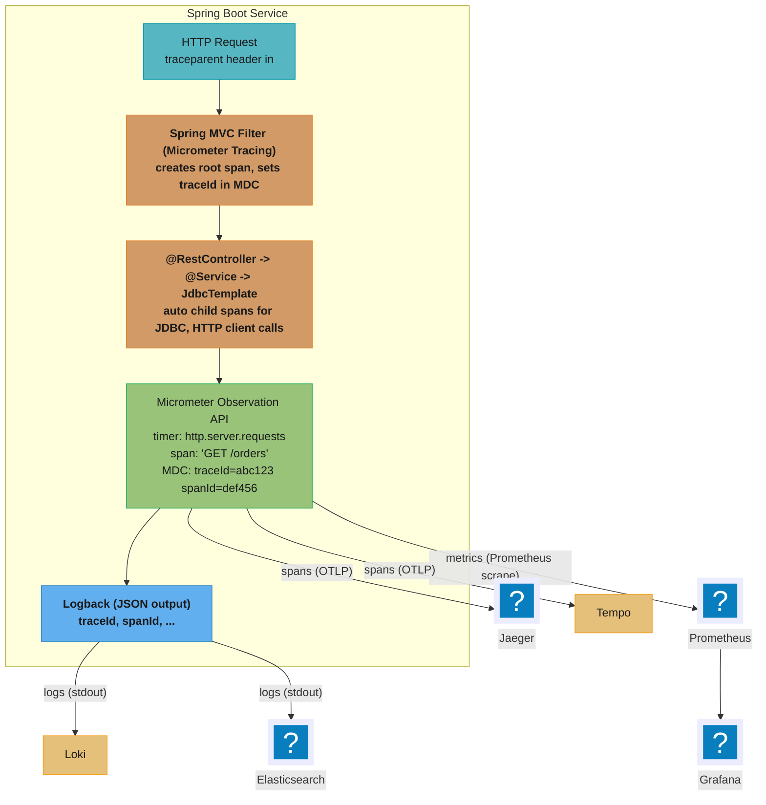
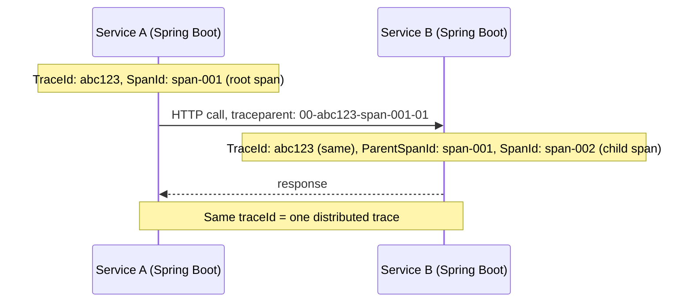

# Observability and Tracing in Spring

## 1. Concept Overview

Observability in a Spring Boot service means the ability to understand the system's behaviour from its external outputs — metrics, traces, and logs — without touching the running code (the "three pillars of observability").

Key components in the Spring ecosystem:

**Metrics:**
- `Micrometer` — vendor-neutral metrics API (counter, gauge, timer, histogram)
- `micrometer-registry-prometheus` — exposes metrics as Prometheus text format at `/actuator/prometheus`
- Spring Boot Actuator — auto-instruments HTTP requests, JVM, HikariCP, Kafka, etc.

**Tracing:**
- `Micrometer Tracing` 1.7 — Spring Boot 4+ tracing abstraction (replaces Spring Cloud Sleuth)
- `spring-boot-starter-opentelemetry` — Spring Boot 4's OpenTelemetry starter; bundles the Micrometer Tracing OTel bridge, the OTel SDK, and the OTLP exporter in one dependency
- `micrometer-tracing-bridge-otel` — OpenTelemetry bridge (still addable on its own when you need to pin the bridge or SDK independently of the starter's BOM)
- `opentelemetry-exporter-otlp` — exports spans via OTLP to Jaeger, Tempo, Honeycomb, Datadog
- W3C Trace Context (`traceparent` header) — standardised trace propagation across services

**Structured Logging:**
- `spring-boot-starter-logging` (Logback by default) — MDC populated with `traceId` / `spanId` by Micrometer Tracing
- JSON logging via `logstash-logback-encoder` — structured log output for ingestion by Elasticsearch/Loki
- `logging.structured.format.console=ecs` (Spring Boot 3.4+) — native ECS structured logging

**Observation API (unified abstraction):**
- `Observation` (Micrometer 1.17) — single abstraction that produces metrics, traces, AND log correlation simultaneously

---

## 2. Intuition

> Observability is the ability to ask "what is my system doing right now?" and get a concrete, data-backed answer. A distributed system without observability is a black box — you learn about problems only when customers complain.

**Key insight:** The shift from logging to observability is a shift from "recording what happened" to "understanding causality." A log line saying `"Order 12345 created in 245ms"` is a fact; a trace showing the 245ms broke down as 2ms Spring MVC + 180ms JDBC + 63ms external API + 0ms serialization is an explanation. Structured logs without traces are searchable but not causal; traces without logs lose context. The Micrometer Observation API threads all three together automatically.

**Why this matters for senior engineers:** Production incidents are resolved by those who can find the cause fastest. Engineers who understand distributed tracing (trace IDs propagated via `traceparent`, span hierarchy, exemplars linking metrics to traces) debug p99 latency regressions in 5 minutes that others spend hours on by reading logs.

---

## 3. Core Principles

1. **Three pillars of observability**: metrics (aggregate), traces (per-request), logs (event records). All three are needed; no single pillar suffices alone.
2. **Trace context propagation**: a `traceId` must flow through every service call. W3C `traceparent` header is the standard format (`00-{traceId}-{spanId}-{flags}`).
3. **Auto-instrumentation first**: Spring Boot Actuator + Micrometer Tracing auto-instruments HTTP, JDBC, Kafka, Redis, and `@Scheduled` — write explicit `Observation` code only for business-critical custom operations.
4. **Sampling matters**: at high volume (1,000 req/s), 100% trace sampling generates 1,000 spans/req = 1M span-events/s — too expensive. Use head-based (random 1–10%) or tail-based (100% for errors/slow requests) sampling.
5. **Structured logs with trace correlation**: MDC fields `traceId` and `spanId` enable jumping from a log line to the corresponding trace in Jaeger/Grafana Tempo — the critical debugging link.
6. **Exemplars**: a Prometheus metric data point that carries a `{traceId}` label — allows navigating from a high p99 histogram bucket directly to an example trace that contributed to it.

---

## 4. Types / Architectures / Strategies

### 4.1 Instrumentation Levels

| Level | How | What You Get |
|---|---|---|
| Auto-instrumentation (Spring Boot Actuator) | Just add dependencies | HTTP, JVM, HikariCP, Kafka, Redis, Spring Batch, `@Scheduled` metrics + traces |
| Micrometer Observation API | `Observation.start("name")` | Custom span + metric + MDC correlation in one call |
| Manual Micrometer | `registry.counter("name").increment()` | Custom metrics without tracing |
| Manual OTel API | `tracer.spanBuilder("name").startSpan()` | Full control over span attributes |
| Aspect-based | `@Observed` annotation (Spring Boot 3.2+) | Automatically creates an Observation for every annotated method |

### 4.2 Propagation Formats

| Format | Header | Standard | Supported By |
|---|---|---|---|
| W3C Trace Context | `traceparent`, `tracestate` | W3C Recommendation | OTel, Micrometer Tracing, all modern APMs |
| B3 Single | `b3` | Zipkin | Zipkin, older Sleuth |
| B3 Multi | `X-B3-TraceId`, `X-B3-SpanId`, etc. | Zipkin | Zipkin, older systems |
| Datadog | `x-datadog-trace-id`, etc. | Proprietary | Datadog Agent |

Spring Micrometer Tracing defaults to W3C `traceparent` with the OTel bridge. B3 is available via `micrometer-tracing-bridge-brave`.

---

## 5. Architecture Diagrams

### Observability Stack Overview



### Distributed Trace Propagation



---

## 6. How It Works — Detailed Mechanics

### 6.1 Required Dependencies (Spring Boot 4.1 + Maven)

```xml
<!-- Actuator (metrics endpoint, health, info) -->
<dependency>
    <groupId>org.springframework.boot</groupId>
    <artifactId>spring-boot-starter-actuator</artifactId>
</dependency>

<!-- Micrometer Prometheus registry -->
<dependency>
    <groupId>io.micrometer</groupId>
    <artifactId>micrometer-registry-prometheus</artifactId>
</dependency>

<!-- OpenTelemetry starter — bundles the Micrometer Tracing OTel bridge,
     the OTel SDK, and the OTLP exporter as one managed dependency -->
<dependency>
    <groupId>org.springframework.boot</groupId>
    <artifactId>spring-boot-starter-opentelemetry</artifactId>
</dependency>
```

`spring-boot-starter-opentelemetry` replaces the Boot 3-era combination of
`micrometer-tracing-bridge-otel` + `opentelemetry-exporter-otlp` pulled in and versioned
individually. Add those two artifacts directly, instead of the starter, only when you need
to pin the bridge or the OTel SDK to a version the starter's BOM does not carry — for a new
service the starter is the default.

### 6.2 Configuration

```yaml
# application.yaml
management:
  endpoints:
    web:
      exposure:
        include: health, info, prometheus, metrics, loggers
  tracing:
    sampling:
      probability: 0.1   # 10% head-based sampling (100% in dev: 1.0)
  opentelemetry:
    enabled: true                            # false disables the OTel SDK while keeping propagators wired
    tracing:
      export:
        otlp:
          endpoint: http://otel-collector:4318/v1/traces  # OTLP HTTP endpoint
      sampler: parent-based-trace-id-ratio    # or always-on, always-off, trace-id-ratio, parent-based-always-on/off
      limits:
        max-attributes: 64
        max-attribute-value-length: 256
    logging:
      limits:
        max-attributes: 64

logging:
  pattern:
    console: "%d{ISO8601} %-5level [%X{traceId},%X{spanId}] %logger{36} - %msg%n"
  # Or structured JSON logging (Spring Boot 3.4+):
  # structured:
  #   format:
  #     console: ecs

spring:
  application:
    name: order-service   # appears in trace service.name attribute
```

`management.opentelemetry.enabled=false` disables the OTel SDK entirely while keeping the
W3C `traceparent` propagator configuration active — useful when a sidecar `-javaagent`
already owns span creation and Spring's own SDK would double-instrument (§8).
`management.opentelemetry.tracing.sampler` selects the OTel sampler implementation
directly; `management.tracing.sampling.probability` remains the bridge-level shorthand
for the common "ratio of requests to trace" case and is honoured by the
`parent-based-trace-id-ratio` sampler above. `management.opentelemetry.tracing.limits.*`
and `management.opentelemetry.logging.limits.*` bound `SpanLimits`/`LogLimits` — cap
attribute count and value length so one runaway `highCardinalityKeyValue` call cannot
bloat every exported span.

### 6.3 Using the Micrometer Observation API

```java
// Auto-instrumentation is active by default for HTTP, JDBC, Kafka.
// For custom business logic, use Observation:

@Service
@RequiredArgsConstructor
public class InventoryService {
    private final ObservationRegistry registry;
    private final InventoryRepository repo;

    public InventoryStatus checkStock(long productId, int quantity) {
        return Observation.createNotStarted("inventory.check", registry)
            .lowCardinalityKeyValue("product.category", lookupCategory(productId))
            .highCardinalityKeyValue("product.id", String.valueOf(productId))
            .observe(() -> {
                // Everything inside observe() is wrapped in:
                //   - a timer metric: inventory.check{product.category=...}
                //   - a trace span: "inventory.check"
                //   - MDC: traceId, spanId auto-populated
                InventoryRecord record = repo.findById(productId);
                return record.availableQty() >= quantity
                    ? InventoryStatus.AVAILABLE
                    : InventoryStatus.OUT_OF_STOCK;
            });
    }
}
```

Key distinction:
- **`lowCardinalityKeyValue`**: tag with few distinct values (category, status, region) → safe for Prometheus labels (no cardinality explosion)
- **`highCardinalityKeyValue`**: attribute with many values (product ID, user ID, order ID) → stored in span attributes only, NOT as Prometheus labels

### 6.4 @Observed Annotation (Spring Boot 3.2+)

```java
// Declarative observation — no boilerplate Observation.createNotStarted() code
@Service
@Observed(name = "payment.processing", contextualName = "processPayment")
public class PaymentService {

    @Observed(name = "payment.charge", contextualName = "chargeCard")
    public PaymentResult charge(PaymentRequest req) {
        // Automatically wrapped in an Observation when called
        return stripeClient.charge(req);
    }
}

// Requires @EnableMethodSecurity or equivalent AOP enablement
// and spring-boot-starter-aop on classpath
```

### 6.5 Structured Logging with Trace Correlation

```xml
<!-- logback-spring.xml: JSON logging with traceId/spanId in every log line -->
<appender name="JSON" class="ch.qos.logback.core.ConsoleAppender">
    <encoder class="net.logstash.logback.encoder.LogstashEncoder">
        <customFields>{"service":"order-service","env":"${SPRING_PROFILES_ACTIVE}"}</customFields>
        <fieldNames>
            <timestamp>@timestamp</timestamp>
            <message>message</message>
            <level>level</level>
        </fieldNames>
        <!-- traceId and spanId come from MDC, auto-populated by Micrometer Tracing -->
    </encoder>
</appender>
```

Output line:
```json
{
  "@timestamp": "2024-01-15T02:34:56.789Z",
  "level": "INFO",
  "message": "Order 12345 created",
  "traceId": "abc123def456789012345678",
  "spanId": "0123456789abcdef",
  "service": "order-service",
  "env": "production"
}
```

### 6.6 Exemplars — Linking Metrics to Traces

```yaml
# Enable exemplars in Prometheus registry
management:
  metrics:
    distribution:
      percentiles-histogram:
        http.server.requests: true   # required for exemplars
```

```java
// Exemplars are automatically attached to histogram observations
// when both Micrometer Tracing and Prometheus registry are present.
// Each histogram bucket observation carries the traceId of a sample span.

// Prometheus scrape output (with exemplars):
// http_server_requests_seconds_bucket{...le="0.5"} 1234 # {traceId="abc123"} 0.432 1705283696
//                                                         ^^^ links this bucket to a trace
```

With Grafana: click on a histogram bucket data point → "Explore Trace" → jumps directly to the Jaeger/Tempo trace that contributed to that bucket. This is the exemplar-to-trace navigation.

### 6.7 BROKEN -> FIXED — Losing Trace Context in Async Operations

```java
// BROKEN: trace context is ThreadLocal-based — async thread has empty context
@Async
public CompletableFuture<Result> processAsync(Order order) {
    // traceId in MDC is null — logs from this method have no trace correlation
    log.info("Processing order {}", order.id());  // no traceId in log
    return CompletableFuture.completedFuture(service.process(order));
}
```

**FIX: turn on context propagation for the executor that runs `@Async`.** Propagation is
off by default. For the executor Spring Boot auto-configures, one property applies Spring
Framework's `ContextPropagatingTaskDecorator`, which captures trace span, MDC, and baggage
on the calling thread and restores them on the worker:

```yaml
spring:
  task:
    execution:
      propagate-context: true   # default false in the Spring Boot 4.1 property reference
```

An application that defines its own `ThreadPoolTaskExecutor` bean does not get the
auto-configured executor, so the property does nothing for it. Set the decorator on that
bean instead:

```java
@Bean
public ThreadPoolTaskExecutor applicationTaskExecutor() {
    ThreadPoolTaskExecutor executor = new ThreadPoolTaskExecutor();
    executor.setCorePoolSize(8);
    executor.setTaskDecorator(new ContextPropagatingTaskDecorator()); // restores span + MDC
    return executor;
}
```

With either in place, the identical `@Async` method above logs a populated `traceId`.

**The case that needs a manual wrapper** is an executor that is not a
`ThreadPoolTaskExecutor` — a plain `ExecutorService` you submit work to directly, or a raw
`new Thread(...)`. There, wrap it explicitly with
`io.micrometer:context-propagation`'s `ContextSnapshot`:

```java
// For a plain ExecutorService, which has no TaskDecorator hook. A ThreadPoolTaskExecutor
// takes ContextPropagatingTaskDecorator instead (above).
@Configuration
public class UnmanagedExecutorConfig {

    @Bean
    public ExecutorService rawWorkerPool(ObservationRegistry registry) {
        ExecutorService raw = Executors.newFixedThreadPool(8);
        return ContextExecutorService.wrap(raw, () -> ContextSnapshot.captureAll(registry));
    }
}
```

### 6.8 Running the OpenTelemetry Java Agent Instead of the Bridge

The alternative to §6.1's dependency-based setup is zero-code: attach the agent at JVM
startup and disable Spring's own SDK so the two do not both instrument the same call
(§8.1).

```bash
java -javaagent:opentelemetry-javaagent.jar \
     -Dotel.service.name=order-service \
     -Dotel.exporter.otlp.endpoint=http://otel-collector:4318 \
     -Dotel.traces.sampler=parentbased_traceidratio \
     -Dotel.traces.sampler.arg=0.1 \
     -jar order-service.jar
```

```yaml
# application.yaml — silence Spring's own OTel SDK so the agent is the only instrumenter
management:
  opentelemetry:
    enabled: false   # propagator wiring stays; span creation and export move to the agent
```

The agent now owns HTTP, JDBC, and Kafka spans without a single line of Spring
configuration for them. `@Observed`-annotated methods still work — Micrometer's
`Observation` API creates its span through the agent's registered OTel `Tracer` — but
`Observation`-driven *metrics* stop flowing through the disabled Micrometer registry path,
so a service that leans on `Observation` for custom business metrics, not just spans,
should keep the bridge active instead of disabling it wholesale.

---

## 7. Real-World Examples

### 7.1 Netflix — Atlas + Distributed Tracing

Netflix uses Atlas (their internal time-series system) for metrics and a distributed tracing system (similar to Zipkin) for request tracing. Each microservice publishes `traceId` in every log line. When a user reports a video stream failure, on-call engineers use the `traceId` from the error log to reconstruct the full call graph across 50+ microservices — identifying whether the failure was in the CDN, the streaming service, the licensing service, or the playback device.

### 7.2 Shopify — Grafana LGTM Stack

Shopify uses the Grafana LGTM stack: Loki (logs), Grafana (dashboards), Tempo (traces), Mimir (metrics). Spring Boot services ship `traceId` in JSON logs (Loki), spans via OTLP to Tempo, and Prometheus metrics to Mimir. During a Black Friday incident, engineers drill down: Grafana dashboard shows p99 checkout latency spike → Tempo trace shows 3-second DB lock wait → Loki query filters by `traceId` to find the full context → root cause identified in 3 minutes.

### 7.3 Spring Boot Actuator — JVM and HikariCP Auto-metrics

Spring Boot Actuator auto-instruments: `jvm.memory.used`, `jvm.gc.pause`, `hikaricp.connections.pending`, `spring.kafka.consumer.fetch-latency-avg`, `http.server.requests` (histograms with p50/p95/p99). These metrics require zero application code — just `spring-boot-starter-actuator` + a registry dependency. An operations team building Grafana dashboards for a new service gets instant visibility without instrumenting a single line of business code.

### 7.4 Replacing an async-propagation workaround with one property

A payment-processing team had an `AsyncConfig` bean wrapping every `@Async` executor with
`ContextExecutorService.wrap(executor.getThreadPoolExecutor(), () -> ContextSnapshot.captureAll(registry))` —
about 20 lines of boilerplate duplicated across 6 services, plus a unit test per service
asserting the wrapped executor propagated `traceId`. The team deleted the bean, went back
to Spring Boot's auto-configured executor, and set
`spring.task.execution.propagate-context=true`, which applies `ContextPropagatingTaskDecorator`
to that executor. They kept one test per service, because the property defaults to `false`
and a missing line silently drops the `traceId` again. The only executor left wrapped was a
`ScheduledExecutorService` one service built directly in a `@PostConstruct` method to poll a
legacy SOAP endpoint; it has no `TaskDecorator` hook, so it kept its
`ContextExecutorService.wrap()` call.

---

## 8. Tradeoffs

| Approach | Coverage | Cardinality Risk | Overhead | When |
|---|---|---|---|---|
| Auto-instrumentation only | HTTP, JDBC, Kafka, JVM | Low | Minimal | Default for most services |
| `@Observed` annotation | Method-level, all code | Moderate (if poorly tagged) | Low (AOP proxy) | Annotating service-layer business operations |
| Manual `Observation` API | Full control | Controlled | Low | Critical custom operations |
| Manual OTel API | Full control | Controlled | Low | When OTel-specific features needed |
| 100% trace sampling | All requests | N/A (traces not metrics) | High storage + network | Dev/test; never in production at >100 req/s |
| Tail-based sampling | Errors + slow | N/A | Higher collector CPU | High-value traces only |

### 8.1 Deployment choice: Micrometer Tracing bridge vs OpenTelemetry Java agent

Every option in the table above assumes an in-process bridge. The deployment decision that
actually determines how a service gets traced is bridge vs agent, and it is binary, not a
spectrum:

| | Micrometer Tracing bridge (in-process) | OTel Java agent (`-javaagent`) |
|---|---|---|
| How it's added | `spring-boot-starter-opentelemetry` / `micrometer-tracing-bridge-otel` dependency | `-javaagent:opentelemetry-javaagent.jar` at JVM startup, no dependency |
| Code required | Yes: `Observation`/`@Observed` calls for anything beyond auto-instrumented HTTP/JDBC/Kafka | None: bytecode instrumentation at class-load time |
| Typed API | Yes: `Observation`, `lowCardinalityKeyValue`/`highCardinalityKeyValue` | No: spans are created wherever the agent's instrumentation module decides |
| Library coverage | Whatever Spring auto-instruments plus what you code | Broader: 100+ libraries instrumented out of the box, including ones Spring never wires |
| Works with Spring's own instrumentation | Yes, it *is* Spring's instrumentation | Overlaps it: the agent also instruments Spring MVC/JDBC/Kafka |

**The two must not both be active.** Running the bridge and the agent together double-spans
every auto-instrumented call and risks a class-loader `ClassCastException` between the
agent's bundled OTel SDK and the app's own `io.opentelemetry` classes on the classpath. Pick
one: set `management.opentelemetry.enabled=false` (§6.2) to silence the in-process SDK when
the agent is attached, or omit the agent and use the bridge for a service you actually want
typed `Observation` calls in. There is no supported "use both" configuration.

---

## 9. When to Use / When NOT to Use

### Use Micrometer Observation API when:
- Instrumenting custom business-critical operations (payment processing, fraud detection, external API calls)
- You need one instrumentation call to produce metrics AND traces AND log correlation simultaneously

### Use `@Observed` annotation when:
- You want declarative, zero-boilerplate observation for service-layer methods
- AOP-proxied beans are acceptable (same restrictions as `@Transactional`)

### Use manual `MeterRegistry` (counters, gauges) when:
- You need custom domain metrics not captured by Observation (e.g., business KPIs: orders per minute by product category, cart abandonment rate)
- No trace context is needed — purely aggregate business metrics

### Use the Micrometer Tracing bridge (in-process) when:
- The service already uses `@Observed`/`Observation` for custom business metrics — the bridge is what makes those calls produce spans at all
- You want typed span attributes (`lowCardinalityKeyValue`/`highCardinalityKeyValue`) rather than whatever the agent's auto-instrumentation happens to attach
- You are building a new service and want the dependency, not a deployment-time JVM flag, to be the source of truth for what's instrumented

### Use the OTel Java agent when:
- Instrumenting a legacy or third-party service you cannot or do not want to add dependencies to
- You need coverage of a library Spring does not auto-instrument (the agent's 100+ supported libraries are broader than Spring's own instrumentation set)
- Rolling out tracing across many existing services quickly, where consistent zero-code coverage matters more than typed spans

### Do NOT:
- Attach the OTel Java agent to a service that also depends on `spring-boot-starter-opentelemetry` without setting `management.opentelemetry.enabled=false` — see Pitfall 6.
- Add user IDs, order IDs, or product IDs as **Prometheus metric labels** — high cardinality causes Prometheus OOM. Use them as span attributes instead.
- Set `sampling.probability=1.0` in production without estimating storage costs: 1,000 req/s × 10 spans/req × 500 bytes = 5 MB/s = 432 GB/day.

**What this actually says.** "Trace storage is just requests per second times spans per request times bytes per span — and sampling is the one multiplier you control." Everything on the left of that equation is set by your traffic and your instrumentation depth; `sampling.probability` is the only term you can turn down without changing the application.

| Symbol | What it is |
|--------|------------|
| `1,000 req/s` | Request rate hitting the traced service. Set by traffic, not by you |
| `10 spans/req` | Instrumentation depth — one span per hop: controller, JDBC, Redis, outbound HTTP |
| `500 bytes` | Wire size of one exported span: IDs, name, timestamps, attributes |
| `sampling.probability` | Fraction of traces kept, `0.0`–`1.0`. Multiplies the whole product |
| `86,400` | Seconds in a day — converts a per-second rate into a daily volume |

**Walk one example.** The same traffic at 100% versus the recommended 10%:

```
  spans/s   = 1,000 req/s x 10 spans/req      = 10,000 spans/s
  bytes/s   = 10,000 x 500 bytes              = 5,000,000 B/s = 5 MB/s
  per day   = 5 MB/s x 86,400 s               = 432,000 MB    = 432 GB/day

  probability = 1.0  ->  432 GB/day
  probability = 0.1  ->  432 x 0.1            = 43.2 GB/day
  saved                                       = 388.8 GB/day

  at 0.1 with 30-day retention: 43.2 x 30     = 1,296 GB  (~1.3 TB steady state)
```

Dropping one digit of `sampling.probability` divides the bill by ten. That is why the
production recommendation is `0.1` plus a tail-based rule that re-adds the traces you
actually need.

**Why the tail-based rule exists.** Head-based sampling is uniform, so it keeps 10% of
*errors* too. If your error rate is 0.1%, that is 1,000 req/s × 0.001 × 0.1 = 0.1 error
traces per second — you lose 90% of exactly the traces you were going to debug. Tail-based
sampling keeps 100% of errors and 10% of the rest; because errors are rare, the extra
storage is a rounding error on the 43.2 GB/day figure.

---

## 10. Common Pitfalls

### Pitfall 1: High-cardinality labels in Prometheus
```java
// BROKEN: order ID as a metric label → millions of unique label combinations
registry.timer("order.processing", "orderId", String.valueOf(order.id()))
    .record(duration);
// Prometheus keeps one time series per label combination → OOM at scale

// FIX: use low-cardinality labels only for metrics
registry.timer("order.processing", "tier", order.customerTier().name())
    .record(duration);
// Store orderId as a span attribute instead (high cardinality is fine there)
```

### Pitfall 2: Missing trace context in async code
See §6.7. Context propagation to `@Async` is off by default, so a log line on the worker
thread has no `traceId` until `spring.task.execution.propagate-context=true` is set for the
auto-configured executor, or a custom `ThreadPoolTaskExecutor` gets a
`ContextPropagatingTaskDecorator`. A plain `ExecutorService` or a raw `Thread` needs
`ContextExecutorService.wrap()`.

### Pitfall 3: Actuator endpoints exposed on the public port
```yaml
# BROKEN: all Actuator endpoints on port 8080 — exposed to internet
management:
  endpoints:
    web:
      exposure:
        include: "*"

# FIX: separate management port (not routed in the public load balancer)
management:
  server:
    port: 8081   # internal only; never in public VPC routing tables
  endpoints:
    web:
      exposure:
        include: health, prometheus, loggers
```

### Pitfall 4: Sampling suppressing error traces
Head-based sampling at 1% drops 99% of traces — including error traces you want to see. Fix: configure tail-based sampling (otel-collector or Tempo) to always keep traces with `status=ERROR` and sample the rest at 1%.

### Pitfall 5: Losing `traceId` at asynchronous service boundary (message queues)
When an event is published to Kafka, the `traceparent` header must be written to the Kafka record headers. Spring Kafka's `KafkaTemplate` with Micrometer Tracing propagation does this automatically — but only if the trace context is active on the publishing thread. Verify with `kafka-console-consumer --property print.headers=true` that `traceparent` appears in record headers.

### Pitfall 6: Running the Micrometer Tracing bridge and the OTel Java agent together
```bash
# BROKEN: the agent is attached AND the app depends on spring-boot-starter-opentelemetry
java -javaagent:opentelemetry-javaagent.jar -jar order-service.jar
# management.opentelemetry.enabled defaults to true — Spring's own SDK is also active
```
Every HTTP/JDBC/Kafka call now gets two spans — one from the agent's bytecode
instrumentation, one from Spring's auto-configured OTel SDK — doubling the trace tree and,
depending on classloader layering, risking a `ClassCastException` between the agent's
bundled `io.opentelemetry.api.trace.Span` and the app's own copy on the classpath. Fix:
pick one instrumenter (§8.1). Running the agent: set `management.opentelemetry.enabled=false`
so Spring's SDK stops creating and exporting spans while the propagator wiring stays
active. Running the bridge: do not attach `-javaagent` at all.

---

## 11. Technologies & Tools

| Tool / Feature | Version | Purpose |
|---|---|---|
| `spring-boot-starter-actuator` | Spring Boot 4.x | Auto-instruments + exposes metrics/health/info endpoints |
| `spring-boot-starter-opentelemetry` | Spring Boot 4+ | OTel starter bundling the Micrometer Tracing bridge, OTel SDK, and OTLP exporter |
| `micrometer-registry-prometheus` | Micrometer 1.17 | Prometheus metrics scrape endpoint at /actuator/prometheus |
| `micrometer-tracing-bridge-otel` | Micrometer Tracing 1.7 | OTel bridge for Micrometer Tracing (also pulled in by the starter above) |
| `opentelemetry-exporter-otlp` | OTel Java SDK 1.x | OTLP span export to Jaeger/Tempo/Honeycomb/Datadog |
| `Observation` API | Micrometer 1.17 (Spring Boot 3+) | Unified metrics + trace + log correlation |
| `@Observed` | Micrometer 1.17 (Boot 3.2+) | Declarative method-level observation |
| W3C `traceparent` | W3C Recommendation | Distributed trace context propagation header |
| `logstash-logback-encoder` | 7.x | JSON structured logging for Logback |
| `logging.structured.format.console=ecs` | Spring Boot 3.4+ | Native ECS structured JSON logging |
| `management.tracing.sampling.probability` | Spring Boot 4.x | Head-based sampling rate (0.0–1.0), honoured by the OTel ratio samplers |
| `management.opentelemetry.enabled` / `.tracing.sampler` / `.tracing.limits.*` / `.logging.limits.*` | Spring Boot 4.1+ | OTel SDK enable/disable, sampler selection, span/log attribute limits |
| Grafana Tempo | Open source | Distributed trace backend (OTLP ingestion) |
| Jaeger | Open source | Alternative distributed trace backend |
| Prometheus | Open source | Metrics time-series database |
| Grafana | Open source | Dashboard + alerting + trace navigation |

---

## 12. Interview Questions with Answers

**Q: What are the three pillars of observability, and why is each insufficient alone?**
**Short:** Metrics, traces, and logs each show a different slice, and none alone explains a slow request.
Metrics, traces, and logs. Metrics (counters, histograms, gauges) are aggregate — they tell you that p99 latency is 2 seconds but not which specific requests are slow or why. Traces are per-request causality maps — they show which service and which code path took the 2 seconds, but individual traces don't tell you how widespread the problem is. Logs are event records — they capture detailed context per event but are not structured for aggregation or causality analysis. Together: metrics alert you that something is wrong, traces tell you why a specific request was slow, and logs provide the fine-grained context (SQL queries, error messages, business fields) for debugging.

**Q: What is the W3C `traceparent` header and what are its fields?**
**Short:** It is the standard propagation header carrying version, trace ID, parent span ID, and sampling flags.
`traceparent` is the W3C Trace Context standard for distributed trace propagation. Format: `{version}-{traceId}-{parentSpanId}-{flags}`. Example: `00-abc123def456789012345678901234-0123456789abcdef-01`. Fields: `version` (always `00`); `traceId` (128-bit hex, unique per distributed request — same across all services in one request); `parentSpanId` (64-bit hex, the calling span's ID — enables parent-child span linking); `flags` (8-bit, bit 0 = sampling flag: `01` means this trace is sampled). When Service A calls Service B, A sets `traceparent` with its own `spanId` as `parentSpanId` — Service B creates a child span with A's span as parent, building the trace tree.

**Q: What is the Micrometer Observation API, and how does it differ from directly calling `MeterRegistry`?**
**Short:** It creates a metric, a trace span, and MDC context together, keeping all three signals correlated.
`MeterRegistry.counter("name").increment()` creates a metric only — no trace span, no MDC context. The Observation API (`Observation.createNotStarted("name", registry).observe(...)`) creates all three simultaneously: a timer metric (`name` with `outcome` and `exception` tags), a trace span (added as a child to the current active span), and populates MDC with `traceId`/`spanId` for the duration of the observed block. This ensures all three signals share the same name and context — when you look at a metric, a trace, and a log, they all agree on what happened. Using raw `MeterRegistry` calls scatters the instrumentation and loses correlation.

**Q: What is trace sampling and what are the tradeoffs between head-based and tail-based sampling?**
**Short:** Head-based decides at the root span cheaply; tail-based decides after completion so it can always keep errors.
Head-based sampling decides at the root span (first service) whether to record the trace — all downstream services inherit the decision. It is computationally cheap but cannot make intelligent decisions: a 1% head-based sampler drops 99% of traces, including some error traces. Tail-based sampling records all trace data initially and makes the keep/drop decision after the trace is complete — allowing "always keep errors or traces > 1 second." Tail-based sampling requires a trace collector (OTel Collector, Tempo with trace-aware receiver) to buffer spans and correlate them by `traceId` before applying the sampling policy. Cost: higher collector memory + CPU. Best practice: head-based 1–10% for normal traffic, tail-based rule to always keep error traces.

**Q: What is cardinality in Prometheus metrics, and why is it dangerous to use request-level IDs as labels?**
**Short:** Each unique label combination creates a stored time series, so high-cardinality IDs can OOM Prometheus.
Each unique combination of label values in a Prometheus metric creates one time series in Prometheus's memory. Prometheus stores all active series in memory for fast queries. Adding a label with 1 million distinct values (e.g., `userId`, `orderId`, `traceId`) creates 1 million time series — each consuming ~1–2 KB of memory = 1–2 GB per metric just for that label. This "cardinality explosion" causes Prometheus OOM and query timeouts. Rule: Prometheus labels must be low cardinality (< 1,000 distinct values): `status` (ok/error), `tier` (free/pro/enterprise), `region` (us-east/eu-west), `endpoint` (path template, not full URL). High-cardinality identifiers (userId, orderId, traceId) belong in trace span attributes — the trace backend indexes them efficiently.

**Q: How does Micrometer Tracing propagate the trace context to virtual threads or CompletableFuture?**
**Short:** By capturing a ContextSnapshot on the calling thread and restoring it on the worker, through a TaskDecorator or a wrapped executor.
Trace span, MDC, and baggage live in `ThreadLocal`s, so a virtual thread or a `CompletableFuture` stage starts with none of them unless something copies them across. For a `ThreadPoolTaskExecutor`, including one backed by virtual threads, that something is `ContextPropagatingTaskDecorator`, which Spring Boot applies to its auto-configured executor when `spring.task.execution.propagate-context=true` (default `false`). For an `ExecutorService` you construct and submit work to directly, or a `CompletableFuture` chain on such an executor, Micrometer Tracing's context propagation (backed by `io.micrometer:context-propagation`) captures all registered context values — trace context, MDC, Reactor context — into a `ContextSnapshot`. Wrapping such an executor with `ContextExecutorService.wrap(executor, () -> ContextSnapshot.captureAll(registry))` restores the captured context before each submitted task runs; for a bare `CompletableFuture` stage, `ContextSnapshot.captureAll(registry).wrap(runnable/callable)` does the same. A `Executors.newVirtualThreadPerTaskExecutor()` used directly (not through `@Async`) needs the identical manual wrap.

**Q: What is an exemplar, and how does it link Prometheus metrics to distributed traces?**
**Short:** It is a histogram sample carrying the triggering request's trace ID, letting Grafana jump to that trace.
An exemplar is a sample data point attached to a Prometheus histogram/summary observation that carries additional metadata — specifically the `traceId` of the request that contributed to that observation. When a request with `traceId=abc123` is recorded in the `http.server.requests` histogram with a value of 0.8 seconds, the exemplar attaches `traceId=abc123` to that bucket boundary. In Grafana, a histogram visualization can display exemplars as orange dots — clicking a dot opens the Tempo trace for `abc123`. This is the "metric to trace" drill-down path. Requirements: Prometheus must be configured with `--enable-feature=exemplar-storage`; Micrometer must have both a tracing bridge and Prometheus registry active.

**Q: How do you configure distributed tracing with Spring Boot 4 to export spans to Jaeger via OTLP?**
**Short:** Add the OTel tracing bridge and OTLP exporter dependencies, then set the OTLP endpoint and sampling probability.
Add `spring-boot-starter-opentelemetry` (or `micrometer-tracing-bridge-otel` + `opentelemetry-exporter-otlp`). Configure:
```yaml
management:
  tracing:
    sampling:
      probability: 1.0  # 100% in dev
  opentelemetry:
    tracing:
      export:
        otlp:
          endpoint: http://jaeger:4318/v1/traces  # Jaeger OTLP HTTP endpoint
spring:
  application:
    name: my-service   # becomes the "service.name" span attribute
```
Spring Boot auto-configures the OTel `SdkTracerProvider`, the `OtlpHttpSpanExporter`, and the `MicrometerTracingAutoConfiguration`. Every HTTP request, JDBC query, and Kafka consumer invocation is automatically traced and exported to Jaeger. No manual `Tracer.spanBuilder()` code is needed for auto-instrumented paths.

**Q: What is structured logging, and how does it differ from traditional log messages?**
**Short:** It logs a JSON object of key-value fields instead of a free-text string, making logs queryable and joinable.
Traditional logging: `log.info("Order 12345 created for user john@example.com in 245ms")` — a human-readable string. Searching for all slow orders requires regex: `grep "created.*[0-9]{4,}ms"`. Structured logging: `log.info("Order created", kv("orderId", 12345), kv("userId", "john"), kv("durationMs", 245))` — a JSON object `{"message": "Order created", "orderId": 12345, "userId": "john", "durationMs": 245, "traceId": "abc123"}`. Searching for all orders > 200ms: `level=INFO AND message="Order created" AND durationMs>200`. Structured logs are queryable, aggregatable, and linkable to traces via `traceId`. They are also parsable by log aggregation systems (Elasticsearch, Loki) without fragile regex extraction.

**Q: How do you expose and secure the `/actuator/prometheus` endpoint?**
**Short:** Serve it only on a separate internal management port, never on the public port, with authentication.
Never expose Actuator endpoints on the public port in production. Configure a separate management port: `management.server.port=8081`. The load balancer routes port 8080 (public) to the internet; port 8081 is internal-only (VPC security group or Kubernetes NetworkPolicy blocks external access). On port 8081, expose only the needed endpoints: `management.endpoints.web.exposure.include=health,prometheus,loggers,metrics`. For authenticated scraping: configure `management.endpoint.prometheus.enabled=true` and add Spring Security to the management port with `HttpSecurity.requestMatcher(EndpointRequest.toAnyEndpoint()).authorizeHttpRequests(auth -> auth.anyRequest().hasRole("PROMETHEUS"))`.

**Q: What is the difference between `lowCardinalityKeyValue` and `highCardinalityKeyValue` in the Observation API?**
**Short:** Low-cardinality values become Prometheus tags; high-cardinality values become span attributes only.
`lowCardinalityKeyValue(key, value)` produces a Prometheus metric tag (label) — it must have few distinct values (< 100). Example: `product.category=electronics`. These appear as dimensions in Prometheus time series. `highCardinalityKeyValue(key, value)` produces a span attribute only — it is never added to the Prometheus metric. Example: `product.id=12345`. High-cardinality values in Prometheus labels cause cardinality explosion; in span attributes they are fine because the trace backend indexes them efficiently (by `traceId`). Using the wrong method — putting high-cardinality data in `lowCardinalityKeyValue` — causes Prometheus OOM.

**Q: How do you ensure the `traceId` appears in every log line, including logs from async methods?**
**Short:** Add %X{traceId} to the log pattern; Micrometer fills the MDC per span, and async threads see it only after context propagation is enabled.
Micrometer Tracing auto-populates MDC keys `traceId` and `spanId` for the duration of every span (HTTP request, JDBC call, Observation block). For synchronous code, the MDC is automatically populated and cleared. Async code is the gap: the MDC is a `ThreadLocal`, and propagation to `@Async` is off by default. Turn it on with `spring.task.execution.propagate-context=true` for Spring Boot's auto-configured executor, set a `ContextPropagatingTaskDecorator` on a custom `ThreadPoolTaskExecutor`, and wrap a plain `ExecutorService` or raw `Thread` task with `ContextExecutorService.wrap(...)` / `ContextSnapshot.captureAll(registry)` (§6.7). Verify: add `%X{traceId}` to your Logback pattern and write an integration test that calls an async service method and checks that the log output contains a non-empty `traceId`.

**Q: What are SLIs, SLOs, and how does Micrometer help implement them?**
**Short:** An SLI measures quality like p99 latency, an SLO sets its target, and Micrometer supplies the raw histograms.
SLI (Service Level Indicator) is a metric that measures service quality — e.g., p99 latency, error rate. SLO (Service Level Objective) is the target — e.g., "99% of requests complete in < 500ms". Micrometer provides: `http.server.requests` histogram (for latency SLIs), `http.server.requests{outcome=SERVER_ERROR}` counter (for error rate SLIs). In Prometheus/Grafana: `histogram_quantile(0.99, rate(http_server_requests_seconds_bucket[5m]))` computes p99 latency. An alerting rule fires when p99 > 500ms over 5 minutes — violating the SLO. Spring Boot Actuator's automatic `http.server.requests` instrumentation provides SLI data with zero custom code; SLO alerting lives in Prometheus/Grafana.

**Q: How would you trace a Spring Batch job end-to-end?**
**Short:** Spring Batch auto-creates nested spans for the job, each step, and each chunk under one trace tree.
Spring Batch 5 + Micrometer Tracing (Spring Boot 3.1+) auto-creates spans for: `JobExecution` (root span), each `StepExecution` (child span), and each chunk (child of step). The job trace shows: total job duration, per-step duration, and identifies slow steps. To add business context: use `Observation.createNotStarted("inventory.check", registry).observe(...)` inside `ItemProcessor` — creates a child span of the current step span. The full trace in Jaeger shows: `importJob` (root) → `importStep` → `chunk-0` → `inventory.check` × N. Configure `management.tracing.sampling.probability=1.0` for scheduled batch jobs (they're low-frequency, so 100% sampling is affordable).

**Q: How do metrics, traces, and logs together diagnose a production incident?**
**Short:** A metric spike, an exemplar-linked trace, and a correlated log line pinpointed a HikariCP pool exhaustion in minutes.
Scenario: Black Friday sale, checkout p99 latency spikes from 180ms to 4.2 seconds at 18:35. Grafana alert fires. Diagnosis in 4 minutes: (1) Grafana dashboard: `http.server.requests{uri=/checkout}` p99 histogram shows spike at 18:35; (2) exemplar on the spike bucket → jumps to a Tempo trace for `traceId=abc123`; (3) trace shows: checkout span 4.1s, JDBC `inventory.check` span 3.8s, DB connection `await` span 3.5s; (4) HikariCP metric `hikaricp.connections.pending` shows pool exhaustion (all 10 connections busy) at 18:35; (5) Loki query `traceId=abc123`: log line shows `connection acquire timed out after 3500ms` — HikariCP pool of 10 connections too small for Black Friday traffic; (6) fix: `spring.datasource.hikari.maximum-pool-size=25`. Resolved in 7 minutes. Without observability, this would have required hours of reading server logs.

**Q: What does `spring-boot-starter-opentelemetry` provide that adding the individual OTel dependencies did not?**
**Short:** One managed dependency for the tracing bridge, OTel SDK, and OTLP exporter, version-aligned by the Boot BOM.
`spring-boot-starter-opentelemetry` is Spring Boot 4's single starter for OpenTelemetry: it pulls in the Micrometer Tracing OTel bridge, the OpenTelemetry Java SDK, and the OTLP exporter together, with all three versions resolved by the Spring Boot BOM instead of declared and aligned by hand. Before it, a service added `micrometer-tracing-bridge-otel` and `opentelemetry-exporter-otlp` as two separate coordinates and relied on the BOM (or manual pinning) to keep the bridge and SDK compatible — a mismatch produced `NoSuchMethodError` at startup rather than a build failure. The starter does not add new capability over the two dependencies combined; it removes a version-skew failure mode and is the default choice for a new service. Reach for the individual artifacts only when you need to pin the bridge or SDK independently of what the starter's BOM entry carries.

**Q: What does `management.opentelemetry.enabled=false` actually disable, and when would you set it?**
**Short:** It turns off the OTel SDK's span/log pipeline while keeping W3C traceparent propagation configured.
`management.opentelemetry.enabled=false` disables the OpenTelemetry SDK — the `SdkTracerProvider`, the batch span processor, and the OTLP exporter stop creating and shipping spans — while Spring still configures the W3C `traceparent` propagator, so inbound/outbound header handling and MDC population keep working. The main reason to set it: a sidecar `-javaagent` is already attached and doing the instrumentation and export, and running Spring's own SDK alongside it would create a second, competing set of spans and risk a class-loader conflict between the agent's bundled OTel classes and the app's own (§8.1). It is also useful for isolating a "propagation only, no export" configuration in a test or local-dev profile without removing the dependency.

**Q: How do you bound span size in OpenTelemetry so one over-tagged operation cannot bloat every exported span?**
**Short:** Set management.opentelemetry.tracing.limits.max-attributes and max-attribute-value-length to cap span size.
`management.opentelemetry.tracing.limits.max-attributes` caps how many attributes (span tags) a single span can carry, and `management.opentelemetry.tracing.limits.max-attribute-value-length` caps how long any one attribute's value can be — both configure the OTel SDK's `SpanLimits`, and Boot 4.1 auto-configures them from these properties. Without a limit, a single `highCardinalityKeyValue` call that stuffs a large payload (a full JSON body, a stack trace) into a span attribute inflates every exported span's wire size, which multiplies directly into the OTLP export bandwidth and collector storage bill covered in §9's sampling math. `management.opentelemetry.logging.limits.*` applies the equivalent bound to `LogLimits` for OTel log records. Defaults are reasonable for typical attribute usage (64 attributes, 256-character values); tighten them further only if a specific instrumentation point is known to attach oversized values.

**Q: How does the Micrometer Tracing bridge differ from the OpenTelemetry Java agent, and can a service run both?**
**Short:** No: the bridge is in-process and typed, the agent is zero-code and broader, and running both double-instruments every call.
The bridge (`spring-boot-starter-opentelemetry` / `micrometer-tracing-bridge-otel`) is in-process: it requires the dependency and, for anything beyond auto-instrumented HTTP/JDBC/Kafka, explicit `Observation`/`@Observed` code, but it gives a typed API and integrates with Spring's own instrumentation and MDC population. The OTel Java agent (`-javaagent:opentelemetry-javaagent.jar`) instruments over 100 libraries by bytecode manipulation at class-load time with zero code and zero dependency, but offers no typed API: span boundaries are wherever the agent's instrumentation module draws them, not your domain boundary. They are not combinable: both instrumenting the same JDBC call produces duplicate spans, and the agent's bundled OTel SDK classes can collide with the app's own OTel classpath entries in a `ClassCastException`. Pick one: set `management.opentelemetry.enabled=false` to run the agent alone, or skip the agent and use the bridge where typed `Observation` calls matter.

**Q: Why does an `@Async` method log an empty `traceId`, and which fix fits which executor?**
**Short:** Propagation is off by default: set propagate-context for Boot's executor, a ContextPropagatingTaskDecorator on your own, wrap() for a plain ExecutorService.
`@Async` runs the method on an executor thread, and the trace span, MDC, and baggage are `ThreadLocal`s on the calling thread, so the worker starts with none of them. Spring Boot does not copy them by default: `spring.task.execution.propagate-context` is `false` in the Boot 4.1 property reference. Three fixes, by executor. Spring Boot's auto-configured `ThreadPoolTaskExecutor`: set `spring.task.execution.propagate-context=true`, which applies `ContextPropagatingTaskDecorator`. A `ThreadPoolTaskExecutor` bean you define yourself: the property does not reach it, so call `setTaskDecorator(new ContextPropagatingTaskDecorator())`. A plain `ExecutorService` or a raw `Thread`, which has no decorator hook: `ContextExecutorService.wrap(executor, () -> ContextSnapshot.captureAll(registry))`. Whichever applies, keep an integration test that asserts a non-empty `traceId` in the async log line, because removing one property line fails silently.

---

## 13. Best Practices

1. **Start with auto-instrumentation** — `spring-boot-starter-actuator` + Prometheus + Micrometer Tracing OTel bridge gives HTTP, JVM, JDBC, Kafka traces and metrics with zero application code.
2. **Use `@Observed` for service-layer methods** that are business-critical and need custom timing + trace spans.
3. **Never use high-cardinality values (userId, orderId) as Prometheus metric labels** — use `lowCardinalityKeyValue` for metrics labels, `highCardinalityKeyValue` for span attributes.
4. **Structure logs as JSON** (`logstash-logback-encoder`) with `traceId` and `spanId` in every line — enables direct Loki-to-Tempo navigation.
5. **Separate the management port** — never expose `/actuator/prometheus` on the public port.
6. **Set `sampling.probability=0.1` in production** (10%) for normal traffic; configure tail-based sampling in the OTel Collector to always keep error/slow traces.
7. **Turn on context propagation for `@Async`** — `spring.task.execution.propagate-context=true` for Spring Boot's executor, or a `ContextPropagatingTaskDecorator` on your own `ThreadPoolTaskExecutor` — and keep an integration test that asserts a non-empty `traceId` in the async log output. Reserve `ContextExecutorService.wrap()` for a plain `ExecutorService` or a raw `Thread`.
8. **Enable exemplars** (`management.metrics.distribution.percentiles-histogram.http.server.requests=true`) — essential for metric-to-trace drill-down.
9. **Annotate spans with business context** (order tier, customer region, payment method) for root cause analysis beyond raw latency.
10. **Define and alert on SLOs** using `histogram_quantile` Prometheus queries — observability without alerting is just expensive storage.

---

## 14. Case Study

**Scenario: Diagnosing p99 checkout latency regression after a Spring Boot upgrade**

An e-commerce service upgraded from Spring Boot 2.7 to 3.2. Post-upgrade, p99 checkout latency increased from 220ms to 680ms. Observability tools identified the root cause in 12 minutes.

**Step 1 — Metrics alert:** Grafana `http.server.requests{uri=/checkout}` p99 histogram alarm fires at 680ms (SLO: 500ms). The alarm includes an exemplar `traceId`.

**Step 2 — Trace drill-down (Tempo):** The exemplar trace shows:
```
checkout (680ms)
  ├── JDBC: SELECT inventory WHERE productId=? (550ms)  ← suspicious
  ├── JDBC: INSERT orders ... (12ms)
  └── Kafka: send order.created (5ms)
```

**Step 3 — Span attributes:** The JDBC span shows `db.statement = "SELECT * FROM inventory WHERE productId = ?"`. Absence of `db.row_count` attribute from the new auto-instrumentation suggests a full table scan.

**Step 4 — Structured logs (Loki, filter by traceId):**
```json
{"level":"WARN","message":"Slow query: SELECT * FROM inventory WHERE productId=? took 548ms","traceId":"abc123","rowsScanned":1200000}
```

**Root cause:** Spring Boot 3.2 + Hibernate 6 changed the default `IN` clause strategy. A `@Query` using `productId IN :ids` was generating a query that bypassed the composite index. The index on `(productId, warehouseId)` was only used when `warehouseId` was also in the WHERE clause; the new Hibernate 6 query omitted it.

**Fix:** Added `@Index(columnList = "productId")` to the entity + reworded the query.

**Timeline:** Alert at T+0, trace identified at T+3min, log confirms at T+7min, root cause at T+10min, fix deployed at T+42min. Without observability: this would have been a 4-hour war-room session comparing logs manually.

**Cross-links:**
- [Spring Boot Actuator](../spring_boot_actuator/spring_boot_actuator.md) — metrics endpoints, health indicators
- [Spring Cloud Patterns](../spring_cloud_patterns/spring_cloud_patterns.md) — Micrometer Tracing in distributed services
- [Spring Performance](../spring_performance/spring_performance.md) — JVM tuning, connection pool sizing

---

## Related / See Also

- [Spring Boot Actuator](../spring_boot_actuator/spring_boot_actuator.md) — Micrometer metrics foundation
- [Case Study: OTel Observability](../case_studies/cross_cutting/otel_observability_for_spring.md) — production tracing setup
- [Spring Cloud Patterns](../spring_cloud_patterns/spring_cloud_patterns.md) — distributed tracing across services
- [Observability, Tracing & OTel](../../devops/observability_tracing_and_otel/observability_tracing_and_otel.md) — OTel Collector pipeline, sampling policies, and backend deployment (Jaeger/Tempo/Prometheus) beyond the Spring-side instrumentation covered here
- [Observability (HLD)](../../hld/observability/observability.md) — the three-pillars theory and system-design tradeoffs behind metrics/traces/logs
- [Observability & Monitoring](../../backend/observability_and_monitoring/observability_and_monitoring.md) — alerting, SLIs/SLOs, and dashboard design at the platform level
