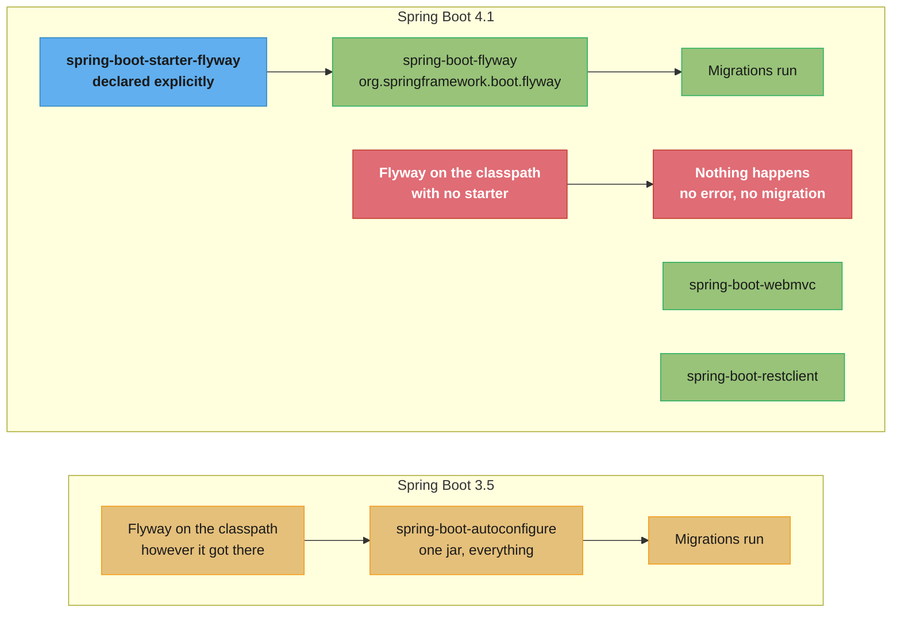
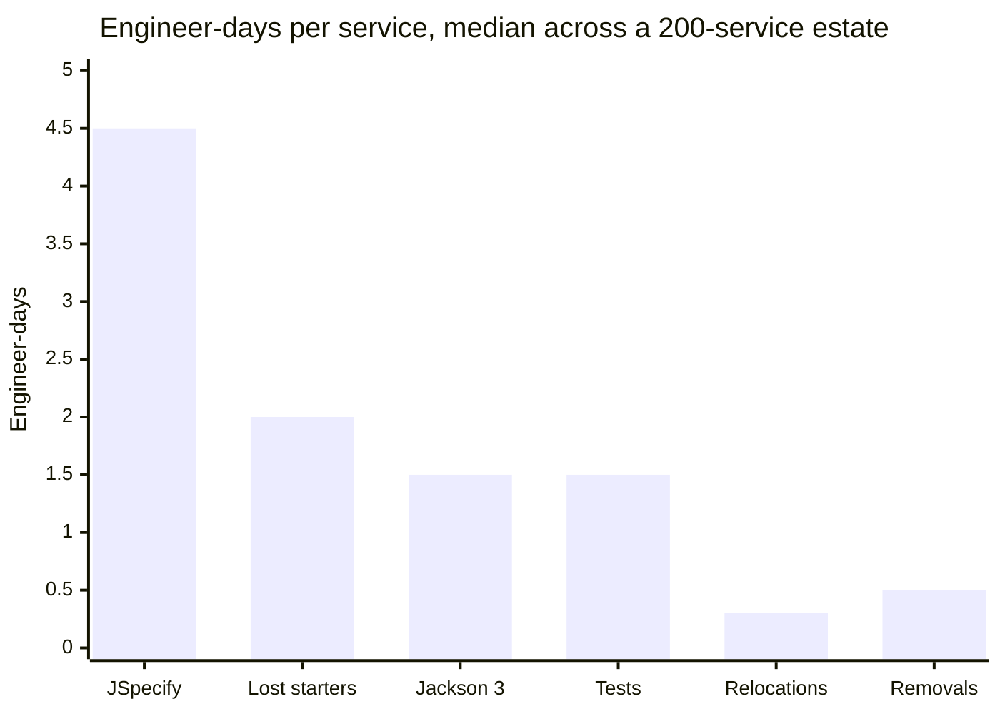

# Spring Boot 4 Migration

> Baseline for this module: **Spring Boot 4.1.x** (4.1.0 GA 2026-06-10) on **Spring Framework
> 7.0.8**, Java 17–26 with JDK 25 recommended. Spring Boot 4.0.0 went GA on **2025-11-20**.
> Every version, artifact id, property name and recipe id below is the one that is live today.

## 1. Concept Overview

Spring Boot 4 is not a routine minor. It is the release where **the framework's jar layout,
its JSON library, its null-safety contract and its Jakarta EE baseline all changed at once**,
and the upgrade from 3.5 is a scheduled project with a rollback plan rather than a version bump
in a `pom.xml`.

Four independent axes moved, and each breaks a different part of your build:

| Axis | What changed | What it breaks |
|---|---|---|
| **Modularization** | `spring-boot-autoconfigure` split into per-technology `spring-boot-<technology>` modules, each rooted at package `org.springframework.boot.<technology>`; starters split to match | Imports, `spring.autoconfigure.exclude` strings, and any dependency you were getting transitively |
| **Jakarta EE 11** | Servlet 6.1, Jakarta Persistence 3.2, Jakarta Validation 3.1, Tomcat 11.0, Hibernate 7.4 | Undertow (incompatible with Servlet 6.1) and anything pinned to an older Jakarta artifact |
| **Jackson 3** | `com.fasterxml.jackson` becomes `tools.jackson`; annotations, mixins and JSON properties renamed | Every custom serializer, `@JsonComponent`, and `spring.jackson.*` key you own |
| **Null-safety** | JSpecify annotations applied throughout the codebase | A strict null checker or Kotlin compiles your existing, working code into errors |

The three things that make this migration *feel* different from 2→3 are worth naming up front.
The 2→3 upgrade had one dominant mechanical change — `javax.*` to `jakarta.*` — that a
find-and-replace mostly solved. Boot 4 has **four smaller changes with no single sweep**, and
two of them (the transitive-starter loss and the property renames) fail **silently**: the
application starts, nothing logs an error, and a behaviour you relied on is simply absent.

The second difference is that a large part of the work is **not yours**. Spring Cloud, Spring
AI, Spring Batch, Spring Security and every third-party starter have their own compatible
versions, and your migration is gated on the slowest of them.

The third is that the tooling is genuinely good now. `spring-boot-properties-migrator` finds
renamed properties at runtime, and OpenRewrite's `UpgradeSpringBoot_4_0` recipe performs the
package relocations mechanically. **The engineering judgment is in what the tools cannot do**
— deciding which JSpecify errors are real bugs, discovering which starters you were getting by
accident, and sequencing 200 services so the estate is never half-migrated in a way that
matters.

Related modules: [`spring_boot_autoconfiguration`](../spring_boot_autoconfiguration/spring_boot_autoconfiguration.md)
covers the modular starters as a *mechanism*; this module covers migrating an estate onto them.
[`spring_testing`](../spring_testing/spring_testing.md) owns the Boot 4 test changes in depth,
and [`spring_native_graalvm`](../spring_native_graalvm/spring_native_graalvm.md) owns the
GraalVM 25 requirement.

---

## 2. Intuition

**One-line analogy:** the jar got split into rooms, and everything you used to pick up off the
floor now lives in a specific room you have to walk into deliberately.

**Mental model.** Boot 3 shipped one large `spring-boot-autoconfigure` jar that auto-configured
anything it found on the classpath. If Flyway was present — for any reason, including as
somebody else's transitive dependency — Boot configured it. Boot 4 split that jar per
technology and split the starters to match, so **presence on the classpath is no longer
consent**. Flyway on the classpath without `spring-boot-starter-flyway` is a library that sits
there doing nothing, and your migrations quietly stop running.

**Why it matters.** That inversion is the whole migration in miniature. The 2→3 upgrade failed
loudly: `javax.servlet.HttpServlet` did not compile, and you fixed it. Boot 4's most expensive
failures are **absences** — an auto-configuration that is not there, a property whose key
moved, a `MockMvc` bean that is no longer provided. Absences do not throw at startup. They
show up in the integration test you did not have, or in production.

**Key insight.** Sequence the migration by **failure mode, not by module**. Do the loud
failures first, because the compiler and the build find them for you: the Jakarta baseline,
the package relocations, the Jackson group id. Then hunt the silent ones deliberately with
tools built for exactly that — `spring-boot-properties-migrator` for renamed keys, a
dependency-tree diff for starters you lost, and an integration test that asserts your
migrations ran. A migration that compiles is roughly halfway done.

---

## 3. Core Principles

1. **Presence is not consent.** Boot 4 auto-configures a technology when its *starter* is
   present, not merely its library. Every transitive dependency you were relying on by accident
   is now an explicit decision you have to make.

2. **Automate the mechanical, read the judgmental.** Package relocations and annotation renames
   have exactly one correct answer, so give them to OpenRewrite. JSpecify nullability errors
   each encode a real question about whether a value can be null; read every one.

3. **Deprecated is a schedule; removed is a wall.** Boot 4 contains both, and confusing them
   inverts your plan. `spring-boot-starter-web` still resolves — it is deprecated. `@MockBean`
   does not — it was removed. Check which before you estimate.

4. **You are gated by your slowest dependency, not by Boot.** Spring Cloud, Spring AI, Spring
   Batch and every third-party starter have their own compatibility windows. Establish those
   first; they decide whether the migration is possible this quarter at all.

5. **The riskiest changes are the silent ones.** A renamed property, a lost transitive starter
   and a test-slice bean that is no longer provided all produce a green build. Budget explicit
   detection for each.

6. **Migrate a representative service first, not the easiest one.** The easy service teaches
   you nothing. Pick one that uses Jackson customization, Flyway, Spring Cloud and Testcontainers,
   and let it surface the whole problem set once instead of 40 times.

7. **Keep the estate mixed for as short a time as possible, but accept that it will be mixed.**
   A 200-service migration takes months. Design the sequence so that no cross-service contract
   depends on both versions behaving identically.

---

## 4. Types / Architectures / Strategies

### 4.1 Migration Strategies

| Strategy | How it works | Best for | Cost |
|---|---|---|---|
| **Big bang** | Every service upgraded in one release window | < 10 services, one team, shared release train | High risk, one rollback point, cheapest coordination |
| **Strangler / rolling** | Service by service, oldest-and-simplest to newest-and-hardest | 20–500 services, many teams | Months of a mixed estate; needs a compatibility policy |
| **OpenRewrite-assisted rolling** | The recipe runs in CI as a PR per service; humans review only the non-mechanical diff | Any estate above ~30 services | Recipe tuning up front, then near-linear scaling |
| **Fork-and-freeze** | New services on Boot 4; existing ones stay on 3.5 until forced | An estate with no capacity | 3.5 OSS support ended 2026-06-30; you pay for commercial support or migrate under pressure |

**The default for a real estate is OpenRewrite-assisted rolling.** The recipe does the
relocations and renames uniformly, which is exactly the part that is both high-volume and
zero-judgment, and it collapses the per-service diff to the part a human must actually read.

### 4.2 The Four Change Axes, Ranked by Blast Radius

| Rank | Change | Detected by | Silent? |
|---|---|---|---|
| 1 | JSpecify null-safety | Compiler, if you run a null checker or Kotlin | No — loud, and often the wall people hit first |
| 2 | Modular starters | Nothing. The app starts | **Yes** |
| 3 | Property renames (`spring.jackson.*`, others) | `spring-boot-properties-migrator` | **Yes** without it |
| 4 | Package relocations | Compiler | No |
| 5 | Jackson 3 group id and annotations | Compiler and dependency resolution | No |
| 6 | Test-support changes (`@MockBean`, `@SpringBootTest`) | Compiler for `@MockBean`; **runtime** for the missing `MockMvc` bean | Mixed |
| 7 | Removals (Undertow, Session Hazelcast/Mongo) | Dependency resolution | No |

Rank 2 and rank 3 are where migrations go wrong, precisely because they are ranked below the
loud changes in everyone's attention and above them in cost.

### 4.3 Starter Renames and Additions

Several starters were renamed to align with their module. **The old names still resolve and
should be considered deprecated**, scheduled for removal in a future release — so a build that
does nothing keeps working, which is exactly why nobody notices.

| Boot 3 | Boot 4 | Note |
|---|---|---|
| `spring-boot-starter-web` | `spring-boot-starter-webmvc` | Old name deprecated, still resolves |
| (no dedicated starter) | `spring-boot-starter-restclient` | New: `RestClient` and `RestTemplate` |
| (transitive Flyway) | `spring-boot-starter-flyway` | **Required** for Flyway auto-configuration |
| (transitive Liquibase) | `spring-boot-starter-liquibase` | **Required** for Liquibase auto-configuration |
| (manual OTel trio) | `spring-boot-starter-opentelemetry` | Brings the dependencies to export metrics and traces over OTLP |

Each starter has a `-test` companion — `spring-boot-starter-liquibase-test`,
`spring-boot-starter-restclient-test` — which is how the test-side dependencies were split out
of `spring-boot-starter-test`.

### 4.4 Migration Tooling

| Tool | Solves | Limit |
|---|---|---|
| `org.openrewrite.java.spring.boot4.UpgradeSpringBoot_4_0` | Package relocations, annotation renames, dependency coordinates | Cannot decide a nullability question or invent a starter you never declared |
| `org.springframework.boot:spring-boot-properties-migrator` | Renamed configuration keys, at runtime, with diagnostics | Runtime only — it cannot see a key you never set locally |
| `mvn dependency:tree` diff (before vs after) | Transitive dependencies you silently lost | Needs a disciplined before-snapshot |
| A null checker (NullAway, or Kotlin) | JSpecify violations | Produces the errors; the judgment is yours |
| `spring-boot-maven-plugin` `build-image` | AOT cache via `BP_JVM_AOTCACHE_ENABLED` | Separate concern; do it *after* the migration lands |

---

## 5. Architecture Diagrams

### The jar split, and where auto-configuration went



The right-hand red path is the migration's signature failure: the library is present, the
application starts cleanly, and the schema is never migrated.

### Sequencing by failure mode

```mermaid
flowchart LR
    classDef loud   fill:#98c379,stroke:#27ae60,color:#1a1a1a
    classDef quiet  fill:#e06c75,stroke:#c0392b,color:#fff,font-weight:bold
    classDef gate   fill:#c678dd,stroke:#9b59b6,color:#fff
    classDef done   fill:#56b6c2,stroke:#0097a7,color:#1a1a1a

    g0(["Establish dependency ceilings<br/>Cloud, AI, Batch, third-party"]):::gate
    g0 --> s1["1. Bump the BOM<br/>let the build break loudly"]:::loud
    s1 --> s2["2. Run OpenRewrite<br/>relocations + renames"]:::loud
    s2 --> s3["3. Fix JSpecify errors<br/>each one is a real question"]:::loud
    s3 --> s4["4. Jackson 3<br/>group id, annotations, keys"]:::loud
    s4 --> q1["5. Hunt lost starters<br/>dependency-tree diff"]:::quiet
    q1 --> q2["6. Hunt renamed properties<br/>properties-migrator"]:::quiet
    q2 --> q3["7. Fix the tests<br/>MockMvc no longer auto-provided"]:::quiet
    q3 --> done(["Deploy behind a canary"]):::done
```



Steps 1–4 are found by the build. Steps 5–7 are found only because you went looking, which is
why they are separate numbered steps rather than a line in a checklist.

---

## 6. How It Works — Detailed Mechanics

### 6.1 Establish the Dependency Ceiling First

Before a single line changes, find out what your dependencies allow. This step decides whether
the migration is a two-week project or a two-quarter one.

```
Spring Boot 4.1.0 GA          2026-06-10   Framework 7.0.8, Java 17-26
Spring Boot 4.0.0 GA          2025-11-20   Framework 7.0.x, Java 17-25
Spring Cloud 2025.1 "Oakwood" 2025.1.2 (2026-06-11) compatible with Boot 4.0.7,
                              "introduces compatibility for Spring Boot 4.1.0"
                              2025.1.3 (2026-08-20) is based on Boot 4.0.8
Spring AI 2.0.0 GA            2026-06-12   requires Boot 4.0 / 4.1 on Framework 7.0
Spring Batch 6.0 GA           2025-11-19   ships with Boot 4
GraalVM native-image          25 or later required by Boot 4
```

**The Spring Cloud question is the one people get wrong in both directions.** The official
compatibility matrix lists the 2025.1 train against "Spring Boot Generation 4.0.x, 4.1.x
(Starting with 2025.1.2)", so a Boot 4.1 service with Spring Cloud is supported. What is *also*
true is that each patch release is *built against* a specific Boot version — 2025.1.3 is based
on Boot 4.0.8 — so the BOM you import manages Boot 4.0.8 unless you override it.

```xml
<!-- Order matters: the FIRST BOM that manages an artifact wins in Maven. -->
<dependencyManagement>
    <dependencies>
        <dependency>
            <groupId>org.springframework.boot</groupId>
            <artifactId>spring-boot-dependencies</artifactId>
            <version>4.1.0</version>          <!-- declared first -> Boot 4.1.0 wins -->
            <type>pom</type>
            <scope>import</scope>
        </dependency>
        <dependency>
            <groupId>org.springframework.cloud</groupId>
            <artifactId>spring-cloud-dependencies</artifactId>
            <version>2025.1.3</version>       <!-- built against Boot 4.0.8 -->
            <type>pom</type>
            <scope>import</scope>
        </dependency>
    </dependencies>
</dependencyManagement>
```

Silently pushing the Boot BOM ahead of what the train was built against is **never a compile
error** — dependency versions are resolved at build time and Java links dynamically. It
surfaces at runtime as `NoSuchMethodError` or `NoClassDefFoundError` the first time a Spring
Cloud code path calls an API shape the forced Boot version changed. Verify the combination in
an integration test that actually exercises your gateway or config-client paths; do not infer
support from a green build.

Patch timing is one train for the whole portfolio. Since the September 2026 release change,
every Spring project ships its patches on one day, the Thursday after the third Monday of each
month, in place of the old two-week window where each layer of the dependency tree released on
a different day. The first regular train under this model is 2026-10-22. Plan BOM bumps around
that date, and check which CVEs a train fixes by id, severity and project at
`spring.io/security`.

### 6.2 Broken → Fixed: The Starter You Were Getting by Accident

**Broken.** A perfectly ordinary Boot 3.5 `pom.xml`, migrated by bumping the version:

```xml
<dependency>
    <groupId>org.springframework.boot</groupId>
    <artifactId>spring-boot-starter-data-jpa</artifactId>
</dependency>
<dependency>
    <groupId>org.flywaydb</groupId>
    <artifactId>flyway-core</artifactId>      <!-- was enough in Boot 3 -->
</dependency>
```

The application starts. `/actuator/health` is `UP`. Every endpoint works, because the schema
already exists from the last Boot 3 deploy. Then someone adds `V37__add_index.sql`, it is never
applied, and the failure surfaces days later as a slow query or a missing-column exception in a
code path nobody exercised in staging.

**Fixed.**

```xml
<dependency>
    <groupId>org.springframework.boot</groupId>
    <artifactId>spring-boot-starter-flyway</artifactId>
</dependency>
```

**How to find every instance rather than this one.** Snapshot the dependency tree on the Boot
3.5 commit, snapshot it again after the bump, and diff:

```bash
git checkout pre-boot4 && mvn -q dependency:tree -DoutputFile=/tmp/before.txt
git checkout boot4     && mvn -q dependency:tree -DoutputFile=/tmp/after.txt
diff <(sort /tmp/before.txt) <(sort /tmp/after.txt) | grep '^<'
```

Then add a test that asserts the behaviour, not the dependency — because the dependency can come
back and the behaviour still be off:

```java
@SpringBootTest
class FlywayActuallyRunsTest {

    @Autowired ApplicationContext ctx;

    @Test
    void flywayIsAutoConfigured() {
        assertThat(ctx.getBeanNamesForType(Flyway.class))
                .as("Flyway auto-configuration requires spring-boot-starter-flyway in Boot 4")
                .isNotEmpty();
    }
}
```

### 6.3 Package Relocations

The rule is uniform and worth memorising: **"All Spring Boot modules are named
`spring-boot-<technology>`. The root package of each module is
`org.springframework.boot.<technology>`."** The relocations follow from it.

| Before | After |
|---|---|
| `org.springframework.boot` (`BootstrapRegistry` and related) | `org.springframework.boot.bootstrap` |
| `@EntityScan` in the old autoconfigure package | `org.springframework.boot.persistence.autoconfigure.EntityScan` |
| `TestRestTemplate` in the old test-autoconfigure package | `org.springframework.boot.resttestclient.TestRestTemplate` |
| `org.springframework.boot.test.autoconfigure.properties` (`@PropertyMapping`, `Skip`) | `org.springframework.boot.test.context` |
| GraphQL support | `org.springframework.boot.graphql` (starter `spring-boot-starter-graphql`) |

Give all of this to OpenRewrite:

```bash
mvn -U org.openrewrite.maven:rewrite-maven-plugin:6.46.1:run \
  -Drewrite.recipeArtifactCoordinates=org.openrewrite.recipe:rewrite-spring:RELEASE \
  -Drewrite.activeRecipes=org.openrewrite.java.spring.boot4.UpgradeSpringBoot_4_0
```

```kotlin
// Gradle
plugins { id("org.openrewrite.rewrite") }
rewrite { activeRecipe("org.openrewrite.java.spring.boot4.UpgradeSpringBoot_4_0") }
dependencies { rewrite("org.openrewrite.recipe:rewrite-spring:<version>") }
// then: gradle rewriteRun
```

**The relocation trap the compiler cannot catch** is `spring.autoconfigure.exclude`. It is a
string property with no compile-time check, so a fully-qualified name that moved is silently
ignored and the auto-configuration you meant to exclude quietly comes back on. Prefer
`@SpringBootApplication(exclude = SomeAutoConfiguration.class)`, which takes a `Class<?>` and
therefore fails to compile when the class moves.

### 6.4 Jackson 3 — and the Property Rename That Reversed

The group id and package both change: `com.fasterxml.jackson` becomes `tools.jackson`. **One
exception matters**: the `jackson-annotations` module keeps the `com.fasterxml.jackson.core`
group id and the `com.fasterxml.jackson.annotation` package, so `@JsonProperty` and friends do
*not* move and a blanket find-and-replace over `com.fasterxml` breaks your build.

```java
// Boot 3
import com.fasterxml.jackson.databind.ObjectMapper;
import com.fasterxml.jackson.annotation.JsonProperty;

// Boot 4
import tools.jackson.databind.ObjectMapper;
import com.fasterxml.jackson.annotation.JsonProperty;   // unchanged -- annotations stayed
```

Spring's own annotations were renamed: `@JsonComponent` is now `@JacksonComponent`, and
`@JsonMixin` is now `@JacksonMixin`.

**The property rename is the subtlest item in the whole migration, because it moved and then
partly moved back.** In Boot 4.0 the JSON-specific `spring.jackson.read.*` and
`spring.jackson.write.*` properties moved beneath `spring.jackson.json.read` and
`spring.jackson.json.write`. In Boot 4.1 the *original* prefixes were **reintroduced with a
different meaning**: general reading and writing features common across CBOR, JSON and XML.

```yaml
# Boot 3.5
spring.jackson.read.accept-single-value-as-array: true      # JSON-specific

# Boot 4.0 and 4.1 -- the JSON-specific form
spring.jackson.json.read.accept-single-value-as-array: true

# Boot 4.1 -- the SAME OLD KEY, now meaning a format-agnostic feature
spring.jackson.read.<general-feature>: true                  # applies to CBOR, JSON and XML
```

So a config file that survived the upgrade untouched may parse, validate, and mean something
different. This is exactly why `spring-boot-properties-migrator` is not optional:

```xml
<dependency>
    <groupId>org.springframework.boot</groupId>
    <artifactId>spring-boot-properties-migrator</artifactId>
    <scope>runtime</scope>
</dependency>
```

It analyses the environment, prints diagnostics at startup, and temporarily migrates properties
at runtime. **Remove it once the migration is done** — leaving it in production means a
renamed key keeps working forever and nobody ever fixes the file.

### 6.5 JSpecify — Where the Compiler Turns Into a Reviewer

Boot 4.0 adds JSpecify nullability annotations throughout. If you run a null checker in your
build, or write Kotlin, "this could lead to compilation failures because of now nullable or
non-nullable types." This is the wall most upgrades hit on day one, and it is the good kind of
wall: every error is a real question about a value that could always have been null.

```java
// Boot 3: compiled, and would NPE if the header was absent.
String tenant = request.getHeaders().getFirst("X-Tenant").toLowerCase();

// Boot 4 with a null checker: getFirst() is annotated @Nullable -> compile error.
String header = request.getHeaders().getFirst("X-Tenant");
String tenant = (header != null) ? header.toLowerCase() : DEFAULT_TENANT;
```

Two concrete migrations of your own annotations:

```java
// Deprecated Spring annotation
import org.springframework.lang.Nullable;

// JSpecify replacement
import org.jspecify.annotations.Nullable;
```

Actuator is the specific case that bites: endpoint parameters can no longer use
`org.springframework.lang.Nullable` to declare a parameter optional; migrate those to
`org.jspecify.annotations.Nullable`.

**Do not suppress your way out.** The temptation — adding `@SuppressWarnings` or disabling the
checker for the migration — converts a one-time review of genuine null hazards into permanent
technical debt that nothing will ever prompt you to revisit.

### 6.6 Test Changes: The Ones That Fail at Runtime

`@MockBean` and `@SpyBean` were **removed** in Boot 4.0, in favour of `@MockitoBean` and
`@MockitoSpyBean`. That one is loud — it does not compile.

The expensive one is quiet. Boot 4 changed what `@SpringBootTest` provides:

```java
// BROKEN on Boot 4: compiles, then fails at runtime with NoSuchBeanDefinitionException.
@SpringBootTest
class OrderControllerTest {
    @Autowired MockMvc mockMvc;        // no longer auto-provided
    @Autowired TestRestTemplate rest;  // no longer auto-provided either
}
```

```java
// FIXED
@SpringBootTest
@AutoConfigureMockMvc
class OrderControllerTest {
    @Autowired MockMvc mockMvc;
}
```

For an HTTP client in a `WebEnvironment.RANDOM_PORT` test, `@AutoConfigureTestRestTemplate`
brings `TestRestTemplate` back and additionally requires dependencies on
`org.springframework.boot:spring-boot-resttestclient` and
`org.springframework.boot:spring-boot-restclient`. **Prefer replacing it entirely** with
Framework 7's `RestTestClient` — the non-reactive sibling of `WebTestClient` — configured with
`@AutoConfigureRestTestClient`:

```java
@SpringBootTest(webEnvironment = WebEnvironment.RANDOM_PORT)
@AutoConfigureRestTestClient
class OrderApiTest {

    @Autowired RestTestClient client;

    @Test
    void returnsProblemDetailForUnknownOrder() {
        client.get().uri("/api/orders/{id}", "missing")
              .exchange()
              .expectStatus().isNotFound()
              .expectHeader().contentType(MediaType.APPLICATION_PROBLEM_JSON);
    }
}
```

OpenRewrite handles the mock annotations for you:
`org.openrewrite.java.spring.boot4.ReplaceMockBeanAndSpyBean`, with
`org.openrewrite.java.spring.boot4.UnwrapMockAndSpyBeanContainers` for the repeatable-container
form.

### 6.7 Removals, and One Restoration

| Item | Status | What to do |
|---|---|---|
| **Undertow** | **Removed.** Boot 4 requires a Servlet 6.1 baseline "with which Undertow is not yet compatible", so the starter and the embedded-server option are both gone | Move to Tomcat 11 or Jetty before you start |
| **Spock** | **Removed in 4.0** (Spock did not support Groovy 5), then **restored in 4.1** with Spock 2.4 | If you are going to 4.1, nothing to do. If you stopped at 4.0, this is a reason to go to 4.1 |
| **Spring Session Hazelcast** | Removed from Boot; "now under the leadership of the Hazelcast team" | Move the session store to Redis or JDBC, or wire the repository by hand against the Hazelcast team's artifact |
| **Spring Session MongoDB** | Removed from Boot; now led by the MongoDB team | Same |
| **`HttpHeaders` as a `MultiValueMap`** | Framework 7.0: "This class no longer extends the `MultiValueMap` contract"; `HttpHeaders#asMultiValueMap` exists as an immediately `@Deprecated` fallback | Fix the call sites; do not lean on the fallback |
| **`RestTemplate`** | Documentation-deprecated in Framework 7.0, **formally `@Deprecated` as of 7.1**, removal scheduled for 8.0 (not yet scheduled) | Not urgent, but new code should use `RestClient` |

The Spock row is the reason to check *both* 4.0 and 4.1 notes rather than only the migration
guide. A removal in one minor and a restoration in the next is invisible if you read only the
first document you found.

### 6.8 Portfolio Projects You Will Drag Along

**Spring Batch 6** ships with Boot 4 and has its own migration, with one operational rule that
outranks all its API changes: **failed job instances launched with v5 cannot be restarted under
v6**, because the job-parameter serialization format changed. The guidance is explicit — v5
failed instances must be "either restarted to success or abandoned before the migration to v6
is done." That is a pre-migration task with a deadline, not a post-migration fix.

Its API changes: `JobOperator` supersedes `JobLauncher` (`JobLauncher` carries
`@Deprecated(since="6.0", forRemoval=true)`, and `JobOperator extends JobLauncher`, so no
separate `JobLauncher` bean is needed); `JobRepository extends JobExplorer`, absorbing
`isJobInstanceExists()`, `findJobExecutions()` and `findJobInstancesByName()`;
`CommandLineJobRunner` is deprecated in favour of `CommandLineJobOperator`; item packages moved
from `org.springframework.batch.item` to `org.springframework.batch.infrastructure.item` (and
likewise for `poller`, `repeat` and `support`). The recipe is
`org.openrewrite.java.spring.batch.SpringBatch5To6Migration`. Schema changes are real too —
`BATCH_JOB_SEQ` became `BATCH_JOB_INSTANCE_SEQ` and per-vendor migration scripts ship with the
project, so a Batch 5 database is not silently readable by Batch 6.

Note what is *not* a Batch 6 item, because it appears in a lot of upgrade write-ups: JSR-352
support was removed in Batch **5.0** (2022). And the XML namespace configuration,
`CommandLineJobRunner` and `@EnableBatchProcessing(modular = true)` are **deprecated in 6.0,
not removed** — a Batch 5 XML codebase still runs on 6.0 with warnings.

**Spring Security 7** has its own recipe,
`org.openrewrite.java.spring.security7.UpgradeSpringSecurity_7_0`. **Spring AI 2.0** requires
Boot 4.0 or 4.1 and is therefore blocked on this migration rather than blocking it.

---

## 7. Real-World Examples

**A 200-service estate, rolling over two quarters.** The platform team migrated one
representative service by hand first — chosen because it used Jackson customization, Flyway,
Spring Cloud Gateway and Testcontainers — and turned everything they learned into a tuned
OpenRewrite recipe plus a five-item review checklist. The remaining 199 went through as
bot-raised PRs, one per service, with humans reading only the non-mechanical diff. The
hand-migrated service took nine days; the median bot-assisted service took under two hours of
human attention.

**A payments service blocked on Spring Cloud.** The team wanted Boot 4.1 for the OpenTelemetry
starter but imported `spring-cloud-dependencies`. Reading only the `spring-cloud-release` wiki's
supported-versions table, which lists the 2025.1 train against Boot 4.0.x, they concluded they
were blocked for a quarter. The official compatibility matrix on the project page says
otherwise — 2025.1.2 onward supports the 4.1.x generation. **Two primary sources from the same
organisation disagreed, and the more pessimistic one was the stale one.** Check both; prefer
the project page, and confirm with an integration test.

**A reporting service that stopped migrating its schema.** Flyway was a transitive dependency
through an internal shared library. The Boot 4 upgrade was a one-line version bump, everything
passed, and the service ran for eleven days before a new column referenced by a nightly report
turned out not to exist. Root cause: no `spring-boot-starter-flyway`. The fix was one
dependency; the lesson was the assertion test in §6.2, now in the platform's service template.

**A Kotlin service that took three weeks for JSpecify alone.** Kotlin's null-safety interacts
directly with JSpecify annotations, so the upgrade surfaced roughly 400 compile errors across a
medium codebase. About 15% were genuine latent NPE risks. The team's retrospective conclusion
was that the three weeks were owed regardless of Boot 4 — the compiler simply presented the
bill.

**A team that stopped at Boot 4.0 because of Spock.** They had a substantial Spock test suite,
found Spock support removed in 4.0, and paused the migration for two months. Spock support was
restored in 4.1. Reading the 4.1 release notes alongside the 4.0 migration guide would have
turned a two-month pause into a decision to skip 4.0 entirely and go straight to 4.1. The
support dates make the same case: 4.0.x OSS support ends 2026-12-31, so a team landing on 4.0
in October 2026 gets about two months of OSS patches, while 4.1.x runs to 2027-07-31.

---

## 8. Tradeoffs

### Migrate Now vs Stay on 3.5

| Dimension | Boot 4.1 | Boot 3.5 |
|---|---|---|
| OSS support | 4.1.x until 2027-07-31, commercial to 2028-07-31. 4.0.x OSS ends 2026-12-31, commercial 2027-12-31 | Ended 2026-06-30 (last OSS patch 3.5.16); commercial support to 2032-06-30 |
| Java | 17–26, JDK 25 recommended | 17–24 |
| Jakarta EE | 11 (Servlet 6.1, JPA 3.2, Hibernate 7.4) | 10 |
| Jackson | 3 (`tools.jackson`) | 2 (`com.fasterxml.jackson`) |
| Null safety | JSpecify throughout | Spring's own `@Nullable` |
| Spring AI 2.0 | Supported | **Not supported** — requires Boot 4.0/4.1 |
| gRPC | Auto-configured natively in 4.1 | Standalone or community starter |
| OpenTelemetry | `spring-boot-starter-opentelemetry` | Manual dependency trio |
| Migration cost | Paid now, on your schedule | Paid later, on someone else's |

### Big Bang vs Rolling

| | Big bang | Rolling |
|---|---|---|
| Coordination | One window, one plan | Continuous, per team |
| Rollback | One decision, whole estate | Per service, granular |
| Mixed-version window | None | Months |
| Risk concentration | Everything on one night | Spread thin |
| Suits | < 10 services | > 20 services |
| Failure mode | One bad interaction takes the whole estate down | A slow tail of unmigrated services that never finishes |

The rolling failure mode is real and under-appreciated: without a deadline and a visible
scoreboard, the last 15% of services never migrate, and you carry two baselines indefinitely.

### OpenRewrite vs Hand Migration

| | OpenRewrite | By hand |
|---|---|---|
| Package relocations | Uniform, complete, minutes | Error-prone, slow, easy to miss one |
| Annotation renames | Exact | Exact but tedious |
| Nullability decisions | **Cannot do it** | The actual work |
| Lost transitive starters | **Cannot see them** | Found only by looking |
| Setup cost | Recipe tuning on the first service | None |
| Payoff | Near-linear above ~30 services | Linear at any size |

### Where the Migration Effort Actually Goes



Package relocations — the change everyone budgets for, because it is the most visible — is the
cheapest item on the list, because a tool does all of it. JSpecify and the hunt for lost
starters dominate, and neither is automatable.

---

## 9. When to Use / When NOT to Use

### Migrate to Boot 4 when

- **You are on Boot 3.5 and want supported open-source releases.** 3.5 OSS support ended on
  June 30, 2026, with 3.5.16 the last OSS patch. This is the default reason and it needs no other justification.
- **You want Spring AI 2.0.** It requires Boot 4.0 or 4.1; there is no path on 3.5.
- **You want first-class gRPC**, the `spring-boot-starter-opentelemetry` starter, or
  Framework 7's API versioning.
- **You are on JDK 25 and want the JDK AOT cache.** Boot 4's packaging support is built around
  it. See [`spring_performance`](../spring_performance/spring_performance.md).
- **You are starting a new service.** Start on 4.1; there is no migration to do.
- **Your JSpecify debt is real and you would rather pay it deliberately.** The upgrade forces a
  review of every nullable value the framework hands you. On a Kotlin codebase, that review is
  the single largest source of found bugs in the whole migration.

### Do NOT migrate yet when

- **A critical third-party starter has no Boot 4 build.** You will end up forking it or pinning
  a transitive dependency by hand, and both are worse than waiting one quarter.
- **You depend on Undertow** and cannot move to Tomcat 11 or Jetty. Undertow support is gone;
  this is a prerequisite, not a migration step.
- **You have unresolved failed Spring Batch v5 job instances.** Restart them to success or
  abandon them *before* migrating; a v6 runtime cannot restart them, and discovering that
  mid-migration means data work under time pressure.
- **You are mid-incident, mid-audit, or inside a change freeze.** This migration touches every
  service's dependency graph. It needs a quiet window.
- **You cannot afford the JSpecify review on a large Kotlin codebase this quarter.** Suppressing
  it converts a bounded project into permanent debt; deferring it keeps the option.
- **The only motivation is "4 is bigger than 3."** Boot 3.5 has commercial support until
  June 30, 2032. Migrate for a capability or for the support horizon, not for the number.

---

## 10. Common Pitfalls

### Pitfall 1 — The transitive starter you lost, discovered in production

**Symptom.** Everything works, then a schema change silently never applies. **Cause.** Flyway
(or Liquibase) was on the classpath transitively and Boot 3 auto-configured it; Boot 4 requires
`spring-boot-starter-flyway`. **Impact in one incident:** eleven days between the upgrade and
the discovery, a missing column in a nightly report, and a manual schema reconciliation across
four environments. **Fix.** Diff the dependency tree before and after, and add the
`assertThat(ctx.getBeanNamesForType(Flyway.class)).isNotEmpty()` test from §6.2 to your service
template so the next service cannot repeat it.

### Pitfall 2 — Assuming "renamed" means "removed"

`spring-boot-starter-web` still resolves. It is deprecated in favour of
`spring-boot-starter-webmvc` and scheduled for removal in a future release, which means your
build keeps working and nobody migrates it — until the release that removes it, when a whole
estate has to move at once under a deadline. The mirror-image error is worse: budgeting a
deprecation window for `@MockBean`, which was **removed** in 4.0 and does not compile. Check
each item individually; the two words are one apart and the plans they imply are opposite.

### Pitfall 3 — Blanket find-and-replace on `com.fasterxml`

Jackson 3 moves `com.fasterxml.jackson` to `tools.jackson`, but **`jackson-annotations` did not
move** — it keeps the `com.fasterxml.jackson.core` group id and the
`com.fasterxml.jackson.annotation` package. A `sed` over the whole tree rewrites `@JsonProperty`
imports into a package that does not exist. The build fails immediately, so this one is cheap —
but it eats an afternoon and it convinces people the Jackson migration is harder than it is.
Use `org.openrewrite.java.jackson.UpgradeJackson_2_3`, which knows the exception.

### Pitfall 4 — A property that survived the upgrade and changed meaning

`spring.jackson.read.*` moved to `spring.jackson.json.read.*` in Boot 4.0. In Boot 4.1 the
original prefix came back, meaning general format-agnostic features shared across CBOR, JSON and
XML. A configuration file untouched through both upgrades therefore parses cleanly on 4.1 and
configures something else. **This is the only change in the migration where doing nothing
produces a wrong result rather than no result**, which is why
`spring-boot-properties-migrator` belongs in the runtime scope of every service during the
migration and out of every service afterwards.

### Pitfall 5 — `spring.autoconfigure.exclude` silently stops excluding

The property takes fully-qualified class names as unchecked strings. Every auto-configuration
class moved package in Boot 4, so every entry in that property is now a name that matches
nothing — and the auto-configuration you were excluding comes back on, with no error and no
warning. A service that excluded `DataSourceAutoConfiguration` to control its own pooling
suddenly has a Boot-managed `DataSource`. Migrate to
`@SpringBootApplication(exclude = ...)`, which is `Class<?>`-typed and fails to compile when a
class moves.

### Pitfall 6 — Trusting one primary source on Spring Cloud compatibility

The `spring-cloud-release` wiki's supported-versions table lists the 2025.1 train against Boot
4.0.x only. The project's own compatibility matrix lists "Spring Boot Generation 4.0.x, 4.1.x
(Starting with 2025.1.2)", and the 2025.1.2 announcement says it "introduces compatibility for
Spring Boot 4.1.0". Both pages are official and they disagree; the wiki is the stale one. A team
that reads only the wiki blocks itself for a quarter it did not need to lose. Read both, prefer
the project page, and settle it with an integration test that exercises your actual Spring Cloud
code paths — because the BOM you import is still *built against* a specific Boot patch (2025.1.3
is based on Boot 4.0.8), and forcing the Boot BOM ahead of it fails at runtime with
`NoSuchMethodError`, never at compile time.

### Pitfall 7 — Suppressing the JSpecify errors to "unblock" the migration

Adding `@SuppressWarnings` or disabling the null checker turns a bounded, one-time review into
permanent debt with no future trigger to revisit it. On one Kotlin codebase roughly 15% of the
~400 JSpecify errors were genuine latent NPE risks; suppressing them would have shipped every
one. If the review genuinely cannot fit this quarter, defer the *migration*, not the review.

### Pitfall 8 — Reading the 4.0 migration guide and stopping

Spock support was removed in 4.0 and **restored in 4.1** once Spock 2.4 supported Groovy 5. A
team that read only the 4.0 guide paused a migration for two months over a problem that 4.1
fixed. The general rule: the migration guide tells you what 4.0 broke; the 4.1 release notes
tell you what 4.1 fixed, added, or reintroduced. Both are required reading, and if you are
migrating today you are migrating to 4.1, not 4.0.

### Pitfall 9 — Discovering the Batch v5 restart wall mid-migration

Spring Batch 6 changed the job-parameter serialization format, so "it is not possible to restart
failed job instances that were launched with v5 using v6." If your batch estate has a backlog of
failed instances, they must be restarted to success or explicitly abandoned before the migration
— a data task with its own schedule. Discovering this after the Batch 6 runtime is deployed
means the only remaining options are abandoning the instances or standing a v5 runtime back up.

---

## 11. Technologies & Tools

| Technology | Purpose | Note |
|---|---|---|
| Spring Boot 4.1.x | Target platform | 4.1.0 GA 2026-06-10; Framework 7.0.8; Java 17–26, JDK 25 recommended |
| Spring Boot 4.0.x | Intermediate target | GA 2025-11-20; skip it if you can — 4.1 restores Spock and adds the OTel starter |
| Spring Framework 7.0.x | Underlying framework | 7.0.9 current; 7.1 has milestones but no GA |
| `spring-boot-properties-migrator` | Finds and temporarily migrates renamed properties | `runtime` scope; **remove after the migration** |
| OpenRewrite `rewrite-maven-plugin` / `org.openrewrite.rewrite` | Runs the migration recipes | `mvn org.openrewrite.maven:rewrite-maven-plugin:6.46.1:run`; Gradle `rewriteRun` |
| `org.openrewrite.java.spring.boot4.UpgradeSpringBoot_4_0` | The top-level Boot 3→4 recipe | Package relocations, annotation renames, coordinates |
| `org.openrewrite.java.jackson.UpgradeJackson_2_3` | Jackson 2→3 | Sub-recipes for package changes, dependencies, type changes, method renames |
| `org.openrewrite.java.spring.boot4.ReplaceMockBeanAndSpyBean` | `@MockBean`/`@SpyBean` → `@MockitoBean`/`@MockitoSpyBean` | Pair with `UnwrapMockAndSpyBeanContainers` |
| `org.openrewrite.java.spring.security7.UpgradeSpringSecurity_7_0` | Spring Security 6→7 | Run after the Boot recipe |
| `org.openrewrite.java.spring.batch.SpringBatch5To6Migration` | Spring Batch 5→6 | Handles the `org.springframework.batch.infrastructure.*` relocations |
| NullAway / Kotlin compiler | Surfaces JSpecify violations | The errors are the point; do not suppress them |
| `mvn dependency:tree` | Before/after diff to find lost transitive starters | The only reliable detector for Pitfall 1 |
| Testcontainers | Proves Flyway/Liquibase actually ran post-migration | See [Testcontainers and Test Strategy](../case_studies/cross_cutting/testcontainers_and_test_strategy.md) |
| `RestTestClient` | Framework 7's non-reactive `WebTestClient` | `@AutoConfigureRestTestClient`; replaces `TestRestTemplate` |
| Tomcat 11 / Jetty | Servlet 6.1 containers | Undertow is not an option on Boot 4 |
| GraalVM for JDK 25 | Native image | Boot 4 requires native-image 25 or later |

---

## 12. Interview Questions with Answers

**Q: What is the single most likely way a Spring Boot 4 migration breaks silently in production?**
**Short:** A technology you were auto-configuring through a transitive dependency now needs its own starter, so it stops configuring with no error at all.

A lost transitive starter, and Flyway is the canonical case. Under Boot 3, `spring-boot-autoconfigure` was one jar that configured anything it found on the classpath, so a plain `flyway-core` dependency — including one arriving through somebody else's library — was enough. Boot 4 split that jar per technology and split the starters to match, so auto-configuration now follows the *starter*, not the library. Without `spring-boot-starter-flyway` the application starts cleanly, health is `UP`, and migrations simply never run; the failure surfaces days later as a missing column. Detect it by diffing `mvn dependency:tree` before and after the bump, and prevent it permanently with a test asserting `ctx.getBeanNamesForType(Flyway.class)` is non-empty, because the dependency can regress and the behaviour test cannot.

**Q: `spring-boot-starter-web` and `@MockBean` — which one still works on Boot 4?**
**Short:** The starter still resolves and is deprecated; @MockBean was removed outright and will not compile.

`spring-boot-starter-web` still resolves. Several starters were renamed to align with their modules, and "the older starters remain, but should be considered deprecated and will be removed in a future release" — so your build keeps working and the migration to `spring-boot-starter-webmvc` is scheduled, not forced. `@MockBean` and `@SpyBean` are the opposite: Boot's support for them "has been removed in this release, in favor of `@MockitoBean` and `@MockitoSpyBean`." The distinction matters because it inverts your plan — one is a background task you can defer, the other is a compile error that blocks the build on day one. Check each item individually rather than assuming a release is uniformly one or the other; Boot 4 contains plenty of both.

**Q: Your Boot 4 upgrade compiles and all tests pass, then `@Autowired MockMvc` throws at runtime. Why?**
**Short:** Boot 4's @SpringBootTest no longer provides MockMvc; you must add @AutoConfigureMockMvc explicitly.

Because `@SpringBootTest` stopped providing it. The migration guide is explicit: "Using the `@SpringBootTest` annotation will no longer provide any MockMVC support. If you want to use MockMVC in your tests you should now add an `@AutoConfigureMockMvc` annotation to the test class." The same applies to `WebClient` and `TestRestTemplate`, which now need `@AutoConfigureTestRestTemplate` plus dependencies on `spring-boot-resttestclient` and `spring-boot-restclient`. It fails at runtime rather than compile time because the field type still exists — only the bean is gone. The recommended direction is not to restore `TestRestTemplate` at all but to move to Framework 7's `RestTestClient` via `@AutoConfigureRestTestClient`, which is the non-reactive sibling of `WebTestClient`.

**Q: Jackson 3 moves `com.fasterxml.jackson` to `tools.jackson`. What does a global find-and-replace break?**
**Short:** jackson-annotations did not move — it keeps the com.fasterxml.jackson.core group id and com.fasterxml.jackson.annotation package.

Your annotation imports. Jackson 3 "uses new group IDs and package names with `com.fasterxml.jackson` becoming `tools.jackson`", but there is an explicit exception: "the `jackson-annotations` module which continues to use the `com.fasterxml.jackson.core` group ID and `com.fasterxml.jackson.annotation` package." So `ObjectMapper` moves to `tools.jackson.databind.ObjectMapper` while `@JsonProperty` stays exactly where it was, and a `sed` across the tree rewrites every annotation import into a package that does not exist. The build fails immediately, so the cost is time rather than correctness. Spring's own annotations were also renamed — `@JsonComponent` is now `@JacksonComponent` and `@JsonMixin` is now `@JacksonMixin` — and `org.openrewrite.java.jackson.UpgradeJackson_2_3` knows all of this.

**Q: Which single Boot 4 change makes a configuration file *wrong* rather than merely outdated?**
**Short:** spring.jackson.read.* moved to spring.jackson.json.read.* in 4.0, then 4.1 reused the original prefix for a different, format-agnostic meaning.

The `spring.jackson` property reshuffle, because it moved and then partly moved back. In Boot 4.0 "the JSON-specific `spring.jackson.read.*` and `spring.jackson.write.*` properties have moved beneath `spring.jackson.json.read` and `spring.jackson.json.write`." Then Boot 4.1 reintroduced the *original* prefixes with a different meaning: general reading and writing features common across CBOR, JSON and XML. A config file carried untouched through both upgrades therefore parses cleanly on 4.1 and configures something other than what its author intended — everywhere else in the migration, doing nothing yields no effect, and here it yields a wrong one. This is why `spring-boot-properties-migrator` is a required runtime dependency during the migration; it analyses the environment, prints diagnostics at startup, and temporarily migrates keys. Remove it when you are done, or nobody will ever fix the file.

**Q: Why do JSpecify annotations break a build that compiled fine on Boot 3.5?**
**Short:** Boot 4 annotates its API for nullability, so a null checker or Kotlin now sees calls that always could have returned null as compile errors.

Because Boot 4.0 "adds JSpecify nullability annotations. If you are using a null checker in your build or using Kotlin, this could lead to compilation failures because of now nullable or non-nullable types." Nothing about the runtime behaviour changed — `HttpHeaders.getFirst()` could always return `null`. What changed is that the framework now says so in a form your checker enforces, so code that dereferenced the result unguarded becomes an error. Every one of those errors is a real question about whether that value can be null in your application, which makes this the most valuable part of the migration and the most expensive: on a medium Kotlin codebase it can be hundreds of errors, of which a meaningful fraction are latent NPEs. Also migrate your own `org.springframework.lang.Nullable` usages to `org.jspecify.annotations.Nullable`; Actuator endpoint parameters specifically no longer accept the old annotation.

**Q: You excluded an auto-configuration with `spring.autoconfigure.exclude` and after the Boot 4 upgrade it is running again. What happened?**
**Short:** Every auto-configuration class moved package, and spring.autoconfigure.exclude is an unchecked string, so a stale FQN is silently ignored.

The class moved and the property is a string. Boot 4 split `spring-boot-autoconfigure` into per-technology `spring-boot-<technology>` modules, each rooted at `org.springframework.boot.<technology>`, so every auto-configuration class has a new fully-qualified name. `spring.autoconfigure.exclude` has no compile-time check, so an entry that no longer matches anything is ignored in silence and the auto-configuration you were suppressing comes back on. A service that excluded `DataSourceAutoConfiguration` to manage its own pooling now gets a Boot-managed `DataSource` with no warning. The durable fix is `@SpringBootApplication(exclude = SomeAutoConfiguration.class)`, whose `Class<?>` attribute fails to compile when the class relocates — which is the whole reason to prefer the typed form over the string one.

**Q: Can you run Spring Cloud on Spring Boot 4.1 today?**
**Short:** Yes. The official matrix supports the 2025.1 train on Boot 4.1.x from 2025.1.2 onward; the release wiki's table is stale, and holding at 4.0 leaves OSS patches only until 2026-12-31.

Yes, and the interesting part is that two official sources disagree. The `spring-cloud-release` wiki's supported-versions table lists the 2025.1 "Oakwood" train against Boot 4.0.x only, while the project's own compatibility matrix says "Spring Boot Generation 4.0.x, 4.1.x (Starting with 2025.1.2)" and the 2025.1.2 announcement states it "introduces compatibility for Spring Boot 4.1.0". The wiki is the stale one. What remains true is that each patch is *built against* a specific Boot version (2025.1.3 is based on Boot 4.0.8), so importing `spring-cloud-dependencies` manages that Boot version unless your own BOM is declared first. Forcing the Boot BOM ahead of the train is never a compile error; it surfaces at runtime as `NoSuchMethodError` when a Spring Cloud path calls an API shape the newer Boot changed. Settle it with an integration test, not with a green build. Do not stay on Boot 4.0 to match the train's base patch: 4.0.x OSS support ends 2026-12-31 against 2027-07-31 for 4.1.x, so a team that stops at 4.0 has about two months of OSS patches left.

**Q: What was removed from Boot 4, and what came back?**
**Short:** Undertow, Spring Session Hazelcast and Spring Session MongoDB are gone; Spock was removed in 4.0 and restored in 4.1.

Undertow support is removed outright, because "Spring Boot 4 requires a Servlet 6.1 baseline, with which Undertow is not yet compatible" — the starter and the embedded-server option both. Spring Session Hazelcast and Spring Session MongoDB left Boot because those integrations moved to the Hazelcast and MongoDB teams respectively, so the projects live on outside Boot's own support. Spock is the one that reverses: removed in 4.0 because Spock did not yet support Groovy 5, then restored in 4.1 with Spock 2.4. That reversal is a good argument for reading the 4.1 release notes alongside the 4.0 migration guide — a team that read only the guide paused a migration for two months over a problem the next minor had already fixed.

**Q: How do you decide between a big-bang and a rolling Boot 4 migration?**
**Short:** Below roughly ten services big bang is cheaper to coordinate; above twenty, roll it with OpenRewrite and accept a months-long mixed estate.

By service count and by how much cross-service coupling you have. Under about ten services with one release train, big bang is genuinely cheaper: one window, one plan, one rollback decision, and no mixed-version period to reason about. Above twenty, rolling is the only realistic option, and the right shape is OpenRewrite-assisted — migrate one *representative* service by hand (one that uses Jackson customization, Flyway, Spring Cloud and Testcontainers, so it surfaces the whole problem set once), turn what you learn into a tuned recipe, then raise a bot PR per service where humans review only the non-mechanical diff. The rolling failure mode to plan against is the tail: without a deadline and a visible scoreboard, the last 15% of services never migrate and you carry two baselines indefinitely.

**Q: What can OpenRewrite do for this migration, and what can it not?**
**Short:** It does package relocations and annotation renames exactly; it cannot answer a nullability question or notice a starter you never declared.

It handles everything mechanical and unambiguous. `org.openrewrite.java.spring.boot4.UpgradeSpringBoot_4_0` performs the package relocations, annotation renames and dependency-coordinate changes, with companions for Jackson (`org.openrewrite.java.jackson.UpgradeJackson_2_3`), the mock annotations (`ReplaceMockBeanAndSpyBean`), Spring Security 7 and Spring Batch 6. What it cannot do is the two most expensive items: every JSpecify error encodes a real question about whether a value can be null in *your* application, and a starter you were receiving transitively is invisible to a source-rewriting tool because there is nothing in your source to rewrite. So the correct sequence is to run the recipes first, precisely so that the diff a human reads is only the part that needed a human.

**Q: What is the Boot 4 package-relocation rule, and can you name three concrete moves?**
**Short:** Every module is spring-boot-<technology> rooted at package org.springframework.boot.<technology>; @EntityScan, TestRestTemplate and BootstrapRegistry all moved accordingly.

The rule is stated once and everything follows from it: "All Spring Boot modules are named `spring-boot-<technology>`. The root package of each module is `org.springframework.boot.<technology>`." Concretely: `@EntityScan` now lives at `org.springframework.boot.persistence.autoconfigure.EntityScan` in the new `spring-boot-persistence` module; `TestRestTemplate` moved to `org.springframework.boot.resttestclient`; `BootstrapRegistry` and its related classes moved to `org.springframework.boot.bootstrap`; and `@PropertyMapping` moved from `org.springframework.boot.test.autoconfigure.properties` to `org.springframework.boot.test.context`. All of it is compiler-detected, so it is cheap — the only relocation that costs you anything is the one the compiler cannot see, in `spring.autoconfigure.exclude`.

**Q: What does `spring-boot-properties-migrator` actually do, and why must you remove it?**
**Short:** It reports renamed configuration keys at startup and temporarily migrates them at runtime; leaving it in means the renames are never really fixed.

You add it in `runtime` scope and it "will not only analyze your application's environment and print diagnostics at startup, but also temporarily migrate properties at runtime for you." That dual behaviour is exactly why it works and exactly why it is dangerous to keep: it is the only practical way to find a renamed key, because no compiler sees configuration strings, and it also makes the old key keep working. Leave it in production and the migration never completes — the diagnostics scroll past in the logs, the application behaves correctly, and the day the shim is finally removed a config file that has not been touched in two years breaks. The documentation says it plainly: "Once you're done with the migration, please make sure to remove this module from your project's dependencies."

**Q: `HttpHeaders` code that compiled on Boot 3.5 no longer does. What changed?**
**Short:** Framework 7 removed the MultiValueMap contract from HttpHeaders; the asMultiValueMap fallback exists but ships already deprecated.

Framework 7 revisited the type: "The `HttpHeaders` API has been revisited in 7.0. This class no longer extends the `MultiValueMap` contract," and several methods were removed as a result. A fallback exists — `HttpHeaders#asMultiValueMap` — but it was introduced "immediately `@Deprecated`", which is the API designers telling you it is a migration aid rather than a destination. Any code that passed `HttpHeaders` where a `MultiValueMap<String, String>` was expected, or that used the map-shaped methods, needs fixing at the call site. It is a loud, compiler-detected change, so the risk is not missing it; the risk is reaching for `asMultiValueMap` everywhere and shipping a codebase that now depends on a method already scheduled to go.

**Q: Is `RestTemplate` deprecated, and when does it disappear?**
**Short:** Documentation-deprecated in Framework 7.0, formally @Deprecated as of 7.1, and scheduled for removal in 8.0 — which is not yet scheduled.

It is a staged deprecation, and the stage matters. Framework 7.0 says `RestTemplate` "was previously declared as 'feature complete'. As of Spring Framework 7.0, we have deprecated this type in our reference documentation, and we will mark it as officially `@Deprecated` in Spring Framework 7.1." Framework 7.1 then makes it formal: "`RestTemplate` and related types are formally deprecated as of 7.1. Their actual removal is scheduled for Spring Framework 8.0 (not yet scheduled)." So on Boot 4.1, which ships Framework 7.0.x, `RestTemplate` carries no `@Deprecated` in code at all. The practical guidance is unchanged either way — write new code against `RestClient`, and treat the rewrite of existing `RestTemplate` call sites as a background task rather than a migration blocker.

**Q: Which Spring Batch 6 change has to happen *before* you migrate, not during?**
**Short:** Failed v5 job instances must be restarted to success or abandoned first, because the parameter format changed and v6 cannot restart them.

Clearing the backlog of failed job instances. The job-parameter serialization format changed in v6, so "it is not possible to restart failed job instances that were launched with v5 using v6", and the guidance is that "failed v5 job instances are either restarted to success or abandoned before the migration to v6 is done." That is a data task with its own schedule, and discovering it after the v6 runtime is deployed leaves you choosing between abandoning the instances outright and standing a v5 runtime back up to drain them. The database also needs work — `BATCH_JOB_SEQ` became `BATCH_JOB_INSTANCE_SEQ`, and per-vendor migration scripts ship with the project — so a Batch 5 schema is not silently readable by Batch 6 either.

**Q: Someone says Spring Batch 6 removed JSR-352 support and XML namespace configuration. Are they right?**
**Short:** No on both counts — JSR-352 went in Batch 5.0, and the XML namespaces are deprecated in 6.0 with removal planned for v7.

No, on both counts, and it is a useful example of how upgrade write-ups drift. JSR-352 support was removed in Spring Batch **5.0**, back in 2022, so attributing it to 6.0 misdates it by a whole major. The XML namespace configuration (`batch:` and `batch-integration:`) is *deprecated* in 6.0 with removal scheduled for v7, which means a Batch 5 XML codebase still runs on 6.0, with warnings. The same applies to `CommandLineJobRunner`, deprecated in favour of `CommandLineJobOperator`, and to `@EnableBatchProcessing(modular = true)`. The pattern is worth internalising for any migration: "deprecated" and "removed" are one word apart, they invert the plan, and secondary write-ups conflate them constantly.

**Q: What is the Java and Jakarta EE baseline for Boot 4.1, and what does it force?**
**Short:** Java 17 minimum through Java 26, Jakarta EE 11 with Servlet 6.1, Tomcat 11 and Hibernate 7.4; Servlet 6.1 is what removed Undertow.

Boot 4.1 requires at least Java 17 and is compatible up to and including Java 26, with JDK 25 the recommended target. The platform baseline is Jakarta EE 11: Servlet 6.1, Jakarta Persistence 3.2, Jakarta Validation 3.1, Jakarta Annotation 3.0, on Tomcat 11.0 and Hibernate 7.4 (Boot 4.1.1 manages 7.4.5.Final; Boot 4.0.x shipped 7.1 and 7.2). The consequential item is Servlet 6.1, because that is precisely what removed Undertow: Boot 4 requires the 6.1 baseline "with which Undertow is not yet compatible." So if you run Undertow, moving to Tomcat 11 or Jetty is a prerequisite you complete before the migration starts, not a step inside it. Boot 4 also requires GraalVM native-image 25 or later if you build native images.

**Q: How would you sequence the work, and where does the effort actually go?**
**Short:** Do the compiler-visible changes first because the build finds them, then hunt the silent ones deliberately — lost starters and renamed properties.

Sequence by failure mode rather than by module. First the loud half, because the build does the finding: bump the BOM, run the OpenRewrite recipes for relocations and renames, work through the JSpecify errors, and finish Jackson 3. Then the quiet half, which only surfaces because you go looking: diff the dependency tree for starters you lost transitively, run `spring-boot-properties-migrator` to catch renamed keys, and fix the tests that now fail at runtime because `@SpringBootTest` no longer provides `MockMvc`. The effort distribution surprises people — package relocations are the change everyone budgets for and the cheapest item on the list, because a tool does all of it, while JSpecify and the hunt for lost starters dominate and neither is automatable.

**Q: You are on Boot 3.5 with a healthy service and no new-feature pressure. What is the case for not migrating yet?**
**Short:** Wait when a critical starter has no Boot 4 build, you still run Undertow, or you have unresolved failed Batch v5 job instances.

There are three good reasons and one bad one. Wait if a critical third-party starter has no Boot 4 build, because forking it or hand-pinning transitives is worse than one quarter of patience. Wait if you depend on Undertow and cannot yet move to Tomcat 11 or Jetty, because that is a prerequisite rather than a migration step. Wait if you have unresolved failed Spring Batch v5 job instances, since they must be cleared first. And wait if a large Kotlin codebase's JSpecify review genuinely cannot fit this quarter, because suppressing it converts a bounded project into permanent debt. The bad reason to migrate is that four is bigger than three: Boot 3.5 OSS support ended on June 30, 2026 but commercial support runs to June 30, 2032, so the real drivers are the support horizon and specific capabilities (Spring AI 2.0, native gRPC, the OpenTelemetry starter, JDK 25 and the AOT cache), not the version number.

---

## 13. Best Practices

1. **Establish the dependency ceiling before writing any code.** Spring Cloud, Spring AI, Spring
   Batch and every third-party starter have their own compatibility windows; the slowest one
   decides whether this migration is possible at all this quarter.

2. **Migrate one *representative* service by hand first.** Choose the one that uses Jackson
   customization, Flyway, Spring Cloud and Testcontainers, so it surfaces the whole problem set
   once rather than forty times.

3. **Run the OpenRewrite recipes before a human reads anything.** Their entire value is that the
   remaining diff is the part that needed judgment.

4. **Snapshot `mvn dependency:tree` on the pre-migration commit.** It is the only reliable way to
   find the starters you were receiving transitively, and you cannot take the snapshot
   retroactively.

5. **Add `spring-boot-properties-migrator` at the start and delete it at the end.** Put the
   deletion on the migration checklist, not in someone's memory.

6. **Assert behaviour, not dependencies.** `assertThat(ctx.getBeanNamesForType(Flyway.class)).isNotEmpty()`
   survives a dependency regression in a way that a `pom.xml` review does not.

7. **Replace `spring.autoconfigure.exclude` with `@SpringBootApplication(exclude = ...)`.** The
   typed form fails to compile when a class relocates; the string form fails silently.

8. **Read every JSpecify error rather than suppressing it.** Each one is a genuine question about
   nullability, and this is the only moment anything will ever force you to answer it.

9. **Go straight to 4.1, not 4.0.** 4.1 restores Spock support, adds
   `spring-boot-starter-opentelemetry`, and auto-configures gRPC. Context propagation to
   `@Async` still needs `spring.task.execution.propagate-context=true` (default `false`).

10. **Verify Spring Cloud compatibility with an integration test, not a compatibility table.**
    Two official sources currently disagree, and a BOM mismatch fails at runtime rather than at
    compile time.

11. **Clear the failed Spring Batch v5 job instances before the migration window opens.** After
    the v6 runtime is live, restarting them is no longer an option.

12. **Keep the mixed-version window short and visible.** Publish a per-service scoreboard with a
    deadline; without one, the last 15% never migrate and you carry two baselines forever.

13. **Do the JDK AOT cache and native-image work *after* the migration lands.** Two variables at
    once turns a startup-time regression into an unfalsifiable argument.

---

## 14. Case Study

### Scenario: Migrating a 200-Service Payments Estate from Boot 3.5 to Boot 4.1

**Context.** A payments company runs 200 Spring services across 26 teams on Boot 3.5 / Java 21.
The trigger was not curiosity: Boot 3.5's open-source support window was closing, and one
product team wanted Spring AI 2.0, which requires Boot 4.0 or 4.1 with no path on 3.5.
Constraints: no change freeze may be violated, PCI-scoped services need a documented rollback,
and no cross-service contract may depend on both baselines behaving identically.

**Week 0 — the dependency ceiling.** Before any code changed, the platform team enumerated every
third-party starter across all 200 `pom.xml` files and checked each for a Boot 4 build. Three
had none; two of those were internal libraries the platform team owned and could fix, and one
was a vendor SDK that shipped a compatible version six weeks later. **Spring Cloud consumed two
days of the week entirely because of a documentation conflict**: the `spring-cloud-release` wiki
listed the 2025.1 train against Boot 4.0.x only, which would have blocked 40 gateway and
config-client services. The project's own compatibility matrix listed 4.0.x *and* 4.1.x from
2025.1.2 onward. The team settled it by building one gateway service against Boot 4.1.0 and
Spring Cloud 2025.1.3 and running the full integration suite — it passed — and recorded the
verdict in an ADR so nobody re-litigated it. **Outcome: the estate was not blocked, and the
pessimistic wiki page cost two days rather than a quarter.**

Also in week 0: a query against the Batch job repository found **34 failed v5 job instances**
across four batch services. Because v6 cannot restart a v5-launched instance, those were
scheduled for restart-or-abandon over the following fortnight. Nobody would have looked for them
otherwise, and finding them after the v6 deploy would have meant standing a v5 runtime back up.

**Weeks 1–2 — the representative service.** They migrated `refund-service` by hand, chosen
because it used custom Jackson serializers, Flyway, Spring Cloud Gateway routes, Testcontainers
and a Kotlin module. Nine engineer-days, distributed roughly as:

| Work | Days | Notes |
|---|---|---|
| JSpecify errors | 4.5 | ~180 errors from the Kotlin module; 24 were genuine latent NPEs |
| Jackson 3 | 1.5 | Two custom serializers; one afternoon lost to a `sed` that rewrote `@JsonProperty` imports |
| Tests | 1.5 | `@MockBean` → `@MockitoBean` mechanically; `MockMvc` failures at runtime, then `RestTestClient` |
| Lost starters | 1.0 | Flyway and Liquibase both, found by dependency-tree diff |
| Package relocations | 0.3 | Entirely the OpenRewrite recipe |
| Removals | 0.2 | No Undertow; one service used Spring Session Hazelcast, moved to Redis |

**The finding that changed the plan.** Flyway was arriving transitively through an internal
shared library, so the migrated service started cleanly, reported `UP`, and would never have
applied another migration. It was caught only because someone diffed the dependency tree out of
caution. That single discovery became the estate's most important control: an assertion test in
the service template, plus a CI check comparing the pre- and post-migration dependency trees on
every migration PR.

**Weeks 3–14 — the rolling migration.** The lessons became a tuned OpenRewrite recipe list —
`UpgradeSpringBoot_4_0`, `UpgradeJackson_2_3`, `ReplaceMockBeanAndSpyBean`,
`UnwrapMockAndSpyBeanContainers`, plus `UpgradeSpringSecurity_7_0` and
`SpringBatch5To6Migration` where relevant — run by a bot that raised one PR per service.
`spring-boot-properties-migrator` went in at `runtime` scope in the same PR, with a follow-up
ticket to remove it. Humans reviewed only the non-mechanical diff.

| Metric | Value |
|---|---|
| Median human attention per bot-assisted service | 1.8 hours |
| Services needing more than one engineer-day | 31 (all Kotlin or heavy Jackson customization) |
| Lost transitive starters found across the estate | 18 (14 Flyway, 3 Liquibase, 1 Micrometer registry) |
| Renamed properties surfaced by the migrator | 240 across 200 services |
| Genuine NPE bugs found via JSpecify | 96 |
| Rollbacks | 2, both canary-stage, both a missing starter |
| Elapsed | 14 weeks against a 20-week estimate |

**The one that nearly got away.** A reconciliation service carried
`spring.jackson.read.accept-single-value-as-array: true` in its config. Boot 4.0 moved the key
beneath `spring.jackson.json.read`; Boot 4.1 reintroduced the original prefix with a
format-agnostic meaning. The file went through the migration untouched, parsed cleanly, and
configured something other than what its author intended. The properties-migrator's startup
diagnostics caught it — which is the entire argument for adding the dependency, since no
compiler and no test would have.

**What they would do differently.** Two things. First, put the dependency-tree diff in CI from
day one rather than week two; the two canary rollbacks were both missing starters that the check
would have caught in the PR. Second, **do not schedule the JDK AOT-cache work in the same
quarter**. One team enabled `BP_JVM_AOTCACHE_ENABLED` in the same release as their Boot 4
upgrade, saw a startup regression, and spent a week unable to attribute it — the training run
was executing against the fat jar rather than the extracted application, but with two variables
moving nobody could prove it. Land the migration, let it settle, then optimise.

---

## Related / See Also

- [`spring_boot_autoconfiguration`](../spring_boot_autoconfiguration/spring_boot_autoconfiguration.md)
  — modular starters and the `AutoConfiguration.imports` mechanism as a *mechanism*.
- [`spring_testing`](../spring_testing/spring_testing.md) — `@MockitoBean`, `@ServiceConnection`,
  `RestTestClient`, and the Boot 4 test slices in depth.
- [`spring_batch`](../spring_batch/spring_batch.md) — Spring Batch 6's `JobOperator`,
  `ChunkOrientedStep` and package relocations.
- [`spring_native_graalvm`](../spring_native_graalvm/spring_native_graalvm.md) — the GraalVM 25
  requirement and the reachability-metadata format change.
- [`spring_performance`](../spring_performance/spring_performance.md) — the JDK AOT cache, CDS
  and CRaC work to do *after* the migration lands.
- [`spring_cloud_patterns`](../spring_cloud_patterns/spring_cloud_patterns.md) — the Spring Cloud
  train and Framework 7's core `@Retryable` / `@ConcurrencyLimit`.
- [`spring_ai`](../spring_ai/spring_ai.md) — Spring AI 2.0, which requires this migration.
- [`../../java/jvm_internals/jvm_internals.md`](../../java/jvm_internals/jvm_internals.md) —
  JDK 25 and the JVM side of the platform bump.
