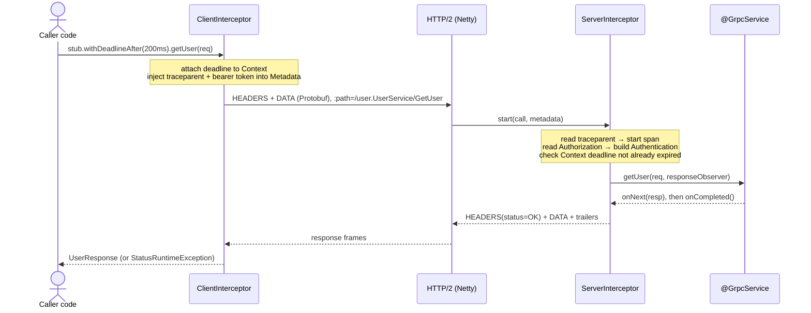
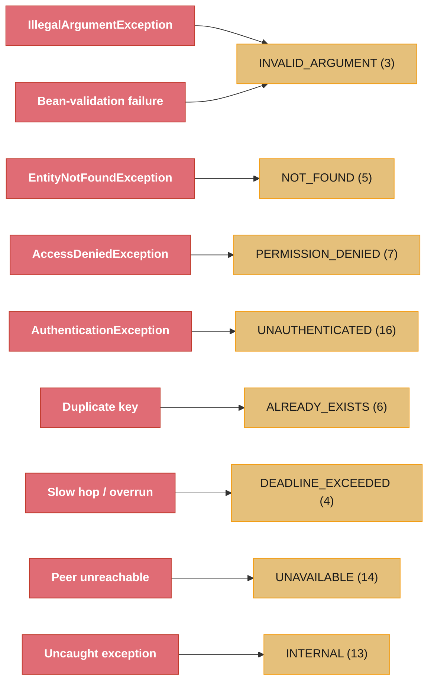
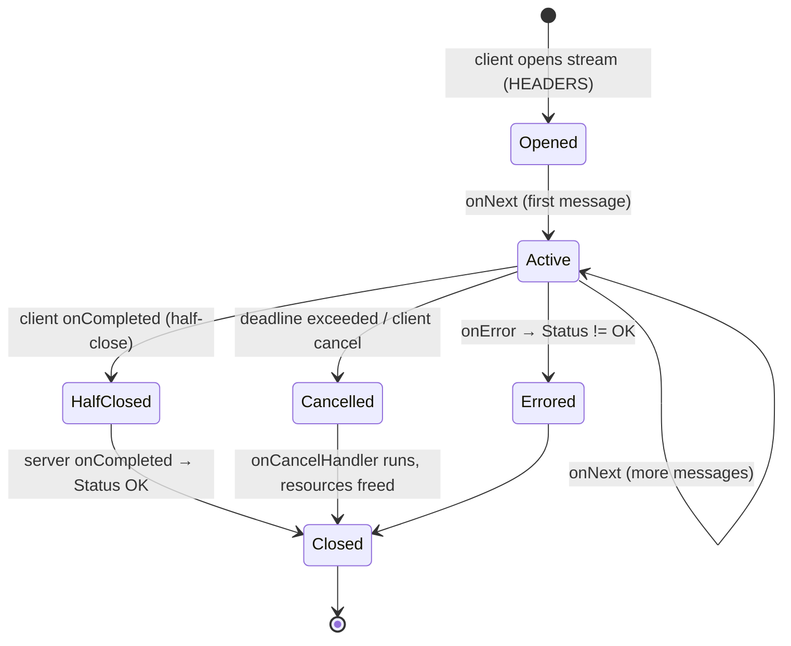

# Spring gRPC Integration — Beans, Interceptors, Security, Tracing, Deadlines

---

## 1. Concept Overview

gRPC is a contract-first, HTTP/2-based RPC framework: you write a `.proto` service definition, generate strongly-typed stubs, and call remote methods as if they were local. The wire mechanics — Protobuf varint encoding, HTTP/2 stream multiplexing, the four RPC modes — are covered in depth in [gRPC & Protobuf (pure Java)](../../java/grpc_protobuf/grpc_protobuf.md) and [gRPC & Protobuf (backend design)](../../backend/grpc_and_protobuf/grpc_and_protobuf.md). This module is about the *Spring* layer on top: how a gRPC server and its channels become managed beans, how cross-cutting concerns (auth, logging, metrics, tracing) plug in through interceptors, and how gRPC composes with Spring Security and Micrometer.

Raw grpc-java requires you to build a `Server`, register `BindableService` implementations, manage a `ManagedChannel` lifecycle, and wire interceptors by hand. Spring removes that boilerplate.

**Spring Boot 4.1 auto-configures gRPC natively** — this is the current path for any new project. Add `org.springframework.boot:spring-boot-starter-grpc-server` and/or `org.springframework.boot:spring-boot-starter-grpc-client` and Boot wires a Netty-backed gRPC server (or, if you also pull in a Servlet starter, exposes gRPC over HTTP/2 through the servlet container), registers your `@GrpcService` beans (`org.springframework.grpc.server.service.GrpcService`), and configures channels from `spring.grpc.client.channel.<name>.*` properties. Client stubs are injected with `@ImportGrpcClients`, not hand-wired. This native support is built on the same Spring gRPC project (`org.springframework.grpc`) that shipped standalone before 4.1 — Boot now ships and auto-configures it itself instead of requiring a separate `spring-grpc-*-starter` dependency, and there is a documented migration path from Spring gRPC 1.0 to 1.1 for projects moving onto Boot 4.1.

**If you're still on Boot 4.0 or earlier**, native auto-configuration isn't available, and the two options were the standalone Spring gRPC starters (`spring-grpc-server-spring-boot-starter` / `spring-grpc-client-spring-boot-starter`, `spring.grpc.*` properties) or **grpc-spring-boot-starter**, the community project (`net.devh`), the de-facto standard for years before either official option existed — properties under `grpc.server.*` / `grpc.client.*`, `@GrpcService` (`net.devh.boot.grpc.server.service.GrpcService`) for servers, `@GrpcClient` for injecting stubs, and a richer built-in security module than the official project shipped at the time.

All of these auto-configure the gRPC server, register your `@GrpcService` beans, expose channel factories, and let you contribute `ServerInterceptor` / `ClientInterceptor` beans that Spring orders and applies globally. This module covers that wiring, the error-mapping and deadline mechanics that bite in production, and the integrations with Spring Security and Micrometer Tracing.

---

## 2. Intuition

One-line analogy: `@GrpcService` is to gRPC what `@RestController` is to HTTP — the framework discovers the bean, binds it to the transport, and runs a filter chain around every call. A gRPC `ServerInterceptor` is the `OncePerRequestFilter` of the RPC world.

Mental model: a gRPC call flows through an *interceptor chain* the same way an HTTP request flows through the `FilterChainProxy` in Spring Security. On the client, a `ClientInterceptor` wraps the outgoing call — attaching a deadline, injecting a `traceparent` header, adding an auth token. On the server, a `ServerInterceptor` unwraps it — reading metadata, authenticating, starting a span, timing the call — before the `@GrpcService` method runs. Spring's job is to collect these interceptors as beans, order them, and register them once.

Why it matters: teams adopt gRPC for internal service-to-service traffic because it is 5–10x more compact than JSON and strongly typed, but a gRPC call that leaves Spring's comfort zone loses everything Spring gives you for free over HTTP — the `SecurityContext`, the trace propagated in MDC, the Micrometer timer. Without deliberate interceptor wiring, your gRPC endpoints are unauthenticated, untraced, and unmonitored. The single most common production incident is a client with no deadline hanging forever against a slow or dead server, exhausting its own thread pool.

Key insight: gRPC does not use `HttpServletRequest`, so none of Spring MVC's servlet-scoped machinery applies. Security, tracing, and context propagation all move to the gRPC `Metadata` (headers) and gRPC `Context` (a `ThreadLocal`-like immutable scope). Everything in this module is about rebuilding Spring's cross-cutting guarantees on top of those two gRPC primitives.

---

## 3. Core Principles

**Beans, not boilerplate.** A `@GrpcService`-annotated bean is auto-discovered and bound to the server; a channel is a `ManagedChannel` bean injected by name. You never call `ServerBuilder.forPort(...)` or manage a channel's shutdown yourself.

**Interceptors are the cross-cutting seam.** Every concern that HTTP handles with a servlet filter — auth, logging, metrics, tracing, tenancy — is a `ServerInterceptor` (inbound) or `ClientInterceptor` (outbound) in gRPC. Order matters and is explicit.

**Metadata carries context, not the message.** Auth tokens, trace context, tenant IDs travel in `Metadata` (the gRPC equivalent of HTTP headers), keyed by `Metadata.Key`. The Protobuf message body stays purely domain data.

**Deadlines are absolute and propagate.** A deadline is a wall-clock instant, not a per-hop timeout. Set once on the client, it flows through the gRPC `Context` to every downstream call, and any hop that overruns fails fast with `DEADLINE_EXCEEDED`.

**Errors are Status codes, not stack traces.** gRPC has 16 canonical `Status` codes. Mapping domain exceptions to the right code (and back) is the contract between services; leaking a raw exception as `UNKNOWN` destroys the caller's ability to react.

**Context propagation must be explicit across threads.** The gRPC `Context` and Micrometer's observation context are `ThreadLocal`-backed; crossing a thread pool (async handler, reactive scheduler) drops them unless you wrap the executor.

---

## 4. Types / Architectures / Strategies

### Boot 4.1 native gRPC vs the legacy net.devh starter

| Dimension | Boot 4.1 native (current) | grpc-spring-boot-starter (net.devh, legacy) |
|-----------|----------------------------|-----------------------------------------------|
| Starters | `spring-boot-starter-grpc-server`, `spring-boot-starter-grpc-client` | `grpc-server-spring-boot-starter`, `grpc-client-spring-boot-starter` |
| Server annotation | `@GrpcService` (`org.springframework.grpc.server.service.GrpcService`) | `@GrpcService` (`net.devh.boot.grpc.server.service.GrpcService`) |
| Client injection | `@ImportGrpcClients(types = ...)` — Boot injects the stub bean | `@GrpcClient("name")` on a stub field |
| Config prefix | `spring.grpc.server.*`, `spring.grpc.client.channel.<name>.*` | `grpc.server.*`, `grpc.client.<name>.*` |
| Channel customization | `GrpcChannelBuilderCustomizer` bean | `grpc.client.<name>.*` YAML properties |
| Security | `GrpcSecurity` / `@PreAuthorize` (Netty), or standard Spring Security config over the servlet transport | Built-in `grpc-server-spring-boot-starter` security (`GrpcSecurity`, `@Secured`) |
| Test slice | `@AutoConfigureTestGrpcTransport` (in-process transport) | No dedicated Boot test slice — roll your own in-process channel |
| When to use | Any project on Boot 4.1+ | Pinned to Boot 4.0 or earlier |

The command to remember: on Boot 4.1+, reach for the native starters first. `net.devh` is worth knowing because it was the mainstream choice for years and plenty of existing services still run it, but it is not the starting point for new work.

### The four RPC modes in a Spring service

| Mode | `@GrpcService` method shape | Spring use case |
|------|-----------------------------|-----------------|
| Unary | `(Req, StreamObserver<Resp>)`, one `onNext` | Standard request/response (get, create) |
| Server streaming | `(Req, StreamObserver<Resp>)`, many `onNext` | Server pushes a result set / live feed |
| Client streaming | returns `StreamObserver<Req>`, one final `onNext` | Client uploads a batch, server aggregates |
| Bidirectional streaming | returns `StreamObserver<Req>`, many `onNext` | Chat, real-time sync, long-lived duplex |

Reactive variants (`Mono`/`Flux` signatures) come from `reactor-grpc` (Salesforce reactive-grpc) or the reactive support in Spring gRPC — see [Spring WebFlux](../spring_webflux/spring_webflux.md) for the reactive model these plug into.

### Interceptor ordering strategies

| Concern | Interceptor | Typical order (lower = outer/first) |
|---------|-------------|-------------------------------------|
| Tracing / observation | `ObservationGrpcServerInterceptor` | 0 (outermost, so it times everything) |
| Authentication | custom `ServerInterceptor` reading `Metadata` | 100 |
| Authorization | Spring Security / `@Secured` check | 150 |
| Logging | custom `ServerInterceptor` | 200 |
| Metrics (per-method) | custom or Micrometer | 300 (innermost) |

### Error-mapping strategies

| Strategy | How | When |
|----------|-----|------|
| `@GrpcExceptionHandler` (`@GrpcAdvice`, net.devh only) | Central class maps exception → `Status` | Clean, controller-advice-like; not available on the Boot 4.1 native path |
| `onError(StatusRuntimeException)` per call | Manual `responseObserver.onError(...)` | Fine-grained, per-method control; the portable choice under Boot 4.1 native |
| Rich error model | `StatusProto.toStatusRuntimeException` with `google.rpc.ErrorInfo` / `BadRequest` details | Machine-readable structured errors |

Boot 4.1's native gRPC support has no documented `@GrpcAdvice`-style central exception mapper — its own error-mapping story is `SecurityGrpcExceptionHandler` for security-specific failures and manual `Status` mapping (per call, or inside a shared `ServerInterceptor`) for everything else. A project moving off net.devh's `@GrpcAdvice` should consolidate its exception→`Status` mapping into one `ServerInterceptor` rather than looking for a like-for-like annotation.

---

## 5. Architecture Diagrams

### Unary call: client interceptor → server interceptor → @GrpcService



The client interceptor writes the deadline and trace/auth metadata; the server interceptor reads them back and rebuilds Spring's `SecurityContext` and trace span before the service method runs.

### Server interceptor chain (ordering)


Lower order runs first and outermost, so the observation interceptor wraps (and times) every inner interceptor plus the handler. Reverse the order and your span would miss the auth and logging cost.

### Domain exception ↔ gRPC Status mapping



A central `@GrpcAdvice` maps each domain exception to a canonical `Status`; anything unmapped falls through as `INTERNAL (13)`, which tells the caller nothing — the whole point of the mapping is to avoid that.

### Streaming call lifecycle



A bidirectional stream stays `Active` while either side sends. Half-close (`onCompleted`) signals no more requests; cancellation and deadline expiry both short-circuit to `Cancelled`, where your `ServerCallStreamObserver.setOnCancelHandler` must release resources.

---

## 6. How It Works — Detailed Mechanics

### Protobuf build (Maven) — Boot-managed plugin (current)

Spring Boot 4.1 provides dependency management for `io.github.ascopes:protobuf-maven-plugin`, so a project parented on `spring-boot-starter-parent` needs no manual `protoc`/codegen version pinning or OS-classifier plugin.

```xml
<parent>
  <groupId>org.springframework.boot</groupId>
  <artifactId>spring-boot-starter-parent</artifactId>
  <version>4.1.1</version>
</parent>

<build>
  <plugins>
    <plugin>
      <groupId>io.github.ascopes</groupId>
      <artifactId>protobuf-maven-plugin</artifactId>
    </plugin>
  </plugins>
</build>
```

`.proto` files live in `src/main/proto/`. The old pairing — `org.xolstice.maven.plugins:protobuf-maven-plugin` plus the `kr.motd.maven:os-maven-plugin` classifier extension, each with a hand-pinned `protoc`/`protoc-gen-grpc-java` version — still works but is no longer what Boot's own docs show; prefer the managed `io.github.ascopes` plugin on new projects.

### Server autoconfiguration — Boot 4.1 native (current)

```xml
<dependency>
  <groupId>org.springframework.boot</groupId>
  <artifactId>spring-boot-starter-grpc-server</artifactId>
</dependency>
```

```yaml
# application.yml
spring:
  grpc:
    server:
      port: 9090                       # default; 0 = random (pair with @LocalGrpcServerPort in tests)
      reflection:
        enabled: true                  # needed for grpcurl; disable in hardened prod
      ssl:
        enabled: false                 # true + a configured SSL bundle for TLS
```

```java
import org.springframework.grpc.server.service.GrpcService;
import io.grpc.stub.StreamObserver;

@GrpcService  // discovered and bound to the auto-configured server, no manual bind
public class UserGrpcService extends UserServiceGrpc.UserServiceImplBase {

    private final UserRepository repo;

    public UserGrpcService(UserRepository repo) { this.repo = repo; }

    @Override
    public void getUser(GetUserRequest request, StreamObserver<UserResponse> obs) {
        User user = repo.findById(request.getId())
            .orElseThrow(() -> new EntityNotFoundException("user " + request.getId()));
        obs.onNext(UserResponse.newBuilder()
            .setId(user.getId()).setName(user.getName()).build());
        obs.onCompleted();   // MUST call, or the client hangs until its deadline
    }
}
```

The same `spring-boot-starter-grpc-server` dependency backs a standalone Netty server by default; adding a Servlet starter alongside it (and excluding `io.grpc:grpc-netty` in favor of `io.grpc:grpc-servlet-jakarta`) instead exposes the same `@GrpcService` beans over HTTP/2 through the servlet container — useful when the app already terminates HTTP/2 for other traffic and you don't want a second listening port.

**If you're on Boot 4.0 or earlier**, native auto-configuration doesn't exist yet; the net.devh community starter was (and remains) the common choice there:

```xml
<dependency>
  <groupId>net.devh</groupId>
  <artifactId>grpc-server-spring-boot-starter</artifactId>
  <version>3.1.0.RELEASE</version>
</dependency>
```

```yaml
grpc:
  server:
    port: 9090
    max-inbound-message-size: 4MB
    security:
      enabled: false
```

```java
import net.devh.boot.grpc.server.service.GrpcService;
// same @GrpcService-annotated class shape as above, different import
```

### Injecting a client stub — @ImportGrpcClients (current)

```xml
<dependency>
  <groupId>org.springframework.boot</groupId>
  <artifactId>spring-boot-starter-grpc-client</artifactId>
</dependency>
```

```java
import org.springframework.grpc.client.ImportGrpcClients;
import org.springframework.boot.autoconfigure.SpringBootApplication;

@SpringBootApplication(proxyBeanMethods = false)
@ImportGrpcClients(target = "user-service", types = UserServiceGrpc.UserServiceBlockingStub.class)
public class OrderApplication { }
```

```java
@Service
public class OrderService {

    private final UserServiceGrpc.UserServiceBlockingStub userStub;   // injected by @ImportGrpcClients

    public OrderService(UserServiceGrpc.UserServiceBlockingStub userStub) {
        this.userStub = userStub;
    }

    public UserResponse lookup(long id) {
        return userStub
            .withDeadlineAfter(200, TimeUnit.MILLISECONDS)   // ALWAYS set a deadline
            .getUser(GetUserRequest.newBuilder().setId(id).build());
    }
}
```

```yaml
spring:
  grpc:
    client:
      channel:
        user-service:
          target: "static://user-service:9090"     # or discovery:/// via a LB
          ssl:
            enabled: false
          inbound:
            message:
              max-size: 8MB
```

Customize the underlying `ManagedChannelBuilder` (auth headers, keepalive, load-balancing policy) with a `GrpcChannelBuilderCustomizer` bean rather than reaching into the channel manually:

```java
import org.springframework.grpc.client.GrpcChannelBuilderCustomizer;
import org.springframework.grpc.client.interceptor.security.BasicAuthenticationInterceptor;

@Configuration(proxyBeanMethods = false)
public class GrpcClientConfig {

    @Bean
    GrpcChannelBuilderCustomizer<?> userServiceChannelCustomizer() {
        return GrpcChannelBuilderCustomizer.matching("user-service",
            (builder) -> builder.intercept(new BasicAuthenticationInterceptor("service", "token")));
    }
}
```

**If you're on Boot 4.0 or earlier**, inject with net.devh's `@GrpcClient` instead:

```java
// net.devh style
@Service
public class OrderService {

    @GrpcClient("user-service")             // channel named in grpc.client.user-service.*
    private UserServiceGrpc.UserServiceBlockingStub userStub;

    public UserResponse lookup(long id) {
        return userStub
            .withDeadlineAfter(200, TimeUnit.MILLISECONDS)
            .getUser(GetUserRequest.newBuilder().setId(id).build());
    }
}
```

```yaml
grpc:
  client:
    user-service:
      address: "static://user-service:9090"
      negotiation-type: plaintext
      deadline: 500ms            # default per-call deadline if none set on the stub
```

### Server interceptor — auth, ordered, populating SecurityContext

```java
import io.grpc.*;
import org.springframework.core.annotation.Order;

@Order(100)                                 // runs after tracing (order 0), before logging (200)
@net.devh.boot.grpc.server.interceptor.GrpcGlobalServerInterceptor
public class AuthServerInterceptor implements ServerInterceptor {

    static final Metadata.Key<String> AUTH =
        Metadata.Key.of("authorization", Metadata.ASCII_STRING_MARSHALLER);

    private final JwtDecoder jwtDecoder;
    public AuthServerInterceptor(JwtDecoder jwtDecoder) { this.jwtDecoder = jwtDecoder; }

    @Override
    public <Req, Resp> ServerCall.Listener<Req> interceptCall(
            ServerCall<Req, Resp> call, Metadata headers, ServerCallHandler<Req, Resp> next) {

        String bearer = headers.get(AUTH);
        if (bearer == null || !bearer.startsWith("Bearer ")) {
            call.close(Status.UNAUTHENTICATED.withDescription("missing bearer token"), new Metadata());
            return new ServerCall.Listener<>() {};   // no-op listener; call is already closed
        }
        try {
            Jwt jwt = jwtDecoder.decode(bearer.substring(7));
            Authentication auth = new JwtAuthenticationToken(jwt);
            // Bind identity into the gRPC Context so downstream (and @Secured) can see it.
            Context ctx = Context.current().withValue(SecurityContextKey.KEY, auth);
            return Contexts.interceptCall(ctx, call, headers, next);
        } catch (JwtException e) {
            call.close(Status.UNAUTHENTICATED.withDescription("invalid token"), new Metadata());
            return new ServerCall.Listener<>() {};
        }
    }
}
```

The gRPC `Context` (not servlet `SecurityContextHolder`) carries identity, because a gRPC call is not servlet-scoped. net.devh's security module bridges this into `SecurityContextHolder` for `@Secured`/`@PreAuthorize` support; with the official starter you read the context key yourself or install the bridge interceptor.

### Client interceptor — inject a token on every outbound call

```java
@net.devh.boot.grpc.client.interceptor.GrpcGlobalClientInterceptor
public class TokenClientInterceptor implements ClientInterceptor {

    private final TokenProvider tokens;
    public TokenClientInterceptor(TokenProvider tokens) { this.tokens = tokens; }

    @Override
    public <Req, Resp> ClientCall<Req, Resp> interceptCall(
            MethodDescriptor<Req, Resp> method, CallOptions opts, Channel next) {
        return new ForwardingClientCall.SimpleForwardingClientCall<>(next.newCall(method, opts)) {
            @Override public void start(Listener<Resp> listener, Metadata headers) {
                headers.put(AuthServerInterceptor.AUTH, "Bearer " + tokens.currentToken());
                super.start(listener, headers);
            }
        };
    }
}
```

### Error handling with @GrpcAdvice / @GrpcExceptionHandler

```java
import net.devh.boot.grpc.server.advice.GrpcAdvice;
import net.devh.boot.grpc.server.advice.GrpcExceptionHandler;

@GrpcAdvice                                 // like @ControllerAdvice, but for gRPC
public class GrpcExceptionAdvice {

    @GrpcExceptionHandler(EntityNotFoundException.class)
    public Status handleNotFound(EntityNotFoundException e) {
        return Status.NOT_FOUND.withDescription(e.getMessage());
    }

    @GrpcExceptionHandler({IllegalArgumentException.class, ConstraintViolationException.class})
    public Status handleBadRequest(Exception e) {
        return Status.INVALID_ARGUMENT.withDescription(e.getMessage());
    }

    @GrpcExceptionHandler(AccessDeniedException.class)
    public Status handleDenied(AccessDeniedException e) {
        return Status.PERMISSION_DENIED.withDescription("forbidden");
    }
    // Anything unmapped surfaces as UNKNOWN/INTERNAL — always add a catch-all.
}
```

On the client, unwrap the code:

```java
try {
    return userStub.withDeadlineAfter(200, MILLISECONDS).getUser(req);
} catch (StatusRuntimeException e) {
    Status.Code code = e.getStatus().getCode();
    if (code == Status.Code.NOT_FOUND) throw new UserNotFoundException(req.getId());
    if (code == Status.Code.DEADLINE_EXCEEDED) throw new UpstreamTimeoutException("user-service");
    throw e;   // UNAVAILABLE etc. bubble to a retry/circuit-breaker layer
}
```

### Deadlines and cancellation propagation — BROKEN → FIX

```java
// BROKEN: no deadline. If user-service is slow (GC pause) or dead (TCP accepts,
// never responds), this call blocks the calling thread FOREVER. Under load the
// caller's thread pool fills with hung calls and the whole service becomes
// unresponsive — a classic cascading failure with no error, just silence.
public UserResponse lookup(long id) {
    return userStub.getUser(GetUserRequest.newBuilder().setId(id).build());
}
```

```java
// FIX: set an absolute deadline. The deadline propagates through the gRPC Context
// to every downstream hop; any overrun fails fast with DEADLINE_EXCEEDED instead
// of hanging. 200ms here budgets the whole call, not each hop.
public UserResponse lookup(long id) {
    return userStub
        .withDeadlineAfter(200, TimeUnit.MILLISECONDS)
        .getUser(GetUserRequest.newBuilder().setId(id).build());
}
```

**What the formula is telling you.** "A deadline is one wall-clock instant shared by the whole call tree, so every hop spends from the same budget — what a downstream service receives is the original budget minus everything already consumed above it." A per-hop timeout has no such subtraction, which is why the two behave completely differently under load.

| Symbol | What it is |
|--------|------------|
| `withDeadlineAfter(200, MS)` | Sets an absolute instant `now + 200ms`, not a per-call duration |
| gRPC `Context` | The carrier. The instant rides it to every downstream call automatically |
| `Context.current().getDeadline()` | What a server reads to see the *remaining* budget |
| `DEADLINE_EXCEEDED` | Status code 4. Raised the moment the instant passes, at whichever hop notices |

**Walk one example.** The Section 7 chain — order calls user, then pricing, then inventory — under a single 300 ms deadline set at the edge:

```
  budget set at the edge                       = 300 ms   (absolute instant T+300)

  hop 1  user       takes  40 ms  ->  remaining = 300 - 40         = 260 ms
  hop 2  pricing    takes 120 ms  ->  remaining = 260 - 120        = 140 ms
  hop 3  inventory  GC pause, needs 400 ms
                    sees remaining 140 ms, already short  -> DEADLINE_EXCEEDED

  contrast: per-hop timeouts of 300 ms each
    worst-case wall clock = 300 + 300 + 300                        = 900 ms
    the edge caller waits 3x the budget it thought it set
```

That 900 ms is the "reset at each hop" bug. The caller believes it bounded the request at
300 ms; the actual bound is 300 ms times the depth of the call tree, and the depth grows
every time someone adds a service in the middle.

**Why the server-side check exists.** Without `deadline.isExpired()`, inventory would
happily start 400 ms of work for a client that has already given up — burning a thread and
a database connection on a response nobody will read. Reading the propagated deadline lets
the deepest hop fail in microseconds instead, which is what turns a cascading pile-up back
into a fast, clean error.

On the server, observe the propagated deadline and cancellation:

```java
@Override
public void getUser(GetUserRequest req, StreamObserver<UserResponse> obs) {
    // The client's remaining budget is visible here — bail before expensive work.
    Deadline deadline = Context.current().getDeadline();
    if (deadline != null && deadline.isExpired()) {
        obs.onError(Status.DEADLINE_EXCEEDED.asRuntimeException());
        return;
    }
    if (Context.current().isCancelled()) return;   // client already gave up
    // ... do work, honoring the budget ...
}
```

### Micrometer tracing — traceparent through Metadata

```xml
<dependency><groupId>io.micrometer</groupId>
  <artifactId>micrometer-tracing-bridge-otel</artifactId></dependency>
<dependency><groupId>io.opentelemetry</groupId>
  <artifactId>opentelemetry-exporter-otlp</artifactId></dependency>
```

Under Boot 4.1 native gRPC, `ObservationGrpcClientInterceptor` is **auto-configured automatically whenever Micrometer is on the classpath** — no `@Bean` needed; disable it with `spring.grpc.client.observation.enabled=false` if you don't want it. The server side has no documented auto-configuration equivalent, so `ObservationGrpcServerInterceptor` still needs a manual `@Bean`:

```java
import io.micrometer.core.instrument.binder.grpc.ObservationGrpcServerInterceptor;

@Configuration
public class GrpcObservabilityConfig {

    @Bean
    @Order(0)   // outermost server interceptor — times the entire call chain
    ObservationGrpcServerInterceptor grpcServerObservation(ObservationRegistry reg) {
        return new ObservationGrpcServerInterceptor(reg);
    }
}
```

These interceptors serialize the current trace into the W3C `traceparent` metadata key on the client (`00-<32-hex trace>-<16-hex span>-01`) and deserialize it on the server, so a single trace ID spans the whole gRPC call graph — the same mechanism described in [Observability & Tracing](../observability_and_tracing/observability_and_tracing.md), just carried over gRPC `Metadata` instead of HTTP headers.

### Testing — the in-process gRPC test slice (current)

`spring-boot-starter-grpc-server-test` and `spring-boot-starter-grpc-client-test` (or the combined `spring-boot-grpc-test` module) add `@AutoConfigureTestGrpcTransport`, which replaces real network channels with in-process ones — no port binding, no flaky "address already in use" failures in CI:

```java
import org.junit.jupiter.api.Test;
import org.springframework.beans.factory.annotation.Autowired;
import org.springframework.boot.grpc.test.autoconfigure.AutoConfigureTestGrpcTransport;
import org.springframework.boot.test.context.SpringBootTest;
import org.springframework.grpc.client.ImportGrpcClients;

import static org.assertj.core.api.Assertions.assertThat;

@SpringBootTest
@AutoConfigureTestGrpcTransport
@ImportGrpcClients(types = UserServiceGrpc.UserServiceBlockingStub.class)
class UserGrpcServiceTests {

    @Autowired
    private UserServiceGrpc.UserServiceBlockingStub userStub;

    @Test
    void getUserReturnsMatch() {
        UserResponse resp = userStub.getUser(
            GetUserRequest.newBuilder().setId(1L).build());
        assertThat(resp.getName()).isEqualTo("Ada");
    }
}
```

To test against a real bound port instead — e.g. verifying TLS or a load balancer target — set `spring.grpc.server.port=0` and inject the actual port with `@LocalGrpcServerPort` rather than hardcoding 9090. See [Spring Testing](../spring_testing/spring_testing.md) for how this test slice fits alongside `@SpringBootTest` and the other test slices.

---

## 7. Real-World Examples

**Internal service mesh at scale.** A payments company moved 40 internal microservices from JSON-over-HTTP to gRPC. Each service exposes a `@GrpcService`; a shared library contributes four global interceptors (observation order 0, auth 100, tenant 150, logging 200) so every service is traced and authenticated identically. Cross-service payloads shrank ~65% versus JSON, and p99 serialization time dropped from 4ms to well under 1ms.

**Auth via interceptor, not per-method code.** A logistics platform validates a JWT in a single `AuthServerInterceptor` that decodes the token, builds a `JwtAuthenticationToken`, and binds it into the gRPC `Context`. Method-level `@Secured("ROLE_DISPATCH")` then works exactly as in Spring MVC — because net.devh's security bridge copies the context identity into `SecurityContextHolder` before the handler runs.

**Deadline budget preventing a cascade.** An order service calls user → pricing → inventory in sequence with a single 300ms deadline set at the top. When inventory suffered a GC pause, the deadline had already been consumed by the first two hops; inventory saw `Context.current().getDeadline().isExpired()` and returned `DEADLINE_EXCEEDED` in microseconds instead of hanging, so the order service failed fast and served a degraded response rather than exhausting its thread pool.

**Tracing an incident in 90 seconds.** A slow checkout was traced by pasting the `traceparent` trace ID (captured from the response) into Tempo. The trace showed `order (12ms) → pricing (280ms) → currency-rate DB (270ms)`, isolating a missing index — all because `ObservationGrpcClientInterceptor` propagated `traceparent` through gRPC metadata across four services.

**gRPC-Web for the browser.** A dashboard SPA cannot speak native gRPC (browsers cannot control HTTP/2 frames), so an Envoy sidecar with the gRPC-Web filter translates browser `application/grpc-web+proto` requests into native gRPC to the Spring `@GrpcService`, giving the frontend typed clients without a REST layer.

---

## 8. Tradeoffs

### gRPC vs REST vs GraphQL

| Dimension | gRPC | REST (JSON) | GraphQL |
|-----------|------|-------------|---------|
| Payload | Protobuf binary (compact) | JSON text (verbose) | JSON text |
| Contract | `.proto`, compile-time typed | OpenAPI (optional) | SDL schema |
| Transport | HTTP/2 required | HTTP/1.1 or 2 | usually HTTP/1.1 |
| Streaming | First-class (4 modes) | SSE / chunked hacks | Subscriptions (WS) |
| Browser | Needs gRPC-Web proxy | Native | Native |
| Best for | Internal service-to-service | Public APIs, broad clients | Client-shaped aggregation |

### Boot 4.1 native gRPC vs net.devh starter

| Dimension | Boot 4.1 native | net.devh starter |
|-----------|------------------|-------------------|
| Backing | Auto-configured by Spring Boot itself | Community, very mature |
| Security | `GrpcSecurity`/`@PreAuthorize` (Netty) or standard Spring Security (servlet transport) | Built-in `GrpcSecurity`, `@Secured` |
| Config | `spring.grpc.*` | `grpc.*` |
| Test support | Dedicated `@AutoConfigureTestGrpcTransport` slice | No dedicated Boot test slice |
| Momentum | Current, ships with every Boot 4.1+ app | Stable, huge existing install base |
| Recommendation | Default choice on Boot 4.1+ | Only when pinned to Boot 4.0 or earlier |

### gRPC vs HTTP for internal traffic

| Dimension | gRPC | HTTP/JSON |
|-----------|------|-----------|
| Debuggability | Needs `grpcurl`/tooling | `curl` + eyeballs |
| Schema evolution | Field numbers, strict rules | Loose, ad hoc |
| Load balancing | L7 / mesh needed (sticky HTTP/2) | Any L4/L7 LB |
| Human readability | Binary | Text |

---

## 9. When to Use / When NOT to Use

**Use Spring gRPC when:**
- Internal service-to-service traffic where payload size, latency, and a strict typed contract matter.
- You want streaming (server push, client upload batches, or duplex sync) as a first-class citizen.
- Polyglot services share one `.proto` contract and generate native clients in each language.

**Do NOT use Spring gRPC when:**
- The API is public or consumed by arbitrary browsers/third parties — REST/JSON has far broader reach and tooling.
- You need human-readable, `curl`-debuggable endpoints and your team has no gRPC tooling.
- Your clients are exclusively browsers and you do not want a gRPC-Web proxy — REST or GraphQL is simpler.

**Use interceptor-based auth/tracing when:**
- More than one `@GrpcService` needs the same cross-cutting concern — centralize it in one global interceptor.

**Do NOT scatter cross-cutting logic when:**
- You are tempted to re-validate the token or start a span inside each method body — that is the exact duplication interceptors exist to remove.

**Avoid gRPC without deadlines, always:**
- Any client call with no `withDeadlineAfter` is a latent hang; there is no scenario where an unbounded internal RPC is acceptable.

---

## 10. Common Pitfalls

### Pitfall 1: Client call with no deadline (the hang)

```java
// BROKEN: no deadline. A dead-but-listening peer never sends a response;
// the blocking stub waits indefinitely. 1,000 RPS × infinite wait = thread
// pool exhaustion in seconds, and the caller looks "hung" with zero errors.
UserResponse r = userStub.getUser(req);
```

```java
// FIXED: bound every call. Prefer a per-call deadline (budgets the whole tree);
// also set a channel-level default as a backstop.
UserResponse r = userStub.withDeadlineAfter(200, TimeUnit.MILLISECONDS).getUser(req);
```
```yaml
grpc:
  client:
    user-service:
      deadline: 500ms   # backstop if a code path forgets the per-call deadline
```

### Pitfall 2: Forgetting onCompleted() (server-side hang)

```java
// BROKEN: onNext without onCompleted. The client's stream never closes;
// it blocks until ITS deadline fires, then reports DEADLINE_EXCEEDED — a
// misleading error that hides a server bug.
@Override public void getUser(GetUserRequest req, StreamObserver<UserResponse> obs) {
    obs.onNext(buildResponse(req));
    // missing obs.onCompleted();
}
```

```java
// FIXED: always terminate the observer exactly once — onCompleted OR onError.
@Override public void getUser(GetUserRequest req, StreamObserver<UserResponse> obs) {
    obs.onNext(buildResponse(req));
    obs.onCompleted();
}
```

### Pitfall 3: Leaking exceptions as UNKNOWN

```java
// BROKEN: an unhandled exception propagates to the client as Status.UNKNOWN
// with no description (stack traces are stripped for security). The caller
// cannot tell "not found" from "bug" from "bad input".
@Override public void getUser(GetUserRequest req, StreamObserver<UserResponse> obs) {
    User u = repo.findById(req.getId()).orElseThrow();  // NoSuchElementException → UNKNOWN
    obs.onNext(toResponse(u)); obs.onCompleted();
}
```

```java
// FIXED: map to a meaningful Status, centrally via @GrpcAdvice (see §6),
// so the client receives NOT_FOUND (5) with a description.
User u = repo.findById(req.getId())
    .orElseThrow(() -> new EntityNotFoundException("user " + req.getId()));
```

### Pitfall 4: Exceeding the 4 MB default message limit

```
# SCENARIO: a batch endpoint returns 10,000 records. Encoded Protobuf = 6 MB.
# The client fails with:
#   RESOURCE_EXHAUSTED: gRPC message exceeds maximum size 4194304: 6291456
# grpc-java caps inbound messages at 4 MiB by default on BOTH ends.
```

**Put simply.** "The limit is a byte count, not a record count — so the only way to reason about it is to divide your payload by your row count and find out what one record actually costs on the wire." Once you know the per-record size, the maximum safe page size falls straight out of the 4 MiB cap.

| Symbol | What it is |
|--------|------------|
| `4194304` | The grpc-java default `maxInboundMessageSize`, in bytes — 4 MiB, `4 x 1024 x 1024` |
| `6291456` | The size of the message that was actually sent — 6 MiB, `6 x 1024 x 1024` |
| `RESOURCE_EXHAUSTED` | Status code 8. Raised by the *receiver*, so both ends need raising |
| `max-inbound-message-size` | Per-side cap. Set on the server and on each named client channel |

**Walk one example.** Turn the failing batch into a page size:

```
  cap        = 4 x 1024 x 1024               = 4,194,304 bytes
  sent       = 6 x 1024 x 1024               = 6,291,456 bytes   -> rejected

  per record = 6,291,456 / 10,000 records    ~ 629 bytes/record
  max page   = 4,194,304 / 629               ~ 6,666 records

  choose 5,000 (a safe round number below the cap):
    5,000 x 629 bytes                        = 3,145,728 bytes = 3.0 MiB   ok
```

A page of 5,000 leaves roughly 25% headroom, which matters because Protobuf sizes vary per
record — a few unusually long string fields in one page can push an "exactly at the limit"
choice over the edge.

**Why raising the limit is the second-best fix.** `max-inbound-message-size: 8MB` only
buys you one doubling; the next growth in the dataset breaks it again, and in the meantime
every receiver must buffer the whole 8 MiB in heap before your handler sees a single
record. Server streaming or pagination keeps peak memory at one page regardless of how
large the result set grows.

```yaml
# FIXED (prefer): paginate or server-stream instead of one giant message.
# If you truly must, raise the client-side limit (Boot 4.1 native):
spring:
  grpc:
    client:
      channel:
        user-service:
          inbound:
            message:
              max-size: 8MB
```

The server side has no dedicated Boot property for this — override it with a custom `ServerBuilder`/`NettyServerBuilder` post-processor bean, or, on net.devh, the equivalent `grpc.server.max-inbound-message-size` / `grpc.client.user-service.max-inbound-message-size` properties. Either way, raising the cap is the fallback, not the fix — pagination or streaming keeps peak memory bounded regardless of how large the result set grows.

### Pitfall 5: Trace/security context lost across a thread boundary

```java
// BROKEN: the gRPC Context and Micrometer trace are ThreadLocal-backed.
// Offloading to a plain executor drops both — the async work is untraced
// and unauthenticated.
@Override public void getUser(GetUserRequest req, StreamObserver<UserResponse> obs) {
    executor.submit(() -> {                 // loses Context + trace
        obs.onNext(buildResponse(req));
        obs.onCompleted();
    });
}
```

```java
// FIXED: wrap the runnable so the current gRPC Context propagates; use a
// context-propagating executor for Micrometer trace continuity.
@Override public void getUser(GetUserRequest req, StreamObserver<UserResponse> obs) {
    executor.submit(Context.current().wrap(() -> {   // gRPC Context carried
        obs.onNext(buildResponse(req));
        obs.onCompleted();
    }));
}
```

### Pitfall 6: Interceptor order silently wrong

```java
// BROKEN: metrics interceptor at order 0 (outermost) and observation at 300.
// The trace span now starts AFTER metrics/auth/logging, so those inner costs
// are invisible in the trace, and unauthenticated calls still get timed.
@Bean @Order(0)   MetricsInterceptor metrics() { ... }
@Bean @Order(300) ObservationGrpcServerInterceptor obs(ObservationRegistry r) { ... }
```

```java
// FIXED: observation outermost (0) so the span wraps everything; auth next;
// metrics innermost so it times only the handler.
@Bean @Order(0)   ObservationGrpcServerInterceptor obs(ObservationRegistry r) { ... }
@Bean @Order(100) AuthServerInterceptor auth(JwtDecoder d) { ... }
@Bean @Order(300) MetricsInterceptor metrics() { ... }
```

---

## 11. Technologies & Tools

| Tool | Role | Notes |
|------|------|-------|
| `spring-boot-starter-grpc-server` | Boot 4.1 native server autoconfig | `spring.grpc.server.*`; current |
| `spring-boot-starter-grpc-client` | Boot 4.1 native client autoconfig | `spring.grpc.client.channel.*`; current |
| `spring-boot-starter-grpc-server-test` | Boot 4.1 native server test slice | pairs with `@AutoConfigureTestGrpcTransport` |
| `spring-boot-starter-grpc-client-test` | Boot 4.1 native client test slice | pairs with `@AutoConfigureTestGrpcTransport` |
| `GrpcChannelBuilderCustomizer` | Customizes a named channel's `ManagedChannelBuilder` | e.g. attach `BasicAuthenticationInterceptor` |
| `grpc-server-spring-boot-starter` (net.devh) | Legacy community server autoconfig | `@GrpcService`, `grpc.server.*`; Boot 4.0 and earlier |
| `grpc-client-spring-boot-starter` (net.devh) | Legacy community client autoconfig | `@GrpcClient`, `grpc.client.*`; Boot 4.0 and earlier |
| `grpc-spring-boot-starter` security (net.devh) | Legacy `GrpcSecurity`, `@Secured` on gRPC | Bridges to `SecurityContextHolder` |
| `protobuf-maven-plugin` (`io.github.ascopes`) | Boot-managed `.proto` codegen | Replaces the old `org.xolstice` plugin plus `os-maven-plugin` pairing |
| `micrometer-core` (`binder.grpc.*`) | `Observation*Interceptor` for gRPC | Client interceptor auto-configured by Boot 4.1; server interceptor still manual |
| `micrometer-tracing-bridge-otel` | Trace bridge to OTLP | Exports to Tempo/Jaeger |
| Envoy gRPC-Web filter | Browser to gRPC translation | For SPA clients |
| `grpcurl` | CLI to call gRPC by reflection | The `curl` of gRPC; needs reflection service |
| gRPC server reflection | Runtime service/method discovery | `spring.grpc.server.reflection.enabled=false` to disable in prod if sensitive |

---

## 12. Interview Questions with Answers

**Q: Why does a gRPC client call hang forever, and how do you prevent it?**
**Short:** A blocking stub with no deadline waits indefinitely for a peer that never replies.
Because a blocking stub with no deadline waits indefinitely for a response that a slow or dead-but-listening peer never sends. gRPC does not impose a default timeout, so the call blocks its thread until the peer replies; under load this exhausts the caller's thread pool with zero errors — just silence. Always call `stub.withDeadlineAfter(200, TimeUnit.MILLISECONDS)`, and set a channel-level `deadline` backstop so a forgotten per-call deadline still fails fast with `DEADLINE_EXCEEDED`.

**Q: What is the difference between a gRPC deadline and a per-hop timeout?**
**Short:** A deadline is an absolute instant propagated through the call tree; a timeout is per-call and relative.
A deadline is an absolute wall-clock instant that propagates through the entire call tree, whereas a timeout is a per-call relative duration. When a client sets `withDeadlineAfter(300ms)`, that instant travels through the gRPC `Context` to user → pricing → inventory; each hop sees the *remaining* budget via `Context.current().getDeadline()`. This prevents the "reset timeout at each hop" bug where a 300ms budget silently becomes 900ms across three services. Set the deadline once at the edge of a request and let it flow.

**Q: How does `@GrpcService` differ from `@RestController`, and what machinery does it lose?**
**Short:** It binds to the gRPC server instead of the servlet dispatcher, losing all servlet-scoped machinery.
`@GrpcService` binds a bean to the HTTP/2 gRPC server instead of the servlet dispatcher, so none of Spring MVC's servlet-scoped machinery applies. There is no `HttpServletRequest`, no `HandlerInterceptor`, no servlet `SecurityContextHolder` auto-population. Cross-cutting concerns move to gRPC `ServerInterceptor`s, and identity/trace context move to gRPC `Metadata` and `Context` rather than servlet request attributes. You rebuild security, tracing, and logging on those two gRPC primitives.

**Q: How do you propagate the security identity into a gRPC service method?**
**Short:** Read the token from Metadata in a ServerInterceptor and bind identity into the gRPC Context.
Read the token from `Metadata` in a `ServerInterceptor`, build an `Authentication`, and bind it into the gRPC `Context` with `Contexts.interceptCall`. Because gRPC calls are not servlet-scoped, the servlet `SecurityContextHolder` is not populated automatically; the interceptor either stores identity in the gRPC `Context` (read directly downstream) or, with net.devh's security bridge, copies it into `SecurityContextHolder` so `@Secured`/`@PreAuthorize` work as in MVC. Do this in one global interceptor, not per method.

**Q: Why does an unhandled server exception reach the client as UNKNOWN, and how do you fix it?**
**Short:** gRPC strips stack traces and maps unmapped exceptions to Status.UNKNOWN with no description.
Because gRPC strips stack traces for security and maps any unmapped exception to `Status.UNKNOWN` with no description, so the caller cannot distinguish a bug from "not found" from bad input. Fix it with a central `@GrpcAdvice` class whose `@GrpcExceptionHandler` methods map each domain exception to a canonical `Status` (`EntityNotFoundException` → `NOT_FOUND`, `IllegalArgumentException` → `INVALID_ARGUMENT`), and always include a catch-all so nothing silently degrades to `INTERNAL`.

**Q: What happens if a server-side handler calls onNext but forgets onCompleted?**
**Short:** The response stream never closes, so the client blocks until its deadline fires and times out.
The response stream never closes, so the client blocks until its own deadline fires and then reports `DEADLINE_EXCEEDED` — a misleading error that hides a pure server bug. Every `StreamObserver` must be terminated exactly once with `onCompleted()` (success) or `onError()` (failure). This is the server-side twin of the missing-deadline client hang; both manifest as a "timeout" that points at the wrong cause.

**Q: How does interceptor ordering affect tracing and metrics correctness?**
**Short:** Lower @Order runs first and outermost, so tracing must be order 0 to wrap every inner interceptor.
Lower `@Order` runs first and outermost, so the observation/tracing interceptor must be order 0 to wrap and time every inner interceptor plus the handler. If metrics or auth run outside the span, their cost is invisible in the trace and even unauthenticated calls get timed. The correct chain is observation (0) → auth (100) → authorization (150) → logging (200) → metrics (300, innermost), so the span measures the full inbound cost.

**Q: How is trace context propagated across a gRPC call?**
**Short:** The client interceptor serializes the trace into the W3C traceparent metadata key on the call.
The client interceptor serializes the current trace into the W3C `traceparent` metadata key on the outgoing call. The `ObservationGrpcServerInterceptor` then deserializes that key and continues the span on the server, so one trace ID spans the entire call graph. Because it travels in gRPC `Metadata` (the header analog), this is identical in spirit to HTTP header propagation, just over gRPC. Register both interceptors from `micrometer-core`'s `binder.grpc` package.

**Q: Why do gRPC calls fail with RESOURCE_EXHAUSTED on large payloads?**
**Short:** grpc-java caps inbound messages at 4 MiB by default on both the server and the client.
Because grpc-java caps inbound messages at 4 MiB by default on both the server and the client, so a 6 MB response throws `RESOURCE_EXHAUSTED: gRPC message exceeds maximum size 4194304`. The right fix is to paginate or switch to server streaming so no single message is huge; only if unavoidable, raise `max-inbound-message-size` on both ends — a large limit invites memory pressure and makes a single call able to OOM the process.

**Q: What is the difference between Boot 4.1's native gRPC support and net.devh's starter?**
**Short:** Boot 4.1 auto-configures gRPC natively under spring.grpc; net.devh is the legacy community project under grpc.
Boot 4.1 auto-configures gRPC natively via `spring-boot-starter-grpc-server`/`-client`, configured under the `spring.grpc` properties, while net.devh's starter is the community project under the `grpc` prefix that was the de-facto standard before native support existed. Both auto-configure the server, register `@GrpcService` beans, and support global interceptors; net.devh still has the richer built-in security bridge (`GrpcSecurity`, `@Secured`, `@GrpcGlobalServerInterceptor`). Choose the native starters on Boot 4.1+; keep net.devh only when pinned to Boot 4.0 or earlier.

**Q: How does cancellation propagate, and how should a streaming handler react?**
**Short:** A client cancel or expired deadline cancels the server's gRPC Context and fires an onCancel callback.
When a client cancels or its deadline expires, the server's gRPC `Context` becomes cancelled and a `ServerCallStreamObserver.setOnCancelHandler` callback fires. A long-running or streaming handler should check `Context.current().isCancelled()` before expensive steps and register an on-cancel handler to release resources (close cursors, cancel downstream calls). Ignoring cancellation wastes CPU producing results no one will read and can leak connections on long streams.

**Q: How do you inject a gRPC stub as a Spring bean?**
**Short:** Annotate the application class with @ImportGrpcClients naming the stub type to inject.
Under Boot 4.1 native gRPC, annotate the application (or a config class) with `@ImportGrpcClients(target = "channel-name", types = MyServiceGrpc.MyServiceBlockingStub.class)` and Spring injects the stub bean bound to the channel named in `spring.grpc.client.channel.<name>.*`. On Boot 4.0 or earlier with net.devh, annotate a stub field with `@GrpcClient("channel-name")` instead, bound to `grpc.client.<name>.*`. Prefer a blocking stub for unary request/response, an async stub for streaming, and always apply `withDeadlineAfter` on each call rather than trusting a global default.

**Q: What exactly does Spring Boot 4.1 add for gRPC that Boot 4.0 didn't have?**
**Short:** Boot 4.1 ships gRPC starters that auto-configure the server and client without a separate dependency.
Boot 4.1 ships `spring-boot-starter-grpc-server` and `spring-boot-starter-grpc-client`, which auto-configure a Netty-backed server (or, alongside a Servlet starter, expose gRPC over HTTP/2 through the servlet container), register `@GrpcService` beans, and configure channels from `spring.grpc.*` properties — all built into Boot itself. Before 4.1 you had to add the standalone `spring-grpc-*-spring-boot-starter` dependency (the Spring gRPC project, pre-1.1) to get any of that; the underlying `org.springframework.grpc` classes are the same, only the delivery and auto-configuration moved into Boot.

**Q: How does `@ImportGrpcClients` differ from just declaring a `@Bean` for a stub?**
**Short:** It scans for generated stub types and registers each as a bean bound to a named channel, no boilerplate method.
`@ImportGrpcClients(target = "name", types = ...)` registers one bean per listed stub type, each bound to the channel named by `target` (or, with `basePackages`, scans for every generated stub under a package) — no `@Bean` factory method needed per stub. Declaring the stub yourself in a `@Configuration` class still works and is useful when the channel needs per-stub customization beyond what `GrpcChannelBuilderCustomizer` covers, but for the common case `@ImportGrpcClients` is the one-line replacement for that boilerplate.

**Q: How do you customize a gRPC client channel's transport settings under Boot 4.1 native gRPC?**
**Short:** Register a GrpcChannelBuilderCustomizer bean scoped to the channel name, instead of touching the channel directly.
Register a `GrpcChannelBuilderCustomizer<?>` bean, typically built with the static `GrpcChannelBuilderCustomizer.matching("channel-name", builder -> ...)` helper, so it only applies to the named channel's `ManagedChannelBuilder`. This is where you attach a `BasicAuthenticationInterceptor`, tune keepalive, or set a load-balancing policy — properties in `spring.grpc.client.channel.<name>.*` cover the common cases (target, SSL, message size), and the customizer covers what a property can't express.

**Q: How do you test a `@GrpcService` without opening a real network port?**
**Short:** Add @AutoConfigureTestGrpcTransport to a @SpringBootTest so the stub talks over an in-process channel.
Add `@AutoConfigureTestGrpcTransport` alongside `@SpringBootTest` and `@ImportGrpcClients`; it swaps the real network channels for in-process ones, so the test injects a working stub with no port binding and no risk of a CI "address already in use" flake. It's the gRPC equivalent of `MockMvc` skipping the servlet container. For a test that must exercise the real transport (TLS, a load balancer target), set `spring.grpc.server.port=0` and read the bound port with `@LocalGrpcServerPort` instead.

**Q: What are the four gRPC streaming modes and their Spring method shapes?**
**Short:** Unary, server-streaming, client-streaming, and bidirectional-streaming, each with a distinct method shape.
Unary and server-streaming both take a `(Request, StreamObserver<Response>)` signature, differing only in how many times the handler calls `onNext`. Client-streaming and bidirectional-streaming both return a `StreamObserver<Request>` that receives the incoming messages. Client-streaming emits one final response after the client half-closes; bidirectional keeps both directions open concurrently. In Spring you override the generated `...ImplBase` method matching the mode declared in the `.proto`.

**Q: How do you secure gRPC endpoints with method-level authorization?**
**Short:** Authenticate identity in a ServerInterceptor, then guard methods with @Secured or @PreAuthorize.
Authenticate in a `ServerInterceptor` that populates identity, then guard methods with `@Secured` or `@PreAuthorize`. net.devh's security bridge enforces those annotations by copying the gRPC-context identity into `SecurityContextHolder` before the handler runs. The interceptor answers "who are you?" (`UNAUTHENTICATED` on failure) and the annotation answers "may you?" (`PERMISSION_DENIED` on failure). Keeping the two separate mirrors Spring Security's authentication-vs-authorization split.

**Q: How do you call a Spring gRPC service from a browser?**
**Short:** Put a gRPC-Web proxy like Envoy in front, since browsers cannot speak native HTTP/2 gRPC framing.
Put a gRPC-Web proxy (Envoy's gRPC-Web filter, or grpcwebproxy) in front, because browsers cannot control HTTP/2 framing and cannot speak native gRPC. The proxy translates the browser's `application/grpc-web+proto` over HTTP/1.1 into native gRPC to the Spring `@GrpcService`. Alternatively expose a REST façade via transcoding (a gateway maps JSON/HTTP to the gRPC method using `google.api.http` annotations) when you want plain REST for external clients.

**Q: Why is Metadata used for auth tokens instead of the Protobuf message?**
**Short:** Metadata is the transport-level header channel, keeping cross-cutting context out of the domain schema.
Because Metadata is the transport-level header channel — cross-cutting context like tokens, trace IDs, and tenant IDs belong there so interceptors can read them without parsing the domain message. Putting an auth token in the request message couples every method's schema to security concerns and forces the handler (not an interceptor) to enforce auth. Keys use `Metadata.Key.of(name, ASCII_STRING_MARSHALLER)`; binary values use a `-bin` suffix key.

**Q: What does a channel-level default deadline give you over a per-call deadline?**
**Short:** It is a backstop bounding any call whose code path forgot to set its own per-call deadline.
A channel `deadline` is a backstop that bounds any call whose code path forgets `withDeadlineAfter`, so a single missed per-call deadline cannot hang. The per-call deadline is still preferred because it budgets the whole downstream tree for that specific request, while the channel default is a blunt catch-all. Configure both: a strict per-call deadline for correctness and a generous channel deadline as a safety net.

**Q: How do you keep gRPC serialization out of your service's critical CPU path under load?**
**Short:** Rely on Protobuf's compact binary encoding and avoid oversized messages by paginating or streaming.
Rely on Protobuf's compact binary encoding, which is far smaller than JSON and parses faster, so serialization rarely dominates. Then avoid oversized messages by paginating or streaming instead of returning multi-MB blobs. Reuse generated builders rather than reflection, keep field numbers stable to avoid re-encoding surprises, and let the Netty transport multiplex many calls over one HTTP/2 connection so you are not paying per-call connection setup. The wire-level detail lives in [gRPC & Protobuf (pure Java)](../../java/grpc_protobuf/grpc_protobuf.md).

**Q: When would you choose gRPC over REST or GraphQL for a new API?**
**Short:** Choose gRPC for internal service-to-service traffic needing typed contracts, small payloads, and streaming.
Choose gRPC for internal service-to-service traffic where a strict typed contract, small binary payloads, low latency, and first-class streaming matter more than human readability. Choose REST for public or browser-facing APIs that need the broadest client reach and `curl`-level debuggability, and GraphQL when clients need to shape aggregated responses across many resources. gRPC's browser gap (needs gRPC-Web) and binary opacity are the usual reasons it stays internal.

---

## 13. Best Practices

1. Set `withDeadlineAfter` on every client call and a channel-level `deadline` backstop; an unbounded internal RPC is never acceptable.
2. Terminate every `StreamObserver` exactly once — `onCompleted()` on success, `onError()` on failure — or the peer hangs until its deadline.
3. Centralize error mapping in one place and always include a catch-all so nothing degrades to `UNKNOWN` — a `@GrpcAdvice`/`@GrpcExceptionHandler` class on net.devh, or a shared `ServerInterceptor` on Boot 4.1 native, which has no advice-style equivalent.
4. Put cross-cutting concerns in global interceptors, not method bodies: observation at order 0, auth at 100, authorization at 150, logging at 200, metrics innermost.
5. Carry identity, trace, and tenant in `Metadata` and the gRPC `Context`; never smuggle them into the Protobuf message.
6. Authenticate in an interceptor, authorize with `@Secured`/`@PreAuthorize` — keep the "who" and "may you" checks separate, mapping to `UNAUTHENTICATED` and `PERMISSION_DENIED`.
7. Register `ObservationGrpcServerInterceptor` (still manual under Boot 4.1 native) alongside the auto-configured `ObservationGrpcClientInterceptor` so `traceparent` propagates across the whole gRPC call graph into your tracing backend.
8. Prefer pagination or server streaming over raising `max-inbound-message-size`; a large limit lets one call OOM the process.
9. Wrap any executor/async offload with `Context.current().wrap(...)` (and a context-propagating executor for Micrometer) so security and trace context survive the thread hop.
10. Keep `.proto` field numbers stable and follow the schema-evolution rules from [gRPC & Protobuf (pure Java)](../../java/grpc_protobuf/grpc_protobuf.md); never renumber or reuse a field tag.
11. Enable server reflection only where `grpcurl` debugging is needed; disable it in hardened production to avoid exposing the service catalog.
12. Pin `protoc`, `protoc-gen-grpc-java`, and the runtime `io.grpc` versions together to avoid generated-vs-runtime incompatibilities — the Boot-managed `io.github.ascopes:protobuf-maven-plugin` does this for you when the project is parented on `spring-boot-starter-parent`.
13. Start new projects on the Boot 4.1 native starters (`spring-boot-starter-grpc-server`/`-client`); reach for net.devh only when the project is pinned to Boot 4.0 or earlier.
14. Test with `@AutoConfigureTestGrpcTransport` and `@ImportGrpcClients` for in-process gRPC tests — no bound port, no CI flake from a stale port still in `TIME_WAIT`.

---

## 14. Case Study

### Scenario: Internal Microservice-to-Microservice API over gRPC with Auth, Tracing, and Deadlines

**Context.** A fintech platform runs 25 internal services behind an HTTP gateway. Service-to-service calls were JSON-over-HTTP with hand-rolled `RestTemplate` clients: no shared auth, inconsistent timeouts, and traces that broke at every hop because propagation was copy-pasted and often wrong. Two incidents in a quarter were caused by a slow downstream with no client timeout hanging its callers until thread pools drained. The team decided to standardize internal traffic on gRPC with a shared Spring library enforcing auth, tracing, and deadlines uniformly.

**Requirements.**
- Every internal call authenticated by a service JWT, validated once in an interceptor.
- One trace ID spanning any call chain, exported to Tempo.
- A hard deadline on every call, propagated through the whole tree, no exceptions.
- Consistent error codes so callers can react (retry `UNAVAILABLE`, surface `NOT_FOUND`, reject `INVALID_ARGUMENT`).

**Architecture decision.** Build one `platform-grpc-starter` internal library that contributes four global server interceptors and two client interceptors, and expose a `.proto` per service. Every service depends on the starter; no service writes its own auth or tracing code.

**Implementation.**

Shared interceptor registration in the starter's autoconfiguration:
```java
@AutoConfiguration
public class PlatformGrpcAutoConfiguration {

    @Bean @Order(0)
    ObservationGrpcServerInterceptor serverObservation(ObservationRegistry r) {
        return new ObservationGrpcServerInterceptor(r);   // outermost: full-call span
    }
    @Bean @Order(100)
    AuthServerInterceptor auth(JwtDecoder decoder) { return new AuthServerInterceptor(decoder); }

    @Bean @Order(200)
    LoggingServerInterceptor logging() { return new LoggingServerInterceptor(); }

    @Bean
    ObservationGrpcClientInterceptor clientObservation(ObservationRegistry r) {
        return new ObservationGrpcClientInterceptor(r);
    }
    @Bean
    ServiceTokenClientInterceptor clientToken(TokenProvider p) {
        return new ServiceTokenClientInterceptor(p);      // injects service JWT on egress
    }
}
```

The pricing service exposes a `@GrpcService`; the order service consumes it with a deadline:
```java
@GrpcService
public class PricingGrpcService extends PricingServiceGrpc.PricingServiceImplBase {
    @Override
    public void quote(QuoteRequest req, StreamObserver<QuoteResponse> obs) {
        if (Context.current().getDeadline() != null && Context.current().getDeadline().isExpired()) {
            obs.onError(Status.DEADLINE_EXCEEDED.asRuntimeException());
            return;   // don't compute a price no one will wait for
        }
        Money price = pricingEngine.price(req.getSku(), req.getQty());
        obs.onNext(QuoteResponse.newBuilder().setCents(price.cents()).build());
        obs.onCompleted();
    }
}

@Service
public class OrderService {
    @GrpcClient("pricing-service")
    private PricingServiceGrpc.PricingServiceBlockingStub pricing;

    public Quote getQuote(String sku, int qty) {
        try {
            QuoteResponse r = pricing
                .withDeadlineAfter(150, TimeUnit.MILLISECONDS)   // budget the whole chain
                .quote(QuoteRequest.newBuilder().setSku(sku).setQty(qty).build());
            return new Quote(r.getCents());
        } catch (StatusRuntimeException e) {
            if (e.getStatus().getCode() == Status.Code.DEADLINE_EXCEEDED)
                return Quote.unavailable();   // degrade, don't hang
            if (e.getStatus().getCode() == Status.Code.UNAVAILABLE)
                throw new RetryableException("pricing-service down");
            throw e;
        }
    }
}
```

Central error mapping in the starter:
```java
@GrpcAdvice
public class PlatformGrpcExceptionAdvice {
    @GrpcExceptionHandler(EntityNotFoundException.class)
    Status notFound(EntityNotFoundException e) { return Status.NOT_FOUND.withDescription(e.getMessage()); }
    @GrpcExceptionHandler(ConstraintViolationException.class)
    Status invalid(ConstraintViolationException e) { return Status.INVALID_ARGUMENT.withDescription(e.getMessage()); }
    @GrpcExceptionHandler(AccessDeniedException.class)
    Status denied(AccessDeniedException e) { return Status.PERMISSION_DENIED.withDescription("forbidden"); }
    @GrpcExceptionHandler(Exception.class)          // catch-all: never leak UNKNOWN
    Status other(Exception e) { return Status.INTERNAL.withDescription("internal error"); }
}
```

**Results.**

During a later incident, the pricing engine hit a 4-second GC pause. Because the order service set a 150ms deadline that had already been partly consumed upstream, pricing saw an expired deadline and returned `DEADLINE_EXCEEDED` in microseconds. The order service caught it and served an "unavailable" quote placeholder; the checkout flow stayed up. Before gRPC deadlines, the equivalent event drained the order service's thread pool and took checkout down for 8 minutes.

| Metric | Before (JSON/HTTP) | After (Spring gRPC) |
|--------|--------------------|---------------------|
| Inter-service payload size | 100% (JSON baseline) | ~35% (Protobuf) |
| Hung-call incidents / quarter | 2 | 0 |
| Broken traces across hops | frequent | none (traceparent propagated) |
| p99 serialization time | ~4ms | <1ms |
| Mean incident RCA time | ~30 min (log grep) | ~90s (Tempo trace) |

**Observability outcome.** A single trace ID from `ObservationGrpcClientInterceptor` spanned order → pricing → currency-rate DB in Tempo, isolating a missing index in 90 seconds. Auth was uniform because one `AuthServerInterceptor` validated every call; no service re-implemented it.

**Lesson learned.** The value was not gRPC's speed alone but the *shared starter* that made auth, tracing, and deadlines impossible to get wrong. Cross-cutting concerns belong in global interceptors contributed once, exactly as the [Spring Security Architecture](../spring_security_architecture/spring_security_architecture.md) `FilterChainProxy` centralizes them for HTTP — gRPC just moves the seam from servlet filters to `ServerInterceptor`s.

---

## Related / See Also

- [gRPC & Protobuf (pure Java)](../../java/grpc_protobuf/grpc_protobuf.md) — wire format, generated stubs, the four RPC modes, schema evolution
- [gRPC & Protobuf (backend design)](../../backend/grpc_and_protobuf/grpc_and_protobuf.md) — load balancing, service mesh, HTTP/2 multiplexing
- [Spring WebFlux](../spring_webflux/spring_webflux.md) — the reactive model behind `Mono`/`Flux` gRPC stubs
- [Observability & Tracing](../observability_and_tracing/observability_and_tracing.md) — Micrometer Observation, W3C `traceparent`, OTLP export
- [Spring Security Architecture](../spring_security_architecture/spring_security_architecture.md) — `FilterChainProxy`, authentication vs authorization, method security
- [Spring Testing](../spring_testing/spring_testing.md) — test slices, `@SpringBootTest`, where `@AutoConfigureTestGrpcTransport` fits alongside the others
