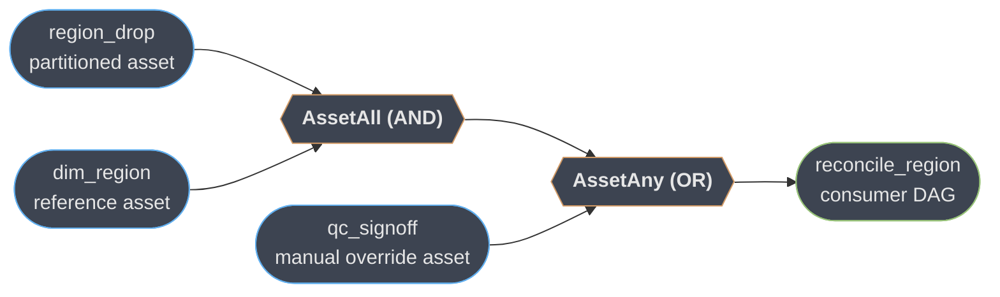
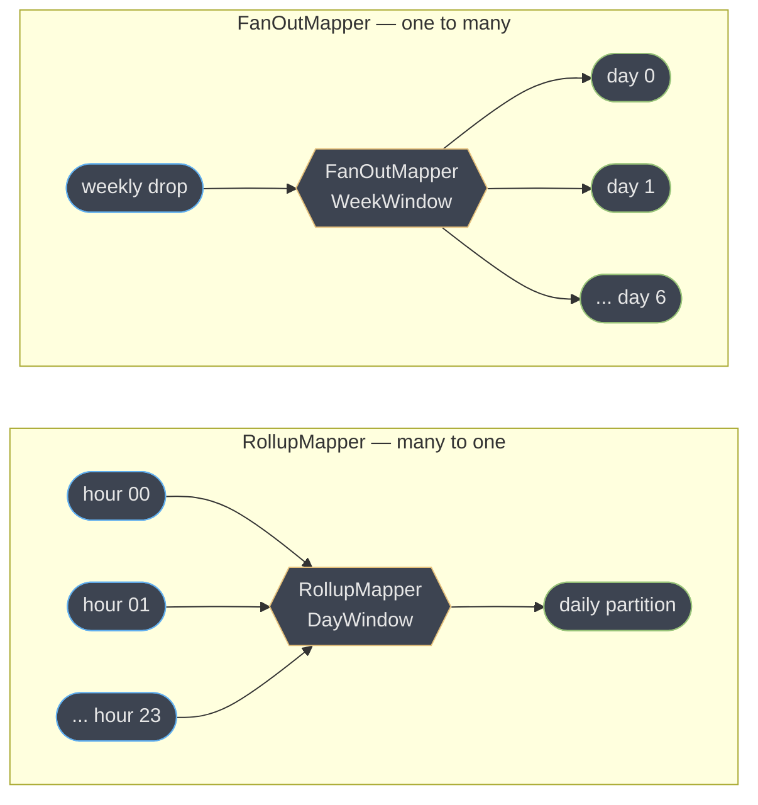
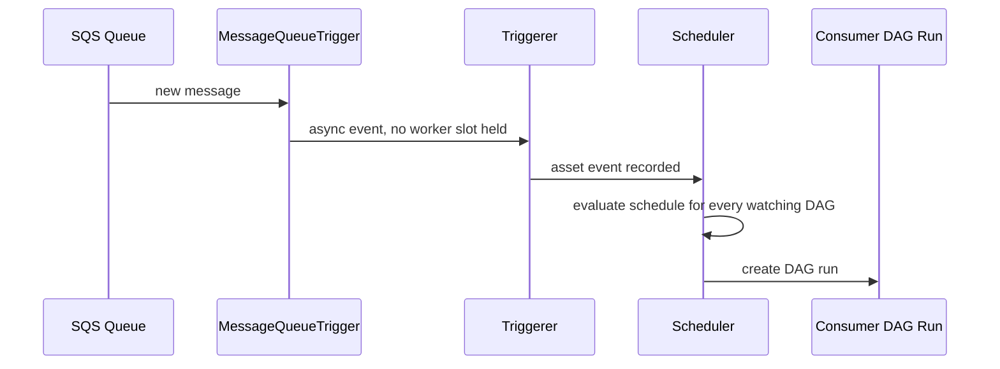

# Assets, Partitions, and the State Store

> **Version anchor (2026-10-19).** Apache Airflow **3.3.2** (released **2026-09-17**), same
> line as [the parent module](apache_airflow.md). Every API on this page is the
> `airflow.sdk` surface shipped in 3.3.2: `Asset`, `@asset`, `AssetAlias`, `AssetAny`,
> `AssetAll`, `AssetWatcher`, `PartitionedAtRuntime`, `CronPartitionTimetable`,
> `PartitionedAssetTimetable`, and the partition-mapper family. Asset partitioning shipped
> in **[3.2]** and was substantially expanded in **[3.3]**; the task/asset state store
> (AIP-103) and pluggable retry policies (AIP-105) are both **[3.3]** headline features.
> Anything not tagged is stable across the current 3.x line.

[The parent Airflow module](apache_airflow.md) owns the scheduler loop, executors, DAG
parsing, deferrable operators, backfills, and HA — read it first. This page is the deep
dive on the four things that changed how Airflow DAGs are *delivered* and *wired together*
in Airflow 3: DAG bundles as a deployment mechanism, the full asset/partition API surface,
the task and asset state store, and the data-aware-vs-time-based scheduling tradeoff. It
does not re-argue Airflow vs. durable-execution engines — that is
[`temporal_durable_execution`](../temporal_durable_execution/temporal_durable_execution.md)
§8/§9's job — and it does not re-teach table-format mechanics, which belong to
[`apache_iceberg`](../apache_iceberg/apache_iceberg.md).

---

## 1. Concept Overview

Airflow 2's mental model had two moving parts: a flat folder of `.py` files, and a clock.
The DAG processor watched a directory; the scheduler watched a calendar. Airflow 3 replaces
both. The folder becomes a **DAG bundle** — a named, sourced, optionally *versioned*
collection of DAG code, so "where did this code come from" is a first-class, queryable fact
instead of a deployment detail invisible to Airflow itself. The clock becomes optional: a
**data asset** — the rename and expansion of 2.x's *dataset* — lets a DAG's trigger be "this
specific thing was produced" rather than "it is 2am." **Partitioning** (landed in [3.2],
expanded in [3.3]) makes that trigger precise: not "the customers table changed" but "the
`us-east` slice of the customers table, for 2026-08-25, changed" — and a downstream DAG can
fire once per slice instead of once per table.

Both changes create a problem the 2.x XCom/Variable model was never built for: a task or an
asset now needs to remember something *between* runs that is neither small enough for an
XCom row nor global enough for a Variable — a paging cursor, a watermark, a submitted job
ID. **AIP-103** answers that directly with a scoped key-value **state store**. And once a
retry can carry state instead of starting from zero, "retry the same way every time" stops
making sense — **AIP-105**'s pluggable retry policies let the retry decision itself depend
on *what kind* of failure this was.

These four features share one architectural cause, which is the real subject of this page:
**Airflow 3's Task Execution API decoupled workers from the metadata database.** A worker
that can no longer read a database row directly needs an API-mediated way to know which code
version it is running (bundles), which logical object it is producing (assets), and where
its scratch state lives (the state store). Bundles, assets, and the state store are not
three unrelated 3.x features — they are the same boundary shift, applied to code delivery,
to data dependency, and to task memory respectively.

---

## 2. Intuition

> **One-line analogy:** a time-based schedule is a bus timetable — the bus leaves at 2am
> whether or not anyone is at the stop; an asset graph is a relay race — each runner starts
> the moment the baton (the asset) actually arrives, and nobody is watching a clock at all.

**Mental model for partitioning specifically:** an unpartitioned asset is a single light
switch — "customers changed" is the only sentence it can say. A partitioned asset is a
panel of switches, one per slice, and a **partition mapper** is the wiring diagram that says
which downstream switches a given upstream switch turns on. `RollupMapper` wires many
upstream switches into one downstream switch (24 hourly partitions light one daily switch);
`FanOutMapper` wires one upstream switch into many downstream switches (one weekly drop
lights seven daily switches). The **wait policy** decides whether the downstream switch
needs *every* wired-in upstream switch on (`WaitForAll`) or just enough of them
(`MinimumCount(n)`).

**Key insight:** a relay race has no timetable to consult when something goes wrong. A late
bus is visible on the timetable itself — "the 2am bus didn't run." A baton that never
arrives is invisible by construction: there is no schedule to compare against, only an
absence. This is the honest cost of data-aware scheduling, and it is the thread §8 and the
war stories in §10 keep coming back to.

---

## 3. Core Principles

- **A bundle answers "what code," an asset answers "what data," a state-store entry answers
  "what did I already do."** Confusing the three is the root of most of this page's war
  stories — reaching for a Variable to store a cursor, or trusting `LocalDagBundle` to give
  you version history it was never designed to record.
- **Only `GitDagBundle` is versioned** (parent §6.20). Everything downstream of "did this
  run use the code I think it used" depends on that one fact.
- **An asset's identity is its URI, not its name.** Two `Asset(...)` declarations with the
  same URI string are the same asset to the scheduler, however different their surrounding
  Python looks; two declarations that differ by one character are two *different* assets
  that will never talk to each other, silently (§10).
- **Partitioning is a mapping problem, not a filtering problem.** A partition mapper does
  not decide *whether* a downstream run happens — it decides *which* downstream partition
  key an upstream event maps to. Get the mapper wrong and you either over-trigger (every
  upstream event re-runs everything) or under-trigger (an upstream event maps to a key
  nothing consumes).
- **State-store data is a retry aid, not a data store.** `max_value_storage_bytes` defaults
  to 65,535 (parent §6.10a) precisely so nobody mistakes it for a place to stash a payload.
- **An asset graph has no central schedule to inspect.** Every asset-scheduled DAG's trigger
  condition lives in that DAG's own file. "Why did nothing run today" requires walking a
  dependency graph across files, not reading one cron table (§8).
- **The Task Execution API is why any of this had to be built new, not extended.** A 2.x
  worker read Variables and XComs straight out of the metadata DB; a 3.x worker's only
  channel to durable state is the versioned REST API, so "let a task remember something" and
  "let a DAG file live somewhere other than local disk" both had to become API-mediated
  primitives rather than direct DB access with a new table bolted on.

---

## 4. Types / Architectures / Strategies

### 4.1 Partition mapper taxonomy

The full mapper family beyond the three the parent module names, with the shape each one
expresses:

| Mapper | Shape | What it normalizes |
|---|---|---|
| `IdentityMapper` | 1 → 1, no transform | Upstream and downstream partition keys are the same string |
| `StartOfHourMapper` / `StartOfDayMapper` / `StartOfWeekMapper` | many timestamps → 1 bucket | Rounds a fine-grained timestamp key down to its containing hour/day/week |
| `ProductMapper` | composite key | Combines two mappers into one key, e.g. `region \| day` from `region \| timestamp` |
| `FixedKeyMapper` | N → 1 fixed key | Every upstream key maps to one hardcoded downstream key, regardless of value |
| `AllowedKeyMapper` | N → filtered N | Passes upstream keys through unchanged, but only the ones on an allow-list |
| `RollupMapper` | many → 1, windowed | Wraps an upstream mapper plus a `Window`; downstream fires once the window's expected keys are present |
| `FanOutMapper` | 1 → many, windowed | Wraps an upstream mapper plus a `Window`; one upstream event expands into every downstream key the window implies |

`RollupMapper` and `FanOutMapper` are the two that need a `Window` (§4.2) and a wait policy
(§4.3) — the plain mappers above them are pure key-rewriting with no waiting involved.

### 4.2 Windows

A `Window` bounds how far a rollup or fan-out reaches:

| Window | Bounds |
|---|---|
| `HourWindow` / `DayWindow` / `WeekWindow` / `MonthWindow` | A calendar period, `Window.Direction.FORWARD` or `.BACKWARD` from the triggering key |
| `SegmentWindow(["us","eu","apac"])` | A fixed, named, non-temporal set of categorical keys — the mechanism for "wait for all three regions," not just "wait for all of today" |

### 4.3 Wait policies

| Policy | Fires when |
|---|---|
| `WaitForAll()` | Every partition key the window implies has landed — the strict default |
| `MinimumCount(n)` | At least `n` of the expected keys have landed — for pipelines that tolerate partial coverage rather than blocking on a straggler |

### 4.4 Producer-side vs. consumer-side partitioning

Partitioning is declared on two different sides of an asset relationship, and conflating
them is a common source of confusion:

| Side | Declared where | API |
|---|---|---|
| **Producer** — this asset itself is naturally sliced | `schedule=` on the `@asset`-decorated function | `CronPartitionTimetable("15 * * * *")` (predetermined, cron-keyed) or `PartitionedAtRuntime()` (the run decides its own key via `outlet_events[self].add_partitions(...)`) |
| **Consumer** — this DAG needs to react per-slice to one or more partitioned upstream assets | `schedule=` on the downstream `@dag` | `PartitionedAssetTimetable(assets=..., default_partition_mapper=...)`, with an optional `partition_mapper_config` dict overriding the mapper per individual upstream asset |

### 4.5 DAG bundle promotion topologies

The parent module (§6.20) covers the four built-in bundle classes and the versioning
consequence. What it does not cover is *how a team actually promotes a bundle through
environments* — three shapes, in increasing order of safety:

1. **Single branch, single environment.** `tracking_ref: "main"` everywhere. Simplest, and
   the one that produces the "my fix never deployed" war story in §10 when someone later
   pins a tag.
2. **Branch-per-environment.** `dev` tracks `main`, `staging` tracks a `release/*` branch,
   `prod` tracks a `stable` branch that's fast-forwarded deliberately. Promotion is a
   `git push` to the next branch, and rollback is a `git revert`.
3. **Tag-per-release, pinned per environment.** `tracking_ref` is an explicit tag
   (`v2026.34.0`), bumped by CI after a staging soak. This is the only shape where "what
   code is running in prod" is answerable without querying Airflow at all — but it is also
   the shape where forgetting to bump the tag is invisible until someone notices a run's
   recorded `bundle_version` doesn't match the latest commit.

---

## 5. Architecture Diagrams

### 5.1 A conditional asset expression



`reconcile_region` fires the moment either branch is satisfied: `region_drop` **and**
`dim_region` both updated, **or** a human directly updates `qc_signoff` to force a run. This
is `schedule=(region_drop & dim_region) | qc_signoff` — §6.3 gives the runnable code.

### 5.2 RollupMapper vs. FanOutMapper



24 hourly upstream events collapse into 1 daily downstream run under `RollupMapper` with a
`WaitForAll()` policy; 1 weekly upstream event expands into 7 daily downstream runs under
`FanOutMapper`. The blast radius on the fan-out side is why `max_downstream_keys` exists on
`FanOutMapper` — an unbounded fan-out from a single mis-mapped event is exactly what it caps.

### 5.3 Asset watcher event flow



The `AssetWatcher` never occupies a worker slot — it rides the same Triggerer asyncio loop
deferrable operators use (parent §5.3), so watching a queue that never fires costs nothing
beyond one live coroutine.

---

## 6. How It Works — Detailed Mechanics

### 6.1 Why the Task Execution API forces this shape

Before Airflow 3, a worker process imported Airflow's ORM models and talked to the metadata
DB with a live SQLAlchemy session — any table the scheduler could see, the worker could see.
The **Task Execution API** ([3.0]) removed that: a worker now speaks a versioned REST
contract to the API server, and nothing else. That single boundary change is why bundles,
assets, and the state store all had to become *API resources* rather than *new database
tables a worker reads directly*:

- A worker asking "what code am I running" can no longer just check the file's mtime on
  local disk — if the DAG came from a `GitDagBundle`, the worker may not even be on the same
  host as the DAG processor's checkout. The API has to hand it a `bundle_version` explicitly.
- A worker recording "I produced this asset" can no longer `INSERT INTO dataset_event`
  directly — it calls the API, which validates the outlet declaration and writes the row.
- A worker fetching its own state-store cursor calls the API's state-store endpoint, backed
  by whatever `[workers] state_store_backend` names — which does not have to be the metadata
  DB at all (parent §6.10a).

The **Task SDK** is the first (Python) client of that API; the practical consequence for
non-Python workers is that a Go or JVM task runtime, landing in **[3.3]** as experimental
Coordinator-based SDKs, gets bundles, assets, and the state store *for free* — they are
already API resources, not Python-ORM objects a non-Python runtime would have had to
reimplement.

### 6.2 The `@asset` decorator and `@asset.multi`

The lowest-friction way to declare a producer: `@asset` turns one function into a
single-task DAG that both defines and produces an asset in one declaration, replacing the
`Asset(...)` + separate `@dag`/`@task` + `outlets=[...]` shape from the parent module's
§6.10 for the common one-task case:

```python
from airflow.sdk import asset, Metadata

@asset(uri="s3://warehouse/dim_region/current", schedule="@daily")
def dim_region(self):
    row_count = refresh_dimension_table()
    yield Metadata(self, {"row_count": row_count})   # attaches to this asset event
```

`self` is a reserved parameter name populated with the asset being defined — not a class
instance — so a function that never references `self` can omit it. `context` and
`outlet_events` are the other two reserved names, populated the same way `**context` is
populated for a normal `@task`. When one function logically produces more than one asset,
`@asset.multi` replaces the single implicit outlet with an explicit list:

```python
from airflow.sdk import Asset, asset

@asset.multi(schedule=None, outlets=[Asset("s3://warehouse/dim_region/us"),
                                      Asset("s3://warehouse/dim_region/eu")])
def split_region_dim(input_asset):
    ...
```

A downstream asset can read what an upstream one wrote about itself without touching XCom —
`inlet_events` looks up the `Metadata` an upstream `@asset` yielded, by asset object:

```python
@asset(schedule=None)
def audit_dim_region(context, dim_region):
    events = context["inlet_events"][dim_region]
    last_row_count = events[-1].extra["row_count"]
```

### 6.3 AssetAlias, AssetAny, AssetAll

`AssetAlias` solves the case where a task doesn't know the asset URI it's about to produce
until it runs — a dynamic outlet, resolved at execution time rather than parse time:

```python
from airflow.sdk import AssetAlias, task

@task(outlets=[AssetAlias("region-drop-outputs")])
def ingest_region(*, outlet_events):
    region = detect_region_from_payload()
    outlet_events[AssetAlias("region-drop-outputs")].add(
        Asset(f"s3://raw/region-drops/{region}.csv"))
```

Consumers wait on the alias itself (`schedule=AssetAlias("region-drop-outputs")`) rather
than on any one concrete URI, so adding a new region needs no consumer-side edit.

`AssetAny`/`AssetAll` are named-class equivalents of the `|`/`&` operators used on the
diagram in §5.1 — both spellings compile to the same conditional-expression object, and
which one reads better is a style choice:

```python
from airflow.sdk import AssetAny, AssetAll

schedule = AssetAny(AssetAll(region_drop, dim_region), qc_signoff)   # same as (a & b) | c
```

### 6.4 Partitioned assets, end to end

**Producer side — predetermined.** `CronPartitionTimetable` is for an asset whose slices
line up with a calendar the way the asset itself already runs on — each cron firing *is* one
partition, keyed automatically:

```python
from airflow.sdk import asset, CronPartitionTimetable

@asset(uri="file://incoming/player-stats/team_b.csv",
       schedule=CronPartitionTimetable("15 * * * *", timezone="UTC"))
def team_b_player_stats():
    ...   # this run's partition key is derived from which cron firing this is
```

**Producer side — decided at run time.** `PartitionedAtRuntime()` is for an asset whose
slice is a fact only the task itself can determine — parsing an upload's contents, reading a
parameter, consulting an external system:

```python
from airflow.sdk import asset, PartitionedAtRuntime

@asset(uri="file://incoming/player-stats/live-region.csv",
       schedule=PartitionedAtRuntime())
def live_region_player_stats(self, outlet_events):
    region = sniff_region_from_payload()
    write_partition(region)
    outlet_events[self].add_partitions([region])   # or a list, for multi-partition runs
```

**Consumer side.** `PartitionedAssetTimetable` sits on the downstream DAG's `schedule` and
maps upstream partition keys to the downstream keys that should fire, per §4.1's mapper
table:

```python
from airflow.sdk import DAG, RollupMapper, StartOfHourMapper, DayWindow, PartitionedAssetTimetable

with DAG(
    dag_id="daily_region_rollup",
    schedule=PartitionedAssetTimetable(
        assets=live_region_player_stats,
        default_partition_mapper=RollupMapper(
            upstream_mapper=StartOfHourMapper(), window=DayWindow()),
    ),
    catchup=False,
) as dag:
    ...
```

`partition_mapper_config` overrides the mapper for one specific upstream asset when a
consumer depends on several partitioned assets with different natural granularities —
without it, `default_partition_mapper` applies uniformly to every asset in `assets=`.

### 6.5 Cross-team access control on assets

`AssetAccessControl` scopes *who may produce* an asset, independent of the DAG-level RBAC
the parent module's §6.14 covers — relevant the moment more than one team's DAGs can write
to overlapping URIs:

```python
from airflow.sdk import Asset, AssetAccessControl

shared_dim = Asset(
    name="dim_region", uri="s3://warehouse/dim_region/current",
    access_control=AssetAccessControl(producer_teams=["data_platform"], allow_global=False),
)
```

`allow_global=False` blocks any DAG outside `producer_teams` from declaring this asset as an
outlet at all — parse-time enforcement, not a runtime permission check. This does not fix
the deeper multi-tenancy gap the parent module documents (§6.18: shared Connections, shared
Python interpreter) — it only narrows who can *claim to produce* a given asset.

### 6.6 Asset watchers for external events

An `AssetWatcher` pairs an asset with a trigger that fires on something outside Airflow
entirely — a queue message, not another DAG's task completion. Only triggers that inherit
from `BaseEventTrigger` qualify, specifically to rule out a trigger that could reschedule
itself forever without ever producing a terminal event:

```python
from airflow.providers.common.messaging.triggers.msg_queue import MessageQueueTrigger
from airflow.sdk import DAG, Asset, AssetWatcher
from airflow.providers.standard.operators.empty import EmptyOperator

trigger = MessageQueueTrigger(
    scheme="sqs", sqs_queue="https://sqs.us-east-1.amazonaws.com/0123456789/ingest-ready")
asset = Asset("sqs_ingest_ready", watchers=[AssetWatcher(name="sqs_watcher", trigger=trigger)])

with DAG(dag_id="on_ingest_ready", schedule=[asset]) as dag:
    EmptyOperator(task_id="process")
```

The watcher's trigger runs on the Triggerer, exactly like a deferrable operator's wait
(§5.3) — the scheduler never polls the queue itself, and the asset event only exists once the
trigger actually fires.

### 6.7 The state store, used the way the parent module's SparkSubmitOperator example
generalizes

Parent §6.10a walks the `SparkSubmitOperator`/`ResumableJobMixin` case in detail — that
pattern generalizes to any long-running external job a retry should reconnect to rather than
resubmit. The two scopes matter differently once assets and partitions are in play:
`task_state_store` is safe to key by nothing extra (it is already scoped to one task
instance, one run, one partition if the DAG is partitioned); `asset_state_store` is scoped
to the *asset*, so a producer and every consumer share one namespace — a watermark
`asset_state_store` value written by a partitioned producer is visible, unpartitioned, to
every consumer of that asset, which is the right place for "what's the newest partition
key anyone has confirmed" and the wrong place for anything partition-specific.

### 6.8 Data-aware vs. time-based scheduling — the honest tradeoff

A cron schedule is a **single, centrally readable fact**: `airflow dags list` plus a glance
at each DAG's `schedule=` tells you exactly when everything runs, today, without executing
anything. An asset graph is a **distributed dependency system with no central schedule at
all** — every asset-scheduled DAG's trigger condition is defined in that DAG's own file, so
"what will run in the next hour" is not a query, it is a graph traversal across every DAG
file in the bundle. This is not a documentation gap; it is structural, because the whole
point of asset scheduling is that no single clock decides anything.

The consequence engineers underestimate: **"why did nothing run" is strictly harder to
debug in an asset graph than in a time-based schedule.** A missed cron run leaves a visible
absence against a known timetable. A missed asset event leaves *nothing* — no row, no gap,
because the row that should have existed simply doesn't. Debugging it means walking
backward through the dependency graph asking "did the thing this depends on actually fire,"
one hop at a time, and a `WaitForAll` partition consumer makes the walk worse: the consumer
looks correctly idle, waiting, and only inspecting each individual upstream partition's
state reveals which one never landed (§10's monthly-asset deadlock is exactly this).

### 6.9 A complete worked example — `@asset`, a partitioned asset, and a conditional expression

```python
from airflow.sdk import Asset, PartitionedAtRuntime, asset, dag, task

@asset(uri="s3://raw/region-drops/latest.csv", schedule=PartitionedAtRuntime())
def region_drop(self, outlet_events):
    region = detect_region_from_payload()
    write_to_s3(region)
    outlet_events[self].add_partitions([region])

reference_table = Asset("s3://warehouse/dim_region/current")
manual_qc_signoff = Asset("s3://qc/signoff/latest.json")

# Fires when (a fresh region partition AND the reference table are both current)
# OR the QC team forces a run by touching the signoff asset directly.
@dag(schedule=(region_drop & reference_table) | manual_qc_signoff, catchup=False)
def reconcile_region():
    @task
    def merge(**context):
        for event in context["triggering_asset_events"].get(region_drop, []):
            process_partition(event.extra)

    merge()

reconcile_region()
```

`triggering_asset_events` is populated in the run context with exactly which asset events
caused this run to fire — the mechanism that lets `merge()` know *which* region partition to
process, rather than re-scanning the whole table on every trigger.

---

## 7. Real-World Examples

**Astronomer's Astro** builds its "DAG-based deploys" feature directly on `GitDagBundle`,
giving customers per-branch preview deployments where each preview environment tracks a
different `tracking_ref` against the same repository. **Google Cloud Composer**
(managed Airflow) documents `S3DagBundle`/`GCSDagBundle`-equivalent bundle sourcing from GCS
buckets as the recommended replacement for its older `gcloud composer environments storage
dags import` workflow, moving DAG delivery from an imperative CLI step to a declared,
refreshable bundle. **Amazon MWAA** similarly documents pointing a bundle at an S3 prefix as
the 3.x-native replacement for its `dags/` folder sync. Data platform teams building
event-driven ingestion (a common shape at companies running Kafka-fed lakehouses) use
`AssetWatcher` with `MessageQueueTrigger` against a Kafka or SQS topic to start a DAG the
instant an upstream system publishes "batch ready," rather than polling or guessing a safe
cron offset — the same shift [`debezium_change_data_capture`](../debezium_change_data_capture/debezium_change_data_capture.md)
argues for at the database level, applied to orchestration triggers.

---

## 8. Tradeoffs

| Dimension | Time-based (`schedule="@daily"`) | Data-aware (asset graph) |
|---|---|---|
| Where the trigger logic lives | One line, centrally listable | Distributed across every DAG's `schedule=` |
| "What runs in the next hour" | `airflow dags list` answers it | Requires a graph traversal, no single query |
| Debugging "nothing ran" | Compare against a known timetable | Walk the dependency graph hop by hop |
| Reacts to a late upstream | Not at all — runs anyway, on stale data | Correctly waits, or correctly never fires if upstream never lands |
| Partition-level precision | None — a DAG run covers the whole schedule interval | Native — `WaitForAll`/`MinimumCount` per slice |
| Coupling between teams | Loose — nobody needs to know another DAG exists | Tight by design — a consumer names its producer's asset URI |
| Best failure mode | Visible: a run happened on bad/incomplete data | Silent: a run simply never happens |

`RollupMapper` vs. `FanOutMapper` carries its own smaller tradeoff: a rollup consolidates
noise (24 small upstream events become 1 meaningful downstream run) at the cost of the
`WaitForAll` deadlock risk in §10; a fan-out amplifies a single event into many runs, at the
cost of the blast radius `max_downstream_keys` exists to cap.

---

## 9. When to Use / When NOT to Use

**Use asset-driven scheduling when:** a downstream pipeline's correctness genuinely depends
on an upstream artifact's actual completion, not an estimated completion time; when multiple
producers can satisfy the same logical dependency (`AssetAny`) or a consumer must know
several things converged (`AssetAll`); when partition-level granularity would otherwise
force a consumer to reprocess an entire table because one slice changed; and when an
external system (not another Airflow DAG) is the real trigger, which is exactly what
`AssetWatcher` is for.

**Stay time-based when:** the schedule genuinely is the business rule ("run the monthly
close report on the 1st," not "run when the ledger asset updates" — the ledger updates
continuously); the team is small enough that "what runs when" needs to stay answerable at a
glance; or the pipeline has no meaningful upstream artifact at all (a pure external-API
poll has nothing to be an asset consumer *of*).

**Use `PartitionedAtRuntime` over `CronPartitionTimetable` when** the partition key is a
fact discovered inside the task, not derivable from the clock alone — an uploaded file's
contents, a webhook payload's region field. Reach for `CronPartitionTimetable` whenever the
calendar slot *is* the partition key; it needs no run-time detection logic and is easier to
reason about statically.

**Do not** build a `GitDagBundle` promotion pipeline (§4.5) more elaborate than the team's
actual release cadence justifies — a tag-per-release shape adds a manual promotion step that
a small team with one environment gains nothing from and will eventually forget to perform
(§10).

---

## 10. Common Pitfalls (Production War Stories)

**The asset URI typo that split one asset into two, silently.** A producer team wrote
`Asset("s3://warehouse/customers")`; a consumer team, working from a Slack message rather
than the producer's source, wrote `Asset("s3://warehouse/customer")` — singular, no `s`.
Both parsed cleanly. Both showed up in the asset graph in the UI, as two unrelated nodes with
no edge between them, because URI equality is exact-string, not fuzzy. The consumer DAG sat
"correctly" idle for three weeks, waiting on an asset that no producer would ever update,
while the actual `customers` asset updated daily as designed. Nothing errored — an asset
schedule with a typo'd URI is not a broken DAG, it is a DAG waiting on a promise nobody made.
The fix that stuck was procedural, not technical: producer teams now publish their asset
URIs from a single Python constants module other teams import, rather than copy-pasting a
string from documentation.

**The bundle version pin that meant a "fixed" DAG never deployed.** A team debugging a
recurring failure changed `tracking_ref` from `main` to a specific commit SHA during an
incident, to freeze the exact code while they investigated — a reasonable move. The
follow-up fix was merged to `main` two days later and the on-call engineer closed the
incident, but nobody reverted the `tracking_ref` pin in `dag_bundle_config_list`. The bundle
kept resolving to the frozen SHA. Every subsequent deploy to `main` was invisible to that
environment for six weeks, until an unrelated engineer noticed the DAG's grid view still
showed the pre-fix behavior and traced it back to the pinned SHA still sitting in the config.
The lesson: a `tracking_ref` pin taken during an incident is itself an incident-shaped
change, and it needs the same "revert this" tracking a feature flag would get — a pin with
no expiry is a silent freeze.

**State-store growth with no cleanup.** A team adopted `task_state_store` for a
high-volume, high-cardinality mapped task (`.expand()` over tens of thousands of small file
paths per run, parent §6.6), writing a small cursor value per mapped instance. They left
`[state_store] default_retention_days` at its default of 30 and `clear_on_success` at its
default of `False` — reasonable defaults for state genuinely worth keeping. But their state
was purely a retry aid with no value after a successful run, so every one of those tens of
thousands of mapped-instance entries sat unreclaimed for a full 30 days regardless of
outcome, and the backing store's row count grew roughly linearly with 30 days of run
history times fan-out width. The fix was two config lines, not code: `clear_on_success =
True` for that specific workload, since nothing downstream ever needed a successful
mapped instance's cursor again.

**A conditional asset expression that deadlocked because one upstream only runs monthly.**
A consumer DAG was declared `schedule=AssetAll(daily_transactions, monthly_reconciliation)`
— intending "run once both the day's transactions and this month's reconciliation are
ready." `daily_transactions` updated every day as expected; `monthly_reconciliation` updated
once, on the last business day of the month, by design. The consumer correctly never fired
between the 1st and the last business day — it was, by the `AssetAll` semantics, doing
exactly what it was told. But the team reading the UI saw a healthy-looking, permanently
"waiting" DAG and spent most of a sprint assuming a bug, because nothing in the graph view
distinguishes "waiting on a slow-but-fine monthly upstream" from "waiting on something
broken." The actual fix was `AssetAny` was the wrong operator to have reached for in the
first place — the real requirement was "run daily on transactions alone, and separately
re-run a reconciliation-only variant when the monthly asset lands," two DAGs, not one
`AssetAll`. A wait policy of `MinimumCount` would not have helped here either, since both
inputs were genuinely required — the design error was combining a daily-cadence and a
monthly-cadence dependency into one consumer at all.

---

## 11. Technologies & Tools

### 11.1 DAG bundle sources

| Tool | What it does |
|---|---|
| Git | Backing source for `GitDagBundle`, the only versioned built-in bundle type. |
| Amazon S3 | Backing source for `S3DagBundle`, unversioned DAG delivery from an object-storage prefix. |
| Google Cloud Storage | Backing source for `GCSDagBundle`, unversioned DAG delivery on GCP. |
| GitHub Actions | Common CI runner for promoting a bundle's tracking ref between environments. |

### 11.2 Managed Airflow platforms

| Tool | What it does |
|---|---|
| Astronomer | Managed Airflow with per-branch preview deploys built on DAG bundles. |
| Amazon MWAA | AWS-managed Airflow reading DAGs from an S3-backed bundle. |
| Google Cloud Composer | GCP-managed Airflow reading DAGs from a GCS-backed bundle. |

### 11.3 Event sources for asset watchers

| Tool | What it does |
|---|---|
| Amazon SQS | Common `MessageQueueTrigger` backend for `AssetWatcher`-driven DAGs. |
| Apache Kafka | Streaming source an `AssetWatcher` can watch for upstream-ready events. |
| Amazon EventBridge | Event bus source for triggering asset events from AWS service activity. |

### 11.4 Consumers, quality, and lineage

| Tool | What it does |
|---|---|
| dbt | Common asset consumer/producer for warehouse transformation DAGs. |
| Great Expectations | Data-quality checks commonly gating an asset's outlet event. |
| OpenLineage | Lineage standard several asset-aware catalogs emit events against. |
| DataHub | Metadata catalog capable of indexing an Airflow asset graph alongside other lineage. |

### 11.5 Related reading

Related reading: [Apache Airflow](apache_airflow.md) (scheduler, executors, DAG parsing,
deferrable operators, backfills, HA), [Temporal — durable
execution](../temporal_durable_execution/temporal_durable_execution.md) (the orchestration
alternative, argued in the parent module's §8/§9), [Apache
Iceberg](../apache_iceberg/apache_iceberg.md) (the table format many asset-scheduled
pipelines actually write to), [Debezium change data
capture](../debezium_change_data_capture/debezium_change_data_capture.md) (the database-level
version of "react to a change, not a clock"), and [data pipelines and
processing](../../ml/data_pipelines_and_processing/data_pipelines_and_processing.md) (the
vendor-neutral pipeline-design concepts this page assumes).

---

## 12. Interview Questions with Answers

**Q: A consumer DAG scheduled on `customers` never fires, but the producer's logs show it
succeeding every day — what's the most likely cause?**
**Short:** A URI mismatch between producer and consumer creates two distinct assets that never link, and nothing errors.
Asset identity is the exact URI string, so `Asset("s3://warehouse/customers")` and
`Asset("s3://warehouse/customer")` are two unrelated nodes in the graph, each valid on its
own, with no edge between them. Neither the producer nor the consumer DAG raises an error,
because each is internally consistent — the producer really did produce its asset, the
consumer really is waiting on a different one. Compare the exact URI strings character by
character, or better, source both from one shared constant so a typo can't diverge them.

**Q: You upgraded to Airflow 3 expecting DAG versioning, but a past run's grid view still
shows today's code — what did you miss?**
**Short:** Only GitDagBundle is versioned; the default LocalDagBundle records no code version at all.
DAG versioning depends entirely on the DAGs arriving through a bundle that records a code
version, and of the four built-in bundle types only `GitDagBundle` does — `LocalDagBundle`
(the default), `S3DagBundle`, and `GCSDagBundle` all deliver code with no version stamped.
A deployment that kept the 2.x pattern of syncing files onto local disk and pointing
`LocalDagBundle` at the folder gets Airflow 3 with none of its versioning benefit. Declare a
`GitDagBundle` with an explicit `tracking_ref` if a past run's view needs to reflect the
exact code it actually ran.

**Q: An incident responder pinned `tracking_ref` to a specific commit SHA to freeze behavior
during debugging — a week later, merged fixes still aren't showing up in that environment.
Why?**
**Short:** The pin was never reverted, so every later commit to the tracked branch is invisible to that bundle.
`tracking_ref` is a static config value, not a rolling pointer that resumes tracking `main`
once the incident ends — pin it to a SHA and it stays pinned until someone edits the config
back. This is functionally a silent feature freeze with no expiry and no alert, so an
incident-time pin needs the same follow-up discipline as a feature flag: track it, and
revert it explicitly once the investigation closes.

**Q: A `state_store`-backed cursor table has grown to millions of rows even though most
tasks succeed on the first attempt — what config would you check first?**
**Short:** `clear_on_success`, which defaults to False, so successful tasks' state is retained for the full retention window regardless.
`[state_store] clear_on_success = False` is the sensible default for state genuinely worth
keeping after success, but a high-fan-out mapped task using the state store purely as a
retry aid accumulates one entry per mapped instance per run for the full
`default_retention_days` (30 by default) even when nothing ever needed to read it back.
Flipping `clear_on_success = True` for workloads where the state has no post-success value
removes the entries as soon as the task succeeds, instead of waiting out the retention
window.

**Q: A DAG is declared `schedule=AssetAll(daily_sales, monthly_close)` and appears to hang
for weeks at a time — is this a bug?**
**Short:** No — AssetAll correctly waits for every listed asset, so a monthly-cadence asset holds up a daily one by design.
`AssetAll` requires every named asset to have updated before the consumer fires; combining a
daily-cadence asset with a monthly-cadence one in a single `AssetAll` means the consumer is
correctly idle for most of the month, not broken. The design error is usually upstream of
the schedule expression: two dependencies on genuinely different cadences belong in two
separate consumer DAGs (one daily, one triggered by the monthly asset alone), not merged
into one `AssetAll` that inherits the slower cadence.

**Q: What does `PartitionedAtRuntime()` buy you that `CronPartitionTimetable` cannot
express?**
**Short:** A partition key only discoverable inside the task itself, not derivable from the calendar in advance.
`CronPartitionTimetable` derives each run's partition key purely from which cron slot fired
— appropriate when the slice and the schedule are the same fact. `PartitionedAtRuntime()`
defers key assignment until the task body runs and calls
`outlet_events[self].add_partitions(...)`, which is required whenever the partition is a
fact only discoverable at execution time — parsing an uploaded file's contents, reading a
webhook payload's region field, or any input the calendar alone cannot predict.

**Q: A `FanOutMapper`-based consumer suddenly produced thousands of downstream DAG runs
from a single upstream event — what config would have capped that, and why wasn't it?**
**Short:** `max_downstream_keys` on the mapper bounds fan-out width; leaving it unset (or too high) allows an unbounded blast radius.
`FanOutMapper` expands one upstream partition event into every downstream key its `Window`
implies, and nothing else bounds that expansion by default — a mis-specified window (a
`MonthWindow` where a `WeekWindow` was intended, say) can turn one event into an order of
magnitude more downstream keys than expected. Setting `max_downstream_keys` on the mapper
gives an explicit ceiling the scheduler enforces, turning a runaway fan-out into a visible
rejection instead of a flood of DAG runs.

**Q: Why can a Go or JVM Task SDK client use the state store and DAG bundles with no
special integration work, when it took Airflow years to ship non-Python execution at all?**
**Short:** Both are already API resources behind the Task Execution API, not Python-ORM objects a new language would need to reimplement.
Bundles, assets, and the state store are all reached through the same versioned REST Task
Execution API every worker — Python or otherwise — already has to speak to do anything at
all. A non-Python runtime built against that API gets bundle version info and state-store
access as ordinary HTTP calls, with none of the Python-specific ORM modeling a pre-3.0
worker would have needed to port. The hard problem was the API boundary itself, which
shipped in 3.0; everything built as an API resource afterward inherits multi-language
support for free.

**Q: What is the actual difference between `task_state_store` and `asset_state_store`, and
when would writing to the wrong one cause a bug?**
**Short:** task_state_store is scoped to one task instance; asset_state_store is shared by every producer and consumer of the asset.
`task_state_store` is private to the specific task instance that wrote it — a resume cursor
or partial-progress marker with no meaning outside that one task's retries. `asset_state_store`
is scoped to the asset itself and visible to every task, in any DAG, that produces or
consumes it — the right home for a shared watermark. Writing a partition-specific value
into `asset_state_store` on a partitioned asset is the classic mistake: because the store is
unpartitioned at the asset level, a later write from a different partition silently
overwrites it, and any consumer reading "the" watermark gets whichever partition wrote last.

**Q: You need an asset that other teams can consume but only your team should be allowed to
produce — what's the mechanism, and what doesn't it fix?**
**Short:** AssetAccessControl with producer_teams and allow_global=False; it does not fix Airflow's shared-connections multi-tenancy gap.
`AssetAccessControl(producer_teams=["your_team"], allow_global=False)` on the `Asset`
declaration is enforced at parse time — any DAG outside the named teams that tries to
declare the asset as an outlet is rejected. It narrows *who may claim to produce this asset*,
nothing more; it does not address the underlying multi-tenancy limitation the parent module
documents in its §6.18, where every worker still shares one Connection/Variable namespace
and one Python interpreter regardless of asset-level access control.

**Q: An `AssetWatcher`'s trigger keeps rescheduling itself and never produces a terminal
asset event — what class of trigger would prevent this at declaration time?**
**Short:** Only triggers inheriting BaseEventTrigger are valid watcher triggers, specifically to rule this failure mode out.
A general-purpose `BaseTrigger` (the same base a deferrable operator's wait uses, parent
§6.31) has no contract requiring it to ever terminate — appropriate for a wait, wrong for a
watcher, which must eventually produce a discrete asset event or nothing downstream can ever
fire. `AssetWatcher` requires its trigger to inherit `BaseEventTrigger`, which is
specifically the subset of triggers designed to emit a terminal event rather than
indefinitely reschedule, closing off the infinite-reschedule failure mode by construction
rather than by convention.

**Q: What's the practical difference between the `&`/`|` operator syntax and the
`AssetAll`/`AssetAny` classes for a conditional schedule?**
**Short:** None functionally — both spellings produce the same conditional-expression object; it's a readability choice.
`schedule=(a & b) | c` and `schedule=AssetAny(AssetAll(a, b), c)` compile to identical
conditional-expression objects; Airflow does not distinguish them at evaluation time. Teams
generally prefer the operator form for short expressions and the named-class form once
nesting gets deep enough that operator precedence becomes hard to read at a glance — pick one
convention per codebase rather than mixing both.

**Q: A downstream DAG using `RollupMapper` with `WaitForAll()` over a `DayWindow` never
fires on days when one hourly upstream partition is missing — is `MinimumCount` the fix?**
**Short:** Only if partial-day coverage is actually acceptable; MinimumCount trades completeness for availability, it doesn't fix a missing upstream.
`WaitForAll()` is doing exactly what it was configured to do — refusing to run on incomplete
data. Switching to `MinimumCount(n)` makes the consumer fire on partial coverage, which is
the right call if the business tolerates a day with, say, 22 of 24 hourly partitions, and
the wrong call if it doesn't — it does nothing to fix *why* an hourly partition is missing in
the first place. Diagnose the missing upstream partition before reaching for a looser wait
policy that would silently mask the same problem next time.

**Q: Why does `[state_store] max_value_storage_bytes` default to 65,535 rather than
something larger?**
**Short:** It's a deliberately small ceiling that enforces the state store's purpose: a cursor store, not a data store.
The 64 KB ceiling is a design statement, not an engineering limitation of the backing
storage — it exists precisely to stop the state store from becoming a second place to
recreate the XCom-bloat pitfall the parent module documents in its §10. A resume cursor, a
watermark timestamp, or a submitted job ID comfortably fits well under that ceiling; anything
that doesn't fit is a signal the data belongs in an external store with only a pointer kept
in the state store, the same discipline XCom already requires.

**Q: Your team is moving from `Asset(...)` + `outlets=[...]` to the `@asset` decorator for
new pipelines — what changes structurally, not just syntactically?**
**Short:** @asset collapses a separate DAG-plus-task declaration into one function; it doesn't change what gets scheduled or how dependencies resolve.
`@asset` is sugar over the same underlying DAG-and-outlet machinery the parent module's §6.10
example uses explicitly — it removes the boilerplate of writing a `@dag`, a `@task`, and an
`outlets=[...]` list for the common case of one function producing one asset, but the
resulting asset's identity, its position in the dependency graph, and how consumers schedule
against it are unchanged. Reach for the explicit `Asset()` + `outlets=` form instead whenever
a single unit of work genuinely needs to be a multi-task DAG, not a one-function shortcut.

**Q: A `PartitionedAssetTimetable` consumer depends on two upstream assets with different
natural granularities — hourly and daily. How do you avoid forcing both onto the same
mapper?**
**Short:** partition_mapper_config overrides the default mapper per individual upstream asset in the same schedule.
`default_partition_mapper` applies uniformly to every asset listed in `assets=` unless
overridden, which is wrong the moment two upstreams genuinely partition on different
grains. `partition_mapper_config={specific_asset: SomeOtherMapper()}` lets one asset in the
same `PartitionedAssetTimetable` use a different mapper than the rest, so an hourly asset
can roll up through `RollupMapper` while a daily asset in the same schedule passes through
`IdentityMapper` unchanged.

---

## 13. Best Practices

- **Source every asset URI from one shared module**, not copy-pasted strings across
  producer and consumer DAG files — the single highest-leverage fix for the URI-typo failure
  mode in §10, since it makes a mismatch a Python `NameError` instead of a silent split.
- **Never leave an incident-time `tracking_ref` pin unreverted.** Track it the way you'd
  track a feature flag, with an owner and an expected removal date, not as a config edit
  that quietly outlives the incident.
- **Set `clear_on_success = True`** on any state-store usage that is purely a retry aid with
  no value after success — the default (`False`) is correct for state genuinely worth
  keeping, not for every use case.
- **Never combine assets of genuinely different cadences in one `AssetAll`.** A daily and a
  monthly dependency belong in separate consumer DAGs; forcing them together makes the
  faster-cadence consumer inherit the slower one's rhythm, indistinguishably from a bug.
- **Set `max_downstream_keys` on every `FanOutMapper`** in a production pipeline — an
  unbounded fan-out from one mis-mapped upstream event is a blast-radius incident waiting to
  happen, not a hypothetical.
- **Prefer `CronPartitionTimetable` over `PartitionedAtRuntime` whenever the calendar slot
  genuinely is the partition key** — it needs no run-time detection code and is easier to
  reason about from the DAG file alone.
- **Treat a `WaitForAll` consumer that "looks idle" as a graph-walk task, not a health
  check.** The UI cannot distinguish "waiting correctly on a slow upstream" from "waiting on
  something broken" — check each individual upstream partition's actual state before
  assuming either.
- **Use `AssetAccessControl` on any asset more than one team writes to**, even inside a
  single Airflow deployment — it converts an accidental cross-team outlet into a parse-time
  rejection instead of a silent double-write.

---

## 14. Case Study — Migrating a 60-DAG Time-Scheduled Estate to Asset-Driven Scheduling

**Scenario.** A mid-sized data platform team runs 60 production DAGs, all time-scheduled
(`@hourly`/`@daily`/custom cron), feeding a warehouse consumed by BI dashboards and three
downstream ML training pipelines. The recurring complaint: dashboards routinely show stale
numbers for 20-40 minutes after an upstream ETL DAG actually finishes, because every
downstream DAG's cron offset is a *guess* at how long the upstream typically takes, padded
generously to avoid running on incomplete data — and the guess is wrong often enough to
erode trust in the numbers. The team decides to move the 12 DAGs on the critical warehouse
path to asset-driven scheduling, keep the other 48 time-based, and does it over one quarter.

### Requirements

- Zero downtime — dashboards must keep updating throughout the migration, including on the
  DAGs being actively converted.
- The 12 critical-path DAGs must fire within minutes of their true upstream completion, not
  a padded cron guess.
- Rollback to time-based scheduling must be possible for any single DAG without touching the
  others.
- The migration must not require rewriting the actual task logic — only the trigger
  mechanism.

### Migration order and why

**Phase 1 — bundle first, assets second.** Before touching any schedule, the team moved the
entire 60-DAG estate off the unversioned `LocalDagBundle` (files synced by a legacy
`git-sync` sidecar) onto `GitDagBundle` with `tracking_ref: "main"`, changing nothing about
scheduling. This was deliberately sequenced first because every later step needed accurate
`bundle_version` history to debug — converting scheduling logic *and* delivery mechanism in
the same change would have made any regression ambiguous about which change caused it.

**Phase 2 — declare assets without removing schedules.** For each of the 12 target DAGs, the
team added `outlets=[Asset(...)]` to the relevant producer tasks while *leaving the existing
cron schedule in place* on every DAG, consumer and producer alike. This ran both mechanisms
in parallel for two weeks — every asset event fired exactly on the old cron cadence, since
nothing was consuming the events yet, but it let the team verify in the UI's asset graph that
dependencies were wired correctly before anything depended on them being correct.

**Phase 3 — flip consumers one at a time, leaves-first.** Starting from the DAGs furthest
downstream (dashboards, not the ETL jobs feeding them), the team changed one consumer's
`schedule=` from cron to the asset expression, watched it for 3-5 days, then moved to the
next. Leaves-first was deliberate: a downstream DAG converting early is a low-blast-radius
experiment (only that DAG's trigger timing is affected), while converting a heavily-depended-
on upstream DAG early would have made every unconverted downstream DAG's cron offset
suddenly wrong relative to the new, tighter timing.

**Phase 4 — remove the old cron schedules.** Only after every consumer in a dependency chain
had been running successfully on asset triggers for at least a week did the team remove the
now-redundant time-based schedule from the producer DAGs, closing the parallel-running
period.

### What broke

- **The URI-typo incident from §10 happened during Phase 2**, on the very first pair of DAGs
  converted — caught quickly only because Phase 2's deliberate "wire it up before depending
  on it" step meant nobody was yet relying on the broken link.
- **One DAG's dashboards went stale for a full day during Phase 3** when the team converted a
  consumer whose upstream producer hadn't actually been onto `GitDagBundle` long enough for
  its `outlets=` declaration to have landed in a deployed bundle version — a bundle-refresh
  timing gap, not a logic bug, resolved by explicitly checking each producer's deployed
  `bundle_version` before flipping the paired consumer.
- **Two of the twelve DAGs were reverted to time-based scheduling permanently** after the
  migration, not as a failure but as a deliberate finding: their true dependency was a
  monthly close process with only one meaningful update a month, and asset scheduling added
  graph-debugging overhead (§8) for a trigger that a plain cron expression already expressed
  perfectly well. This became the team's standing rule for future conversions — convert a
  DAG only when its trigger condition is genuinely data-dependent, not merely because
  asset scheduling is the newer mechanism.

### Outcome

Dashboard staleness on the 10 DAGs that stayed converted dropped from a 20-40 minute cron
buffer to single-digit minutes, bounded by actual pipeline runtime rather than a padded
guess. The two reverted DAGs and the 48 never-touched DAGs stayed on cron, and the mixed
estate — some asset-driven, some time-based, wired by `AssetAny`/`AssetAll` where a
consumer genuinely needed both kinds of input — is the team's stated end state, not a
transitional one: the case study's real lesson is that "convert everything to assets" was
never the goal; converting only the DAGs whose failure mode §8 describes (stale data because
the clock was a bad proxy for real completion) was.
