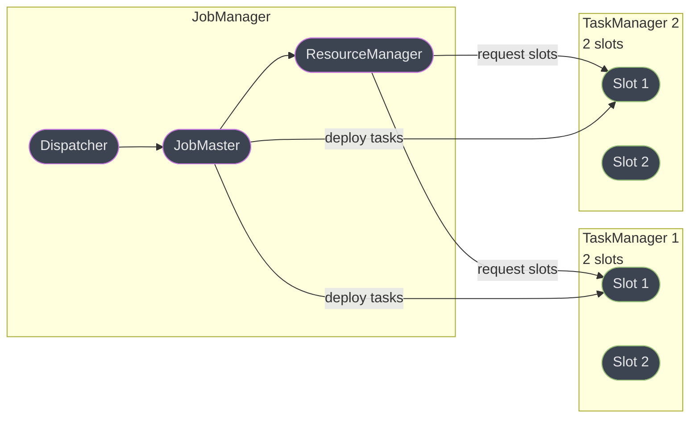
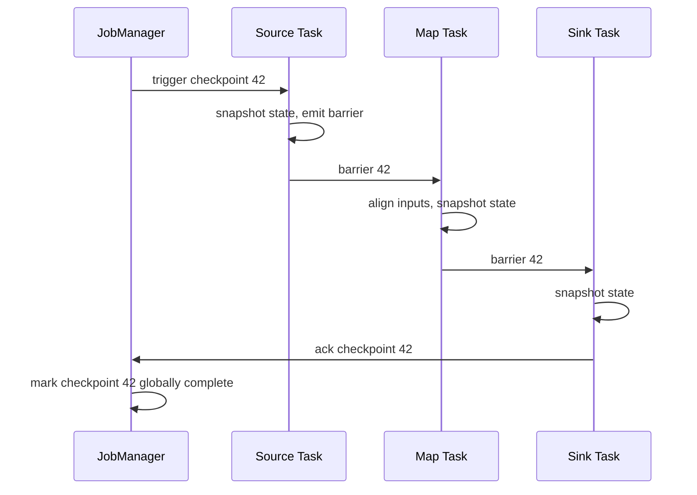

# Apache Flink

> **Version anchor (2026-08-26).** **Apache Flink 2.3.0** (released **2026-06-25**) is the
> current stable release on the 2.x line, alongside the bugfix releases **2.2.1**
> (2026-05-15) and **2.1.3** (2026-06-14) on their own minor lines. **Flink 1.20** is the
> maintained Long-Term-Support branch on the 1.x line, with **1.20.5** released
> **2026-06-03**. **Flink 2.0.0**, released **2025-03-24**, is the load-bearing boundary
> this page keeps returning to: the first Flink major version in nine years, and the release
> that **removed** — not deprecated — the DataSet API, the Scala DataStream and DataSet
> APIs, `SourceFunction`/`SinkFunction`/Sink V1, `TableSource`/`TableSink`, and the legacy
> flat `flink-conf.yaml` (replaced by a structured `config.yaml`), while requiring Java 11 as
> the minimum runtime. It also introduced **ForSt**, Flink's disaggregated state backend
> (§6.4), and the asynchronous execution model built on it. **Apache Flink CDC 3.6.0**
> (released 2026-03-31) is the current stable release of the separate, now fully
> ASF-governed CDC framework (§6.7). Version-gated behavior is tagged inline as `[2.0]`,
> `[2.3]`, `[CDC 3.x]`, and so on; anything untagged is stable across the 2.x line.

Apache Flink is a distributed engine for **stateful** computation over unbounded and bounded
data streams — the word "stateful" is the whole point of this page, and §1 opens on exactly
what that means and what it costs. This page does not restate Kafka's own architecture,
which belongs to [Kafka deep dive](../../backend/kafka_deep_dive/kafka_deep_dive.md); does
not restate log-based CDC mechanics, which belong to
[Debezium](../debezium_change_data_capture/debezium_change_data_capture.md); does not
restate table-format internals, which belong to
[Apache Iceberg](../apache_iceberg/apache_iceberg.md); and does not restate general
streaming-system theory (delivery guarantees, windowing vocabulary, the streaming/batch
duality), which belongs to [`hld/stream_processing`](../../hld/stream_processing/stream_processing.md).
This page cross-links each once and goes deep on what only Flink owns: the JobManager/
TaskManager runtime, the checkpoint and watermark machinery, and the operational failure
modes that show up once Flink is the thing holding your application's state.

---

## 1. Concept Overview

### The word that matters: stateful

A **stateless** stream transform reads a record, does something to it, and forgets it ever
existed — filter, map, a 1:1 field rename. A **stateful** stream transform needs to
remember something about records it saw before in order to correctly process the one in
front of it right now: a running count, a session's accumulated events, the last-seen value
of a join key, a fraud model's rolling feature window. Flink's entire architecture — the
JobManager/TaskManager split, checkpointing, the state-backend abstraction, watermarks — is
infrastructure built to answer one question: **how do you keep that "remembered" state
correct, fast to access, and recoverable after a crash, at a scale where it will not fit
on one machine or in one process's memory?** A tool that does not answer that question is
solving a different, easier problem.

This is the axis that actually separates Flink from its nearest neighbors, more than any
feature-comparison table can:

| System | What it is | Where state lives |
|---|---|---|
| **Apache Flink** | A standalone distributed runtime purpose-built for stateful stream processing | Colocated with each keyed operator instance, in a pluggable state backend, checkpointed by the runtime |
| **Kafka Streams** | A Java **library** you embed in your own application; there is no separate Kafka Streams cluster | Local RocksDB per application instance, backed by a Kafka changelog topic — your app's own JVM is the runtime |
| **Apache Beam** | A **portable API**, not a runtime; you write once and execute on a chosen runner (Flink, Spark, Dataflow, ...) | Whatever the underlying runner provides — Beam has no state engine of its own |
| **Spark Structured Streaming** | A streaming API layered on Spark's batch execution engine, run as repeated **micro-batches** | Structured state store (HDFS-state-store or RocksDB-backed), checkpointed once per micro-batch |

Kafka Streams' library model means "the cluster" is just however many copies of your app
you run — no separate scheduler, no separate deploy, but also no independent scaling of
compute from your application's own lifecycle. Beam is not a competitor to Flink at all; it
is a compatibility layer that can *target* Flink as one of several runners, and choosing
Beam is a decision to trade some Flink-native feature surface for runner portability. Spark
Structured Streaming's default execution mode discretizes the stream into micro-batches —
correct, and by far the most widely deployed streaming engine in practice because most Spark
shops already run Spark — but it means output latency is bounded below by the micro-batch
interval, and its "continuous processing" experimental mode has narrower operator support
than the micro-batch path. Flink's DataStream runtime is **pipelined**: a record moves
operator-to-operator as it arrives, with no batch boundary at all, and latency is a function
of processing time per operator, not a scheduled interval. See §8 for the full tradeoff
table against these and the newer streaming-database class.

### Flink 2.0: the boundary, precisely

Flink's own release announcement is explicit that hundreds of previously **deprecated**
APIs were **removed** in 2.0, not merely flagged again — this is the single most common
mistake made about this release, so state it plainly:

| API | Status before 2.0 | Status in 2.0+ |
|---|---|---|
| **DataSet API** (batch) | Deprecated since 1.12 | **Removed.** Use the DataStream API in `BATCH` execution mode |
| **Scala DataStream / DataSet API** | Deprecated | **Removed.** Use the Java DataStream API |
| **`SourceFunction`, `SinkFunction`, Sink V1** | Deprecated since 1.14–1.15 | **Removed.** Use `Source`/`Sink` V2 |
| **`TableSource`, `TableSink`** | Deprecated | **Removed.** Use `DynamicTableSource`/`DynamicTableSink` |
| **Flat `flink-conf.yaml`** | The only config file format | **Removed** as the primary format. Replaced by structured `config.yaml` |
| **Per-Job deployment mode** (YARN-only) | Deprecated since 1.15 | Not a supported deployment target on the 2.x line — use **Application Mode** |
| **`ProcessFunction`, `KeyedProcessFunction`, `WatermarkStrategy`, Table API, Flink SQL** | Stable | **Unaffected** — these are the APIs you should already be writing against |

The practical trap this produces: a Flink 1.x codebase using `DataSet<T>`,
`env.readTextFile(...).map(...)` in the old batch API, or a hand-rolled `SourceFunction`
does not compile against 2.x at all — it is a rewrite, not a recompile, and no flag brings
the old class back. The DataStream API's unification of batch and streaming execution
(choosing `RuntimeExecutionMode.BATCH` for a bounded source) is the intended migration
target for former DataSet users, not a like-for-like API swap.

### The new architectural piece: disaggregated state

Flink 2.0's other headline change is **ForSt** (§6.4), a disaggregated state backend that
moves primary state storage off local disk and onto a distributed file system, with local
disk used only as an optional cache tier. It exists because RocksDB-on-local-disk ties a
job's recovery time and rescaling time to how much state it has to move over the network —
ForSt's whole pitch is decoupling "how much state you have" from "how fast you can recover
or rescale," at the cost of read/write latency now crossing a network hop instead of hitting
local disk. §6.4 covers when that tradeoff is worth taking. Taken together, ForSt and the
removed-API table above are the two things a reader arriving from a Flink 1.x background
most needs oriented before anything else in this page makes sense.

---

## 2. Intuition

**One-line analogy.** A query engine looks something up fresh, every time, from data at
rest — like asking a librarian to re-find a book each visit. Flink is a warehouse with
permanent workstations: each keyed partition of your data has a dedicated desk (state) that
stays stocked between visits, and a record arriving for that key walks straight to its own
desk instead of searching the shelves.

**The mental model.** A Flink job is a long-running program, not a query you run once. Each
operator instance — one parallel slice of one stage of your dataflow — owns a slice of
keyed state that lives beside it for the operator's entire life. When a checkpoint happens,
every operator instance snapshots its own local state slice independently and in parallel;
there is no single "the state" to lock or serialize, because state was never centralized in
the first place. Recovery replays from the last consistent set of those slices, not from
scratch.

**Why it matters.** Any streaming system can filter and map. The hard, differentiating
problem is: what does "a running total, correctly computed exactly once, surviving a crash,
sharded across 200 machines, using out-of-order event timestamps" actually require? The
answer is checkpointing (§6.2), watermarks (§6.1), and a state-backend abstraction (§6.4),
and every one of Flink's headline features is in service of making that answer both correct
and fast.

**The key insight.** *State locality is the whole architecture.* Because state lives beside
the operator instance that owns it rather than in a separate store the operator calls out
to, a state access is (in the common case) a local read, not a network round trip — this is
the performance argument for Flink over "stream processing implemented as a stateless
compute layer plus an external key-value store." It is also the reason checkpointing has to
be distributed and asynchronous rather than "pause the world and snapshot a database":
there is no single database to snapshot, only thousands of independent local state slices
that must agree, after the fact, on what point in the stream they collectively represent.

---

## 3. Core Principles

1. **Pipelined execution, not staged batches.** A record flows operator to operator as soon
   as it is produced; there is no discretization into micro-batches waiting on a scheduling
   tick. This is what gives Flink sub-second output latency independent of any configured
   interval, in exchange for more operational machinery (checkpointing, backpressure
   propagation) to keep that pipeline consistent.

2. **State is local, sharded by key, and independently checkpointed.** Every keyed operator
   instance is responsible for exactly the state of the keys hashed to it (§6.4); no
   operator instance ever needs another instance's state to process a record for its own
   keys, which is what makes horizontal scaling of stateful computation possible at all.

3. **Event time is a property of the data, not of the clock reading it.** Watermarks (§6.1)
   are the only mechanism by which the runtime learns "no earlier event-time data is
   coming" — without them, a windowed aggregation has no principled way to know when a
   window is done accumulating.

4. **Exactly-once is an emergent property, not a single flag.** `execution.checkpointing.mode:
   EXACTLY_ONCE` guarantees internal state is exactly-once. Getting that guarantee to hold
   end-to-end, through a sink writing to an external system, additionally requires either
   an idempotent sink or a two-phase-commit sink (§6.5) — the checkpointing mode alone
   says nothing about what happens once a record leaves Flink.

5. **Backpressure is a first-class signal, propagated upstream, not an error condition.**
   A slow sink or a stalled downstream operator causes upstream operators to throttle their
   own output, visible in the Web UI as busy/backpressured ratios (§6.6) — it is the
   runtime working correctly under load, and diagnosing *which* operator is the true
   bottleneck (as opposed to merely backpressured by something further downstream) is a
   distinct, learnable skill.

6. **Recovery replays a graph, not a single process.** A restart re-deploys the affected
   region's tasks (§6.8) and restores each one's state from the last completed checkpoint
   independently and in parallel — there is no single "the job's state" object to reload,
   which is the same locality property from §2 showing up again as the reason recovery time
   scales with the size of the affected region's state, not the size of the whole job.

---

## 4. Types / Architectures / Strategies

### 4.1 The runtime: JobManager and TaskManager

Every Flink cluster, regardless of deployment mode, has exactly two kinds of processes:

- **JobManager** — the control plane. Internally split into the **Dispatcher** (accepts job
  submissions, starts a JobMaster per job), the **ResourceManager** (talks to the
  deployment's resource provider — Kubernetes, YARN, or a fixed standalone pool — to acquire
  and release TaskManagers), and the **JobMaster** (one per running job: owns the
  ExecutionGraph, schedules tasks onto slots, coordinates checkpoints).
- **TaskManager** — the worker. Each TaskManager offers a configurable number of **task
  slots** (`taskmanager.numberOfTaskSlots`, default **1**), and a slot is the unit of
  resource Flink schedules a task into — a fixed share of the TaskManager's managed memory,
  shared CPU otherwise. A TaskManager with 4 slots can run 4 parallel task instances
  concurrently (subject to slot sharing, §4.2).

### 4.2 Parallelism and slot sharing

A job's **parallelism** (`parallelism.default`, default **1**, almost always overridden per
job or per operator) is how many parallel instances each operator runs as. By default, all
operators in the same **slot sharing group** (the default group, unless explicitly split)
can pack their parallel instances into the same slot — so a job with parallelism 4 across a
source, three transforms, and a sink typically needs only 4 slots total, one full pipeline
slice per slot, rather than one slot per operator instance. This is why the number of slots
a job needs is, in the common case, its maximum parallelism, not the sum of every operator's
parallelism.

### 4.3 From program to running tasks: the three graphs

| Graph | Built by | What it represents |
|---|---|---|
| **StreamGraph** | The client, from your DataStream/Table API program | The logical dataflow: transformations and their data types, before any physical decisions |
| **JobGraph** | The client, from the StreamGraph | Operators **chained** into tasks where possible (adjacent operators with compatible parallelism and no shuffle between them fuse into one task, avoiding serialization and network overhead) |
| **ExecutionGraph** | The JobMaster, from the submitted JobGraph | The JobGraph expanded by parallelism into concrete parallel **ExecutionVertices**, each assigned to a task slot at deployment time |

Operator chaining is why the Web UI shows fewer boxes than your program has operators — a
`map().filter().map()` chain with matching parallelism and no keyBy/shuffle between them
runs as a single task, in a single thread, with zero serialization between the fused steps.

### 4.4 Deployment modes

| Mode | Cluster lifecycle | `main()` runs on | Use case |
|---|---|---|---|
| **Application Mode** | One dedicated cluster per application; JobManager and job share a lifecycle | Inside the cluster, on the JobManager | The default recommendation since 1.11 — no client-side classpath surprises, one job's cluster failure never affects another job |
| **Session Mode** | One long-lived cluster, many jobs submitted to it over time | On the submitting client | Fast job startup for many short-lived jobs sharing a warm cluster, at the cost of jobs competing for the same resource pool and blast-radius risk if the shared cluster fails |

Both run on any of three resource providers: **Standalone** (you manage the processes
yourself), **Kubernetes native** (Flink's own ResourceManager talks directly to the
Kubernetes API to allocate TaskManager pods — the **Flink Kubernetes Operator** is the
recommended way to run this in production, managing the `FlinkDeployment` custom resource
and its upgrade/savepoint lifecycle), and **Apache YARN**. Per-Job Mode, YARN-only, was
deprecated in 1.15 and is not a supported target on the 2.x line — a dedicated single-job
cluster on YARN is Application Mode's job now.

### 4.5 The API layers

| Layer | Abstraction level | When to reach for it |
|---|---|---|
| **Flink SQL** | Declarative, dynamic tables (§6.7) | The default choice for anything expressible as a query — aggregations, joins, windows over well-typed data |
| **Table API** | Declarative, fluent (Java/Python), same semantics as SQL, same optimizer | SQL's semantics with a programmatic, composable API — building queries from reusable fragments |
| **DataStream API** | Imperative, typed records, explicit operators | Custom windowing logic, non-relational state machines, side outputs, precise control over watermarks and timers |
| **ProcessFunction family** | The escape hatch beneath DataStream | `KeyedProcessFunction` (per-key state + timers), `CoProcessFunction` (two-input joins with custom logic), `BroadcastProcessFunction` (low-throughput broadcast side input joined against a high-throughput main stream), and the newer **Process Table Function (PTF)** bringing the same per-record, stateful, timer-driven escape hatch into SQL and the Table API |

The escape hatch is still fully current in the 2.x line: `ProcessFunction` was never
deprecated, and it is the correct answer whenever SQL/Table API's relational vocabulary
cannot express the logic — a session that needs a custom timeout policy, a rule engine
evaluating arbitrary per-key state, anything that needs to register and react to its own
event-time or processing-time timers directly.

### 4.6 Windowing constructs

Windows are how an unbounded stream becomes a series of bounded, aggregatable chunks. All
four DataStream window assigners share the same `.window(...)`/`.trigger(...)` shape and
differ only in how they carve the stream:

| Window type | Boundary rule | Example |
|---|---|---|
| **Tumbling** | Fixed-size, non-overlapping, back-to-back | `TumblingEventTimeWindows.of(Time.seconds(10))` — the `[00,10)`, `[10,20)` windows in §6.1's worked example |
| **Sliding** | Fixed-size, overlapping, advancing by a configurable slide smaller than the size | `SlidingEventTimeWindows.of(Time.minutes(5), Time.minutes(1))` — a 5-minute window recomputed every 1 minute, so one event contributes to 5 overlapping windows |
| **Session** | Dynamically sized, closes after a configurable inactivity gap | `EventTimeSessionWindows.withGap(Time.minutes(15))` — a user's browsing session, ending after 15 minutes of no events for that key |
| **Global** | One window per key, never closes on its own | `GlobalWindows.create()` — always paired with a **custom `Trigger`**, since without one nothing ever fires |

A **trigger** decides when a window's contents are evaluated and emitted — the default for
event-time windows fires once when the watermark passes the window's end, but a custom
trigger can fire early (a count-based trigger emitting a partial result every N elements
inside a still-open window) or fire on a completely different signal for a global window
(a marker event that means "this session is explicitly closed, evaluate now"). A
**`ProcessWindowFunction`** gives access to every buffered element plus window metadata
(start/end timestamps) when the aggregation needs more than a running sum — for a purely
incremental aggregate, pairing a lightweight `AggregateFunction` with the window (rather
than buffering every raw element for a `ProcessWindowFunction` to iterate at fire time) is
the standard performance optimization: the running aggregate updates on each element in
constant space, instead of the window holding every element until it fires.

---

## 5. Architecture Diagrams



*The Dispatcher accepts a submission and starts a per-job JobMaster; the JobMaster asks the
ResourceManager for slots and deploys tasks directly into them. No JobManager component ever
touches a record — the data plane is entirely inside TaskManagers.*


*Chaining happens between StreamGraph and JobGraph — this is the step that turns
`map().filter().map()` into one fused task when parallelism matches and no shuffle
intervenes, which is why the Web UI's task count is usually smaller than the program's
operator count.*



*Asynchronous barrier snapshotting (§6.2): the barrier is a control record flowing through
the same channels as data, and each task snapshots its own state the instant the barrier
passes through it — no global pause, no coordinator touching data.*

---

## 6. How It Works — Detailed Mechanics

### 6.1 Event time, watermarks, allowed lateness, side outputs

**Event time** is the timestamp the event actually happened, carried in the record itself.
**Processing time** is the wall-clock time Flink happens to see it — and in any real
pipeline, network delay, retries, and buffering mean event time and processing time diverge,
sometimes by a lot. A **watermark** is the runtime's answer to "how far has event time
progressed, and is it safe to consider a window done": a watermark of `T` is Flink's
assertion that no future record with event time `< T` should be expected (though one might
still arrive — that is exactly what "late" means).

The common strategy, bounded out-of-orderness, computes the watermark as
`max(event-time seen so far) - allowed_lag`:

```java
WatermarkStrategy<Order> strategy = WatermarkStrategy
    .<Order>forBoundedOutOfOrderness(Duration.ofSeconds(5))
    .withTimestampAssigner((order, recordTimestamp) -> order.getEventTimeMillis())
    .withIdleness(Duration.ofMinutes(1));
```

`withIdleness(Duration.ofMinutes(1))` marks a source partition idle if it produces no
records for a minute, excluding it from the watermark calculation until it resumes — without
this, one silent Kafka partition holds the *global* watermark back forever, because the
watermark for a keyed operator with multiple input partitions is the **minimum** across all
of them (§10.4 is exactly this incident).

Worked example — a tumbling window `[12:00:00, 12:00:10)`, 5-second bounded out-of-orderness,
1-minute allowed lateness:

```
event-time axis (seconds past 12:00:00) -------------------------------->
      00        03        07        10        12        14        20
      |---------|---------|---------|---------|---------|---------|
      [   tumbling window [12:00:00, 12:00:10)   )

arrivals, in wall-clock order (watermark = max event-time seen so far - 5s):
  e1  ts=03   watermark -> 00     window still open, e1 buffered
  e2  ts=07   watermark -> 02     window still open, e2 buffered
  e3  ts=12   watermark -> 07     window still open (07 < 10)
  e4  ts=15   watermark -> 10     WATERMARK CROSSES 10: window [00,10) fires
                                   output = {e1, e2} (e3, ts=12, belongs
                                   to the NEXT window, [10,20))
  e5  ts=04   watermark stays 10, ts=04 < 10 -> LATE EVENT, but within
              allowedLateness(1 minute) -> window [00,10) RE-FIRES with
              {e1, e2, e5}, superseding the earlier result
  e6  ts=02   watermark stays 10 (e6 does not advance it), ts=02 < 10
              AND past the 1-minute allowedLateness window -> routed to
              the side output, never contributes to any window result
```

`allowedLateness(Time.minutes(1))` keeps a fired window's state alive for one extra minute
past its watermark trigger specifically to absorb `e5`-shaped lateness — every re-fire
during that window emits an updated result, which is why a downstream sink consuming a
windowed aggregation must be able to handle an updated value for a window it already saw,
not assume one-result-per-window. Once allowed lateness expires, state for that window is
discarded, and anything arriving after that — `e6` — has nowhere correct to go; a
`.sideOutputLateData(lateTag)` on the window operator routes it to a separate stream instead
of silently dropping it, so a pipeline can at minimum count or archive what it missed rather
than lose the fact that it happened.

### 6.2 Checkpointing: asynchronous barrier snapshotting

Flink's fault-tolerance mechanism is a distributed variant of the **Chandy-Lamport
algorithm**: the JobManager periodically injects a **checkpoint barrier** — a control
record, not a data record — into every source. A barrier flows through the dataflow
alongside real records, in the same channels, in order. When a task receives a barrier on
all its input channels, it asynchronously snapshots its own local state to the configured
checkpoint storage and forwards the barrier downstream. No global pause ever happens; each
task's snapshot is a purely local action, taken the instant its own barrier condition is
met, and the checkpoint is only "complete" once the JobManager has an acknowledgment from
every task in the graph.

Key configuration (`CheckpointingOptions`, current defaults):

| Key | Default | What it controls |
|---|---|---|
| `execution.checkpointing.interval` | none (must be set) | How often a checkpoint is triggered |
| `execution.checkpointing.mode` | `EXACTLY_ONCE` | `EXACTLY_ONCE` waits for barrier alignment (or uses unaligned checkpoints); `AT_LEAST_ONCE` skips alignment entirely for lower latency at the cost of possible duplicate internal state on recovery |
| `execution.checkpointing.timeout` | 10 minutes | How long a checkpoint may run before being discarded as failed |
| `execution.checkpointing.min-pause` | 0 | Minimum gap enforced between the end of one checkpoint and the start of the next |
| `execution.checkpointing.max-concurrent-checkpoints` | 1 | How many checkpoints may be in flight at once |
| `execution.checkpointing.tolerable-failed-checkpoints` | 0 | Consecutive checkpoint failures tolerated before the job itself fails |
| `execution.checkpointing.unaligned.enabled` | `false` | Enables unaligned checkpoints (below) |
| `execution.checkpointing.incremental` | `false` | Whether a state backend that supports it (RocksDB, ForSt) checkpoints only the delta since the last checkpoint |
| `execution.checkpointing.externalized-checkpoint-retention` | `NO_EXTERNALIZED_CHECKPOINTS` | Whether the last checkpoint survives job cancellation, for manual restore |

**Aligned vs. unaligned checkpoints.** Under the default **aligned** mode with
`EXACTLY_ONCE`, a task with multiple input channels must wait for the barrier to arrive on
*every* channel before snapshotting, buffering records that keep arriving on channels whose
barrier already passed — this is correct, but under backpressure, buffering can take a long
time, stalling the checkpoint. **Unaligned checkpoints**
(`execution.checkpointing.unaligned.enabled: true`) let a task snapshot as soon as the
*first* barrier arrives, snapshotting the in-flight buffered records on the not-yet-arrived
channels *as part of its own state* rather than waiting for them — trading a larger
checkpoint (it now includes in-flight buffer contents) for a bounded, backpressure-immune
checkpoint duration. Flink's own recommendation is to enable unaligned checkpoints
specifically when a job is checkpointing under sustained backpressure and aligned checkpoint
durations are unpredictable; for a healthy, non-backpressured pipeline aligned checkpoints
are usually smaller and simpler to reason about.

**Incremental checkpoints and the changelog state backend.** With
`execution.checkpointing.incremental: true` on RocksDB or ForSt, each checkpoint uploads
only the state that changed since the previous one (RocksDB's own SST-file structure makes
this natural — unchanged SST files are simply referenced, not re-uploaded), rather than a
full state snapshot every time. The **Changelog State Backend** goes further: it continuously
streams every state *mutation* to durable storage as it happens, independent of the
checkpoint cycle, so a checkpoint's cost drops to "flush whatever's buffered in the
changelog" rather than "snapshot the state store." The underlying RocksDB/ForSt instance is
still the queryable source of truth for reads; its SSTables are periodically uploaded
("materialized") on a separate, much less frequent cadence (10 minutes by default) than
checkpointing itself.

### 6.3 Checkpoint vs. savepoint

Both are full state snapshots taken via the same barrier mechanism, and the distinction is
about **ownership and format**, not mechanism:

| | Checkpoint | Savepoint |
|---|---|---|
| **Triggered by** | The runtime, on `execution.checkpointing.interval` | A human or an operator tool, explicitly |
| **Owned by** | Flink — retention, cleanup, and format are Flink's internal concern | The user — `NO_CLAIM` mode (the default) means Flink never deletes it |
| **Format** | Whatever the state backend produces natively (fast) | **Canonical** (a unified, backend-independent format — portable, can restore onto a *different* state backend or across Flink versions) or **native** (backend-specific, faster to take and restore, since Flink 1.15) |
| **Typical use** | Automatic recovery from a task failure | Planned maintenance: version upgrades, rescaling, migrating between state backends, blue-green job deployment |

Restoring across a Flink minor-version upgrade, or from RocksDB onto ForSt, requires the
**canonical** format specifically — a native savepoint is tied to the state backend that
produced it, and restoring it onto a different backend is not guaranteed to work at all.
`bin/flink savepoint <jobId> [target-dir]` (or the equivalent Kubernetes Operator field)
takes one; `bin/flink run -s :savepointPath` restores from one, and `--allowNonRestoredState`
is required if the new job graph has dropped an operator whose state the savepoint still
carries — using it incorrectly silently discards that operator's state rather than failing
loudly, so it should never be a reflexive flag to make an error go away.

### 6.4 State backends: HashMap, RocksDB, and ForSt

| Backend | State lives | Best for | Checkpoint cost |
|---|---|---|---|
| **HashMapStateBackend** | JVM heap, as Java objects | Small state, low-latency access, jobs that fit comfortably in memory | Full snapshot each time — no incremental support, since there's no on-disk structure to diff |
| **EmbeddedRocksDBStateBackend** | RocksDB on local disk, serialized bytes | State larger than heap — the long-standing production default | Supports incremental checkpoints; recovery must re-download and rebuild local RocksDB state, cost scales with state size |
| **ForSt** `[2.0]` | RocksDB engine, primary storage **disaggregated onto a DFS**, local disk as an optional cache tier | Very large state, environments prioritizing fast recovery/rescale over local-disk read latency | Checkpoint is close to metadata-only (data is already on the DFS); a VLDB 2026 paper from the Flink community reports up to 94% reduction in checkpoint duration and up to 49x faster recovery versus local RocksDB, at up to 50% storage cost savings |

`state.backend.type` (default `hashmap`) selects among `hashmap`, `rocksdb`, and `forst`.
ForSt's tradeoff is the mirror image of RocksDB's: a state access now potentially crosses a
network hop to the DFS rather than hitting local disk, so ForSt is a latency-for-recovery
trade, not a strict upgrade — a job whose bottleneck is per-record state-access latency, not
recovery time, may still be better served by local RocksDB.

**State TTL.** `StateTtlConfig` attaches a time-to-live to keyed state so entries expire
automatically instead of growing the state store forever — the fix for §10.1's incident.
Cleanup happens two ways depending on backend: the heap backend uses
`cleanupIncrementally()` (a configurable number of entries checked per state access, trading
a small per-record latency cost for bounded background work), and RocksDB/ForSt use
`cleanupInRocksdbCompactFilter()`, dropping expired entries during RocksDB's own compaction
passes rather than scanning proactively. Background cleanup is enabled by default as of
Flink 1.8+; the trap is state that is genuinely never accessed again after a key stops
appearing — with no access to trigger the heap backend's incremental check, that entry can
sit expired-but-present until compaction (RocksDB) or forever (heap, if compaction-based
cleanup isn't configured).

**Keyed vs. operator state.** *Keyed state* (`ValueState`, `ListState`, `MapState`, ...) is
partitioned by the record's key and only accessible inside a `KeyedStream` — this is what
"state lives beside the operator instance that owns that key range" means concretely.
*Operator state* (`ListState` via `CheckpointedFunction`, or the built-in
`UnionListState`) belongs to the operator instance as a whole, independent of any key —
used for source-connector offsets (each source subtask's own list of partition offsets) and
similar per-instance-not-per-key bookkeeping.

**The `uid()` rule.** Flink identifies which slice of a savepoint or checkpoint belongs to
which stateful operator by a generated ID *unless you assign one explicitly* with
`.uid("my-operator-name")`. That generated ID is derived from the operator's position and
structure in the graph — reorder operators, add a new one upstream, or even just recompile
with a different Flink or library version in some cases, and the generated IDs can shift.
On restore, Flink matches savepoint state to the running job by UID; a mismatched UID means
that operator's state silently comes back empty rather than failing the restore, because a
missing UID is, from the runtime's point of view, indistinguishable from "this operator is
new and legitimately starts from scratch." **Every stateful operator should carry an
explicit `.uid()`, set once, and never changed for that operator's lifetime** — see §10.3
for what happens without it.

### 6.5 Exactly-once end to end: two-phase-commit sinks

Internal exactly-once — state updates are never lost or duplicated across a failure — is
what `execution.checkpointing.mode: EXACTLY_ONCE` alone provides. Making that guarantee hold
**through** a sink to an external system additionally requires the sink itself to
participate in the checkpoint protocol via **two-phase commit**:


The **KafkaSink**'s `DeliveryGuarantee.EXACTLY_ONCE` implements exactly this: it opens a new
Kafka transaction between checkpoints, writes records into it, and only **commits** that
transaction once the checkpoint that covers those writes is confirmed complete — a
`read_committed` consumer never sees the data until then. The classic production trap sits
in the interaction between two independently configured timeouts:

**Broken.** Flink's `KafkaSink` defaults its producer's `transaction.timeout.ms` to **one
hour**, but the Kafka broker's own `transaction.max.timeout.ms` defaults to **15 minutes**.
Left at defaults, the producer simply fails to initialize with an
`InvalidTransactionTimeout` error, because 3,600,000ms exceeds the broker's 900,000ms
ceiling — a hard startup failure, not a subtle one. The more insidious version of this trap
is a team that *does* set `transaction.timeout.ms` correctly below the broker ceiling — say,
10 minutes — but leaves `execution.checkpointing.interval` at 20 minutes. Every open
transaction now outlives its own timeout before the checkpoint that would commit it
completes; the broker aborts it unilaterally, and the sink's next commit attempt fails.

```java
// broken: checkpoint interval outlives the Kafka transaction
env.enableCheckpointing(Duration.ofMinutes(20).toMillis());
KafkaSink<String> sink = KafkaSink.<String>builder()
    .setKafkaProducerConfig(Map.of("transaction.timeout.ms", "600000")) // 10 min
    .setDeliverGuarantee(DeliveryGuarantee.EXACTLY_ONCE)
    .build();
```

```java
// fixed: transaction.timeout.ms comfortably exceeds checkpoint interval,
// while staying under the broker's transaction.max.timeout.ms ceiling
env.enableCheckpointing(Duration.ofMinutes(5).toMillis());
KafkaSink<String> sink = KafkaSink.<String>builder()
    .setKafkaProducerConfig(Map.of("transaction.timeout.ms", "900000")) // 15 min
    .setDeliverGuarantee(DeliveryGuarantee.EXACTLY_ONCE)
    .build();
```

The operational guidance directly from Flink's own connector documentation: size
`transaction.timeout.ms` for the **worst case**, not the average — checkpoint interval plus
the maximum time a restart-and-recovery cycle might add before the next commit — and keep
it under the broker's `transaction.max.timeout.ms`. Because Flink's design fails safe (an
aborted transaction takes the job down rather than silently committing partial or duplicate
data), the actual production cost of getting this wrong is availability, not correctness: a
crash-loop and reprocessing from the last good checkpoint, not silently duplicated or lost
records downstream.

### 6.6 Backpressure: diagnosis, not just symptom

Backpressure is upstream throttling caused by a slow or stalled consumer further down the
pipeline — Flink's own network stack propagates it automatically via bounded buffer credits,
which is a feature (it prevents unbounded memory growth), not a malfunction. The diagnostic
problem is that backpressure is visible everywhere upstream of the true bottleneck, so
"operator X looks backpressured" does not by itself say X is the problem — it may simply be
waiting on Y downstream.

The Web UI's per-subtask **busy** and **backpressured** ratios (sampled via stack-trace
sampling of each task's thread) are the primary tool: a subtask that is mostly **busy**
(actively computing) is a genuine compute bottleneck; a subtask that is mostly
**backpressured** (blocked trying to send output) is waiting on something downstream, so the
real bottleneck is further along the chain, not at that subtask. Walking the busy/idle/
backpressured ratios from sink toward source, the first operator that is genuinely **busy**
rather than **backpressured** is the actual bottleneck. `numRecordsOutPerSecond` and
`numRecordsInPerSecond` per operator corroborate this: a real bottleneck's output rate
plateaus below its input rate even while upstream keeps offering more.

**Buffer debloating** (`taskmanager.network.memory.buffer-debloat.enabled`, default
**`false`**) dynamically shrinks the amount of in-flight, buffered data between operators to
target a configurable consumption time
(`taskmanager.network.memory.buffer-debloat.target`), rather than letting network buffers
fill to their static maximum. Its practical payoff is smaller, more predictable **aligned**
checkpoint times under backpressure — less data has to drain through a slow operator before
a barrier can catch up — and it composes with, rather than replaces, unaligned checkpoints;
Flink's own guidance treats them as complementary tools for the same problem (checkpointing
staying fast under backpressure), not alternatives to choose between.

### 6.7 Flink SQL and the Table API: dynamic tables

Flink SQL treats a stream as a **dynamic table**: a table that changes over time, where a
query against it is continuously re-evaluated and its own result is itself a dynamic table,
which can then be turned back into a stream. That stream-to-table-to-stream round trip is
governed by the **changelog stream duality** — three kinds of change streams a dynamic table
can materialize as:

| Kind | Row events | When it applies |
|---|---|---|
| **Append-only** | Only inserts, never updates or deletes | A stream with no aggregation, or a `GROUP BY` on an ever-growing, never-revisited key such as a windowed tumbling aggregation |
| **Upsert** | Inserts and updates keyed by a primary key, no explicit deletes (or deletes as a special upsert-null) | A `GROUP BY` on a key that keeps being revisited — a running total per user that keeps changing as new events arrive |
| **Retract** | Every update is an explicit retraction of the old row plus insertion of the new row | Non-deterministic or non-keyed changes — a query without a clean primary key to upsert against |

A sink connector must declare which kinds of changes it can consume — attempting to write an
upsert or retract changelog into a strictly append-only sink (a plain file, an append-only
Kafka topic with no compaction) fails, because that sink has no way to represent "this row
changed" or "this row is gone," only "here is a new row." `FROM_CHANGELOG`/`TO_CHANGELOG`
`[2.3]` make this conversion explicit in SQL rather than implicit in connector behavior.

**Watermarks in DDL** are declared directly on the table, not bolted on afterward in code:

```sql
CREATE TABLE orders (
    order_id    STRING,
    amount      DECIMAL(10, 2),
    event_time  TIMESTAMP(3),
    WATERMARK FOR event_time AS event_time - INTERVAL '5' SECOND
) WITH (
    'connector' = 'kafka',
    'topic' = 'orders',
    'properties.bootstrap.servers' = 'kafka:9092',
    'format' = 'json'
);
```

This is the same bounded-out-of-orderness strategy from §6.1, expressed declaratively; any
windowed SQL query (`TUMBLE`, `HOP`, `SESSION`) over this table uses this watermark exactly
as a DataStream job would.

**Flink CDC as a source.** [`Apache Flink CDC`](https://github.com/apache/flink-cdc) `[CDC
3.x]` is a separate ASF project (not part of Flink core) that embeds log-based CDC source
connectors — for MySQL, PostgreSQL, MongoDB, Oracle, and others — directly as Flink sources
and, since its 3.x pipeline-connector model, as a standalone YAML-defined data-integration
pipeline that does not require hand-written Flink jobs at all. It answers a different
question than [Debezium](../debezium_change_data_capture/debezium_change_data_capture.md)'s
usual deployment: Debezium typically publishes change events to Kafka for many independent
consumers to share, while Flink CDC's source connectors pull directly from the database's
replication log *into* a Flink job with no Kafka hop in between — lower latency and one
fewer moving part when Flink is the only consumer, at the cost of the database's replication
slot now being held open by a Flink job instead of a dedicated, purpose-built CDC service.
Both share the same underlying log-based capture mechanics that Debezium's own page owns in
full.

### 6.8 Restart strategies and failover regions

A task failure and a checkpoint failure are recovered the same way: the job (or a scoped
part of it) restarts from the last completed checkpoint. Two independent settings decide
the blast radius and the pacing of that restart:

**Failover strategy** (`jobmanager.execution.failover-strategy`, default **`region`** since
Flink 1.10) decides *how much* of the job restarts. The `region` strategy groups tasks into
disjoint "pipelined regions" — connected via pipelined (in-memory) edges — and, on a single
task's failure, restarts only the smallest set of regions actually affected, rather than the
whole job. A job with a `keyBy` shuffle between two otherwise-independent stages typically
splits into multiple regions at that boundary, so a failure downstream of the shuffle does
not force the upstream source to re-read and reprocess data it already emitted successfully.
The legacy `full` strategy restarts the entire job on any task failure — strictly more
disruptive, and effectively only relevant for debugging or for jobs with no meaningful
region boundaries to exploit.

**Restart strategy** decides *how* a restart is paced, via `restart-strategy.type`:

| Strategy | Behavior | When checkpointing is enabled and nothing else is configured |
|---|---|---|
| `exponential-delay` | Backoff doubles (times a configurable multiplier) after each consecutive failure, up to a cap, resetting after a period of stability | **The default**: initial backoff 1s, max backoff 1min, multiplier 1.5, jitter 0.1, reset-backoff threshold 1 hour, infinite attempts before that reset |
| `fixed-delay` | A constant delay between every restart attempt, up to a maximum attempt count | Explicit opt-in only |
| `failure-rate` | Restarts unless failures exceed a configured rate (`restart-strategy.failure-rate.max-failures-per-interval` over `restart-strategy.failure-rate.failure-rate-interval`), at which point the job is declared failed outright | Explicit opt-in only |

`exponential-delay` being the checkpointing-enabled default is a deliberate choice: an
isolated, occasional failure gets retried almost immediately (1-second initial backoff), but
a job stuck in a genuine crash loop backs off up to a full minute between attempts rather
than hammering the same failing dependency — and the 1-hour reset threshold means a job that
recovers and stays healthy for an hour returns to fast retries rather than staying
permanently backed off from an incident that's long over.

### 6.9 Complex event processing with FlinkCEP

For pattern-matching logic — "an A event followed within 10 minutes by three B events with
no C event in between" — `flink-cep` provides a **Pattern API** purpose-built for exactly
this shape, rather than hand-rolling it as a `KeyedProcessFunction` with manual timers and
buffered state:

```java
Pattern<Transaction, ?> fraudPattern = Pattern.<Transaction>begin("small")
    .where(SimpleCondition.of(tx -> tx.getAmount().compareTo(SMALL_THRESHOLD) < 0))
    .followedBy("large")
    .where(SimpleCondition.of(tx -> tx.getAmount().compareTo(LARGE_THRESHOLD) > 0))
    .within(Duration.ofMinutes(10));

PatternStream<Transaction> patternStream = CEP.pattern(
    transactionStream.keyBy(Transaction::getCardToken), fraudPattern);

DataStream<Alert> alerts = patternStream.process(
    new PatternProcessFunction<Transaction, Alert>() {
        @Override
        public void processMatch(Map<String, List<Transaction>> match,
                                  Context ctx, Collector<Alert> out) {
            out.collect(new Alert(match.get("small").get(0), match.get("large").get(0)));
        }
    });
```

`.followedBy(...)` allows other events in between the matched ones (non-strict contiguity);
`.next(...)` requires strict adjacency instead. `.within(...)` bounds how long a partial
match may stay alive waiting for the rest of the pattern before it's discarded — without it,
an incomplete match holds state indefinitely, the same unbounded-growth risk §10.1 covers
for ordinary keyed state. `MATCH_RECOGNIZE`, Flink SQL's ISO-standard pattern-matching
clause available since 1.7, runs on the same FlinkCEP engine underneath a declarative SQL
surface — the choice between the two is the same DataStream-versus-SQL tradeoff as
everywhere else in Flink: full programmatic control against a shallower learning curve for a
team already fluent in SQL.

### 6.10 State schema evolution

A long-running job eventually needs to change the shape of a class stored in state — add a
field to a POJO, change a type. Flink's built-in POJO and Avro serializers support
**backward-compatible schema evolution** across a savepoint restore under specific
conditions: for POJOs, adding or removing a field is supported as long as the field's
declared type doesn't change and the class remains a valid POJO (a public no-arg
constructor, public getters/setters or public fields); Avro-backed state follows Avro's own
schema-evolution compatibility rules (a new field must carry a default value to be
readable against records written under the old schema). What is **not** safely evolvable
this way: changing a field's type, restructuring a class hierarchy, or switching which
serializer a state descriptor uses entirely — none of those are covered by the built-in
compatibility check, and attempting them produces either a restore failure (the safe
outcome) or, with a custom `TypeSerializer` that doesn't implement its own compatibility
logic correctly, silently misread bytes (the dangerous one). For a genuinely incompatible
change, the safe path is: stop the job with a savepoint under the old schema, run a
one-off offline job that reads that savepoint's state and rewrites it under the new schema
using the [State Processor API](https://nightlies.apache.org/flink/flink-docs-stable/docs/libs/state_processor_api/),
then restart from the rewritten savepoint — never assume an incompatible change will simply
fail loudly on restore without having verified it against a staging environment first.

### 6.11 Elastic scaling: Reactive Mode and the Kubernetes Operator autoscaler

Manually re-tuning parallelism as load changes is a standing operational tax; two related
mechanisms exist to automate it. **Reactive Mode** (`jobmanager.scheduler: adaptive`)
assumes a single job per cluster and always scales that job's parallelism to match however
many TaskManagers the cluster currently has — adding a TaskManager scales the job up, and
Flink handles the rescale internally, with no external controller needed. It is the
building block, not the full autoscaling story: it reacts to however many TaskManagers
exist, but it does not itself decide when to add or remove them based on load.

The **Flink Kubernetes Operator's autoscaler** is the layer that closes that loop: with
`job.autoscaler.enabled: true` and the scheduler set to `adaptive`, it continuously
observes each operator's true resource utilization (a stabilization window aggregating
metrics — 1 minute by default in the standalone Adaptive Scheduler, 2 minutes with a
1-minute metrics window in the Operator's own implementation) against a target utilization
(35% by default, with a configurable boundary), and adjusts each operator's parallelism
independently rather than the whole job uniformly — a source or a genuinely hot operator
scales differently from a lightly loaded downstream sink. In-place rescaling, supported
since Flink 1.18, changes parallelism without a full stop-and-restore-from-savepoint cycle,
which is what makes autoscaling responsive enough to react to real load swings rather than
only correcting yesterday's provisioning mistake on tomorrow's manual deploy.

### 6.12 `maxParallelism` and key groups

Every keyed stream is internally partitioned into a fixed number of **key groups** —
determined by `pipeline.max-parallelism` (commonly still referred to by its long-standing
name `maxParallelism`), set once and, in the general case, **fixed for the life of the
job's state**. Flink hashes each key into one of that many key groups at write time, and
key groups (not individual keys) are the unit actually redistributed across operator
instances when parallelism changes — rescaling from 8 to 16 instances works by handing each
new instance a different subset of the existing key groups, never by rehashing individual
keys again. This is why setting `maxParallelism` too low up front is a genuine ceiling:
a job cannot be rescaled beyond however many key groups exist, because there would be
nothing left to hand a new operator instance — a job started with `maxParallelism: 32`
cannot later run at parallelism 64, no matter how much compute is available, without a
full state migration through the State Processor API (§6.10) to re-key under a larger key
group count. The standing guidance is to set `maxParallelism` generously above any
realistically anticipated future parallelism (Flink's own default heuristic multiplies
the initial parallelism to leave headroom), since raising it later is exactly as
disruptive as any other incompatible state change, while an unnecessarily high value costs
only a small, fixed amount of metadata overhead per checkpoint.

---

## 7. Real-World Examples

**Netflix** runs **Keystone**, its core real-time stream-processing platform, on Apache
Flink after migrating off Apache Samza — Keystone moves on the order of 2 trillion events
per day and multiple petabytes daily into Netflix's data warehouse, powering personalization,
operational insight, and fraud-detection use cases. Netflix's own engineering blog
documented both the migration and the tuning work required to run Flink reliably at that
scale on AWS.

**Uber** built and open-sourced **AthenaX**, a self-service streaming-SQL platform on top of
Apache Flink and Apache Calcite, letting engineers author streaming analytics in SQL rather
than hand-written DataStream jobs; at the scale Uber's engineering blog described, AthenaX
managed over 1,000 production streaming jobs processing more than a trillion messages a day.

**Pinterest** runs Flink as its general-purpose stream-processing platform: real-time
experiment analytics (its first production Flink use case), near-real-time image-similarity
detection, and real-time ML signal generation, all on a shared, multitenant deployment
framework. Pinterest's engineering blog reported clusters processing more than 20 million
messages per second across a dozen production Flink clusters, and documented the specific
JVM, network-buffer, and checkpointing tuning required to keep multitenant clusters stable
at that throughput.

**Alibaba** is Flink's own origin story in a real sense: Alibaba built an internal fork
("Blink") to meet its own real-time-compute demands at Double 11 shopping-festival scale, and
merged that fork's improvements back into Apache Flink starting in 2019 after acquiring
Ververica (founded by Flink's original creators). Alibaba Cloud's own managed offering,
**Realtime Compute for Apache Flink**, is a direct commercial descendant of that internal
deployment, and remains one of the largest known Flink footprints in production.

The common shape across all four: none of them are running a single stateless filter job.
Every one of these deployments exists because the organization needed stateful,
low-latency, exactly-once-capable computation over a continuous event stream at a volume
where "run a cron job every few minutes" or "embed a stream library per service" stopped
being viable.

---

## 8. Tradeoffs

| System | Execution model | State model | Where it wins | Where it costs you |
|---|---|---|---|---|
| **Apache Flink** | Pipelined, record-at-a-time | Colocated, checkpointed keyed state, pluggable backend | Lowest achievable output latency; the deepest windowing/watermark vocabulary; a general-purpose runtime for arbitrary stateful logic | A standalone cluster to operate: JobManager/TaskManager lifecycle, checkpoint storage, savepoint discipline, its own deployment tooling |
| **Kafka Streams** | Pipelined, embedded in your app | Local RocksDB per app instance, Kafka changelog topic as backup | No separate cluster at all — scaling is "run more copies of your app"; minimal new operational surface for a shop already running Kafka | Bound to your application's own deploy lifecycle and language (JVM); weaker windowing/CEP surface than Flink; state rebuild after a restart streams the whole changelog back |
| **Spark Structured Streaming** | Micro-batch (default), continuous processing (experimental, narrower operator support) | Structured state store, checkpointed per micro-batch | The natural choice where Spark batch jobs already exist — one engine, one operational model, one team's expertise for both | Latency floor set by the micro-batch interval; the continuous-processing path trades that away but supports a much smaller operator set |
| **RisingWave / Materialize** (streaming databases) | Incremental view maintenance over a Postgres-compatible SQL surface | Managed internally by the database, not exposed as a pluggable backend | Postgres-familiar SQL, a running database you query directly rather than a job you deploy and monitor — dramatically lower operational surface for "maintain this materialized view incrementally" | Narrower general-purpose programmability than DataStream/ProcessFunction; you are inside the database's execution model, not writing arbitrary stateful code |
| **ksqlDB** | Built directly on Kafka Streams | Same local-RocksDB-per-instance model as Kafka Streams | SQL-first authoring over Kafka topics with no separate engine to run beyond the ksqlDB server itself | Kafka-only source/sink surface; the same Kafka Streams state-rebuild and scaling characteristics underneath the SQL layer |
| **Arroyo** | Pipelined, Rust runtime, SQL-first | Embedded state, checkpointed | A single self-contained binary — no JVM, dramatically simpler to deploy and reason about for SQL-shaped streaming jobs | Younger project, smaller connector and operator ecosystem than Flink's; not the choice for custom stateful logic beyond what its SQL surface expresses |

The honest framing: **Flink's cost is operational complexity**, not raw capability — nothing
in this table processes more kinds of stateful streaming logic more precisely than Flink
does. The entire streaming-database class (RisingWave, Materialize) exists as a direct
answer to that cost: most streaming workloads are actually "maintain this SQL view
incrementally," and paying Flink's operational tax — cluster lifecycle, checkpoint tuning,
savepoint discipline, JVM tuning — to get there is a real, calculable overhead a managed
streaming database is built specifically to avoid. Choosing Flink is a bet that either the
logic genuinely needs DataStream/ProcessFunction-level control, or the scale and breadth of
streaming workloads justifies operating a general-purpose engine once rather than several
narrower tools.

**Flink is deliberately absent from this table's nearest apparent neighbor: [Apache
Airflow](../apache_airflow/apache_airflow.md).** They are not competitors — Airflow
schedules and orchestrates discrete, finite tasks (often *submitting* a Flink or Spark job
as one node in a DAG) on a defined cadence, while Flink is the always-running engine that
processes an unbounded stream continuously. Reaching for Airflow to "orchestrate" a
continuous stream, or for Flink to run a once-a-day bounded aggregation, is a category
error in both directions — see §9's decision criteria for the concrete line between them.

---

## 9. When to Use / When NOT to Use

**Reach for Flink when:**
- The logic is genuinely stateful — running aggregates, sessionization, stream-to-stream
  joins, pattern detection over time — and needs to be correct under out-of-order,
  at-least-partially-delayed real-world event arrival.
- Output latency in the sub-second-to-few-seconds range matters, ruling out micro-batch.
- The organization already runs, or is willing to operate, a dedicated cluster and the
  checkpoint/savepoint operational discipline that comes with it.
- The workload is broad enough (many jobs, many teams, varied logic) that a general-purpose
  engine amortizes better than several narrower point tools.

**Do NOT reach for Flink when:**
- The transform is **stateless** — a single-topic filter, reshape, or route. A Kafka
  Streams library embed, or even a plain consumer-producer loop, does the same job with a
  fraction of the operational surface, and "does this job need a separate cluster at all"
  should be the first question, not an afterthought.
- The job is fundamentally **batch** — a nightly aggregation over a bounded dataset with no
  latency requirement. That is
  [Apache Airflow](../apache_airflow/apache_airflow.md)-orchestrated batch territory (or
  Spark batch), not a standing streaming cluster; running Flink continuously to compute
  something that only needs to run once a day is paying an always-on operational cost for a
  workload that does not need one.
- A **single Kafka topic in, single Kafka topic out, with a Kafka Streams-shaped
  transformation** already covers it — Kafka Streams' embedded model is strictly cheaper to
  operate for exactly this shape, and reaching for Flink here is choosing the general
  solution over the specific one for no benefit.
- The actual need is "maintain this SQL view incrementally over a small number of
  well-defined queries" — a streaming database (RisingWave, Materialize) is very often the
  right answer here (§8), trading Flink's generality for a running database's much smaller
  operational footprint.
- The team has no appetite to own checkpoint storage, savepoint discipline, and JVM/cluster
  tuning as an ongoing responsibility — that operational commitment is not optional once
  Flink is in the critical path, and underestimating it is how §10's incidents happen.
- **A prototype or proof-of-concept with an uncertain future** is rarely worth Flink's setup
  cost up front — a small script against a bounded sample, or a short-lived Kafka Streams
  embed, answers "does this logic even work" far faster, with the migration to Flink (if the
  prototype earns production traffic and genuine state requirements) deferred until the
  workload has actually proven it needs what Flink specifically offers.

---

## 10. Common Pitfalls (Production War Stories)

### 10.1 RocksDB state grew until the TaskManagers ran out of disk

**Symptom.** A session-windowing job's RocksDB local-disk usage grows steadily for weeks,
with no corresponding growth in live traffic, until TaskManagers start failing on disk
exhaustion and the job enters a crash-restart loop.

**Cause.** The job's keyed state (per-user session accumulators) was never given a TTL.
Users who stopped being active — churned, or simply inactive for a season — left their
session state permanently resident in RocksDB; nothing ever removed it, because nothing
ever expired it, and inactive keys are, by definition, never accessed again to trigger any
access-time-based cleanup path.

**Fix.** `StateTtlConfig.newBuilder(Time.days(30)).cleanupInRocksdbCompactFilter(1000).build()`
on the offending descriptor, deployed via a savepoint-based upgrade (§6.3) so existing state
survived the change. Disk usage stabilized within two compaction cycles as decades of
accumulated inactive-user state finally expired. The standing rule the team adopted:
**every new keyed state descriptor gets an explicit TTL decision at review time** — "no TTL"
must be a deliberate choice (state that genuinely needs to live forever), never a default.

### 10.2 A checkpoint interval longer than the Kafka transaction timeout broke exactly-once

**Symptom.** A KafkaSink-backed job with `DeliveryGuarantee.EXACTLY_ONCE` starts failing
intermittently with producer errors after weeks of stable operation, always correlated with
periods of slightly slower checkpoint completion.

**Cause.** Exactly the trap in §6.5: `transaction.timeout.ms` had been set below the
broker's `transaction.max.timeout.ms` ceiling correctly at initial setup, but
`execution.checkpointing.interval` was later widened (to reduce checkpointing overhead
under higher load) without anyone revisiting the transaction timeout that interval now had
to fit inside. Once a checkpoint occasionally ran close to the transaction timeout, the
broker aborted the in-flight transaction before Flink's commit arrived.

**Fix.** `transaction.timeout.ms` raised to comfortably exceed the *worst-case* checkpoint
duration observed (not the average), while confirming it still stayed under the broker's
`transaction.max.timeout.ms`; checkpoint interval and transaction timeout were subsequently
treated as a **single coupled setting**, changed together and reviewed together, never one
without the other.

### 10.3 A rescale failed because operators had no explicit `uid()`

**Symptom.** A routine rescale from parallelism 8 to parallelism 16, done via savepoint
(§6.3), restores successfully with no error — but a downstream deduplication operator's
counts silently reset to zero, and duplicate records start appearing in the output.

**Cause.** The job's operators had no explicit `.uid()` calls; Flink had been generating
IDs from each operator's position in the graph. An unrelated code change earlier that
sprint had added a new logging-only `map()` step upstream of the deduplication operator —
harmless on its own, but it shifted every downstream operator's position in the graph, which
shifted every downstream operator's *generated* UID. On restore, the savepoint's state for
the (old-UID) deduplication operator no longer matched the (new-UID) deduplication operator
in the running job, so Flink treated it as a brand-new stateful operator starting from
empty state — silently, because a missing-UID mismatch is indistinguishable from "this
operator is legitimately new."

**Fix.** Every stateful operator in the job was given an explicit, permanent `.uid()`, and a
CI check was added that fails the build if any stateful operator lacks one. The general
lesson: **`uid()` is not a rescale-time concern, it is a day-one concern** — the incident
that exposes a missing `uid()` is never the rescale itself, it's whatever unrelated upstream
change happened to shift the graph's shape before the next one.

### 10.4 Watermark stalling on an idle Kafka partition froze all windowed output

**Symptom.** A windowed aggregation job stops emitting any results at all, across every key,
even though the Web UI shows the job healthy, consuming records, and checkpointing
successfully.

**Cause.** One Kafka partition among many feeding the job's source went idle — no traffic on
that specific partition key range for an extended period, while every other partition kept
flowing normally. Because the operator's watermark is the *minimum* watermark across all its
input channels, that one silent partition held the global watermark at its last-seen value
indefinitely, which meant no window anywhere in the job could ever be judged "complete" —
every window kept waiting for a watermark advance that the idle partition would never
contribute.

**Fix.** `WatermarkStrategy.withIdleness(Duration.ofMinutes(1))` (§6.1) added to the source's
watermark strategy, excluding an idle partition from the watermark-minimum calculation once
it stops producing, letting the remaining active partitions continue advancing the global
watermark. The standing practice: **any watermark strategy over a partitioned source with
uneven traffic across partitions needs `withIdleness` from the start**, not as a reactive
fix — traffic imbalance across partitions is the normal case for most real Kafka topics,
not an edge case.

### 10.5 A savepoint taken before a major version upgrade could not be restored after it

**Symptom.** A planned Flink 1.x-to-2.x upgrade, with a savepoint taken as the safety net
beforehand, fails to restore on the new version — the job cannot start, and the team is
left choosing between rolling back the upgrade or losing state history.

**Cause.** The savepoint had been taken in **native** format (the default choice the team
had made for faster savepoint/restore cycles day-to-day), which ties its on-disk structure
to the exact state-backend implementation that produced it. The Flink 2.x upgrade changed
enough of the underlying RocksDB-backend internals that the native-format savepoint's
structure was no longer restorable as-is, and — separately — several APIs the running job
depended on had been removed outright in 2.0 (§1), so even a successful state restore would
still have needed a code migration.

**Fix.** The rollback path (stay on 1.x, re-plan the upgrade) was taken for that attempt.
The durable fix was two-part: **savepoints taken specifically ahead of any major-version or
state-backend migration must use the canonical format** (`--format CANONICAL` /
`SavepointFormatType.CANONICAL`), explicitly, regardless of what format is used for routine
operational savepoints — and the migration itself has to budget for a code-level pass
against the removed-API table in §1 before the state-restore question even comes up. A
version-upgrade runbook now requires a canonical-format savepoint as a named, separate step
from the routine pre-deployment savepoint the team already took by habit.

### 10.6 A traffic-driven rescale hit a hard ceiling nobody expected

**Symptom.** A job running comfortably at parallelism 32 needs to scale to parallelism 96
ahead of a planned traffic event. The rescale request is accepted, the job restarts from a
savepoint — and comes back up still running at 32, with no error surfaced anywhere obvious.

**Cause.** The job had been launched over a year earlier with `pipeline.max-parallelism`
left at whatever the deployment tooling's template default computed at the time — a value
just above the original launch parallelism, with no headroom built in. Key groups (§6.12)
are fixed at that ceiling for the life of the job's state, and a rescale can only
redistribute existing key groups across more instances, never create more of them; asking
for parallelism above `maxParallelism` silently clamps to whatever the ceiling allows,
because the request is not actually invalid, it is just unsatisfiable given the current key
group count, and Flink does not treat that as a fatal error worth failing the deploy over.

**Fix.** There was no in-place fix — reaching genuine parallelism 96 required a full state
migration: reading the existing savepoint through the State Processor API, rewriting it
under a new job graph with `maxParallelism` set generously above any realistic future need,
and restarting fresh from the rewritten savepoint, scheduled as a maintenance window well
ahead of the traffic event rather than as an emergency same-day fix. The standing practice
adopted afterward: `maxParallelism` is set explicitly and generously (not left to a
template default) at job creation time, specifically because it is the one scaling
parameter that cannot be changed later without a full migration — every other tunable in
this page can be adjusted with a routine savepoint restore; this one cannot.

---

## 11. Technologies & Tools

### 11.1 Runtime, Deployment & Managed Services

| Tool | What it does |
|---|---|
| Apache Flink | The distributed stream-processing engine this page covers. |
| Flink Kubernetes Operator | Manages the FlinkDeployment lifecycle, upgrades and savepoints on Kubernetes. |
| Apache YARN | Legacy Hadoop-ecosystem resource provider Flink can deploy onto. |
| Apache ZooKeeper | Coordinates JobManager high availability in non-Kubernetes deployments. |
| Ververica Platform | Commercial Flink management platform from Flink's original creators. |
| Amazon Managed Service for Apache Flink | AWS's fully managed Flink runtime, formerly Kinesis Data Analytics. |
| Realtime Compute for Apache Flink | Alibaba Cloud's managed Flink offering, descended from the Blink fork. |
| Confluent Cloud for Apache Flink | Confluent's managed Flink service integrated with Confluent Kafka. |

### 11.2 State Backends & Storage

| Tool | What it does |
|---|---|
| RocksDB | Embedded LSM-tree store underlying Flink's local-disk state backend. |
| ForSt | Flink's disaggregated state backend storing primary state on a DFS. |
| Amazon S3 | Common object-storage target for checkpoints, savepoints and ForSt. |
| Google Cloud Storage | Object storage target for checkpoints and disaggregated state on GCP. |
| Apache Hadoop HDFS | On-premises distributed filesystem used as checkpoint storage. |

### 11.3 APIs, SQL & Table Formats

| Tool | What it does |
|---|---|
| Apache Calcite | SQL parser and optimizer framework underlying Flink SQL's planner. |
| Apache Beam | Portable pipeline API that can target Flink as one of several runners. |
| PyFlink | Python API surface for the DataStream, Table and SQL APIs. |
| Apache Iceberg | Open table format Flink reads and writes via its Iceberg connector. |
| Apache Paimon | Streaming lakehouse table format built for low-latency Flink updates. |

### 11.4 CDC & Ingestion

| Tool | What it does |
|---|---|
| Flink CDC | ASF project embedding log-based database CDC sources directly as Flink sources. |
| Debezium | Log-based CDC connector family Flink jobs can also consume from Kafka. |
| Apache Kafka | The most common source and sink for Flink streaming jobs. |
| Confluent Schema Registry | Schema management Flink connectors use for Avro/Protobuf formats. |

### 11.5 Observability & Operations

| Tool | What it does |
|---|---|
| Prometheus | Scrapes JobManager and TaskManager metrics for dashboards and alerting. |
| Grafana | Renders checkpoint-duration, backpressure and throughput dashboards. |
| OpenTelemetry | Distributed tracing and metrics export standard Flink 2.x integrates with. |

### 11.6 Testing & Local Development

| Tool | What it does |
|---|---|
| Flink MiniCluster | Embedded lightweight cluster for running real jobs inside a JUnit test. |
| JUnit 5 | Test framework Flink's own operator and process-function test harnesses build on. |
| Testcontainers | Throwaway Kafka and database containers for Flink source/sink integration tests. |
| Apache Flink Playgrounds | Official Docker-based sandbox environments for hands-on Flink exercises. |

### 11.7 Related reading

Related reading: [Kafka deep dive](../../backend/kafka_deep_dive/kafka_deep_dive.md),
[Debezium](../debezium_change_data_capture/debezium_change_data_capture.md),
[Apache Iceberg](../apache_iceberg/apache_iceberg.md),
[Apache Airflow](../apache_airflow/apache_airflow.md),
[stream processing](../../hld/stream_processing/stream_processing.md),
[event-driven fundamentals](../../backend/event_driven_fundamentals/event_driven_fundamentals.md),
[data pipelines and processing](../../ml/data_pipelines_and_processing/data_pipelines_and_processing.md).

---

## 12. Interview Questions with Answers

**Q: A rescale from 8 to 16 parallelism restores cleanly with no errors, but a downstream operator's counts silently reset to zero — what happened?**
**Short:** A missing `.uid()` meant the operator's generated ID shifted, so the savepoint's state matched to "a new operator" instead of the real one.
Flink identifies which slice of savepoint state belongs to which operator by an ID that, unless you call `.uid("name")` explicitly, is generated from the operator's position in the graph. Any upstream graph change — adding, removing, or reordering an operator — can shift that generated ID even for operators nobody touched, and on restore a mismatched ID looks identical to "this operator is legitimately new," so its state comes back empty rather than the restore failing loudly. The fix is giving every stateful operator an explicit, permanent `uid()` from day one, verified by a CI check, because the incident that exposes a missing one is almost never the rescale itself — it's whatever unrelated change shifted the graph beforehand.

**Q: Your KafkaSink job with EXACTLY_ONCE delivery starts failing intermittently after someone widened the checkpoint interval to reduce overhead — why?**
**Short:** The Kafka transaction opened between checkpoints outlived its own `transaction.timeout.ms` before the wider-interval checkpoint could commit it.
Flink's exactly-once Kafka sink opens a transaction at the start of a checkpoint period and only commits it once that checkpoint completes; if `execution.checkpointing.interval` is widened without also raising `transaction.timeout.ms` to comfortably exceed the new worst-case checkpoint duration, the Kafka broker aborts the still-open transaction on its own timeout before Flink ever gets to commit it. Flink's KafkaSink defaults `transaction.timeout.ms` to one hour, while Kafka's broker-side `transaction.max.timeout.ms` defaults to 15 minutes, so even the defaults require a deliberate, broker-ceiling-aware value rather than being left alone. The practical fix is treating checkpoint interval and transaction timeout as one coupled setting that is only ever changed together.

**Q: A session-windowing job's RocksDB disk usage keeps growing for months with no traffic growth — what's the likely cause and fix?**
**Short:** Keyed state for churned or inactive keys was never given a TTL, so it accumulates forever since it is never accessed again to trigger cleanup.
State for a user or session key that stops appearing in the stream is never revisited, and without an explicit `StateTtlConfig`, nothing ever expires it — RocksDB's `cleanupInRocksdbCompactFilter()` only drops expired entries during compaction, and the heap backend's `cleanupIncrementally()` only checks entries that are actually accessed, so a genuinely dead key sits resident indefinitely either way. The fix is attaching a TTL (for example 30 days) to every keyed-state descriptor that represents per-user or per-session accumulation, deployed via a savepoint-based upgrade so existing state survives the change. The standing discipline this produces: no TTL should ever be the silent default — it should be a deliberate choice made and reviewed for every new state descriptor.

**Q: All windowed output across every key in your job suddenly stops, even though the job looks healthy and is still checkpointing — what's the likely cause?**
**Short:** One idle Kafka partition is holding the global watermark back, because the operator's watermark is the minimum across all input channels.
A keyed operator's effective watermark is the minimum of every input channel's watermark, so a single silent partition among many active ones freezes the global watermark at its last value indefinitely, and no window anywhere in the job can be judged complete because the runtime is still waiting for that one partition's watermark to advance. `WatermarkStrategy.withIdleness(Duration.ofMinutes(1))` excludes a partition from the minimum once it stops producing for that duration, letting the active partitions keep advancing the watermark on their own. Any watermark strategy over a partitioned source with realistically uneven traffic needs idleness handling from the start, not as a reactive patch after the first incident.

**Q: A savepoint taken before a major Flink version upgrade won't restore on the new version — what went wrong?**
**Short:** The savepoint was taken in native format, which is tied to the exact state-backend implementation version that produced it.
Native-format savepoints (the default choice many teams make for faster save/restore) are backend-specific and are not guaranteed to restore against a changed backend implementation, which a major version bump like 1.x to 2.x can include; canonical format is the unified, backend-independent format built specifically to survive that kind of migration. Compounding the problem, Flink 2.0 removed several APIs outright (the DataSet API, Scala DataStream/DataSet, `SourceFunction`/`SinkFunction`), so even a successful state restore can still require a code-level migration pass first. The durable fix is a version-upgrade runbook that requires an explicit canonical-format savepoint as its own named step, separate from whatever format routine operational savepoints use.

**Q: Your old Flink 1.x job using the DataSet API won't even compile against Flink 2.x — is this a deprecation warning you can suppress, or something else?**
**Short:** The DataSet API was fully removed in Flink 2.0, not deprecated further — there is no flag or compatibility mode that brings it back.
Flink 2.0's release explicitly removed, rather than re-deprecated, the DataSet API, the Scala DataStream and DataSet APIs, `SourceFunction`/`SinkFunction`/Sink V1, and `TableSource`/`TableSink` after each spent years deprecated on the 1.x line — this is a rewrite against the DataStream API (using `RuntimeExecutionMode.BATCH` for bounded sources as the DataSet replacement), not a recompile. The most common version of this mistake is treating "deprecated" and "removed" as interchangeable when reading older blog posts or Stack Overflow answers written against 1.x. Before any 2.x migration, audit for DataSet usage, Scala API imports, and any hand-rolled `SourceFunction`/`SinkFunction` implementations specifically, since none of them produce a graceful runtime warning — they simply fail to compile.

**Q: You're running Flink SQL and get an error that your sink "doesn't support consuming update and delete changes" — what's actually happening?**
**Short:** Your query produces an upsert or retract changelog, but the sink connector only accepts an append-only stream.
A dynamic table's query result materializes as one of three changelog kinds — append-only, upsert, or retract — and a sink must declare which kinds it can consume; a `GROUP BY` on a key that gets revisited (a running per-user total, for instance) produces upsert or retract changes as that total keeps updating, and a plain append-only sink like a raw file or a non-compacted topic has no way to represent "this row changed." The fix is either changing the sink to one that supports upserts (a keyed table format, a database with a primary key, an upsert-capable Kafka sink), or restructuring the query so its output is genuinely append-only, such as a windowed tumbling aggregation whose result rows are never revisited once emitted. `FROM_CHANGELOG`/`TO_CHANGELOG` in newer Flink SQL make this changelog-kind conversion explicit rather than an implicit connector-compatibility surprise.

**Q: What's the actual difference between a checkpoint and a savepoint, given they use the same underlying mechanism?**
**Short:** Ownership and format — Flink owns and manages a checkpoint's lifecycle automatically; a savepoint is user-triggered and user-owned.
Both are full state snapshots taken via the same asynchronous barrier mechanism, but a checkpoint is triggered on `execution.checkpointing.interval` by the runtime itself, which also controls its retention and cleanup, while a savepoint is triggered explicitly by an operator and, under the default `NO_CLAIM` mode, is never deleted by Flink regardless of what happens to the job. Savepoints also expose a format choice checkpoints don't meaningfully need: canonical (backend-independent, portable across Flink versions and state backends) versus native (backend-specific, faster to take and restore, but not portable). Use checkpoints for automatic recovery from an unplanned failure, and savepoints — in canonical format specifically — for any planned operation: version upgrades, rescaling, or state-backend migration.

**Q: What is a Flink watermark, precisely, and what does it NOT guarantee?**
**Short:** A watermark of T asserts no earlier event-time data is expected, but late data can still legitimately arrive after it.
A watermark is a control signal, not a hard guarantee: `WatermarkStrategy.forBoundedOutOfOrderness(Duration.ofSeconds(5))` computes it as the maximum event timestamp seen so far minus the configured lag, which is a heuristic bet about how out-of-order the data can realistically get, not a proof. Any event with a timestamp earlier than the current watermark that arrives afterward is, by definition, late — and Flink still has to define what happens to it: `allowedLateness` keeps a fired window's state alive to absorb some of that lateness by re-firing an updated result, and `sideOutputLateData` catches whatever arrives after even that window closes, so nothing is silently dropped without at least being routable somewhere. The number chosen for the out-of-orderness bound is a direct latency-versus-completeness tradeoff: too small produces excessive late data, too large delays every window's first firing by that same amount.

**Q: Why does unaligned checkpointing make checkpoint duration more predictable under backpressure, and what's the cost?**
**Short:** It snapshots as soon as the first input barrier arrives instead of waiting for all channels, at the cost of a larger checkpoint that includes in-flight buffered data.
Under the default aligned mode, a task with multiple input channels must buffer records still arriving on channels whose barrier hasn't shown up yet, waiting for every channel's barrier before it can snapshot — under sustained backpressure, that buffering wait can stretch unpredictably, dragging out the whole checkpoint. `execution.checkpointing.unaligned.enabled: true` lets a task snapshot the instant its first barrier arrives, capturing the not-yet-arrived channels' in-flight buffer contents as part of its own state rather than waiting for their barriers, which bounds checkpoint duration independent of how backpressured the pipeline is. The tradeoff is checkpoint size: an unaligned checkpoint includes buffered in-flight records the aligned version never would, so it's a deliberate choice for jobs actually suffering unpredictable aligned-checkpoint durations under load, not a default to flip everywhere.

**Q: How does the changelog state backend reduce checkpoint time compared to plain incremental RocksDB checkpoints?**
**Short:** It continuously streams individual state mutations to durable storage as they happen, so a checkpoint only has to flush the small pending buffer, not snapshot the state store.
Incremental RocksDB checkpointing already avoids re-uploading unchanged SST files, but it still has to identify and upload whatever SST files changed since the last checkpoint at checkpoint time. The changelog state backend moves that work earlier: every state mutation is appended to a durable changelog continuously, independent of the checkpoint cycle, so when a checkpoint is triggered there is typically only a small amount of already-in-flight changelog data left to flush. The underlying RocksDB instance remains the queryable source of truth for reads and is periodically "materialized" (its SSTables uploaded) on a much less frequent cadence — 10 minutes by default — decoupled entirely from checkpoint frequency.

**Q: Someone proposes switching the state backend from local RocksDB to ForSt purely to make checkpoints faster — is that the right call?**
**Short:** Often yes for checkpoint and recovery time, but state access now potentially crosses a network hop to the DFS instead of hitting local disk.
ForSt disaggregates primary state storage onto a DFS with local disk used only as an optional cache, which is why its checkpoints are close to metadata-only — the data is already durably stored — and why a VLDB 2026 benchmark from the Flink community reported up to 94% reduction in checkpoint duration and up to 49x faster recovery versus local RocksDB. The tradeoff moves to the read/write path: a state access that used to be a local RocksDB read can now involve a network round trip to the DFS, so a job whose bottleneck is per-record state-access latency rather than recovery or rescale time may not see a net win. The right framing is that ForSt is a latency-for-recovery trade, evaluated against what the job's actual bottleneck is, not an unconditional upgrade.

**Q: What's the difference between EXACTLY_ONCE and AT_LEAST_ONCE checkpointing modes, and what does neither one say about your sink?**
**Short:** They control whether Flink's internal state processing tolerates duplicates on recovery; neither alone says anything about what happens once a record leaves Flink to an external system.
`EXACTLY_ONCE` (the default) uses barrier alignment so that a task snapshots state reflecting exactly the records processed up to the checkpoint boundary, guaranteeing internal state correctness on recovery; `AT_LEAST_ONCE` skips alignment for lower latency, accepting that some already-processed records might be reprocessed after a recovery, duplicating their effect on internal state. Getting an end-to-end exactly-once guarantee through a sink additionally requires the sink itself to be either idempotent (reprocessing the same record twice has no additional effect) or a two-phase-commit sink like KafkaSink's transactional mode, which only commits output once the covering checkpoint is confirmed complete. A team that sets `EXACTLY_ONCE` and assumes their downstream database now can't see duplicates has conflated the checkpointing mode with the sink's own delivery guarantee — they are independent knobs that both have to be set correctly.

**Q: How is chaining decided between the StreamGraph and JobGraph, and why does the Web UI show fewer boxes than your program has operators?**
**Short:** Adjacent operators with matching parallelism and no shuffle between them fuse into a single task during JobGraph construction, avoiding a serialization and network hop.
The StreamGraph represents every logical transformation in your program as a distinct node; building the JobGraph from it chains eligible adjacent operators — same parallelism, no repartitioning operation like `keyBy` between them — into one physical task that runs as a single thread with function calls between the fused steps instead of serialized records crossing a network or even an in-process queue boundary. A `keyBy` breaks the chain by definition, since it requires a shuffle to route records to the correct downstream key-partitioned instance. This is why a `map().filter().map()` sequence typically shows up as one task in the Web UI even though your source code wrote three separate operators, and why inserting a `keyBy` or an explicit `.disableChaining()` between two operators that used to fuse is a real, measurable change to the job's network and serialization cost, not a cosmetic one.

**Q: A subtask shows high "backpressured" percentage in the Web UI — does that mean it's the bottleneck?**
**Short:** No — a mostly-backpressured subtask is waiting on something further downstream; a mostly-busy subtask is the actual compute bottleneck.
The Web UI's stack-trace-sampled busy/idle/backpressured ratios distinguish a subtask actively computing (busy) from one blocked trying to send its output because a downstream consumer isn't draining fast enough (backpressured); backpressure is visible on every operator upstream of the true bottleneck, not just at the bottleneck itself, because Flink's bounded-buffer-credit network stack propagates the slowdown backward through the whole pipeline. The correct diagnostic walk starts at the sink and moves upstream, looking for the first operator that is genuinely busy rather than backpressured — that operator is the real bottleneck, and everything upstream of it showing backpressure is a symptom, not a separate problem to fix independently. `numRecordsOutPerSecond` plateauing below `numRecordsInPerSecond` at that operator corroborates the diagnosis.

**Q: You need to backfill historical state into a live Flink job's keyed state without a separate batch pipeline — what's the DataStream-native approach?**
**Short:** Run the job in BATCH execution mode over the bounded historical source first, take a savepoint, then restore the streaming job from it.
Since the DataSet API's removal, the DataStream API itself supports `RuntimeExecutionMode.BATCH` for genuinely bounded sources, letting the same operator and state logic used for the live streaming job process a historical bounded dataset with batch-optimized scheduling, then produce a savepoint capturing the resulting state. The live streaming job is then started (or restarted) from that savepoint via `-s :savepointPath`, picking up mid-stream with the backfilled state already in place rather than needing to replay the entire historical stream through the streaming job itself. This depends on the operator graph between the batch backfill run and the streaming run matching closely enough that explicit `uid()`s (§6.4) resolve correctly — another concrete case where the `uid()` discipline pays off.

**Q: Compare Flink's pipelined execution model to Spark Structured Streaming's default micro-batch model — what does each actually cost?**
**Short:** Flink's pipelined model has no latency floor tied to a batch interval; Spark's micro-batch model bounds output latency below by the batch interval but reuses Spark's mature, widely-known batch execution engine.
A Flink record moves operator to operator as it's produced, with no scheduling tick discretizing the stream, giving output latency that's a function of per-operator processing time rather than a configured interval — this is the structural reason Flink typically achieves lower and more predictable latency than Spark's default micro-batch path. Spark Structured Streaming's micro-batch model discretizes the stream into small batches processed on a schedule, which is simpler to reason about for teams already fluent in Spark's batch engine and lets the same operational and tuning knowledge transfer, at the cost of output latency bounded below by the batch interval. Spark's experimental continuous-processing mode narrows that latency gap but supports a smaller operator set than the micro-batch path, so the choice in practice usually comes down to whether an organization already has deep Spark operational expertise to leverage versus needing Flink's latency floor and deeper windowing vocabulary.

**Q: Why can't Kafka Streams simply replace Flink for a large-scale, multi-team streaming platform?**
**Short:** Kafka Streams has no separate cluster or scheduler of its own — scaling and deployment are entirely coupled to your application's own lifecycle, which doesn't fit a shared multi-tenant platform.
Kafka Streams is a library embedded directly in your JVM application; "the cluster" is simply however many copies of that application you run, with no independent JobManager-equivalent scheduling tasks across a shared resource pool, and no separate deploy or upgrade path from the application itself. For a single team owning one service with a Kafka Streams-shaped transformation, this is a genuine operational advantage — no separate cluster to run at all. For an organization running many independent, differently-scaled stateful streaming jobs across many teams, Flink's separate runtime lets a platform team operate one shared cluster with independent job scheduling, resource isolation via slots, and centralized checkpoint/savepoint tooling — capabilities that don't exist in a model where every job's scaling is tied to its own application's deploy lifecycle.

**Q: When is a streaming database like RisingWave or Materialize actually the better answer than a hand-written Flink job?**
**Short:** When the real need is a materialized view maintained incrementally, not arbitrary stateful compute — it trades Flink's generality for a database's smaller footprint.
A streaming database exposes a Postgres-compatible SQL surface over incrementally maintained materialized views, so the operational unit is a database you query directly, not a job you deploy, checkpoint-tune, and monitor with Flink's own tooling — for a genuinely SQL-shaped set of streaming aggregations and joins, that's a large reduction in what a team has to learn and operate. The tradeoff is programmability: nothing in a streaming database's SQL surface reaches ProcessFunction-level custom stateful logic, arbitrary timers, or non-relational state machines, so any requirement that steps outside "maintain this view" pushes back toward Flink. The practical rule: default to a streaming database when the workload really is a handful of well-defined incremental SQL views, and reach for Flink when the logic needs custom code, broad job diversity across many teams, or capabilities (CEP, arbitrary windowing, broadcast joins) a streaming database's SQL surface doesn't expose.

**Q: What replaced the removed `SourceFunction`/`SinkFunction` interfaces, and what does the replacement actually change functionally?**
**Short:** `Source`/`Sink` V2, which unify batch and streaming source/sink implementations under one interface instead of requiring separate ones per execution mode.
The old `SourceFunction`/`SinkFunction` model required largely separate implementations for streaming versus the (now-removed) DataSet batch API, duplicating connector logic; the `Source`/`Sink` V2 interfaces (`FLIP-27`/`FLIP-143`) are execution-mode-agnostic, letting one connector implementation serve both `STREAMING` and `BATCH` execution modes on the unified DataStream API, with split enumeration, checkpointed reader state, and unified metric reporting built into the interface itself rather than bolted on per-connector. A team maintaining a custom connector against the old interfaces has to migrate to `Source`/`Sink` V2 to run on 2.x at all — there is no compatibility shim, consistent with §1's removed-not-deprecated framing for everything else in this table.

**Q: What does `execution.checkpointing.incremental` actually do, and does a HashMapStateBackend job benefit from setting it?**
**Short:** It uploads only the state that changed since the previous checkpoint instead of a full snapshot every time — and no, HashMapStateBackend has no on-disk structure to diff, so the flag has nothing to act on.
Incremental checkpointing relies on the state backend having some persistent, diffable on-disk representation between checkpoints — RocksDB's SST-file structure means unchanged files can simply be referenced rather than re-uploaded, which is exactly what `execution.checkpointing.incremental: true` (default `false`) enables for RocksDB and ForSt. HashMapStateBackend keeps state as live Java objects on the JVM heap with no persistent on-disk form between checkpoints at all, so every checkpoint is necessarily a full snapshot of whatever's currently in memory — there is nothing for an incremental mode to diff against. This is one concrete reason large-state jobs default to RocksDB or ForSt rather than HashMapStateBackend even when the working set would technically fit in heap: incremental checkpointing is only available to the backends built to support it.

**Q: A team wants to run Flink purely to batch-aggregate a bounded dataset once a night — is that a reasonable use of the engine?**
**Short:** Technically the DataStream API's BATCH execution mode supports it, but running a standing streaming cluster for a once-nightly bounded job is usually the wrong operational shape.
Flink 2.x's unified DataStream API can execute a bounded source in `RuntimeExecutionMode.BATCH`, using batch-optimized scheduling rather than pipelined streaming — so it is not technically incapable of the workload. The mismatch is operational: a nightly batch job doesn't need a continuously running, checkpoint-tuned, savepoint-managed cluster sitting idle the other 23 hours of the day, and every hour of that idle cluster is cost and operational surface with nothing to show for it. Unless the same cluster is also running genuine streaming jobs that justify keeping it up continuously, a scheduled Spark batch job or an Airflow-orchestrated pipeline is the better fit for "aggregate this bounded dataset on a schedule," reserving Flink for the workloads that actually need its always-on, low-latency pipelined execution model (§9).

**Q: A single task failure restarts your entire 200-task job instead of just the affected part — why, and what's the fix?**
**Short:** `jobmanager.execution.failover-strategy` is set to `full` instead of the default `region`, which restarts the whole graph on any task failure.
The `region` failover strategy (default since Flink 1.10) groups tasks connected by pipelined edges into disjoint regions and, on a task failure, restarts only the smallest set of regions actually affected, leaving healthy, independent regions of the job running untouched. The `full` strategy restarts everything on any failure regardless of where it occurred, which is strictly more disruptive and mostly relevant only as a debugging fallback or for jobs with no meaningful region boundaries to exploit — for instance a single unbroken chain with no independent branches. If a job explicitly configures `full` (or an older deployment inherited that setting from before 1.10 shipped `region` as the default), switching it back to `region` is almost always a pure improvement with no downside for a graph that has any structural independence to exploit.

**Q: Why does Flink default to exponential-delay restarts instead of just retrying immediately or failing fast?**
**Short:** It retries near-instantly for an isolated failure but backs off up to a minute for a sustained one, avoiding both slow recovery and a hammering crash loop.
When checkpointing is enabled and no restart strategy is explicitly configured, Flink defaults to `exponential-delay` with a 1-second initial backoff, 1-minute maximum backoff, 1.5x multiplier, and a 1-hour reset-backoff threshold — so a single transient blip recovers in about a second, while a genuinely broken dependency (a downstream service that's actually down) gets progressively longer gaps between attempts instead of retrying every second against something that isn't coming back soon. The 1-hour reset threshold matters operationally too: a job that stays healthy for an hour after an incident returns to fast 1-second retries rather than staying artificially throttled from an issue that's long resolved. Overriding this to `fixed-delay` is reasonable when a team wants predictable, constant retry timing for alerting purposes; overriding to `failure-rate` is reasonable when the real goal is "give up and page a human" past a defined failure threshold rather than retrying forever.

**Q: Your FlinkCEP pattern is holding more and more state over time even though matches complete quickly — what did you forget?**
**Short:** The `.within(...)` clause, which bounds how long a partial match stays alive waiting for the rest of the pattern before it's discarded.
Without a `.within(Duration...)` bound on the pattern, an event that starts matching the first stage of a pattern but never sees the remaining stages arrive keeps its partial-match state alive indefinitely — structurally the same unbounded-state-growth problem as forgetting a TTL on ordinary keyed state (§10.1), just triggered by an incomplete pattern rather than a churned key. Adding `.within(Duration.ofMinutes(10))` (or whatever window the business logic for the pattern actually implies) caps how long any partial match can occupy state before FlinkCEP discards it. The general rule for any stateful pattern-matching or session-style logic: every state-holding construct needs an explicit answer to "how does this state eventually get cleaned up if the expected sequence never completes," whether that's a TTL, a `.within()` bound, or an explicit timeout timer in a `ProcessFunction`.

**Q: You added a field to a POJO stored in keyed state and restored from an old savepoint — did it work, and would it have worked for every kind of change?**
**Short:** Adding or removing a POJO field is supported schema evolution; changing a field's type or the serializer entirely is not, and needs the State Processor API instead.
Flink's built-in POJO serializer supports backward-compatible evolution for adding or removing fields across a savepoint restore, as long as the class remains a valid POJO and no retained field's declared type changes — Avro-backed state follows Avro's own compatibility rules, requiring a default value on any new field. Changing a field's type, restructuring the class hierarchy, or switching which serializer a state descriptor uses are not covered by that automatic compatibility check, and attempting one either fails the restore outright (the safe outcome) or, with a custom serializer lacking correct compatibility logic, silently misreads the old bytes. For a genuinely incompatible change, the safe path is taking a savepoint under the old schema, using the State Processor API to read and rewrite that state offline under the new schema, and restarting from the rewritten savepoint — not assuming the restore will simply fail loudly if something's wrong.

**Q: What's the practical difference between a sliding window and running the same aggregation with a tumbling window plus a shorter re-fire trigger?**
**Short:** A sliding window's overlapping copies each hold and reprocess a full window's worth of state; a tumbling window with early firing computes one partial result from state it already holds.
`SlidingEventTimeWindows.of(Time.minutes(5), Time.minutes(1))` creates five overlapping one-minute-offset window instances for any given moment, so a single event is assigned into and contributes to five separate window instances simultaneously — real additional state and compute proportional to (window size / slide interval). A tumbling window with an early-firing custom trigger, by contrast, holds exactly one window instance per period and simply emits an updated partial aggregate on the trigger's schedule from state that already exists for that single window — cheaper, but it produces a different question ("what does this window look like so far") rather than sliding's ("what do the last 5 minutes look like, refreshed every minute"). Choosing between them is a question of what the consumer actually needs: a genuinely overlapping trailing window (sliding) versus a running preview of one period's still-accumulating result (tumbling plus early firing).

**Q: Someone argues Application Mode is strictly worse than Session Mode because it means one cluster per job — when is that actually true?**
**Short:** Only when job startup latency for many short-lived jobs matters more than fault isolation — Application Mode is the default recommendation otherwise.
Session Mode's single long-lived cluster means a new job submission skips cluster-startup latency entirely, which matters for workloads submitting many short-lived jobs in quick succession — but every job in that cluster shares the same JobManager and resource pool, so one job's classpath conflict, resource exhaustion, or JobManager crash can affect every other job sharing it. Application Mode's one-cluster-per-application model means slower job startup (the cluster itself has to come up) but complete isolation: no job's failure or resource usage touches another's, and no client-side classpath ever has to match a shared session cluster's. The default recommendation since Flink 1.11 reflects that most production streaming jobs are long-running, not short-lived and frequent, which is exactly the case where Application Mode's isolation matters more than Session Mode's faster cold-start.

**Q: What does `.followedBy(...)` mean in a FlinkCEP pattern, and how is it different from `.next(...)`?**
**Short:** `.followedBy` allows other unrelated events between the two matched stages; `.next` requires the second stage to be the very next event.
`Pattern.begin("a").followedBy("b")` matches any event satisfying stage `b`'s condition that arrives after a matching `a` event, regardless of what else arrives on that key in between — non-strict contiguity, appropriate when the pattern cares about "did these two things both eventually happen in this order" rather than "did these two things happen back to back." `.next("b")` instead requires the very next event on that key to be the one satisfying `b`, failing the match (for that instance) if any other event intervenes — strict contiguity, appropriate for genuinely adjacent-event patterns like a specific state-machine transition. Mixing them incorrectly is a common authoring mistake: reaching for `.next` when the pattern was actually meant to allow intervening noise produces a pattern that almost never matches in a realistic, noisy stream.

**Q: Your Flink SQL job reading from a Kafka topic with `WATERMARK FOR event_time AS event_time - INTERVAL '5' SECOND` never produces any windowed output — what should you check first?**
**Short:** Whether every partition is actively producing — a single silent partition holds the declared watermark back exactly as it would in DataStream (§10.4).
The DDL-declared watermark strategy computes the same bounded-out-of-orderness watermark as the DataStream API's `forBoundedOutOfOrderness`, and it is subject to the identical per-partition-minimum rule: if the underlying Kafka source has multiple partitions and even one goes idle, the table's effective watermark stalls at that partition's last value, and no windowed SQL query (`TUMBLE`, `HOP`, `SESSION`) over that table can ever fire. Flink SQL's watermark DDL supports the same idleness handling as the DataStream API, configurable via the connector's source-idle-timeout options, and it needs to be set explicitly for the same reason `withIdleness` needs to be set explicitly in DataStream jobs — an idle partition is the normal case for a real partitioned topic with uneven traffic across keys, not a rare edge case. Checking per-partition throughput in Kafka's own consumer-lag metrics is the fastest way to confirm this diagnosis before touching any Flink configuration.

**Q: What does `ProcessWindowFunction` give you that a plain `AggregateFunction` on the same window doesn't, and what does that cost?**
**Short:** Access to every buffered element and window metadata at fire time, at the cost of buffering the whole window instead of maintaining a constant-space running aggregate.
An `AggregateFunction` paired with a window updates a single running accumulator incrementally as each element arrives, so the window's state footprint stays constant regardless of how many elements land in it — the right default for anything expressible as sum, count, min, max, or a custom associative combine. A `ProcessWindowFunction` instead buffers every raw element until the window fires, then hands the full `Iterable` of elements plus the window's start/end timestamps to your code — necessary when the logic genuinely needs to see every element (computing a median, or emitting metadata about the window itself), but the memory cost scales with elements-per-window rather than staying flat. The standard pattern for getting both is combining them: an `AggregateFunction` for the incremental aggregate, with a `ProcessWindowFunction` wrapped around it purely to attach window metadata to the already-computed single result, which keeps the constant-space property while still exposing the window boundaries downstream.

**Q: A job rescale request to parallelism 96 gets accepted and restores from a savepoint, but the job comes back up still running at 32 — no error anywhere. What happened?**
**Short:** `pipeline.max-parallelism` was left at a value close to the original launch parallelism, and it silently caps how far any future rescale can go.
Key groups — the fixed-count internal partitioning of keyed state — are set by `maxParallelism` at job launch and stay fixed for the life of the job's state; a rescale can only redistribute existing key groups across more instances, never create additional ones, so requesting a parallelism above the key-group ceiling silently clamps to whatever the ceiling allows rather than failing loudly, because the request itself isn't invalid, only unsatisfiable given the current key-group count. Recovering the ability to scale further requires a genuine state migration: reading the existing savepoint through the State Processor API, rewriting it under a job graph with a higher `maxParallelism`, and restarting fresh from the rewritten savepoint. The standing fix is setting `maxParallelism` generously above any realistically anticipated future scale at job-creation time, since it is one of the few settings in Flink that cannot be changed later through a routine savepoint restore.

**Q: What's the difference between Reactive Mode and the Flink Kubernetes Operator's autoscaler, and do you need both?**
**Short:** Reactive Mode scales a job to match however many TaskManagers exist; the autoscaler is what actually decides when to add or remove them based on real load.
Reactive Mode (`jobmanager.scheduler: adaptive`) is a scheduling mode that assumes one job per cluster and always uses every available TaskManager, rescaling automatically whenever the TaskManager count changes — but it has no opinion about when that count should change, since something else has to decide to add or remove TaskManagers in the first place. The Flink Kubernetes Operator's autoscaler is that decision layer: it observes each operator's actual resource utilization against a target (35% by default) over a stabilization window and adjusts parallelism per-operator, using in-place rescaling (available since Flink 1.18) rather than a full stop-and-restore cycle. In practice they're used together on Kubernetes — the autoscaler decides the target scale, Reactive Mode (or the Operator's own rescale mechanism) is what actually carries it out — and Reactive Mode alone, without the autoscaler, just means "always use all available resources" with a human or external system still deciding how many resources are available.

**Q: When would you reach for `MATCH_RECOGNIZE` in Flink SQL instead of the FlinkCEP Pattern API directly?**
**Short:** When the pattern-matching logic sits inside an otherwise SQL-shaped pipeline and a team more fluent in SQL than DataStream owns it.
`MATCH_RECOGNIZE` is Flink SQL's ISO-standard pattern-matching clause, running on the same underlying FlinkCEP engine as the programmatic Pattern API, so the two aren't different capabilities so much as different authoring surfaces over the same mechanism. Reaching for `MATCH_RECOGNIZE` makes sense when the pattern-matching step is one stage inside a larger SQL pipeline that's otherwise declarative — joins, aggregations, a `CREATE TABLE` sink — and introducing a DataStream-API detour just for the pattern stage would break that pipeline's consistency for no functional gain. The Pattern API remains the better choice for genuinely complex, deeply nested, or highly custom pattern logic (multiple stages with intricate combinations of `.next()`/`.followedBy()`/`.timesOrMore()`), where SQL's declarative surface becomes harder to read than the equivalent Java would be.

**Q: A team wants to author its Flink job entirely in Python via PyFlink instead of Java — what changes, performance-wise?**
**Short:** Table API and SQL jobs in PyFlink run at native JVM speed since the logic compiles to the same execution plan; custom Python UDFs pay a real serialization and process-boundary cost.
PyFlink's Table API and SQL surface is a thin Python binding over the same planner and execution engine Java uses, so a job expressed purely in relational terms — joins, aggregations, windowed SQL — runs with no meaningful performance gap versus the Java equivalent, because there's no Python code actually executing on the hot path. A Python-defined `ProcessFunction` or scalar/table UDF is different: each invocation crosses the JVM-to-Python process boundary, serializing arguments out and results back, which is real, measurable overhead compared to the same logic in Java or Scala running natively inside the JVM. The practical guidance: default to Table API/SQL for anything expressible relationally regardless of language, and treat a Python UDF's per-record cost as a deliberate tradeoff made for team language fit, not a free substitute for Java custom logic on a latency-sensitive hot path.

**Q: Your team is choosing between running Flink standalone on Kubernetes with hand-rolled manifests versus the Flink Kubernetes Operator — what does the Operator actually buy you?**
**Short:** Declarative lifecycle management for upgrades and savepoints — a `kubectl apply` to a `FlinkDeployment` triggers a savepoint-then-restore upgrade automatically instead of a hand-run runbook.
Hand-rolled Kubernetes manifests can deploy a Flink cluster, but every operational lifecycle event — a version upgrade, a configuration change, a planned rescale — has to be scripted or run manually as a sequence of savepoint-then-redeploy steps, with no single controller enforcing that sequence happens correctly and in order. The Flink Kubernetes Operator manages a `FlinkDeployment` custom resource declaratively: changing the resource's spec (a new job JAR, a new parallelism) triggers the Operator's own upgrade logic, which takes a savepoint, waits for it to complete, and restarts from it automatically, the same sequence a human would otherwise run by hand every time. For a team running more than a handful of Flink jobs, that consistency is the actual argument for the Operator — not a new capability Flink itself lacks, but removing an entire class of manual-runbook mistakes (a savepoint skipped under time pressure, an upgrade sequenced wrong) from the deployment path.

---

## 13. Best Practices

- **Assign an explicit `.uid()` to every stateful operator, on day one, and never change it
  for that operator's lifetime.** Enforce it with a CI check rather than a code-review
  reminder — §10.3's incident is what happens when this is left to memory.
- **Couple `execution.checkpointing.interval` and any two-phase-commit sink's transaction
  timeout as a single setting.** Changing one without reviewing the other is exactly how
  §6.5's and §10.2's incidents happen; size the timeout for worst-case checkpoint duration,
  not the average.
- **Give every keyed-state descriptor an explicit TTL decision at review time.** "No TTL" is
  a legitimate answer for state that genuinely must live forever — but it should be a
  reviewed choice, not the silent default that produces §10.1.
- **Add `withIdleness` to any watermark strategy over a partitioned source with realistically
  uneven traffic.** Treat this as the default, not a reactive fix after the first stalled-
  output incident (§10.4) — most real partitioned sources have uneven traffic.
- **Take canonical-format savepoints specifically before any major-version upgrade or
  state-backend migration**, even if native format is the routine choice for everyday
  operational savepoints. Make it a named, separate runbook step, not an assumption that the
  routine savepoint format already covers this case (§10.5).
- **Diagnose backpressure from the sink backward, looking for the first genuinely-busy
  operator, not the first backpressured one.** Backpressure is visible on everything
  upstream of the real bottleneck; treating the first backpressured operator you find as the
  problem chases the wrong fix.
- **Audit for removed 1.x APIs — DataSet, Scala DataStream/DataSet, `SourceFunction`/
  `SinkFunction`, `TableSource`/`TableSink` — before any 2.x migration**, not as a step
  discovered by a failed compile. None of these produce a deprecation warning on 2.x; they
  simply do not exist.
- **Treat `EXACTLY_ONCE` checkpointing mode and end-to-end exactly-once delivery as two
  separate guarantees that both need explicit configuration.** The checkpointing mode alone
  says nothing about what a sink does once a record leaves Flink.
- **Default new pipelines to Application Mode on Kubernetes with the Flink Kubernetes
  Operator**, reserving Session Mode for genuinely many short-lived jobs sharing a warm
  cluster where the shared-blast-radius tradeoff is acceptable.
- **Question whether the workload needs Flink at all before writing the job.** A single
  stateless topic-to-topic transform, a nightly bounded aggregation, or a small number of
  well-defined incremental SQL views each have a cheaper, more specific tool (§9) — Flink's
  generality is worth its operational cost only when the workload actually needs it.
- **Set `pipeline.max-parallelism` generously at job creation, never left at a tooling
  default.** It is one of the few settings that cannot be changed later without a full
  State Processor API migration (§6.12, §10.6) — the cost of over-provisioning it is a
  small fixed metadata overhead, and the cost of under-provisioning it is an emergency
  migration during exactly the traffic event that motivated the rescale in the first place.
- **Prefer Table API/SQL for anything genuinely relational, reserving Python UDFs and the
  DataStream API's ProcessFunction family for logic that actually needs them.** A
  PyFlink job expressed purely in SQL runs at native JVM speed; a Python UDF pays a real
  per-record serialization cost that a relationally-expressible equivalent does not.
- **Bound every state-holding construct with an explicit answer to "how does this get
  cleaned up if the expected sequence never completes."** A TTL on keyed state, a
  `.within()` bound on a CEP pattern, an explicit timeout timer in a `ProcessFunction` — the
  mechanism differs by construct, but the question is the same one every time, and skipping
  it is what turns into §10.1's or §6.9's unbounded-growth incident months later.

---

## 14. Case Study — Real-Time Fraud Scoring for Card-Present Transactions

### The situation

A mid-size payments processor authorizes **card-present transactions** — in-store swipes
and taps — at a sustained **6,000 transactions per second** at peak, with a hard
**200ms end-to-end budget** for a fraud-risk score to influence the authorization decision
before the terminal times out. The existing system is a stateless rules engine that checks
each transaction against static thresholds with no memory of the cardholder's recent
behavior, and it is missing an entire class of fraud: rapid small-then-large purchase
sequences, and geographically impossible consecutive transactions (a card used in two
distant cities minutes apart). Both require **state** — a per-card rolling window of recent
activity — which the stateless rules engine has no way to hold. The mandate: add
behavioral, stateful fraud signals without breaking the 200ms authorization budget, and
without introducing a single point of failure that could stall live authorizations.

### The design

Transaction events flow from the payment gateway into a Kafka topic keyed by card token
(never the raw card number). A Flink job, running in **Application Mode** on Kubernetes via
the Flink Kubernetes Operator, computes two behavioral features per card, both backed by
**keyed state**:

```java
public class VelocityAndGeoFeatureFunction
        extends KeyedProcessFunction<String, Transaction, ScoredTransaction> {

    // last N transactions per card, TTL'd so churned cards don't accumulate forever
    private ListState<Transaction> recentTransactions;

    @Override
    public void open(OpenContext ctx) {
        StateTtlConfig ttl = StateTtlConfig
            .newBuilder(Time.hours(6))
            .cleanupInRocksdbCompactFilter(1000)
            .build();
        ListStateDescriptor<Transaction> desc =
            new ListStateDescriptor<>("recent-tx", Transaction.class);
        desc.enableTimeToLive(ttl);
        recentTransactions = getRuntimeContext().getListState(desc);
    }

    @Override
    public void processElement(Transaction tx, Context ctx,
                                Collector<ScoredTransaction> out) throws Exception {
        List<Transaction> history = new ArrayList<>();
        recentTransactions.get().forEach(history::add);

        double velocityScore = computeVelocity(history, tx);   // rapid-succession pattern
        double geoScore = computeGeoImpossibility(history, tx); // impossible-travel pattern

        history.add(tx);
        if (history.size() > 20) history.remove(0);
        recentTransactions.update(history);

        out.collect(new ScoredTransaction(tx, velocityScore, geoScore));
    }
}
```

State backend is **RocksDB** with `execution.checkpointing.incremental: true` — not ForSt,
because the job's bottleneck is per-record state-access latency inside the 200ms budget, and
local-disk RocksDB reads beat a network hop to a DFS for this specific workload (§6.4's
tradeoff resolved in local-disk's favor here). `execution.checkpointing.interval` is set to
**30 seconds** with `EXACTLY_ONCE` mode; the sink writing scored transactions back to Kafka
uses `DeliveryGuarantee.AT_LEAST_ONCE` rather than the full two-phase-commit
`EXACTLY_ONCE` mode, a deliberate tradeoff — the downstream authorization service is already
idempotent on transaction ID, so paying the latency cost of Kafka transactions for the
output side buys correctness the consumer doesn't need.


### Sizing and state-size arithmetic

At 6,000 transactions/second and an active card population of roughly 40 million cards with
a 6-hour TTL window, steady-state keyed state holds at most 20 recent transactions per
active card. Each `Transaction` record serializes to roughly 200 bytes; 40 million cards ×
20 transactions × 200 bytes ≈ **160GB** of steady-state RocksDB data, spread across the
job's TaskManagers by key-group. At parallelism 64 (chosen to keep each TaskManager's local
RocksDB instance comfortably under the disk and memory available per node), that's roughly
2.5GB of state per parallel subtask — well within a single-node RocksDB instance's
comfortable working set, leaving headroom for the temporary space RocksDB compaction itself
needs.

Incremental checkpointing keeps the *per-checkpoint* upload small — under normal operation,
each 30-second checkpoint only has to upload the SST files that changed in that window, not
the full 160GB, which is what makes a 30-second interval viable at this state size at all; a
full-snapshot HashMapStateBackend equivalent would make a 30-second interval implausible at
this state volume.

### Operational playbook

- **Checkpoint monitoring.** Alert if checkpoint duration exceeds 20 seconds (approaching
  the 30-second interval) or if `numberOfFailedCheckpoints` exceeds
  `execution.checkpointing.tolerable-failed-checkpoints` (set to 3, up from the default 0,
  specifically because a single transient S3 blip should not fail the job outright).
- **Backpressure watch.** Per-subtask busy/backpressured ratios on the
  `VelocityAndGeoFeatureFunction` operator specifically — this is the one genuinely stateful,
  compute-heavy operator in the graph, and it is where a real bottleneck would first appear
  as sustained "busy," not "backpressured."
- **State-size drift.** A weekly report on average RocksDB size per TaskManager; a trend
  that doesn't track active-card-population growth is the same TTL-misconfiguration signal
  as §10.1, caught before it becomes a disk-exhaustion incident.
- **Savepoint discipline before every deploy.** Every code change ships via a canonical-
  format savepoint-based restore, and every stateful operator carries an explicit `.uid()`,
  checked in CI — non-negotiable given §10.3's failure mode and the fact that a silent
  feature-reset in a fraud model is a security regression, not merely a data-quality one.

### The failure drill

Quarterly, the team kills a random TaskManager pod mid-checkpoint in a staging replica of
the production job and verifies three things: the job recovers from the last completed
checkpoint within the alerting SLO (under 90 seconds from failure to first correctly-scored
transaction), no transaction is scored twice with two different velocity scores reaching the
authorization service (verifying the `AT_LEAST_ONCE` sink's idempotency assumption actually
holds downstream), and the recovered job's RocksDB state size matches the pre-failure size
within the expected checkpoint-interval's worth of drift — a mismatch here is exactly the
kind of silent-state-loss signature that would otherwise surface, unnoticed, as a slow
degradation in fraud-catch rate rather than a loud incident.

### Capacity headroom

`pipeline.max-parallelism` was set to 512 at launch — 8x the initial parallelism of 64 —
specifically so that a future scale-up ahead of a seasonal peak (historically 3-4x average
traffic around major shopping periods) never hits §10.6's ceiling; the cost of that
headroom is a small, fixed amount of extra key-group bookkeeping per checkpoint, negligible
against the alternative of an emergency state migration during a peak-traffic window. The
Flink Kubernetes Operator's autoscaler (§6.11) is deliberately **not** enabled on this job
despite being available in the platform team's shared tooling: the 200ms authorization
budget makes the team unwilling to accept the autoscaler's few-minute reaction lag during a
sudden traffic spike, so capacity is instead provisioned ahead of known peak windows via a
scheduled parallelism change (a routine savepoint-based restore, not a rescale emergency),
with the autoscaler reserved for the team's other, less latency-critical Flink jobs.

### What we deliberately didn't do

The team considered, and rejected, running the velocity and geo features as two separate
Flink jobs joined downstream — simpler individually, but it would have doubled the number
of savepoint-managed deployments and moved the join itself into a third stateful component,
trading one well-understood `KeyedProcessFunction`'s state for three separately-operated
pieces of state to keep consistent. They also considered Flink SQL over the DataStream API
for this specific logic and rejected it: the geo-impossibility calculation needs custom
per-pair-of-points logic and access to the raw historical list, which sits squarely in
ProcessFunction territory (§4.5) rather than anything a `MATCH_RECOGNIZE` clause or a
windowed SQL aggregation expresses cleanly. Both decisions traded some implementation
convenience for keeping the state model — and therefore the failure modes — in one place
the on-call team already understands deeply.
