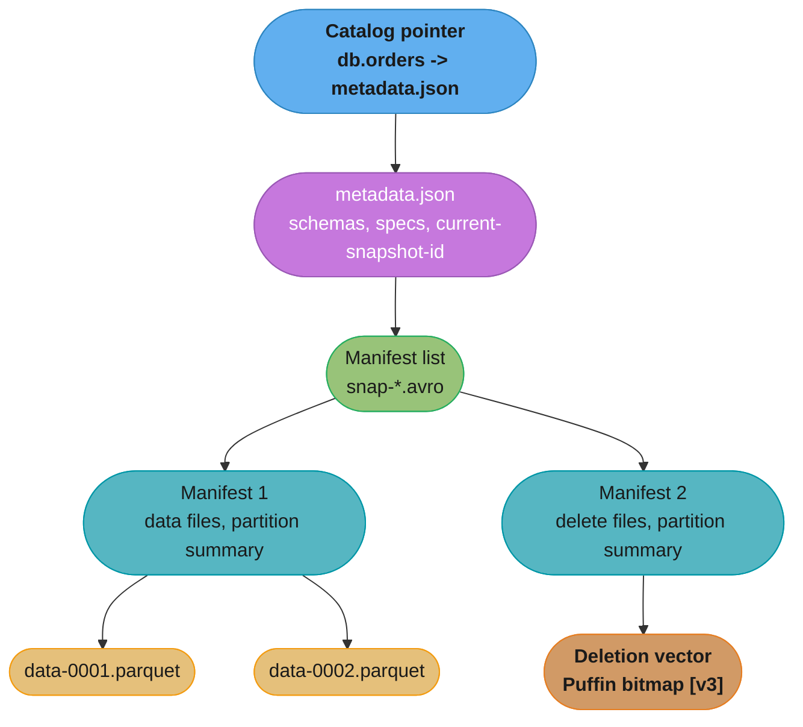
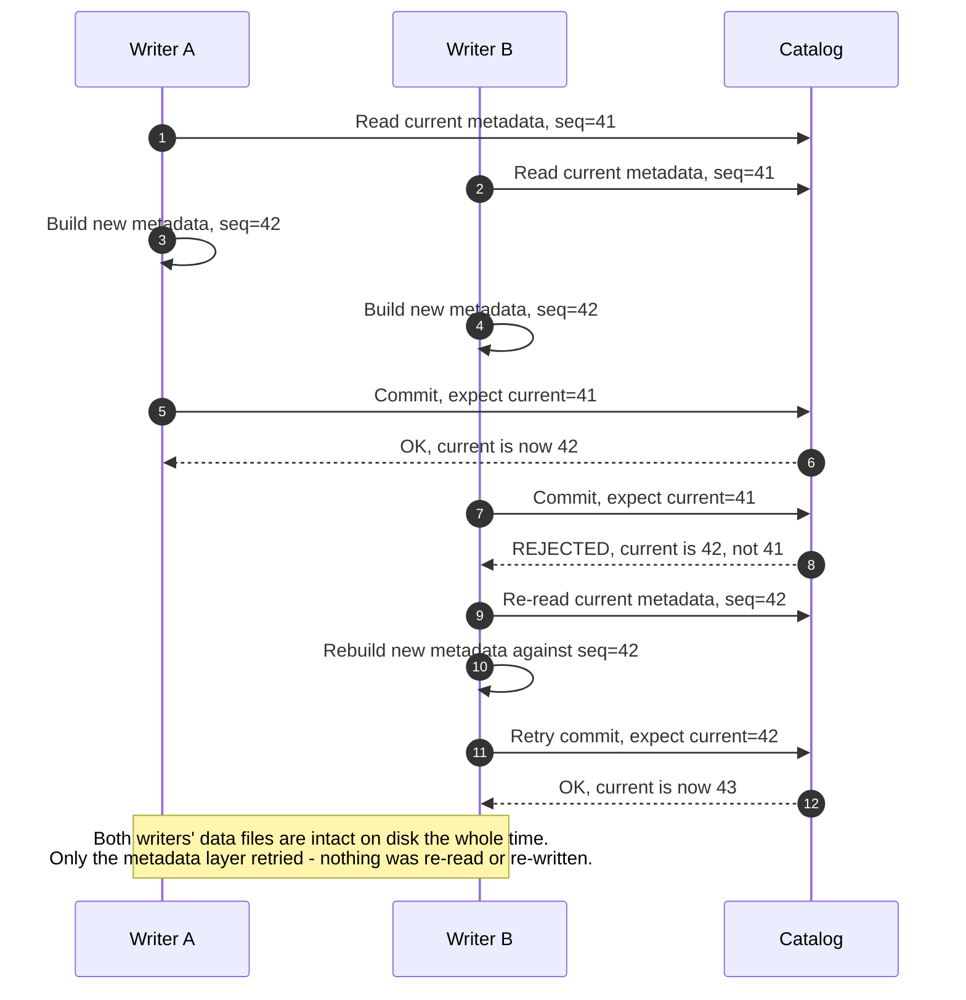
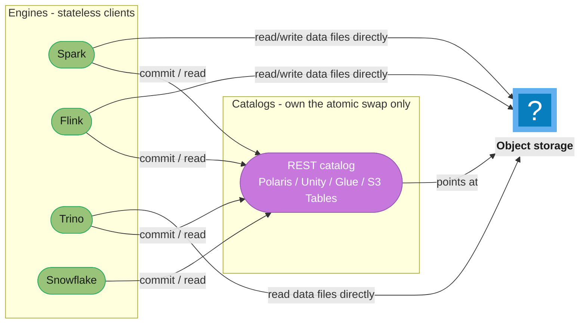
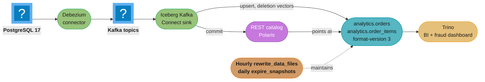

# Apache Iceberg

> **Version anchor (2026-08-26).** **Apache Iceberg (Java) 1.11.0**, released **2026-05-19** — over 1,000 commits from 200+ contributors, adding Apache Spark 4.1 and Apache Flink 2.1 as the default build targets, a new pluggable File Format API, manifest-list encryption, refreshed credential lifecycle handling, and a query-planning optimization that skips deletion-vector validation for pruned partitions. The prior releases on the line are **1.10.0** (2025-09-11) and the **1.9.x** series. **Table spec v3** is ratified and now the release that signals its seven capabilities — deletion vectors, row lineage, the VARIANT type, default column values, geometry/geography types, nanosecond timestamps, and multi-argument partition transforms — are stable enough to build on: Snowflake reached GA on v3 **2026-05-07**, and Databricks Runtime **18.0+** ships Managed Iceberg and Iceberg v3 GA. **`format-version` still defaults to 2 for new tables** (has since 1.4.0); v3 is explicit opt-in via `'format-version'='3'`. **v3 readers can read v2 tables; v2 readers cannot read v3 tables** — the compatibility arrow points one way only. **PyIceberg 0.11.1** (2026-03-03) is the current stable Python client; **0.12.0** is in release-candidate as of this writing. The **REST catalog** is the interoperability standard this whole ecosystem converges on in 2026 — Apache Polaris, Databricks Unity Catalog, AWS Glue and S3 Tables, Snowflake Open Catalog and Google BigLake all speak it. Version-gated behaviour is tagged inline as `[v3]`, `[1.11]`, `[1.10]`, `[1.4]` and so on; anything not tagged is stable across the 1.x line.

Apache Iceberg is an open table format: a specification and a Java (plus Python, Rust and Go) implementation for tracking the files that make up a table on object storage, so that many engines — Spark, Flink, Trino, Snowflake, Databricks, BigQuery — can read and write the same table with snapshot isolation, schema evolution and time travel, without any of them owning the data. This page is the product deep dive: the metadata layout with real field values, the catalog implementations and what each actually guarantees, the maintenance procedures by their real API names, and CDC ingestion into a live table. The vendor-neutral case for table formats — ACID on object storage, and Iceberg versus Delta Lake versus Hudi — belongs to [`database/lakehouse_and_table_formats`](../../database/lakehouse_and_table_formats/lakehouse_and_table_formats.md); this page cross-links it once here and once in §8, and does not restate it.

---

## 1. Concept Overview

### Three things people conflate

A working Iceberg deployment has three distinct layers, and most confusion about "what is Iceberg" comes from treating them as one thing.

| Layer | What it is | Examples |
|---|---|---|
| **The table format** | The specification: how schema, partitioning, snapshots and file lists are represented as JSON and Avro on object storage. This is what "Iceberg" means when people say "an Iceberg table" | Table spec v1/v2/v3, the metadata tree in §4 |
| **The catalog** | The service that atomically swaps one pointer — which `metadata.json` is current for a given table name — and nothing more | REST catalog, Hive Metastore, AWS Glue, Apache Polaris, Unity Catalog (§4.4) |
| **The engine** | The compute that plans queries, reads and writes data files, and asks the catalog to commit | Spark, Flink, Trino, Snowflake, DuckDB, BigQuery |

A catalog does not store data. An engine does not own the table's identity. The format defines what a valid commit looks like; the catalog enforces that only one commit wins a race; the engine is a client of both. Interoperability — the entire pitch of an open table format — is exactly the claim that any engine can talk to any catalog and read a table any other engine wrote, because all three layers are specified independently of any one vendor's implementation.

### The spec line: v1, v2, v3

| Spec | Status | What it added over the previous version |
|---|---|---|
| **v1** | Legacy, still readable | Append-only tables: schema, partitioning, snapshots, manifest lists |
| **v2** | The long-standing default (`format-version=2` since 1.4.0) | Row-level deletes (positional and equality delete files), sequence numbers for correct delete-to-data-file ordering |
| **v3** | Ratified; stable for adoption as of Iceberg 1.11.0 | **Deletion vectors** (Puffin-encoded bitmaps replacing positional delete files), **row lineage** (`_row_id`, `_last_updated_sequence_number`), the **VARIANT** type with shredding for semi-structured data, **default column values**, **geometry/geography** types, **nanosecond-precision timestamps**, and **multi-argument partition transforms** |

Every table on disk carries its own `format-version`, so v1, v2 and v3 tables coexist under the same catalog and the same engine binary. The one-way compatibility rule is the operational fact to internalize: **upgrading a table's `format-version` to 3 is a decision that breaks any reader still pinned to a pre-v3 engine build.** Nothing prevents the upgrade — it is one `ALTER TABLE ... SET TBLPROPERTIES` — but it is not reversible in practice, because downgrading the property does not remove the v3 constructs (deletion vectors, row-lineage fields) already written into the table's history.

### Who governs it

Apache Iceberg is an Apache Software Foundation top-level project (graduated May 2020), Apache License 2.0, with the spec, the Java/Python/Rust/Go implementations, and the REST catalog OpenAPI definition all developed in the open at `github.com/apache/iceberg`. No single vendor owns the trademark or the roadmap; the project's PMC includes engineers from Apple, Netflix, Snowflake, Tabular (acquired by Databricks), Dremio and AWS, among others. This is the structural reason multiple competing commercial catalogs (Polaris from Snowflake/Dremio, Unity Catalog from Databricks, Glue from AWS) can all claim to be "the" Iceberg catalog without any one of them controlling the format itself.

### The mental model this page keeps returning to

Every hard question about Iceberg reduces to one of two things: **what does the metadata tree say right now**, and **who won the race to change it**. §4 gives the tree's shape. §6 gives the commit protocol that decides the race. Everything else — schema evolution, partition evolution, time travel, maintenance — is a consequence of those two answers.

Cross-reference: the vendor-neutral argument for *why* a table format solves ACID-on-object-storage at all, and how Iceberg compares to Delta Lake and Apache Hudi as competing answers to the same problem, is [`database/lakehouse_and_table_formats`](../../database/lakehouse_and_table_formats/lakehouse_and_table_formats.md). This page assumes that argument and goes deep on Iceberg's own machinery.

---

## 2. Intuition

**One-line analogy.** A table is a pointer to a list of files, and a commit is an atomic swap of that pointer — like a symlink you can only ever repoint, never edit in place, and every repoint is recorded so you can always ask "what did this symlink point to an hour ago."

**The mental model.** Nothing in an Iceberg table is ever mutated. A write produces new data files, a new set of manifests describing which files belong to the table, and a new `metadata.json` whose `current-snapshot-id` names the manifest list that is now "the table." The commit is the single atomic operation that changes which `metadata.json` a catalog entry names. Readers that started before the commit keep reading the old snapshot's files, which still exist, unmodified, until something explicitly expires them. Readers that start after see the new snapshot. There is no lock, no coordination between readers and the writer, and no half-written state ever visible to anyone — because visibility is gated by one atomic pointer flip, not by file-level consistency.

**Why it matters.** Object storage (S3, GCS, ADLS) gives you durable, cheap, infinitely scalable blob storage and essentially nothing else: no atomic multi-file transactions, historically weak or absent rename semantics, no row-level indexes. A table format is the layer that manufactures ACID transactions, schema evolution and time travel *on top of* that primitive, using nothing but immutable files plus one atomically-swappable pointer. Iceberg's specific bet is that the pointer swap should be as cheap and engine-agnostic as possible — a single row update in a catalog, or a single conditional PUT — so that the interesting work (which files does the table have, what changed) lives in data the catalog never has to parse.

**The key insight.** *Metadata is data.* Every layer of Iceberg's metadata tree — manifest lists, manifests — is itself a file in a well-known columnar or row format (Avro, mostly) that any engine can scan with a normal reader, not a proprietary index only Iceberg's own code understands. You can `SELECT * FROM table.files` and get back the manifest contents as rows. This is the corollary of "no engine owns the table": if the metadata were opaque, only the engine that wrote it could safely read it, and interoperability would be a lie.

---

## 3. Core Principles

1. **Snapshot isolation via optimistic concurrency on one atomic pointer.** Every writer reads the current `metadata.json`, builds new metadata that includes its changes, and attempts to atomically replace the pointer. If another writer won the race first, the loser retries against the new current state. No table-wide lock is ever held while data is being written — only the pointer swap itself needs to be atomic, and that operation is designed to be as small and fast as the catalog can make it.

2. **Metadata-as-data.** Manifests and manifest lists are Avro files with a documented schema and stable field IDs (§6.2). Any engine's ordinary Avro reader can open them; no engine-specific binary index is required to plan a query. The metadata tables (`.files`, `.manifests`, `.snapshots`, `.history`, `.partitions`) exist specifically so an operator can query this data with SQL instead of a bespoke tool.

3. **Engine neutrality by specification, not by convention.** The table format, the REST catalog API, and every file format Iceberg writes are documented independently of any implementation. A Rust writer and a Java reader agree on correctness because they both implement the same spec, not because one calls into the other's library.

4. **Data files are immutable; only the pointer set describing them changes.** Iceberg never rewrites a Parquet file in place. An "update" is always: write new files (or a delete file marking rows dead), then commit a new snapshot whose manifests reference the new set. This is what makes concurrent readers safe without locks and what makes time travel free — an old snapshot's files are simply still there until something expires them.

5. **The commit is a compare-and-swap, and everything about scaling writers is about shrinking the blast radius of that swap.** Partition specs, sequence numbers, manifest partitioning by data and deletes, and the retry properties in §6.5 all exist to make concurrent commits either not conflict in the first place, or fail fast and cheap when they do.

6. **Schema and partition changes are metadata operations, not data rewrites.** Renaming a column, widening an int to a long, or changing a table's partitioning does not touch a single existing data file (§6.9, §6.10). This is possible only because every column is tracked by a permanent field ID rather than by name or position, and every data file records the partition spec it was written under.

7. **The catalog's only real job is the atomic swap; everything else is convenience.** Table listing, namespace hierarchies and access control are useful, but the property that makes a catalog *correct* for Iceberg is whether it can guarantee that exactly one of two concurrent "point this table name at a new metadata.json" operations wins (§4.2). A catalog that cannot do that is not safe to write through from two engines at once, no matter how good its UI is.

---

## 4. Types / Architectures / Strategies

### 4.1 The metadata tree — a taxonomy

Reading an Iceberg table is a strict top-down walk through four layers of files, each one narrowing what the next layer means.

| Layer | File(s) | Format | What it says |
|---|---|---|---|
| **Catalog pointer** | one row per table | catalog-specific | "For table `db.orders`, the current metadata is at `s3://.../00042-<uuid>.metadata.json`" |
| **Table metadata** | `metadata.json` (one file per commit, immutable, never overwritten) | JSON | Full schema history, partition spec history, sort orders, table properties, and which snapshot is current |
| **Manifest list** | `snap-<snapshot-id>-<uuid>.avro` (one per snapshot) | Avro | The list of manifests that make up this snapshot, with per-manifest partition-value summaries so a query can skip whole manifests |
| **Manifest** | `<uuid>-mN.avro` (many per snapshot, shared across snapshots when unchanged) | Avro | The list of data files (or delete files) this manifest owns, one row per file, with per-column min/max stats |
| **Data file** | `.parquet` / `.orc` / `.avro` | Parquet (overwhelmingly, in practice) | The actual rows |

A query engine descends exactly this path: load the catalog pointer, parse `metadata.json` to find `current-snapshot-id`, load that snapshot's manifest list, prune manifests whose partition summary cannot match the query's predicates, load the surviving manifests, prune individual data files by column stats, and only then open the Parquet files that remain. Every pruning step above the Parquet layer costs an Avro scan, not a data scan — this is why Iceberg query planning on a huge table with a selective filter can be sub-second even before a single row of data is touched.

### 4.2 Catalog implementations — what each actually guarantees for the atomic swap

The one property every Iceberg catalog must provide is: given two writers racing to commit against the same table, exactly one wins, and the loser can detect that it lost. How each catalog implements that varies, and it decides the catalog's real-world reliability, not its feature list.

| Catalog | Atomic-swap mechanism | Multi-engine reach | Notable limitation |
|---|---|---|---|
| **REST catalog** | Server-side, implementation-defined (usually a `CAS` on a database row) | The interoperability standard — any client implementing the OpenAPI spec talks to any REST catalog server | You depend on the specific server's own consistency guarantee; the spec defines the API, not the server's internals |
| **Hive Metastore (HMS)** | A metastore-DB row update inside a Thrift-locked transaction | Broad legacy reach (Spark, Trino, Presto, Hive all speak Thrift) | Not natively multi-region; HMS's own lock semantics, not Iceberg's, decide correctness under contention |
| **AWS Glue Data Catalog** | DynamoDB-backed conditional write inside AWS's own service, exposed through Glue's `UpdateTable` with a version check | Deep AWS-engine reach (Athena, EMR, Redshift Spectrum, Glue jobs), and now the Iceberg REST protocol as an alternate entry point | AWS-account-scoped; cross-account access needs Lake Formation or resource sharing |
| **JDBC catalog** | A row-level `UPDATE ... WHERE version = ?` against any JDBC-speaking database (Postgres, MySQL) | Whatever can reach that database | You are operating a database as critical infrastructure for every table commit |
| **Project Nessie** | Git-like commit graph with branches and merge semantics, backed by a versioned store | Any REST-catalog-speaking engine, plus Nessie's own multi-table transaction and branch/tag model | Adds an extra service and a mental model (branches, merges) that most teams do not need |
| **Apache Polaris** | REST catalog reference implementation; graduated to ASF top-level Feb 2026 (from a Snowflake/Dremio donation). **Polaris 1.4.0** (April 2026) added AWS STS session-tag credential vending for CloudTrail correlation, storage-scoped credentials, S3 KMS encryption, CockroachDB as a persistence backend, and Iceberg metrics persisted to the database | Vendor-neutral by governance; the path of least friction for a team that wants a REST catalog without building one | A JVM service you now operate, unless you use a managed offering (Snowflake Open Catalog runs Polaris) |
| **Databricks Unity Catalog** | Its own Iceberg REST Catalog (IRC) endpoint, plus **Managed Iceberg** (GA on Databricks Runtime 18.0+) with **Catalog Commits** — the catalog coordinates the write transaction directly rather than engines racing on S3 | Read/write/create for Managed Iceberg tables; read-only Iceberg access to Delta tables with Iceberg reads enabled ("Foreign Iceberg" territory) | The richest governance and lineage layer, but the deepest feature set is reserved for tables Unity Catalog itself manages |
| **AWS S3 Tables** | A managed Iceberg REST endpoint fused into S3 itself, with **automatic background compaction** and governance through IAM and Lake Formation | Any REST-catalog client; wired into Glue Data Catalog as a federated source | A managed product with its own maintenance defaults you do not fully control |

**The practical decision.** REST is the interoperability answer — pick a REST-speaking catalog (Polaris, Unity Catalog's IRC endpoint, Glue's REST API, S3 Tables, Snowflake Open Catalog) whenever more than one engine vendor needs write access to the same tables, because it is the one interface every major engine's Iceberg client now implements natively. HMS and the JDBC catalog remain legitimate for a single-engine, already-invested-in-Hive estate, but neither is where the ecosystem is converging.

### 4.3 Delete-file strategies

| Strategy | Spec | How it marks a row deleted | Read cost | Write cost |
|---|---|---|---|---|
| **Positional delete** | v2 | A separate file listing `(data_file_path, row_position)` pairs | Reader must join every data file scan against its positional deletes | Cheap to write — appended, not merged |
| **Equality delete** | v2 | A separate file listing column values that identify deleted rows (e.g. `id = 42`) | Reader must apply an equality filter against every row scanned, more expensive than a positional join | Cheapest to write — no need to know the row's exact file or position at write time, ideal for streaming upsert |
| **Deletion vector** | v3, replaces positional deletes | A **Puffin**-encoded roaring bitmap, one per referenced data file, of the row positions deleted from that file — indexed directly in the manifest via `content_offset`/`content_size_in_bytes` rather than requiring a full scan of a separate delete file | A single bitmap lookup per data file, no join — measurably cheaper at query time than positional deletes | Comparable to positional deletes to write; the win is entirely on the read side |

v3's deletion vectors are a strict replacement for positional deletes, not an addition — a v3 writer does not produce new positional delete files. Equality deletes remain in v3 for the write-time case a deletion vector cannot serve efficiently: a streaming upsert that only knows a row's key, not its file and position.

### 4.4 Write modes — copy-on-write vs merge-on-read, per operation

Iceberg lets `UPDATE`, `DELETE` and `MERGE` each choose independently between rewriting affected data files immediately or writing only delete markers and deferring the rewrite to compaction.

| Property | Values | Copy-on-write (`copy-on-write`) | Merge-on-read (`merge-on-read`) |
|---|---|---|---|
| `write.update.mode` | `copy-on-write` (default), `merge-on-read` | Rewrites every data file touched by the `UPDATE`, producing new files with the changed rows already applied | Writes delete markers for changed rows plus new data files for the new values; old files stay, minus the deleted rows |
| `write.delete.mode` | `copy-on-write` (default), `merge-on-read` | Rewrites every data file with a deleted row, producing a smaller file with the survivors | Writes only a delete file (positional, equality, or a deletion vector on v3) |
| `write.merge.mode` | `copy-on-write` (default), `merge-on-read` | Rewrites every data file touched by either the matched-update or matched-delete branch of the `MERGE` | Writes delete markers for matched rows plus new files for inserted/updated ones |

**The tradeoff is write amplification versus read amplification, stated precisely.** Copy-on-write pays the full cost of rewriting a file at write time — a `DELETE` that removes one row from a 512 MB file rewrites the whole 512 MB — but every subsequent read is a plain scan with no delete-file join. Merge-on-read makes the write O(rows changed), not O(file size), which is the only viable option for a streaming upsert workload, but every read after that pays the join or bitmap-lookup cost until compaction catches up. **A CDC-fed table (§6.17) is the canonical merge-on-read case**, and it is exactly the workload where skipping compaction turns into the small-files-plus-delete-files problem in §10.

### 4.5 The REST catalog protocol — the shape every implementation agrees on

The REST catalog spec is an OpenAPI definition, not a running product, and it is what lets Polaris, Unity Catalog's IRC endpoint, Glue's REST API and S3 Tables all be "an Iceberg catalog" to the same client code.

| Endpoint family | Purpose | Notable behaviour |
|---|---|---|
| `GET /v1/{prefix}/namespaces` | List and manage namespace hierarchies | Namespaces nest, so a catalog can mirror a database's schema/catalog structure |
| `GET /v1/{prefix}/namespaces/{ns}/tables` | List tables in a namespace | Paginated for large namespaces |
| `POST /v1/{prefix}/namespaces/{ns}/tables` | Create a table | Returns the initial `metadata.json` location plus any vended storage credentials |
| `GET /v1/{prefix}/namespaces/{ns}/tables/{table}` | Load a table's current metadata | This is the read side of the atomic-pointer read in §6.3 step 1 |
| `POST /v1/{prefix}/namespaces/{ns}/tables/{table}` | **Commit** a table update | The body carries `requirements` (preconditions, e.g. "current metadata is still X") and `updates` (the metadata changes) — the server evaluates requirements atomically before applying updates, which is the REST expression of compare-and-swap |
| `POST /v1/{prefix}/tables/rename` | Rename a table across namespaces | Namespace-scoped catalogs (Glue, Unity Catalog) implement this as a metadata-only move |

**Credential vending** is the practically load-bearing extension most production REST catalogs implement beyond the bare spec: a `LoadTableResult` response can carry short-lived, storage-scoped credentials (an S3 STS token scoped to exactly this table's prefix) alongside the metadata location, so an engine never needs a long-lived storage credential of its own — the catalog mints one, valid for minutes, every time a table is loaded. This is what makes REST catalogs the practical answer for centralizing access control: revoking access is a catalog-side policy change, not a rotation of credentials baked into every engine's configuration.

### 4.6 Engine integration taxonomy

| Engine | Integration depth | Native catalog support |
|---|---|---|
| **Apache Spark** | Full read/write, DataSourceV2, all maintenance procedures | Any catalog via `spark.sql.catalog.*` configuration, including REST |
| **Apache Flink** | Full streaming read/write, exactly-once sink | REST, Hive, custom catalog implementations |
| **Trino** | Full read/write via the Iceberg connector | REST, Hive, Glue, JDBC, Nessie |
| **Snowflake** | Native read/write for tables it manages; read for externally-cataloged tables | Its own catalog, plus reading through a REST-speaking external catalog |
| **Databricks** | Full read/write for Managed Iceberg; read-only for Foreign Iceberg (externally written) | Unity Catalog's own IRC endpoint |
| **Google BigQuery** | Native read/write as a first-class open-format table type | BigLake metastore, plus reading external REST catalogs |
| **DuckDB** | Embedded read (and growing write support) via an extension | REST, and direct `metadata.json` loading with no catalog at all |
| **ClickHouse** | Table function and table-engine read access | REST, Glue, Hive |

The pattern worth internalizing: every serious engine now treats "speak the REST catalog protocol" as table stakes, and the meaningful differentiation has moved to *how much of the write path* — full read/write versus read-only, native versus connector — each vendor supports for tables it does not itself manage.

### 4.7 File format taxonomy, and the 1.11 File Format API

| Format | Role | Why |
|---|---|---|
| **Apache Parquet** | The overwhelming default for data files | Columnar, strong predicate pushdown, the broadest tooling ecosystem |
| **Apache ORC** | A supported alternative, rare in new deployments | Legacy Hive-ORC estates migrating in place |
| **Apache Avro** | Manifests, manifest lists, and occasionally data files for row-oriented, write-heavy use cases | Row-oriented, cheap to append to, matches how manifests are incrementally built |
| **Puffin** | Deletion vectors [v3] and statistics blobs, never table data | A purpose-built binary container for auxiliary metadata that doesn't fit the columnar data-file model |

Iceberg 1.11.0's new **pluggable File Format API [1.11]** restructures how the core library relates to these physical formats — instead of format-specific logic scattered through the read/write paths, each format implements a common interface the rest of Iceberg's code depends on abstractly. The practical consequence for a table owner is indirect but real: it is what makes adding support for a new physical format (or an engine's own preferred variant) an isolated implementation rather than a change touching Iceberg's core, and it is the same kind of internal refactor that made deletion vectors — themselves a new "format" in the sense of a new physical encoding for delete information — cleanly pluggable into the existing read path.

### 4.8 Table lifecycle — creation, dropping, and what "purge" actually deletes

| Operation | What it does at the catalog | What it does to data files |
|---|---|---|
| `CREATE TABLE` | Registers a new catalog pointer at an initial `metadata.json` with no snapshots | None yet — an empty table has no data files |
| `CREATE TABLE ... AS SELECT` | Same, plus an immediate first commit with the query's output | Writes new data files as part of table creation |
| `DROP TABLE` | Removes the catalog pointer | **Leaves data files on disk** — the table becomes unreachable through the catalog, but nothing is deleted from storage |
| `DROP TABLE ... PURGE` | Removes the catalog pointer | **Deletes every data file, delete file, manifest, manifest list and metadata.json the table's history references** |
| `CALL catalog.system.register_table(...)` | Creates a catalog pointer at an **existing** `metadata.json`, without writing any new files | None — this is the zero-copy registration path §7 credits Apple's tooling for |

The gap between plain `DROP TABLE` and `DROP TABLE ... PURGE` is the one most likely to surprise an operator moving from a system where dropping a table always reclaims storage: a plain drop is a metadata-only operation, cheap and fast, but leaves the full weight of the table's data sitting in object storage indefinitely, discoverable only by `remove_orphan_files` treating it as debris (assuming its `older_than` window has passed) or by a manual storage audit. `PURGE` is the operation that actually reclaims space, and it is correspondingly slower and irreversible — there is no snapshot or branch that survives a purge, unlike `expire_snapshots`, which always respects `retain_last`. Treat `PURGE` with the same operational caution as `remove_orphan_files`: know what you're deleting before you run it, because nothing about the catalog layer can undo it afterward.

---

## 5. Architecture Diagrams

### 5.1 The metadata tree, top to bottom



*Every pruning decision above the Parquet layer costs an Avro scan of a manifest or manifest list, not a scan of table data. A query with a selective partition filter can eliminate most of a petabyte-scale table's manifests before opening a single data file — this is planning speed, not execution speed, and it is why Iceberg's metadata being "data" pays off at query time, not just for tooling.*

### 5.2 Two writers racing the pointer swap



*This is the compare-and-swap from §3's first principle, made concrete. The retry is cheap precisely because data files are immutable — Writer B rebuilds only its manifest list and `metadata.json` against the new base, not the Parquet it already wrote. `commit.retry.*` (§6.5) controls how many times and how long this loop runs before giving up.*

### 5.3 Compaction, before and after (ASCII — the file-count axis is the point)

```
BEFORE rewrite_data_files: one manifest, forty small files from streaming writes

  manifest -> [ 4MB ][ 3MB ][ 6MB ][ 2MB ][ 5MB ] ... (40 files, avg 4 MB)
              query must OPEN all 40 files that survive partition pruning,
              each open costing a network round trip before the first byte

AFTER rewrite_data_files(strategy => 'binpack'): same rows, fewer files

  manifest -> [        480MB        ][   160MB   ]   (2 files, target 512MB)
              query opens 2 files instead of 40 - the row count is identical,
              the file-open overhead dropped by 20x

  Rule of thumb: file-open + footer-read overhead dominates below roughly
  100 MB per file; above the write.target-file-size-bytes default (512 MB)
  the marginal benefit of fewer, larger files flattens out.
```

*Compaction changes file count and layout, never row content — the manifest list gains a new snapshot whose data is byte-identical in aggregate to the old one, which is why `rewrite_data_files` is always safe to run against a live table: readers on the old snapshot are unaffected, and readers on the new one simply see fewer, larger files.*

### 5.4 Catalog-vs-engine topology



*The catalog is on the write path for exactly one operation — the commit — and otherwise gets out of the way. Every engine reads and writes data files directly against object storage; the catalog never proxies data, only the pointer. This is why a catalog can be a small, cheap service even for a petabyte-scale lakehouse: its job is metadata-sized, not data-sized.*

### 5.5 Positional deletes versus a deletion vector, before and after (ASCII — the lookup-cost axis is the point)

```
v2: POSITIONAL DELETE — a scan must JOIN the data file against separate delete files

  data-0007.parquet (200,000 rows)          delete files referencing data-0007.parquet
  row 0   ..................                pos-delete-0001.parquet: [row 41, row 88, ...]
  row 1   ..................                pos-delete-0002.parquet: [row 41, row 5200, ...]
  row 2   ..................                pos-delete-0003.parquet: [row 199981, ...]
  ...                                        (written by 3 separate merge-on-read commits
  row 199999 ...............                 over time - a MERGE across delete files)

  reader cost per row: probe every delete file's row-position set  ->  O(deletes) per file

v3: DELETION VECTOR — one Puffin bitmap per data file, merged in place on every delete

  data-0007.parquet (200,000 rows)          data-0007.parquet.deletion-vector (Puffin)
  row 0   ..................                bit 0:  0   bit 41:    1   bit 88:      1
  row 1   ..................                bit 1:  0   bit 5200:  1   bit 199981:  1
  ...                                        (ONE bitmap, updated by merging new deletes
  row 199999 ...............                 into it - never a second delete file)

  reader cost per row: a single bit test against one bitmap  ->  O(1) per row, not O(deletes)
```

*The row count and the logical result are identical in both pictures — three deletes accumulated over three separate merge-on-read writes. What changed is the shape of the read-time cost: v2's cost grows with how many separate delete files have accumulated against one data file, while v3's is a single lookup regardless of how many merges built the current bitmap. This is the concrete mechanism behind §6.8's claim that v3 turns a join into an O(1) test.*

### 5.6 A table's ref graph — `main`, a branch, and a tag (ASCII — the tree shape is the point)

```
Snapshots flow left to right as they commit. main always points at the newest
tip it has been fast-forwarded to; a branch forks and lives independently;
a tag freezes one point forever, exempt from expire_snapshots' age cleanup.

  s41 --- s42 --- s43 --- s44 --- s45 --- s46 --- s47      <- commits over time
                            |                       ^
                            |                       |
                            |                    [main]  (current tip)
                            |
                            +--- s44b --- s44c        <- backfill_2026 branch,
                                            ^              forked at s44, its own
                                         [backfill_2026]   independent commits

  s43 also carries [released_2026_08_20] -- a TAG, pinned forever, ignored by
  expire_snapshots regardless of age or retain_last, until explicitly removed.

  Fast-forward: main jumps from s44 to s44c in ONE commit once backfill_2026
  is validated -- the branch's intermediate commits (s44b) become part of
  main's own history at that point, not merged or replayed, just adopted.
```

*The tree shape is exactly what makes Write-Audit-Publish (§6.13) safe: a branch's commits are invisible to anyone reading `main` until the fast-forward, and a tag is the one construct in the whole metadata tree immune to `expire_snapshots`' otherwise-universal age-based cleanup — which is precisely why `released_2026_08_20` survives 5-day retention windows that would otherwise reclaim it.*

---

## 6. How It Works — Detailed Mechanics

### 6.1 An annotated `metadata.json`

Every field below is a real key from the table metadata spec, not a placeholder. This is roughly what `s3://warehouse/db/orders/metadata/00042-3f1a....metadata.json` looks like after several commits and one schema change:

```json
{
  "format-version": 2,
  "table-uuid": "9c9b7a1d-4e2e-4f1e-8a3c-0e6f2b7d1a90",
  "location": "s3://warehouse/db/orders",
  "last-sequence-number": 118,
  "last-updated-ms": 1755878400123,
  "last-column-id": 12,
  "current-schema-id": 1,
  "schemas": [
    { "schema-id": 0, "fields": [ { "id": 1, "name": "order_id", "type": "long", "required": true } ] },
    { "schema-id": 1, "fields": [
      { "id": 1, "name": "order_id", "type": "long", "required": true },
      { "id": 2, "name": "customer_id", "type": "long", "required": true },
      { "id": 3, "name": "status", "type": "string", "required": false },
      { "id": 12, "name": "shipped_at", "type": "timestamptz", "required": false }
    ]}
  ],
  "default-spec-id": 1,
  "last-partition-id": 1000,
  "partition-specs": [
    { "spec-id": 0, "fields": [] },
    { "spec-id": 1, "fields": [
      { "source-id": 2, "field-id": 1000, "name": "customer_id_bucket", "transform": "bucket[16]" }
    ]}
  ],
  "default-sort-order-id": 0,
  "sort-orders": [ { "order-id": 0, "fields": [] } ],
  "properties": {
    "write.target-file-size-bytes": "536870912",
    "write.parquet.compression-codec": "zstd",
    "commit.retry.num-retries": "4"
  },
  "current-snapshot-id": 8241119302913,
  "snapshots": [
    {
      "snapshot-id": 8241119302913,
      "parent-snapshot-id": 8241110002211,
      "sequence-number": 118,
      "timestamp-ms": 1755878400123,
      "manifest-list": "s3://warehouse/db/orders/metadata/snap-8241119302913-1-abc.avro",
      "summary": { "operation": "append", "added-data-files": "3", "added-records": "41200" }
    }
  ],
  "snapshot-log": [ { "timestamp-ms": 1755878400123, "snapshot-id": 8241119302913 } ],
  "metadata-log": [ { "timestamp-ms": 1755878390001, "metadata-file": "s3://warehouse/db/orders/metadata/00041-....metadata.json" } ],
  "refs": { "main": { "snapshot-id": 8241119302913, "type": "branch" } }
}
```

Field-by-field, the ones worth internalizing: **`last-column-id`** is a permanent counter that never decreases and never reuses an ID, even for a dropped column — it is what makes field-ID-based schema evolution safe (§6.9). **`schemas`** is an array, not a single object — every schema version a table has ever had is retained, because old snapshots and old data files may have been written under an earlier schema. **`current-snapshot-id`** is the one pointer everything else in this section exists to atomically move. **`metadata-log`** is what makes time travel to *metadata as of a point in time* possible, distinct from **`snapshot-log`**, which tracks table-content time travel. **`refs`** is where branches and tags live (§6.13) — `main` is just the first ref, not a hardcoded concept.

### 6.2 An annotated manifest entry

A manifest is an Avro file where each row describes one data file (or delete file). Field IDs are stable across the spec, which is what lets old and new engine versions read the same manifest without agreeing on field order:

```
status (id 0):              1                          # 0=EXISTING, 1=ADDED, 2=DELETED
snapshot_id (id 1):         8241119302913
sequence_number (id 3):     118                          # when the referencing snapshot was created
file_sequence_number (id 4): 118                          # when the file itself was added
data_file (id 2):
  content (id 134):         0                             # 0=DATA, 1=POSITION_DELETES, 2=EQUALITY_DELETES
  file_path (id 100):       "s3://warehouse/db/orders/data/customer_id_bucket=7/0003-abc.parquet"
  file_format (id 101):     "PARQUET"
  partition (id 102):       { "customer_id_bucket": 7 }
  record_count (id 103):    41200
  file_size_in_bytes (id 104): 198344112
  column_sizes (id 108):    { 1: 329600, 2: 329600, 3: 1980112 }
  value_counts (id 109):    { 1: 41200, 2: 41200, 3: 41200 }
  null_value_counts (id 110): { 3: 812 }
  lower_bounds (id 125):    { 1: 90210001, 2: 55012 }
  upper_bounds (id 128):    { 1: 90251200, 2: 88123 }
  split_offsets (id 132):   [4, 67108868, 134217732]
  sort_order_id (id 140):   0
```

**`lower_bounds`/`upper_bounds`** are what let the planner skip a file without opening it: a query filtering `order_id = 90300000` prunes this file immediately, because the upper bound (90251200) is below the filter value. **`content`** is what distinguishes a data-file manifest from a delete-file manifest — Iceberg keeps them in separate manifests so a planner can skip every delete-file manifest entirely for a table with no deletes. For a v3 deletion vector, `content_offset`/`content_size_in_bytes` (field IDs 144/145) point at the exact byte range inside a Puffin file holding this data file's bitmap, so the reader does not need to scan a whole delete file to find its own file's deletes.

### 6.3 The commit protocol

Every write, from a single `INSERT` to a full `rewrite_data_files`, follows the same protocol:

1. **Read** the current `metadata.json` via the catalog.
2. **Stage** new data files (and delete files, if applicable) directly to object storage — this step involves no catalog interaction and can be arbitrarily parallel.
3. **Build** a new manifest list and `metadata.json` describing the table with the new files included, based on the metadata read in step 1.
4. **Commit**: ask the catalog to atomically swap the pointer from the old `metadata.json` to the new one, conditioned on the pointer still being what was read in step 1.
5. **On success**, done. **On failure** (someone else committed first), go back to step 1, re-read the now-current metadata, and rebuild the new metadata against it — step 2's staged data files are still valid and are not re-written, only the metadata layer is redone.

The retry loop is governed by real properties, not an unbounded spin:

| Property | Default | What it controls |
|---|---|---|
| `commit.retry.num-retries` | **4** | Maximum retry attempts before the commit fails outright |
| `commit.retry.min-wait-ms` | **100** | Initial backoff between retries |
| `commit.retry.max-wait-ms` | **60000** (1 min) | Ceiling the exponential backoff is capped at |
| `commit.retry.total-timeout-ms` | **1,800,000** (30 min) | Total wall-clock budget across all retries combined |

A commit that exhausts retries fails the write entirely — nothing is silently partially applied, because nothing was ever partially visible in the first place (§3, principle 4). Under heavy concurrent-writer contention against one table, raising `commit.retry.num-retries` buys resilience at the cost of tail latency; the structural fix is almost always to reduce how many independent writers target the same table concurrently, or partition the write workload so commits do not collide as often.

### 6.4 Hidden partitioning and the partition spec

A partition spec maps source columns through a **transform** to a partition value, and Iceberg tracks that mapping in metadata rather than requiring the query to know it. `bucket[16]` on `customer_id` and `day` on `shipped_at` are both transforms; a query filtering `shipped_at BETWEEN ...` is automatically pruned against the `day` partition value without the query author ever writing `WHERE partition_day = ...` — this is "hidden partitioning": the partition column is not a column in the table's schema at all, it is metadata derived from a real column via a transform function.

### 6.5 Partition evolution

`ALTER TABLE orders ADD PARTITION FIELD month(shipped_at)` changes the table's partition spec **for future writes only**. Existing data files keep the partition spec ID they were written under (`spec-id` in the manifest), and old manifests are never rewritten to pretend the old files were partitioned the new way. A query spanning both eras plans against **both** partition specs simultaneously — this is why partition evolution is a metadata-only operation with zero data rewrite, and also why a table's file layout on disk can legitimately contain data written under several different partition schemes at once. Compaction is the only thing that ever normalizes old files onto a new spec, and only if you ask it to.

### 6.6 Schema evolution by field ID

Every column has a permanent, monotonically increasing **field ID** (from `last-column-id`) assigned once, at creation, and never reused. A `RENAME COLUMN` changes only the `name` string attached to that ID in the current schema — every data file written under the old name still resolves correctly, because Parquet files store field IDs in their own footer (`PARQUET-Iceberg` field-ID mapping) and the reader joins on ID, not on name. This is the mechanism, stated precisely, behind the oft-repeated claim "Iceberg makes rename safe": renaming is safe specifically because nothing about resolution ever depended on the name in the first place. Widening a type (`int` -> `long`, `float` -> `double`) is likewise a metadata-only schema change, because Parquet's own type promotion rules make the wider read valid over the narrower on-disk representation; narrowing, by contrast, is rejected outright, because it is not losslessly representable.

### 6.7 Sort orders and `write.distribution-mode`

A **sort order** is metadata, exactly like a partition spec — it describes how rows within each write task should be locally sorted, which improves the effectiveness of column min/max pruning (§6.2) at read time by making each file's value range tighter. `write.distribution-mode` (`none`, `hash`, `range`) controls how the *engine* shuffles rows across write tasks before the per-task sort is applied: `hash` co-locates all rows for a partition value onto one task (fewer, non-overlapping files per partition), `range` additionally balances file sizes across a global sort key, and `none` leaves distribution to the engine's own defaults. There is no single global default — it is left to each engine's write path — but `hash` is the practical default recommendation for any partitioned table with a meaningful number of partitions, because it is what prevents every write task from touching every partition.

### 6.8 Positional deletes, equality deletes, and how deletion vectors change the read path

Under v2 merge-on-read, a scan of a data file with pending deletes must **join** that file's rows against every positional-delete file referencing it (or apply every equality-delete predicate), row by row, before returning results — a real per-row cost proportional to delete-file size. Under v3, that join becomes a **single bitmap lookup**: the deletion vector for a given data file is a Puffin-encoded roaring bitmap keyed by row position, and checking "is this row deleted" is an O(1) bit test rather than a merge against a separate file's rows. The write side changes too — where v2 might scatter one data file's deletes across several positional-delete files written by different tasks over time, v3 requires **at most one deletion vector per data file**, which a writer merges into on every subsequent delete rather than appending a new delete file each time. This is the single biggest reason v3 tables show materially better scan latency on update-heavy workloads without any change to compaction cadence.

### 6.9 The VARIANT type and shredding

VARIANT (v3) stores semi-structured values — JSON-like data whose shape is not guaranteed consistent row to row — in a binary encoding that supports partial-value pruning without full deserialization. **Shredding** is the write-time optimization where the engine detects that most rows share a common sub-structure (e.g., every row's variant has a `user.id` field) and physically stores those common paths as ordinary typed Parquet columns alongside the raw variant binary, so a query touching only `variant:user.id` reads a normal columnar int field instead of deserializing the whole binary blob per row. The variant binary remains the source of truth for any path the shredded columns don't cover; shredding is an engine-chosen physical optimization, not a schema change the writer of the query has to know about.

### 6.10 Row lineage and what it enables

v3's row lineage adds two fields Iceberg maintains automatically for every row: **`_row_id`**, a table-scoped unique identifier assigned once when a row is first written and carried forward unchanged through every subsequent update to that row, and **`_last_updated_sequence_number`**, the snapshot sequence number of the write that most recently touched the row. Together they answer "which rows changed since snapshot N" with a metadata-only query — `WHERE _last_updated_sequence_number > N` — instead of a full-table diff between two snapshots. This is what makes CDC-style incremental consumption of an Iceberg table itself tractable (a downstream consumer reading changes *out of* Iceberg, the mirror image of §6.17's CDC *into* Iceberg), and it is the mechanism materialized-view maintenance and audit trails lean on to avoid recomputing from scratch on every refresh.

### 6.11 The maintenance procedures

Every one of these is a real Spark SQL stored procedure name, callable as `CALL catalog_name.system.<procedure>(...)`.

**`rewrite_data_files`** — compacts small files into larger ones (§5.3).

```sql
CALL catalog.system.rewrite_data_files(
  table => 'db.orders',
  strategy => 'binpack',
  options => map('target-file-size-bytes', '536870912', 'min-input-files', '5'),
  where => 'shipped_at >= date_sub(current_date(), 7)'
);
```

Key arguments: `strategy` is `binpack` (default; groups existing files toward the target size with no reordering) or `sort` (rewrites in a specified sort order, more expensive, better pruning); `where` scopes the rewrite to a partition or predicate, essential on a large table so compaction doesn't do a full-table pass every run; `options` is a free-form map, most commonly `target-file-size-bytes` to override the table property for one run.

**`rewrite_manifests`** — consolidates fragmented manifest files, which accumulate one small manifest per commit under a high-frequency writer.

```sql
CALL catalog.system.rewrite_manifests(table => 'db.orders', use_caching => true);
```

`use_caching` (default `false`) enables Spark-side caching of the manifest data during the rewrite; `spec_id` targets manifests under one specific partition spec if the table has been through partition evolution; `sort_by` reorders manifest entries by partition columns to improve planning-time pruning.

**`expire_snapshots`** — removes old snapshot metadata and the data/delete files that are no longer referenced by any retained snapshot.

```sql
CALL catalog.system.expire_snapshots(
  table => 'db.orders',
  older_than => TIMESTAMP '2026-08-19 00:00:00',
  retain_last => 5
);
```

`older_than` and `retain_last` (default **1**) combine: a snapshot is expired only if it is both older than the cutoff **and** not among the last N retained. `clean_expired_metadata` (default `false`, newer option) additionally prunes stale schema, partition-spec and sort-order entries no longer referenced by any retained snapshot's metadata, not just the snapshot records themselves.

**`remove_orphan_files`** — deletes files physically present under the table's location but referenced by no manifest of any retained snapshot: the debris of failed writes, crashed jobs, or files a compaction already replaced.

```sql
CALL catalog.system.remove_orphan_files(
  table => 'db.orders',
  older_than => TIMESTAMP '2026-08-23 00:00:00',
  dry_run => true
);
```

`older_than` defaults to **3 days ago** — a deliberate safety window, because a file that is genuinely orphaned but younger than that might actually be an in-flight write from a still-running job that hasn't committed yet. `dry_run` (default `false`) lists candidates without deleting; **always dry-run first in production** (§10.4). `prefix_mismatch_mode` (default `ERROR`) governs what happens when the storage location's scheme/authority (`s3://` vs `s3a://`) doesn't match what's recorded in metadata — `ERROR` refuses to guess, which is the safe default.

**`rewrite_position_delete_files`** — the delete-file analog of `rewrite_data_files`, compacting small positional-delete files (v2 tables; irrelevant once fully on v3 deletion vectors, which are already at most one per data file).

```sql
CALL catalog.system.rewrite_position_delete_files(table => 'db.orders', where => 'customer_id_bucket = 7');
```

### 6.12 Time travel and rollback

Every retained snapshot is independently queryable:

```sql
SELECT * FROM db.orders VERSION AS OF 8241119302913;
SELECT * FROM db.orders TIMESTAMP AS OF '2026-08-20 00:00:00';
CALL catalog.system.rollback_to_snapshot('db.orders', 8241110002211);
CALL catalog.system.set_current_snapshot('db.orders', snapshot_id => 8241110002211);
```

`rollback_to_snapshot` and `set_current_snapshot` both move the `main` ref backward, but they differ in what happens to the snapshots in between: `rollback_to_snapshot` requires the target to be an ancestor of the current snapshot and removes the intervening history from the linear log going forward, while `set_current_snapshot` will point at any snapshot, ancestor or not, which is how you recover from a bad `rollback` or jump across a branch. Time travel reads are bounded by whatever `expire_snapshots` has left retained — a snapshot that has already been expired, and whose files have already been deleted, cannot be recovered by any query.

### 6.13 Branching and tagging — Write-Audit-Publish

`refs` in `metadata.json` (§6.1) is not limited to `main`. A **branch** is a named, independently-committable pointer sharing the table's history up to its fork point; a **tag** is an immutable, permanently-retained pointer to one specific snapshot, exempt from `expire_snapshots`'s normal age-based cleanup.

```sql
ALTER TABLE db.orders CREATE BRANCH audit_2026_08_20;
INSERT INTO db.orders.branch_audit_2026_08_20 SELECT * FROM staging.new_orders;
-- run validation queries against db.orders.branch_audit_2026_08_20
ALTER TABLE db.orders CREATE TAG released_2026_08_20 AS OF VERSION 8241119302913;
CALL catalog.system.fast_forward('db.orders', 'main', 'audit_2026_08_20');
```

This is the **Write-Audit-Publish** pattern: write to a branch, audit it there with the production table's real query engines and validation logic, and only fast-forward `main` once the audit passes — all without ever exposing a consumer of `main` to unvalidated data, and without a separate staging table to keep schema-synced.

### 6.14 The metadata tables

Every table exposes a family of queryable metadata tables, accessed as `db.orders.<name>`:

| Table | Rows | Typical use |
|---|---|---|
| `.snapshots` | One row per retained snapshot: id, timestamp, operation, summary | "When did this table last get a delete operation" |
| `.files` | One row per live data/delete file across the current snapshot: path, size, record count, column stats | Finding the actual small-file distribution driving a compaction decision |
| `.manifests` | One row per manifest: path, length, partition summary | Diagnosing manifest fragmentation before `rewrite_manifests` |
| `.history` | The linear snapshot-log: when each snapshot became current | Auditing exactly when a table's content changed |
| `.partitions` | One row per partition value: file count, record count, size | Finding a skewed or over-fragmented partition |

```sql
SELECT partition, file_count, record_count FROM db.orders.partitions ORDER BY file_count DESC LIMIT 10;
```

### 6.15 Table properties that actually matter

| Property | Default | What changing it buys you |
|---|---|---|
| `write.target-file-size-bytes` | **536870912** (512 MB) | Larger for cheaper full-table scans with fewer files; smaller only if you have a specific latency reason to open files faster |
| `write.parquet.compression-codec` | **`zstd`** | `zstd` is the right default for almost everyone; `snappy` trades ratio for CPU on write-heavy pipelines |
| `history.expire.max-snapshot-age-ms` | **432000000** (5 days) | How long a snapshot survives `expire_snapshots` by age alone, independent of `retain_last` |
| `history.expire.min-snapshots-to-keep` | **1** | The floor `expire_snapshots` will never go below, regardless of age |
| `commit.manifest.target-size-bytes` | **8388608** (8 MB) | The size Iceberg tries to merge small manifests toward during normal commits, distinct from an explicit `rewrite_manifests` run |
| `format-version` | **2** | v3 is opt-in; see the version anchor for the one-way compatibility consequence |
| `write.parquet.row-group-size-bytes` | **134217728** (128 MB) | The Parquet-level row group size within each data file; leave at the default unless a specific columnar-scan profile calls for tuning it |
| `write.parquet.page-size-bytes` | **1048576** (1 MB) | The Parquet page size within each row group — again, rarely worth deviating from the default |
| `read.split.target-size` | **134217728** (128 MB) | The target size of a read task's file split during query planning, independent of the write-side file-size target |
| `read.split.planning-lookback` | **10** | How many splits ahead the planner looks when grouping small files into a combined read task |
| `write.metadata.previous-versions-max` | **100** | How many old `metadata.json` files are retained before the oldest is deleted; distinct from snapshot retention (§6.11), this bounds the metadata-file count itself |
| `write.metadata.delete-after-commit.enabled` | **false** | Whether old `metadata.json` files are proactively deleted as newer ones are written, rather than left for `expire_snapshots`/`remove_orphan_files` to clean up later |
| `gc.enabled` | **true** | The master switch protecting a table's files from being physically deleted by any maintenance operation — setting it `false` makes `expire_snapshots` and `remove_orphan_files` no-ops on that table, a safety valve for a table under active investigation |
| `write.wap.enabled` | **false** | Turns on Write-Audit-Publish semantics (§6.13) for writes that don't explicitly target a branch — most teams manage WAP explicitly via branches instead of this table-wide switch |

### 6.16 PyIceberg usage

```python
from pyiceberg.catalog import load_catalog

catalog = load_catalog("prod", **{
    "uri": "https://catalog.example.com/iceberg",
    "type": "rest",
    "warehouse": "s3://warehouse",
})

table = catalog.load_table("db.orders")
df = table.scan(row_filter="shipped_at >= '2026-08-01'").to_pandas()

table.append(new_arrow_table)                  # append-only write, no engine required
table.overwrite(new_arrow_table, overwrite_filter="customer_id_bucket = 7")

with table.transaction() as txn:
    txn.update_schema().add_column("promo_code", "string").commit()
```

PyIceberg is a full catalog and table client with no JVM dependency — it can read, append, overwrite and evolve schema directly against object storage, which is what makes it the natural choice for a Python-only ingestion service (§6.17) that should not need to embed Spark just to write to an Iceberg table.

### 6.17 CDC into Iceberg

This is the seam between the CDC world ([`Debezium`](../debezium_change_data_capture/debezium_change_data_capture.md)) and the lakehouse world, and it deserves its own subsection because the failure modes are specific to combining the two.

**The path.** A Debezium PostgreSQL or MySQL connector produces row-level change events onto Kafka topics. The **Apache Iceberg Kafka Connect sink connector** (`iceberg-kafka-connect`, a first-party part of the Iceberg project) consumes those topics and writes into Iceberg tables, with a `DebeziumTransform` SMT that promotes the Debezium envelope's `before`/`after` fields to the top level and adds `_cdc.op`, `_cdc.ts`, `_cdc.offset`, `_cdc.source` and `_cdc.key` metadata columns the sink uses to decide insert, update or delete per record. The sink supports automatic table creation, schema evolution as the source schema changes, and — via Kafka Connect's own commit coordinator writing to a control topic — exactly-once delivery into the Iceberg commit itself, distinct from and stronger than the exactly-once caveats in Debezium's own page (which stop at the Kafka boundary).

**Why streaming CDC produces the small-files problem faster than anything else.** A batch ETL job writing to Iceberg controls its own file sizes — it can buffer a target amount of data before flushing. A CDC sink is driven by Kafka Connect's poll-and-commit loop, typically flushing every few seconds to keep end-to-end latency low, which means every flush interval that produces even a handful of changed rows becomes its own small data file (and, on v2, its own small delete file). A table absorbing 500 changes/second at a 30-second flush interval produces roughly 2,880 new files a day from that one connector alone, most of them a few hundred kilobytes — the exact failure mode §10.1 quantifies.

**Upsert versus append-only-plus-dedupe.** The sink's upsert mode uses merge-on-read (equality deletes on v2, or a deletion vector merge on v3) keyed on the source table's primary key, which keeps the Iceberg table's row count matching the source's in near-real time but pays the read-side join/lookup cost from §6.8 until compaction runs. The alternative — append every event as a new row, keep the Debezium `op` and `source.ts_ms` columns, and let a downstream query or materialized view compute "latest row per key" — avoids delete files entirely and is dramatically cheaper on the write and compaction side, at the cost of pushing the dedupe cost to every consumer of the raw table. **Upsert is the right choice for a table users query directly; append-plus-dedupe is the right choice for a raw landing table feeding a transform layer**, which is the same shape the "capture business tables versus capture an outbox" tradeoff takes on the Debezium side.

**Ordering and exactly-once.** Iceberg's commit is per-table, not per-key, so within one Kafka Connect commit interval the sink can safely batch many keys' changes into one Iceberg snapshot — but **ordering across a Kafka partition rebalance is only as good as Debezium's own guarantee** (per-key order on one partition; see the Debezium page's ordering Q&A), and the Iceberg sink does not add or repair ordering the source stream did not already have. Exactly-once into the Iceberg table itself is real (control-topic-coordinated commit), which removes one layer of duplicate risk Debezium's own page treats as unsolved — but a redelivered *upstream* Debezium event still needs the equality-delete/deletion-vector merge to be idempotent per key, which it is by construction (a merge on the same key twice converges to the same state), so the practical advice is unchanged from Debezium's own: **build for idempotency, and let the sink's exactly-once commit be a bonus, not the only line of defense.**

**Compaction cadence a CDC table needs.** A CDC-fed table needs `rewrite_data_files` running materially more often than a batch-ingested one — hourly or even more frequent for a high-churn table, scoped with `where` to only the partitions that received traffic in the window, rather than a nightly full-table pass that lets small files and delete files accumulate for 24 hours first. §14 works through the concrete numbers for exactly this shape of pipeline.

### 6.18 Statistics files and cost-based optimization

Beyond the per-file column bounds every manifest entry already carries (§6.2), Iceberg supports table-level **statistics files** — Puffin blobs holding richer summaries such as NDV (number-distinct-values) sketches per column — registered in `metadata.json`'s `statistics` array and keyed to the snapshot they describe. An engine's cost-based optimizer uses these to make join-order and broadcast-versus-shuffle decisions without scanning data: `ANALYZE TABLE db.orders COMPUTE STATISTICS` (Spark) triggers the computation and registers the resulting Puffin file. Unlike per-file bounds, which every write produces as a side effect, statistics files are opt-in and go stale as a table changes — an operator has to decide whether to recompute them on a schedule or accept optimizer decisions based on an aging snapshot's shape.

### 6.19 Isolation levels and read consistency

Every Iceberg read is **snapshot-isolated** by construction: a query pins `current-snapshot-id` at the start of planning and reads exactly that snapshot's files for its entire duration, immune to concurrent commits that land after it started. This is a property of the immutable-files-plus-atomic-pointer design (§3), not a configuration an engine can weaken — there is no "read uncommitted" mode, because there is no uncommitted state ever visible to a reader in the first place. What Iceberg's optimistic concurrency control does **not** give you automatically is serializable *write* isolation across arbitrary concurrent transactions: two concurrent `MERGE` operations against overlapping rows are individually snapshot-isolated but can still both succeed against different retries and produce a result equivalent to running them in some order, which may not be the order either caller expected. Row-level and partition-level conflict detection (comparing which specific files or partitions two concurrent commits touched, not just whether the pointer moved) is what most engines layer on top of the base compare-and-swap to make concurrent writes to *disjoint* partitions succeed without unnecessary retries, while still correctly retrying when they genuinely overlap.

### 6.20 Encryption

Table data can be encrypted at the file level using per-file keys managed through a **key management service (KMS)** integration, with the key metadata itself stored in the `key_metadata` field of each manifest entry (§6.2) — the manifest records which key protects which file without exposing the key material in plaintext metadata. Iceberg 1.11.0 extends this with **manifest-list encryption [1.11]**: previously the manifest list itself — which, recall from §4.1, contains per-manifest partition-value summaries — was unencrypted even on a table with encrypted data files, meaning partition value ranges were visible to anyone who could read object storage even without data access. Encrypting the manifest list closes that metadata-leakage gap, at the cost of requiring every reader to resolve the relevant key before it can even plan a query, not just before it opens data files.

### 6.21 Credential lifecycle refresh

1.11.0 also reworked how vended, short-lived storage credentials (§4.5) are refreshed during a long-running job. A Spark job that plans against a table, then spends an hour writing output, previously risked its initially-vended credentials expiring mid-job if the vending catalog's token lifetime was shorter than the job's runtime. The refreshed credential lifecycle handling proactively renews vended credentials before expiry rather than only reacting to an authorization failure, which matters specifically for the class of job this page cares most about — a long-running compaction (`rewrite_data_files` against a large partition range) or a multi-hour backfill (§14) is exactly the shape of job most exposed to a mid-run credential expiry under the old behaviour.

### 6.22 A REST catalog commit request, concretely

§4.5 named the commit endpoint's shape in the abstract — `requirements` plus `updates`. This is what a real commit body looks like when an engine appends three new data files to `db.orders`, expressed as the `CommitTableRequest` the REST spec defines:

```json
{
  "identifier": { "namespace": ["db"], "name": "orders" },
  "requirements": [
    { "type": "assert-ref-snapshot-id", "ref": "main", "snapshot-id": 8241110002211 }
  ],
  "updates": [
    { "action": "add-snapshot", "snapshot": {
        "snapshot-id": 8241119302913,
        "parent-snapshot-id": 8241110002211,
        "sequence-number": 118,
        "manifest-list": "s3://warehouse/db/orders/metadata/snap-8241119302913-1-abc.avro",
        "summary": { "operation": "append", "added-data-files": "3" }
    }},
    { "action": "set-snapshot-ref", "ref-name": "main", "type": "branch", "snapshot-id": 8241119302913 }
  ]
}
```

The `requirements` array is the REST expression of the compare-and-swap precondition from §6.3: `assert-ref-snapshot-id` says, in effect, "only apply these updates if `main` is still at snapshot 8241110002211" — exactly the state the engine read before staging its files. If another writer's commit already moved `main`, the server rejects the whole request atomically, the `requirements` check having failed, and the engine goes back to §6.3 step 1 with fresh metadata. The `updates` array is applied only when every requirement holds, which is what makes the endpoint a single atomic operation rather than a check followed by a separate, racy write.

### 6.23 The full partition transform catalog

Every hidden-partitioning example on this page has used `bucket` or `day`; the complete set of transform functions a partition spec can apply to a source column is worth having in one place:

| Transform | What it computes | Typical use |
|---|---|---|
| `identity` | The raw column value, unchanged | Low-cardinality columns already suitable as a partition key (a status enum, a region code) |
| `bucket(N, col)` | Hash the value into one of `N` fixed buckets | Bounding cardinality on a high-cardinality column (§10.6) — the standard fix for a raw ID or UUID column |
| `truncate(N, col)` | The first `N` characters (string) or the value rounded down to a width (numeric) | Coarsening a string or numeric key without a hash, when a range-scan-friendly ordering matters |
| `year(col)` / `month(col)` / `day(col)` / `hour(col)` | The value truncated to that calendar granularity | Time-series tables, almost always the partition key for an event-timestamp column |
| `void` | Drops the value — no partitioning contribution | Reserved for spec evolution scenarios where a field needs to exist in the spec without partitioning on it |
| Multi-argument transforms **[v3]** | A single partition field derived from more than one source column at once | New in v3 — lets a partition value express a relationship across columns (e.g., a composite key transform) that v1/v2 required modeling as separate fields |

`bucket` and `truncate` are the two transforms that exist specifically to solve the cardinality-bounding problem §10.6 walks through as a war story; `year`/`month`/`day`/`hour` are what makes time-range queries prune effectively with zero query-side partition awareness (§6.4); and multi-argument transforms are the newest addition, letting v3 tables express partition relationships that previously had to be flattened into multiple separate partition fields, each independently contributing to cardinality.

### 6.24 The rest of v3: default column values, geometry/geography, and nanosecond timestamps

Three more v3 capabilities round out the seven named in §1, each solving a narrower but real gap:

**Default column values [v3].** Adding a required column to a table with existing data has historically forced a choice between making the column optional (weakening the schema's own guarantee) or paying a full-table rewrite to backfill a value. v3 lets a schema change specify both an `initial-default` (applied to rows that existed before the column was added, resolved at read time without touching those rows' files) and a `write-default` (applied to future writes that don't explicitly set the column) — `ALTER TABLE orders ADD COLUMN currency string DEFAULT 'USD'` is a metadata-only operation under v3 that would otherwise require a decision between nullable-forever or a rewrite.

**Geometry and geography types [v3].** Prior to v3, spatial data had no native Iceberg type — teams stored WKT strings, GeoJSON blobs, or engine-specific extensions with no cross-engine portability and no native bounding-box pruning. v3's `geometry` (planar, Euclidean coordinates) and `geography` (coordinates on a sphere or ellipsoid, needed for anything spanning real-world distances at scale) types are natively understood by the format, including bounding-box statistics in manifest entries analogous to the `lower_bounds`/`upper_bounds` §6.2 already covers for scalar columns — a spatial predicate can prune files the same way a numeric range predicate does.

**Nanosecond-precision timestamps [v3].** v2's `timestamp`/`timestamptz` types are microsecond-precision, which is a real gap for domains where sub-microsecond ordering matters — high-frequency trading event logs, distributed tracing spans, scientific instrumentation. v3 adds nanosecond-precision timestamp types alongside the existing microsecond ones (not a replacement), so a table can choose the precision its domain actually needs rather than every table paying nanosecond storage overhead by default.

### 6.25 Concurrent compaction versus concurrent writes — how a long rewrite avoids losing new data

A `rewrite_data_files` pass against a large, actively-written partition can take minutes; the streaming writer landing new rows into that same partition does not stop for it. This is a specific, important instance of the general commit protocol (§6.3), worth walking through concretely because "does compaction lose in-flight writes" is a natural worry.

The rewrite action records the **starting sequence number** it began planning against — effectively, "I am replacing these specific input files, which represent the table's state up to sequence N." When it commits, its requirement is not "the table hasn't changed at all" (which would make compaction on a busy table nearly impossible to ever land) but a narrower one: "the specific files I am replacing are still present and haven't themselves been replaced by someone else." A concurrent streaming writer appending *new* files during the compaction window is invisible to this requirement — those new files were never among the rewrite's inputs, so the rewrite's commit and the streamer's commits do not conflict, and both succeed independently. What *does* conflict is two compaction jobs (or a compaction and a delete operation) targeting overlapping input files at the same time, which correctly forces one to retry against the other's result.

This is the mechanism that makes §14's hourly, `where`-scoped compaction schedule safe to run continuously alongside a live CDC sink without the elaborate branch-and-fast-forward dance a large ad hoc rewrite needed in §10.3 — routine compaction's input set is narrow and short-lived enough that it rarely collides with a concurrent streamer's appends, while an ad hoc, slow, wide rewrite has a much larger window in which something else's commit can invalidate its assumptions.

### 6.26 Multi-table transactions via Nessie

Every commit protocol described so far (§6.3, §6.25) is scoped to **one table** — Iceberg's base compare-and-swap has no native concept of atomically committing across two different tables at once. **Project Nessie** is the catalog implementation that adds this as a first-class capability: because Nessie models the entire catalog's state as a Git-like commit graph, a single Nessie commit can atomically move the pointers for multiple tables together, and a branch (§4.2, §6.13) in Nessie is scoped to the whole catalog rather than to one table.

```
-- Nessie-specific: stage changes to two tables on a branch, commit both atomically
CREATE BRANCH etl_2026_08_26 IN nessie;
USE REFERENCE etl_2026_08_26 IN nessie;
INSERT INTO orders SELECT * FROM staging.new_orders;
INSERT INTO order_items SELECT * FROM staging.new_order_items;
-- both inserts are staged on the branch; nothing on `main` has changed yet
MERGE BRANCH etl_2026_08_26 INTO main IN nessie;
-- both tables' changes become visible to `main` readers in one atomic operation
```

This is the one genuine capability gap between Nessie and every other catalog on this page's list (§4.2, §8.2): a plain REST catalog, Glue, or a JDBC catalog each commit one table atomically, but a workflow needing "these three tables update together or none of them do" — a common shape for a multi-table ETL pipeline where partial application would leave referential inconsistency visible to readers — has no native cross-table atomicity outside Nessie's branch-and-merge model. Most teams work around the gap by accepting brief cross-table inconsistency windows (each table's own commit is still individually atomic and snapshot-isolated) rather than adopting Nessie specifically for this property, but it is worth knowing the gap exists and which catalog closes it before ruling out a legitimate requirement.

---

## 7. Real-World Examples

**Netflix — the origin.** Iceberg was started at Netflix in 2017 by Ryan Blue and Dan Weeks to fix Hive's correctness gaps for petabyte-scale, high-write-throughput tables: Hive offered no atomic multi-file commit, no reliable schema evolution and partition layouts that leaked into every query. Netflix open-sourced it and donated it to the Apache Software Foundation in **November 2018**; it graduated to a top-level ASF project in **May 2020**. The direction of influence matters here the way it does for Debezium and Netflix's DBLog: Iceberg is not "the format Netflix uses" as an endorsement of something built elsewhere, Netflix's own production pain is the reason the format has the shape it does — immutable files, atomic pointer swap, no engine-owned index.

**Apple.** Apple runs Iceberg across its data platform at what its engineers (notably Russell Spitzer, an Apache Iceberg PMC member) have described in public talks as tables ranging from hundreds of megabytes to many petabytes, spanning real-time streaming, micro-batch and traditional ETL workloads. Apple has contributed significant engineering back to the project, including zero-copy migration tooling that registers existing Parquet files into Iceberg metadata without duplicating storage — the practical on-ramp for a team migrating an existing Hive or plain-Parquet estate without a full data rewrite — and foundational work on petabyte-scale row-level operations (`MERGE`/`UPDATE`/`DELETE` performance) presented at VLDB.

**Other large adopters.** Public engineering talks and blog posts from **LinkedIn**, **Stripe** and **Pinterest** describe Iceberg-based lakehouse migrations away from Hive-style warehouses at multi-petabyte scale, each citing the same underlying motivations this page keeps returning to: atomic multi-file commits Hive could never guarantee, schema evolution that doesn't require a coordinated migration, and file-level statistics that make query planning tractable at their scale. The specific numbers in any one company's public talk age quickly and are not repeated here; the consistent pattern across all of them is not.

**The 2026 interop state.** The defining fact about Iceberg in 2026 is that "which vendor's Iceberg" has stopped being a meaningful question for a growing share of the ecosystem, because the REST catalog spec is what everyone actually implements: **Snowflake** reached GA on spec v3 (2026-05-07) and operates both its own Iceberg tables and Polaris (which it co-donated to the ASF) as an Open Catalog service; **Databricks** ships Managed Iceberg and Iceberg v3 as GA on Runtime 18.0+, with Unity Catalog's Iceberg REST Catalog endpoint serving both Databricks-managed and externally-written tables; **AWS** wired the Iceberg REST protocol into both Glue Data Catalog and **S3 Tables**, the latter adding automatic background compaction as a managed feature; **Microsoft Fabric's OneLake** exposes a read-only Iceberg REST Catalog endpoint and auto-translates between Iceberg and Delta metadata so a table written by one engine is visible from either format without a copy; and **BigQuery** reads and writes Iceberg tables natively as one of its supported open table formats. None of this required Iceberg's own release cadence to move — it is a catalog-and-engine-compatibility story playing out entirely at the layer §1 calls out as distinct from the format itself.

**What this means for a team choosing a catalog today.** The practical consequence of this convergence is that the catalog decision (§4.2, §8.2) has become lower-stakes than it was even a year earlier — because every serious catalog option now speaks the same REST protocol, moving from one to another is a configuration and credential-vending change, not a data migration. The data itself, being spec-governed rather than vendor-proprietary, is the same table regardless of which catalog currently fronts it.

---

## 8. Tradeoffs

### 8.1 Table format comparison — kept short, owned elsewhere

The vendor-neutral comparison of Iceberg against Delta Lake, Apache Hudi and Apache Paimon — ACID model, concurrency control philosophy, ecosystem maturity — is [`database/lakehouse_and_table_formats`](../../database/lakehouse_and_table_formats/lakehouse_and_table_formats.md)'s territory in full. The one-line version: Delta Lake's transaction log and Iceberg's metadata tree solve the same problem with different physical layouts and different degrees of engine-neutrality by design; Hudi optimizes hardest for low-latency upsert; Paimon targets streaming-native, LSM-backed tables. This page's comparisons below are deliberately about the **product-level decisions inside an Iceberg deployment** — which catalog, which write mode — not about which format to pick in the first place.

### 8.2 Catalog comparison — the decision that actually matters day to day

| | **REST (Polaris/Unity/Glue/S3 Tables)** | **Hive Metastore** | **AWS Glue (native API)** | **JDBC catalog** |
|---|---|---|---|---|
| Multi-engine interop | **Best** — the converging standard | Broad but legacy (Thrift) | AWS-native engines, now also REST | Whatever speaks JDBC |
| Operates as | A REST service (managed or self-run) | A Thrift service you run | A managed AWS service | A database you already run |
| Credential vending | Native to the spec — short-lived, scoped storage credentials handed out at table-load time | No — engines need their own storage credentials | AWS-native via IAM | No |
| Cross-cloud reach | Yes, by design | Awkward | AWS-only, without extra work | Yes, if the DB is reachable |
| Governance/lineage depth | Varies by implementation — Unity Catalog is deepest | Minimal | IAM plus Lake Formation | None built in |
| Right when | More than one engine vendor writes to the same tables | An existing Hive-invested estate, single engine family | Already AWS-native, want managed infra | Small footprint, already operating the DB |

### 8.3 Write mode comparison — the operational tradeoff inside every `UPDATE`/`DELETE`/`MERGE`

| | **Copy-on-write** | **Merge-on-read** |
|---|---|---|
| Write cost for a small change to a big file | High — rewrites the whole file | Low — proportional to rows changed |
| Read cost | Low — plain scan, no join | Higher — delete-file join or deletion-vector lookup per file |
| Right for | Batch updates, infrequent changes, read-heavy tables | Streaming upsert, CDC ingestion, write-heavy tables |
| Needs active compaction to stay healthy | Less urgently | **Yes, or read cost grows without bound** |
| v3 deletion vectors change the calculus | No change | Meaningfully cheaper reads (§6.8), same write cost |

### 8.4 Serialization and storage format inside Iceberg

| | **Parquet** | **ORC** | **Avro** |
|---|---|---|---|
| Iceberg's dominant real-world choice | **Yes, overwhelmingly** | Rare, mostly legacy Hive-ORC estates | Manifest/manifest-list format only — never the data-file choice in practice |
| Column pruning and predicate pushdown | Excellent | Excellent | Weak — row-oriented |
| Ecosystem tooling | Broadest | Narrower | N/A for data files |

### 8.5 "Deletion vectors versus positional deletes" — is upgrading to v3 worth it today

| | **Stay on v2 (positional/equality deletes)** | **Upgrade to v3 (deletion vectors)** |
|---|---|---|
| Read cost on update-heavy tables | Higher — per-file join | Lower — per-file bitmap lookup (§6.8) |
| Every reader in your stack must support v3 | Not a concern | **Required** — v2 readers cannot read v3 tables at all |
| Reversibility | N/A | Effectively one-way once v3 constructs exist in history |
| Right when | Any reader in the estate (an older Trino, an older Spark, a BI tool's connector) cannot yet read v3 | Every engine touching the table is confirmed v3-capable, and read latency on deletes is the bottleneck |

The honest decision rule: **audit every reader before flipping `format-version=3`**, not just the writer. The upgrade is a one-line property change and an entirely one-way door in practice.

### 8.6 Managed versus self-hosted catalog operation

| | **Self-hosted (Polaris, HMS, JDBC catalog you run)** | **Managed (S3 Tables, Databricks Managed Iceberg, Snowflake Open Catalog)** |
|---|---|---|
| Who owns compaction and snapshot expiry | You, on a schedule you build | Often bundled — S3 Tables runs automatic background compaction |
| Who is paged when the catalog service is down | You | The provider |
| Cost model | Your infrastructure plus operational time | A managed-service fee, typically bundled with storage or compute |
| Vendor neutrality | High — you chose and can swap the implementation | Lower — the managed conveniences are specific to that vendor's write path |
| Right when | A platform team exists to own this, and cross-cloud/cross-vendor governance matters | A small team wants the operational surface minimized and can accept the coupling |

The pattern to watch for: a managed catalog's bundled maintenance (automatic compaction, predictive optimization) is real value, but it is delivered by that vendor's own compute against that vendor's own scheduling logic — moving a table off S3 Tables or off Databricks Managed Iceberg to another catalog means picking up compaction ownership yourself from that point forward, not carrying the automation with you.

### 8.7 REST catalog versus Hive Metastore for a migration

| | **Migrate to a REST catalog** | **Stay on Hive Metastore** |
|---|---|---|
| Multi-engine future | Unlocked — every modern engine speaks REST | Constrained to Thrift-speaking engines |
| Migration effort | Real — repoint every engine's catalog config, validate credential vending, often re-register tables | None |
| Credential model | Short-lived, catalog-vended, centrally revocable | Long-lived storage credentials baked into engine configs, typically |
| Governance and audit | Centralized at the catalog | Scattered across whichever engine last touched a table |
| Right when | More than one engine vendor is realistically on the roadmap, even if not today | A genuinely single-engine estate with no near-term multi-vendor plan, where migration effort buys nothing yet |

A team migrating specifically to unblock a second engine (Snowflake or Databricks joining an existing Spark-on-HMS estate) should treat the REST catalog move as the actual unblocking work — repointing Spark at a new catalog with zero other engines waiting is effort spent with no immediate payoff, and is better sequenced to land at the same time the second engine's access requirement does.

### 8.8 An Iceberg table versus a warehouse's own native table format

| | **Warehouse-native table** (Snowflake native, plain Databricks-managed Delta) | **Iceberg table inside the same warehouse** |
|---|---|---|
| Read/write from outside the warehouse | Usually none, or a slow export path | Native — any Iceberg-speaking engine reads and writes directly against object storage |
| Performance inside the warehouse | Often best-in-class — the vendor controls the whole stack | Very close, and closing further every release, but historically a small gap versus the fully proprietary path |
| Lock-in | Full — the data physically leaves in a warehouse-specific format if you migrate | None at the format layer — the files are standard Parquet plus a spec-governed metadata tree |
| Vendor's own managed conveniences | Full feature set, always | Available for tables the vendor's own catalog manages (Unity Catalog Managed Iceberg, S3 Tables); reduced for tables it only reads |

The decision is rarely "never use the native format" — a single-engine, deeply warehouse-integrated workload with no multi-engine story genuinely benefits from the vendor's fully optimized native path. It becomes "use Iceberg instead" the moment either interoperability (another engine needs access) or migration optionality (avoiding a data format that cannot leave the vendor) is a real, not hypothetical, requirement — which is precisely the calculus behind every major warehouse vendor now offering Iceberg as a first-class table type rather than treating it as an external, second-class connector.

### 8.9 When the format choice doesn't have to be permanent: Apache XTable

**Apache XTable** (formerly OneTable, still in the Apache Incubator as of 2026 rather than a top-level project) narrows the "which table format" decision by translating **metadata only** between Hudi, Delta Lake and Iceberg, without duplicating or rewriting the underlying data files — a table physically written in one format gets a synchronized metadata tree in the others, so engines that only speak Iceberg can read data a Hudi or Delta writer produced.

| | **XTable-translated read access** | **A native Iceberg table** |
|---|---|---|
| What's translated | Metadata only — the underlying data files are never rewritten | N/A — the table is natively Iceberg from the start |
| Write path | Stays on the origin format; XTable does not merge concurrent writes made independently across formats to the same files | Native multi-engine write, governed by the format's own commit protocol (§6.3) |
| Right when | The write path is committed to a specific format (often for a reason outside this page's scope) but a specific consumer only speaks Iceberg | The write path itself needs to be multi-engine, not just the read path |

The practical effect on the §8.8 decision: XTable makes the format choice **less permanent** for read access specifically, which is a meaningful de-risking of an initial format choice, but it is not a substitute for native multi-engine writes — a table with several independent writers across formats is a different, harder problem XTable's read-side translation does not solve. Treat it as a bridge for read interoperability during a migration or a mixed-format estate, not as a reason to defer the underlying format decision indefinitely.

---

## 9. When to Use / When NOT to Use

### Use Apache Iceberg when

- **Several engines need write or read access to the same tables**, and vendor lock-in to one engine's proprietary table layout is the risk you are managing away. This is Iceberg's entire reason to exist relative to a warehouse-proprietary table.
- **The table is genuinely large** — hundreds of gigabytes to petabytes — where Hive-style partition-directory listing and a lack of file-level statistics make query planning itself slow, and where metadata-as-data planning (§4.1) pays for itself.
- **You need time travel, audit history, or Write-Audit-Publish** for a table that must never expose unvalidated writes to consumers.
- **Schema evolves in practice** — columns get added, renamed, widened — and you need that to be free rather than a coordinated migration.
- **You are building a CDC-fed lakehouse table** and want warehouse-native upsert semantics without inventing your own compaction and merge logic (§6.17).
- **You want a catalog-driven, engine-agnostic governance layer** (REST catalog with credential vending) rather than baking storage credentials into every engine's own config.

### Do NOT use Apache Iceberg when

- **One engine, one small table, no multi-engine story.** A warehouse's own native table format (or plain partitioned Parquet with Hive-style directories) is simpler and has fewer moving parts when nothing downstream needs the interoperability Iceberg buys.
- **The workload is a single-writer OLTP system.** Iceberg's commit protocol is optimistic-concurrency-on-a-pointer, tuned for infrequent-to-moderate concurrent writers producing large batches — not for thousands of single-row transactional writes a second. That is a database's job, not a table format's.
- **Nobody will own compaction.** A merge-on-read table with no scheduled `rewrite_data_files` degrades in read latency over time, silently, exactly like a Debezium slot nobody watches degrades a database's disk. If there is no owner for the maintenance job, the table will rot.
- **The data is small enough that a plain relational table or a single Parquet file is simpler.** Iceberg's metadata tree has real overhead — a `metadata.json`, a manifest list, at least one manifest — that is pure cost on a table with a few thousand rows.
- **You need sub-second single-row point lookups at OLTP-grade latency.** Even a well-compacted Iceberg table's read path is a file-open-and-scan model, not an index-seek model — reach for a database or a key-value store for that access pattern and use Iceberg for the analytical copy.

### The decision table

| Situation | Choose | Why |
|---|---|---|
| Multi-engine analytical lakehouse | **Iceberg, REST catalog** | The interoperability the format exists to provide |
| CDC-fed table feeding BI/warehouse queries | **Iceberg, v3 deletion vectors, upsert sink, hourly compaction** | Merge-on-read plus a compaction cadence matched to churn |
| One team, one engine, moderate data | **The engine's native table format** | Fewer moving parts than adopting a table format for no interoperability gain |
| OLTP transactional workload | **A database** | Iceberg's concurrency model is not built for it |
| Raw CDC landing zone feeding a transform layer | **Append-only Iceberg table, dedupe downstream** | Avoids delete-file churn on a table nobody queries directly |
| Small reference/dimension table | **Plain Parquet or the warehouse's native format** | Iceberg's metadata overhead is real cost with no offsetting benefit |
| Spatial or high-precision time-series data | **Iceberg v3 (geometry/geography, nanosecond timestamps)** | Native types with file-pruning statistics, once every reader is confirmed v3-capable (§6.24, §8.5) |
| Migrating an existing Hive/Parquet estate with no budget for a full rewrite | **Zero-copy registration (`register_table`)** | Registers existing files into Iceberg metadata without duplicating storage (§4.8, §7) |
| Sensitive partition-value ranges on an already-encrypted table | **Iceberg 1.11 with manifest-list encryption** | Closes the metadata-leakage gap per-file encryption alone leaves open (§6.20) |

---

## 10. Common Pitfalls (Production War Stories)

### 10.1 The CDC sink table became unqueryable after three weeks

**Symptom.** A dashboard querying a CDC-fed `orders` table goes from sub-second to 40+ seconds over three weeks, with no code change and no data-volume anomaly in the source database.

**Cause.** The Iceberg Kafka Connect sink was flushing every 15 seconds at roughly 300 changed rows per flush, producing on the order of 5,700 tiny data files a day and a matching number of small equality-delete files (the table was still on v2). No compaction job was ever scheduled — the team had run `rewrite_data_files` once, manually, during initial setup, and treated it as done. Every query was now opening thousands of sub-megabyte files and joining each one against its own delete file.

**Fix.** An hourly `rewrite_data_files` scoped with `where` to the partitions touched in the last two hours, plus `rewrite_position_delete_files` on the same cadence. Query latency returned to sub-second within one compaction cycle. The structural fix was recognizing that a streaming sink's default flush behavior *guarantees* small files — compaction on a CDC table is not an optimization to schedule "when you get to it," it is a required, ongoing part of the pipeline from day one.

**The alert.** A scheduled check on `db.orders.files` for average `file_size_in_bytes` trending down and file count trending up, alongside a check that the compaction job's last successful run is recent.

### 10.2 `expire_snapshots` never ran, and the storage bill tripled

**Symptom.** Object storage costs for the lakehouse climb steadily for eight months with no corresponding growth in query volume or logical data size, and nobody notices until finance asks about it.

**Cause.** The pipeline that set up the table ran `rewrite_data_files` on a schedule but never scheduled `expire_snapshots` or `remove_orphan_files`. Every compaction run left the *old*, pre-compaction files fully intact and referenced by older, still-retained snapshots — because nothing had ever expired those snapshots, `history.expire.max-snapshot-age-ms`'s 5-day default was never actually enforced, since the default only takes effect when the procedure is actually invoked, not automatically. Eight months of daily compactions had left roughly eight months of superseded file generations all still live on disk.

**Fix.** A scheduled `expire_snapshots(older_than => now() - INTERVAL 5 DAYS, retain_last => 10)` and a weekly `remove_orphan_files(older_than => now() - INTERVAL 3 DAYS)` — the two together, because expiring snapshots removes files no *retained* snapshot's manifest points to, while orphan cleanup catches files that were never referenced at all (crashed writes, replaced-by-compaction debris that somehow escaped normal cleanup). Storage dropped by roughly 70% over the following month as the backlog cleared.

**The alert.** A weekly report comparing `db.orders.snapshots` count and the table's total storage footprint against the trailing month — a snapshot count that only ever grows is the tell, exactly as a Debezium replication slot that only ever grows is the tell on the CDC side.

### 10.3 A commit-retry storm during a backfill took the table's write throughput to zero

**Symptom.** A one-time backfill job writing to a table that also receives continuous streaming writes causes the streaming writer's commit success rate to collapse; both jobs eventually start failing with retry-exhaustion errors.

**Cause.** The backfill job and the streaming sink were both committing against the *same table*, with the backfill issuing large, infrequent commits and the streamer issuing small, frequent ones. Every backfill commit invalidated whatever base the streaming writer had staged its metadata against, forcing a retry; with commits arriving every few seconds from the streamer and taking tens of seconds each from the backfill, most streaming commits lost the race and exhausted `commit.retry.num-retries` (default 4) before the backoff window (`commit.retry.max-wait-ms`, default 60s) gave them a real shot.

**Fix.** The backfill was pointed at a **branch** (§6.13) instead of `main`, ran to completion there with no contention from the streaming writer, was validated, and was fast-forwarded onto `main` in a single fast, uncontended commit. Where a branch genuinely cannot be used, the fallback is raising `commit.retry.num-retries` and `commit.retry.total-timeout-ms` for the lower-priority job and accepting higher latency, never for both jobs at once — that just makes the collision take longer to resolve, not less likely to happen.

**The alert.** Commit-retry-count metrics (most engines expose these per write) trending up is the earliest signal, well before outright failures start.

### 10.4 `remove_orphan_files` deleted live data because the safety window was overridden

**Symptom.** A partition's data disappears entirely mid-afternoon; queries against it return zero rows, and the table's own snapshot history shows nothing that should have removed it.

**Cause.** An operator, chasing a storage-cost target, ran `remove_orphan_files` with `older_than` overridden to a much shorter window than the 3-day default — a few hours — to "clean up faster." A concurrently running Spark job had staged data files for an in-flight write that had not committed yet; those staged files, correctly, are not referenced by any manifest, because the commit that would reference them hadn't happened. `remove_orphan_files` classified them as orphaned by its own (now much too aggressive) age threshold and deleted them, and the write then committed metadata pointing at files that no longer existed.

**Fix.** `remove_orphan_files` was never run again with `older_than` shorter than the default 3-day window, and — more durably — every production invocation was changed to always run `dry_run => true` first, with the delete pass only issued after a human reviewed the candidate list. The 3-day default exists specifically because a long-running write can legitimately stage files well before it commits; overriding it is a decision that needs the same scrutiny as overriding a database's `DROP` guard rail.

**The alert.** None needed at the tooling level — this is a change-management rule: no `remove_orphan_files` invocation ships to production without a preceding `dry_run` in the same runbook.

### 10.5 Partition evolution didn't rewrite old files, and a "why is this scan slow" ticket took two days

**Symptom.** A query filtering on `shipped_at` runs fast against recent data and dramatically slower against data older than a specific date, on the same table, same query shape.

**Cause.** The table's partition spec had been changed from unpartitioned to `month(shipped_at)` several months earlier. Every file written after that change benefited from partition pruning; every file written before it was still under the old, unpartitioned spec and had to be scanned in full for any query touching that date range, because partition evolution (§6.5) is a metadata-only change that never rewrites existing data files. Nobody had run a compaction pass to bring the old files onto the new spec.

**Fix.** `rewrite_data_files` explicitly scoped to the pre-evolution date range, which rewrites those files under the *current* partition spec as a side effect of compaction (compaction always writes new files under whatever spec is current). The lesson generalized into a standing practice: **partition evolution is a commitment to a follow-up compaction pass**, not a complete operation on its own, and skipping that follow-up leaves a permanently two-tier table.

**The alert.** A query against `db.orders.partitions` for a `null`/empty partition value alongside real ones is the signature of pre-evolution files still present; alert when that count stops shrinking after a scheduled compaction.

### 10.6 Over-partitioning: one row per partition, and query planning itself became the bottleneck

**Symptom.** A table with what looks like reasonable data volume takes ten seconds just to *plan* a query — before any data file is opened.

**Cause.** The table was partitioned by `(customer_id, order_date)` with no bucketing, on a workload with millions of distinct customers. The result was, effectively, one or a handful of tiny files per partition value and a correspondingly enormous number of partitions — each with its own manifest entries to plan against. Manifest-list and manifest scanning (§4.1's whole pruning argument) is cheap *per file*, but its cost is proportional to how many manifest entries exist, and a table with millions of partitions has millions of entries to scan even before any pruning logic runs.

**Fix.** Replaced the raw `customer_id` partition with `bucket(16, customer_id)`, cutting distinct partition values from millions to 16 while preserving most of the pruning benefit for point lookups by customer, and combined it with `month(order_date)` rather than the raw date. Planning time dropped from ten seconds to sub-100ms. The general rule this confirms: **a partition transform's job is to bound cardinality**, and any partition key with unbounded or very high cardinality needs a `bucket`/`truncate` transform between it and the partition spec, never the raw column.

**The alert.** `SELECT COUNT(*) FROM db.orders.partitions` trending toward the millions on a table that isn't genuinely that large is the early signal, well before planning latency becomes a support ticket.

### 10.7 A JDBC catalog became the bottleneck under concurrent-writer load

**Symptom.** During a traffic spike, write throughput across a whole cluster of Spark streaming jobs — writing to a dozen different, unrelated Iceberg tables — degrades simultaneously, even though the tables themselves have no relationship to each other.

**Cause.** All twelve tables shared one JDBC catalog backed by a single small PostgreSQL instance sized for the metadata workload it had when the team had two tables. Every commit across every table, unrelated as they were, contended for that one database's connection pool and its own row-lock behavior on the catalog's internal tracking table. What looked like an Iceberg concurrency problem was a conventional database capacity problem one layer removed — the catalog itself had become a shared bottleneck no individual table's design decisions could fix.

**Fix.** Migrated to a REST catalog (Polaris) with its own horizontally-scalable persistence backend, which removed the single small-database chokepoint entirely. Short of a full catalog migration, the interim mitigation was sizing the JDBC catalog's backing database and connection pool for aggregate commit rate across every table it serves, not for any one table's workload — a lesson that generalizes to any catalog implementation: **the catalog's own capacity is a shared resource across every table it serves**, and it needs monitoring and capacity planning independent of any single table's health.

**The alert.** Catalog-side commit latency (time from compare-and-swap request to response, measured at the catalog, not inferred from engine-side retry counts) trending up across multiple unrelated tables simultaneously is the signature of a shared-catalog capacity problem, distinct from any single table's contention issue (§10.3).

### 10.8 A manifest-fragmented table's planning cost crept up for months before anyone measured it

**Symptom.** A table with well-compacted, appropriately-sized data files (the small-file problem from §10.1 was never present) still shows query planning time growing steadily over many months, on a table whose data volume barely changed.

**Cause.** The table received frequent, small commits — a scheduled job appending a modest batch every few minutes, every day, for a year — and while `rewrite_data_files` had been running on schedule and kept data files well-sized, nobody had ever scheduled `rewrite_manifests`. Every one of those thousands of small commits added at least one small manifest to the manifest list, and Iceberg's automatic manifest-merging during normal commits (governed by `commit.manifest.target-size-bytes`, default 8MB) only merges manifests opportunistically during a commit — it does not retroactively rewrite manifests from commits long past. A year of small commits had left tens of thousands of tiny manifests for the planner to scan on every query, independent of how well-compacted the underlying data was.

**Fix.** A one-time `rewrite_manifests` pass consolidated the backlog, and a weekly scheduled run was added going forward. The general lesson: **data-file compaction and manifest compaction are two independent maintenance obligations that happen to often be scheduled together but fix entirely different bottlenecks** — a table can be perfectly healthy on one axis and quietly degrading on the other, and only checking `db.table.files` for file-size health misses a manifest-fragmentation problem entirely.

**The alert.** `SELECT COUNT(*) FROM db.orders.manifests` trending up with no corresponding growth in `db.orders.files`'s row count is the specific signature — data-file count staying flat while manifest count climbs means fragmentation at the metadata layer, not the data layer.

### 10.9 A downgraded reader silently truncated nanosecond timestamps to microseconds

**Symptom.** A latency-analysis pipeline computing sub-microsecond gaps between trace spans starts returning gaps of exactly zero for a large fraction of events, immediately after an unrelated infrastructure change.

**Cause.** The table stored `[v3]` nanosecond-precision timestamps for trace-span boundaries, written by a v3-capable Flink job. A routine infrastructure change rolled one read-path service back to a slightly older engine build that supported v3 tables in general but had not yet picked up nanosecond-timestamp read support specifically — a narrower compatibility gap than the table's own `format-version`, which is what let the rollback pass every existing "can this engine read v3" check the team had. The older build silently truncated nanosecond values to microsecond precision on read rather than failing loudly, since the type was still a recognized (if narrower) timestamp to it.

**Fix.** The compatibility check was rewritten to test the specific type, not just the table's `format-version` — verifying nanosecond-timestamp support explicitly rather than treating "v3-capable" as one monolithic capability. The broader lesson: **v3 is seven distinct capabilities, not one feature flag**, and an engine can legitimately support some of them (deletion vectors, say) well before it supports all of them (nanosecond timestamps, multi-argument transforms) — auditing readers before an upgrade (§8.5, §13) needs to check the specific v3 features a table actually uses, not just a table's format-version number.

**The alert.** A contract test that writes a known nanosecond-precision value and asserts it reads back unchanged, run against every reader in the estate as part of any engine version bump — the same discipline Debezium's own page recommends for a schema contract test on decimal precision.

### 10.10 A debugging session's `set_current_snapshot` call was never reverted

**Symptom.** A production dashboard quietly serves data that is eleven days stale, with no error, no failed job, and every upstream pipeline reporting healthy — discovered only when an analyst notices a number that should have changed and hasn't.

**Cause.** An engineer investigating a data-quality question two weeks earlier had used `CALL catalog.system.set_current_snapshot('db.orders', snapshot_id => <old_id>)` to inspect the table's state as of a specific past point, intending it as a temporary, local debugging step. `set_current_snapshot` does not create a session-scoped view — it moves the table's actual `main` ref (§6.12) for every reader, permanently, until something moves it again. The engineer's investigation concluded, but nothing ever pointed `main` back at the live snapshot, and the CDC sink's own commits — which build on whatever `main` currently is — continued landing on top of that old point, silently forking the table's effective history away from what every dashboard assumed it was tracking.

**Fix.** `main` was restored to the correct current snapshot, and the standing rule adopted afterward was procedural: any investigative use of `set_current_snapshot` against a production table's `main` ref happens on a **branch**, never on `main` directly — `CALL catalog.system.set_current_snapshot('db.orders', branch => 'debug_investigation', snapshot_id => <old_id>)` gives the same point-in-time view with zero risk of ever being forgotten in a state that affects live readers. Where a read-only look at history is all that's needed, `VERSION AS OF` / `TIMESTAMP AS OF` (§6.12) is strictly safer than either — it can never move anything, because it isn't a write.

**The alert.** A daily check comparing `main`'s current `snapshot-id` against the most recent entry in `db.table.history` — any table where those two values persistently disagree with what a healthy CDC sink should be producing is exactly this failure mode, and it is invisible to any check that only looks at whether jobs are running successfully, since every job involved genuinely was.

---

## 11. Technologies & Tools

### 11.1 Catalogs

| Tool | What it does |
|---|---|
| Apache Polaris | ASF top-level REST catalog with credential vending and role-based access control. |
| Databricks Unity Catalog | Governance layer with a native Iceberg REST Catalog endpoint and Managed Iceberg. |
| AWS Glue Data Catalog | AWS-native metastore, now also reachable through the Iceberg REST protocol. |
| AWS S3 Tables | Managed Iceberg tables built into S3 with automatic compaction. |
| Hive Metastore | The legacy Thrift-based metastore many engines still speak. |
| Project Nessie | Git-like versioned catalog with branches and multi-table commits. |
| Snowflake Open Catalog | Snowflake's managed Polaris offering. |
| JDBC Catalog | Any relational database used as a minimal Iceberg catalog. |
| Microsoft Fabric OneLake | Read-only Iceberg REST Catalog endpoint that auto-translates to and from Delta metadata. |

### 11.2 Engines

| Tool | What it does |
|---|---|
| Apache Spark | The primary engine for Iceberg maintenance procedures and batch writes. |
| Apache Flink | Streaming writer and reader for Iceberg tables. |
| Trino | Distributed SQL query engine with a mature Iceberg connector. |
| DuckDB | Embedded analytical engine with native Iceberg table reads. |
| Snowflake | Cloud data warehouse reading and writing Iceberg tables natively. |
| Databricks | Lakehouse platform with GA support for Managed and Foreign Iceberg tables. |
| Google BigQuery | Serverless warehouse with native Iceberg table support. |
| ClickHouse | OLAP engine with an Iceberg table function and connector. |
| Dremio | Query engine and lakehouse platform built around direct Iceberg read and write. |
| Starburst | Trino-based commercial platform with deep Iceberg catalog integration. |

### 11.3 Ingestion and CDC

| Tool | What it does |
|---|---|
| Debezium | Log-based CDC connector family feeding Kafka topics for CDC-to-Iceberg pipelines. |
| Apache Kafka | The durable log carrying CDC events between Debezium and the Iceberg sink. |
| Iceberg Kafka Connect Sink | First-party sink connector writing Kafka topics into Iceberg tables. |
| Apache Flink CDC | Embeds source connectors directly in a Flink job writing to Iceberg. |

### 11.4 Client libraries and tooling

| Tool | What it does |
|---|---|
| PyIceberg | Python client for reading and writing Iceberg tables without a JVM. |
| iceberg-rust | Rust implementation of the table format, embedded in several newer engines. |
| Apache Iceberg Go | Go implementation used by lightweight tooling and query engines. |
| Puffin | The binary format used for deletion vectors and statistics blobs. |
| Apache Parquet | The dominant on-disk data-file format for Iceberg tables. |
| Apache Avro | The format Iceberg uses for its own manifests and manifest lists. |

### 11.5 Observability and governance

| Tool | What it does |
|---|---|
| Prometheus | Scrapes Kafka Connect and catalog-service metrics for compaction and commit-latency dashboards. |
| Grafana | Renders the dashboards teams build over compaction cadence and commit-retry rates. |
| OpenLineage | Column and table-level lineage standard several Iceberg-aware catalogs emit events against. |
| DataHub | Metadata catalog and lineage graph that can index Iceberg tables alongside other data assets. |

### 11.6 Related reading

Related reading: [lakehouse and table formats](../../database/lakehouse_and_table_formats/lakehouse_and_table_formats.md), [Debezium](../debezium_change_data_capture/debezium_change_data_capture.md), [Kafka deep dive](../../backend/kafka_deep_dive/kafka_deep_dive.md), [data pipelines and processing](../../ml/data_pipelines_and_processing/data_pipelines_and_processing.md), [replication and high availability](../../database/replication_and_high_availability/replication_and_high_availability.md).

---

## 12. Interview Questions with Answers

**Q: Why is renaming a column in Iceberg considered safe when it would break a Hive table's downstream readers?**
**Short:** Iceberg resolves columns by a permanent field ID stored in every data file's footer, never by name, so a rename changes only a label.
Every column gets a field ID once, from the table's `last-column-id` counter, at the moment it is first added, and that ID never changes and is never reused, even after the column is dropped. A `RENAME COLUMN` only updates the `name` string attached to that ID in the current schema entry; every Parquet file already written keeps storing data under the original field ID in its own footer, and a reader resolves by ID, not by string match. This is also why widening `int` to `long` is a free metadata operation and narrowing is rejected outright — the promotion is losslessly representable over the existing on-disk bytes, and a narrowing is not. Contrast this with a system that resolves by column position or name: renaming there either breaks every query written against the old name or silently misreads existing files under the new one.

**Q: You just partitioned a table by `customer_id` directly instead of `bucket(16, customer_id)` — what breaks?**
**Short:** Nothing breaks correctness, but query planning slows to a crawl, because millions of distinct customers become millions of partitions to scan manifests for.
Manifest-list and manifest pruning (§4.1) is fast per file, but its cost scales with how many manifest entries exist to evaluate, and a raw high-cardinality column as a partition key produces one partition value — and usually one tiny file — per distinct value. On a table with millions of customers, planning a single query can mean scanning millions of manifest entries before a single predicate gets to prune anything meaningfully. `bucket(N, column)` hashes the column into a fixed, small number of buckets, bounding partition cardinality by construction while still letting a point lookup on that column prune to one bucket. The general rule: any partition transform candidate with unbounded or very high cardinality needs `bucket` or `truncate` between it and the spec, never the raw column.

**Q: A table's storage cost tripled over eight months even though compaction has been running the whole time — what did the team forget?**
**Short:** `expire_snapshots` — compaction produces new files but never deletes the old ones; only expiring the superseded snapshots that reference them does.
`rewrite_data_files` writes new, larger data files and commits a new snapshot referencing them, but it does not delete the files the old, still-retained snapshots point to — deleting those is exactly what `expire_snapshots` does, by removing snapshot records older than a cutoff (and not among the last N retained) and then removing any file no *retained* snapshot's manifest still references. A pipeline that schedules compaction but never schedules `expire_snapshots` accumulates every pre-compaction file generation forever. `remove_orphan_files` is a separate, complementary job that catches files never referenced by any manifest at all — crashed writes, debris — which `expire_snapshots` cannot see because it only looks at what snapshots reference.

**Q: Two Spark jobs commit to the same Iceberg table at nearly the same time — what actually happens?**
**Short:** Both build new metadata against the same base; the catalog accepts whichever commits first via compare-and-swap, and the loser retries against the new state.
Iceberg uses optimistic concurrency: both writers read the current `metadata.json`, stage their data files independently with no coordination, then attempt an atomic compare-and-swap at the catalog asking "replace the pointer, but only if it's still what I read." One succeeds; the other's swap is rejected because the pointer has already moved. The loser re-reads the new current metadata, rebuilds its own manifest list and `metadata.json` against that new base — its already-staged data files are untouched and are not re-written — and retries the swap. This is governed by `commit.retry.num-retries` (default 4), `commit.retry.min-wait-ms` (100) and `commit.retry.max-wait-ms` (60000), with a `commit.retry.total-timeout-ms` ceiling of 1,800,000ms (30 minutes) across the whole retry loop.

**Q: What is the actual difference between a manifest and a manifest list?**
**Short:** The manifest list is one file per snapshot naming which manifests belong to it; each manifest is one file listing the actual data or delete files.
A snapshot's manifest list (`snap-<id>-<uuid>.avro`) is the top-level index for that snapshot: one row per manifest, each row carrying a partition-value summary so the planner can skip whole manifests without opening them. Each manifest underneath is itself an Avro file with one row per data file or delete file, carrying per-column min/max bounds for further pruning at the file level. Manifests are shared across snapshots when nothing in them changed — a snapshot that only appends new files gets a new manifest list that reuses every prior manifest unchanged and adds one new manifest for the new files, which is why a commit's metadata write cost is proportional to what changed, not to the table's total size.

**Q: You need to backfill 200 million rows into a live Iceberg table without blocking the streaming writer that's also hitting it — what's the mechanism?**
**Short:** Commit the backfill to a branch, validate it there, then fast-forward `main` onto it in a single uncontended commit.
Creating a branch (`ALTER TABLE ... CREATE BRANCH backfill_2026`) gives the backfill job an independent, freely-committable pointer sharing the table's history up to the fork point, so its many large commits never race the streaming writer's frequent small ones for the `main` pointer. Once the backfill is complete and validated — ideally by running the production table's real queries against the branch — `CALL catalog.system.fast_forward('db.table', 'main', 'backfill_2026')` moves `main` in one fast commit. This is the Write-Audit-Publish pattern, and it is the structural fix for the commit-retry storm that happens when two very differently-paced writers fight over the same pointer.

**Q: What exactly does a v3 deletion vector replace, and why is it faster to read?**
**Short:** It replaces positional delete files with one Puffin-encoded roaring bitmap per data file, turning a per-row join into an O(1) bitmap lookup.
Under v2, a scan with pending deletes must join every row against one or more separate positional-delete files that reference it — real per-row cost that scales with delete-file size and can require merging several delete files per data file if writes accumulated over time. A v3 deletion vector is at most one bitmap per data file, keyed by row position, encoded in the Puffin format and located directly via `content_offset`/`content_size_in_bytes` fields in the manifest — checking whether a given row is deleted becomes a single bit test rather than a merge operation. Equality deletes remain in v3 for the one write-time case a deletion vector can't serve well: a streaming upsert that only knows a row's key, not its file and exact position, at write time.

**Q: Someone flips `format-version` to 3 on a shared table. What can go wrong that a green build won't catch?**
**Short:** Any reader still on a pre-v3 engine build can no longer read the table at all — v3 readers read v2, but v2 readers cannot read v3.
The compatibility arrow runs one direction only. A BI tool's Iceberg connector, an older Trino coordinator, or a pinned older Spark version that hasn't picked up v3 support will simply fail to open the table once even one commit has written v3-specific constructs — a deletion vector, a row-lineage field. Nothing in the write path checks who else reads the table before allowing the property change, and reverting the property afterward does not remove the v3 constructs already present in history, so the upgrade is effectively one-way in practice. Audit every consumer of a table — not just the writer that's proposing the upgrade — before flipping `format-version`.

**Q: What's the actual difference between `rewrite_data_files` and `rewrite_manifests`, and when do you need both?**
**Short:** `rewrite_data_files` compacts the data itself; `rewrite_manifests` compacts the metadata layer describing it — they solve different bottlenecks.
`rewrite_data_files` fixes small-file proliferation at the data-file layer — the thing that makes a query open thousands of tiny files. `rewrite_manifests` fixes fragmentation one layer up: a table committed to frequently accumulates many small manifests, one or a few per commit, and a query's planning phase has to scan every one of them even before it gets to data-file pruning. A CDC-fed table with frequent small commits (§6.17) typically needs both on a regular cadence — data-file compaction because every flush interval writes small files, and manifest rewriting because every commit adds a small manifest regardless of how much data it carries.

**Q: A `remove_orphan_files` run deleted files that were part of an in-flight, uncommitted write. How is that possible if orphan detection checks what's referenced in manifests?**
**Short:** The default 3-day `older_than` safety window exists exactly for this; the incident happens when someone overrides it to a much shorter interval.
Staged data files for a write that hasn't committed yet are, correctly, unreferenced by any manifest — the commit that would reference them hasn't happened. `remove_orphan_files` cannot distinguish "genuinely orphaned debris" from "legitimately in-flight, about to be referenced" by manifest-reference status alone, so it relies on age: the default `older_than` of 3 days ago assumes no legitimate write stays uncommitted that long. Someone tightening that window to "a few hours" to save storage cost removes that safety margin, and a long-running job's staged files fall inside the newly aggressive cutoff. The standing fix is procedural: never run it in production without `dry_run => true` first, and never override the default window without a specific, reviewed reason.

**Q: How does hidden partitioning differ from Hive-style partitioning, concretely?**
**Short:** The partition value is derived from a real column via a transform and lives only in metadata; there is no separate partition column to filter on or get wrong.
A Hive table's partition is a literal directory path segment and a literal column the query author must reference (`WHERE year=2026 AND month=8`), and getting that wrong — filtering on the real timestamp column instead — silently loses all partition pruning. Iceberg's partition spec maps a source column through a transform (`day(shipped_at)`, `bucket(16, customer_id)`) to a partition value that is never exposed as a queryable column at all; the planner derives the transform automatically from a predicate against the *source* column. A query filtering `shipped_at BETWEEN ...` gets full partition pruning with zero partition-aware syntax in the query, and there is no way to write a query that "forgets" to filter on the partition column, because there isn't one to forget.

**Q: What happens to old data files when you evolve a table's partition spec?**
**Short:** Nothing — partition evolution is metadata-only, so existing files keep the old spec, and old and new specs coexist until a compaction rewrites the old files.
`ALTER TABLE ... ADD PARTITION FIELD` changes the spec for future writes only; every data file already on disk retains the `spec-id` it was written under, recorded per-file in its manifest entry, and a query spanning both eras plans against both specs simultaneously. This is what makes partition evolution free at the moment it happens — but it also means a table can end up with a permanently two-tier layout, unpartitioned or coarsely-partitioned old data sitting alongside cleanly-partitioned new data, unless someone explicitly runs `rewrite_data_files` scoped to the old date range to bring those files onto the current spec. Partition evolution is a commitment to a follow-up compaction pass, not a complete operation by itself.

**Q: Compare copy-on-write and merge-on-read for a table receiving continuous CDC upserts.**
**Short:** Merge-on-read is the only viable choice — copy-on-write would rewrite the whole containing file for every single-row change, which streaming ingestion can't afford.
Copy-on-write's cost is proportional to the size of every file touched by a change, not to the number of rows changed — deleting one row from a 512MB file rewrites the full 512MB file. A CDC sink processing hundreds of row-level changes a second under that model would be rewriting enormous files continuously. Merge-on-read's cost is proportional to rows changed: write a small delete marker (or merge into a deletion vector on v3) plus a small file for the new values, and defer the expensive full-file rewrite to a scheduled compaction. The tradeoff moves to the read side — every scan pays the delete-file join or bitmap-lookup cost until compaction catches up — which is exactly why a CDC-fed table needs a compaction cadence matched to its churn rate, not a nightly afterthought.

**Q: What's the risk in running a large one-time backfill against the same table a streaming writer is actively committing to?**
**Short:** A commit-retry storm — the backfill's large, slow commits keep invalidating the streamer's staged metadata, and the streamer exhausts its retry budget.
Both writers are doing optimistic concurrency against the same pointer, so every commit either wins the race outright or forces the other side to rebuild its metadata and retry. A backfill issuing large, infrequent, slow commits against a streamer issuing small, frequent, fast ones creates asymmetric contention: the streamer's rapid retries keep losing to whichever commit lands in between, and can exhaust `commit.retry.num-retries` (default 4) before its `commit.retry.max-wait-ms` (default 60 seconds) backoff gives it a real shot. The fix is isolating the backfill onto a branch so it never contends for the `main` pointer at all, then fast-forwarding once validated — not raising retry limits on both sides, which just makes the collision slower to resolve rather than less likely.

**Q: Why does the REST catalog matter more than any specific catalog product?**
**Short:** It is the interface every major engine vendor's Iceberg client now implements, which is what actually delivers multi-engine interoperability rather than just multi-engine *reading*.
Iceberg's table format alone lets any engine read files another engine wrote, but the catalog is the piece that decides who can *write*, and until the REST spec, every catalog implementation (Hive Metastore's Thrift protocol, Glue's native API) was its own bespoke integration surface each engine vendor had to build separately. A REST catalog is a documented OpenAPI spec any client can implement once; Snowflake's Polaris, Databricks' Unity Catalog IRC endpoint, AWS Glue's REST API and S3 Tables, and Microsoft Fabric's OneLake endpoint all speak variants of the same protocol, so an engine that implements the REST client once can write through any of them. The practical consequence: choosing a REST-speaking catalog is what actually delivers on "open table format" as a claim about avoiding lock-in, not the choice of any one catalog product.

**Q: What does the `EventRouter`-equivalent problem look like on the Iceberg side of a CDC pipeline — i.e., what's the analog of the outbox decision?**
**Short:** Upsert versus append-only-plus-dedupe — upsert for tables users query directly, append-only for a raw landing table feeding a transform layer.
An upsert sink (equality deletes on v2, a deletion-vector merge on v3) keeps the Iceberg table's row count matching the source table's in near real time, which is right for a table BI tools or analysts query directly, at the cost of paying delete-file read overhead until compaction runs. An append-only sink writes every change event as a new row and defers deduplication — computing "latest row per key" — to a downstream transform or materialized view, which avoids delete-file churn on the raw table entirely at the cost of pushing dedupe work to every consumer. The rule mirrors Debezium's own outbox-versus-direct-capture tradeoff: pick upsert for a consumer-facing table, append-only for a landing zone nobody queries raw.

**Q: A CDC-fed Iceberg table's small-file count keeps growing even though compaction ran last night — why?**
**Short:** Nightly compaction can't keep up with a streaming sink flushing every few seconds; the compaction cadence has to match the ingestion cadence, not run once a day.
A Kafka Connect sink typically flushes on a short interval to keep end-to-end latency low, and every flush that carries even a handful of changed rows becomes its own small file — a table absorbing hundreds of changes per second at a 30-second flush interval can produce thousands of new files a day from one connector alone. A single nightly `rewrite_data_files` run processes yesterday's entire accumulation in one pass, but the table sits in a degraded, many-small-files state for the whole day in between, and if ingestion volume grows the nightly window may stop being enough to even fully catch up. The fix is running compaction hourly or more often, scoped with `where` to only the partitions that received traffic in the recent window, so the small-file count never grows unbounded between runs.

**Q: What's the actual mechanism that lets Iceberg answer "what changed since snapshot N" without diffing the whole table?**
**Short:** Row lineage — v3's `_row_id` and `_last_updated_sequence_number` fields, letting a query filter `WHERE _last_updated_sequence_number > N` as a metadata-only operation.
Every row gets a permanent `_row_id` assigned once when first written and carried forward unchanged through subsequent updates, plus a `_last_updated_sequence_number` recording which snapshot most recently touched it. Before row lineage, computing "what changed" required either scanning and diffing two full snapshots row by row, or relying on an application-level version column the writer had to maintain itself. This is the mechanism materialized-view maintenance and incremental audit trails rely on to avoid recomputing from scratch on every refresh, and it is the mirror image of CDC ingestion *into* Iceberg — this is CDC-style consumption reading changes *out of* an Iceberg table.

**Q: Trino, Spark and a BI tool all query the same Iceberg table through different catalog connections — what makes that safe?**
**Short:** They all resolve the same catalog pointer to the same `metadata.json`, so whichever snapshot is current is what every engine sees, regardless of which one wrote it.
The catalog's only correctness-critical job is the atomic pointer swap (§3); nothing about which engine performs a commit changes what "current" means to a different engine reading afterward. As long as all three point at the same catalog (or REST-speaking catalogs that all resolve the same underlying pointer), a commit from Spark is immediately visible, at full snapshot-isolation consistency, to a query Trino issues a moment later — no cache invalidation, no eventual consistency window, because there is no per-engine cached notion of the table's state that needs propagating. What is NOT automatically safe is two of those engines writing concurrently without going through the same catalog's compare-and-swap — a catalog that doesn't enforce atomicity (or two different catalogs each unaware of the other) is how two "current" versions of a table can diverge.

**Q: You're choosing between Apache Polaris and AWS Glue's native API for a new lakehouse — what actually decides it?**
**Short:** Whether more than one engine vendor needs write access — Polaris (or any REST catalog) is the multi-vendor answer; Glue's native API is the AWS-native answer.
Glue's native `UpdateTable`-with-version-check API gives you deep integration with Athena, EMR, Redshift Spectrum and Glue jobs, IAM-native access control, and no extra service to operate — the right choice when the estate is already AWS-native and staying that way. Apache Polaris (graduated ASF top-level, February 2026; 1.4.0 in April 2026 added AWS STS session-tag credential vending, storage-scoped credentials and S3 KMS support) is vendor-neutral by governance and speaks the REST catalog standard every major engine vendor now implements, which is what you need the moment Snowflake, Databricks or a non-AWS engine needs write access to the same tables. Glue also now exposes an Iceberg REST endpoint of its own, which narrows but does not eliminate the gap — the REST endpoint gets you protocol compatibility, not Polaris's cross-cloud, cross-vendor governance model.

**Q: What's the risk of running `remove_orphan_files` without `dry_run` first, even with the default settings?**
**Short:** None from the default window itself, but skipping the review step means a misconfigured `location` or scheme mismatch deletes files silently instead of surfacing a mismatch first.
The default `older_than` of 3 days is a reasonable safety margin against legitimate in-flight writes, but `location` (defaulting to the table's own location) and `prefix_mismatch_mode` (defaulting to `ERROR`, refusing to guess when a storage scheme like `s3://` versus `s3a://` doesn't match what metadata recorded) are both places a misconfiguration turns "list candidates" into "delete files that were never actually orphaned." `dry_run => true` costs nothing but a second run and lets a human confirm the candidate list matches expectations — actually-orphaned debris from crashed writes and superseded compaction output — before anything is deleted. Treat it as a standing rule, not a case-by-case judgment call: no production `remove_orphan_files` invocation skips the dry run.

**Q: How would you explain "metadata is data" to someone who thinks Iceberg's metadata is just an internal implementation detail?**
**Short:** You can `SELECT * FROM table.files` and get manifest contents back as ordinary query results — the metadata is Avro any engine's normal reader can open.
Manifests and manifest lists are not a proprietary binary index only Iceberg's own code can parse; they are documented Avro schemas with stable field IDs, and the metadata tables (`.files`, `.manifests`, `.snapshots`, `.history`, `.partitions`) expose exactly that data as queryable SQL. This is a deliberate design choice, not an incidental one: if the metadata layer were opaque, only the engine that wrote it could safely read it, and "any engine can read any other engine's table" — the entire pitch of an open table format — would be false in practice even if true on paper. It is also why diagnosing a fragmented-manifest or small-file problem is a SQL query against `db.table.files`, not a specialized debugging tool.

**Q: What's the single biggest operational difference between adopting Iceberg for batch ETL output versus adopting it as a CDC sink target?**
**Short:** Batch ETL controls its own file sizes by buffering before flush; a CDC sink is driven by a poll-and-commit loop that guarantees small files by construction.
A batch job writing to Iceberg decides how much data to accumulate before it flushes, so it can target `write.target-file-size-bytes` directly and largely avoid the small-file problem from the start. A Kafka Connect CDC sink flushes on a short interval to keep latency low, and every interval that carries even a modest number of changed rows becomes its own small file regardless of what the target file size property says — the property governs compaction's *output*, not the sink's per-flush writes. The consequence is that a CDC-fed table needs an aggressive, matched-to-churn compaction schedule as a first-class part of the pipeline design from day one, not a periodic cleanup task bolted on afterward, which is the single biggest planning mistake teams make moving from batch to streaming ingestion.

**Q: What does `clean_expired_metadata` do that plain `expire_snapshots` doesn't?**
**Short:** It additionally prunes stale schema, partition-spec and sort-order entries that no retained snapshot's metadata references any more, not just old snapshot records and their files.
Plain `expire_snapshots` removes snapshot records past the age/retain-last cutoff and the data/delete files no *retained* snapshot points to — but `metadata.json`'s `schemas`, `partition-specs` and `sort-orders` arrays can accumulate entries for schema versions or specs that predate every retained snapshot and are no longer referenced by anything, since those arrays are additive by default. `clean_expired_metadata` (default `false`) closes that gap by also removing those unreferenced metadata entries, which matters mainly for a very long-lived table that has been through many schema or partition-spec changes and whose `metadata.json` has grown large enough that parsing it becomes a measurable part of query planning latency.

**Q: Snowflake, Databricks and BigQuery all claim GA support for Iceberg v3 — does that mean a v3 table written by one is fully portable to the others?**
**Short:** Yes for the spec-defined data itself, since all three read and write the same ratified spec, but vendor-managed conveniences on top of it are not portable.
The v3 spec itself — deletion vectors, row lineage, VARIANT, geometry types, nanosecond timestamps — is a single ratified document every GA implementation reads and writes against, which is the entire point of a spec-governed format rather than a vendor-proprietary one; a v3 table Snowflake writes is a valid v3 table Databricks or BigQuery can read. What is not portable is anything a vendor bolted on as a managed convenience: Unity Catalog's Predictive Optimization and Liquid Clustering, S3 Tables' automatic background compaction, or a catalog's own credential-vending behavior are implementation features of that vendor's catalog and compute layer, not properties of the table itself, and switching catalogs means picking up (or losing) those conveniences separately from the data's portability.

**Q: What does snapshot isolation guarantee for a long-running analytical query, and what does it NOT guarantee about concurrent writes?**
**Short:** A reader sees one consistent snapshot for its whole duration; it says nothing about whether two concurrent writers' MERGEs land in the order either caller expected.
Every query pins `current-snapshot-id` at the start of planning and reads exactly that snapshot's files throughout, immune to any commit that lands after it started — there is no dirty read possible, because nothing is visible before its commit completes. What snapshot isolation does not give you is serializability across arbitrary concurrent writers: two overlapping `MERGE` statements are each individually snapshot-isolated but can still resolve in an order neither caller controlled, unless the engine layers its own row- or partition-level conflict detection on top of the base compare-and-swap (§6.19). Know the difference before promising a consumer "no lost updates" — that promise depends on the engine's conflict-detection granularity, not on Iceberg's isolation model alone.

**Q: What problem does the new File Format API in Iceberg 1.11.0 actually solve?**
**Short:** It abstracts physical-format logic behind a common interface, so adding or evolving a file format is an isolated implementation change rather than one touching Iceberg's core read/write path.
Before 1.11, format-specific logic for Parquet, ORC, Avro and Puffin was scattered through the core library rather than unified behind one interface, which made every new physical encoding — most visibly, v3's deletion vectors, themselves a new Puffin-encoded construct — a change to shared code paths rather than a plug-in. The File Format API restructures that relationship so the core depends on formats abstractly, which is what made deletion vectors cleanly pluggable into the existing read path rather than requiring bespoke integration. For a table owner the effect is indirect: you don't configure the File Format API directly, but it's the internal reason new physical encodings can land in minor releases without destabilizing the read/write core.

**Q: A dozen unrelated Iceberg tables all slow down at once during a traffic spike — what's the first thing you check that has nothing to do with any single table's design?**
**Short:** The catalog's own capacity — a shared JDBC-backed or database-backed catalog is a single resource every table's commits contend for, regardless of the tables' own relationship to each other.
Table-level fixes (partition design, compaction cadence, write-mode choice) cannot fix a catalog that is itself under-provisioned for the aggregate commit rate of everything it serves — a small JDBC catalog backed by one modest database instance, sized when a team had two tables, becomes a shared bottleneck once a dozen independent streaming jobs are all committing through it (§10.7). Check catalog-side commit latency across multiple unrelated tables simultaneously before assuming any one table has a design problem; a REST catalog with a horizontally-scalable backend (Polaris, a managed offering) removes this class of failure by construction rather than by capacity planning.

**Q: You compacted a table's data files diligently for a year but query planning still got slower — what did you miss?**
**Short:** Manifest fragmentation — thousands of small commits each add at least one small manifest, and data-file compaction never touches the manifest layer.
`rewrite_data_files` fixes the data-file layer; it says nothing about how many manifests exist to describe those files. A table receiving frequent small commits accumulates one small manifest per commit, and Iceberg's automatic in-commit manifest merging (governed by `commit.manifest.target-size-bytes`, default 8MB) only merges opportunistically during normal commits — it does not retroactively consolidate manifests from commits long past. The fix is a separately scheduled `rewrite_manifests` pass; the diagnostic is comparing `db.table.manifests` count (climbing) against `db.table.files` count (flat) — a flat data-file count with a climbing manifest count is the specific signature of fragmentation at the metadata layer, not the data layer (§10.8).

**Q: What does manifest-list encryption in Iceberg 1.11.0 actually protect that per-file data encryption doesn't?**
**Short:** It closes a metadata-leakage gap — partition value ranges were visible in an unencrypted manifest list even when the data files themselves were encrypted.
Per-file encryption with KMS-managed keys (recorded via `key_metadata` in each manifest entry) protects the row data itself, but before 1.11 the manifest list — which carries per-manifest partition-value summaries for pruning (§4.1) — was not encrypted, so anyone who could read object storage could see partition value ranges without ever needing data access. Manifest-list encryption [1.11] closes that gap, at the cost that every reader must now resolve the relevant key before it can even plan a query, not just before opening data files — a real latency and dependency-chain cost for the added confidentiality.

**Q: When would S3 Tables' automatic compaction be the wrong choice, even though it removes an operational burden?**
**Short:** When the table's actual traffic pattern needs a compaction cadence or scoping the managed default doesn't match — a CDC table needing hourly, `where`-scoped runs is the clearest example.
A managed automatic-compaction feature runs on the provider's own schedule and targeting logic, which is tuned for a general workload, not necessarily for a specific table's churn pattern — a CDC-fed table (§6.17, §10.1) that needs hourly compaction scoped to recently-touched partitions may not get exactly that from a general-purpose managed default, and the operator has limited or no control over the scheduling logic to fix a mismatch. The tradeoff is the same one in §8.6 generally: managed maintenance is real value for a workload the default fits, and a constraint the moment a table's specific needs diverge from what the provider tuned for.

**Q: Why does credential-vending matter more than which specific catalog product you pick?**
**Short:** It moves storage access control to the catalog, revocable centrally and short-lived by default, instead of long-lived credentials baked into every engine's own configuration.
Without vending, every engine touching a table needs its own durable storage credential — an S3 access key, a service account — configured and rotated independently, and revoking one engine's access means finding and changing that engine's own config. With vending, the catalog mints a short-lived, table-scoped credential at load time (§4.5), so access control is a single policy change at the catalog and a credential that expires on its own if nothing renews it. This is a bigger practical security win than the choice between, say, Polaris and Unity Catalog's IRC endpoint — both support vending, and a catalog without it is a materially weaker choice regardless of its other features.

**Q: What's the risk of running `ANALYZE TABLE` to build statistics once and never again?**
**Short:** The statistics go stale as the table changes, and a cost-based optimizer making decisions off an aging snapshot's shape can pick worse join orders than having no statistics at all.
Statistics files (§6.18) are Puffin blobs holding NDV sketches and similar summaries, registered against the snapshot they were computed for — they are opt-in and are not automatically recomputed as the table's data changes underneath them. A one-time `ANALYZE TABLE` run is a snapshot of the table's shape at that moment; six months of subsequent writes can leave the optimizer reasoning about a data distribution that no longer resembles reality, which is arguably worse than having no statistics and falling back to the engine's other heuristics. Treat statistics computation as a scheduled job with a cadence matched to how much the table's shape actually drifts, the same discipline compaction and snapshot expiry already need.

**Q: You need to add a required `currency` column to a table with 640 million existing rows without a rewrite — is that possible?**
**Short:** Yes, under v3 — a default column value gives existing rows an `initial-default` and future writes a `write-default`, both metadata-only.
Before v3, a required column with no way to backfill existing rows forced a choice between making it optional (a weaker schema guarantee than the source system actually has) or paying a full-table rewrite to populate it. v3's default column values let a schema change specify both defaults in the same metadata-only operation (§6.24): `ALTER TABLE orders ADD COLUMN currency string DEFAULT 'USD'` resolves every pre-existing row to `'USD'` at read time with zero data files touched, while new writes that don't explicitly set the column also get the default going forward. This is squarely a v3-only capability — a v2 table has no mechanism for it beyond nullable-and-hope or a real rewrite.

**Q: A table storing GPS coordinates for a logistics fleet is deciding between `geometry` and `geography` types — which one, and why does it matter?**
**Short:** `geography`, because it spans real-world distances on a sphere; `geometry` assumes flat, planar Euclidean coordinates, which produces wrong distance and area calculations at scale.
`geometry` [v3] is correct for a coordinate system that is genuinely planar — a building floor plan, a small local survey grid — where Euclidean math on the raw coordinates gives the right answer. `geography` [v3] is correct whenever coordinates represent real positions on the Earth's surface and distances or areas need to account for that curvature; treating GPS coordinates as planar produces increasingly wrong distance calculations as the distances involved grow, exactly the mistake `geometry` would silently make on a fleet spanning any meaningful geographic area. Both types carry bounding-box statistics in manifest entries (§6.2, §6.24) for the same file-pruning benefit scalar columns already get.

**Q: What's actually new about multi-argument partition transforms in v3, versus just adding two separate partition fields?**
**Short:** A single partition value can now be derived from more than one source column together, expressing a real relationship between them instead of two independently-varying fields.
Under v1/v2, expressing "partition by region and by a bucketed customer ID" required two separate partition fields, each contributing its own cardinality dimension to the spec — the combination is the Cartesian product of both fields' distinct values, which can multiply partition count in ways neither field alone would. v3's multi-argument transforms let a partition spec compute one derived value from multiple source columns as a single relationship, which can express intent — and bound cardinality — more precisely than stacking independent single-column transforms. This is newer and less battle-tested than the single-argument transform catalog (§6.23), so treat it as a tool for a specific, well-understood cardinality relationship rather than a default replacement for stacking `bucket`/`year` fields.

**Q: What does Databricks' distinction between "Managed Iceberg" and "Foreign Iceberg" actually mean for what you can do with a table?**
**Short:** Managed Iceberg tables get full read/write plus Unity Catalog's automation (Predictive Optimization, Liquid Clustering); Foreign Iceberg tables — written by another engine — are read-only.
A Managed Iceberg table is one Unity Catalog itself creates and owns the write path for, via Catalog Commits (the catalog coordinating the transaction directly rather than engines racing on S3), which is what unlocks Databricks' bundled maintenance automation. A Foreign Iceberg table is one written by an external engine (Spark writing directly, another catalog's client) that Unity Catalog has been pointed at for read access only — you get the interoperability of reading any spec-compliant table, but none of the managed conveniences, because Unity Catalog never owned the commit path for that table's writes. The practical consequence: choosing Databricks as your primary write path gets you the automation; choosing it as one of several read consumers of a table another engine owns does not, and that's a deliberate, not incidental, distinction.

**Q: How would you decide between an Iceberg table and a warehouse's own native table format for a new workload?**
**Short:** Whether anything outside that warehouse ever needs to read or write the table — if yes, Iceberg; if genuinely never, the native format's tighter optimization may win.
A warehouse-native table (Snowflake native, a plain Databricks-managed Delta table) can be the vendor's best-optimized path with the whole stack under one implementation's control, but the data cannot leave in that format without a conversion step, and no other engine can touch it directly. An Iceberg table inside the same warehouse gives up a historically small performance edge — closing every release — in exchange for interoperability and migration optionality that has real value the moment a second engine, a different BI tool, or a future platform decision needs direct access. The decision is not "always Iceberg"; it is asking whether the single-vendor assumption genuinely holds for this workload's whole foreseeable lifetime (§8.8).

**Q: A `DROP TABLE` command ran against a table by mistake — how bad is it, and does it matter whether `PURGE` was included?**
**Short:** Without `PURGE` it's recoverable — the catalog pointer is gone but every data file is still on disk; with `PURGE` the files are actually deleted and gone.
A plain `DROP TABLE` only removes the catalog entry — the table becomes unreachable through normal queries, but its data files, manifests and `metadata.json` history are untouched in object storage, so re-registering the table against its last known `metadata.json` location (via `register_table`, §4.8) recovers it fully with no data loss. `DROP TABLE ... PURGE` actually deletes every file the table's history references, which is irreversible — there is no snapshot, branch or tag that survives a purge. The practical guidance: know which form of drop a runbook or a script issues, and treat `PURGE` with the same "confirm before you run it" discipline as `remove_orphan_files` without `dry_run`.

**Q: Why doesn't a routine hourly compaction job need the branch-and-fast-forward treatment the ad hoc rewrite in this page's case study needed?**
**Short:** A narrow, short-lived rewrite's input file set rarely overlaps a concurrent streamer's new appends, so the two don't actually conflict at the compare-and-swap layer.
A compaction's commit requirement is that the *specific input files it is replacing* are still present — not that the whole table is unchanged (§6.25) — and a concurrent streaming writer's new files were never among those inputs, so its commits and the compaction's don't collide. What actually caused the case study's incident was a large, slow, wide rewrite whose long build time gave many more commits a window to land in between, multiplying the chance of a genuine conflict with either the compaction job or the streamer. The takeaway that generalizes: scope and duration are what determine collision risk, not the mere fact that multiple writers target the same table.

**Q: What's the actual difference between `register_table` and a normal `CREATE TABLE ... AS SELECT` for bringing existing Parquet data into Iceberg?**
**Short:** `register_table` points a new catalog entry at an already-existing valid `metadata.json` with zero new writes; CTAS reads and rewrites every row into new Iceberg-managed files.
CTAS is a real data migration — it reads the source data and writes brand-new Parquet files plus a fresh metadata tree, at the storage and compute cost of a full copy. `register_table` (the zero-copy path §7 credits Apple's tooling for pioneering) is for the narrower case where compatible Iceberg metadata already exists — typically produced by a migration tool that wrote Iceberg-format metadata pointing at existing Parquet files without touching the files themselves — and it is a metadata-only catalog operation with no data movement at all. Reach for CTAS when migrating from a genuinely different physical layout (Hive-partitioned directories, a different file format); reach for `register_table` when the files are already effectively Iceberg-shaped and only the catalog entry is missing.

**Q: What's the practical difference between querying `db.table.snapshots` and querying `db.table.history`?**
**Short:** `.snapshots` describes each retained snapshot's own content (operation, summary, parent); `.history` is the linear timeline of when each snapshot became `main`'s current pointer.
`.snapshots` answers "what happened in this snapshot" — one row per retained snapshot with its operation type, added/deleted file counts, and parent-snapshot lineage, useful for auditing what a specific commit did. `.history` answers "when was the table at each state" — a strictly time-ordered log of which snapshot was current at each point, which is what you query to find "what was `main` pointing at last Tuesday at 3pm" before doing a `TIMESTAMP AS OF` query. The two overlap in the data they can each partially reconstruct, but `.history` is the one built specifically for the time axis, while `.snapshots` is built for the content axis.

**Q: A colleague suggests partitioning a fact table by `truncate(2, country_code)` instead of `identity(country_code)` for a two-letter ISO code — does that make sense?**
**Short:** No — `truncate` exists to coarsen a value that's naturally higher-cardinality or higher-precision than you want to partition by; a 2-letter code truncated to 2 characters is just `identity` with extra steps.
`truncate(N, col)` is the right tool when you want to partition on a coarser view of a naturally fine-grained column — the first few characters of a long product SKU, or a numeric value rounded to a bucket boundary for range-friendly ordering. A two-letter ISO country code is already at the granularity you'd partition on; `truncate(2, country_code)` computes exactly the same partition value `identity(country_code)` would, at the cost of an unnecessary transform in the spec. Reach for `truncate` when the source column's natural granularity is finer than the partition granularity you want, not as a default habit for every string column.

**Q: Why does the manifest-list's per-manifest partition summary matter more than the per-file bounds in `.files` for planning speed at petabyte scale?**
**Short:** It lets the planner skip an ENTIRE manifest — potentially thousands of files — without opening any of them, before per-file bounds are even consulted.
The manifest list (§4.1, §6.2) carries a coarse partition-value summary per manifest, which is the first and cheapest pruning pass: a query filtering on a partition column can eliminate whole manifests whose summary proves no file inside them could match, without reading a single manifest entry. Only the manifests that survive that pass get opened, and only then does the planner consult individual data files' `lower_bounds`/`upper_bounds` for finer pruning. At petabyte scale with thousands of manifests, this two-tier pruning is what keeps planning cost proportional to what a query could plausibly match, rather than to the table's total file count.

**Q: What operational assumption does `snapshot.mode: recovery`-style thinking NOT have an equivalent for in Iceberg — i.e., what's structurally different from Debezium's position-loss problem?**
**Short:** Iceberg has no analog to a replication slot pinning a source's log — the "position" is always the catalog pointer itself, and losing it costs at most the catalog's own backup, never source data.
Debezium's worst-case position loss (a dropped replication slot) is unrecoverable event loss from the *source* system, because the source's own log gets recycled once nothing pins it. Iceberg's "position" — the catalog pointer plus retained snapshot history — has no equivalent external system whose data can be silently reclaimed out from under it: the data files and metadata tree are Iceberg's own durable storage, not a borrowed log with its own retention policy. The closest Iceberg comes to a position-loss incident is a catalog's own backing store failing without a backup, or a `remove_orphan_files`/`PURGE` operation deleting files still needed — both are self-inflicted operational failures, not a structural race against an external system's log retention the way Debezium's slot is.

**Q: A debugging session used `set_current_snapshot` against a production table's `main` ref — what's actually wrong with that, beyond bad hygiene?**
**Short:** It permanently moves what every reader sees, table-wide, until something moves it back — unlike a query-scoped time-travel read, it has no automatic expiry or session boundary.
`VERSION AS OF`/`TIMESTAMP AS OF` (§6.12) are read-only and scoped to one query — they can never affect another reader. `set_current_snapshot` rewrites the `main` ref itself, exactly the pointer every other reader and every writer building on `main` resolves against, and it stays that way indefinitely because nothing about the operation is temporary by construction. The safe pattern for investigative use is running it against a **branch**, never `main` directly, so an operator's forgotten cleanup step costs nothing rather than silently forking a table's effective history for every downstream consumer (§10.10).

**Q: What does `gc.enabled: false` actually protect, and when would you deliberately set it?**
**Short:** It's the master switch that makes `expire_snapshots` and `remove_orphan_files` into no-ops on that table — a safety valve while a table is under active investigation.
With `gc.enabled` at its default `true`, both maintenance procedures function normally, deleting files no retained snapshot references. Setting it `false` on a specific table — during, say, an incident investigation where you need every historical file preserved regardless of what the normal retention schedule would reclaim — makes both procedures skip physical deletion for that table entirely, even if they're still scheduled and running against it. It is a narrow, deliberate override for a specific window, not a standing configuration; leaving it `false` indefinitely defeats the storage-bloat protections §10.2 exists to provide.

**Q: You're auditing a table and see both a `write.distribution-mode` property and a sort order defined — how do the two interact?**
**Short:** Distribution decides which write task gets which rows before the local sort happens — they're sequential steps in the same write path, not competing configurations.
`write.distribution-mode` (§6.7) controls the engine-level shuffle that groups rows across write tasks — `hash` co-locates all rows for a partition value onto one task, `range` additionally balances by a sort key. The sort order then applies *within* each task's already-assigned rows, tightening the min/max bounds (§6.2) that make file-level pruning effective. Getting the order backwards in your mental model — thinking the sort order decides distribution — misses why `hash` distribution paired with a good sort order produces both few files per partition (distribution's job) and tight column bounds within each file (sort order's job); either alone leaves the other's benefit on the table.

---

## 13. Best Practices

### Table and partition design

- **Bound partition cardinality with a transform.** Never partition directly on a raw high-cardinality column; wrap it in `bucket(N, col)` or `truncate(N, col)` so manifest counts and query planning stay proportional to real table size, not to distinct-value count (§10.6).
- **Plan for partition evolution's follow-up compaction.** Evolving a spec is free at the moment you do it, but old files never move onto the new spec on their own — schedule a `rewrite_data_files` pass scoped to the pre-evolution range as part of the same change, not as an afterthought (§10.5).
- **Choose `format-version=3` deliberately, table by table**, only once every reader touching that table is confirmed v3-capable — the upgrade is one property and effectively a one-way door.
- **Set `write.distribution-mode: hash`** on any meaningfully partitioned table so write tasks aren't each touching every partition, which is the difference between a handful of well-sized files per partition and hundreds of tiny ones.

### Catalog and access

- **Default to a REST-speaking catalog** for any table more than one engine vendor will ever need to write to — Polaris, Unity Catalog's IRC endpoint, Glue's REST API, or S3 Tables. Reach for a legacy Hive Metastore or JDBC catalog only for a genuinely single-engine, already-invested estate.
- **Use credential vending rather than static storage credentials in every engine's config.** A REST catalog minting short-lived, table-scoped credentials at load time is both more secure and the thing that makes cross-team, cross-engine access auditable.
- **Decide who owns the tables managed by a "managed" catalog offering before adopting it.** Databricks Managed Iceberg and S3 Tables both bundle real conveniences (Predictive Optimization, automatic compaction) with real lock-in to that vendor's write path for those specific tables.

### Compaction and maintenance

- **Never let a merge-on-read table run without a scheduled compaction owner.** A CDC-fed table needs `rewrite_data_files` hourly or more often, scoped with `where` to the recently-touched partitions, not a nightly full-table pass (§10.1, §6.17).
- **Schedule `expire_snapshots` and `remove_orphan_files` as separately owned jobs**, not assumed side effects of compaction — compaction alone leaves every superseded file generation on disk forever (§10.2).
- **Always `dry_run => true` a `remove_orphan_files` call in production before the real pass**, and never shorten `older_than` below the 3-day default without a specific, reviewed reason (§10.4).
- **Run `rewrite_manifests` alongside `rewrite_data_files` on any table committed to frequently.** Data-file compaction and manifest compaction fix different bottlenecks, and a table with thousands of small commits accumulates manifest fragmentation even when its data files are well-sized.

### CDC ingestion

- **Decide upsert versus append-only-plus-dedupe per table, based on who queries it.** Upsert for a table consumers query directly; append-only for a raw landing table feeding a transform layer, to avoid delete-file churn nobody needs (§6.17).
- **Size the compaction cadence to ingestion rate, not to a calendar default.** A sink flushing every few seconds guarantees small files; the compaction job has to run often enough that the small-file backlog never grows unbounded between runs.
- **Build idempotent merge keys into the sink configuration**, matching Debezium's own idempotent-consumer guidance — a redelivered upstream event should converge to the same row state on re-merge, not create a duplicate or a spurious update.
- **Use a branch for a large backfill against a table with an active streaming writer.** Fast-forwarding onto `main` after validation avoids the commit-retry storm two very differently-paced writers create when both target `main` directly (§10.3).

### Concurrency and commits

- **Treat `commit.retry.num-retries` and `commit.retry.total-timeout-ms` as symptoms to investigate, not knobs to raise reflexively.** A commit-retry storm usually means two writers should not both be targeting the same pointer directly; a branch is the structural fix.
- **Scope writes as narrowly as the workload allows.** A write touching one partition contends far less than a full-table rewrite running concurrently with a streaming writer on the same table.

### Observability

- **Alert on `db.table.snapshots` count trending only upward** with no corresponding `expire_snapshots` activity — the storage-bloat signature, well before a finance team notices the bill.
- **Track average `file_size_in_bytes` and total file count from `db.table.files`** as a standing dashboard, not a one-time investigation tool — a CDC table's small-file trend is visible days before a query-latency complaint arrives.
- **Watch `db.table.partitions` row count** for unexpected growth toward the high thousands or millions — the earliest signal of an over-cardinality partition key, well before planning latency shows up as a support ticket.
- **Compare `db.table.manifests` count against `db.table.files` count on a schedule**, not only when planning latency is already a complaint — a flat file count with a climbing manifest count is manifest fragmentation, invisible to any check that only looks at file sizes (§10.8).
- **Monitor catalog-side commit latency across the whole fleet of tables one catalog serves**, not per table — a shared catalog degrading under aggregate load looks, from any single table's perspective, exactly like unrelated contention (§10.7).

### Schema, security and encryption

- **Never rely on column position or name for correctness in downstream tooling** — every safe schema-evolution guarantee (rename, widen, reorder) depends on field-ID resolution, and code that assumes positional or name-based column identity outside Iceberg's own readers can silently misread a table after an entirely valid schema change.
- **Encrypt the manifest list, not just data files, on any table where partition value ranges themselves are sensitive.** Per-file data encryption alone leaves partition summaries readable in the unencrypted manifest list on pre-1.11 configurations (§6.20).
- **Recompute table statistics on a schedule tied to how fast the table's shape actually drifts**, not once at setup — stale NDV sketches can steer a cost-based optimizer worse than having none at all (§6.18).
- **Register default column values explicitly [v3]** when adding a new required column to a table with existing data, rather than leaving old rows to resolve to an engine-specific implicit default that may not match what new rows will actually contain.

### Migration and interoperability

- **Audit every reader, not just the writer proposing a change, before any one-way operation** — `format-version=3`, dropping a legacy delete-file format, or a partition-spec change that a downstream tool's cached assumptions depend on.
- **Treat a catalog migration as a credential and configuration change, not a data migration**, when moving between REST-speaking catalogs — the table's spec-governed files are identical regardless of which catalog fronts them; only pointer resolution and vended credentials change.
- **Confirm zero-copy registration support before assuming a Hive or plain-Parquet migration requires a full rewrite.** Registering existing files into Iceberg metadata without duplicating storage is a supported path on several engines, and reaching for a full data rewrite by default wastes both time and storage cost.

### Testing and CI

- **Run a contract test asserting a known nanosecond-precision (or other narrow v3-feature) value reads back unchanged**, against every reader in the estate, as part of any engine version bump — not just a coarse "can this engine open a v3 table" check (§10.9).
- **Include `dry_run => true` as the tested path for `remove_orphan_files`** in any CI or staging validation of a maintenance pipeline, so the dry-run behavior itself is exercised before it is trusted in a production runbook.
- **Validate a schema-evolution change against a branch before it reaches `main`**, exactly like a data backfill — Write-Audit-Publish (§6.13) is as valid for a risky `ALTER TABLE` as it is for a bulk load.
- **Assert `db.table.manifests` and `db.table.files` counts in a staging environment before and after a load test**, not only in production — manifest fragmentation (§10.8) is easy to reproduce synthetically and cheap to catch before it ships.
- **Treat the maintenance schedule itself as a tested artifact** — a scheduled `expire_snapshots`/`remove_orphan_files`/`rewrite_manifests` job that silently stopped running is indistinguishable from one that was never configured, and both look identical until §10.2's storage bill or §10.8's planning latency surfaces months later.

---

## 14. Case Study — Real-Time Order Analytics: CDC from PostgreSQL into an Iceberg Lakehouse

### The situation

A mid-size e-commerce platform runs its order-management system on **PostgreSQL 17**, roughly **1,800 order-related writes per second at peak**, and feeds a nightly nine-hour batch ETL into a warehouse for analytics and a fraud-review dashboard. The nightly batch means fraud analysts investigate transactions up to 24 hours stale, and a recurring finance request — same-day gross merchandise value — cannot be answered without a manual export. The mandate: sub-five-minute freshness for the `orders` and `order_items` tables in the analytics lakehouse, no rewrite of the order-management application, and a design the data platform team (three engineers) can operate without adding headcount.

### The design

**Debezium's PostgreSQL connector** (§4 of [`Debezium`](../debezium_change_data_capture/debezium_change_data_capture.md)) captures `orders` and `order_items` directly — not through an outbox, because these are already the tables analytics needs, not an inter-service integration contract — publishing to two Kafka topics. The **Apache Iceberg Kafka Connect sink connector** consumes both topics with the `DebeziumTransform` SMT, writing into two Iceberg tables on **format-version 3**, using **upsert mode** (deletion-vector merge on the primary key) because both tables are queried directly by the BI layer and the fraud dashboard.

```json
{
  "name": "orders-iceberg-sink",
  "config": {
    "connector.class": "org.apache.iceberg.connect.IcebergSinkConnector",
    "topics": "shop.public.orders,shop.public.order_items",
    "iceberg.catalog.type": "rest",
    "iceberg.catalog.uri": "https://catalog.internal/iceberg",
    "iceberg.tables": "analytics.orders,analytics.order_items",
    "iceberg.tables.upsert-mode-enabled": "true",
    "iceberg.tables.auto-create-enabled": "true",
    "iceberg.tables.evolve-schema-enabled": "true",
    "transforms": "debezium",
    "transforms.debezium.type": "org.apache.iceberg.connect.transforms.DebeziumTransform"
  }
}
```

The tables are created with `write.target-file-size-bytes: 268435456` (256MB, deliberately below the 512MB default, chosen because compaction runs hourly and a smaller target keeps each compaction pass's rewrite volume manageable) and `write.distribution-mode: hash` partitioned by `day(created_at)`, `bucket(8, merchant_id)`.



*Every component from §1's three-layer taxonomy is present and separable: Debezium and the sink are engines writing data; Polaris is the catalog owning only the atomic pointer; the hourly maintenance job is a separate, independently-scheduled writer against the same tables — which is exactly the shape that produced the commit-contention incident below when a fourth, unplanned writer joined it.*

### Sizing the pipeline

The initial rollout badly underestimated the Kafka Connect sink's own resource needs, treating it as a thin pass-through rather than a compute-bearing write path in its own right — a mistake worth naming because it is an easy one to repeat.

| Component | Initial sizing | Sizing after tuning | What changed |
|---|---|---|---|
| Kafka Connect workers | 2 x 4 vCPU, 8GB heap | 4 x 8 vCPU, 16GB heap | Parquet encoding and the deletion-vector merge on every upsert are genuinely CPU-bound, not I/O-bound as the team first assumed |
| Kafka partitions per topic | 6 | 24 | Sink task parallelism is capped by partition count; under-partitioning left most of the added worker capacity idle |
| `iceberg.control.commit.interval-ms` | 5,000 | 20,000 | The shorter interval maximized freshness but multiplied small-file count for no freshness benefit the fraud dashboard actually needed |
| REST catalog (Polaris) replicas | 1 | 3, behind a load balancer | A single instance was an availability single point of failure discovered during the commit-contention incident's postmortem, not before |
| Compaction compute | Ad hoc, on the same shared Spark cluster as analyst queries | Dedicated Spark pool, scheduled | Compaction competing with analyst queries for cluster resources was intermittently starving both |

The `commit.interval-ms` change is the one worth dwelling on: the team's first instinct was "faster commits mean fresher data," but the fraud dashboard's actual requirement was sub-five-minute freshness, and 5-second commits bought freshness nobody asked for at the direct cost of a 4x increase in files-per-hour for compaction to absorb. Matching the commit interval to the actual freshness requirement, not to "as fast as technically possible," is what made the hourly compaction schedule (rather than something more aggressive) sufficient.

### Why upsert, and why format-version 3 from day one

Direct upsert into a table BI tools query means every change is visible to analysts within the sink's flush interval, with no downstream deduplication step to build and maintain. The team chose v3 at launch rather than starting on v2 and upgrading later specifically because of §8.5's one-way-door problem — the estate had exactly one reader (a single Trino cluster the platform team also controlled), so auditing every reader for v3 support was a one-time, low-risk check rather than an ongoing coordination burden, and starting on v3's deletion vectors avoided ever paying the v2 positional-delete join cost at all.

### The small-file problem, on schedule this time

The Kafka Connect sink flushes every 20 seconds. At peak, roughly 1,800 writes/second across both tables translates to roughly 36,000 changed rows per flush interval at the busiest hour, producing one new data file (and, before compaction, one deletion-vector update) per topic-partition per flush. Unmanaged, this shape produces thousands of small files a day — the exact failure mode of §10.1 — so the team scheduled `rewrite_data_files` **hourly**, scoped with `where => "created_at >= current_timestamp() - INTERVAL 2 HOURS"` to bound each run's cost to recent activity rather than a full-table scan, alongside a **daily** `expire_snapshots(older_than => now() - INTERVAL 5 DAYS, retain_last => 24)` and a **weekly** `remove_orphan_files(older_than => now() - INTERVAL 3 DAYS, dry_run => true)` reviewed before the real pass runs.

```sql
CALL rest.system.rewrite_data_files(
  table => 'analytics.orders',
  strategy => 'binpack',
  options => map('target-file-size-bytes', '268435456'),
  where => "created_at >= current_timestamp() - INTERVAL 2 HOURS"
);
```

### The backfill: three years of order history, no downtime

Launch required loading three years of existing history — roughly 640 million `orders` rows — into a table the live CDC pipeline was already writing to. Rather than pause ingestion, the team created a `backfill_2026` branch, ran a Spark batch job reading directly from a PostgreSQL replica to populate it (bypassing the Debezium/Kafka path entirely for the bulk load, since a one-time historical load has none of CDC's ordering or duplicate concerns), validated row counts and spot-checked fraud-flagged orders against the branch, and fast-forwarded `main` onto it in a single commit once satisfied.

```sql
ALTER TABLE analytics.orders CREATE BRANCH backfill_2026;
-- Spark batch job writes 640M historical rows to analytics.orders.branch_backfill_2026
-- validation queries run against analytics.orders.branch_backfill_2026
CALL rest.system.fast_forward('analytics.orders', 'main', 'backfill_2026');
```

Because the branch shared no contention with `main`, the live CDC sink's commits — arriving every 20 seconds throughout the four-day backfill — never once failed a retry, and the fast-forward at the end was a single, fast, uncontended commit rather than a multi-hour merge operation.

### Schema evolution mid-pipeline: adding a column with zero coordination

Four months in, the order-management team added a `fulfillment_center_id` column to the `orders` table in PostgreSQL to support a new multi-warehouse rollout. Under the old nightly-batch ETL, a source schema change like this had historically meant a coordinated ticket to the data platform team, a manual mapping update, and a multi-day lag before the new column appeared anywhere downstream.

Under the CDC pipeline, none of that coordination was necessary. Debezium picked up the `ALTER TABLE` from the WAL automatically, the new column arrived on the next change event, and the Iceberg sink's `iceberg.tables.evolve-schema-enabled: true` setting applied the equivalent `ALTER TABLE analytics.orders ADD COLUMN fulfillment_center_id bigint` against the Iceberg table on its own, as a metadata-only operation (§6.6) — existing rows simply read back with the column `null`, no rewrite of the 640 million already-backfilled rows required. The new column was queryable in Trino within the same flush interval as any other change, with **zero platform-team involvement**.

```sql
-- What the sink did automatically, expressed as the equivalent DDL:
ALTER TABLE analytics.orders ADD COLUMN fulfillment_center_id bigint;
-- Existing 640M rows resolve fulfillment_center_id to NULL; no data file touched.
-- New rows from this point carry the value; last-column-id advances by one.
```

The one process change this prompted: the platform team added a Slack notification on `evolve-schema-enabled` events, not to gate them, but because an *unexpected* schema change is a useful signal that a source-side migration is underway even when nobody filed a ticket for it — visibility without reintroducing the coordination overhead the pipeline was built to remove.

### The commit-contention incident

Six weeks post-launch, a data engineer kicked off an ad hoc analytical rewrite — reformatting `order_items` with a new sort order to speed up a specific dashboard query — directly against `main`, running concurrently with the hourly compaction job and the continuous CDC sink. Within twenty minutes, the CDC sink's commit success rate dropped from effectively 100% to under 40%, and Kafka Connect's task began logging `CommitFailedException` after exhausting its retry budget.

**Cause.** Three writers — the CDC sink (frequent, small commits), the scheduled compaction (hourly, moderate-size commits), and the ad hoc rewrite (one very large, slow commit) — were all racing for the same `main` pointer at once. The rewrite's single commit took several minutes to build; every commit the CDC sink or the compaction job attempted during that window lost the compare-and-swap race and had to retry, and enough of those retries stacked up that some genuinely exhausted `commit.retry.num-retries` before the rewrite finally landed.

**Fix.** The standing rule adopted afterward: any ad hoc or one-time large operation against a table with an active streaming writer goes through a branch and a fast-forward, no exceptions, exactly like the original backfill. The CDC sink's own `commit.retry.total-timeout-ms` was also raised from the 30-minute default to 45 minutes as a second line of defense, accepting slightly higher tail latency on rare contention in exchange for not failing outright.

### Capacity and outcome numbers

| Quantity | Value | Derivation |
|---|---|---|
| Peak combined CDC write rate | ~1,800 rows/s | Measured across `orders` + `order_items` |
| Sink flush interval | 20 s | Kafka Connect `iceberg.control.commit.interval-ms` |
| New files per peak flush (pre-compaction) | ~40–60 | One per active topic-partition per flush |
| Compaction cadence | Hourly, `where`-scoped | Bounds each run to ~2 hours of recent activity |
| `write.target-file-size-bytes` | 256 MB | Chosen below the 512 MB default for faster per-run compaction |
| Historical backfill volume | 640M rows, `orders` | Loaded via a branch, zero contention with live CDC |
| Backfill duration | 4 days | Spark batch job against a PostgreSQL replica |
| Query latency, fraud dashboard | 24h stale -> **p50 ~90s** | End-to-end: WAL commit to queryable in Iceberg |
| Nightly batch ETL | Retired | Replaced entirely by the CDC pipeline |
| Snapshot retention | 5 days / 24 snapshots minimum | `expire_snapshots` daily |

### Cost, before and after

| Cost line | Nightly batch era | CDC-on-Iceberg era | Note |
|---|---|---|---|
| Nightly ETL cluster | Fixed nine-hour reserved compute window, seven nights a week | Retired entirely | The single largest line-item removed |
| Streaming infrastructure (Kafka, Connect, sink) | None | New, continuous | Traded a large batch window for a smaller but continuous footprint |
| Storage — raw retained history | One warehouse copy | Iceberg files plus 5 days of superseded snapshots | `expire_snapshots`' 5-day window keeps the overhead bounded and predictable |
| Compaction compute | N/A | Dedicated hourly Spark pool | A new, deliberately isolated line-item after the incident in §10.3's shape forced separating it from the shared analyst cluster |
| Manual export tooling for finance's same-day GMV request | Ad hoc analyst time, weekly | Eliminated — a standing dashboard query | Not a line item that appeared on any budget before, but a real recurring cost in analyst hours |

The net change was not a straightforward cost reduction — the nightly batch window's large, predictable cost was traded for a smaller, continuous one plus new infrastructure the team hadn't operated before. The team's own framing to leadership was accurate and worth stating plainly: the win was **freshness and correctness** (§10's small-file and expiry pitfalls notwithstanding, once the maintenance schedule was tuned), not a cost-savings pitch — and evaluating the project on cost alone would have undersold what actually justified it.

### Team and governance — what three engineers could and couldn't own

The mandate explicitly ruled out adding headcount, so every design choice was also a scope decision about what three people could operate sustainably.

| Responsibility | Owner | Why |
|---|---|---|
| PostgreSQL replication slot health, WAL retention | Order-management team (existing DBA on-call) | Already owned the source database; adding a slot didn't change who was paged for it |
| Debezium connector and Kafka Connect cluster | Data platform team | New infrastructure, three-person team's core responsibility |
| REST catalog (Polaris) | Data platform team, self-hosted on Kubernetes | Chosen over a fully managed offering specifically because the team wanted direct visibility into commit latency during the rollout; revisited a year later once the pipeline was stable |
| Compaction, snapshot expiry, orphan cleanup | Data platform team, fully automated as scheduled jobs | No human toil after initial setup — the explicit design goal given no added headcount |
| Query access and dashboards | Analytics and fraud teams, self-serve via Trino | No change from before — this was the entire point of choosing direct capture over an outbox pattern |

The choice to self-host Polaris rather than adopt a fully managed REST catalog offering was the one governance decision the team flagged as worth revisiting: it bought them the commit-latency visibility that mattered during the six-week stabilization period (including diagnosing the commit-contention incident above), but it also made the data platform team the on-call owner for the catalog service itself — a tradeoff that made sense with three engineers wanting deep visibility into a new system, and one the team planned to reconsider once the pipeline had a year of stable operation behind it.

### Scaling to a second source, six months later

Success with `orders` and `order_items` prompted the fraud team to ask for the same treatment for a `payment_events` table on a **separate** PostgreSQL instance run by the payments team — a database with a much higher write rate (roughly **6,500 writes/second at peak**, driven by a payment-retry mechanism that writes several rows per logical transaction) and a stricter compliance requirement: every payment event needed to be individually auditable, including every retry, which ruled out upsert mode outright.

**The design decision that changed.** Where `orders` used upsert because analysts query current state directly, `payment_events` was built **append-only**, keeping every Debezium `op` and `source.ts_ms` value as ordinary columns and pushing "current status per payment" to a downstream materialized view rather than baking deduplication into the base table (§6.17's "capture business tables versus outbox"-style tradeoff, applied here to upsert-versus-append rather than outbox-versus-direct-capture). This was a deliberate divergence from the first pipeline's pattern, not an oversight — the compliance requirement to retain every individual event made upsert's row-count-matches-source property actively wrong for this table.

```json
{
  "name": "payment-events-iceberg-sink",
  "config": {
    "connector.class": "org.apache.iceberg.connect.IcebergSinkConnector",
    "topics": "payments.public.payment_events",
    "iceberg.catalog.uri": "https://catalog.internal/iceberg",
    "iceberg.tables": "analytics.payment_events_raw",
    "iceberg.tables.upsert-mode-enabled": "false",
    "iceberg.tables.auto-create-enabled": "true",
    "transforms": "debezium",
    "transforms.debezium.type": "org.apache.iceberg.connect.transforms.DebeziumTransform"
  }
}
```

**The incident this shape avoided.** Because `payment_events_raw` never issues a merge, it carries **no delete files at all** — every write is a plain append, so there is nothing for §6.8's join-cost problem to ever apply to, and the table's read latency stayed flat through the entire onboarding regardless of compaction cadence. The cost moved instead to the downstream materialized view recomputing "latest status per payment," which the team scheduled as its own incremental job reading `_last_updated_sequence_number` (§6.10) to process only rows that changed since its last run, rather than reprocessing the whole table.

**What carried over unchanged from the first pipeline**, because the underlying mechanics didn't care which table was involved: hourly `where`-scoped compaction, the branch-and-fast-forward pattern for the historical backfill, the same REST catalog (now serving two independent source databases through the same Polaris deployment, which is exactly the multi-table capacity concern §10.7 describes — the team explicitly re-checked catalog commit latency headroom before onboarding the second, much higher-throughput source), and the same alerting suite from §13's Observability list.

### Interview discussion points

| If asked... | Point to |
|---|---|
| "Why direct capture instead of an outbox here?" | These are already the analytics tables, not an inter-service contract — the outbox tradeoff (§6.17) exists to protect a physical schema from leaking across a team boundary, and there is no boundary to protect when analytics is the intended consumer of the physical schema itself |
| "Why upsert instead of append-only-plus-dedupe?" | Both tables are queried directly by BI and fraud tooling — append-only would have pushed "latest row per key" computation onto every dashboard query, which is the wrong tradeoff for a consumer-facing table (§6.17) |
| "Why v3 at launch instead of the safer v2-then-upgrade path?" | A single-reader estate made the usual one-way-door risk (§8.5) a one-time audit instead of an ongoing coordination cost — this is a decision that does not generalize to a multi-reader estate |
| "How did the backfill avoid disrupting live ingestion?" | A branch, not a maintenance window — §6.13's Write-Audit-Publish pattern, validated then fast-forwarded in one uncontended commit |
| "What actually caused the commit-contention incident, mechanically?" | Three independent writers optimistically racing the same pointer (§6.3); the ad hoc rewrite's long single commit statistically dominated the compare-and-swap race against the CDC sink's frequent small ones |
| "What would you flag as the biggest single risk in this design a year later?" | Compaction and catalog health both being fully automated with no human toil is the design goal, but it also means a silent failure in either (§10.1, §10.7) has no human in the loop to notice it before it becomes a query-latency incident — the standing mitigation is the alerting in §13's Observability list, not the automation itself |

### What the team would do differently

The honest retrospective item: **format-version 3 from day one was the right call given a single-reader estate, but it is not a default to reach for automatically.** The team's own internal recommendation to other groups adopting Iceberg afterward was to check the reader list first, exactly as §8.5 and the Q&A on this page describe — a team with a BI tool whose Iceberg connector lags spec adoption would have had a materially worse first six weeks than this one did.

