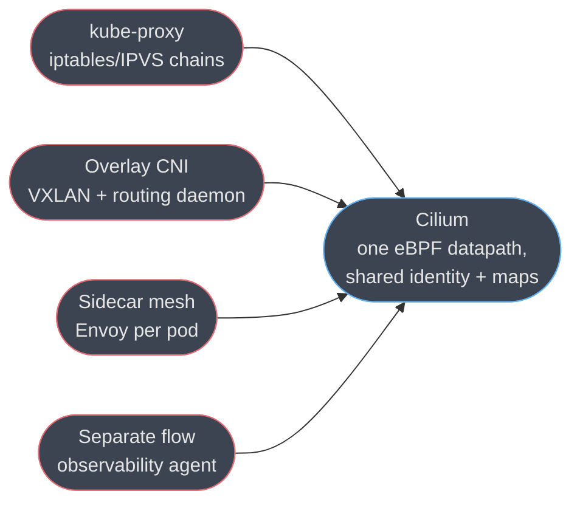
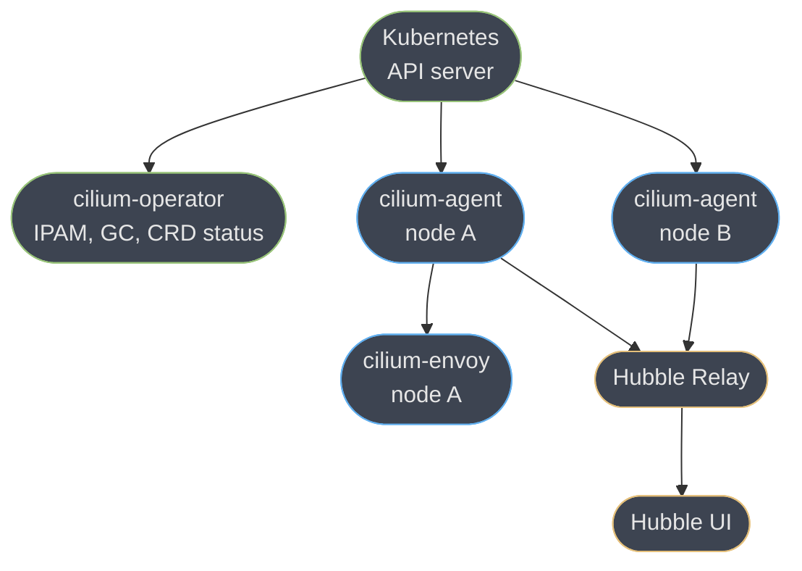
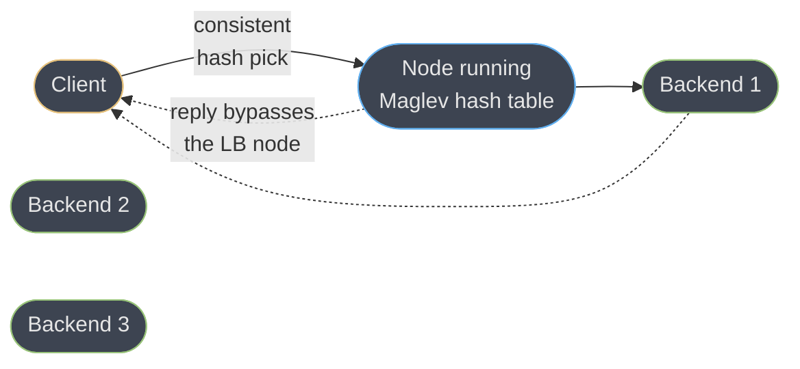
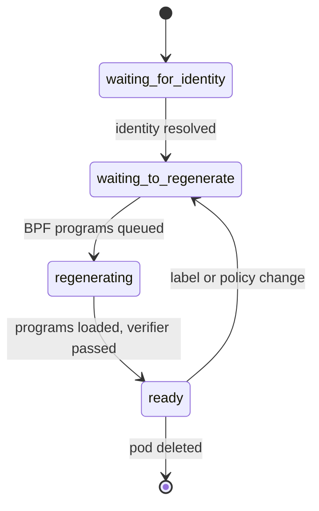

# Cilium

> **Version anchor (2026-08-26).** **Cilium 1.20.1** (released **2026-08-18**) is the current
> stable patch on the **1.20** minor line, cut **2026-07-29**. Cilium supports its three most
> recent minor releases with bug and security fixes on roughly a six-month cadence, so **1.19**
> (latest patch **1.19.7**, also 2026-08-18) and **1.18** (latest patch **1.18.13**, also
> 2026-08-18) are still patched, while **1.17** exited support the same week 1.20 shipped.
> Cilium graduated the CNCF on **2023-10-11** — the first CNI project to do so — under governance
> from maintainers across 7+ companies and 800+ contributors. Its creating company, Isovalent,
> was acquired by Cisco in a deal that closed **2024-04-12**; Cisco is now the largest single
> contributor, but the project remains community-governed under the CNCF, not Cisco-owned.
> `kubeProxyReplacement` is a **boolean** Helm value (`true`/`false`) in the current line — an
> older three-way string (`strict`/`probe`/`partial`) documented that same setting in earlier
> releases and is retired; this page uses the current boolean form throughout except where it is
> explicitly the subject (§6.4, §10). The **BGP Control Plane** resources referenced here are the
> current `cilium.io/v2` CRDs (`CiliumBGPClusterConfig`, `CiliumBGPPeerConfig`,
> `CiliumBGPAdvertisement`) — the earlier `CiliumBGPPeeringPolicy` (`v2alpha1`) is superseded.
> Version-gated behaviour is tagged inline as `[1.20]`, `[BGP v2]`, `[Gateway API]` and so on;
> unmarked claims are stable across the 1.18-1.20 line.

Cilium is an eBPF-based networking, security and observability platform for Kubernetes and
Linux workloads: one agent per node, running kernel-native programs, that replaces
kube-proxy's Service dataplane, a traditional overlay CNI's routing, a sidecar service mesh's
per-pod proxies, and a bolt-on flow-observability agent with a single datapath built on eBPF.
This page is the product deep dive — the components, the datapath modes, real Helm values and
CRDs, and the operational failure modes. The vendor-neutral Kubernetes networking model (the
pod network contract, Services, kube-proxy's three dataplane modes, and the iptables-vs-eBPF
scaling argument) belongs to
[`devops/kubernetes_networking`](../../devops/kubernetes_networking/kubernetes_networking.md),
which this page assumes and does not restate; Cilium's embedded L7 proxy is
[`Envoy`](../envoy_proxy/envoy_proxy.md), covered once here in §6.4 and linked, not re-taught;
vendor-neutral Kubernetes RBAC/PodSecurity/secrets hardening is
[`devops/kubernetes_security`](../../devops/kubernetes_security/kubernetes_security.md); the
sidecar-vs-sidecar-free service mesh tradeoff in general is
[`backend/service_mesh_and_service_discovery`](../../backend/service_mesh_and_service_discovery/service_mesh_and_service_discovery.md).

---

## 1. Concept Overview

### What one eBPF datapath replaces

A cluster running a traditional stack has four separate systems doing four separate jobs,
each with its own failure modes:

| System | Job | What it costs |
|---|---|---|
| kube-proxy (iptables or IPVS) | Rewrite Service VIPs to Pod IPs | Sequential iptables chains scale linearly with Service count; every Service and every endpoint churn is a chain rewrite |
| A CNI plugin (Flannel, an overlay Calico) | Pod IP allocation, cross-node packet delivery | A VXLAN overlay adds encapsulation and MTU overhead; policy enforcement, if any, is a second iptables layer bolted on top |
| A sidecar service mesh (Istio with sidecars, Linkerd) | mTLS, L7 routing, retries between services | One proxy container per pod — CPU/memory reserved per replica purely for proxying, plus a second hop through loopback per hop |
| A separate observability agent | Flow-level visibility, who-talks-to-whom | Usually samples or infers from logs/metrics rather than seeing every packet |

Cilium's pitch is that all four are instances of the same underlying problem — "make a
decision about a packet, cheaply, at kernel speed" — and that eBPF lets one set of in-kernel
programs, sharing one set of in-kernel maps, do all four jobs instead of four separate
userspace or semi-userspace systems each re-deriving the same routing and identity
information independently.

### An eBPF primer, scoped to what Cilium needs

eBPF (extended Berkeley Packet Filter) is a mechanism for running small, sandboxed programs
inside the Linux kernel, triggered by kernel events, without writing a kernel module and
without a context switch to userspace for every decision. Four things matter for
understanding Cilium and nothing more — this page is not a general eBPF module (the repo has
none elsewhere; treat this primer as the floor, not a substitute for one):

- **Attach points.** A BPF program is loaded and attached to a specific hook, and the hook
  determines what the program can see and how early it runs. Cilium uses several: **XDP**
  (eXpress Data Path) attaches at the network driver, before the kernel allocates a socket
  buffer — the earliest and cheapest point to drop or redirect a packet, used for the fastest
  path of load balancing and DDoS mitigation. **tc** (traffic control) ingress/egress hooks
  attach to a network device after the kernel has built its packet structure, giving a program
  a fully parsed packet to make routing, NAT and policy decisions on — this is where most of
  Cilium's per-packet logic lives. **Socket-level** hooks (`connect()`/`sendmsg()` interception
  via `cgroup/connect4`, `cgroup/sendmsg4`) let Cilium redirect a Service connection to a
  backend *before* a packet is even built, for same-node traffic. **kprobes/tracepoints**
  attach to kernel functions and syscalls — Tetragon's domain (§6.12), not the networking
  datapath.
- **The verifier.** Before any BPF program is loaded into the kernel, the verifier statically
  walks every possible execution path and rejects the program if it can find an unbounded
  loop, an out-of-bounds memory access, or a path that isn't provably safe — no crash, no
  hang, no arbitrary memory read is a possible outcome of a program that passed. This is what
  makes it safe to run untrusted-looking logic in kernel space at all; a program that the
  verifier cannot prove safe simply never loads, and it fails at load time, not at runtime.
- **Maps.** A BPF map (hash table, LRU hash, array, ring buffer) is the only state that
  survives between one program invocation and the next, and the only channel between kernel
  space and userspace — Cilium's policy decisions, its Service-to-backend tables, its conntrack
  state and its identity-to-label mapping are all BPF maps that `cilium-agent` populates from
  userspace and that the in-kernel programs read on every packet with no syscall involved.
- **CO-RE and BTF.** "Compile Once, Run Everywhere" means a single compiled BPF program binary
  can run correctly across kernel versions with different internal struct layouts, using **BTF**
  (BPF Type Format) metadata the kernel exposes about its own data structures so the loader can
  patch field offsets at load time instead of the program needing to be recompiled per kernel.
  This is why one `cilium-agent` container image runs unmodified across a fleet with mixed
  kernel versions rather than shipping a kernel-specific build per node.
- **XDP has three modes, and Cilium picks the best one the hardware allows.** **Native** (or
  "driver") mode runs the XDP program in the NIC driver itself, before any socket buffer is
  allocated — the fastest option, but only as many NIC drivers support it. **Generic** (or
  "skb") mode runs the same program later, after the kernel has already built its packet
  structure, as a fallback on drivers or virtualized NICs with no native XDP support — it
  works everywhere but forfeits most of XDP's speed advantage. **Offloaded** mode pushes the
  program onto a SmartNIC's own processor entirely, bypassing the host CPU for that decision —
  rare in cloud environments, common in some bare-metal high-throughput deployments. Which
  mode a node ends up running is visible in `cilium status`, and it is a direct function of the
  NIC driver, not a setting most operators tune by hand.

Cilium's central move is to put Service load balancing, NetworkPolicy enforcement, identity
resolution, NAT, encryption and flow export all inside this same in-kernel, map-backed
machinery, instead of layering four separate systems each re-deriving "which pod is this
packet from and where should it go."

---

## 2. Intuition

**One-line analogy.** iptables is a stack of increasingly long paper forms a packet has to
walk through and get stamped by, one rule at a time, in order; eBPF is a lookup table — the
packet's identity goes in, the verdict comes out, in constant time, regardless of how many
Services or policies exist.

**The mental model.** Every Cilium decision — "which backend for this Service VIP," "is this
packet allowed," "what labels does the source pod have" — reduces to a hash-map lookup keyed
by a compact identifier (a Service ID, a numeric security identity, a connection tuple) rather
than a linear scan of rules or a chain of proxies. The `cilium-agent` DaemonSet's job is to
keep those maps in sync with the Kubernetes API's view of the world; the in-kernel BPF
programs never talk to the API server, never make a network call, and never block on
userspace — they only read maps that are already populated.

**Why it matters.** A traditional dataplane's cost model is "more Services, more policies,
more churn = more work per packet," because a linear chain or a per-pod proxy scales with the
thing it's protecting against. eBPF's cost model is "a hash lookup, whether there are ten
Services or ten thousand" — which is the structural reason Cilium markets itself on scaling
past iptables' practical ceiling, and why "does this scale to our Service count" stops being
a question worth asking once the dataplane is BPF maps rather than sequential rules.

**The key insight.** *Identity is the object policy is written against, not the IP.* A pod's
IP is a fact that changes on every restart; its labels are (usually) stable across its whole
lifecycle. Cilium converts a pod's labels into a numeric security identity once, and every
downstream decision — NetworkPolicy match, Hubble flow attribution, ClusterMesh service
routing — keys off that identity, not the IP that happens to be attached to it this minute.
This is the single idea that makes the rest of the page make sense.

---

## 3. Core Principles

1. **eBPF in the kernel, not iptables or a userspace proxy, is the dataplane.** Cilium's
   packet decisions run as in-kernel BPF programs attached at XDP, tc and socket hooks,
   backed by BPF maps `cilium-agent` populates — there is no per-packet syscall into
   userspace and no sequential rule chain to walk.
2. **Identity-based security, not IP-based.** A pod's labels are hashed into a numeric
   security identity (§6 internals; a `uint32`), and every policy, flow record and
   cross-cluster route is keyed on that identity — so policy survives pod churn without
   recompilation, and the same label set always maps to the same identity cluster-wide.
3. **One datapath, many features, shared state.** Service load balancing, NetworkPolicy,
   NAT, encryption and flow export are not four bolted-on systems; they read and write the
   same BPF maps and share the same identity resolution, which is why Hubble can attribute
   every flow to a policy verdict for free instead of correlating separate logs.
4. **Declarative CRDs, reconciled per node, no central dataplane chokepoint.** Every node
   runs its own `cilium-agent` reconciling `CiliumNetworkPolicy`, `CiliumEndpoint` and the
   rest against its local BPF maps; there is no central load balancer or proxy the whole
   cluster's traffic must pass through (`cilium-operator` and `clustermesh-apiserver` are
   control-plane only — see §4).
5. **CO-RE portability.** One compiled agent binary, carrying BTF-described programs, runs
   across a fleet with mixed kernel patch levels without a per-kernel build — the tradeoff
   is a real minimum kernel-feature floor (§9), not zero dependency on the kernel.
6. **The verifier is a hard safety boundary, not a suggestion.** A BPF program that cannot
   be proven safe never loads — this is what makes "run untrusted-shaped logic at kernel
   speed" a defensible engineering bet instead of a kernel-module crash risk.

---

## 4. Types / Architectures / Strategies

### 4.1 Components

| Component | Kind | Role |
|---|---|---|
| `cilium-agent` | DaemonSet, one per node | Watches the K8s API, programs the local BPF maps and programs, runs the embedded Envoy proxy for L7 policy, exposes `cilium status` / metrics |
| `cilium-operator` | Deployment (typically 1-3 replicas, leader-elected) | Cluster-wide, non-per-packet work: IPAM allocation for cloud IPAM modes, garbage-collecting stale identities and CiliumEndpoints, CRD status/derivative-resource management. Never sits in the packet path — its outage degrades control-plane reconciliation speed, not existing traffic |
| Hubble | Embedded in `cilium-agent` | Per-node flow observability, reading the same eBPF-visible events the datapath already produces |
| Hubble Relay | Deployment | Aggregates per-node Hubble gRPC streams into one cluster-wide `hubble observe` view |
| Hubble UI | Deployment | Web UI for the aggregated flow graph, built on Hubble Relay |
| `clustermesh-apiserver` | Deployment, one per participating cluster | Exposes that cluster's identities, endpoints and Services to peer clusters for ClusterMesh (§6.7) |
| Cilium CLI (`cilium`) | Client binary | `cilium status`, `cilium connectivity test`, `cilium bpf ct list`, cluster install/upgrade |
| `cilium-envoy` | Container inside the agent pod (or its own DaemonSet, per node) | The embedded Envoy instance handling L7 CiliumNetworkPolicy rules, Ingress/Gateway API HTTP routing, and sidecar-free Service Mesh (§6.4, §6.11) |

### 4.2 Datapath (routing) modes

| Mode | Helm key | Mechanism | When it's the right call |
|---|---|---|---|
| **Native routing** | `routingMode: native` | Relies on the underlying network fabric — BGP (§6.9) or L2 adjacency with `autoDirectNodeRoutes` — to route pod-CIDR traffic between nodes with no encapsulation | Bare metal or a cloud VPC where you control routing; maximum throughput, no MTU tax |
| **Tunnel (encapsulation)** | `routingMode: tunnel`, `tunnelProtocol: vxlan` (default) or `geneve` | Every inter-node packet is VXLAN- or Geneve-encapsulated over UDP, forming a full mesh with zero fabric routing requirements | Environments with no control over the underlying network, or where nodes aren't on a shared L2/L3 fabric — the default because it always works |
| **eBPF host routing** | Auto-enabled when the kernel supports it | Bypasses iptables and the upper host network stack entirely for pod-bound packets, delivering directly from the physical NIC into the pod's network namespace | Automatic — verify it's active via `cilium status` reporting "Host Routing: BPF" rather than "Legacy" |

### 4.3 IPAM modes

| Mode | `ipam.mode` | Mechanism |
|---|---|---|
| Cluster-pool (default) | `cluster-pool` | `cilium-operator` carves a per-node CIDR from `ipam.operator.clusterPoolIPv4PodCIDRList` (default `10.0.0.0/8`) sized by `ipam.operator.clusterPoolIPv4MaskSize` (default `24`, i.e. a `/24` per node) |
| Kubernetes | `kubernetes` | Delegates entirely to the `PodCIDR` Kubernetes already assigned each Node; no separate Cilium pool |
| AWS ENI | `eni` | Allocates and attaches ENIs (or secondary IPs on an ENI) directly from VPC address space — pods get real, routable VPC IPs, and native routing needs no overlay at all |
| Azure IPAM | `azure` | Same idea against Azure VNETs, used by Azure CNI Powered by Cilium |
| GKE-native | delegated to GKE's own IP allocation | Dataplane V2 (§7) reuses GKE's alias-IP-range allocation rather than running its own IPAM |

### 4.4 kube-proxy replacement modes

`kubeProxyReplacement` is a **boolean**: `true` gives full eBPF replacement of kube-proxy's
job — ClusterIP, NodePort, LoadBalancer, externalIPs, HostPort and session affinity all
handled in-kernel, with `cilium-agent` refusing to start if the kernel lacks the required
BPF features. `false` (the default) still eBPF-accelerates ClusterIP-to-backend load
balancing in-cluster, but leaves NodePort/LoadBalancer/HostPort to whatever else is running
(usually kube-proxy itself, coexisting). This replaced an older three-value string
(`strict`/`probe`/`partial`) that let an operator selectively enable individual Service types
while still running kube-proxy for the rest — see §10 for the confusion this could cause and
its modern equivalent.

### 4.5 Identity-based security model

Every endpoint (a pod, or an external CIDR/entity) resolves to a numeric **security
identity** — a `uint32` derived from its security-relevant label set, cached in a shared
identity map so the same label set always yields the same identity across the cluster.
`CiliumNetworkPolicy` selectors match against labels, are compiled down to identity-to-identity
rules, and are enforced as a BPF map lookup keyed on the connection's resolved source and
destination identities — not their IPs. Reserved identities (values 1-255) cover well-known
non-pod endpoints (`host`, `world`, `cluster`, `kube-apiserver`, `remote-node`); CIDR-based
identities for un-labelled external traffic start at `2^24 + 1` and are local to each node,
so the same CIDR policy can carry a different numeric identity on two different nodes without
that being a bug.

```
security identity value (uint32)                          scope
0 ......................... 255    reserved (world, host,   cluster-wide,
                                    cluster, kube-apiserver, fixed meaning
                                    remote-node, ...)

256 ................... 65,535     label-derived pod         cluster-wide,
                                    identities                same labels =
                                                               same value
                                                               everywhere

16,777,217 (2^24+1) ...           CIDR / un-labelled          node-local,
  and up                          external endpoints          may differ
                                                               node to node
```
*Reserved and label-derived identities carry one fixed meaning cluster-wide; only the CIDR
range is node-local by design — a policy debugging session that assumes every numeric identity
means the same thing on every node will misread a CIDR-based one.*

### 4.6 Encryption and traffic-shaping modes

| Mode | Helm key | Mechanism | Notes |
|---|---|---|---|
| No transparent encryption (default) | `encryption.enabled: false` | Pod traffic unencrypted at the Cilium layer | The common baseline; app-layer TLS (or a sidecar mesh's mTLS) covers encryption separately if needed |
| WireGuard | `encryption.type: wireguard` | ChaCha20-Poly1305, per-node-pair L3 tunnel, keys distributed via the K8s API | Simpler key management; better on hardware without AES-NI (§6.14) |
| IPsec | `encryption.type: ipsec` | Kernel XFRM/ESP, AES-GCM with AES-NI where present | Higher throughput on AES-NI hardware; more operational surface (key rotation, XFRM state) |
| Bandwidth Manager | `bandwidthManager.enabled: true` | eBPF EDT pacing, optional per-pod BBR | Per-pod bandwidth ceilings via standard K8s annotations (§6.15) |

---

## 5. Architecture Diagrams


*Four systems, each re-deriving pod/Service identity separately, collapse into one set of
BPF maps and programs that every feature — LB, policy, encryption, observability — reads.*


*`cilium-operator` and `clustermesh-apiserver` (omitted for space, see §6.7) are
control-plane only; every node's `cilium-agent` reconciles independently and keeps
forwarding traffic even if the operator or API server is briefly unreachable (§10).*


*Same-node Service traffic can be redirected at the socket hook before a packet is even
built; cross-node traffic is decided at tc (policy, NAT, routing-mode encapsulation) with
XDP as the earliest possible drop point for hostile or clearly-invalid packets (§6.13).*


*The IP never enters the decision — a pod restarting with a new IP but the same labels
resolves to the same identity and the same policy verdict with zero recompilation.*


*DSR: the LB node picks a backend via Maglev consistent hashing and forwards the request,
but the backend replies directly to the client — the LB node never sees return traffic,
which is the throughput win and the operational cost (§6.13).*

---

## 6. How It Works — Detailed Mechanics

### 6.1 Packet path: pod-to-pod

**Same node.** Traffic between two pods on the same node never leaves the host: the socket
hook or a tc program on the source pod's veth resolves the destination pod's veth directly
and redirects the packet there, skipping any router or bridge lookup — genuinely a single
kernel hop.

**Cross node, native routing.** The source node's tc egress program consults the identity and
policy maps, applies the policy verdict, and hands the packet to the kernel's normal routing
table, which — because `autoDirectNodeRoutes` or BGP (§6.9) has installed a route to every
other node's pod CIDR — sends it out the physical interface with no encapsulation. The
destination node's tc ingress program picks it up, resolves the destination pod's identity,
and delivers it.

**Cross node, tunnel mode.** Same policy evaluation, but the egress program VXLAN- or
Geneve-encapsulates the packet with an outer header addressed to the destination node's real
IP; the destination node's tunnel device decapsulates, and delivery proceeds as above. The
cost is roughly 50 bytes of VXLAN/Geneve overhead per packet plus one decapsulation, which is
why `routingMode: native` is the throughput-optimal choice whenever the underlying fabric can
support it.

### 6.2 Packet path: pod-to-Service (ClusterIP)

With `kubeProxyReplacement: true`, a same-node client's `connect()` to a ClusterIP is
intercepted at the `cgroup/connect4` socket hook *before* any packet exists: the eBPF program
looks up the Service's backend list in a BPF map, picks one (round-robin or Maglev — see
§6.13), and rewrites the destination address in the socket itself, so every packet the
application ever sends already targets the real backend IP with zero further per-packet NAT
cost. A remote client (from outside the cluster, or via NodePort) hits the tc-level datapath
instead: the packet is DNAT'd from VIP to backend IP and, unless DSR is enabled, SNAT'd so
the reply naturally routes back through the same node.

### 6.3 Packet path: node-to-external and Egress Gateway

Pod-to-internet traffic is, by default, masqueraded (`enable-ipv4-masquerade: true`) to the
egressing node's IP — the same behaviour most CNIs provide. When an upstream firewall needs a
stable, allow-listable source IP per team or namespace rather than "any node in the cluster,"
`CiliumEgressGatewayPolicy` (`cilium.io/v2`) routes matching pod egress traffic through a
designated gateway node and SNATs it to one specific `egressIP` (or the first address on a
named interface — the two are mutually exclusive, and specifying both makes Cilium ignore the
policy entirely):

```yaml
apiVersion: cilium.io/v2
kind: CiliumEgressGatewayPolicy
metadata:
  name: checkout-fixed-egress
spec:
  selectors:
    - podSelector:
        matchLabels:
          app: checkout
  destinationCIDRs:
    - "203.0.113.0/24"
  egressGateway:
    nodeSelector:
      matchLabels:
        egress-gateway: "true"
    egressIP: "203.0.113.100"
```

### 6.4 CiliumNetworkPolicy and CiliumClusterwideNetworkPolicy

`CiliumNetworkPolicy` (namespaced) and `CiliumClusterwideNetworkPolicy` (cluster-scoped, no
`metadata.namespace`) extend Kubernetes' native `NetworkPolicy` with L7 rules, FQDN-based
egress, and named non-pod entities — the same default-deny flip applies: the moment any
policy's `endpointSelector` matches a pod, that pod goes from "all traffic implicitly
allowed" to "deny everything not explicitly listed," exactly as with native `NetworkPolicy`.
`toEntities` names endpoints that have no pod labels of their own: `world` (anything outside
the cluster), `cluster` (anything inside it), `host` (the node's own processes), `remote-node`
(other cluster nodes specifically) and `kube-apiserver` (the reserved identity for the API
server, needed even under a strict deny-all because pods routinely call it directly for
leader election, service account token review, or a controller's own watches).

L7 rules are what actually invoke the embedded Envoy: an HTTP rule under `toPorts.rules.http`
causes Cilium to redirect matching traffic through the local `cilium-envoy` instance, which
enforces the method/path/header match and forwards or rejects at the application layer — L3/L4
enforcement never leaves the kernel, but the moment a rule needs to look inside an HTTP
request, the packet is handed to userspace Envoy for that one decision. `toFQDNs` resolves a
domain name to a set of IPs to whitelist for egress, but **Cilium must observe the DNS answer
itself** to build the FQDN-to-IP map — a `toFQDNs` rule with no accompanying DNS-egress allow
never matches anything, because Cilium never sees the resolution happen:

```yaml
apiVersion: cilium.io/v2
kind: CiliumNetworkPolicy
metadata:
  name: checkout-egress
  namespace: payments
spec:
  endpointSelector:
    matchLabels:
      app: checkout
  egress:
    - toEndpoints:
        - matchLabels:
            k8s:io.kubernetes.pod.namespace: kube-system
            k8s-app: kube-dns
      toPorts:
        - ports:
            - port: "53"
              protocol: UDP
          rules:
            dns:
              - matchPattern: "*"
    - toFQDNs:
        - matchName: "api.stripe.com"
      toPorts:
        - ports:
            - port: "443"
              protocol: TCP
    - toEntities:
        - kube-apiserver
```

### 6.5 Broken -> fixed: the default-deny that silently kills DNS

**Broken.** A platform team, tightening namespace security, applies this policy intending to
default-deny egress except to an approved external API:

```yaml
apiVersion: cilium.io/v2
kind: CiliumNetworkPolicy
metadata:
  name: checkout-egress
  namespace: payments
spec:
  endpointSelector:
    matchLabels:
      app: checkout
  egress:
    - toFQDNs:
        - matchName: "api.stripe.com"
      toPorts:
        - ports:
            - port: "443"
              protocol: TCP
```

The moment this is applied, every pod labelled `app: checkout` flips to default-deny egress —
including to CoreDNS. The `toFQDNs` rule can never resolve `api.stripe.com` because the DNS
query needed to resolve it is itself blocked, so the policy that was meant to *allow* one
external API instead blocks all egress, DNS included, cluster-wide for that label. Nothing in
`kubectl apply` warns about this; the policy is syntactically valid and does exactly what it
says.

**Fixed.** Add the explicit DNS-allow *before* relying on any `toFQDNs` rule — this is exactly
§6.4's example: an explicit `toEndpoints` rule for `kube-dns` on UDP/53 with a `dns` L7 rule,
placed ahead of the FQDN rule. The general lesson: **any default-deny policy needs its DNS
and `kube-apiserver` allowances written explicitly**, because neither is implicit, and the
failure mode when they're missing is silent until something downstream times out.

### 6.6 Hubble: flow observability

Hubble is not a separate agent scraping logs — it reads the same eBPF-visible events
`cilium-agent` already generates for the datapath, so every flow it reports carries the
policy verdict, the resolved identities on both sides, and (for L7-redirected traffic) the
HTTP method/path/status, with no separate correlation step. `hubble observe` streams flows
live from a single node's Hubble server:

```
hubble observe --namespace payments --verdict DROPPED
09:14:02  payments/checkout-7c9 -> kube-system/coredns-x9k2  DNS-Request  DROPPED  (Policy denied)
```

**Hubble Relay** aggregates every node's per-node Hubble gRPC stream into one cluster-wide
view, which is what `hubble observe` talks to by default in a multi-node install, and what
**Hubble UI** renders as a live service-dependency graph. Metrics are opted into per-category
via `hubble.metrics.enabled` (e.g. `dns`, `drop`, `tcp`, `flow`, `httpV2`) and exported under
the `hubble_` Prometheus namespace — `hubble_flows_processed_total` (flows by verdict),
`hubble_drop_total` (drops by reason), `hubble_dns_queries_total`, `hubble_http_requests_total`
and `hubble_tcp_connecttime_seconds` are the ones platform teams dashboard first, because
`hubble_drop_total` is what would have shown the §6.5 incident as a spike the moment the
policy was applied, well before an SLO alert fired downstream.

### 6.7 Cluster Mesh

ClusterMesh connects multiple Cilium-managed clusters into one flat identity and Service
space: each participating cluster runs `clustermesh-apiserver`, which exposes its identities,
endpoints and Services to peers over mTLS. A **global service** is declared by giving a
Kubernetes `Service` of the same name and namespace in two or more clusters the annotation
`service.cilium.io/global: "true"` (plus `service.cilium.io/shared: "true"` on the side whose
backends should actually be exported) — Cilium then load-balances across backends from every
cluster that shares it, as if they were local. `service.cilium.io/affinity` (`local` /
`remote` / `none`, default `none`) controls whether a client prefers its own cluster's
backends and only spills to remote ones on local unavailability, which is the mechanism
behind a "prefer local, fail over to another region" topology without any application-level
retry logic. Because the same label set resolves to the same numeric security identity in
every participating cluster, a `CiliumNetworkPolicy` written once enforces identically
cluster to cluster — this is identity-based security's payoff extended to multi-cluster,
not a separate feature.

### 6.8 BGP Control Plane

`[BGP v2]` The current BGP Control Plane is a set of `cilium.io/v2` CRDs —
`CiliumBGPClusterConfig` (binds a BGP instance to nodes via a `nodeSelector`),
`CiliumBGPPeerConfig` (reusable peer settings: timers, graceful restart, authentication), and
`CiliumBGPAdvertisement` (what gets advertised — pod CIDRs, Service VIPs, egress-gateway IPs).
This lets Cilium speak BGP to top-of-rack switches to advertise pod-CIDR reachability for
native routing (§4.2) without a separate routing daemon, and to advertise LoadBalancer Service
IPs directly into the network fabric instead of depending on a cloud load balancer:

```yaml
apiVersion: cilium.io/v2
kind: CiliumBGPClusterConfig
metadata:
  name: rack-peering
spec:
  nodeSelector:
    matchLabels:
      rack: a
  bgpInstances:
    - name: instance-65000
      localASN: 65000
      peers:
        - name: tor-switch
          peerASN: 65001
          peerAddress: "10.0.0.1"
          peerConfigRef:
            name: default-peer-config
```

The superseded resource, `CiliumBGPPeeringPolicy` (`v2alpha1`), configured the same
capability as a single flatter object per node selector; it is not the interface to reach for
in a new deployment.

### 6.9 Gateway API and Cilium Ingress

Cilium implements the Kubernetes **Gateway API** natively — `Gateway` and `HTTPRoute`
resources are reconciled directly by `cilium-agent`, which programs the per-node embedded
Envoy (§6.11) to serve the matched routes; classic `Ingress` objects are also supported via a
built-in `IngressClass`, but Gateway API is the recommended surface for anything new, both
because it expresses traffic-splitting and header-based routing that annotation-driven
Ingress cannot, and because it is the migration target named in the ingress-nginx retirement
guidance (§7). North-south traffic (client to cluster) and east-west L7 policy (§6.4) share
the same per-node Envoy instance rather than requiring a separate ingress-controller
deployment.

### 6.10 Cilium Service Mesh vs Istio Ambient

Cilium's Service Mesh is sidecar-free by construction, not as an alternate mode bolted onto a
sidecar design: **one Envoy per node**, not one per pod, handles every L7-policy-triggered and
Gateway API-routed request on that node, driven by the same eBPF identity resolution that
already runs for L3/L4. This is architecturally distinct from Istio's **ambient mode**, which
splits the problem differently: a per-node `ztunnel` DaemonSet handles L4 (mTLS, identity,
transparent capture) for every pod with no proxy at all in most traffic, and an *optional*
per-namespace or per-service **waypoint** proxy (itself Envoy-based) is deployed only where L7
features — HTTP routing, retries, per-route authorization — are actually needed. The practical
difference: Cilium's per-node Envoy is always in the L7 path for any L7-policed traffic on
that node, while ambient's waypoint is opt-in per workload, so a cluster with little L7 policy
runs almost no Envoy at all under ambient and one Envoy DaemonSet's worth under Cilium
regardless. Neither design puts a proxy in every pod; both are the sidecar-free generation of
service mesh, and the practical choice is usually "which CNI are we already running," since
running Cilium's mesh on top of a different CNI, or Istio ambient on top of a non-Cilium CNI,
is the common path.

### 6.11 Tetragon — a separate, sibling project

**Tetragon is not part of the Cilium networking datapath — it is a separate CNCF-adjacent
project, created by the same team, that shares eBPF as its mechanism and nothing else
architecturally.** Where Cilium's programs attach at network hooks (XDP, tc, socket) to make
packet decisions, Tetragon's attach at kprobes and tracepoints to observe and enforce on
process execution, file access and syscalls — process-tree-aware runtime security, not
network policy. It can enrich its events with the same Kubernetes identity metadata
(namespace, pod labels) Cilium uses, and the two are commonly deployed together, but Tetragon
has its own CRDs (`TracingPolicy`), its own agent, and its own release cadence; a
`CiliumNetworkPolicy` has no effect on what Tetragon enforces and vice versa. Scope this
correctly in any design discussion: "we run Cilium" says nothing about whether Tetragon is
also deployed.

### 6.12 Performance: XDP, Maglev and DSR

Placing load-balancing decisions as early as XDP — before the kernel has even allocated a
socket buffer for the packet — is what lets Cilium handle NodePort and LoadBalancer traffic
at line rate with minimal per-packet CPU, and it's the same early-drop point used to shed
volumetric attack traffic before it costs anything further downstream. **Maglev** consistent
hashing is the algorithm behind backend selection when connection stability matters: a
standard modulo-hash backend selection reshuffles a large fraction of existing connections
every time the backend set changes size, while Maglev's table construction guarantees that
adding or removing one backend remaps only approximately `1/N` of existing connections — the
property that keeps long-lived connections pinned to their original backend through routine
autoscaling. **DSR (Direct Server Return)** dispatches the request to a backend (via IP
options, IPIP or Geneve encapsulation depending on environment) but lets the backend reply
**directly** to the client, never routing the response back through the load-balancing node —
this roughly halves the LB node's packet-processing cost for return traffic and removes it
from the response-latency path entirely. The tradeoff is real: DSR requires the backend to be
able to source packets as if it were the original destination (which some cloud network
fabrics restrict), health-checking gets more complex because the LB node can't observe
response behaviour, and it is not Cilium's default precisely because it trades a throughput
win for an operational one — plain SNAT/DNAT with the LB node in both directions is simpler to
reason about and debug, which is why most deployments start there and move to DSR only once
LB-node CPU on return traffic is a measured bottleneck.

### 6.14 Transparent encryption: WireGuard vs IPsec

Cilium encrypts pod-to-pod traffic transparently, with no application change, via one of two
backends selected with `encryption.type`. **WireGuard** (`wireguard`) uses ChaCha20-Poly1305
over a per-node-pair L3 tunnel, with peer public keys distributed automatically through the
Kubernetes API — simpler key-management operationally, and more CPU-efficient than IPsec on
hardware with no AES-NI instruction support, at the cost of a lower measured maximum
throughput ceiling on hardware that does have it. **IPsec** (`ipsec`) uses the kernel's native
XFRM/ESP stack and, where the CPU supports AES-NI, can use AES-GCM with hardware acceleration
that outperforms WireGuard's software ChaCha20 path — the same hardware dependency that makes
IPsec the wrong default on a fleet with mixed or unknown instruction-set support. There is no
universal winner: **benchmark both against the actual node type before committing**, and
default to WireGuard when the two measure close, because its operational simplicity (no
manual key rotation, no XFRM policy debugging) is worth more than a marginal throughput edge.

IPsec key rotation is the one place its extra operational surface is concrete rather than
abstract: the key is identified by a small `key-id` (a `uint8` from 1-15) stored alongside the
pre-shared key material in a Kubernetes Secret, and rotating it means incrementing that ID
monotonically, rolling over from 15 back to 1 — Cilium updates every node automatically when
the Secret changes, and deliberately keeps **both the old and new key in use simultaneously**
during the transition, tracking per-endpoint which key each remote node has already picked up
so encryption keeps working correctly for endpoints on either side of the rollout at any given
moment. The visible consequence is that the keys-in-use count, normally two per remote node
per enabled IP family (current plus the always-available previous), doubles to four during an
active rotation — a real, expected transient, not a leak or a stuck rotation, though it is
exactly the kind of metric spike worth having on a dashboard specifically so it reads as
"rotation in progress" rather than "something is wrong" the first time someone sees it.

### 6.15 Bandwidth Manager

`bandwidthManager.enabled: true` lets Cilium enforce per-pod bandwidth limits natively in
eBPF using **EDT** (Earliest Departure Time) packet pacing rather than a separate
traffic-control queueing discipline bolted on afterward — and it is the prerequisite for
enabling **TCP BBR** congestion control on a per-pod basis, which specifically helps services
fronted by a Kubernetes Service and facing external clients across variable-latency paths,
where BBR's throughput behavior beats the kernel's default CUBIC. Limits are declared per pod
with the standard annotations, enforced independently per replica — a Deployment with five
replicas each carrying `egress-bandwidth: "10M"` gives each pod 10M, not 10M shared across all
five:

```yaml
apiVersion: v1
kind: Pod
metadata:
  name: video-transcoder
  annotations:
    kubernetes.io/egress-bandwidth: "50M"
    kubernetes.io/ingress-bandwidth: "50M"
spec:
  containers:
    - name: transcoder
      image: internal/transcoder:2026.08
```

`cilium status` reporting `BandwidthManager: EDT with BPF [BBR]` confirms both pieces are
active; the feature needs no CNI chaining and does not depend on the community `bandwidth` CNI
plugin at all — it is Cilium-native end to end.

### 6.16 Endpoint lifecycle and node-level health checking


*A rising count of endpoints stuck past `regenerating` under heavy pod churn is the leading
indicator that agent reconciliation is falling behind the cluster's actual change rate.*

Every pod Cilium manages is tracked as a `CiliumEndpoint`, moving through an explicit state
machine — `waiting-for-identity` -> `waiting-to-regenerate` -> `regenerating` -> `ready` —
every time its BPF programs need rebuilding: pod creation, a label change that alters its
resolved identity, or a policy change that affects it all trigger a regeneration. The
endpoint-regeneration-latency metric is the leading indicator of a cluster overwhelming its
own agents with churn: a healthy node regenerates an endpoint in low milliseconds to a few
seconds, and a rising value during a large rolling deploy or a burst autoscale event means
newly-scheduled pods are reachable later than expected — a real but usually self-resolving
symptom, not an outage, unless the backlog keeps growing rather than draining.

Separately, `cilium-health` runs continuous connectivity probes between every pair of nodes
and against a synthetic health endpoint on each node, independent of any actual application
traffic. Its `unreachable_nodes` and `unreachable_health_endpoints` metrics are the signal
that distinguishes "one specific pod can't be reached" (an endpoint or policy problem) from
"this node has actually fallen off the mesh" (a node-level networking or agent problem) —
checking `cilium-health status` before escalating a single connectivity report to a node-level
incident is a cheap step that prevents chasing the wrong layer.

### 6.17 Policy audit mode: how the "stage before enforce" workflow actually works

Every earlier reference to "staging a policy in audit mode" (§6.5, §10, §13, §14) means one
specific, concrete mechanism: **Policy Audit Mode**, which makes Cilium evaluate every
`CiliumNetworkPolicy` and log what verdict it *would* produce — allow or deny — while
continuing to allow all traffic regardless of that verdict. It can be set daemon-wide via
`policyAuditMode: true` in Helm (or `--policy-audit-mode=true` on `cilium-agent` directly), or
scoped to individual endpoints through `cilium-dbg` on the node running them, which is the
form that actually matters operationally: **daemon-wide audit mode means no policy is enforced
anywhere in the cluster**, so the safe staging pattern is always the endpoint- or
namespace-scoped form, never the global flag left on. The mode is explicitly not meant to be a
standing configuration — a `cilium-agent` restart resets any per-endpoint audit-mode setting
back to whatever the daemon's own default is, which is precisely why §13's guidance is to run
the staging window, watch `hubble_drop_total` and `hubble observe --verdict DROPPED` for
what *would* have been denied, then explicitly flip to enforcing — not to leave a policy in
audit mode indefinitely and assume it is "basically enforced" because nothing shows as
denied.

### 6.18 Two more surfaces worth naming: L2 Announcements and the Host Firewall

**L2 Announcements** solves LoadBalancer Service reachability on bare metal, where there's no
cloud load balancer to hand out an external IP: once LB-IPAM has allocated a Service an IP,
L2 Announcements makes that IP reachable on the local network by answering ARP (and NDP)
queries for it directly — every `cilium-agent` on a node selected for the Service
participates in a Kubernetes-lease-based leader election, and the current lease holder is the
one node answering ARP for that IP at any moment. It is active-passive, not
load-balanced across nodes, and because neither ARP nor NDP crosses an L3 boundary, it only
works within one L2 domain — typically one subnet/VLAN — which makes it the right tool for a
single-rack or single-subnet bare-metal cluster and the wrong one for anything spanning
multiple L2 segments, where the BGP Control Plane (§6.8) is the correct mechanism instead.

**Host Firewall** applies Cilium's same eBPF policy enforcement to the *node's own* network
stack — SSH, kubelet, the API server, etcd traffic on control-plane nodes — not just pod
traffic. It uses the same `CiliumClusterwideNetworkPolicy` resource as pod policy, but matched
via `nodeSelector` instead of `endpointSelector`/`podSelector`, which is the one syntactic
difference that determines whether a policy targets workloads or the node itself. This closes
a real gap default pod-only NetworkPolicy leaves open — a compromised pod with host networking
enabled, or a legitimate but overly broad SSH/kubelet exposure, is a node-level attack surface
no amount of pod-to-pod policy touches — and the same audit-mode staging discipline (§6.17)
applies here for the same reason: a host policy mistake can lock an operator out of the node
it's supposed to protect, so validating before enforcing matters at least as much as it does
for pod policy, arguably more.

### 6.19 Dual-stack: IPv4/IPv6 together

Enabling both `ipv4.enabled: true` and `ipv6.enabled: true` (or `--enable-ipv6` on the agent)
puts Cilium in dual-stack mode: every pod gets both an IPv4 and an IPv6 address, Service load
balancing, NetworkPolicy and Hubble flow visibility all operate across both families
consistently, and `kubeProxyReplacement: true` covers IPv6 Service load balancing the same way
it covers IPv4. Dual-stack is genuinely more moving parts than single-stack, not just "the
same thing twice" — a `CiliumNetworkPolicy` CIDR rule needs to specify which family it's
scoped to, and a dual-stack cluster has surfaced real address-family default-selection
subtleties in practice (a documented case being Services and Ingress resources unexpectedly
preferring an IPv6 address over IPv4 with no explicit family requested) — which is a reminder
that "enable both flags" is the easy part of a dual-stack rollout, and validating which
address family actually gets used where, end to end, is the part that needs real testing
against the specific Cilium version in use rather than an assumption either family "just
works" symmetrically.

---

## 7. Real-World Examples

**Google Kubernetes Engine — Dataplane V2.** GKE's Dataplane V2 is built directly on Cilium
and is **enabled by default for every new GKE Autopilot cluster**; for GKE Standard it has
been available as an explicit choice since GKE **1.20.6-gke.700** but is not the Standard
default. It replaces kube-proxy's iptables chains entirely and is Google's documented path
for `NetworkPolicy` logging and enforcement on GKE.

**Microsoft AKS — Azure CNI Powered by Cilium.** This combines Azure CNI's IPAM/control plane
with Cilium's eBPF dataplane. It is the **default networking for every AKS Automatic
cluster** (no configuration required); on standard AKS clusters it remains an **explicit,
optional** networking configuration a team chooses at cluster creation.

**Amazon EKS.** The Amazon VPC CNI remains **EKS's default** CNI for standard EC2 node
groups; Cilium is a fully **supported alternative CNI** an operator installs explicitly. The
one place Cilium ships with first-class AWS backing beyond "supported alternative" is **EKS
Hybrid Nodes**, where AWS expanded official support for Cilium (including kube-proxy
replacement, ingress and NetworkPolicy) starting **2025-08**. Fargate-only EKS nodes are the
one hard exception — they run only the built-in VPC CNI and cannot run Cilium at all (§9). A
common lower-risk EKS adoption path that isn't "replace the CNI" at all is **CNI chaining**
(`cni.chainingMode: aws-cni`): the Amazon VPC CNI keeps doing IP allocation from VPC subnets
exactly as before, and Cilium's eBPF programs attach to the network devices the VPC CNI
already created, adding NetworkPolicy enforcement, load balancing and Hubble observability on
top without touching IPAM. It's a genuine tradeoff, not a strictly-easier version of full
replacement: L7 policy and IPsec encryption are limited in chained mode, and policy
enforcement only applies to pods created after Cilium is installed, not pods already running —
but for a team wanting NetworkPolicy and observability without an IPAM migration, it's a real
middle option between "no Cilium" and "full `kubeProxyReplacement: true` replacement."

**Alibaba Cloud ACK.** Alibaba integrated Cilium's eBPF dataplane into its own **Terway
Datapath V2** networking mode for Container Service for Kubernetes, addressing service- and
network-latency issues at scale in its own managed offering.

**The ingress-nginx retirement.** The Kubernetes community archived `ingress-nginx` in
2026, ending releases, bug fixes and security patches for a controller that routed roughly
half of all Kubernetes clusters' ingress traffic. Google's Open Source Blog ("The End of an
Era: Transitioning Away from Ingress NGINX," 2026-02) and CNCF's own migration guidance
name a conformant **Gateway API** implementation as the path forward, explicitly listing
Cilium alongside GKE Gateway and Envoy Gateway — and recommend Cilium specifically for teams
already moving toward zero-trust network policy or a service mesh, since eBPF-enforced
NetworkPolicy and Gateway API routing share the same identity model in one workflow.

**Named production adopters.** Cilium's own CNCF project-journey materials and published
case studies name **Datadog** — which runs Cilium as its CNI of choice across every cloud
provider it operates on, on "10s of clusters" totalling **10,000+ nodes and 100,000+ pods** —
alongside **Adobe**, **Bell Canada**, **Bloomberg**, **DB Schenker**, **S&P Global**, **Sky**
and **The New York Times** among 46+ published public case studies.

**The Isovalent/Cisco acquisition, in context.** Isovalent — the company that created and,
until its acquisition, primarily funded Cilium's development — was acquired by Cisco in a deal
that closed 2024-04-12. Cisco is now the largest single corporate contributor to the project,
folding Cilium into its own multicloud networking and security portfolio, but Cilium's
governance stayed with the CNCF rather than moving in-house to Cisco; the practical effect for
an adopter is a well-funded primary contributor rather than a change in the project's
open-governance model or license.

---

## 8. Tradeoffs

| Dimension | Cilium | Calico | Flannel | Amazon VPC CNI | Istio (sidecar) / Linkerd |
|---|---|---|---|---|---|
| Dataplane mechanism | eBPF (native, no iptables dependency) | iptables/nftables or eBPF (dual-mode) | iptables (VXLAN overlay), no policy | AWS-native ENIs, VPC routing, no overlay | Per-pod Envoy/Rust sidecar proxy |
| NetworkPolicy | Full L3-L7, FQDN, entities, ClusterWide | Full L3-L7 (Calico Enterprise for full L7) | **None** — no enforcement at all | Requires a separate policy engine (e.g. Calico add-on) | Mesh-layer L7 policy, not kernel-enforced NetworkPolicy |
| kube-proxy replacement | Full, in-kernel | eBPF mode only, partial | No | No — coexists with kube-proxy | N/A — layered above whatever CNI/kube-proxy is running |
| Observability | Hubble: native, per-flow, policy-attributed | Third-party (Prometheus + Calico metrics) | None built in | CloudWatch/VPC Flow Logs, coarser | Per-proxy access logs and mesh telemetry |
| Multi-cluster | ClusterMesh, identity-federated | Calico Enterprise multi-cluster | Not designed for it | AWS Transit Gateway/PrivateLink at the network layer | Istio multi-cluster mesh (separate mechanism) |
| Kernel dependency | Real — needs a reasonably modern kernel for full features | Lower in iptables mode | Minimal | None (cloud-managed) | None additional beyond the base CNI |
| Debugging tooling | `cilium status`, `hubble observe`, `bpftool` — new skill for the team | `iptables -L` (iptables mode) — familiar to most Linux operators | `iptables -L`, minimal surface | AWS console / CloudWatch, cloud-native to the team already | Per-sidecar Envoy admin interface and logs, one per pod to check |

**Where Cilium genuinely loses.** Its dataplane is only as good as the running kernel — full
kube-proxy replacement, BPF host routing and some XDP acceleration paths need kernel and
feature levels an old LTS distro may not have (§9), which makes Cilium a harder sell on fleets
that can't control their node kernel. Debugging is a real skill-transfer cost: `iptables -L`
gives an operator with no special training a readable rule dump, while a Cilium datapath
problem is diagnosed with `cilium status`, `cilium bpf ct list`, `hubble observe`, and
occasionally `bpftool prog dump` — genuinely different tooling that an incident responder must
already know, not something they can improvise from general Linux experience. And the **blast
radius of a single misconfiguration is cluster-wide, immediately**: a `CiliumClusterwideNetworkPolicy`
or a botched `kubeProxyReplacement` rollout doesn't propagate gradually the way a
per-node Calico/iptables misconfiguration accumulating over days might — every node picks up
the new BPF program state on its own reconciliation cycle, so the same mistake lands
everywhere within roughly one agent resync interval.

**The operational-surface tradeoff is additive, not free, even when every feature is a genuine
win.** BGP Control Plane means a platform team now owns BGP peering health, not just Kubernetes
health; ClusterMesh means cross-cluster mTLS certificate and connectivity health becomes a new
category of incident; transparent encryption means a WireGuard-vs-IPsec hardware-dependent
performance decision (§6.14) becomes a fleet-wide configuration choice someone has to own.
None of these individually is a reason to avoid Cilium — each solves a real problem better than
the alternative it replaces — but a team adopting all of them at once because "Cilium can do
it" rather than because each is a requirement is taking on real, compounding operational
surface for capability it may not need yet.

---

## 9. When to Use / When NOT to Use

**Reach for Cilium when:** Service or endpoint count is high enough that iptables' linear
chain cost is a measured problem; you need NetworkPolicy enforcement with L7/FQDN
granularity and none is currently in place; you want flow-level observability (Hubble)
without deploying a separate agent; you're building or already running a sidecar-free service
mesh and want the networking and mesh layers to share one identity model; or you're migrating
off `ingress-nginx` and want Gateway API plus policy in one system rather than two.

**Do NOT reach for it when:** you're on a managed cluster whose CNI you don't actually
control — EKS Fargate-only node groups, for instance, run only the built-in VPC CNI and
cannot run Cilium regardless of preference; your node fleet runs an old kernel you can't
upgrade (pre-4.19 loses meaningful functionality, and full kube-proxy replacement plus BPF
host routing want a materially newer kernel than that) and upgrading it is out of scope for
the project at hand; or your team has no one who can read a verifier rejection, run `cilium
bpf ct list` at 2am, or reason about a BPF map filling up — adopting an eBPF dataplane without
that skill on call trades a familiar failure mode (an iptables rule you can `grep`) for an
unfamiliar one, and the unfamiliar one is the one that pages you first.

Also weigh it against workload shape, not just team skill: a batch-heavy cluster with very
high pod churn (large parallel job arrays, aggressive autoscaling) stresses endpoint
regeneration (§6.16) in a way a steady-state service fleet never does, and a cluster whose
compute nodes are frequently rotated (spot-instance-heavy autoscaling groups) puts CO-RE and
kernel-feature checks in the critical path of every scale-up event — neither is a reason to
avoid Cilium outright, but both are reasons to load-test the specific churn pattern before
committing to it as the production dataplane, rather than assuming a benchmark run under
steady traffic represents the workload's actual behavior.

---

## 10. Common Pitfalls (Production War Stories)

**The default-deny policy that took DNS down cluster-wide.** This is §6.5, generalized: the
single most common Cilium incident pattern is a `CiliumNetworkPolicy` or
`CiliumClusterwideNetworkPolicy` written to lock down egress that omits the explicit
`kube-dns` allow, because default-deny is implicit the moment any selector matches and DNS
allowance never is. The fix that actually prevents a recurrence, not just this one instance,
is procedural: **stage every new default-deny policy in audit mode before enforcing it** and
watch `hubble_drop_total` and `hubble observe --verdict DROPPED` for the staging window,
because the drop shows up there before any downstream SLO alert would ever fire.

**A kernel upgrade broke the datapath.** Because CO-RE and BTF (§1) are what let one compiled
`cilium-agent` binary run across mixed kernel versions, an upgrade path that changes which BTF
data a kernel exposes — or drops a feature Cilium's chosen datapath mode depends on — can
silently degrade a node from "BPF host routing" to "Legacy" routing, or from full
`kubeProxyReplacement` to a partially-functional state, without any Kubernetes-level signal
that anything changed. The operational fix: **pin Cilium version and kernel/node-image
version together as one upgrade unit**, verify `cilium status` on a canary node after any
kernel bump before rolling it fleet-wide, and never treat a node-image upgrade as
Cilium-independent just because Cilium's own Helm values didn't change.

**Conntrack/BPF map exhaustion drops connections silently.** The connection-tracking maps have
fixed default ceilings — `bpf-ct-global-tcp-max` defaults to **524,288** entries and
`bpf-ct-global-any-max` to **262,144** — sized either as flat numbers or, via
`bpf-map-dynamic-size-ratio`, as a fraction of node memory. A node running well past the
connection-count envelope those defaults were sized for starts silently dropping new
connections once the map is full, with the failure surfacing as intermittent connection
resets or timeouts that look like an application problem long before anyone thinks to check
`cilium bpf ct list` or the drop-reason metrics. The lesson: **size `bpf-ct-global-*-max`
(and the paired `bpf-nat-global-max`, which cannot exceed two-thirds of the combined TCP+any
CT table size) for your connection-churn ceiling before you scale out, not after** a node
starts silently dropping traffic at its default limit.

**What actually happens when `cilium-agent` restarts.** BPF maps and programs are **pinned**
to the BPF filesystem (`bpffs`) independently of the userspace agent process — this is a
deliberate design property, not an accident, and it means existing, already-programmed flows
keep forwarding through the kernel unaffected by an agent restart or crash. What *does* stall
during the restart window is anything requiring a *new* reconciliation decision: a pod
scheduled during the gap, a policy change applied during the gap, or a Service endpoint churn
during the gap won't be reflected in the BPF maps until the agent finishes re-syncing its view
of the API server — so "the agent restarted" reads to an operator as "nothing broke," while
"a deploy landed during an agent restart and new pods took longer than expected to become
reachable" is the actual, more subtle symptom to watch for.

**kube-proxy-replacement partial-mode confusion.** Under the old three-value string
(`strict`/`probe`/`partial`), `partial` let a team keep kube-proxy running for Service types
Cilium wasn't yet handling, and it was a frequent source of double-NAT and conflicting-rule
confusion when both systems ended up programming overlapping state for the same Service. The
current boolean interface doesn't remove the underlying risk, it relocates it: with
`kubeProxyReplacement: false`, an operator can still independently flip on individual pieces
(NodePort handling, socket-based LB, session affinity) via their own dedicated flags while
leaving the rest to a coexisting kube-proxy — the same "two systems programming the same
Service, disagreeing" failure mode is still reachable, it just requires deliberately mixing
individual flags rather than choosing a documented `partial` mode. Read the full feature
matrix for whatever combination you're running rather than assuming boolean-false means
"kube-proxy handles everything Cilium doesn't touch" cleanly.

**ENI IPAM exhaustion on a small instance type left pods stuck `Pending` with no obvious
error.** With `ipam.mode: eni`, every pod IP comes from a real secondary IP slot on an
attached ENI, and the number of ENIs *and* secondary IPs per ENI a node can hold is a fixed
function of the EC2 instance type — a small instance type has a correspondingly small ceiling.
A node running near that ceiling, hit by a burst of scheduling (a rolling deploy landing many
new pods on the same node, or a node pool sized for CPU/memory but not for pod density) runs
out of allocatable IPs before it runs out of any other resource, and the symptom is pods stuck
`Pending` with an event that reads as an IPAM allocation failure rather than an obviously
IP-shaped problem to someone not expecting it. The fix is capacity planning at the IP layer
specifically — matching `max-pods-per-node` (or the equivalent scheduling constraint) to what
the instance type's ENI/secondary-IP ceiling can actually support, not just to CPU and memory —
and it is a class of problem that native cluster-pool or Kubernetes IPAM modes don't have at
all, because they aren't bound to a cloud instance type's IP ceiling in the first place.

**A large rolling deploy pushed endpoint regeneration into a growing backlog, and *new* pods
were unreachable for minutes while existing traffic kept flowing normally.** A deploy that
replaces a large fraction of a Deployment's replicas at once generates a burst of
`CiliumEndpoint` creations, each needing to move through the full
`waiting-for-identity -> waiting-to-regenerate -> regenerating -> ready` state machine
(§6.16) on its node's agent. When the burst outpaces the agent's regeneration throughput, the
backlog grows rather than draining, and every pod queued behind it stays unreachable for
longer than its readiness probe's grace period expects — read from outside as "the deploy is
stuck" or "new pods are flapping," when the actual bottleneck is regeneration throughput, not
anything about the pods themselves. Existing, already-`ready` endpoints are entirely
unaffected, which is exactly why the symptom is confusing: the cluster looks half-healthy,
because it is — old traffic is fine, only the newly-scheduled pods are queued. The mitigation
is pacing the rollout (a lower `maxSurge`/`maxUnavailable`, or a slower rollout strategy for
very large Deployments) rather than treating it as a Cilium bug, and watching the
endpoint-regeneration-latency metric during large deploys as a standing dashboard, not just a
break-glass query reached for after the fact.

**Daemon-wide policy audit mode was left on after a staging exercise, and nothing was actually
enforced for weeks.** A team enabled `policyAuditMode: true` at the Helm chart level — the
daemon-wide form, not the per-endpoint form (§6.17) — to validate a large batch of new
policies safely, watched `hubble_drop_total` for the expected verdicts, and moved on to other
work without ever flipping the flag back off. Because audit mode allows all traffic regardless
of verdict, every `CiliumNetworkPolicy` in the cluster kept logging correct allow/deny
decisions the entire time — which is exactly what made the gap invisible during routine
dashboard checks — while actually enforcing none of them, cluster-wide, until a security scan
unrelated to Cilium happened to attempt (and succeed at) a connection a policy was supposed to
block. The standing fix is procedural, matching §6.17's guidance precisely: **the daemon-wide
Helm flag should never be the mechanism used for staging a normal policy change** — only the
per-endpoint/namespace-scoped form is safe to leave running during a staging window, because
its blast radius is bounded to what's actually being validated, and a daemon-wide audit-mode
flag flip belongs behind the same change-review process as any other cluster-wide security
posture change, not a quick toggle for a one-off test.

---

## 11. Technologies & Tools

### 11.1 Core Cilium sub-projects

| Tool | What it does |
|---|---|
| Tetragon | Sibling eBPF project for runtime security — process, syscall and file-level observability and enforcement, separate from the networking datapath. |
| Hubble | Per-node flow observability embedded in cilium-agent, reading the same eBPF events the datapath already produces. |
| Hubble Relay | Aggregates every node's Hubble stream into one cluster-wide flow view. |
| Hubble UI | Web UI rendering the aggregated Hubble Relay flow graph. |
| Cilium CLI | Client binary for install, upgrade, status and connectivity testing. |

### 11.2 Embedded and peer data-plane components

| Tool | What it does |
|---|---|
| Envoy | The embedded per-node L7 proxy Cilium invokes for HTTP policy rules, Ingress and Gateway API routing. |
| WireGuard | Kernel-native transparent encryption option for pod-to-pod traffic. |
| FRRouting | Common BGP daemon peered against by Cilium's BGP Control Plane on the fabric side. |

### 11.3 Cloud and managed dataplane integrations

| Tool | What it does |
|---|---|
| GKE Dataplane V2 | Google's GKE networking mode built directly on Cilium, default for Autopilot clusters. |
| Azure CNI Powered by Cilium | Azure CNI control plane paired with Cilium's eBPF dataplane, default on AKS Automatic. |
| Amazon VPC CNI | EKS's default CNI, allocating real VPC IPs; Cilium is a supported alternative to it. |
| Alibaba Cloud ACK | Runs Cilium's eBPF dataplane under its own Terway Datapath V2 networking mode. |

### 11.4 Alternative CNIs and service meshes

| Tool | What it does |
|---|---|
| Calico | BGP- or overlay-routed CNI with iptables or eBPF dataplane modes and strong NetworkPolicy support. |
| Flannel | Minimal VXLAN-overlay CNI with no built-in NetworkPolicy enforcement. |
| Istio | Sidecar and sidecar-free (ambient/ztunnel/waypoint) service mesh, a common alternative or complement to Cilium's own mesh mode. |
| Linkerd | Lightweight sidecar service mesh, an alternative to Cilium Service Mesh for teams not adopting Cilium as CNI. |
| Envoy Gateway | Standalone Gateway API implementation, a named alternative migration target alongside Cilium for retired ingress-nginx deployments. |

### 11.5 Observability and kernel-level tooling

| Tool | What it does |
|---|---|
| Prometheus | Scrapes cilium-agent and Hubble metrics for dashboards on drops, policy verdicts and map pressure. |
| Grafana | Renders Cilium's official dashboards over the Prometheus-scraped metrics. |
| bpftool | Kernel-provided CLI for inspecting loaded BPF programs and maps directly, used when Hubble/cilium-cli aren't enough. |
| Wireshark | Packet capture and dissection, still the fallback for byte-level datapath debugging. |
| kube-proxy | The component Cilium replaces or coexists with depending on `kubeProxyReplacement`. |

### 11.6 Related reading

Related reading: [Kubernetes networking](../../devops/kubernetes_networking/kubernetes_networking.md), [Envoy Proxy](../envoy_proxy/envoy_proxy.md), [Kubernetes security](../../devops/kubernetes_security/kubernetes_security.md), [service mesh and service discovery](../../backend/service_mesh_and_service_discovery/service_mesh_and_service_discovery.md).

---

## 12. Interview Questions with Answers

**Q: A team applies a `CiliumNetworkPolicy` intended to allow only one external API, and the whole namespace loses DNS resolution within seconds — what happened?**
**Short:** The policy's endpointSelector flipped the namespace to default-deny egress, and the DNS-allow rule everyone assumes is implicit was never written.
The instant any `CiliumNetworkPolicy` or `CiliumClusterwideNetworkPolicy` matches a pod via its `endpointSelector`, that pod flips from allow-all to deny-except-listed — there is no separate "enable enforcement" step, and nothing warns that DNS wasn't included. A `toFQDNs` rule makes this worse rather than masking it: Cilium can only resolve `api.stripe.com` to IPs by observing the DNS answer, so a `toFQDNs` rule with no DNS egress allowance ahead of it can never match anything, meaning the policy that was supposed to permit one API instead blocks everything, DNS included. The fix is a standing rule, not a one-off patch: every default-deny egress policy needs an explicit `toEndpoints` allow for `kube-dns`/CoreDNS on UDP/53 (and usually `toEntities: kube-apiserver`) written before it, and new default-deny policies should run in audit mode against `hubble observe --verdict DROPPED` before being enforced.

**Q: `kubeProxyReplacement` is set to `false` but the team also individually enabled socket-based load balancing — a NodePort Service now behaves inconsistently depending on which node handles it. Why?**
**Short:** Two systems — kube-proxy and Cilium's own enabled feature flags — are both programming the same Service, and they can disagree.
`kubeProxyReplacement: false` doesn't mean "Cilium does nothing for Services" — it still eBPF-accelerates in-cluster ClusterIP load balancing, and an operator can independently flip on individual pieces like socket-based LB or session affinity via their own flags while leaving kube-proxy running for the rest. This is the direct descendant of the old string-based `partial` mode's confusion: whenever two systems are both entitled to program state for the same Service, whichever one last wrote its rule wins for that specific packet path, and the inconsistency tracks exactly which node's kube-proxy iptables rules raced against which node's Cilium BPF programs. The fix is to read the full feature matrix for the combination in use rather than assuming boolean-false cleanly delegates "everything else" to kube-proxy, and in most cases to just commit to `kubeProxyReplacement: true` once any individual eBPF feature is needed, removing the coexistence risk entirely.

**Q: `bpf-ct-global-tcp-max` is left at its default and the node has been handling a steadily growing connection rate for months — one day, connections start silently failing. What's the mechanism, and what should have caught it earlier?**
**Short:** The connection-tracking map filled — the default is 524,288 TCP entries — and new connections are silently dropped once it's full.
`bpf-ct-global-tcp-max` defaults to 524,288 and `bpf-ct-global-any-max` to 262,144; these are fixed ceilings (or a memory-ratio-derived ceiling via `bpf-map-dynamic-size-ratio`) on how many concurrent connections a node's BPF conntrack map can track. Once the map is full, new connections are dropped at the kernel level with no application-visible error beyond a timeout or reset — it looks exactly like a flaky upstream service, not a capacity ceiling, unless someone thinks to check `cilium bpf ct list` or the drop-reason metrics. The earlier catch is proactive: size the map for the connection-churn ceiling the workload will reach before it gets there, and alert on BPF map utilization the same way you'd alert on disk or memory, rather than waiting for a symptom that reads as an application bug.

**Q: `cilium-agent` on a node crashes and restarts. Do the pods on that node lose connectivity while it's down?**
**Short:** No — BPF maps and programs are pinned to bpffs independently of the agent process, so already-established flows keep forwarding.
The datapath's state lives in the kernel's pinned BPF maps, not in the userspace agent process, so a crash or restart of `cilium-agent` doesn't remove the programs already loaded or the maps already populated — existing connections continue to be forwarded exactly as before. What does stall is anything needing a *new* decision during the restart window: a pod scheduled while the agent is down, a policy change applied during the gap, or Service endpoint churn during the gap won't be reflected in the BPF maps until the agent finishes resyncing its view of the Kubernetes API. So the operationally accurate framing is "steady-state traffic survives an agent restart cleanly; anything requiring reconciliation during the outage window is delayed until resync completes," not "the agent is a single point of failure for the dataplane."

**Q: Your team is used to `iptables -L` for debugging connectivity, and Cilium is now in the cluster — what's actually different about diagnosing a dropped packet?**
**Short:** There's no sequential rule list to read; you need `hubble observe` and `cilium bpf ct list` because the decision is a map lookup, not a chain walk.
`iptables -L` works because iptables' cost model *is* a sequential chain, so reading the chain in order tells you exactly what a packet would hit — there's no equivalent "print the rules in order" for a BPF map, because the whole design point is that the lookup is a hash, not a walk. `hubble observe --verdict DROPPED` is the fastest path to "what got denied and why, with both sides' resolved identity," and `cilium bpf ct list` or `cilium bpf policy get` inspect the actual map contents when Hubble's summary isn't enough. This is a genuine tooling-literacy gap, not a minor syntax difference: a team adopting Cilium without training on `cilium status`, `hubble observe` and basic `bpftool` usage is trading a debugging workflow everyone already knows for one nobody on call has practiced, and that gap is exactly what shows up at 2am during the first real incident.

**Q: What actually breaks if you upgrade the kernel on a Cilium node without also validating Cilium against it first?**
**Short:** A datapath feature can silently downgrade — BPF host routing can fall back to legacy routing, or kube-proxy replacement can partially degrade — with no Kubernetes-level warning.
CO-RE and BTF are what let one compiled `cilium-agent` binary run across mixed kernel versions without a per-kernel recompile, but that portability has a floor: if a kernel upgrade removes a feature a chosen datapath mode depends on, or changes what BTF data the kernel exposes, the agent can fall back to a slower or less-complete mode rather than failing outright, and there's no alert that fires automatically when that happens. The operational fix is to treat the kernel/node-image version and the Cilium version as one upgrade unit rather than two independent axes, and to check `cilium status` for "Host Routing: BPF" (not "Legacy") and full kube-proxy-replacement feature coverage on a canary node before rolling a kernel bump fleet-wide.

**Q: Why does a `toEntities: kube-apiserver` rule need to exist even under a strict default-deny policy — isn't the API server just another endpoint the deny should cover?**
**Short:** Pods routinely call the API server directly for their own reasons, and `kube-apiserver` is a reserved identity, not a labelled pod you can select against.
The API server has no pod labels of its own to write a normal `toEndpoints` selector against — it's addressed via the reserved `kube-apiserver` entity precisely because leader-election sidecars, service-account token review, and any controller's own watch all call it directly, independent of whatever business logic the pod runs. Omitting `toEntities: kube-apiserver` from a default-deny egress policy silently breaks any of those mechanisms the moment the policy is enforced, and because it's not DNS traffic, it doesn't show the same obvious "everything is broken" signature — it manifests as one specific controller behavior failing, which is much harder to attribute back to the policy that caused it. Any default-deny policy audit should check for both `kube-apiserver` and DNS allowances as a pair, not just DNS.

**Q: A cluster running `routingMode: native` between two clusters connected only by a Geneve tunnel across a cloud interconnect starts dropping cross-cluster traffic after a topology change — why would native routing fail here specifically?**
**Short:** Native routing depends on the underlying fabric actually being able to route pod-CIDR traffic without encapsulation, and that assumption silently breaks when the fabric topology changes.
Native routing works by handing the packet to the kernel's own routing table once local policy evaluation is done, trusting that either BGP-advertised routes or `autoDirectNodeRoutes`-installed direct routes make every other node's pod CIDR reachable with no encapsulation — it has no fallback path if that assumption stops holding. A topology change that removes L2 adjacency or a BGP route that stops being advertised leaves native-mode Cilium with no way to reach the affected CIDR, and because there's no encapsulation layer to fall back to, the failure is a hard drop rather than a degraded-but-working state. Tunnel mode (`routingMode: tunnel`) exists exactly for this class of environment — anywhere the fabric's routing guarantees aren't fully under the platform team's control — and the operational lesson is to choose tunnel mode deliberately for any topology spanning administrative boundaries, not just for "simplicity," and to treat a native-routing choice as coupled to a specific, verified fabric guarantee rather than a one-time setup decision.

**Q: Compare a Kubernetes-native `NetworkPolicy` and a `CiliumNetworkPolicy` written to achieve "roughly the same thing" — what does the Cilium version actually add that a plain NetworkPolicy structurally cannot express?**
**Short:** L7 rules (HTTP method/path matching via the embedded Envoy), `toFQDNs`, and named entities like `world`/`kube-apiserver` — none expressible in native NetworkPolicy.
Native `NetworkPolicy` is L3/L4 only — it can allow or deny by namespace/pod selector and port, full stop — while `CiliumNetworkPolicy` extends the same selector model with `toPorts.rules.http` for method/path/header matching (which redirects matching traffic through the embedded per-node Envoy for that one decision), `toFQDNs` for domain-based egress allow-listing where native policy can only match by IP/CIDR, and `toEntities` for well-known non-pod endpoints (`world`, `cluster`, `host`, `kube-apiserver`, `remote-node`) that native policy has no vocabulary for at all. `CiliumClusterwideNetworkPolicy` additionally removes the namespace scoping entirely, letting one policy apply cluster-wide — useful for baseline default-deny postures that shouldn't depend on every namespace remembering to opt in individually. The practical migration path is that any native `NetworkPolicy` can be expressed as an equivalent `CiliumNetworkPolicy`, but the reverse isn't true the moment L7 or FQDN rules are in play.

**Q: What is a "security identity" in Cilium, concretely, and why does a pod restarting with a new IP not require any policy change?**
**Short:** A uint32 derived from a pod's security-relevant labels, cached so the same label set always maps to the same identity — policy is written against it, not the IP.
Every endpoint Cilium manages resolves to a numeric security identity computed from its labels the first time it's seen, and that identity is cached cluster-wide so any two pods with the same security-relevant label set always resolve to the same identity regardless of which node they're on or what IP they were assigned. Policy is compiled and enforced as identity-to-identity rules in a BPF map, so a pod that dies and is rescheduled with an entirely new IP but the same labels resolves to the identical identity and inherits every existing policy decision with zero recompilation or reconciliation delay. Reserved identities (values 1-255) cover well-known non-pod endpoints, and CIDR-based identities for un-labelled external traffic are node-local starting at `2^24 + 1` — which is why the same CIDR-based policy can legitimately carry different numeric identity values on two different nodes without that being a bug to chase.

**Q: You need every packet leaving a specific set of pods to appear to an external firewall as coming from one stable IP, regardless of which node the pods land on — what's the mechanism, and what's the alternative if you can't dedicate a gateway node?**
**Short:** `CiliumEgressGatewayPolicy` routes matching pod egress through one designated node, SNAT'd to one fixed `egressIP`.
The policy matches pods via a `podSelector` and a `destinationCIDRs` list, then routes their egress traffic through a node chosen by `nodeSelector` and rewrites the source address to a single `egressIP` (or, alternatively, the first address on a named interface — the two options are mutually exclusive, and a policy specifying both is simply ignored by Cilium). Without a dedicated gateway node, the default behavior is masquerading to whichever node happens to be egressing the traffic, which produces a source IP that varies with scheduling and can't be safely allow-listed by an external firewall expecting one stable address. The gateway node itself becomes a single point of contention for that traffic's throughput and availability, which is the tradeoff being made in exchange for a stable, allow-listable source IP.

**Q: What is Direct Server Return actually trading away, and why isn't it Cilium's default load-balancing mode?**
**Short:** DSR removes the load-balancing node from the response path entirely, which roughly halves its packet cost but breaks its ability to observe backend health from responses.
Under DSR, the load-balancing node forwards a request to a chosen backend (via IP options, IPIP or Geneve encapsulation) but the backend replies directly to the client, bypassing the LB node for the entire return path — the throughput win is real, since the LB node no longer processes response traffic at all. The cost is operational, not just architectural: health-checking gets materially harder because the LB node genuinely cannot see whether a backend's response ever arrived, some cloud network fabrics restrict a backend's ability to source packets as if it were the original destination, and debugging an asymmetric-path setup requires understanding that "no traffic on the LB node" for a given flow's return leg is expected, not a symptom. Cilium defaults to plain SNAT/DNAT specifically because a symmetric path is simpler to reason about and debug, and teams move to DSR deliberately once measured LB-node CPU cost on return traffic actually justifies the added operational complexity.

**Q: A team building a sidecar-free mesh is deciding between Cilium Service Mesh and Istio ambient mode — what's the actual architectural difference, not just the marketing pitch of "both are sidecar-free"?**
**Short:** Cilium runs one Envoy per node for all L7-policed traffic; Istio ambient splits into an always-on L4 ztunnel plus opt-in per-workload L7 waypoint proxies.
Cilium's design is one Envoy instance per node handling every L7-triggered CiliumNetworkPolicy rule and every Gateway API-routed request on that node, driven by the same eBPF identity resolution already running for L3/L4 — that Envoy is always in the path for any L7-policed traffic on the node it runs on. Istio ambient mode instead splits the problem: a per-node `ztunnel` DaemonSet handles mTLS, identity and transparent capture at L4 for essentially all traffic with no proxy in most paths, and a separate, genuinely optional per-namespace or per-service waypoint proxy (itself Envoy-based) is deployed only where a workload actually needs L7 features like HTTP routing or per-route authorization. The practical consequence: a cluster with little L7 policy runs almost no Envoy under ambient, while Cilium runs its per-node Envoy DaemonSet's worth of proxy regardless of how much L7 policy exists — and in practice the deciding factor for most teams is which CNI they're already committed to, since running Cilium's mesh generally implies running Cilium as the CNI.

**Q: Tetragon shows up in the same conversations as Cilium constantly — is enabling Cilium's NetworkPolicy features the same thing as getting Tetragon's runtime security?**
**Short:** No — Tetragon is a separate project with its own agent and CRDs; a CiliumNetworkPolicy has zero effect on what Tetragon observes or enforces.
Cilium's programs attach at network hooks — XDP, tc, socket — to make packet-forwarding and policy decisions; Tetragon's attach at kprobes and tracepoints to observe process execution, file access and syscalls, which is a fundamentally different kernel surface serving a fundamentally different security question (network segmentation versus runtime behavior). The two projects share the same creating team and the eBPF mechanism, and Tetragon can enrich its events with the same Kubernetes pod/namespace metadata Cilium resolves, but Tetragon ships its own agent, its own `TracingPolicy` CRD, and its own release cadence independent of Cilium's. Deploying Cilium tells you nothing about whether Tetragon is also running, and a design review that conflates "we have network policy" with "we have runtime security" has actually covered neither claim's specific mechanism.

**Q: What does Maglev consistent hashing actually protect against that a simpler modulo-based backend selection doesn't?**
**Short:** It bounds connection remapping on backend-set changes to roughly `1/N` of existing connections instead of reshuffling a large fraction of them.
A naive modulo-hash backend picker (`hash(flow) % backend_count`) remaps a large fraction of every existing connection's chosen backend whenever the backend count changes at all, because the divisor itself changed — a single pod scaling event can silently redirect long-lived connections to a different backend than the one they were established against. Maglev builds a large, precomputed lookup table per backend set specifically constructed so that adding or removing one backend perturbs only approximately `1/N` of the table's entries, keeping the overwhelming majority of existing flows pinned to their original backend through routine autoscaling. This matters most for long-lived connections — a gRPC stream, a database connection pool, a WebSocket — where an unexpected backend remap mid-connection either breaks the connection outright or silently routes to a backend with none of the client's session state.

**Q: A `CiliumBGPPeeringPolicy` from an older deployment guide doesn't seem to apply cleanly on a current Cilium install — what changed?**
**Short:** `CiliumBGPPeeringPolicy` (v2alpha1) is the superseded resource; the current BGP Control Plane uses `CiliumBGPClusterConfig` plus `CiliumBGPPeerConfig` and `CiliumBGPAdvertisement` (v2).
The older single-object `CiliumBGPPeeringPolicy` configured peering, timers and advertisement in one flatter resource; the current v2 API splits the same capability into `CiliumBGPClusterConfig` (which nodes run which BGP instance, via `nodeSelector`), `CiliumBGPPeerConfig` (reusable timer/authentication/graceful-restart settings referenced by name), and `CiliumBGPAdvertisement` (what actually gets advertised — pod CIDRs, Service VIPs, egress-gateway IPs). A guide or Helm values file written against the older resource simply won't be reconciled the same way — there's no silent compatibility shim making the old object behave like the new ones — so the fix is to rewrite the configuration against the current `v2` CRDs rather than debug why the old resource "isn't working" on a current install.

**Q: A cluster on EKS Fargate-only node groups wants to adopt Cilium for its NetworkPolicy features — what's the actual constraint, and what's the workaround?**
**Short:** Fargate nodes in EKS run only the built-in Amazon VPC CNI; Cilium cannot be installed on them at all, no workaround exists at that layer.
Fargate's networking is managed entirely by AWS as part of the Fargate execution environment, and the VPC CNI plugin it ships with is not swappable per pod or per namespace — this isn't a configuration limitation Cilium could work around with a different Helm value, it's a hard platform boundary. A team that genuinely needs Cilium's NetworkPolicy, Hubble observability, or Service Mesh features has to run those workloads on EC2-backed EKS node groups instead of Fargate, which is a real architectural decision (loses Fargate's per-pod billing and no-node-management model) rather than a Cilium installation detail — deciding "we want Cilium" has to happen before "we want Fargate," not after.

**Q: A namespace is fully covered by NetworkPolicy but a service-mesh migration adds `toEntities: world` broadly to unblock some legitimate external calls, and a security review later finds unrelated egress that should have been blocked was allowed the whole time — what's the known limitation at play?**
**Short:** A `toEntities: world` allow combined with a `toFQDNs` rule can broaden what's actually allowed beyond what the FQDN rule alone implies, because `world` matching is IP-based and coarser.
`toFQDNs` rules resolve a domain to specific IPs and scope the allow to exactly those IPs, but a broader `toEntities: world` rule present in the same policy set is evaluated independently and allows *any* external traffic matching it, regardless of whether a narrower `toFQDNs` rule exists elsewhere — the two don't compose into "world, but only what FQDNs also permits." A migration that adds a blanket `world` entity rule "temporarily" to unblock an integration, intending to narrow it later with FQDN rules, leaves every other external destination reachable in the interim, and because nothing fails loudly when this happens, it survives past the "temporary" window until an explicit audit catches it. The standing practice is to treat any `toEntities: world` rule as a deliberate, reviewed, and time-boxed exception, never a stopgap, precisely because its breadth doesn't self-narrow when a more specific rule is added alongside it.

**Q: What's the practical reason Cilium is named specifically, not just generically, in Google's ingress-nginx retirement migration guidance?**
**Short:** Because eBPF NetworkPolicy and Gateway API routing already share Cilium's identity model, so adopting it solves ingress *and* zero-trust policy in one workflow instead of two.
Most Gateway API implementations solve routing and nothing else, so a team migrating off `ingress-nginx` purely for routing could pick any conformant implementation and be done. Google's guidance specifically calls out Cilium for teams already moving toward zero-trust network policy or a service mesh, because Cilium's Gateway API implementation and its NetworkPolicy enforcement are the same identity-based system rather than two independently configured products bolted together — the north-south Gateway API traffic and the east-west L7 policy traffic are handled by the same per-node Envoy and the same security-identity resolution. For a team with no interest in NetworkPolicy or mesh adoption, that shared-system property is not a reason to prefer Cilium over Envoy Gateway or GKE Gateway; it only matters if the policy and mesh questions were already on the roadmap.

**Q: Why is `bpf.lbMapMax`'s default of 65,536 entries a number worth knowing before a large LoadBalancer-heavy deployment, not just an internal implementation detail?**
**Short:** It caps the combined count of LB service, backend and affinity entries in the BPF map — a fleet with many Services and high backend churn can exhaust it.
`bpf.lbMapMax` sizes the BPF maps backing Cilium's own Service load-balancing state — the service table, backend table and session-affinity table together — and 65,536 is the out-of-the-box ceiling regardless of cluster size. A platform running a large number of LoadBalancer/NodePort Services with frequent backend churn (rolling deploys, autoscaling) can approach or exceed that ceiling well before any other resource constraint becomes visible, and the failure mode is the same class as conntrack exhaustion: new Service programming silently fails to take effect rather than erroring loudly. The practical guidance is the same pattern as `bpf-ct-global-*-max` — size it for the Service and backend count you expect to reach, as a deliberate Helm override, rather than discovering the default ceiling in production.

**Q: What actually determines whether `cilium-operator` being down is an emergency or a non-event?**
**Short:** It's a non-event for existing traffic — the operator does no per-packet work — but an emergency for anything needing new IPAM allocation or identity garbage collection.
`cilium-operator` handles cluster-wide, non-per-packet responsibilities: IPAM allocation for the cloud IPAM modes (ENI, Azure), garbage-collecting stale identities and CiliumEndpoints, and CRD status reconciliation — none of which sits in the actual packet-forwarding path, so an operator outage causes zero impact to already-established or even newly-created same-pattern traffic on nodes with capacity already allocated. What does stall is anything requiring a *new* allocation decision during the outage: a node needing a fresh batch of ENI IP addresses, or a burst of new pods needing fresh identities, can back up or fail to schedule until the operator recovers. The practical operational read is "operator down" pages differently than "agent down" — the former is a control-plane degradation with a growing blast radius the longer it's down, the latter is a per-node dataplane concern with the bppfs-pinning safety net described in §10.

**Q: A `ClusterMesh`-connected global Service's traffic keeps landing on a remote cluster's backends even though local backends are healthy — what annotation controls this, and what's the default?**
**Short:** `service.cilium.io/affinity` (`local`/`remote`/`none`) controls this, and the default is `none` — meaning random load balancing across every cluster's backends.
Without an explicit `service.cilium.io/affinity: "local"` annotation, a global Service load-balances randomly across every cluster sharing it, by design — ClusterMesh's default behavior treats all participating clusters' backends as one flat pool, not as a local-preferred, remote-fallback topology. Setting `service.cilium.io/affinity: "local"` changes this to prefer healthy local-cluster backends and only spill to remote clusters when local backends are unavailable or unhealthy, which is the annotation almost every "prefer local, fail over to another region" design actually wants but doesn't get by default. The practical lesson: a team enabling ClusterMesh global services for cross-region failover, not simply for cross-region capacity pooling, needs to set the affinity annotation explicitly — it is never implied by "global" alone.

**Q: You're asked whether Cilium's per-node agent architecture is a single point of failure the way a centralized load balancer would be — how do you answer that precisely?**
**Short:** No — every node reconciles independently against its own BPF maps, so no single node or component sits in every packet's path.
There is no centralized dataplane element any packet must transit — every node's `cilium-agent` reconciles the cluster's declared state (policies, Services, identities) into its own local BPF maps independently, and forwarding on that node depends only on those local maps, not on a live connection to any other component. `cilium-operator`, `clustermesh-apiserver` and even the Kubernetes API server itself can all be briefly unreachable without affecting already-programmed traffic on any node, precisely because the packet-forwarding decision never makes a live call to any of them (§10's agent-restart analysis is the same property from a different angle). The one caveat worth naming precisely: a *new* decision anywhere — a new pod, a new policy, a new Service backend — does depend on the relevant control-plane component being reachable to propagate that change, so "no per-packet single point of failure" is accurate, while "no dependency on the control plane at all" would overstate it.

**Q: What's the minimum kernel feature level a team should actually check before committing to full `kubeProxyReplacement: true`, and why can't Cilium just work around an older kernel?**
**Short:** There's no universal single version number — Cilium checks specific kernel features at startup and refuses to start in `true` mode if any required one is missing.
`kubeProxyReplacement: true` isn't gated on a kernel version string but on the presence of specific BPF capabilities the full replacement depends on — certain map types, certain helper functions, certain hook support — and `cilium-agent` performs that capability check at startup, failing to start rather than silently running in a degraded mode when the kernel is missing something required. This is deliberate: CO-RE and BTF solve "run the same binary across kernels with different struct layouts," not "run full-featured on a kernel that lacks a feature outright" — those are different problems, and no amount of portability machinery invents a kernel capability that isn't there. The practical guidance is to run the current Cilium CLI's connectivity/feature check against a representative node image before committing to `true` fleet-wide, rather than inferring readiness from a kernel version number pulled from release notes, because the actual gate is capability presence, not a version threshold.

**Q: A node is running near its ENI IPAM ceiling, and a rolling deploy schedules a burst of new pods on it — what actually fails, and what does the failure look like from `kubectl`?**
**Short:** Pods get stuck `Pending` with an IPAM allocation-failure event, because ENI IPAM ties pod IP capacity directly to the EC2 instance type's ENI/secondary-IP limits.
`ipam.mode: eni` allocates every pod IP as a real secondary IP on an ENI attached to the node, and both the number of ENIs and the secondary IPs per ENI are fixed by the EC2 instance type — a node runs out of allocatable pod IPs at exactly that ceiling, independent of any remaining CPU or memory headroom. A scheduling burst that lands many new pods on a node already near that ceiling produces pods stuck `Pending` with an event describing an IP allocation failure, which reads to an operator not expecting an IP-shaped ceiling as a scheduling or capacity problem rather than the actual cause. The fix is capacity planning at the IP layer specifically — sizing `max-pods-per-node` to what the instance type's ENI/secondary-IP limit actually supports, not just to CPU and memory — and it is a failure mode unique to cloud-native IPAM modes; cluster-pool and Kubernetes IPAM aren't bound to any instance type's IP ceiling at all.

**Q: Your team assumes every GKE cluster in the fleet runs Cilium's Dataplane V2 because "GKE uses Cilium now" — a Standard cluster's NetworkPolicy behavior doesn't match what a colleague saw on another cluster. Why?**
**Short:** Dataplane V2 is default only for GKE Autopilot; on GKE Standard it has been available since 1.20.6-gke.700 but is opt-in, not automatic.
GKE Autopilot clusters run Dataplane V2 by default with no configuration choice — every Autopilot cluster gets Cilium's eBPF dataplane automatically. GKE Standard clusters are different: Dataplane V2 has been an available, explicit choice at cluster creation since GKE version 1.20.6-gke.700, but it is not the Standard default, and a Standard cluster created without explicitly requesting it runs GKE's older dataplane instead — with correspondingly different NetworkPolicy enforcement and observability characteristics. The practical guidance for any team operating a mixed Autopilot/Standard fleet: never assume dataplane parity across cluster types from "GKE" alone — check the specific cluster's configuration, because the same cloud provider and even the same GKE version can mean two structurally different dataplanes depending on which cluster mode was chosen.

**Q: Same question for AKS — a team assumes "we're on AKS, so we get Cilium" and is surprised their AKS Standard cluster isn't running it. What's the actual default?**
**Short:** Azure CNI Powered by Cilium is the default only for AKS Automatic; on AKS Standard it is an explicit, optional networking configuration chosen at cluster creation.
AKS Automatic clusters get Azure CNI Powered by Cilium as their networking with zero configuration required — it is simply what every AKS Automatic cluster runs. AKS Standard clusters make no such assumption: Azure CNI Powered by Cilium is available as one of several networking configurations a team can choose when creating a Standard cluster, but the default without an explicit choice is Azure's traditional CNI, not Cilium's dataplane. This mirrors the GKE Autopilot/Standard split exactly — the "powered by Cilium" branding on a managed offering names an *available* configuration, not a fleet-wide guarantee, and the distinction matters for anyone reasoning about NetworkPolicy enforcement or Hubble availability across a mixed cluster-mode estate.

**Q: A policy author writes a `CiliumNetworkPolicy` with dozens of L7 HTTP rules across many methods and path patterns, and the agent logs a verifier-related load failure for the generated Envoy configuration or BPF program — what class of problem is this, and how is it different from a normal policy typo?**
**Short:** It's a complexity-budget problem, not a syntax problem — the compiled program or config exceeded what the verifier or Envoy can accept, not that any single rule is wrong.
Every BPF program has to pass the verifier's static analysis within bounded resource limits — a maximum instruction count and a bounded stack, among others — and a policy set complex enough (many selectors, many combined L3/L4/L7 rules on one endpoint) can, in principle, generate a program or configuration that exceeds what compiles or loads cleanly, which is a fundamentally different failure than a YAML typo or a wrong selector. This is precisely why the verifier's role in §1 matters operationally, not just conceptually: a program the verifier rejects never loads, and unlike a typo, the fix isn't "correct the field" but "reduce the combined complexity" — splitting an overly broad policy into more, narrower ones scoped to fewer endpoints or fewer combined rule types, so each individually compiles within budget. Reading the actual verifier or Envoy error output (via `cilium-dbg` diagnostics or agent logs) rather than guessing which rule is "the problem" is the right first step, because the failure is rarely localized to one obviously-wrong line.

**Q: When should an operator reach for `hubble observe` on the CLI versus the Hubble UI, given both show the same underlying flow data?**
**Short:** CLI for scripted, filtered, or incident-time investigation; UI for exploring an unfamiliar service's dependency graph or presenting flow data to a non-CLI audience.
`hubble observe` is the tool for an incident already in progress or a specific hypothesis to test — its flag-driven filtering (`--namespace`, `--verdict`, `--protocol`, `--since`) lets an operator narrow to exactly the flows relevant to a suspected cause in seconds, and its output pipes cleanly into `grep`/`jq` for scripted analysis, which the UI cannot do. The Hubble UI's service-dependency-graph view is the better tool for a different task: understanding an unfamiliar service's actual traffic pattern (who calls it, who it calls, what fraction of its traffic is denied) when there's no specific hypothesis yet to filter for, or when the audience for the finding isn't comfortable with a CLI at all. Neither replaces the other operationally — a team relying solely on the UI loses fast, precise incident-time filtering, and a team with no UI loses the fastest path to "what does this service's traffic actually look like" for someone unfamiliar with it.

**Q: A platform team enables `bandwidthManager` and sets `egress-bandwidth` annotations on a batch workload's pods, expecting the limit to apply per Deployment — the actual behavior surprises them during a scale-up. What did they misunderstand?**
**Short:** Bandwidth limits are enforced per pod, not per Deployment or per Service — each replica gets the full stated limit independently.
The `kubernetes.io/egress-bandwidth` and `kubernetes.io/ingress-bandwidth` annotations apply to each individual pod that carries them, and Cilium's eBPF EDT pacing enforces that limit per pod with no awareness of how many other replicas of the same Deployment exist or what their combined traffic is. A Deployment with `egress-bandwidth: "50M"` scaled from 4 to 40 replicas during a burst doesn't stay capped at an aggregate 50M — it now has up to 40 independent 50M ceilings, a 40x increase in the workload's actual maximum aggregate egress that the annotation's author likely did not intend. Anyone using Bandwidth Manager for genuine aggregate capacity control, rather than per-pod fairness, needs a mechanism above the per-pod annotation — a Service-level or cluster-level rate limit, or a bound on replica count — because the annotation itself has no concept of the fleet total.

**Q: Two nodes report `unreachable_nodes` against each other in `cilium-health status`, but application traffic between pods on those two nodes seems to be working fine. Is this a false alarm?**
**Short:** Not necessarily — `cilium-health` probes node-to-node reachability independent of application traffic, so it can catch a failure app traffic hasn't hit yet.
`cilium-health`'s continuous node-to-node and health-endpoint probing is deliberately independent of real application flows precisely so it can surface a connectivity problem before application traffic happens to exercise the broken path — a routing asymmetry, a partial network-fabric outage, or an MTU mismatch affecting only certain packet sizes can all produce a `cilium-health` alarm while the specific application flows in use so far happen not to trigger the same failure. Treating this as a false alarm because current traffic "looks fine" risks missing the early-warning value the check exists to provide — the correct response is to investigate the specific path `cilium-health` is reporting as broken (often with `cilium-health status` protocol/latency detail), not to dismiss it because no user-facing symptom has appeared yet.

**Q: Why does Cilium's own documentation describe `kubeProxyReplacement: false` as still doing *some* Service load balancing, rather than "off"? What exactly still runs?**
**Short:** Even with the flag false, Cilium still eBPF-accelerates in-cluster ClusterIP-to-backend load balancing — only NodePort/LoadBalancer/HostPort/session-affinity are left to kube-proxy.
The boolean `kubeProxyReplacement` setting is not a single on/off switch for "does Cilium touch Services at all" — with it `false`, Cilium still performs per-packet in-cluster load balancing of ClusterIP Services via eBPF, because that piece doesn't require the fuller feature set (NodePort port ranges, external traffic policy, hostPort handling) that `true` unlocks. This is exactly why partial coexistence with kube-proxy is possible at all: kube-proxy is left to handle the Service types Cilium's `false` mode doesn't cover, while ClusterIP traffic is already on the faster eBPF path either way. Understanding this nuance matters operationally because "kubeProxyReplacement is false" does not mean "Cilium isn't in this path at all" when debugging a ClusterIP-specific issue — it very much still is.

**Q: A team wants to confirm whether their node is using BPF host routing or the legacy path before diagnosing a latency complaint — what's the actual command and what does the output distinguish?**
**Short:** `cilium status` reports a `Host Routing` line reading either `BPF` or `Legacy` — the two paths have materially different per-packet cost.
`cilium status` surfaces a `Host Routing` field that reads `BPF` when eBPF host routing (§4.2) is active — bypassing iptables and the upper host network stack entirely for pod-bound packets — or `Legacy` when the kernel doesn't support it and packets still traverse the regular host networking stack including its iptables hooks. The two paths carry meaningfully different per-packet CPU cost, and a node unexpectedly on `Legacy` (often after a kernel or driver change) is a real, checkable explanation for a latency regression that would otherwise look mysterious — checking this single status line is a faster diagnostic step than profiling the datapath from scratch when host routing mode is the actual, simpler explanation.

**Q: Why is XDP's "generic" (skb) mode described as forfeiting most of the speed advantage, when it's still eBPF running at a similar point in the stack?**
**Short:** Generic mode runs after the kernel has already built the packet's socket-buffer structure, giving up XDP's core advantage of acting before that allocation happens at all.
Native XDP's entire performance argument rests on running in the NIC driver, before the kernel has allocated an `sk_buff` for the packet — an allocation that itself carries real per-packet cost. Generic/skb mode exists as a fallback for NICs and drivers (including many virtualized ones common in cloud environments) that don't implement native XDP support, but it runs the same program logic *after* that allocation has already happened, which means the packet has already paid the cost XDP's placement was specifically meant to avoid. It still provides real value — the program logic itself is unchanged, and it's still earlier than a tc hook — but the headline "runs before packet allocation" claim that makes native XDP attractive for DDoS mitigation and line-rate load balancing does not hold in generic mode, which is why a team benchmarking XDP performance needs to know which mode their actual NIC drivers put them in rather than assuming native mode by default.

**Q: A security review asks whether Cilium's identity-based policy model means an attacker who compromises one pod and steals its labels (e.g., by modifying pod metadata) can impersonate a trusted identity. Is that a real risk, and what's the actual boundary?**
**Short:** No — pod labels are Kubernetes API objects under RBAC control, not something a compromised container process can rewrite from inside itself.
Security identity resolution depends on the pod's labels as recorded in the Kubernetes API, not on anything a process running inside the pod's container can see or influence directly — a compromised container has no built-in mechanism to change its own pod's labels, because that requires an API write against the Pod object, gated by Kubernetes RBAC like any other API mutation. The actual attack surface is therefore not "eBPF trusts labels naively," it's "whatever RBAC and admission-control boundaries exist around who can modify Pod labels or create pods with arbitrary labels" — a legitimate and separate hardening question that belongs to cluster-wide Kubernetes security posture (RBAC scoping, admission policies restricting label-setting), not to a weakness specific to Cilium's identity model. Framing it correctly in a review: identity-based policy is exactly as strong as the Kubernetes RBAC boundary controlling who can set labels, and auditing that boundary is the right follow-up, not treating Cilium's model itself as the vulnerability.

**Q: A team is choosing between `routingMode: native` and `routingMode: tunnel` for a new cluster and defaults to tunnel mode "to be safe" without checking the fabric — what's the actual cost of that default, concretely?**
**Short:** Roughly 50 bytes of VXLAN/Geneve overhead per packet plus one decapsulation on every cross-node packet, paid forever, for a guarantee the fabric may not have needed.
Tunnel mode's entire value proposition is working in any topology with zero fabric-routing requirements, which is exactly why it's a reasonable default when the fabric's routing guarantees are genuinely unknown or uncontrolled — but that safety has a permanent, measurable cost: every cross-node packet carries an outer VXLAN or Geneve header (roughly 50 bytes) and pays one additional decapsulation step at the destination, indefinitely, for as long as the cluster runs in that mode. On a cluster where the fabric actually does support BGP-advertised routes or confirmed L2 adjacency, that cost is being paid for a guarantee the environment already provides for free, and native routing would deliver identical correctness with strictly less per-packet overhead. The practical guidance is to treat "we don't know the fabric's routing guarantees" as a fact to go establish, not a permanent constraint — verifying native routing's preconditions once and switching is usually worth the one-time migration effort on a long-lived cluster, though not on a short-lived or genuinely multi-environment cluster where the uncertainty is structural rather than just unverified.

**Q: `CiliumClusterwideNetworkPolicy` and `CiliumNetworkPolicy` can both express a default-deny posture — when does the cluster-scoped version actually matter operationally, beyond "it applies everywhere"?**
**Short:** It removes the dependency on every namespace remembering to opt into a baseline policy individually — the posture exists even for a namespace nobody thought to configure.
A namespaced `CiliumNetworkPolicy` requires someone to author and apply it in every namespace that should have the posture, which means a new namespace created without anyone remembering to add the policy simply has no default-deny baseline — an omission that is invisible until an incident or an audit finds it. `CiliumClusterwideNetworkPolicy` has no namespace scoping at all, so a cluster-wide baseline (deny-all except DNS and `kube-apiserver`, for instance) applies to every namespace including ones created after the policy was written, with no per-namespace opt-in step to forget. The operational pattern this enables is a two-layer policy model: one clusterwide baseline policy establishing the floor everyone gets by default, plus namespaced policies layered on top for anything more specific to one team's traffic — which is a meaningfully different security posture than "we have NetworkPolicy" achieved entirely through per-namespace policies someone has to remember to write.

**Q: Why does `toFQDNs` need Cilium to observe the live DNS answer rather than simply resolving the domain itself at policy-apply time?**
**Short:** A DNS name's IPs change — CDNs and cloud load balancers rotate them constantly — so a snapshot resolved once at apply time would go stale immediately.
If Cilium resolved `api.stripe.com` once when the policy was applied and hard-coded the resulting IPs into the allow rule, the rule would silently stop matching the moment that domain's DNS answer rotated to a different IP — which, for anything served by a CDN or a cloud load balancer, can happen within minutes and routinely does. By instead observing every DNS response the pod itself receives and updating the FQDN-to-IP mapping continuously, the `toFQDNs` rule stays correct across DNS rotation with no re-application needed, tracking the same identity (the domain name) even as its underlying IPs churn — which is the same "identity outlives the IP" principle from §2 applied to an external, non-Cilium-managed endpoint instead of a pod. The operational consequence worth internalizing: a `toFQDNs` rule is only as fresh as the DNS traffic Cilium has actually observed, so a pod that resolved a domain once, cached the OS-level result, and never re-queries DNS can end up with an allow-list that's stale relative to what the domain currently resolves to, even though Cilium's own map isn't wrong — it simply never saw a newer answer to update from.

**Q: A `CiliumEgressGatewayPolicy` is applied and egress traffic still leaves from the original node's IP rather than the configured `egressIP` — what's a likely cause besides a straightforward selector typo?**
**Short:** The policy specifies both `egressIP` and an interface, which Cilium treats as invalid and ignores the whole policy rather than picking one.
`egressIP` and the alternative interface-based configuration are documented as mutually exclusive specifically because they express two different ways of deriving the same thing — a literal address versus "whatever address is on this interface" — and Cilium's behavior when both are present in the same `egressGateway` spec is not to prefer one, it's to ignore the policy as malformed, with traffic falling through to default masquerading behavior instead of any error surfacing prominently at apply time. This is exactly the kind of "syntactically accepted, semantically ignored" failure mode that makes egress-gateway debugging start with `kubectl get ciliumegressgatewaypolicy -o yaml` to check the spec is well-formed as written, before looking at node selectors or destination CIDRs — a policy that looks reasonable in a diff can still be a no-op in practice for a reason the diff itself doesn't surface.

**Q: A platform team enabled Policy Audit Mode cluster-wide to validate a batch of new policies, and weeks later a security scan found a policy that was supposed to block a connection didn't. What actually happened, and what was the process gap?**
**Short:** The daemon-wide audit-mode Helm flag was left on — it allows all traffic while logging correct verdicts, which made zero enforcement look identical to normal operation on every dashboard.
`policyAuditMode: true` set at the Helm chart level applies daemon-wide, and its entire mechanism is "log what the policy would have decided, but allow the traffic regardless" — meaning every dashboard watching `hubble_drop_total` continued to show exactly the drop verdicts the team expected to see during staging, with no visible difference between "policy is enforced and blocking correctly" and "policy is only logging what it would block." The gap survived for weeks precisely because nothing about routine observability distinguishes those two states — only an actual attempted connection that should have been blocked, arriving successfully, surfaces it. The process fix is to never use the daemon-wide flag for routine policy staging at all — only the per-endpoint or namespace-scoped audit mode (§6.17) has a bounded blast radius appropriate for that use case — and to treat any daemon-wide security-posture flag change with the same review rigor as a production policy change, including an explicit, tracked step to flip it back off.

**Q: A bare-metal cluster spanning two racks on separate VLANs enables L2 Announcements for its LoadBalancer Services, and Services allocated on the second rack's nodes are unreachable from clients on the first rack's subnet — why?**
**Short:** L2 Announcements works only within one L2 domain — ARP and NDP don't cross a subnet/VLAN boundary, so a LoadBalancer IP is only reachable from clients on the same L2 segment as the node currently answering for it.
L2 Announcements makes a LoadBalancer Service's IP reachable by having the current lease-holding node answer ARP (or NDP) queries for it directly, and ARP/NDP are fundamentally L2 protocols that never cross a router or VLAN boundary — a client on a different subnet has no way to resolve that IP to a MAC address at all, regardless of whether the Service and its backends are otherwise perfectly reachable at L3. A cluster genuinely spanning multiple L2 segments needs a mechanism that operates at L3 instead — the BGP Control Plane (§6.8), advertising the same LoadBalancer IPs into the routing fabric rather than answering ARP for them — which is the reason L2 Announcements is correctly scoped to single-rack or single-subnet bare-metal deployments and is not a general substitute for BGP-based LoadBalancer IP advertisement on a larger topology.

**Q: A team wants to restrict SSH access to Kubernetes nodes to a specific CIDR range using Cilium, and reaches for a normal `CiliumNetworkPolicy` with a `podSelector` — why doesn't it apply?**
**Short:** Node-level traffic (SSH, kubelet, etcd on the node itself) isn't matched by `podSelector`/`endpointSelector` at all — it needs the Host Firewall, matched via `nodeSelector` on the same CRD.
`CiliumNetworkPolicy` and `CiliumClusterwideNetworkPolicy` selectors matching via `podSelector` or `endpointSelector` are scoped to pod-network traffic — they have no visibility into traffic destined for the node's own network stack, which is a structurally different traffic class (SSH to the node, kubelet API calls, etcd on a control-plane node). The **Host Firewall** applies the identical `CiliumClusterwideNetworkPolicy` resource but matched by `nodeSelector` instead, which is the one field that determines whether a policy governs workloads or the node itself — an author who writes a `podSelector` rule intending to restrict SSH has written a policy that is syntactically valid and enforces nothing relevant to the actual traffic in question. Given that a host-policy mistake can lock an operator out of node access entirely, the same audit-mode staging discipline used for pod policy (§6.17) applies here with, if anything, more urgency.

**Q: A team on EKS installs Cilium in CNI-chaining mode over the existing Amazon VPC CNI to get NetworkPolicy and Hubble, then reports that a new L7 HTTP policy rule doesn't seem to work — is that expected?**
**Short:** Yes — L7 policy (and IPsec encryption) are limited under `cni.chainingMode: aws-cni`, since the VPC CNI still owns IPAM and Cilium is layered on top for policy and observability only.
CNI chaining is deliberately a narrower integration than full replacement: the Amazon VPC CNI continues doing IP allocation and network-device setup exactly as before, and Cilium's eBPF programs attach afterward to add NetworkPolicy enforcement, load balancing and Hubble observability on the devices the VPC CNI already created — it never takes over IPAM or the full datapath the way `kubeProxyReplacement: true` with native Cilium IPAM does. Certain features that depend on Cilium owning more of the datapath — L7 HTTP policy rules and IPsec transparent encryption among them — are consequently limited or unavailable in chained mode, which is a real, documented tradeoff rather than a misconfiguration to debug. A team that specifically needs L7 policy has to choose full replacement (Cilium as the sole CNI) rather than chaining; chaining is the right choice only when L3/L4 NetworkPolicy plus observability is the actual requirement, with IPAM staying on the existing VPC CNI a deliberate constraint rather than a limitation to work around.

**Q: A dual-stack cluster with both `ipv4.enabled` and `ipv6.enabled` set has a Service that clients keep reaching over IPv6 even though the team assumed IPv4 would be preferred by default — is this a misconfiguration?**
**Short:** Not necessarily a misconfiguration — dual-stack address-family selection has documented subtleties, and "IPv4 by default" is not a universal guarantee across every dual-stack surface.
Dual-stack mode gives every pod both an IPv4 and an IPv6 address and load-balances Services across both families, but which family a client actually ends up using for a given Service or Ingress is a function of DNS resolution order, the client's own address-family preference, and Cilium's own family-selection behavior for that specific resource type — not a single global "IPv4 wins" rule an operator can assume holds everywhere. This has surfaced as a real, reported behavior where Services and Ingress resources ended up preferring IPv6 with no family explicitly requested, catching teams who assumed IPv4-first without verifying it for their specific Cilium version and resource type. The practical guidance for any dual-stack rollout is to explicitly test which family gets used end-to-end for each traffic pattern that matters (Service-to-Service, ingress-to-Service, external client-to-Service) rather than treating "we enabled both flags" as equivalent to "we know which family production traffic actually uses."

**Q: During an IPsec key rotation, a platform team notices the "keys in use per remote node" metric double and pages on it, suspecting a key leak or a stuck rotation — is that the right read?**
**Short:** No — doubling from two to four keys per remote node per IP family during an active rotation is the expected, designed-for transient, not a leak or a failure.
Cilium's IPsec key rotation deliberately keeps the old and new key both valid simultaneously during the transition, tracking per-endpoint which key each remote node has already picked up so encrypted traffic keeps working correctly regardless of which side of the rollout either endpoint is currently on — the alternative, a hard cutover, would break in-flight encrypted traffic for any node pair that hadn't updated in perfect lockstep. Because normal steady-state carries two keys per remote node per enabled IP family (the current key plus the always-available previous one for exactly this kind of transition), an active rotation touching every node pair doubles that to four, and the metric returning to two once every node has picked up the new key is what confirms the rotation actually completed rather than stalled. The correct alerting design is a threshold on how *long* the count stays elevated, not on the count rising at all — a rotation that finishes in minutes and a rotation stuck at four indefinitely are both real signals, but only the second is actually an incident.

---

## 13. Best Practices

- **Pair every default-deny policy with explicit DNS and `kube-apiserver` allowances, in the same commit, never as a follow-up.** This is the single highest-frequency incident pattern in production Cilium deployments (§6.5, §10) and it is entirely preventable by treating the pairing as one atomic change.
- **Stage new or changed NetworkPolicy in audit mode and watch `hubble_drop_total` / `hubble observe --verdict DROPPED` before enforcing.** A policy that would have broken something shows up as drops in the staging window instead of as a production outage.
- **Size `bpf-ct-global-tcp-max`, `bpf-ct-global-any-max`, `bpf-nat-global-max` and `bpf.lbMapMax` for your connection-churn and Service-count ceiling before scaling out, not after a node starts silently dropping traffic at its default limit.**
- **Treat the Cilium version and the node kernel/image version as one upgrade unit.** Verify `cilium status` reports full feature coverage (BPF host routing, complete kube-proxy replacement) on a canary node before rolling either change fleet-wide.
- **Prefer native routing over tunnel mode wherever the underlying fabric genuinely supports it**, and treat that choice as coupled to a specific, verified fabric guarantee (BGP-advertised routes or confirmed L2 adjacency) rather than a one-time setup decision that stays correct through every future topology change.
- **Commit to `kubeProxyReplacement: true` rather than mixing individually-enabled feature flags with a coexisting kube-proxy**, once any single eBPF Service feature is needed — the coexistence path is exactly where the historic `partial`-mode confusion still lives (§10).
- **Set `service.cilium.io/affinity` explicitly on every ClusterMesh global Service** intended for regional failover — the default (`none`) load-balances randomly across every cluster and does not imply a local-preferred topology.
- **Run `cilium connectivity test` after every Cilium upgrade and every kernel/node-image change**, not just after a version bump to Cilium itself.
- **Adopt Gateway API for new ingress rather than annotation-driven `Ingress`**, both for the traffic-splitting and header-routing capability annotations can't express and because it is the documented target for teams migrating off `ingress-nginx`.
- **Scope `toEntities: world` rules as deliberate, reviewed, and time-boxed exceptions**, never as a stopgap — a broad `world` allow does not narrow itself when a more specific `toFQDNs` rule is added alongside it later.
- **Benchmark WireGuard and IPsec against the actual node hardware before choosing one for transparent encryption fleet-wide** — the winner depends on AES-NI availability, and a choice made on documentation alone can leave real throughput on the table in either direction (§6.14).
- **Size `max-pods-per-node` (or the equivalent scheduling constraint) against the ENI/secondary-IP ceiling of the actual instance type when running `ipam.mode: eni`**, not just against CPU and memory — the IP ceiling fails silently as `Pending` pods with no obvious connection to IP exhaustion (§10).
- **Dashboard endpoint-regeneration latency and `cilium-health`'s `unreachable_nodes`/`unreachable_health_endpoints` as standing metrics**, not break-glass queries — both are the earliest signal of a class of degradation (churn backlog, partial node isolation) that user-facing symptoms surface only much later.

---

## 14. Case Study — Consolidating kube-proxy, an Overlay CNI and a Sidecar Mesh Across a Multi-Cluster EKS Estate

**Scenario.** A mid-size fintech platform team operates roughly forty Amazon EKS clusters
across three AWS regions, split by product line and environment. Each cluster runs the
default Amazon VPC CNI with kube-proxy in iptables mode, a Calico add-on providing
NetworkPolicy the VPC CNI doesn't natively enforce, and Istio with sidecar injection for
service-to-service mTLS and retry policy. The platform team's complaint isn't a single
outage — it's a slow accumulation of cost: every pod carries a fixed Envoy sidecar CPU/memory
reservation regardless of how much traffic it actually handles, Service-count growth is
visibly slowing down `kube-proxy`'s iptables sync time on the largest clusters, and
NetworkPolicy visibility is split across two dashboards (Calico's own metrics, Istio's
per-sidecar access logs) that never agree on the same incident's timeline.

**Requirements.** Reduce the fixed per-pod proxying tax without giving up mTLS or L7 traffic
management; keep Service-dataplane performance flat as Service count keeps growing, rather
than degrading with it; get one observability surface that attributes a flow to both a
NetworkPolicy verdict and its L7 outcome, instead of two; preserve or improve
NetworkPolicy enforcement fidelity during the transition, not just after it; and support the
existing cross-cluster Service discovery Istio's multi-cluster mesh currently provides,
without a hard cutover that breaks in-flight requests.

**Architecture decisions.**

- **CNI and kube-proxy.** Cilium replaces the VPC CNI and Calico together, with
  `kubeProxyReplacement: true` — eliminating both the iptables sync-time problem and the
  second policy engine's separate config surface in one change, since Cilium's own
  NetworkPolicy is now the only enforcement layer.
- **Datapath mode, mixed by topology.** Clusters within the same VPC and region use
  `routingMode: native` with BGP peering to the existing top-of-rack fabric, since the fabric
  already supports it and native mode avoids the encapsulation overhead entirely; clusters
  reachable only across a cross-region peering connection with no BGP relationship stay on
  `routingMode: tunnel` (Geneve) — a deliberate per-topology choice, not a single cluster-wide
  default, made exactly the way §10's native-routing pitfall argues for.
- **Cross-cluster Service discovery.** ClusterMesh replaces Istio's cross-cluster gateway
  mechanism for Service-to-Service discovery, with `service.cilium.io/affinity: "local"` set
  on every global Service from day one — the team had specifically been burned by Istio's
  cross-cluster failover not always preferring the closer region, and wanted the
  local-preferred behavior to be explicit rather than assumed.
- **Mesh and ingress.** Cilium Service Mesh (sidecar-free, per-node Envoy) replaces Istio's
  sidecar-based mTLS and L7 policy for the majority of services; Gateway API replaces the
  remaining Istio ingress gateways for north-south traffic, chosen partly because it also
  positions the platform ahead of the ingress-nginx retirement for the handful of clusters
  still running it for legacy reasons.
- **Observability.** Hubble Relay plus the existing Prometheus/Grafana stack (already scraping
  the clusters for unrelated metrics) replaces the split Calico-metrics-plus-Istio-access-log
  view with one flow stream that already carries both the policy verdict and, for
  L7-redirected traffic, the HTTP outcome.
- **Encryption.** Cross-region, tunnel-mode cluster pairs adopt WireGuard rather than IPsec,
  deliberately: the node pools involved span several EC2 instance families procured over
  years, AES-NI availability across that mix wasn't uniform or fully inventoried, and
  WireGuard's simpler key distribution (through the Kubernetes API, no manual XFRM state) was
  judged worth more than IPsec's throughput ceiling on the subset of hardware that does have
  AES-NI. Same-region, native-routing cluster pairs skip transparent encryption entirely,
  since that traffic never leaves a VPC the team already treats as a trust boundary.
- **Bandwidth Manager.** A nightly reconciliation batch job that had previously saturated a
  shared inter-AZ link during its run window gets `bandwidthManager.enabled: true` and
  per-pod `egress-bandwidth` annotations scoped to that job's pods specifically — chosen over
  a blanket cluster-wide bandwidth policy because the team had already been burned once,
  during initial testing, by forgetting that the limit applies per pod and briefly
  over-provisioning a scaled-up batch run's aggregate egress (§12).

**Operational playbook.** The migration ran namespace-by-namespace within each cluster, never
cluster-wide in one step: Cilium and the old stack ran side by side during a transition
window, with every new `CiliumNetworkPolicy` first applied in audit mode and validated against
`hubble observe --verdict DROPPED` for a full business cycle (long enough to see weekly batch
jobs, not just daily traffic) before being switched to enforce. `cilium connectivity test`
gated every stage, and no namespace's cutover proceeded until it passed cleanly against that
namespace's specific traffic patterns, not just the generic test suite. Node-pool kernel
versions were audited and, where needed, upgraded ahead of the Cilium rollout rather than
during it — several older AMIs were on a kernel too old for full `kubeProxyReplacement`, and
that gap was closed before Cilium was ever installed on those node pools, not discovered
mid-migration.

| Stage | Gate | What it checked |
|---|---|---|
| Node-pool readiness | Kernel/AMI audit | Every node pool meets the kernel-feature floor for full `kubeProxyReplacement` and BPF host routing before Cilium is installed on it |
| Per-namespace cutover | Audit-mode staging, one business cycle | `hubble_drop_total` shows no unexpected denies against real traffic, including weekly batch jobs |
| Per-namespace cutover | `cilium connectivity test` | Passes cleanly against that namespace's specific traffic shape, not just the generic suite |
| Post-cutover | 30-day dual observation | Old stack's dashboards and Hubble's are compared for the same window before the old stack is decommissioned for that namespace |

**What went wrong.** One namespace's Calico `GlobalNetworkPolicy`, when translated to an
equivalent `CiliumClusterwideNetworkPolicy`, dropped the DNS allowance that had been implicit
in Calico's own default profile behavior — exactly the §6.5/§10 failure pattern, encountered
here as a translation gap between two systems' different implicit defaults rather than an
authoring mistake from scratch. It was caught during the audit-mode staging window, visible as
a spike in `hubble_drop_total` for DNS traffic in that namespace well before enforcement, and
fixed by adding the explicit `kube-dns` allow before the policy was ever promoted to enforce —
the incident that didn't happen is the actual measure of the staging step's value.

A second, smaller incident surfaced only after the CNI switch itself: one node pool running a
smaller EC2 instance family, previously fine under the VPC CNI's own IP allocation because
that node pool ran fewer, larger pods, hit its ENI/secondary-IP ceiling under Cilium's `eni`
IPAM mode during a rolling deploy that briefly increased pod density on those specific nodes.
The symptom was pods stuck `Pending` with an IPAM allocation-failure event — exactly §10's
war story — traced back to `max-pods-per-node` having been carried over unchanged from the
old CNI's configuration rather than re-validated against the new IPAM mode's IP-ceiling math
for that instance family. The fix was a one-time capacity audit across every node pool's
instance type against its configured `max-pods-per-node`, not a Cilium configuration change.

**The measured shape of the win.** The mechanism-level wins are structural rather than a
single benchmarked percentage: removing a per-pod Envoy sidecar returns that pod's previously
fixed CPU/memory reservation to the scheduler's available capacity for every pod that no
longer carries one, which is a direct, mechanical resource-accounting change rather than an
estimate; Service-dataplane cost moving from an iptables chain whose evaluation cost scales
with Service count to a BPF map lookup whose cost does not is the same structural argument
that motivates iptables-to-eBPF migrations generally (§1); and collapsing two disagreeing
observability surfaces into one Hubble-fed view removed an entire category of
incident-timeline reconciliation work during on-call handoffs. The operational cost was real
and is worth stating plainly alongside the win: the on-call rotation needed genuine new
training on `cilium status`, `hubble observe` and `cilium bpf ct list` before the team was
confident debugging a Cilium-specific incident without falling back to old iptables habits
that no longer applied, and several node pools required a kernel upgrade the team would not
otherwise have scheduled that year.

**Lessons carried into the next migration wave.** Three practices from this rollout became
standing policy for every subsequent cluster migration, precisely because each one caught a
real incident during this one rather than being adopted speculatively: audit-mode staging is
never skipped even for a policy that "obviously" mirrors an existing Calico rule, because the
DNS incident happened on exactly that kind of translation, not a from-scratch mistake; IP
capacity (ENI ceiling against `max-pods-per-node`) is now audited explicitly as its own
checklist item before any node pool's CNI is switched, rather than assumed to carry over from
the previous CNI's behavior; and no daemon-wide Cilium configuration flag — audit mode
included — is ever left in a non-default state past the specific validation window it was
turned on for, with an explicit tracked step to revert it as part of the same change, not a
follow-up someone might remember.
