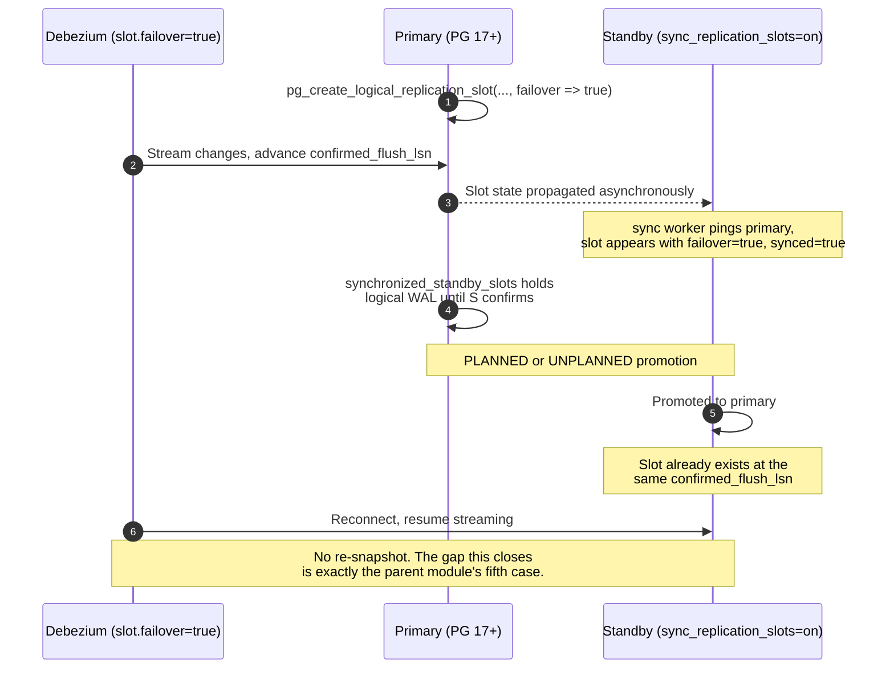
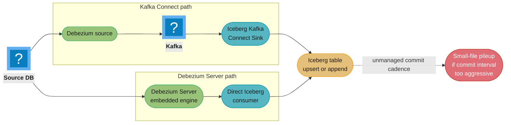
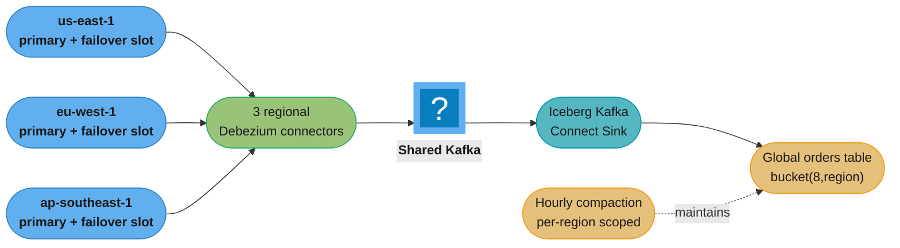

# CDC Across Failover and Into the Lakehouse

> **Version anchor (2026-10-19).** **PostgreSQL 18.6** is the current stable major version
> (PostgreSQL 19 RC1 shipped 2026-10-15), but the mechanism this page is built on is a
> **PostgreSQL 17** feature, logical replication failover, unchanged in essence through 18,
> layered on **PostgreSQL 16**'s prerequisite of logical decoding on a standby. **Debezium
> 3.7.0.Final** (2026-09-29) exposes it as `slot.failover`, added **`[3.0.5.Final]`**
> (2024-12-18). On the lakehouse side: **Apache Iceberg 1.12.0** (the parent module's pin)
> ships the **Iceberg Kafka Connect Sink** in the same release train; **Apache Flink CDC
> 3.7.0** (announced 2026-10-10) moves its Paimon pipeline sink to Paimon 2.0.0 and adds Hive
> sync to its Hudi pipeline sink, on top of the AWS Glue and BigQuery catalog support that
> 3.6.0 added to the Iceberg pipeline connector; **Apache Paimon** is at **2.1.0**
> (2026-10-12), the second release of the 2.x line that began with 2.0.0 (2026-08-07);
> **Apache Hudi** has shipped a Debezium Avro source for Deltastreamer since **0.10.0**.
> Version-gated behaviour is tagged inline.

This page extends [`debezium_change_data_capture`](debezium_change_data_capture.md) along two
threads it deliberately leaves open. §6.3 there already covers PostgreSQL failover slots as a
mechanism; this page's Half 1 starts from that mechanism and asks the harder question — what
survives a failover **across every connector family**, not just PostgreSQL, and what a managed
database changes about the answer. Half 2 covers CDC landing in a lakehouse, a topology §4.7
of the parent names once and moves past. Iceberg's own product mechanics — the metadata tree,
deletion vectors, catalog implementations — belong to
[`apache_iceberg`](../apache_iceberg/apache_iceberg.md), whose §14 is itself a CDC-to-Iceberg
case study; this page's §14 is a different scenario (a fleet, not a single region) and does not
restate that one. Read the parent's §6.3, §6.12 (the four-quadrant recovery table) and §4.3
(snapshot modes) before this page — both halves assume them.

---

## 1. Concept Overview

Two problems get bundled together in practice because they show up in the same postmortem —
"the pipeline broke during the failover, and by the time we re-snapshotted, the warehouse was
a day behind" — but they are structurally unrelated. **Failover survival** is about whether a
connector's *position* — a slot, a GTID set, a resume token, an LSN — remains valid when the
database instance it was reading from stops being the one to read from. **Lakehouse ingestion**
is about what happens to that position's *output* once it lands as files on object storage
instead of rows in an OLTP table or a search index.

They share one root cause, which is why this page pairs them: both are consequences of treating
the log's guarantee — "changes, in commit order, at least once, from a position you can name"
(parent §1) — as if it were free to hold onto across an arbitrary amount of infrastructure
change. A failover changes *which server* holds the position. A lakehouse sink changes *how
long* the position's effects sit unmerged before they are queryable, and *how expensive* it is
to keep merging them. Neither problem is solved by reading the log faster; both are solved by
making the position, and the merge, survive the thing that stresses them.

### The two questions, restated for this page

- **Will my connector's position still mean something after the database fails over — planned
  or unplanned — and if not, what is the blast radius?**
- **Once changes land in the lakehouse, what guarantee do I actually have about ordering,
  deletes, and file count, and which of those degrades first under load?**

---

## 2. Intuition

**One-line analogy, failover half.** A replication slot used to be a library card valid only at
one branch; if that branch closed, your reservations were void and you started the catalog
search over. PostgreSQL 17 makes the card valid at every branch in the same library system,
provided the librarian remembered to photocopy your reservation slip to the other branches
*before* the first one closed.

**One-line analogy, lakehouse half.** Streaming CDC into a lakehouse table is like renovating a
house by mailing one photograph of a changed room every few seconds instead of handing over
blueprints once. Upsert mode is a contractor who re-hangs exactly the photographed wall
immediately; append-only is a contractor who staples every photograph to a corkboard and does
the actual renovation once a day from the pile.

**Why it matters.** A CDC pipeline that survives failover but dumps a million small files a
week into the lakehouse has traded a data-loss risk for a cost-and-latency risk — and a team
that solved the failover half often ships the lakehouse half unmeasured, because it looks like
"just another sink" rather than a second place position and merge cost compound.

**The key insight carried through both halves.** In every case here, the thing that breaks is
not the data path — the log is still ordered, the files are still committed atomically — it is
the **coordination surface**: who agrees the position moved, and who agrees which file version
is current. Failover survival is coordination between two database instances about a slot.
Lakehouse-write correctness is coordination between concurrent writers about a table pointer
(parent-adjacent: [`apache_iceberg`](../apache_iceberg/apache_iceberg.md) §6 owns that
compare-and-swap in full).

---

## 3. Core Principles

1. **A position that lives on only one server is a position that dies with that server.**
   PostgreSQL's pre-17 slot, MySQL's file:pos offset, and SQL Server's CDC capture job all
   share this defect in different clothes; only a GTID set and a MongoDB resume token were
   designed from the start to outlive one specific instance.

2. **"Failover-safe" is a property of the *pair* — source feature plus connector
   configuration — never of either alone.** PostgreSQL 17 shipped failover slots; Debezium had
   to ship `slot.failover` on top of it, two releases later. A managed database adds a third
   layer: whatever the vendor's control plane does or does not wire up on your behalf.

3. **Verify a failover-safety claim against the specific deployment, not the specific
   database.** "PostgreSQL supports failover slots" is true; "your RDS for PostgreSQL 17
   instance is using them" depends on four parameter-group settings (§6.2); "your Aurora
   PostgreSQL cluster is using them" is a claim this page could not verify from AWS's own docs
   and explicitly declines to make (§6.3).

4. **A lakehouse table is a merge target, not a log.** CDC's guarantee ends at "you received
   the changes in order, at least once." What the table *shows* a reader is a function of your
   merge strategy, your commit cadence, and your compaction schedule — three independent knobs
   that a source-side failover fix does nothing to touch.

5. **Deletion vectors changed the read cost of CDC-driven deletes; they did not remove the
   write-time problem.** A streaming upsert knows a row's *key* when it arrives, not its file
   and byte offset — so the write path still reaches for an equality delete, and the deletion
   vector is what compaction produces from it later (§6.6).

6. **Small files are a rate mismatch, not a bug.** Every CDC-to-lakehouse sink commits on a
   timer or a record-count threshold that has nothing to do with your table's natural write
   rate; the fix is always scheduled compaction, never a shorter commit interval.

---

## 4. Types / Architectures / Strategies

### 4.1 Failover-survival tiers, across connector families

| Tier | What it means | Which connectors |
|---|---|---|
| **Native, by design** | The position was designed to be valid regardless of which node is primary | MongoDB (resume token against the replica set, not one member) |
| **Native, if you already run the modern topology** | The position survives *if* your replication topology already uses the mechanism that makes it portable | MySQL/MariaDB with GTID-based replication (not classic file:pos) |
| **Retrofitted, opt-in, two-sided config** | A specific database version plus a specific connector version plus explicit configuration on both primary and standby | PostgreSQL 16/17 + Debezium `slot.failover` |
| **Unsolved at the position layer; solved at the connection layer only** | The position (an LSN) is fine across a synchronous AG replica by construction, but the connector cannot be pointed at a secondary at all | SQL Server Always On Availability Groups |

### 4.2 Lakehouse CDC-ingestion architectures

| Architecture | Shape | Ordering unit | Where merge happens |
|---|---|---|---|
| **Kafka Connect + Iceberg Kafka Connect Sink** | Debezium source connector, Kafka topics, a separate sink connector task per partition | Per Kafka partition (per primary key, if keyed correctly) | In the sink task, per commit |
| **Debezium Server + a direct Iceberg/Delta/Hudi consumer** | No Kafka; Debezium Server's embedded engine calls a consumer that writes table files itself | Per source table, single-threaded per pipeline | In the consumer process, per flush |
| **Embedded in a stream processor (Flink CDC, e.g.)** | Source connector runs inside a Flink job; the job's own sink writes Iceberg/Paimon/Hudi | Per Flink operator partition, same key-affinity discipline as Kafka | In the Flink sink function, per checkpoint |
| **Batch-merge from a durable log** | CDC lands in Kafka/object storage as raw events; a separate scheduled job (Spark `MERGE INTO`) applies them | Whatever the batch job's own ordering key is | In the batch job, per run |

### 4.3 CDC-merge semantics — the two write shapes

| Shape | What the sink writes | Read cost | Write cost |
|---|---|---|---|
| **Upsert (row-level merge)** | One equality- or position-delete plus one new row, per changed key, on every flush | Low once compacted — a bounded merge against a small delete set | Higher per event; every update touches the delete side of the table |
| **Append-only + downstream `MERGE`** | Every event as a new row, `op` and `source.ts_ms` preserved as columns | High until the downstream `MERGE` runs — readers see raw event history, not current state | Lower per event; the merge cost is paid once, in bulk, on a schedule |

Upsert is the default choice when the table is queried directly by something that expects
current state (a BI tool, an operational dashboard). Append-only is the default choice when the
table is itself the source for a scheduled transformation layer (dbt, a Spark batch job) that
was going to do a `MERGE` anyway — writing the merge target directly with upsert mode just
means doing that work twice, once per event and once per batch.

---

## 5. Architecture Diagrams

### 5.1 A failover slot's timeline, primary to promotion to resumption



*The step that fails silently is the one between rows 3 and 5: if `synchronized_standby_slots` on
the primary never named the standby's physical slot, the logical slot could advance past what
the standby has durably received, and the "seamless" resumption in row 8 resumes from a position
the new primary cannot actually serve.*

### 5.2 Collapsing the parent's recovery grid (ASCII — extends debezium_change_data_capture.md §6.12)

```
Same four cells as the parent's table. The change is entirely in the box below it.

              +--------------------+--------------------+
     OFFSETS  |  intact / intact   |  intact / lost      |
              |  Restart. Seconds. |  snapshot.mode=      |
              |                    |  recovery, if no DDL |
              +--------------------+--------------------+
              |  lost / intact     |  lost / lost         |
              |  Full re-snapshot. |  Full re-snapshot     |
              |                    |  from zero.           |
              +--------------------+--------------------+
                    SCHEMA HISTORY: intact        lost

  BEFORE PG17 FAILOVER SLOTS:                 WITH PG17 FAILOVER SLOTS,
  every promotion routes into the             CORRECTLY CONFIGURED:
  fifth case below --------------------->     the ordinary-HA share of that
                                               fifth case is CLOSED. What is
  +----------------------------------+        left is only the deliberate-act
  |  SLOT LOST = DATA LOSS           |        share:
  |  (promotion, drop, invalidation, |
  |   or reaching                    |        - operator DROP REPLICATION SLOT
  |   max_slot_wal_keep_size)        |        - max_slot_wal_keep_size hit
  +----------------------------------+        - slot never marked failover=true
                                               - synchronized_standby_slots wrong
                                               - standby never promoted to primary
                                                 with a synced slot (e.g. a fresh
                                                 rebuild used as the new primary)

  The grid's four cells are UNCHANGED by failover slots -- they answer
  "what if the OFFSET or SCHEMA HISTORY is lost," and failover slots protect
  neither. What moves is how often you land in the box below the grid at all.
```

*Ordinary planned maintenance and unplanned promotion are the closed share. A slot an operator
drops on purpose, or one that outlives `max_slot_wal_keep_size`, is not — no version of
PostgreSQL protects a position from being deliberately or accidentally destroyed, only from
being an incidental casualty of the database doing HA correctly.*

### 5.3 The two lakehouse-ingestion shapes, side by side



*Both paths reach the same table shape and the same small-file failure mode, because the
failure mode lives in the commit-interval/target-file-size relationship (§6.7), not in which
runtime hosts the connector.*

---

## 6. How It Works — Detailed Mechanics

### 6.1 What must be true, precisely, for a PostgreSQL slot to survive promotion

Four independent facts, all required, none sufficient alone. Parent §6.3 introduces the
mechanism; this is the exhaustive checklist a runbook needs.

| # | Fact | Where | Failure if missing |
|---|---|---|---|
| 1 | `wal_level = logical` | both primary and standby | Logical decoding cannot run at all |
| 2 | The logical slot was created with `failover => true`, or `slot.failover=true` was set on the connector while it pointed at the **primary** on PostgreSQL **17+** | primary | An ordinary, non-propagating slot is created silently — no error |
| 3 | `sync_replication_slots = on` on the standby, with `primary_conninfo` including `dbname=`, and `hot_standby_feedback = on` | standby | The sync worker never starts, or starts and cannot see catalog rows it needs |
| 4 | `synchronized_standby_slots` on the primary names the standby's **physical** replication slot | primary | Logical decoding never waits for the standby, so the standby can be handed a slot state it has not durably received |

**The ordering hazard inside fact 4 is the one runbooks miss.** `synchronized_standby_slots`
makes the primary's logical WAL sender block until the named physical slot confirms receipt —
this is what guarantees the standby is never behind what a subscriber has already consumed. Get
the physical slot name wrong (a common copy-paste error when a standby is rebuilt and its
physical slot is recreated under a new name) and the primary happily synchronizes a logical
slot state the standby cannot actually serve, and you find out only at promotion.

Verify readiness before a **planned** switchover with the query PostgreSQL's own failover
documentation gives for exactly this purpose:

```sql
-- On the primary, list every failover-enabled, non-temporary slot
SELECT array_agg(quote_literal(r.slot_name)) AS slots
FROM pg_replication_slots r
WHERE r.failover AND NOT r.temporary;

-- On the standby, confirm each one is synced and not invalidated
SELECT slot_name, (synced AND NOT temporary AND invalidation_reason IS NULL) AS failover_ready
FROM pg_replication_slots
WHERE slot_name IN ('debezium');
```

A row with `failover_ready = false` is a hard stop on a planned switchover, not a warning to
note and proceed past.

### 6.2 What Debezium needs, and where it silently does nothing

`slot.failover=true` **[3.0.5.Final]** tells Debezium to pass `failover => true` when it creates
the slot itself. Two conditions gate it, and both fail the same way — quietly:

```properties
slot.failover=true
```

- The server must be **PostgreSQL 17 or newer**. Against 16 or earlier, Debezium creates an
  ordinary slot and logs nothing distinguishing.
- The connector must be pointed at the **primary**, not a standby. Even PostgreSQL 16's
  standby-decoding capability does not let a connector *create* a failover slot from the
  standby side — creation is a primary-only operation.

Nothing in the connector's status or logs states "this slot is not a failover slot." The only
verification is querying `pg_replication_slots.failover` directly, which is why parent §6.3
already calls this out as its own trap — this page's addition is naming exactly which two
conditions produce the silent no-op, since "check the config" is not actionable without them.

**Capturing from a standby, with incremental snapshots `[3.7]`.** PostgreSQL 16's logical
decoding on a standby lets a connector stream from a hot standby and keep decoding load off the
primary. Until 3.7.0.Beta1 (2026-08-26) an incremental snapshot there could not survive a
restart: a connector with `read.only=true` that restarted mid-snapshot called
`pg_current_xact_id()` to resume it, a standby refuses to assign a transaction ID, and the task
failed (dbz#2431). From 3.7 the read-only incremental snapshot runs on a hot standby. With `read.only=true` (PostgreSQL 13+) the connector writes no signal-table rows:
it uses the in-progress transaction as the low and high watermarks, compares them with the
transaction IDs of WAL and heartbeat events, and takes `execute-snapshot` signals over a channel
other than the source table (Kafka, JMX or file). The trade against the failover-slot setup
above: a slot created on the standby lives only on that node, so losing that standby loses the
position, exactly as a primary-side slot without `failover` does.

### 6.3 Amazon RDS for PostgreSQL — verified, with the exact parameter set

AWS's own documentation for logical slot synchronization confirms the feature is available
**starting with RDS for PostgreSQL 17**, using the same primitives as community PostgreSQL,
with one RDS-specific substitution:

| Setting | Where | Required value |
|---|---|---|
| `rds.logical_replication` | primary's parameter group | `1` |
| `hot_standby_feedback` | standby's parameter group | `1` |
| `rds.logical_slot_sync_dbname` | standby's parameter group | a valid database name (default `postgres`) — RDS's substitute for `primary_conninfo`'s `dbname=`, since RDS manages `primary_conninfo` itself |
| `synchronized_standby_slots` | primary's parameter group | the standby's physical replication slot name |
| `sync_replication_slots` | standby's parameter group | `1` |

The subscription (or the connector) is created with `failover = true` exactly as on
self-managed PostgreSQL. Once a standby is promoted, RDS's own guidance is that the subscriber
— Debezium, in this page's case — **alters its subscription to point at the newly promoted
instance's endpoint**; the slot itself is already there and synchronized, but the *connection
string* still has to move, because RDS gives you a new primary endpoint on promotion rather
than a floating one that silently repoints. Multi-AZ DB clusters (the two-readable-standby
topology) propagate a newly created logical slot to every reader automatically and keep it
synchronized, per AWS's documentation — this is the managed equivalent of fact 4 in §6.1,
handled for you rather than configured by hand.

### 6.4 Aurora PostgreSQL — what is confirmed, and what is not

Aurora PostgreSQL's replication is architecturally different from RDS for PostgreSQL: readers
attach to a **shared cluster storage volume** rather than replaying a WAL stream shipped from
the writer, so "physical standby" does not map onto an Aurora Replica the way it does onto a
traditional streaming replica. What is confirmed, from AWS's own Aurora User Guide: Aurora
PostgreSQL supports logical replication and multiple replication slots on the writer instance,
reads WAL from the shared storage volume to decode it, and Aurora PostgreSQL **17.4** is
generally available with documented failover-time storage-metadata initialization
improvements.

**What this page could not verify against an AWS primary source is whether Aurora PostgreSQL
exposes PostgreSQL 17's `synchronized_standby_slots` / `sync_replication_slots` failover-slot
machinery for Aurora Replicas the same way RDS for PostgreSQL does for a traditional standby**
— several secondary sources claim it, none of AWS's own Aurora PostgreSQL 17 release notes or
replication documentation retrieved for this page state it explicitly. Per this page's sourcing
standard, that claim is omitted rather than asserted. If you are running Debezium against
Aurora PostgreSQL and depending on cross-failover slot survival, verify directly against the
current `AuroraPostgreSQLReleaseNotes` and `AuroraPostgreSQL.Replication.Logical` pages before
you rely on it — do not extrapolate from RDS for PostgreSQL's behavior.

### 6.5 The other three connector families

**MySQL / MariaDB — solved if you already replicate by GTID.** A GTID (`source-uuid:transaction-id`)
identifies a transaction globally, not by binlog file and byte offset on one server, so a
promoted replica that already applied the same GTIDs can serve a connector resuming from the
same GTID set. The trap is **server UUID filtering**: Debezium's stored offset accumulates the
GTID sets of every server that has ever been primary, and after a failover the new primary's own
UUID appears in the set for the first time. `gtid.source.includes` / `gtid.source.excludes`
scope which source UUIDs the connector trusts when computing where to resume, and a topology
that adds a new primary without adjusting the filter can leave the connector unable to compute a
starting position at all. **This entire story requires GTID-based replication already in use**
(`gtid_mode=ON`, `enforce_gtid_consistency=ON`) — a topology still on classic file:pos
coordinates has no portable position, full stop, and a failover there is unconditionally case
three or four of the parent's grid.

**MongoDB — the position was never tied to one node.** A resume token is valid against the
**replica set's oplog**, not against whichever member happened to be primary when it was issued;
after an election, the MongoDB driver's own replica-set discovery reconnects the change stream
to the new primary and resumes from the same token with no Debezium-specific configuration at
all. The real risk at failover is not the position, it is the **oplog window**: if an election
and its resulting connection churn keep the connector from reading for longer than the oplog
retains, the token expires and the connector fails with an invalid-resume-token error,
independent of which node is primary. Size the oplog for the outage you want to survive, not
for steady-state throughput — parent §6 already gives the sizing formula (throughput times
tolerated downtime) for the non-failover case, and it is the same arithmetic here.

**SQL Server — the LSN is fine; the connection target is the actual problem.** SQL Server's CDC
capture job writes to change tables that are themselves part of the database and therefore
replicate through the Availability Group like any other table — an LSN recorded against a
synchronous-commit secondary is valid the instant that secondary is promoted, because the change
tables are already there. The documented limitation is elsewhere: **Debezium's SQL Server
connector has no supported way to read from a readable secondary** — the standard SQL Server
driver property `ApplicationIntent=ReadOnly` that redirects a session to a secondary is not
something the connector exposes, and workarounds attempting it still land on the primary. So the
connector must always point at the AG's primary replica (ideally via the AG **listener**
endpoint, which redirects transparently on failover at the network layer), and the position
itself needs no special failover handling — the problem SQL Server hands you is entirely about
where the TCP connection lands, not about whether the LSN means anything after promotion.

### 6.6 Deletion vectors and the CDC write path — why the write side still uses equality deletes

Iceberg v3 deletion vectors are read-path economics: a Puffin-encoded bitmap keyed by row
position, checked with a single bit test instead of a per-row join
([`apache_iceberg`](../apache_iceberg/apache_iceberg.md) §12 has the full mechanism). **A CDC
sink cannot write one directly**, because a deletion vector needs the deleted row's file and
byte position, and a streaming upsert only ever has the row's **key** at write time — it does
not know, and should not have to compute, which file and offset currently holds that key. So the
write path for a CDC upsert reaches for an **equality delete** — "delete every row where
`id = 4711`" — which costs the writer almost nothing and pushes the cost onto every subsequent
read until compaction resolves it.

`rewrite_data_files`, run on the same schedule as any other compaction job, is what converts the
accumulated equality deletes into deletion vectors (or fully materializes them into the base
data files), restoring the fast read path. The practical consequence: a table under continuous
CDC upsert that has **never been compacted** degrades in query latency over time even though
every individual write succeeded — nothing is broken, the delete backlog is simply uncollected,
and it is the same failure shape as §5.5 of the parent module's slot-lag problem wearing a
different name: an accumulating cost nothing pages you about until a query is slow enough that
someone asks why.

### 6.7 The commit-interval / small-files tradeoff, with real numbers

The Iceberg Kafka Connect Sink's `iceberg.control.commit.interval-ms` (default **300000**, five
minutes, in the connector's own defaults) governs how often the sink flushes buffered records
into a new Iceberg snapshot. Every commit produces at least one new data file per active
topic-partition that had writes in that window, whether the batch was ten rows or ten thousand.

```
commit interval = 5 s, 24 partitions, continuous low-rate writes on most partitions
  -> up to 24 new files every 5 seconds
  -> 24 * 12 (per minute) * 60 (per hour) * 24 (per day) * 7 = 2,903,040 file-creation
     opportunities a week, most of them tiny if traffic is not perfectly even
```

This is not a hypothetical: apache_iceberg.md's own case study describes a team's first instinct
being exactly this — "faster commits mean fresher data" — before measuring that a 5-second
interval multiplied file count roughly 4x over a 20-second interval for a freshness requirement
the downstream consumer never asked for. **Match the commit interval to the actual freshness
SLA, not to the shortest interval the connector allows**, and schedule compaction
(`rewrite_data_files`, scoped by a time predicate to bound each run's cost) on a cadence the
resulting file count actually needs — hourly is a reasonable default for a table under
continuous CDC traffic; sub-hourly compaction competing with sub-minute commits usually means
the commit interval was set wrong in the first place.

### 6.8 Ordering, end to end, from WAL commit to lakehouse row

Parent §6.13 establishes the guarantee inside Kafka: per-key yes, per-table only with one
partition, across tables never. Nothing about landing in a lakehouse improves on that — it can
only preserve or lose what Kafka already delivered.

- **Per key**: preserved, because the Iceberg Kafka Connect Sink task consuming a given Kafka
  partition processes its records in the order it received them, and a keyed topic guarantees
  same-key events land on the same partition. An upsert sink applying events in partition order
  for a given key therefore converges to the correct final state.
- **Across keys within one flush**: not meaningfully ordered in the output file — a single
  commit's data file can contain rows from many keys in whatever order the sink batched them,
  which is fine for an upsert table (final state per key is still correct) and would be wrong
  for anything relying on physical row order as a proxy for time.
- **Across tables**: unsolved here exactly as it is unsolved in Kafka. A lakehouse sink writing
  `orders` and `order_items` as two independent tables gives you no cross-table transactional
  read — a reader can observe the child row before the parent commits its own table's snapshot.
  Multi-table atomicity at the lakehouse layer is a WAP-branch-and-fast-forward exercise
  ([`apache_iceberg`](../apache_iceberg/apache_iceberg.md) §12), not something a streaming sink
  gives you for free.

### 6.9 The tombstone/`before`-image interaction with a lakehouse sink

Parent §6.15 documents `ExtractNewRecordState` flattening the envelope down to just the `after`
image, with five tombstone-handling modes. A lakehouse sink that operates in upsert mode
**needs the operation code and, for a delete, the row's key** — it does not strictly need the
full `before` image the way an audit consumer does, because an equality delete only needs the
key, not the old values. The trap is the opposite direction from the audit case: a pipeline that
flattens **too aggressively** — dropping the envelope's `op` field along with everything else,
or converting a delete into a Kafka tombstone (`tombstones.on.delete=true`, the parent's default)
before the sink ever sees it — leaves the sink with no signal that a row was deleted at all, and
a delete silently becomes a row that is simply never updated again rather than one that is
removed. **Keep `op` in the flattened record** (`ExtractNewRecordState`'s
`add.fields: op,source.ts_ms` is the mechanism) whenever the destination is a merge-mode
lakehouse sink, and confirm the sink is configured to consume the delete signal from a
value-carrying tombstone rather than a value-less Kafka tombstone if you have not disabled
`tombstones.on.delete`.

---

## 7. Real-World Examples

- **A financial-services platform running PostgreSQL across three availability zones** adopted
  PG17 failover slots specifically to close the maintenance window where a routine minor-version
  patch, applied via a planned standby promotion, had previously meant an hour-long re-snapshot
  of a 40 TB outbox-adjacent table every quarter. The change moved planned maintenance from
  "schedule a re-snapshot" to "verify `failover_ready` and proceed."

- **A logistics company on Amazon RDS for PostgreSQL 17** configured `synchronized_standby_slots`
  and `sync_replication_slots` following AWS's documented parameter set, and treats the
  post-promotion subscription re-point (altering the connection to the new primary's endpoint)
  as a scripted step in its failover runbook rather than a manual one — the slot survives
  automatically; only the connection string needs an explicit move.

- **A team running MySQL with Orchestrator-managed topology changes** relies on GTID-based
  replication specifically so that Debezium's stored offset — a GTID set, not a file:pos pair —
  remains valid across every automatic primary reassignment Orchestrator performs, with
  `gtid.source.excludes` maintained as topology membership changes.

- **A retailer streaming order events from PostgreSQL into an Iceberg lakehouse via the Iceberg
  Kafka Connect Sink** runs upsert mode with hourly `rewrite_data_files`, following the same
  shape as [`apache_iceberg`](../apache_iceberg/apache_iceberg.md) §14's case study — this page's
  §14 below extends that shape across a multi-region source rather than repeating it.

---

## 8. Tradeoffs

### 8.1 Solving failover at the source vs at the operational layer

| Approach | What it costs | What it buys |
|---|---|---|
| PG17 failover slots, configured correctly | Two-sided config (§6.1), PostgreSQL 17+, verification discipline before every planned switchover | No re-snapshot on ordinary HA events |
| Accept re-snapshot on every failover | Simpler config, works on any PostgreSQL version | A failover becomes a capacity-planning event — hours to days, scaled to table size |
| A connector-external HA layer (Patroni, repmgr) managing promotion and DNS | Existing infrastructure many teams already run for the database itself | Solves *where the connection points*, not whether the *slot* survives — still needs failover slots underneath for a Debezium connector specifically |

### 8.2 Upsert vs append-only, restated as a cost shape

| | Upsert | Append + downstream `MERGE` |
|---|---|---|
| Freshness for direct queries | Immediate, at flush interval | Only as fresh as the last `MERGE` run |
| Write amplification | One delete + one insert per changed row, continuously | One insert per event; merge cost paid in bulk |
| Compaction dependency | Hard requirement — equality deletes accumulate without it (§6.6) | Softer — unmerged rows are still correct raw history, just not current state |
| Best fit | A table queried directly by BI/operational tooling | A table that is itself an input to a transformation layer already scheduled to run |

### 8.3 Kafka Connect sink vs Debezium Server direct-to-lakehouse

| | Iceberg Kafka Connect Sink | Debezium Server + direct consumer |
|---|---|---|
| Infrastructure | Requires a Kafka cluster and a Connect cluster | No Kafka; one Quarkus process per pipeline |
| Fan-out | Free — any other consumer can read the same topics | None; the lakehouse table is the only destination |
| Operational surface | Two systems (Connect + whatever else reads the topics) | One process, but you own its supervision and offset durability (parent §4.1) |
| Right choice when | Kafka already exists, or more than one consumer needs the change stream | The lakehouse is the only destination and a broker would exist solely to relay to it |

---

## 9. When to Use / When NOT to Use

**Reach for PG17 failover slots when** you run PostgreSQL 17+ with a standby topology and
planned or unplanned promotions currently force a re-snapshot — this is close to free once
configured, and the failure mode of misconfiguring it (an ordinary slot silently created) is no
worse than not having the feature at all.

**Do not bother with failover-slot configuration when** your source is single-node with no
standby, or your snapshot is small enough that a re-snapshot is a non-event — the two-sided
configuration and the verification discipline it demands are a cost with no corresponding
benefit if a failover was never going to cost you anything expensive.

**Reach for a lakehouse CDC sink when** the destination genuinely needs table-format semantics —
time travel, schema evolution without coordination, multiple engines reading the same data — and
not merely "a place to put events." A raw Kafka topic retained long enough is often the right
answer when the actual need is replay, not a query surface.

**Do not default to upsert mode when** nothing queries the lakehouse table directly; append-only
into a table a scheduled job merges is cheaper to operate and easier to reason about when the
merge step already has to run for other reasons (deduplication against a second source, business
logic beyond a straight upsert).

---

## 10. Common Pitfalls (Production War Stories)

### 10.1 The standby was promoted, and the slot went with the old primary

A team running PostgreSQL 16 (not 17) treated a routine standby promotion as a non-event because
"Debezium handles reconnection." It does — to a new connection, with no slot. The new primary
had never held the logical slot at all, because failover slots did not exist on 16; the
connector created a fresh slot at the current LSN on first contact with the new primary, and
every change between the old `restart_lsn` and the promotion was gone. The fix was not a
Debezium change — it was a PostgreSQL major-version upgrade to 17, followed by the two-sided
configuration in §6.1.

### 10.2 `synchronized_standby_slots` was never set, and the "synced" slot was actually behind

A team enabled `sync_replication_slots` on the standby and `slot.failover` on the connector, saw
`synced = true` in `pg_replication_slots`, and considered the job done. They had not set
`synchronized_standby_slots` on the primary, so the primary's logical WAL sender never waited for
the standby to confirm before advancing — the standby's copy of the slot state trailed the
primary's actual position by an unbounded amount depending on load. The promotion that followed
resumed from a position earlier than the primary had reached, which produced duplicate events
downstream — recoverable, because idempotent consumers handled it, but only by luck: a
non-idempotent consumer would have double-applied real writes.

### 10.3 An idle captured table, invisible traffic, and a slot that filled the disk across a failover window

The exact mechanism parent §6.4 describes for a healthy connector recurred here in a different
guise: during a maintenance window with the connector deliberately paused ahead of a planned
switchover, WAL for uncaptured tables kept accumulating behind the (correctly failover-enabled)
slot. The team had sized `max_slot_wal_keep_size` for steady-state operation, not for "connector
paused for N hours while unrelated write traffic continues," and the slot was invalidated by the
safety valve before the switchover completed — trading a disk-fill incident for a scheduled
re-snapshot, which was the intended tradeoff, but one the runbook had not accounted for as a cost
of the maintenance window itself.

### 10.4 A lakehouse sink committing every five seconds generated a million tiny files in a week

A team newly moving off nightly batch set `iceberg.control.commit.interval-ms` to its most
aggressive setting, reasoning that lower latency was strictly better, against a table with 24
Kafka partitions and continuous but modest per-partition traffic. Within a week, manifest-list
scan time for the table's queries had grown by roughly 40x, traced to a file count in the high
hundreds of thousands against an expected low thousands. Nothing was incorrect — every commit
was a valid snapshot — but query planning degraded because `rewrite_data_files` had been
scheduled for a daily cadence sized for a much smaller file count. The fix was the pairing in
§6.7: raise the commit interval to match the actual freshness requirement, and raise the
compaction frequency to match the actual commit rate, rather than treating either knob as
independent of the other.

---

## 11. Technologies & Tools

### 11.1 PostgreSQL failover-slot tooling

| Tool | What it does |
|---|---|
| PostgreSQL | Ships native failover slots, `synchronized_standby_slots` and `sync_replication_slots` since release 17. |
| Debezium | PostgreSQL connector exposes `slot.failover` to create failover-enabled slots. |
| pg_failover_slots | EDB extension that provided slot-failover behavior before it became native in PostgreSQL 17. |
| Patroni | HA orchestrator that manages PostgreSQL promotion and can coordinate slot handling. |
| repmgr | Replication manager for PostgreSQL topology changes and promotion. |
| Amazon RDS | Managed PostgreSQL supporting native failover slots from RDS for PostgreSQL 17. |
| Amazon Aurora | Managed PostgreSQL with a shared-storage replication model distinct from streaming standbys. |

### 11.2 Other connectors' failover primitives

| Tool | What it does |
|---|---|
| MySQL Group Replication | Native MySQL HA with GTID-based membership, keeping GTID sets portable across promotion. |
| Orchestrator | Topology manager that automates MySQL primary promotion using GTID replication. |
| MongoDB | Replica-set change streams whose resume tokens are valid regardless of which member is primary. |
| Always On Availability Groups | SQL Server's synchronous HA feature, replicating CDC change tables to secondaries. |

### 11.3 Lakehouse CDC sinks and engines

| Tool | What it does |
|---|---|
| Iceberg Kafka Connect Sink | First-party Kafka Connect sink writing topics into Iceberg tables with upsert support. |
| Debezium Server Iceberg | Community Debezium Server consumer writing CDC events directly into Iceberg with no Kafka. |
| Flink CDC | Embeds source connectors in a Flink job with pipeline sinks for Iceberg, Paimon and Hudi. |
| Apache Paimon | Lakehouse table format with native CDC ingestion actions and changelog producers. |
| Apache Hudi | Table format with a Deltastreamer/Hudi Streamer Debezium Avro source since 0.10.0. |
| Hudi Streamer | Hudi's continuous ingestion tool, formerly named DeltaStreamer, consuming CDC sources. |

### 11.4 Related reading

Related reading: [Debezium change data capture](debezium_change_data_capture.md),
[Apache Iceberg](../apache_iceberg/apache_iceberg.md),
[lakehouse and table formats](../../database/lakehouse_and_table_formats/lakehouse_and_table_formats.md),
[replication and high availability](../../database/replication_and_high_availability/replication_and_high_availability.md),
[Kafka deep dive](../../backend/kafka_deep_dive/kafka_deep_dive.md).

---

## 12. Interview Questions with Answers

**Q: A standby was promoted during routine maintenance, and Debezium's PostgreSQL connector re-snapshotted a 6 TB table — what should have prevented this?**
**Short:** PostgreSQL 17 failover slots plus Debezium's `slot.failover=true`, configured on both the primary and the standby before the promotion.
Without failover slots, a logical replication slot exists only on the instance it was created on, so a promoted standby starts with no slot at all and a freshly created one begins at the current LSN — every change since the old `restart_lsn` is gone from the log, forcing a full re-snapshot. PostgreSQL 17 lets a slot be marked `failover => true` and propagated to standbys via `sync_replication_slots`; Debezium exposes this as `slot.failover` since `[3.0.5.Final]`. The precondition most runbooks miss is `synchronized_standby_slots` on the primary — without it naming the standby's physical slot, the logical slot's state can be marked "synced" while still trailing the actual position. Verify `pg_replication_slots.failover` and `failover_ready` before every planned switchover rather than trusting the config alone.

**Q: You set `slot.failover=true` on a Debezium PostgreSQL connector and nothing changed — why might the setting be a silent no-op?**
**Short:** The server is older than PostgreSQL 17, or the connector is pointed at a standby rather than the primary — both fail silently.
Debezium can only request a failover-enabled slot when talking to PostgreSQL 17 or newer, and slot creation with the `failover` flag is a primary-only operation — a connector pointed at a standby (even one that supports PostgreSQL 16's logical decoding on standbys) cannot create one from there. Neither condition produces an error or a log line distinguishing it from an ordinary slot; the only way to know is to query `pg_replication_slots.failover` directly on the server the connector is attached to. This is the same silent-defect shape as most of this technology's failure modes: a setting that appears applied and is not. Check the database version and connection target first, before assuming the connector configuration is wrong.

**Q: What does `synchronized_standby_slots` actually guarantee, and what happens if it names the wrong slot?**
**Short:** It makes the primary's logical WAL sender wait for a named physical slot to confirm before advancing, guaranteeing the standby is never behind.
Setting `synchronized_standby_slots` to a standby's physical replication slot name causes logical decoding on the primary to block sending further changes until that physical slot has confirmed receipt of the corresponding WAL — this is what prevents a promoted standby from being handed a logical-slot position it never actually received. If the parameter names the wrong slot (a common error after rebuilding a standby under a new physical slot name), the primary happily synchronizes the logical slot's apparent state while the standby genuinely lags behind it, and `pg_replication_slots.synced` on the standby can read `true` while the position is not actually safe to fail over to. The fix is operational discipline: whenever a standby's physical slot is recreated, `synchronized_standby_slots` on the primary must be updated in the same change, and readiness must be verified with the `failover_ready` query before any planned promotion, not assumed from `synced` alone.

**Q: Does PostgreSQL 17's failover-slot feature close every case in the parent module's four-quadrant recovery table?**
**Short:** No — it closes only the "slot lost to an ordinary HA promotion" share of the fifth, ungridded case; the four quadrants are unchanged.
The four-quadrant grid answers what happens when offsets or schema history are lost, and failover slots protect neither of those — a lost offset or a corrupted schema history still means `recovery` mode or a full re-snapshot exactly as before. What failover slots close is the fifth, off-grid case: a slot that used to die whenever ordinary HA promoted a standby now survives that specific event, provided the two-sided configuration was correct. What remains in that fifth case is every *deliberate or exceptional* loss — an operator running `DROP REPLICATION SLOT`, `max_slot_wal_keep_size` invalidating a slot that grew past its limit, or a promotion where the new primary's slot was never actually synced. Treat failover slots as narrowing the fifth case's blast radius, not as eliminating it.

**Q: Your MySQL topology auto-failed-over via an orchestration tool, and Debezium picked up streaming on the new primary with no re-snapshot — why did this work without a PostgreSQL-style failover feature?**
**Short:** Because the topology already replicates by GTID, and a GTID identifies a transaction globally rather than by one server's log coordinates.
A GTID (`source-uuid:transaction-id`) is portable across the whole replication topology by construction — any replica that has applied a given GTID can serve a connector resuming from it, unlike a binlog file-and-offset pair, which is meaningless off the specific server that wrote it. The catch is server UUID accounting: Debezium's stored offset is a GTID *set* that accumulates every source UUID it has ever seen, and after a failover the new primary's own UUID enters that set for the first time, which is what `gtid.source.includes`/`gtid.source.excludes` exist to keep bounded. This entire story requires the topology to already run with `gtid_mode=ON` and `enforce_gtid_consistency=ON` — a topology still on classic file:pos coordinates gets none of this for free, and a failover there is unconditionally a full re-snapshot.

**Q: A MongoDB replica set elected a new primary mid-stream — did Debezium need any special configuration to keep going?**
**Short:** No — a resume token is scoped to the replica set's oplog, not to whichever member was primary, so the driver reconnects automatically.
Unlike a PostgreSQL slot or a raw binlog offset, a MongoDB resume token was designed from the start to be independent of any one node's identity; after an election, the MongoDB driver's replica-set discovery finds the new primary and resumes the change stream from the same token with zero Debezium-specific failover configuration. The real risk at failover is unrelated to which node is primary: if the election and its connection churn keep the connector disconnected longer than the oplog retains history, the token expires with an invalid-resume-token error regardless of how quickly a new primary was elected. Size the oplog for the outage duration you want to tolerate — throughput times tolerated downtime — and MongoDB's failover story needs essentially nothing beyond that.

**Q: Why can't Debezium's SQL Server connector just read from a readable secondary in an Always On Availability Group after failover?**
**Short:** The connector has no supported way to request the `ApplicationIntent=ReadOnly` redirect SQL Server uses to route sessions to a secondary.
SQL Server's standard mechanism for directing a connection to a readable secondary is a driver-level property, `ApplicationIntent=ReadOnly`, and Debezium's SQL Server connector does not expose it — connections consistently land on the primary replica regardless of attempts to configure otherwise. This is a connection-routing limitation, not a position-safety one: the LSNs the connector tracks are valid the instant a synchronous-commit secondary is promoted, because SQL Server's CDC change tables replicate through the Availability Group like any other table. The practical fix is pointing the connector at the AG's listener endpoint, which redirects transparently to whichever replica is currently primary at the network layer, so the connector's job is simply "always connect to the primary" and the listener handles what "primary" currently means.

**Q: You're running Debezium against Amazon RDS for PostgreSQL 17 and need failover slots working — what exactly has to be set, beyond the community PostgreSQL parameters?**
**Short:** `rds.logical_replication=1` plus `rds.logical_slot_sync_dbname` on the standby, in place of the self-managed `primary_conninfo` dbname setting.
RDS for PostgreSQL uses the identical failover-slot mechanism as community PostgreSQL — `synchronized_standby_slots` on the primary, `sync_replication_slots` and `hot_standby_feedback` on the standby, and a subscription or slot created with `failover=true` — but RDS manages `primary_conninfo` for you, so the standby-side database name the sync worker connects to is set via `rds.logical_slot_sync_dbname` instead of being embedded in a connection string you control. `rds.logical_replication=1` is the RDS-specific gate for logical replication generally, required before any of the failover machinery is reachable. After a promotion, RDS gives the new primary a new endpoint rather than transparently repointing an existing one, so the subscriber still has to alter its subscription (or the connector its connection config) to the new endpoint even though the slot itself survived.

**Q: Is Aurora PostgreSQL's failover-slot story the same as RDS for PostgreSQL's?**
**Short:** Not confirmed — Aurora's shared-storage replica architecture differs from a traditional standby, and AWS's own docs do not explicitly state failover-slot support for it.
Aurora PostgreSQL readers attach to a shared cluster storage volume rather than replaying a shipped WAL stream the way a conventional physical standby does, so the "physical standby confirms receipt" model that `synchronized_standby_slots` depends on does not map onto an Aurora Replica in an obviously equivalent way. AWS's Aurora User Guide confirms logical replication and multiple slots work on the Aurora writer and that Aurora PostgreSQL 17.4 is generally available, but does not explicitly document PostgreSQL 17 failover-slot behavior for Aurora Replicas the way the RDS for PostgreSQL documentation does for standbys. The correct action if this matters to you is verifying directly against the current Aurora PostgreSQL release notes and replication documentation before depending on it, not assuming RDS for PostgreSQL's documented behavior carries over.

**Q: A CDC pipeline into an upsert-mode Iceberg table has been running for months with compaction disabled — what breaks, and why doesn't it show up as an error?**
**Short:** Query latency degrades continuously, because uncompacted equality deletes keep accumulating and every read has to join against all of them.
A streaming upsert writes an equality delete (a "delete every row matching this key" instruction) rather than a deletion vector, because at write time the sink knows the changed row's key but not its file and byte position — deletion vectors need that position, and only compaction can compute it after the fact. `rewrite_data_files` is what converts the growing pile of equality deletes into deletion vectors or fully materialized files, restoring the fast bitmap-based read path; skip it and every scan must evaluate an ever-larger set of equality conditions against every candidate row. Nothing fails loudly because every individual write still succeeds and every individual read still returns correct results — the only symptom is that queries get slower over months, which is easy to attribute to data growth instead of an uncollected delete backlog. Schedule compaction on a cadence matched to your commit rate from day one, not after the first latency complaint.

**Q: When would you choose append-only-plus-downstream-MERGE over direct upsert for a CDC-fed Iceberg table?**
**Short:** When the table already feeds a scheduled transformation job, so paying the merge cost once in bulk beats paying it per event.
Upsert mode pays a delete-plus-insert cost on every changed row, continuously, which is the right trade when something queries the table directly and needs current state at low latency. If the table is itself an input to a dbt model or a scheduled Spark job that was always going to run a `MERGE` — deduplicating against another source, applying business logic beyond a straight key match — writing upsert at the CDC layer does that merge work twice: once per streaming event, and again in the batch job. Append-only lets every event land as a plain insert, preserving the full raw change history (including `op` and `source.ts_ms` as ordinary columns) for the batch job to reduce however it needs to, at the cost of the destination table not reflecting current state between batch runs. The failure mode to watch for is a table that started as append-only "for later reduction" but never got a schedule attached to reduce it — at that point it is neither current nor bounded in growth.

**Q: You flattened Debezium's envelope with `ExtractNewRecordState` for a lakehouse sink and deletes stopped propagating — what's the likely misconfiguration?**
**Short:** The `op` field was dropped during flattening, or deletes are arriving as value-less Kafka tombstones the sink cannot read.
An upsert-mode lakehouse sink needs to know a record represents a delete, which normally comes from the envelope's `op` field — if `ExtractNewRecordState` is configured without `add.fields: op,...`, the flattened record carries only column values with no signal that this row should be removed rather than upserted. The second, subtler cause is `tombstones.on.delete=true` (the parent connector's default): a delete becomes a value-less Kafka tombstone after flattening, which many table-format sinks cannot interpret as "delete this key" because there is no value to read a key or an `op` field from. The fix is keeping `op` (and typically `source.ts_ms`) in the flattened record's added fields, and confirming the specific sink you're using is built to consume delete signal from a value-carrying record rather than requiring a bare Kafka tombstone.

**Q: What ordering guarantee does a CDC-to-lakehouse pipeline actually give you across two related tables, like `orders` and `order_items`?**
**Short:** None — cross-table ordering is exactly as absent at the lakehouse layer as it is inside Kafka, because the sink can only preserve what it received.
Debezium emits changes to different tables on different topics, with nothing coordinating their consumption order, and a lakehouse sink consuming those topics independently commits each table's snapshot on its own schedule — a reader can see a new `order_items` row before the `orders` row it references has landed in its own table's latest snapshot. Per-key ordering within one table is preserved, because a keyed topic guarantees same-key events land on one partition and the sink processes that partition in order, converging an upsert table to the correct final state per key. Cross-table atomicity is not something a streaming sink provides for free; it requires either application-level tolerance for eventual consistency between the two tables, or a batch mechanism — a Write-Audit-Publish branch committed and fast-forwarded once both tables are consistent — run outside the continuous streaming path.

**Q: Your Iceberg Kafka Connect Sink is committing every five seconds and query planning has slowed dramatically over a few weeks — what's the fix, and what's the wrong fix?**
**Short:** Raise the commit interval to match the actual freshness requirement and raise compaction frequency to match the resulting commit rate — don't just compact more aggressively.
A five-second commit interval against a table with many active partitions produces a new data file per active partition per interval regardless of how much data actually changed, so weeks of continuous operation can produce file counts in the hundreds of thousands where a few thousand would suffice, and manifest-list scanning at query time slows in direct proportion. The tempting wrong fix is scheduling `rewrite_data_files` more often without touching the commit interval, which controls the symptom's growth rate but does nothing about its cause and multiplies compaction compute cost for no benefit. The right fix is matching the commit interval to the actual freshness SLA a downstream consumer needs — often 20 seconds to a few minutes is more than sufficient where 5 seconds was set only because it was the most aggressive value available — and then sizing compaction cadence to the resulting, much smaller, file-creation rate.

**Q: How does the Debezium Server Iceberg consumer differ from the Iceberg Kafka Connect Sink, and when would you pick one over the other?**
**Short:** One runs inside Debezium Server with no Kafka at all; the other is a Kafka Connect sink consuming topics a separate Debezium source connector produced.
Debezium Server Iceberg is a community consumer that plugs directly into Debezium Server's embedded engine, writing CDC events straight into Iceberg tables with no broker in between — the right shape when the lakehouse is the pipeline's only destination and a Kafka cluster would exist solely to relay between two processes you already control end to end. The Iceberg Kafka Connect Sink instead consumes from Kafka topics a separate Debezium source connector on Kafka Connect populated, which costs you an additional distributed system but buys durable fan-out — any other consumer can read the same topics independently, and Connect's replicated offset topic is a stronger offset-durability story than Debezium Server's file-based default (parent §4.1). Choose based on whether anything besides the lakehouse ever needs the same change stream.

**Q: A team enabled `iceberg.tables.evolve-schema-enabled` on their CDC sink and an `ALTER TABLE` on the source silently produced a table the sink could no longer write to — what likely happened?**
**Short:** The source-side change was almost certainly a type narrowing or a column drop, which Iceberg's schema evolution accepts as metadata-only in one direction but not the other.
Iceberg permits promoting a column's type (`int` to `long`, `float` to `double`) as a free metadata operation because the promotion is losslessly representable over bytes already on disk, but a narrowing change on the source — shrinking a column's precision, or a source migration that effectively changes a column's semantic type — has no safe automatic mapping, and a schema-evolving sink either rejects the incoming record's schema or, worse, silently coerces it. A dropped source column is safer in isolation (the sink can simply stop populating it, leaving historical rows untouched) but becomes a problem if application code re-adds a column of the same name with an incompatible type later, since Iceberg's permanent field-ID resolution means the "same" column name can now refer to two different IDs across the table's history. The operational guard used in practice ([`apache_iceberg`](../apache_iceberg/apache_iceberg.md) §14) is a Slack notification on every schema-evolution event — not to gate them, but so an unexpected one is visible before it reaches a query.

**Q: What does the Debezium Management Platform actually help you do that plain Kafka Connect REST calls don't, for a CDC-to-lakehouse pipeline?**
**Short:** It gives Debezium Server pipelines — not Kafka Connect ones — a monitoring dashboard, connection validation, and now a native JDBC-sink pipeline flow, as of the `[3.6]` release.
The Debezium Management Platform (Conductor plus the Stage UI) manages Debezium Server pipelines specifically, and `[3.6]` is the release that made it operable rather than a bare config editor: a monitoring tab renders Debezium's own JMX-derived metrics with per-panel failure isolation, and connectivity to both source and destination can be validated before a pipeline is ever created (parent §4.1a has the full mechanics). For a lakehouse pipeline running through Debezium Server's direct Iceberg/Hudi consumer path rather than Kafka Connect, this is the closest thing to an operational console the ecosystem currently offers — it does nothing for a Kafka Connect-hosted pipeline, whose management surface remains the Connect REST API regardless of how far the Platform advances.

**Q: A backfill of historical rows into a live CDC-fed Iceberg table caused the streaming sink's commits to start failing — what's the actual cause, and how does it relate to failover-slot discipline?**
**Short:** Multiple writers raced for the same table pointer via optimistic concurrency, echoing the "don't block a fast writer" rule from slot handling.
Iceberg's commit protocol is optimistic: every writer builds new metadata against the table's current state and attempts an atomic compare-and-swap, and a large, slow-to-build commit (a historical backfill) held the table pointer contested long enough that the continuous CDC sink's frequent small commits kept losing the race and exhausting their retry budget ([`apache_iceberg`](../apache_iceberg/apache_iceberg.md) §12 has the full retry mechanics). The structural fix — committing the backfill to a branch and fast-forwarding `main` onto it once validated — has the same shape as the failover-slot principle in §3 of this page: never let an operation with a long completion time hold a shared coordination point (a table pointer, a replication slot, a physical-standby confirmation) that a fast, continuous operation also depends on. Any one-time large write against a table with an active streaming writer should go through a branch by default, not as a lesson learned after the first contention incident.

**Q: What's the honest limit of "PostgreSQL 17 solved CDC failover" as a claim?**
**Short:** It solved the ordinary-HA share of PostgreSQL's own failover story; it did nothing for MySQL's, SQL Server's, or MongoDB's failure modes, and nothing for deliberate slot loss anywhere.
The feature is scoped precisely to one connector family's one specific failure mode — a PostgreSQL logical slot dying because ordinary HA promoted a standby — and even there it requires four independently-verified configuration facts (§6.1) to actually hold. MySQL's failover story was already mostly solved by GTID replication, which predates PG17 by years and has nothing to do with it; MongoDB's was solved by the resume token's original design; SQL Server's problem was never about position survival at all, only about connection routing Debezium cannot control. And within PostgreSQL itself, a slot an operator deliberately drops, or one invalidated by `max_slot_wal_keep_size`, is exactly as unrecoverable today as it was before PostgreSQL 17 — the parent module's fifth-case warning that a lost slot is data loss, not inconvenience, is undiminished for every cause of loss that is not "an ordinary promotion happened."

---

## 13. Best Practices

### Before enabling failover-slot dependence
- Verify `pg_replication_slots.failover` directly after configuring `slot.failover` — never trust the connector config alone; the failure mode is silent on both PostgreSQL and Debezium's side.
- Confirm `synchronized_standby_slots` on the primary names the standby's **current** physical slot every time that slot is recreated, not just at initial setup.
- Run the `failover_ready` verification query before every **planned** switchover, and treat any `false` row as a hard stop, not a warning.
- On a managed database, verify the vendor's specific parameter set against their current documentation rather than assuming community PostgreSQL's parameter names apply unchanged (RDS renames one; Aurora's support is unverified as of this page).
- Size `max_slot_wal_keep_size` (or the maintenance window itself) for total database write rate during any planned connector pause, not just captured-table traffic.

### Cross-connector failover readiness
- Confirm MySQL replication is GTID-based (`gtid_mode=ON`) before assuming any failover portability; a file:pos topology gets none of this for free.
- Size MongoDB's oplog for the outage duration you want to tolerate across an election, not for steady-state throughput alone.
- Point the SQL Server connector at an Always On listener endpoint, never at an individual replica's hostname, so promotion is transparent at the connection layer even though the connector itself cannot read secondaries.

### Operating a lakehouse CDC sink
- Match commit interval to the actual freshness SLA, and size compaction cadence to the file-creation rate that interval produces — never tune either in isolation from the other.
- Schedule `rewrite_data_files` from day one for any table under continuous CDC upsert; equality-delete backlog degrades read latency silently, with no error to alert on.
- Keep the envelope's `op` field through any flattening SMT feeding a merge-mode sink, and confirm the sink reads delete signal from a value-carrying record rather than a bare Kafka tombstone.
- Route any one-time large write (a backfill, an ad hoc rewrite) against a table with an active CDC writer through a branch-and-fast-forward, never directly against `main`.
- Choose upsert vs append-only based on who reads the table directly, not on which mode "sounds more real-time" — append-only feeding a scheduled `MERGE` is often cheaper for a table nothing queries live.

---

## 14. Case Study — A Multi-Region Order Platform: Surviving Failover, Landing in Iceberg

### The situation

A logistics company runs order-management on **PostgreSQL 17**, active in **three AWS regions**
(`us-east-1`, `eu-west-1`, `ap-southeast-1`), each region's primary paired with one same-region
standby for fast local failover and one cross-region standby for disaster recovery. Debezium
connectors — one per region — feed a single global Iceberg lakehouse used for fleet-wide
analytics and a fraud-review dashboard identical in shape to
[`apache_iceberg`](../apache_iceberg/apache_iceberg.md) §14's, but the platform team's mandate
here adds a constraint that case study did not carry: **the pipeline must survive both planned
maintenance and unplanned regional failover without a re-snapshot**, because a re-snapshot of
any one region's 2 TB order history now competes for bandwidth with disaster-recovery traffic on
the same links.

### The design

Each region's PostgreSQL primary runs with `slot.failover=true` on its Debezium connector,
`synchronized_standby_slots` naming the local standby's physical slot, and `sync_replication_slots`
enabled on both the local and cross-region standby. The three regional connectors write to
three sets of Kafka topics on a shared Kafka cluster, all consumed by one **Iceberg Kafka Connect
Sink** deployment writing into a single partitioned-by-region Iceberg table set
(`bucket(8, region)`, `day(created_at)`), so a regional failover changes which upstream instance
is producing events but never changes which lakehouse table receives them.



*Three independent failover-survival problems (one per region) feed one lakehouse-ingestion
problem shared across all three — which is exactly why the two halves of this page had to be
solved separately before being composed here.*

### What the failover-slot configuration bought, and what it didn't

A planned PostgreSQL minor-version upgrade in `eu-west-1`, executed as a standby promotion,
resumed streaming within the connector's normal reconnect window with **zero re-snapshot** — the
first time the platform team had run that maintenance without a multi-hour bandwidth spike on the
cross-region DR link. An unplanned failure of the `ap-southeast-1` primary six weeks later
produced the same result for the unplanned case, confirming the mechanism does not distinguish
planned from unplanned promotion, only whether the two-sided configuration was correct.

What it did not buy: a `us-east-1` operator running a manual `DROP REPLICATION SLOT` during an
unrelated incident-response procedure, believing the slot was orphaned, destroyed **the failover
slot itself** — the parent module's fifth case, unmodified by any PostgreSQL 17 feature, because
that is a deliberate act, not an HA event. The team absorbed a genuine 2 TB re-snapshot for that
region and added a runbook rule afterward: no `DROP REPLICATION SLOT` without checking
`pg_replication_slots.active` and `failover` first, and confirming with the platform team, not
just the on-call database operator.

### The lakehouse side: three writers, one commit-contention lesson, and a smaller one this time

With three regional connectors sharing one sink deployment and one target table set, the team
had learned the specific lesson [`apache_iceberg`](../apache_iceberg/apache_iceberg.md) §14's
case study paid for in a commit-contention incident, and pre-empted it: the Iceberg Kafka Connect
Sink's own commits are already the only writer against `main` in steady state, so the risk was
scoped to ad hoc analyst rewrites, which the team gated behind the same branch-and-fast-forward
rule from day one rather than discovering it after an outage.

`iceberg.control.commit.interval-ms` was set to **60000** (one minute) — looser than the earlier
case study's 20 seconds, because the fraud dashboard's actual requirement here was 10-minute
freshness, not 5. Compaction runs **hourly per region**
(`where => "region = 'us-east-1' AND created_at >= current_timestamp() - INTERVAL 2 HOURS"`),
scoped by region specifically so a slow compaction run against one region's backlog never delays
another region's schedule.

### Capacity and outcome numbers

| Quantity | Value |
|---|---|
| Regions | 3, each with local + cross-region standby |
| Failover-slot verification cadence | Before every planned switchover; `failover_ready` query, scripted |
| Planned promotions handled with zero re-snapshot | 4, over the first two quarters |
| Unplanned failovers handled with zero re-snapshot | 1 |
| Slot losses to deliberate/operator action (unprotected by design) | 1, 2 TB re-snapshot |
| `iceberg.control.commit.interval-ms` | 60,000 (1 minute) |
| Compaction cadence | Hourly, per-region scoped |
| Fraud dashboard freshness requirement | 10 minutes |
| Fraud dashboard measured freshness, p50 | ~2 minutes |

### What the team would do differently

The one process gap the `DROP REPLICATION SLOT` incident exposed: nothing distinguished a
failover slot from an ordinary one in the operational tooling the on-call team actually used day
to day, so an operator following a generic "clean up orphaned slots" habit had no visual signal
that this particular slot was load-bearing for cross-region failover. The follow-up action was
not a technology change but a naming convention — every failover-enabled slot is now named with
an `_fo` suffix, and the incident runbook for "slot appears orphaned" now starts with "does the
name end in `_fo` — if so, stop and verify before touching it," a cheap fix for an expensive
class of mistake that no PostgreSQL or Debezium feature can prevent by itself.
