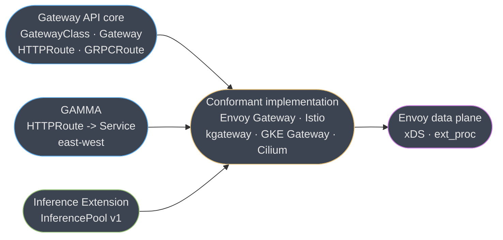
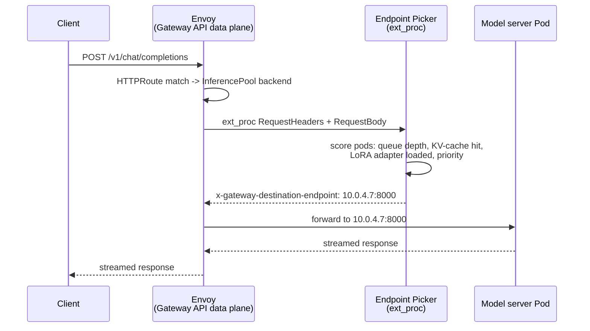

# Gateway API and the Inference Extension

> **Version anchor (2026-10-19).** Kubernetes **Gateway API 1.6.3** (2026-10-06; 1.6.0 GA'd
> `UDPRoute` and promoted `TCPRoute` to v1). **Gateway API Inference Extension v1.6.2**
> (2026-09-17, `kubernetes-sigs/gateway-api-inference-extension`), a patch on v1.6.0
> (released 2026-08-17), the release that
> removed the full Endpoint Picker reference implementation, `InferenceObjective`,
> `InferenceModelRewrite` and `EndpointPickerConfig` from this repository and migrated them to
> the **llm-d** project (CNCF Sandbox since 2026-03-24); the in-tree API surface is now
> `InferencePool` alone. **Agent Router v1.2.0** (2026-10-07), the release that renamed
> Envoy AI Gateway and made it an Agentic AI Foundation project; the `aigateway.envoyproxy.io`
> API group, CRDs, Helm charts, images and `aigw` CLI kept their names, and it builds on Envoy
> Gateway v1.9.2, Gateway API v1.6 and Inference Extension v1.6. **Envoy Gateway 1.9.2**
> (2026-09-28); the 1.9 line reconciles `TCPRoute`/`UDPRoute` through the `v1` API and
> requires Gateway API v1.6 CRDs, and without them TCP and UDP routes are silently skipped.
> Version-gated behavior is tagged inline.

This page extends [the Envoy module](envoy_proxy.md), which you should read first — at least
its §1 (listeners/filter-chains/routes/clusters), §4.7-4.8, §6's `ext_proc` mechanics, and its
xDS and timeout material. That page teaches Envoy as a substrate and mentions the Inference
Extension in one subsection with zero worked examples; this page owns the three-layer
Kubernetes Gateway API taxonomy, the Inference Extension's wire protocol and scheduling
mechanics with real manifests, and the ingress-nginx migration. It does not re-derive
listeners, routes, clusters, xDS or the timeout stack — every mechanic here compiles down to
those primitives, which the parent page already teaches once.

---

## 1. Concept Overview

Three things get called "Gateway API" in a way that collapses real distinctions:

| Layer | What it standardizes | Governing body |
|---|---|---|
| **Gateway API** (core) | Kubernetes ingress: `GatewayClass`, `Gateway`, `HTTPRoute`, `GRPCRoute`, `ReferenceGrant`, `BackendTLSPolicy` | `kubernetes-sigs/gateway-api`, SIG Network |
| **GAMMA** | The same `HTTPRoute` object, reused for **east-west, mesh-internal** routing by letting a route attach to a `Service` instead of a `Gateway` | A sub-initiative of the same project, not a separate API |
| **Gateway API Inference Extension** (GIE) | Which **replica** behind a backend gets an LLM request, using state a proxy cannot see on its own | `kubernetes-sigs/gateway-api-inference-extension`, SIG Network |

All three ship as CRDs consumed by a **conformant implementation** — a control plane that
compiles the CRDs into a running data plane. The parent module's §4.7 table already lists
seven of these; the ones this page cares about are **Envoy Gateway**, **Istio**, **Cilium**,
**GKE Gateway** and **kgateway**, because all five are conformant with GIE, and the other two
genuinely-non-Envoy Gateway API implementations — **Traefik** and **NGINX Gateway Fabric** —
are not, at this version anchor.

**Gateway API's release process has two channels**, and confusing them is the single most
common way to ship a manifest that a given cluster's CRDs reject:

| Channel | What's in it | Status at 1.6.3 |
|---|---|---|
| **Standard** | Resources with an API considered stable enough not to break | `GatewayClass`, `Gateway`, `HTTPRoute` (all `v1`), `GRPCRoute` (`v1`, graduated in 1.1), `ReferenceGrant` (`v1beta1`), `BackendTLSPolicy` (`v1alpha3`\*, standard channel since 1.4), `TLSRoute` (`v1alpha2`\*, standard), `TCPRoute` and `UDPRoute` (both graduated to `v1` in 1.6.0) |
| **Experimental** | Everything in Standard plus resources still moving | `Backend`, `XBackend`, and a provisional Telemetry API (GEP-4768), all new at 1.6 |

\* `BackendTLSPolicy` and `TLSRoute` sit in the **standard channel** — installed by default,
safe to depend on — while their own type version has not yet reached `v1`; **standard-channel
membership and `v1` are two different maturity signals**, and reading only the version string
undercounts what is actually safe to build on.

**Inside GIE, there is exactly one CRD left as of v1.6.0: `InferencePool`, API group
`inference.networking.k8s.io/v1`, GA since GIE v1.0.0.** Everything that used to sit beside it
— the reference **Endpoint Picker (EPP)** server, the `InferenceObjective` and
`InferenceModelRewrite` CRDs (both of which lived at the **experimental**
`inference.networking.x-k8s.io/v1alpha2`, never `v1`; they were
never GA), and the `EndpointPickerConfig` plugin-wiring type — moved out to
**llm-d** in the v1.6.0 release (2026-08-17). §4.3 and §10 cover what
that means for a manifest you copy from an older tutorial.

---

## 2. Intuition

> **One-line model:** Gateway API decides which **Service** gets a request; the Inference
> Extension decides which **Pod inside that Service** gets it, using signals only the model
> server itself can see.

Ordinary Kubernetes load balancing — a `Service`, `kube-proxy` or an Envoy cluster's
least-request policy — treats every backend Pod as interchangeable and every request as one
unit of work. That is a fine assumption for a stateless CRUD API and a wrong one for LLM
inference, where a request's cost varies by orders of magnitude and the *right* replica is
often the one that already holds the conversation's KV cache, not the one with the fewest
open connections. Gateway API's core CRDs never had a field for "which replica has my prefix
cached" — nothing in HTTP routing does — so the Inference Extension adds a second decision
point, external to the proxy, that gets to see per-request state the proxy's connection-pool
counters never will.

---

## 3. Core Principles

**Role-oriented API, not one flat object.** Gateway API deliberately splits authorship across
three personas so that one Kubernetes RBAC boundary maps to one real organizational boundary:

| Persona | Owns | Typical RBAC scope |
|---|---|---|
| Infrastructure provider | `GatewayClass` — which controller implements the class | Cluster-scoped, rarely touched |
| Cluster operator (platform team) | `Gateway` — listeners, TLS termination, which namespaces may attach routes | Cluster-scoped or namespace-scoped per team |
| Application developer | `HTTPRoute` / `GRPCRoute` — path matches, header matches, weighted `backendRefs` | Namespace-scoped, one per app team |

This is the structural fix for what Kubernetes `Ingress` never had: a single flat object that
mixed all three concerns, forcing every path rule through the platform team or every listener
change through the app team. `ReferenceGrant` exists purely to let an app-team route in
namespace A point at a backend Service in namespace B without the platform team pre-approving
every pair — the referenced-namespace owner opts in, once, by creating the grant.

**A route is portable; a policy is not.** `HTTPRoute` and `GRPCRoute` are the same object on
every conformant implementation — this is what makes a `kubectl apply` of an `HTTPRoute`
work identically on Envoy Gateway, Istio or GKE Gateway. Retries, circuit breaking, custom
rate limiting and (as of this page) inference-aware routing are not core fields; they attach
via implementation-specific policy CRDs (`BackendTrafficPolicy` on Envoy Gateway, `DestinationRule`-adjacent policy on Istio) using the standardized `PolicyAttachment`
pattern — a `targetRefs` list pointing back at the route or Gateway it modifies. `InferencePool`
reuses the same portable-core-plus-attached-policy shape: it is a **backend**, referenced from
an ordinary `HTTPRoute.backendRefs` exactly like a `Service` would be.

**The Inference Extension is a protocol, not a fork.** It adds no new field to `HTTPRoute` and
requires no patch to Envoy. `InferencePool` is a new *kind* of backend, and the Endpoint
Picker attaches to the request path through the same `ext_proc` external-processing filter
[the parent module's §6](envoy_proxy.md) already teaches as a generic mechanism. That single
design choice is why the extension works on 25+ Gateway API implementations without any of
them shipping inference-specific code in their data plane.

---

## 4. Types / Architectures / Strategies

### 4.1 The three-CRD request path

An inference request crosses exactly these objects, in order: `Gateway` (which listener
accepted the connection) → `HTTPRoute` (which rule matched, which backend it points at) →
`InferencePool` (the backend, standing in for a `Service`) → the **Endpoint Picker Protocol**
(an out-of-band `ext_proc` call that names the literal Pod) → the Pod. Section 6 walks every
step of that chain with real manifests.

### 4.2 EPP deployment models

| Model | Who runs the EPP | When to use it |
|---|---|---|
| **In-tree reference (pre-v1.6.0)** | You, from `registry.k8s.io/gateway-api-inference-extension/epp` | Legacy; still what most published tutorials show, but the image and its config CRD moved out of this project |
| **llm-d EPP (`llm-d-router`, formerly `llm-d-inference-scheduler`)** | You, from the llm-d project's build | The current community reference implementation — full scoring plugin set, flow control, fairness |
| **Lightweight EPP (`lwepp`)** | You, from `registry.k8s.io/gateway-api-inference-extension/lwepp:v1.6.0` | Conformance testing only — GIE's own docs scope it to validating a Gateway API implementation, not production traffic |
| **Vendor-managed** | The cloud provider | GKE Inference Gateway ships and operates its own EPP behind the same `InferencePool` API |

### 4.3 What moved out of GIE at v1.6.0 — and why a manifest can silently target the wrong plane

| Type | Where it lives now | API it was at (never `v1`) |
|---|---|---|
| Full EPP server binary | `llm-d/llm-d-router` | — |
| `InferenceObjective` (per-request priority/criticality) | `llm-d/llm-d-router` | `inference.networking.x-k8s.io/v1alpha2` |
| `InferenceModelRewrite` | `llm-d/llm-d-router` | `inference.networking.x-k8s.io/v1alpha2` |
| `EndpointPickerConfig` (scoring-plugin wiring) | `llm-d/llm-d-router` | `config.inference.networking.k8s.io/v1alpha1` |
| `InferencePool` | Stays in `kubernetes-sigs/gateway-api-inference-extension` | `inference.networking.k8s.io/v1`, **GA** |

`InferenceModel` was the original alpha name; `InferenceObjective` was the name it was
renamed to before GA. Neither ever reached `v1` inside this project, and as of this anchor
date `InferenceObjective` is not a resource this project ships at all — it is now llm-d's.
Treat any tutorial, including this project's own maintained examples at the time of writing
(§10), that applies `apiVersion: inference.networking.x-k8s.io/v1alpha2` as either
intentionally pinned to the pre-split world or already stale.

### 4.4 Gateway API implementation × Inference Extension support

| Implementation | Data plane | GIE support | Notes |
|---|---|---|---|
| **Envoy Gateway** | Envoy | Yes, via `EnvoyExtensionPolicy`/backend-resource registration | The reference deployment most tutorials use |
| **Istio** (Gateway) | Envoy | Yes, since Istio 1.27 | Waypoints (ambient L7) can also front an `InferencePool` |
| **kgateway** | Envoy | Yes | CNCF sandbox donation of Gloo Gateway |
| **GKE Gateway** | Envoy (Google-managed) | Yes, as **GKE Inference Gateway**, powered by llm-d | Fully managed EPP |
| **Cilium** | eBPF L4 + Envoy L7 | Yes | Named by Google's own ingress-nginx migration guidance (§7) |
| Traefik | its own Go proxy | No | Not GIE-conformant at this anchor |
| NGINX Gateway Fabric | NGINX | No | Not GIE-conformant at this anchor |

### 4.5 Agent Router's two ways to attach an InferencePool

| Route type | Adds over plain `HTTPRoute` | When to use |
|---|---|---|
| `HTTPRoute` + `InferencePool` backendRef | Nothing — standard Gateway API, portable to any conformant implementation | You only need inference-aware routing, no multi-provider LLM gateway features |
| `AIGatewayRoute` + `InferencePool` backendRef | Token accounting (`llmRequestCosts`), model-name header/body routing, cross-provider failover | You are also running Agent Router as the client-facing LLM front door (§6.6) |

---

## 5. Architecture Diagrams

### 5.1 The three layers and who implements them



The Inference Extension is drawn as its own box because it is authored separately and can be
absent from a cluster that only needs the top-left box — §9 covers when to skip it.

### 5.2 One request, two decision points



The first decision — which `InferencePool` — is ordinary Gateway API routing, already xDS by
the time it reaches a worker thread. The second — which Pod inside the pool — happens on the
critical path via a synchronous `ext_proc` round trip, which is the cost this mechanism
trades for a better routing decision (§8, §10).

---

## 6. How It Works — Detailed Mechanics

### 6.1 From HTTPRoute to xDS — one sentence, because the parent module owns this

Envoy Gateway watches `Gateway` and `HTTPRoute` objects, compiles them into Envoy's listener,
route and cluster resources, and streams them over ADS exactly as [§5.2 of the parent
module](envoy_proxy.md) diagrams for every other control plane — an `InferencePool` backend
compiles to a cluster whose endpoints are resolved not by EDS alone but by the `ext_proc`
override described below. Nothing about listeners, filter chains or the timeout stack changes.

### 6.2 The `InferencePool` object, field by field

```yaml
apiVersion: inference.networking.k8s.io/v1
kind: InferencePool
metadata:
  name: llama3-8b-pool
  namespace: default
spec:
  selector:
    matchLabels:
      app: llama3-8b-vllm          # must match the model-server Pods' labels
  targetPorts:
    - number: 8000                  # 1-8 ports; every port is a distinct EPP endpoint
  endpointPickerRef:                 # optional as of v1.6.0
    group: ""                       # "" = core API group
    kind: Service                   # default
    name: llama3-8b-epp
    port:
      number: 9002
    failureMode: FailClose           # default — see 6.3
```

`selector` and `targetPorts` are the only required fields; `endpointPickerRef` became
**optional** in v1.6.0 specifically so a pool can exist and be conformance-tested before an
EPP is wired to it. `targetPorts` allows up to 8 ports, each addressable by the EPP as its own
`podIP:port` endpoint — useful for a model server exposing separate ports per accelerator
partition.

### 6.3 `failureMode` — the broken default, and the fix

**`failureMode` defaults to `FailClose`.** When the EPP is unreachable — crashed, still
starting, network-partitioned — Envoy **drops every request bound for that pool**, not just
the ones mid-flight. This is silent in the sense that nothing about the `InferencePool` YAML
looks unsafe; the field simply defaults to the conservative choice, and "conservative" here
means "the whole pool goes dark the moment one auxiliary Deployment does."

```yaml
# BROKEN (the default): EPP crash-loops after a bad config push -> InferencePool goes dark
endpointPickerRef:
  name: llama3-8b-epp
  port: { number: 9002 }
  # failureMode omitted -> FailClose

# FIXED: an EPP outage degrades to ordinary endpoint selection instead of a total outage
endpointPickerRef:
  name: llama3-8b-epp
  port: { number: 9002 }
  failureMode: FailOpen
```

The tradeoff is real, not cosmetic: `FailOpen` means Envoy picks an endpoint of its own
choosing when the EPP is down — no cache-aware routing, no priority shedding, and a real risk
of hammering an already-overloaded replica during the exact window the EPP would have
protected it. `FailClose` is the right choice when a request routed by chance is worse than no
request at all — a multi-tenant pool with hard isolation requirements, say. For a single
customer-facing chat endpoint, most teams choose `FailOpen` and treat the EPP's own
liveness/readiness probes as the real alarm.

### 6.4 The Endpoint Picker Protocol — how a scoring decision becomes a routing decision

The EPP is wired to Envoy purely as `ext_proc` — the bidirectional streaming gRPC session
[the parent module's §6](envoy_proxy.md) already teaches. The Endpoint Picker Protocol layers
one contract on top of that generic mechanism:

- Envoy sends the `ext_proc` server the request headers and (buffered) body.
- The EPP replies naming its choice one of two equivalent ways: the HTTP header
  **`x-gateway-destination-endpoint`**, or the `ext_proc` response's dynamic metadata under
  the **`envoy.lb`** namespace — never both, the spec forbids disagreement between them.
- The value is one or more `ip:port` pairs (`10.0.4.7:8000` or a comma-separated list for a
  weighted fallback set).
- A caller can constrain the EPP's choice up front by setting
  **`envoy.lb.subset_hint`** → `x-gateway-destination-endpoint-subset` in the request's filter
  metadata; the EPP then must pick only from that subset.
- **No ready endpoint → HTTP 503.** **A request the EPP decides to shed under load → HTTP
  429** — this is the flow-control path (§6.5), not an error in the picker itself.

This is the entire mechanism. Nothing about it is Envoy-specific beyond the transport being
`ext_proc`, which is exactly why 25+ Gateway API implementations can support it without
forking anything.

### 6.5 Scoring signals and flow control

A production EPP (llm-d's reference build) scores every ready Pod in the pool with a small
pipeline of plugins — the actual names shipped in Agent Router's own reference deployment
are `queue-scorer`, `kv-cache-utilization-scorer` and `prefix-cache-scorer`, plus a LoRA-aware
path (the project ships a dedicated multi-LoRA deployment example) that prefers a replica that
already has the requested adapter loaded over one that would have to load it cold:

| Signal | What it measures | Why least-request can't see it |
|---|---|---|
| Queue depth | Pending requests already accepted by the model server | Envoy's connection-pool counters see *connections*, not the server's internal admission queue |
| KV-cache utilization | How full the server's GPU KV-cache is | Entirely internal server state, exposed only via the server's own metrics endpoint |
| Prefix-cache overlap | Whether this replica already holds a matching KV prefix for this conversation | Requires reading the request body, which a connection-level load balancer never does |
| LoRA adapter residency | Whether the requested adapter is already loaded on this replica | Same — internal to the server process |

The EPP's own metrics refresh (Helm-chart default: **10 seconds**) is the freshness bound on
all of the above — a real gotcha covered in §10.

**Flow control (the Saturation Detector) is disabled by default.** With it off, a saturated
pool causes the gateway to immediately reject sheddable requests (any request carrying a
**negative priority**) with `429`, dropping them rather than queueing. Enabling it buffers
incoming requests in the EPP's memory, respecting **strict priority** — a higher-priority
request is served before a lower one regardless of arrival order — and an **intra-priority
fairness** policy among requests at the same priority. `queueDepthThreshold` (the per-backend
pending-queue ceiling the detector reacts to) defaults to **5**.

### 6.6 Agent Router: token accounting and model routing on top of the same pool

`AIGatewayRoute` adds two things `HTTPRoute` cannot express, both verified against the
project's own maintained example manifest:

```yaml
apiVersion: aigateway.envoyproxy.io/v1beta1
kind: AIGatewayRoute
metadata:
  name: chat-models
  namespace: default
spec:
  parentRefs:
    - name: chat-gateway
      kind: Gateway
      group: gateway.networking.k8s.io
  llmRequestCosts:                     # token accounting
    - metadataKey: llm_input_token
      type: InputToken
    - metadataKey: llm_output_token
      type: OutputToken
    - metadataKey: llm_total_token
      type: TotalToken
  rules:
    - matches:                         # model-name routing
        - headers:
            - type: Exact
              name: x-ai-eg-model
              value: meta-llama/Llama-3.1-8B-Instruct
      backendRefs:
        - group: inference.networking.k8s.io
          kind: InferencePool
          name: llama3-8b-pool
    - matches:
        - headers:
            - type: Exact
              name: x-ai-eg-model
              value: mistral:latest
      backendRefs:
        - group: inference.networking.k8s.io
          kind: InferencePool
          name: mistral-pool
```

`llmRequestCosts` writes each extracted token count into request metadata under the
`io.envoy.ai_gateway` namespace — the same dynamic-metadata mechanism §6.4 uses for endpoint
selection — where it becomes available to Envoy's ordinary rate-limit filter (the parent
module's rate-limiting mechanics apply unchanged; this is a metadata source, not a new
enforcement path). Model routing here matches an explicit header, but Agent Router can
also extract the model name from the request body, reusing the buffered-body `ext_proc`
processing mode the parent module's §6 already covers — the model name is inside the JSON
payload for an OpenAI-shaped request, not a header, on most real clients.

### 6.7 A skewed-version manifest, in the wild, today

Agent Router's example directory `examples/inference-pool/` at v1.2.0 holds both worlds.
`base.yaml`, the one most adopters copy first, deploys the EPP from
`ghcr.io/llm-d/llm-d-router-endpoint-picker:main` and creates no `InferenceObjective`. Its
sibling `with-annotations.yaml` still deploys `registry.k8s.io/gateway-api-inference-extension/epp:v0.5.1`,
creates an `InferenceObjective` at `apiVersion: inference.networking.x-k8s.io/v1alpha2` and
configures the EPP with an `EndpointPickerConfig` at `v1alpha1`. Those are the pre-v1.6.0
resources §4.3 describes as moved to llm-d. Downstream projects update their examples file by
file, so two manifests in one directory can target different sides of the split; that is the
version-skew trap covered in §10.

---

## 7. Real-World Examples

- **Google — GKE Inference Gateway.** A fully managed `InferencePool` implementation powered
  by llm-d; Google operates the EPP so the customer authors only `Gateway`, `HTTPRoute` and
  `InferencePool`.
- **The llm-d community.** Founding contributors **CoreWeave, Google Cloud, IBM Research and
  NVIDIA**, with **AMD, Cisco, Hugging Face, Intel, Lambda and Mistral AI** as partners;
  donated to the **CNCF Sandbox on 2026-03-24**. The reference EPP this page describes in §6.5
  is this project's, not GIE's own, as of v1.6.0.
- **Istio.** Gateway API Inference Extension support shipped starting **Istio 1.27**, letting
  an Istio-managed Gateway — or an ambient-mode waypoint — front an `InferencePool` with no
  additional CRD beyond what Istio already manages.
- **Bloomberg, Tetrate and Nutanix**, via the coalition that produced the v1.0 GA release of
  Envoy AI Gateway, renamed **Agent Router** in v1.2.0: the client-facing half of the same "Envoy for LLM traffic" story this page
  and [the parent module](envoy_proxy.md) both cover, from the opposite end.
- **Model-server coverage.** The reference EPP configuration ships defaults for **vLLM**
  (the default), **SGLang**, **Triton with the TensorRT-LLM backend**, and TensorRT-LLM's own
  `trtllm-serve` — see [the Dynamo and NVIDIA serving stack
  page](../nvidia_triton_inference_server/dynamo_and_the_nvidia_serving_stack.md) for what
  each of those servers actually is.

---

## 8. Tradeoffs

| Choice | Gains | Costs |
|---|---|---|
| Plain `HTTPRoute` weighted `backendRefs` | Zero new moving parts, zero new failure mode, portable to literally every Gateway API implementation | Blind to cache state and queue depth — the "least loaded" replica by connection count is routinely the most loaded by actual work |
| `InferencePool` + EPP | Cache-aware and queue-aware routing; priority-based shedding under load | A new synchronous hop on every request; a new process that becomes a single point of decision (mitigated, not eliminated, by `failureMode`) |
| Standard-channel-only manifests | Never breaks on a CRD upgrade; what most implementations install by default | Cannot use `Backend`/`XBackend`/Telemetry API fields, all experimental at 1.6 |
| Flow control enabled | Predictable, priority-respecting behavior under saturation instead of thundering-herd 429s | Buffered requests hold memory in the EPP; a stuck EPP now holds in-flight state, not just routing decisions |
| `AIGatewayRoute` over plain `HTTPRoute` | Token accounting, model-name routing, multi-provider failover | Ties the route to Agent Router specifically — no longer portable to a non-Envoy Gateway API implementation |

[The parent module's §8](envoy_proxy.md) already tables Agent Router against the
Inference Extension as two products solving different halves of "LLM traffic on Envoy" — that
comparison is not repeated here; this table is about the narrower decision of whether to adopt
`InferencePool` routing at all, and at which channel/policy layer.

---

## 9. When to Use / When NOT to Use

**Plain `HTTPRoute` weighted routing is enough when:** every replica behind a backend is
interchangeable — a stateless API, a small model with negligible per-replica cache benefit —
or the fleet is small enough (a handful of replicas) that the variance least-request produces
is smaller than the latency an `ext_proc` round trip adds. Adding an `InferencePool` here is
pure overhead: a new SPOF for no measurable routing improvement.

**`InferencePool` earns its keep when:** requests are long-context or multi-turn chat traffic
where prefix-cache reuse is real money (a cache hit skips prefill entirely); the fleet is
heterogeneous (mixed accelerators, mixed LoRA adapters, uneven per-replica capacity); or the
platform needs priority-based shedding — protecting a paying tier's latency by dropping a
free tier's requests under saturation rather than degrading everyone uniformly.

**GAMMA and `BackendTLSPolicy` are worth adopting independently of any inference decision** —
GAMMA whenever mesh-internal and ingress routing should share one authoring model instead of
vendor CRDs plus Gateway API side by side; `BackendTLSPolicy` whenever backend TLS validation
needs to be declared per-backend rather than baked into a control-plane-specific policy CRD.

---

## 10. Common Pitfalls (Production War Stories)

**The EPP becomes a new single point of failure inside the hot path, and the default hides
it.** `failureMode: FailClose` is a sane default in isolation — better to drop cleanly than
route blindly — but a team that never reads past `endpointPickerRef.name` in a quickstart
inherits it without deciding it. The failure mode to actually watch for: a config push to the
EPP that crash-loops it takes down every pool it serves, not a degraded-but-serving state, and
because the pool itself reports healthy (Envoy's cluster is up; the *picker* is what's down),
dashboards keyed on cluster health miss it entirely. Alert on the EPP's own liveness/readiness
gRPC checks, not on downstream cluster health.

**`ext_proc` adds a real round trip, and it lands on every request, not just cold ones.**
[The parent module's §6](envoy_proxy.md) already prices this generically; the number that
matters here is that an inference request is exactly the shape where the extra hop is
proportionally cheapest (a 2-3ms `ext_proc` call against a request whose total latency is
hundreds of milliseconds to seconds) and exactly the shape where teams still get surprised,
because they benchmarked the *proxy's* overhead, not the EPP's own scoring latency under its
own load.

**The EPP's metrics refresh interval means routing decisions act on stale state.** With a
10-second default scrape of KV-cache utilization and queue depth, a burst of traffic that
saturates a replica in the two seconds after its last scrape is invisible to the picker until
the next cycle — the EPP will keep sending it "the best" replica by a measurement that is
already wrong. This is not a bug to file; it is the tradeoff of pull-based metrics versus a
push-based admission signal, and the mitigation is tuning the scrape interval against actual
burst timescales, not assuming zero staleness.

**CRD version skew between the Inference Extension and the Gateway API core it depends on.**
GIE v1.6.0's own dependency manifest pins `sigs.k8s.io/gateway-api` at **1.5.1** for its
conformance suite, one minor behind the 1.6.3 core release this page's version anchor names.
A cluster running Gateway API 1.6.3 core CRDs alongside a GIE build validated against 1.5.1 is
a real, sourced-in-the-open combination, not a hypothetical — check both projects' pinned
dependency versions before assuming "latest of each" composes cleanly.

**Envoy Gateway 1.9 upgraded before the Gateway API CRDs.** Envoy Gateway 1.9.0 (2026-08-15)
requires Gateway API v1.6 CRDs; on older CRDs it starts cleanly and silently skips every
`TCPRoute` and `UDPRoute`, so non-HTTP listeners go dark with no error. Upgrade the CRDs first,
and drop `sessionPersistence.idleTimeout` from HTTPRoutes before you do, because v1.6 removed it.
The same release turns Lua `EnvoyExtensionPolicy` off by default (re-enable with `enableLua`
under `extensionApis`), so a gateway that relied on a Lua header shim stops applying it. It
also adds `ListenerSet` as a `targetRef` kind for client, security, backend and extension
policies, and out-of-band ORCA load reporting through
`loadBalancer.backendUtilization.outOfBand` in `BackendTrafficPolicy` for backends that
implement `OpenRcaService`.

**Copying an example predates a project split.** §6.7 is not a hypothetical: one of Agent
Router's own maintained examples deploys the pre-split EPP image and an `InferenceObjective`
at an alpha API that no longer ships from the project that used to own it. The fix is
mechanical once you know to look — confirm which repository currently owns each CRD in a
manifest before applying it, not just which `apiVersion` string it uses.

---

## 11. Technologies & Tools

### 11.1 Gateway API core and channels

| Tool | What it does |
|---|---|
| Gateway API | The standard CRD set for Kubernetes L4/L7 routing: GatewayClass, Gateway, HTTPRoute, GRPCRoute. |
| GAMMA | The Gateway API initiative letting HTTPRoute attach to a Service for mesh-internal routing. |
| Ingress2Gateway | CLI that converts Ingress and vendor annotations into equivalent Gateway API objects. |

### 11.2 Gateway API Inference Extension ecosystem

| Tool | What it does |
|---|---|
| Gateway API Inference Extension | The project defining InferencePool and the Endpoint Picker Protocol. |
| InferencePool | The CRD standing in for a Service as an inference-aware routing backend. |
| llm-d | CNCF Sandbox project hosting the reference Endpoint Picker, scoring plugins and flow control. |
| GKE Inference Gateway | Google's managed InferencePool implementation, powered by llm-d. |

### 11.3 Gateway API implementations

| Tool | What it does |
|---|---|
| Envoy Gateway | CNCF-native Envoy control plane implementing Gateway API and InferencePool. |
| Istio | Full-mesh control plane; Gateway-mode and ambient waypoints both support InferencePool. |
| kgateway | CNCF sandbox Gateway API implementation, the renamed Gloo Gateway donation. |
| GKE Gateway | Google Cloud's managed Gateway API implementation. |
| Cilium | eBPF-based CNI whose Gateway API layer hybridizes L4 eBPF with an Envoy L7 path. |
| Contour | VMware-originated Envoy-based Gateway API implementation. |
| Traefik | Independent Go proxy implementing Gateway API without an Envoy data plane. |
| NGINX Gateway Fabric | F5-maintained NGINX-based Gateway API implementation. |

### 11.4 LLM traffic and serving backends

| Tool | What it does |
|---|---|
| Agent Router | Client-facing OpenAI-compatible API layer adding token accounting and model routing over InferencePool. |
| vLLM | Open-source LLM inference server; the default model-server type in EPP reference configuration. |
| SGLang | Open-source LLM inference server supported as an EPP model-server type. |

### 11.5 Related reading

[Envoy — the L7 proxy and data plane](envoy_proxy.md) ·
[Dynamo and the NVIDIA serving stack](../nvidia_triton_inference_server/dynamo_and_the_nvidia_serving_stack.md) ·
[Service mesh and service discovery](../../backend/service_mesh_and_service_discovery/service_mesh_and_service_discovery.md) ·
[Kubernetes scheduling and autoscaling](../../devops/kubernetes_scheduling_and_autoscaling/kubernetes_scheduling_and_autoscaling.md) ·
[vLLM deep dive](../../llm/vllm_deep_dive/vllm_deep_dive.md) ·
[LLM inference and decoding](../../llm/inference_and_decoding/inference_and_decoding.md)

---

## 12. Interview Questions with Answers

**Q: Your `InferencePool` is healthy in every dashboard, but every request to it is returning 503. What's the first thing you check?**
**Short:** Check the Endpoint Picker's own liveness, not the pool's cluster health — FailClose drops all traffic when the EPP dies.
Check whether the Endpoint Picker (EPP) referenced by `endpointPickerRef` is actually up — its own gRPC liveness and readiness checks, not the `InferencePool`'s cluster status, which reports the model-server Pods as healthy regardless of whether the picker in front of them is reachable. `failureMode` defaults to `FailClose`, so an EPP crash-loop drops every request bound for the pool rather than degrading gracefully. If graceful degradation to ordinary endpoint selection is acceptable for this workload, set `failureMode: FailOpen`; if it isn't, the fix is making the EPP itself highly available, not changing the failure mode.

**Q: A manifest you copied from a tutorial applies `apiVersion: inference.networking.x-k8s.io/v1alpha2, kind: InferenceObjective`. Will it work against a cluster running Gateway API Inference Extension v1.6.0?**
**Short:** No — InferenceObjective was removed from GIE's own CRDs at v1.6.0 and migrated to the llm-d project.
It will not, unless the cluster separately installs llm-d's CRDs. `InferenceObjective` was always an experimental alpha type (`v1alpha2`, never `v1`) inside the Gateway API Inference Extension project, and as of the v1.6.0 release (2026-08-17) it was removed from that project entirely and migrated to `llm-d/llm-d-router` along with the full Endpoint Picker implementation and `EndpointPickerConfig`. The only CRD GIE still ships is `InferencePool` at `inference.networking.k8s.io/v1`. Before applying any inference-extension manifest, confirm which project currently owns each CRD in it, not just which `apiVersion` string appears.

**Q: When did `InferenceObjective` reach GA, and what replaced `InferenceModel`?**
**Short:** InferenceObjective never reached GA — it replaced the alpha InferenceModel but stayed alpha itself and was later migrated to llm-d.
`InferenceObjective` never reached GA inside the Gateway API Inference Extension project — it was the renamed successor to the original alpha `InferenceModel`, but it stayed at `inference.networking.x-k8s.io/v1alpha2` throughout, and at v1.6.0 it left the project's CRD surface altogether, migrated to `llm-d/llm-d-router`. The only GIE type that reached `v1`/GA is `InferencePool`. Treat any claim that `InferenceObjective` is a stable v1 resource as describing a snapshot no later than mid-2026, and verify against the current project's own API reference before repeating it.

**Q: Should a new HTTPRoute standard-channel field like GRPCRoute be safe to depend on in production?**
**Short:** Yes for GRPCRoute — it graduated to the standard channel at Gateway API 1.1 and is v1.
GRPCRoute graduated out of experimental into the standard channel in Gateway API 1.1 and is at `v1` as of this anchor's 1.6.3 — it is exactly as safe to depend on as `HTTPRoute` or `Gateway` themselves. The distinction that still matters is standard-channel membership versus the resource's own type version: `BackendTLSPolicy` and `TLSRoute` are both standard-channel (installed by default, considered stable enough to build on) while sitting at `v1alpha3` and `v1alpha2` respectively — reading only the version string undercounts what a cluster operator already treats as safe.

**Q: Why does least-request load balancing route an LLM request to the "least loaded" replica that is actually the most loaded one?**
**Short:** Least-request counts open connections, not GPU KV-cache state or queue depth, which is where an inference server's real load lives.
Because "least loaded" in a connection-pool sense has nothing to do with an inference server's real bottleneck — a replica can have the fewest open connections and still be the one with the fullest KV cache and the deepest internal admission queue, both of which are invisible to a proxy-side counter. The Gateway API Inference Extension's Endpoint Picker fixes this by reading the model server's own metrics — queue depth, KV-cache utilization, prefix-cache overlap — and routing on those instead, at the cost of a synchronous `ext_proc` call the plain load-balancer path never pays.

**Q: How does the Endpoint Picker actually tell Envoy which Pod to route to — is it a custom Envoy filter?**
**Short:** No custom filter — the EPP replies over ordinary ext_proc with an `x-gateway-destination-endpoint` header or dynamic metadata.
It is not a custom filter at all — the EPP is a generic `ext_proc` server, and the Endpoint Picker Protocol is just a naming convention layered on that generic contract. The EPP's `ext_proc` response sets either the HTTP header `x-gateway-destination-endpoint` or dynamic metadata under the `envoy.lb` namespace to an `ip:port` (or comma-separated list), and Envoy routes there. A caller can restrict the EPP's choice up front via `x-gateway-destination-endpoint-subset` filter metadata. Because this rides the same `ext_proc` mechanism as any other out-of-process filter, it works on every conformant implementation without a data-plane patch.

**Q: What HTTP status does a client see when the EPP decides to shed its request under load, versus when there's simply no healthy endpoint?**
**Short:** 429 for a shed (sheddable, negative-priority) request under saturation; 503 when no ready endpoint exists at all.
A `503` means the EPP found no ready endpoint to route to (or, if a caller supplied a subset hint, no eligible endpoint inside that subset). A `429` means the EPP made a routing decision to *drop* the request — the flow-control path, reserved for requests carrying a negative priority (marked "sheddable") when the pool is saturated. Conflating the two miscategorizes an outage as backpressure or the reverse; alerting and retry logic should treat them differently; only the 429 case is expected, healthy behavior under load.

**Q: Is Gateway API's flow control (the Saturation Detector) enabled by default?**
**Short:** No — by default a saturated pool immediately rejects sheddable requests with 429 rather than queueing them.
It is disabled by default. With it off, a saturated `InferencePool` immediately rejects any sheddable (negative-priority) request with `429` rather than holding it. Enabling flow control instead buffers incoming requests in the EPP's own memory, respecting strict priority ordering and an intra-priority fairness policy, until backend capacity frees up — the tradeoff being that a stuck EPP under flow control is now holding in-flight request state, not just making routing decisions, which raises the cost of an EPP outage. `queueDepthThreshold`, the per-backend pending-queue ceiling that triggers the detector, defaults to 5.

**Q: Name three signals the Endpoint Picker's scoring plugins use that a stock Envoy load-balancing policy cannot see.**
**Short:** Queue depth, KV-cache utilization, and prefix-cache overlap — all internal model-server state, not proxy-visible.
Queue depth (pending requests already admitted by the model server, distinct from open connections), KV-cache utilization (how full the server's GPU cache is), and prefix-cache overlap (whether a specific replica already holds a matching KV prefix for this conversation) — plus, for multi-tenant LoRA serving, whether the requested adapter is already loaded on a candidate replica. All four are internal server state exposed only through the model server's own metrics endpoint or request-body inspection; a connection-pool-based load balancer has no way to see any of them.

**Q: What does GAMMA actually add to Gateway API, and why does it matter that it reuses HTTPRoute rather than defining a new object?**
**Short:** GAMMA lets HTTPRoute attach to a Service instead of a Gateway, giving mesh-internal routing the same API as ingress.
GAMMA (Gateway API for Mesh Management and Administration) gives `HTTPRoute` a second valid parent: instead of attaching to a `Gateway` (ingress), it can attach to a `Service` for east-west, mesh-internal routing. The payoff is that a mesh implementation like Istio or Linkerd can express both ingress and mesh routing in the same portable object, instead of ingress in Gateway API and mesh-internal routing in a vendor-specific CRD — one authoring model, one mental model, for two traffic directions.

**Q: A cluster operator wants per-namespace app teams to be able to route to a backend Service in a shared platform namespace without the platform team pre-approving every route. What Gateway API object solves this?**
**Short:** ReferenceGrant — the referenced-namespace owner opts in once, rather than the platform team approving every cross-namespace route.
`ReferenceGrant`. It lets the owner of the *referenced* namespace (the platform team, for a shared backend) opt in once to being targeted from a specific other namespace and kind, rather than requiring per-route approval. This is the mechanism that makes Gateway API's role split (§3) actually enforceable across namespace boundaries — without it, cross-namespace `backendRefs` are rejected outright.

**Q: Your team wants backend mTLS validated per-route rather than baked into a control-plane-specific policy CRD. What's the portable Gateway API answer?**
**Short:** BackendTLSPolicy — a standard-channel CRD for declaring backend TLS validation, portable across implementations.
`BackendTLSPolicy` — a standard-channel resource (stable since Gateway API 1.4, though its own type is `v1alpha3`) that lets a route author declare how TLS to a backend should be validated, portably, instead of relying on an implementation-specific policy CRD. It applies to any route type that forwards to a backend, including `GRPCRoute` and `TLSRoute` in terminate mode.

**Q: Why does the Inference Extension not require its own fork of Envoy or a Wasm plugin — what design choice made that unnecessary?**
**Short:** It's built entirely on ext_proc, a generic mechanism Envoy already had, so no data-plane change was needed.
Because it is built entirely on `ext_proc`, a generic external-processing mechanism Envoy already shipped for arbitrary request/response mutation. The Endpoint Picker Protocol is just a convention for what headers and metadata an `ext_proc` server sets to steer routing — nothing about it required a new Envoy capability. That is also why the extension is not Envoy-specific: any Gateway API implementation whose data plane supports `ext_proc`-equivalent external processing can adopt it, which is how it reached 25+ implementations without a single one forking its proxy.

**Q: You're evaluating whether to add an InferencePool in front of a fleet of 3 stateless classification-model replicas with sub-100ms responses. Worth it?**
**Short:** Usually not — the ext_proc round trip is proportionally expensive against a sub-100ms response with little cache benefit to reuse.
Usually not. The Endpoint Picker's value comes from routing on state a proxy can't see — prefix-cache reuse, queue depth under bursty long-context load — and a small fleet of short, largely stateless classification requests has little of that to exploit: three replicas rarely diverge enough in load for cache-aware routing to matter, and a synchronous `ext_proc` hop is proportionally expensive against a sub-100ms total response time. Plain weighted `HTTPRoute` routing, or even a bare `Service`, is the right level of engineering here; add `InferencePool` when the workload becomes long-context, multi-turn, or heterogeneous enough that the routing decision has real money behind it.

**Q: Kubernetes retired ingress-nginx in March 2026. What did Google's own migration guidance name as conformant replacement targets?**
**Short:** Google named GKE Gateway, Cilium and Envoy Gateway as conformant Gateway API implementations, alongside the Ingress2Gateway tool.
Google's own transition post named **GKE Gateway**, **Cilium**, and **Envoy Gateway** as conformant Gateway API implementations, alongside pointing teams at **Ingress2Gateway**, the CLI that converts Ingress objects and vendor annotations into equivalent Gateway API resources. It stopped short of recommending one implementation over another, instead emphasizing conformance with the current Gateway API release as the bar to check — the same conformance property that makes the Inference Extension itself implementation-agnostic.

**Q: What is the practical difference between adopting Agent Router (formerly Envoy AI Gateway) and adopting the Gateway API Inference Extension, and do you need both?**
**Short:** Agent Router owns the client-facing multi-provider contract; the Inference Extension owns which self-hosted replica serves a request, and the two compose.
They solve different halves and often compose (see [the parent module's §12](envoy_proxy.md) for the fuller comparison). Agent Router owns the **client-facing contract** — an OpenAI-compatible API across multiple providers, token-aware rate limiting, credential handling. The Inference Extension owns **backend selection** for models you host yourself. A platform running its own vLLM fleet behind a multi-provider front door genuinely needs both: `AIGatewayRoute` for the client contract, `InferencePool` as the backend it ultimately routes self-hosted traffic to (§6.6).

**Q: A teammate says GIE v1.6.0 "deprecated" InferenceObjective. Is that the right word?**
**Short:** No — it was removed from this project's CRDs and migrated elsewhere, not deprecated-but-present.
No, and the distinction matters. "Deprecated" implies the resource still exists, still functions, and carries a warning to migrate away from it on the *same* project's own timeline. What actually happened is a **removal plus migration**: `InferenceObjective` no longer exists as a CRD this project ships at all — applying it against a v1.6.0-only cluster fails outright unless llm-d's CRDs are separately installed. Calling that "deprecated" understates the blast radius for anyone auditing a manifest against the current API surface.

**Q: Your `InferencePool` and its EPP are both reporting healthy, but under a traffic spike, requests keep landing on a replica whose KV cache is already full. Why, and what would you check?**
**Short:** The EPP's metrics scrape is pull-based (10s default) — a burst inside that window is invisible until the next cycle.
Because the EPP's view of KV-cache utilization and queue depth is pull-based, not real-time — the reference metrics refresh defaults to a 10-second interval. A burst that saturates a replica within that window is invisible to the scorer until the next scrape, so the picker keeps sending traffic to what its last-known state says is the best choice, which is now stale. This is not a health-check failure — both the pool and the EPP genuinely are up — it's the inherent lag of pull-based metrics; the fix is tuning the scrape interval against the workload's actual burst timescale, not treating it as a bug to patch away.

**Q: Does BackendTLSPolicy being in the "standard channel" mean its API is stable and will never change field names?**
**Short:** No — standard-channel means installed-by-default and considered safe to build on, independent of the type's own version maturity.
No — channel and type-version maturity are two separate axes. `BackendTLSPolicy` is standard-channel (installed by default on a conformant implementation, considered stable enough to depend on operationally) while its type is still `v1alpha3`, meaning its exact schema can still evolve before reaching `v1`. Depending on it in production is the intended use; assuming its field names are permanently frozen because it ships in the standard channel is the trap.

---

## 13. Best Practices

- **Decide `failureMode` deliberately, per pool, instead of accepting the default.** `FailClose` for workloads where a randomly-routed request is worse than none; `FailOpen` for a single customer-facing endpoint where degraded routing beats an outage. Never leave it unexamined.
- **Alert on the EPP's own liveness and readiness, not on `InferencePool` cluster health** — the pool reports the model-server Pods, not the picker in front of them.
- **Pin and track the CRD version each component actually depends on**, not just the version you intend to run — GIE's own conformance suite tracking one minor behind the Gateway API core (§10) is the kind of skew that only shows up when you check dependency manifests directly.
- **Route developer authorship through `HTTPRoute`/`GRPCRoute`, and platform policy through the implementation's attached-policy CRDs** — do not let application teams author `BackendTrafficPolicy`-equivalent objects, and do not let the platform team own path-matching rules; the role split is the point.
- **Start every new `InferencePool` without flow control enabled, prove the pool's steady-state behavior, then turn it on** if priority-based shedding is actually needed — it adds in-flight state to the EPP that a simple 429-on-saturation baseline doesn't carry.
- **Treat any inference-extension tutorial's `apiVersion` lines as a first thing to verify, not to trust** — this page's own §6.7 documents a real, currently-published example that targets a superseded API.
- **Prefer plain `HTTPRoute` and skip `InferencePool` until the workload actually has cache reuse or heterogeneity to exploit** (§9) — an unused scoring pipeline is pure added latency and a pure added failure mode.

---

## 14. Case Study — Migrating a Chat Platform's Model Tier from Round-Robin to InferencePool

**Scenario.** A mid-size SaaS company runs a self-hosted Llama-family chat assistant behind
Envoy Gateway, itself the ingress-nginx replacement adopted during the March 2026 retirement
(the migration [the parent module's §14](envoy_proxy.md) walks in full). The chat backend is
six vLLM replicas on shared GPU nodes, fronted by a plain `HTTPRoute` with a round-robin
`backendRef` to a `Service`. Support tickets cluster around one complaint: long, multi-turn
conversations get progressively slower, while short one-off questions feel fine.

**Requirements.** Reduce time-to-first-token (TTFT) variance on long conversations without
adding a second on-call surface the platform team can't operate; keep the migration
reversible; do not require app-team changes to the client SDK.

**Architecture decision.** The platform team already runs Envoy Gateway, so `InferencePool`
is additive rather than a new control plane. They deploy:

- One `InferencePool` per model family, matching the existing Pod labels — no change to the
  vLLM Deployments themselves.
- llm-d's reference EPP, one Deployment per pool, with `failureMode: FailOpen` — a chat
  product where a degraded-but-served request beats a 503 during an EPP restart.
- The existing `HTTPRoute` is changed in one field: `backendRefs` now names the `InferencePool`
  instead of the `Service`. No client-visible change, no SDK change.
- Flow control left **disabled** at rollout — the team wants to observe cache-aware routing's
  effect before adding priority-based shedding on top of it.

**Operational playbook.** Canary one pool (the smallest model family) for one week behind a
feature-flagged `HTTPRoute` weight split (90% old `Service` backend, 10% new `InferencePool`),
watching three things: EPP pod restarts (a proxy for §10's SPOF risk), the `ext_proc` call
latency exported by Envoy's own stats, and — the actual target metric — TTFT distribution on
requests carrying more than 4 prior turns, since those are exactly the requests with real
prefix-cache reuse available. Only after a clean canary week do they cut the remaining pools
over, one at a time, riskiest-traffic-last, exactly mirroring the phased-cutover discipline
[the parent module's ingress-nginx migration](envoy_proxy.md) already used for the routing
layer itself.

**What to measure, honestly stated.** The expected effect — and this is the shape to verify
against your own traffic, not a number to assume — is a measurable drop in p95 TTFT
specifically on multi-turn conversations, driven by more requests landing on a replica that
already holds a matching KV prefix, plus a *rise* in variance immediately after any EPP
restart while its scoring state is cold. A team running this migration should instrument
before committing to numbers: TTFT and inter-token latency split by conversation-turn count,
EPP `ext_proc` call latency as its own histogram (not folded into total request latency, which
hides it), and cache-hit-attributable routing decisions if the scoring plugin exposes them —
none of which are guessable in advance and all of which are cheap to graph before the
first canary.

**What went wrong, and the fix.** Two weeks after full cutover, an unrelated config push to
the EPP's ConfigMap (a scoring-plugin change, unrelated to `InferencePool` itself) put the EPP
into a crash-loop. Because `failureMode` was `FailOpen`, no outage occurred — Envoy fell back
to its own endpoint selection — but nobody noticed the degradation for six hours because the
alerting was built on `InferencePool` cluster health, which stayed green the entire time
(exactly the trap §10 names). The fix was mechanical: a dedicated alert on the EPP
Deployment's own readiness, wired independently of anything downstream reporting healthy.

**The lesson the team wrote into its own runbook:** `FailOpen` protects users from an outage;
it does not protect the team from not knowing one is happening. Choosing the failure mode and
building the matching alert are two separate decisions, and skipping the second makes the
first look like it worked when it was actually just quietly compensating.
