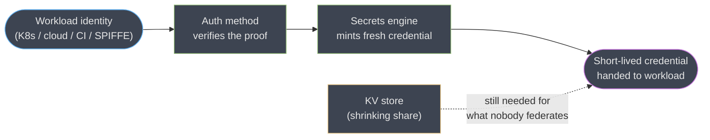
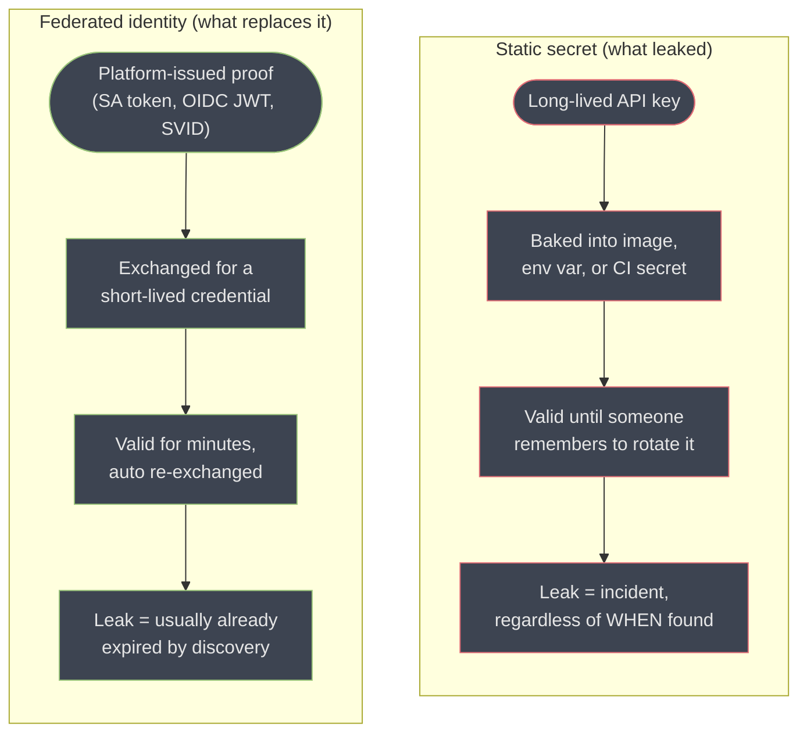
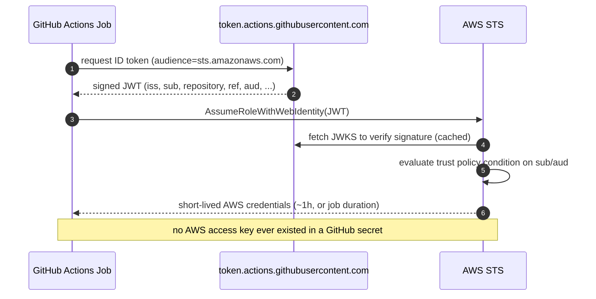
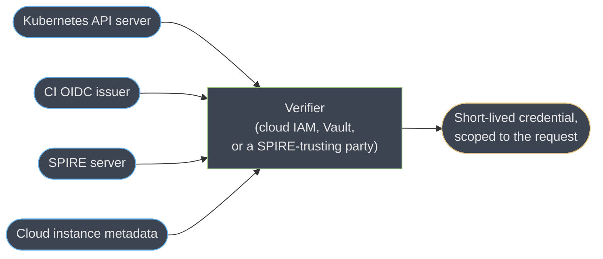
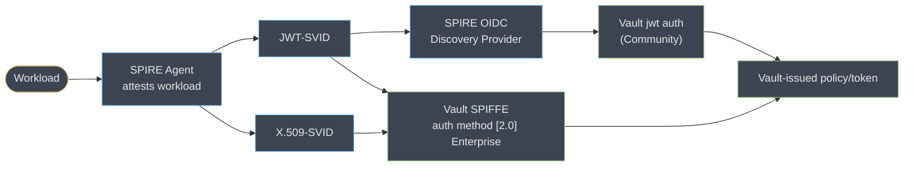

# Workload Identity and the End of Stored Secrets

> **Version anchor (2026-08-26).** HashiCorp Vault **2.0.4** (2026-08-04) — the same release
> [the parent module](hashicorp_vault.md) pins. **OpenBao 2.6.2** (2026-08-18, security-fix
> release over 2.6.1). GitHub Actions OIDC token claims per `docs.github.com`'s current
> reference, including the **immutable `sub` format** GitHub started issuing for
> repositories created after **2026-07-15**. Kubernetes bound, audience-scoped projected
> service-account tokens — GA behind `BoundServiceAccountTokenVolume` since **1.22**, the
> legacy non-expiring `Secret`-mounted token removed as the default in **1.24**. SPIFFE/SPIRE
> cited from `spiffe.io` and the `spiffe/spire` repository; no SPIRE release is pinned
> because the project does not gate the mechanics this page describes to a specific version.
> Vault's own **workload identity federation** for secret sync and **SCIM 2.0 provisioning**
> are both **Enterprise-only**, confirmed against `developer.hashicorp.com/vault/docs/enterprise/scim-overview`
> and HashiCorp's own 2026-04 Vault Enterprise 2.0 announcement. Version-gated claims are
> tagged inline.

[The parent module](hashicorp_vault.md) already covers Vault's own workload-identity
federation for secret sync (§6.8a), Vault's SPIFFE secrets engine and SCIM server (§6.16),
and the `bound_claims` vs `claim_mappings` trap in general form (§6.13) — this page assumes
all three and does not restate them. What it adds is the wider frame those features sit
inside: the industry-wide move from *distributing* a long-lived secret to *proving an
identity you already have* and exchanging it for a short-lived one, across clouds,
Kubernetes, CI/CD and service meshes, of which Vault's own federation features are one
instance among several. The question this page keeps returning to is the one a principal
engineer actually gets asked in 2026: **given how far workload identity has come, do you
still need a secret store at all?**

---

## 1. Concept Overview

For a decade, "secrets management" meant one shape: put a long-lived credential somewhere
encrypted, and control who can read it. That shape has a structural weakness no amount of
encryption fixes — the credential itself is the thing that leaks, and once it exists
anywhere, it exists everywhere it was ever copied, cached, logged or forked. The industry's
response, gathering force since roughly 2019 and now the default assumption in every major
platform's own documentation, is to stop distributing the credential at all:

> **Prove who you are using something the platform already gave you, and receive a
> credential that expires before it matters if it leaks.**

Four mechanisms carry this thesis into production today, each with its own trust root:

| Mechanism | What proves identity | Who verifies it | Kills secret-zero how |
|---|---|---|---|
| **Cloud instance/workload identity** | A cloud provider's own attestation of the compute resource (EC2 instance identity document, GCE instance metadata, an AKS pod's projected token) | The cloud's own IAM (AWS STS, GCP IAM, Microsoft Entra ID) | No IAM access key ever exists on the instance; the platform itself is the credential |
| **OIDC federation from CI** | A signed JWT the CI platform mints for the running job (GitHub Actions' `id-token`, GitLab CI's `ID_TOKEN`, Buildkite's OIDC token) | The receiving cloud or Vault, via the CI platform's published JWKS | No long-lived deploy key sits in a CI secret store waiting to be exfiltrated by a compromised dependency |
| **Kubernetes projected ServiceAccount tokens** | A short-lived, audience-bound JWT the kubelet requests from the API server on the pod's behalf | Whatever the pod presents it to — the API server itself, or an external verifier like Vault or a cloud IAM federation endpoint | No `Secret` object holding a non-expiring SA token sits in etcd for as long as the namespace exists |
| **SPIFFE/SPIRE SVIDs** | An X.509 or JWT identity document a SPIRE agent issues after attesting the workload's own runtime properties (process, node, container) | Any relying party configured to trust the SPIRE trust domain | No credential is provisioned at deploy time at all; identity is derived continuously from what is actually running |

**Secret zero** — the question "what credential does the workload need in order to obtain
its *first* credential?" — is [the parent module's §6.11](hashicorp_vault.md) framing, and
every mechanism above answers it the same way: **do not distribute one.** What differs
across the four rows is *who already gave the workload something to prove identity with*,
and that is the actual decision a platform team is making when it picks one. This page
works through each row's mechanics, where Vault sits relative to all four (as a *broker*
that consumes and re-issues, not as the only place trust can start), and the honest answer
to when you can retire the store entirely.

---

## 2. Intuition

> **One-line model:** a stored secret is a bearer token nobody watches; a workload
> identity is a claim someone else is actively vouching for, right now.

A static API key in a vault is true forever, to anyone holding it, until somebody
remembers to rotate it. A workload identity is true only because the platform that issued
it — Kubernetes, AWS, GitHub — is *at this moment* willing to attest "this specific process,
on this specific node, in this specific job run, is who it claims to be." The credential you
get back inherits that freshness: it is valid for minutes, not years, because the thing that
backs it is being re-verified continuously rather than granted once and trusted forever. The
whole industry direction is a bet that continuous, narrow, expiring trust beats broad,
durable, unwatched trust — the same bet dynamic database credentials make inside Vault
([parent §6.9](hashicorp_vault.md)), generalized to every kind of credential a workload
needs, not only the ones Vault happens to broker.

---

## 3. Core Principles

- **An identity proof is only as trustworthy as its trust root, and the trust root must be
  independently verifiable.** A GitHub Actions OIDC token is trustworthy because any relying
  party can fetch `https://token.actions.githubusercontent.com/.well-known/openid-configuration`
  and check the signature itself — the trust is in the math and the published keys, not in
  GitHub's word alone.
- **Verification requires network reachability to the issuer, always.** Every mechanism in
  §1 needs the verifier (a cloud IAM service, Vault, an API server) to reach the issuer's
  JWKS endpoint, whether by HTTPS fetch or by having the keys pre-loaded. An air-gapped or
  network-partitioned verifier cannot validate a token it cannot fetch keys for — this is
  the same constraint [the parent's §6.8a](hashicorp_vault.md) flags for Vault's own WIF.
- **A broker is not a trust root; it is a translator.** Vault, a cloud IAM service, and a
  SPIRE server all do the same job in this frame: they accept one form of proven identity
  and issue a different, narrower, shorter-lived credential in its place. None of them
  *originates* trust — they all still need a workload to arrive already holding something
  a platform vouched for.
- **Short-lived beats long-lived on every axis that matters at incident time.** A leaked
  15-minute AWS credential is a non-event by the time anyone notices the leak, an
  application logs it, or a scanner finds it in a public repo. A leaked long-lived key is an
  incident regardless of when it is found, because "found" and "still valid" are unrelated
  facts.
- **The store is shrinking, not disappearing.** Every mechanism above answers "how does a
  workload get *a* credential" for the credentials that have a federatable trust root on
  the other end. Not every credential does — see §9. The honest 2026 position is "the store
  is for what's left," not "the store is obsolete."

---

## 4. Types / Architectures / Strategies

### 4.1 The taxonomy of trust roots

| Trust root | Issues | Verified by | Typical lifetime of the resulting credential |
|---|---|---|---|
| Cloud metadata/instance identity | Instance identity document, attached IAM role | The same cloud's STS/IAM | Minutes to 1h, auto-refreshed by the SDK |
| Kubernetes API server | Projected, audience-bound SA JWT | TokenReview (Vault, a cloud) or the API server itself | 1h default, renewed by the kubelet before expiry |
| CI platform OIDC issuer | Job-scoped OIDC JWT | Cloud IAM federation, or Vault's `jwt`/`oidc` auth | Single job run, typically 5–60 minutes |
| SPIRE server | X.509-SVID or JWT-SVID | Any relying party trusting the SPIFFE trust domain | Minutes (JWT-SVID), hours with rotation (X.509-SVID) |
| A human IdP (Okta, Entra ID) | SAML assertion or OIDC token | The application, or Vault's `oidc` auth | A session, typically hours |

### 4.2 Vault as broker versus Vault as store — the axis this page is really about



The **broker path** (identity in, minted credential out) is Vault's growing half; the **KV
store path** is the shrinking half [the parent's §1](hashicorp_vault.md) already names as
"the boring half." This page is almost entirely about the top path and the mechanisms that
feed it identity in the first place.

### 4.3 Six shapes, from most to least Vault-central

1. **Vault as the sole broker** — every workload authenticates to Vault by whatever identity
   it has, Vault mints everything. The shape [the parent module](hashicorp_vault.md) assumes
   throughout.
2. **Vault plus cloud-native WIF side by side** — Kubernetes-to-database credentials still go
   through Vault; Kubernetes-to-AWS credentials go directly through the cloud's own
   Kubernetes-to-IAM federation (EKS Pod Identity, GKE Workload Identity, AKS workload
   identity), bypassing Vault entirely for that leg.
3. **Vault as a downstream consumer of SPIRE** — SPIRE attests workloads and issues SVIDs;
   Vault's `jwt` auth (community edition, via the SPIRE OIDC Discovery Provider bridge) or
   its `[2.0]` SPIFFE auth method (Enterprise, native SVID validation) accepts them as the
   proof of identity, then mints Vault's own downstream credentials (§6.5).
4. **Vault federating outward via its own WIF** — the case [the parent's §6.8a](hashicorp_vault.md)
   already covers: Vault as the identity, a cloud as the relying party, for secret sync and
   the cloud secrets engines.
5. **CI-to-cloud, no Vault in the path at all** — GitHub Actions' OIDC token exchanged
   directly for AWS/GCP/Azure credentials via each cloud's own OIDC identity provider
   configuration. Increasingly the default for deploy pipelines that only ever need cloud
   credentials, never a database password or a PKI cert.
6. **SPIRE plus cloud secrets managers, no Vault at all** — §6.5 and §9 cover when this
   is the honest answer rather than an unfinished migration.

---

## 5. Architecture Diagrams

### 5.1 Static Secret vs. Federated Identity, Side by Side



The old shape's failure mode is a step function — fine until the leak, catastrophic after.
The new shape's failure mode is a decaying exposure window, bounded by the credential's own
short TTL rather than by how fast a human notices.

### 5.2 GitHub Actions OIDC to AWS, No Stored Key Anywhere



The trust policy's condition, not the token's mere validity, is what actually restricts who
may assume the role — see §6.1 for exactly where that condition is written wrong in
practice.

### 5.3 One Verifier, Many Trust Roots



Every trust root in §4.1 feeds the same shape of exchange. The verifier changes (a cloud's
STS, Vault's `jwt`/`kubernetes`/SPIFFE auth, an API server's TokenReview), but the pattern —
proof in, narrow scoped credential out — does not.

---

## 6. How It Works — Detailed Mechanics

### 6.1 Vault's own WIF and SCIM — extending, not repeating, the parent

[The parent's §6.8a](hashicorp_vault.md) already covers `[2.0]` secret sync's workload
identity federation in full: what it federates (Vault's own identity-token issuer, the same
`identity/oidc/token/<role>` machinery as §6.16), which direction (Vault presents a token,
the cloud verifies it and returns STS credentials), which surfaces use it (secret sync
*and* the `aws`/`azure`/`gcp` secrets engines), and its one hard requirement — the cloud
provider must be able to reach Vault's issuer URL to fetch its JWKS, so an air-gapped
cluster cannot federate. **All of that is Enterprise-only**, confirmed against
`developer.hashicorp.com`'s Vault Enterprise 2.0 materials; Vault Community's answer to the
same problem is still the `aws`/`azure`/`gcp` secrets engines configured the ordinary way,
with Vault itself holding (and periodically rotating) a root credential.

[The parent's §6.16](hashicorp_vault.md) covers Vault `[2.0]`'s SCIM server the same way:
Enterprise-only, beta at launch, provisioning and — the actually new half — **deprovisioning**
entities, groups and group memberships from any SCIM-compliant IdP (Okta, SailPoint), at
`identity/scim/v2/Users` and `identity/scim/v2/Groups`. What is worth adding here, because
it is the mechanical detail that makes §10's SCIM war story make sense, is what a SCIM
`DELETE` actually does and does not touch:

```
DELETE /identity/scim/v2/Users/<id>   (from the IdP, on offboarding)
  -> Vault deletes the entity and its aliases
  -> Vault does NOT touch tokens or leases already issued to that entity
  -> Every token issued before the delete remains valid until its own TTL/max_ttl
```

SCIM deletes the *identity record*; it does not reach into the lease and token machinery
[the parent's §6.9–§6.10](hashicorp_vault.md) already cover, which is the same "TTL, not
policy change, is what actually revokes" property those sections describe applied to a new
trigger. The fix is the same one §6.10 already gives for any credential you must revoke on
demand: `vault token revoke -accessor` for the entity's known tokens, or a short enough
`token_max_ttl` on the auth mount that a SCIM delete is never the *only* thing standing
between an offboarded identity and continued access.

### 6.2 The JWT/OIDC trap, applied to GitHub Actions specifically

[The parent's §6.13](hashicorp_vault.md) already establishes the general rule — `bound_claims`
authorizes, `claim_mappings` only labels. Applied to GitHub Actions' specific claim set, the
broken version is subtler than the parent's generic example, because GitHub's issuer is
**shared by every repository on GitHub.com**:

```hcl
# BROKEN. bound_issuer is correct, but nothing restricts WHICH repository.
# token.actions.githubusercontent.com is the issuer for every GitHub Actions
# job on the platform -- public or private, anyone's fork, anyone's org.
vault write auth/jwt/role/deploy-prod \
  role_type="jwt" \
  bound_issuer="https://token.actions.githubusercontent.com" \
  bound_audiences="https://github.com/acme" \
  user_claim="sub" \
  token_policies="deploy-prod" \
  token_ttl="15m"
# If bound_audiences also happens to be a value shared across many
# GitHub orgs (a common copy-pasted "sts.amazonaws.com" from a cloud
# tutorial, reused verbatim here), literally any GitHub Actions job on
# the platform that requests that audience can log in as deploy-prod.
```

```hcl
# FIXED. bound_claims restricts to one repository AND one protected ref;
# claim_mappings is left for labelling only.
vault write auth/jwt/role/deploy-prod \
  role_type="jwt" \
  bound_issuer="https://token.actions.githubusercontent.com" \
  bound_audiences="https://github.com/acme" \
  bound_claims_type="glob" \
  bound_claims='{"repository":"acme/payments","ref":"refs/heads/main"}' \
  claim_mappings='{"workflow":"workflow","actor":"actor","job_workflow_ref":"job_workflow_ref"}' \
  user_claim="sub" \
  token_policies="deploy-prod" \
  token_ttl="15m"
```

**Binding on `repository` alone is still not enough for a fork/PR workflow**, and this is
the trap that makes GitHub specifically worse than the parent's generic example. GitHub does
not issue an OIDC token (or any secret) to a workflow triggered by `pull_request` from a
fork by default — that part is already safe. The gap is **reusable workflows**: if
`deploy-prod`'s pipeline calls a reusable workflow file (`workflow_call`), the token's
`repository` claim still names the *calling* repository, but the code that actually runs is
whatever the *called* workflow file contains — and if that file lives in a less-trusted repo,
or a less-trusted ref of the same repo, `repository` alone does not see it. The additional
claims to bind:

| Claim | What it pins | Why `repository` alone misses it |
|---|---|---|
| `ref` | The exact branch/tag that triggered the run | `repository` matches on any branch, including a feature branch with a compromised workflow file |
| `environment` | A GitHub Environment name, only present if the job references one | Environments carry their own required-reviewer gate; binding on it means Vault only trusts runs a human already approved |
| `job_workflow_ref` | The exact called workflow file and its ref, e.g. `acme/shared-workflows/.github/workflows/deploy.yml@refs/heads/main` | This is the one that actually constrains *which code* ran, independent of which repository triggered it |

And one dated trap: for repositories **created after 2026-07-15**, GitHub's `sub` claim
format changed to an immutable, ID-based form
(`repo:acme@123456/payments@789:ref:refs/heads/main` rather than
`repo:acme/payments:ref:refs/heads/main`). A `bound_claims` rule written against the old
string-name format for a role serving a mix of old and new repositories silently stops
matching the new ones — it fails closed, so the symptom is "deploys from the new repo can't
authenticate," not a security hole, but it is exactly the kind of thing that looks like a
Vault outage until someone reads the actual `sub` value in the audit log.

### 6.3 Kubernetes: from a stored Secret to a token nobody stores

[The parent's §6.12](hashicorp_vault.md) already covers the three failure modes of
Kubernetes auth (audience mismatch, expired reviewer JWT, Vault-outside-cluster). What it
does not cover is the mechanism history that makes those failure modes possible in the
first place — the token itself went through a real architecture change, and knowing which
era a cluster is in changes what "the service account token" even means:

```
  Pre-1.24 (legacy, still possible if you opt back in)
  ----------------------------------------------------
  kubectl create serviceaccount orders-sa
    -> Kubernetes auto-creates a Secret holding a JWT
    -> that JWT has NO expiry, NO audience binding
    -> it sits in etcd for as long as the namespace exists
    -> mounted into EVERY pod using that SA, unconditionally

  1.22+ default, 1.24+ the ONLY default (BoundServiceAccountTokenVolume)
  -----------------------------------------------------------------------
  pod spec requests a projected volume:
    serviceAccountToken:
      audience: vault
      expirationSeconds: 3600
    -> kubelet calls the TokenRequest API on the pod's behalf
    -> token is scoped to THIS pod's UID, THIS audience, 1h default
    -> deleting the pod invalidates it; no Secret object ever exists
```

The practical consequence for anyone auditing a cluster: **`kubectl create serviceaccount`
alone still creates an SA that *can* have a legacy-style Secret manually attached to it**,
and older Helm charts and operators sometimes still do this deliberately for compatibility.
Finding one is not automatically wrong, but it is always worth asking why — see §10's war
story. On the Vault side, `disable_iss_validation` — a config key from before bound tokens
existed, used to skip checking the token's issuer — **defaults to `true` on any auth mount
created against a modern cluster** and should stay there; it is a legacy escape hatch for
issuer strings that do not match Vault's expectation, not a security control anyone should
be turning on deliberately today. `disable_local_ca_jwt`, by contrast, is a live decision
([parent §6.12](hashicorp_vault.md) already covers its tradeoff) — leave it `false` when
Vault itself runs in the cluster it is authenticating against, so Vault's own TokenReview
calls use the kubelet-refreshed local token rather than a static one that quietly expires.

### 6.4 SPIFFE/SPIRE: the identity source Vault can consume two different ways

SPIRE is a **workload attestor**, not a credential broker for arbitrary secrets — it answers
"what SPIFFE ID does this specific running process have" by checking node and workload
selectors (a container's namespace and service account, a process's parent PID, a cloud
instance's own identity document) against registration entries, and issues an SVID once
satisfied. Two separate paths let Vault consume that identity:



**Path one, Community edition: bridge through the SPIRE OIDC Discovery Provider.** SPIRE's
own `oidc-discovery-provider` component publishes a standard `/.well-known/openid-configuration`
document and JWKS for the trust domain, so a SPIRE-issued JWT-SVID validates against Vault's
ordinary open-source `jwt` auth method exactly like any other OIDC token — register the
discovery provider's URL as `oidc_discovery_url`, and everything in §6.2 applies unchanged,
with `bound_claims` matching on the SVID's `sub` (a `spiffe://trust-domain/path` URI). This
is the path available with **no Vault Enterprise licence**.

**Path two, Enterprise: the native SPIFFE auth method `[2.0]`.** Validates both JWT-SVIDs
and X.509-SVIDs (mTLS) directly, against a configured trust bundle (PEM validates X.509
only; JWKS validates both), with no discovery-provider hop required. It is a **consumer**,
symmetric with [the parent's §6.16 SPIFFE secrets engine](hashicorp_vault.md), which is an
**issuer** — Vault can sit on either side of a SPIFFE relationship, but never both for the
same identity: the secrets engine mints SVIDs for workloads that already authenticated to
Vault some other way, and the auth method authenticates workloads that already hold an
SVID SPIRE issued. One documented gap either path inherits: **SPIRE federation between
trust domains requires X.509-SVID support, and Vault's SPIFFE secrets engine issues
JWT-SVIDs only** — a Vault-minted SVID cannot itself participate in cross-trust-domain SPIRE
federation, only in direct relying-party validation.

**The case where SPIRE plus a cloud secrets manager displaces Vault entirely.** A fleet that
is already fully attested by SPIRE, and whose remaining credential needs are cloud IAM
credentials and a handful of third-party API keys, has no structural reason to add Vault as
a broker in between: SPIRE already answers "who is this workload," and a JWT-SVID
federates directly to AWS/GCP/Azure IAM the same way a GitHub Actions token does (§6.2),
with the cloud's own secrets manager (or plain KV, encrypted at rest) holding the handful of
credentials nobody federates. This is not a hypothetical — see §9's decision criteria — but
it trades away exactly what [the parent's §1](hashicorp_vault.md) names as Vault's strongest
argument: one broker across a genuinely heterogeneous fleet. A shop that is SPIRE-only tends
to also be a shop that has already standardized its compute enough that the heterogeneity
argument stopped applying.

### 6.5 Delivery — one line, because the parent already owns this

[The parent's §11.2](hashicorp_vault.md) already lists Vault Secrets Operator, the Agent
Injector, Vault Agent standalone, the Secrets Store CSI Driver and External Secrets
Operator, with the tradeoffs among them. Nothing about workload identity federation changes
which of those you pick — federation changes *what Vault (or a cloud) does to satisfy the
request*, not *how the result reaches the pod*. The one federation-specific addition: **if
the target is a cloud-native store fed by Vault's WIF secret sync**, the pod may not need
any of those five mechanisms at all — it reads AWS Secrets Manager, Azure Key Vault or GCP
Secret Manager through that cloud's own native SDK, with Vault never in the pod's runtime
path.

---

## 7. Real-World Examples

- **GitHub Actions to AWS/GCP/Azure, no stored cloud key** — the default recommended pattern
  in every major cloud's own CI/CD documentation as of 2026, and the single most common
  workload-identity migration a platform team undertakes, because it is the one with no
  Kubernetes or Vault dependency at all.
- **Uber's SPIRE deployment** — by Uber's own published account, SPIRE authenticates
  workload identity across roughly **4,500 services** spanning multiple clouds, and Uber has
  contributed scaling and reliability fixes upstream as a direct result of running it at
  that size.
- **Bloomberg, ByteDance, Pinterest, Square and Yahoo Japan** are listed as production
  SPIFFE/SPIRE end-users in the project's own `ADOPTERS.md` — a genuinely cross-industry set
  (finance, social, e-commerce) rather than one company's pattern.
- **EKS Pod Identity, GKE Workload Identity, AKS workload identity** are each cloud's own
  answer to exactly one leg of this problem — Kubernetes-to-that-cloud's-IAM — and are
  frequently adopted specifically to remove the narrower case Vault's Kubernetes auth plus
  `aws`/`gcp`/`azure` secrets engines used to be the only answer to, without removing Vault
  from the rest of the fleet's non-cloud credential needs.
- **Vault Enterprise 2.0's own WIF and SCIM customers** are, by construction, teams already
  invested enough in Vault as a broker to pay for Enterprise — see [the parent's §7](hashicorp_vault.md)
  for the multi-cloud argument that usually justifies that spend.

---

## 8. Tradeoffs

| | Vault as broker | Cloud-native manager (AWS Secrets Manager / GCP Secret Manager / Azure Key Vault) | SPIRE + direct cloud federation | No store at all |
|---|---|---|---|---|
| What it federates | Any auth method in, any secrets engine out | Cloud IAM roles only, natively | Any relying party trusting the SPIFFE trust domain | Nothing brokered — each system federates directly |
| Multi-cloud, multi-platform | Its strongest case | Weak — one cloud's manager, one cloud's IAM | Strong — SPIRE is cloud-agnostic by design | Depends entirely on each destination's own federation support |
| Dynamic (per-request) credentials | Yes, its core feature | No — static secrets it stores and rotates on a schedule | No — SPIRE issues *identity*, not arbitrary third-party credentials | N/A |
| Operational cost | Real: barrier, seal, storage, leases, audit ([parent §6](hashicorp_vault.md)) | Low — fully managed, pay per secret/call | Real: SPIRE server HA, agent fleet, trust-bundle rotation | Lowest, by definition |
| Licence/cost model | BUSL (free self-hosted) or Enterprise for WIF/SCIM | Pay-per-secret, pay-per-API-call | Apache 2.0, CNCF-graduated, no licence cost | N/A |
| Right fit | Heterogeneous fleet needing dynamic credentials for many backend types | Single-cloud shop with mostly static third-party secrets | Fleet already standardized enough that identity, not secret brokering, is the remaining problem | A fleet where every credential need already federates directly |

**The cost-shape honesty this table owes you:** cloud-native managers are cheapest at small
scale and their per-secret/per-call pricing becomes the expensive option at very large
secret counts — [the parent's §8.2](hashicorp_vault.md) already works this arithmetic for
Vault specifically. SPIRE's cost is almost entirely operational (running SPIRE Server in HA,
rotating trust bundles, keeping node/workload attestor plugins current) rather than
per-unit, which makes it cheap at scale and comparatively expensive to stand up for a small
fleet — the mirror image of the cloud-native manager's curve.

---

## 9. When to Use / When NOT to Use

**You still need a store — Vault, a cloud manager, or at minimum encrypted KV — when:**

- **The credential belongs to a third party that has never heard of OIDC federation.** A
  Stripe API key, a Datadog API key, a vendor's static webhook secret — nothing on the other
  end can validate a workload identity token, so something has to hold the actual value.
  This is the single largest category still requiring a store in 2026, and it is not
  shrinking as fast as the cloud/CI/Kubernetes categories are.
- **You run on-premises or in a private cloud with no cloud IAM to federate to**, and no
  SPIRE deployment either. The trust roots in §4.1 all assume a platform willing to attest
  your workload; bare VMs on your own hardware, without SPIRE, have none.
- **PKI and encryption-as-a-service are the actual need**, not credential distribution — the
  `pki` and `transit` engines [the parent's §6.7–§6.8](hashicorp_vault.md) cover are not
  replaced by any workload-identity mechanism, because they solve a different problem
  entirely (issuing certs, encrypting data) rather than brokering someone else's credential.
- **A credential must cross a boundary neither side controls** — a cross-organization
  integration, an air-gapped environment reachable only by a hand-carried token — where
  federation's JWKS-fetch requirement (§3) cannot be satisfied.

**You genuinely do not need a store for a given credential when:**

- The destination is a cloud your workload already runs on or federates to (AWS, GCP,
  Azure), and the source identity (Kubernetes SA, CI OIDC token, cloud instance identity,
  SVID) is one that cloud's IAM already accepts.
- The workload is CI/CD deploying to a cloud, full stop — GitHub Actions' or GitLab's own
  OIDC-to-cloud federation removes the need for a deploy-key secret with no Vault or SPIRE
  dependency at all.
- The fleet already runs SPIRE and the remaining need is cloud credentials, not a database
  password, a PKI cert, or a third-party API key — §6.4's displacement case.

**Over-engineering to watch for:** standing up Vault, SPIRE, *and* every cloud's native
workload identity mechanism simultaneously for a single-cloud, all-Kubernetes fleet with no
third-party secrets to speak of. Pick the smallest set of trust roots that actually exist in
your environment (§4.1) before adding a broker to sit between them.

---

## 10. Common Pitfalls (Production War Stories)

- **The fork that could mint production credentials.** A team's `deploy-prod` JWT role
  (§6.2) is configured with `bound_issuer` and `bound_audiences` correct, but the security
  condition lives in `claim_mappings` instead of `bound_claims` — the exact inversion
  [the parent's §6.13](hashicorp_vault.md) names as the highest-severity Vault
  misconfiguration, here compounded by GitHub's shared issuer: because `token.actions.githubusercontent.com`
  issues tokens for every repository on the platform, the misconfiguration is not "any repo
  in our org" but **any GitHub Actions job anywhere that requests the matching audience**.
  It is discovered when an unrelated public repository's workflow, testing OIDC federation
  for its own purposes, is found in the audit log holding a `deploy-prod` token it never
  should have been able to request. Fix: `bound_claims` on `repository` and `ref` at
  minimum, `job_workflow_ref` for any pipeline using reusable workflows, and a recurring
  audit of every JWT role's actual field placement, not just its presence.
- **The 90-day-old ServiceAccount Secret nobody deleted.** A namespace created against an
  older Helm chart still attaches a legacy, non-expiring Secret-backed token to its default
  ServiceAccount — §6.3's pre-1.24 shape, left in place because the chart predates the
  cluster's own upgrade to bound tokens by default. It sits, valid indefinitely, mounted
  into every pod using that SA, discovered only during a security review three months later.
  Fix: audit every namespace for `type: kubernetes.io/service-account-token` Secrets that
  are not explicitly required, and treat any hit as a finding regardless of whether it has
  been used — the token being unused is not the same as the token being harmless.
- **The audience mismatch that only failed on renewal.** A Kubernetes-to-Vault integration
  works perfectly at deploy time, because the pod's initial projected token happened to
  carry the audience the Vault role expected. Three hours later, at token renewal, the
  kubelet requests a fresh projected token — and a config drift between the pod spec's
  `audience:` field and the Vault role's `audience` (introduced by an unrelated Helm values
  change) means the *renewed* token no longer matches. The failure surfaces as a 3am page for
  a service that "was working fine," because the initial login succeeded and only the
  renewal path exercises the mismatch. Fix: assert the audience match in CI against the
  actual Helm-rendered pod spec and Vault role config together, not just at initial
  integration-test time.
- **SCIM deprovisioning that didn't revoke anything.** An employee is offboarded; the IdP's
  SCIM `DELETE` fires, and Vault's SCIM server (§6.1) deletes their entity and aliases within
  seconds, exactly as designed. Their still-valid Vault token — issued that morning with a
  `token_ttl` of 24h and no `token_max_ttl` override — keeps working for the rest of the day,
  because entity deletion and token revocation are two different operations and only one of
  them ran. Fix: pair every SCIM-driven deprovisioning integration with a shortened
  `token_max_ttl` on human-facing auth mounts, and treat "the entity is gone" as necessary,
  not sufficient, for "access is gone."
- **Standing up three federation mechanisms for a fleet that needed one.** A platform team
  reads about GKE Workload Identity, deploys SPIRE for "future-proofing," and keeps Vault's
  Kubernetes auth running for the same workloads — three separate identity paths issuing
  overlapping credentials to the same pods, three sets of trust bundles to rotate, and no
  clarity during an incident about which path actually issued the credential in question.
  Fix: pick the mechanism that matches the trust root actually available (§4.1, §9) and
  retire the others; running more than one for the same workload is complexity with no
  corresponding security gain.

---

## 11. Technologies & Tools

### 11.1 Cloud and Platform Workload Identity

| Tool | What it does |
|---|---|
| Amazon IAM | Issues short-lived STS credentials to a role assumed via `AssumeRoleWithWebIdentity`, federated from any OIDC-compliant issuer. |
| GCP Workload Identity Federation | Exchanges an external OIDC or SAML token for short-lived Google Cloud credentials via a workload identity pool. |
| Azure Workload Identity | Federates a Kubernetes ServiceAccount's projected token to a Microsoft Entra app registration's federated credential. |
| Azure Managed Identity | Assigns Microsoft Entra identity directly to an Azure compute resource, with no stored secret at all. |
| AWS IAM Roles Anywhere | Extends IAM role federation to on-premises workloads that hold an X.509 certificate instead of a cloud-native identity. |

### 11.2 CI/CD OIDC Federation

| Tool | What it does |
|---|---|
| GitHub Actions | Mints a job-scoped OIDC token via `id-token: write` permission, redeemable at any OIDC-trusting cloud or Vault. |
| GitLab CI/CD | Issues a per-job `ID_TOKEN` predefined variable carrying pipeline and project claims for the same federation pattern. |
| Buildkite | Provides OIDC tokens scoped to the running pipeline for federation to a cloud or a secrets broker. |
| CircleCI | Issues an OIDC token per job for federated cloud authentication without a stored deploy key. |

### 11.3 Kubernetes and SPIFFE Identity

| Tool | What it does |
|---|---|
| Kubernetes | Issues audience-bound, time-limited ServiceAccount tokens via the TokenRequest API and validates external tokens via TokenReview. |
| SPIRE | Attests running workloads against node and workload selectors and issues short-lived X.509-SVIDs or JWT-SVIDs identifying them. |
| cert-manager | Drives certificate issuance and renewal from a CA (including Vault's PKI engine) on a schedule, the same delivery role the parent module covers for Vault-issued certs. |

### 11.4 Related reading

[HashiCorp Vault](hashicorp_vault.md) — the parent module, owning the barrier, leases,
policies, and Vault's own WIF/SCIM/SPIFFE mechanics this page extends rather than repeats ·
[Secrets management](../../devops/secrets_management/secrets_management.md) — the
discipline-level treatment of secret-zero and delivery patterns ·
[Kubernetes security](../../devops/kubernetes_security/kubernetes_security.md) ·
[Auth and authorization systems](../../backend/auth_and_authorization_systems/auth_and_authorization_systems.md) ·
[Envoy Proxy](../envoy_proxy/envoy_proxy.md) — the SDS side of short-lived certificate
delivery in a service mesh ·
[DevSecOps and supply chain security](../../devops/devsecops_and_supply_chain_security/devsecops_and_supply_chain_security.md)

---

## 12. Interview Questions with Answers

**Q: A Vault JWT role has `bound_issuer` and `bound_audiences` set correctly for GitHub Actions — is that enough to trust it?**
**Short:** No — without `bound_claims` restricting the repository, any GitHub Actions job on the platform can authenticate.
No, because `token.actions.githubusercontent.com` is the OIDC issuer for every GitHub Actions job on the platform, public and private, across every organization. `bound_issuer` and `bound_audiences` narrow the token's origin and intended recipient, but neither restricts *which repository* the token came from — that restriction has to be an explicit `bound_claims` entry on `repository` (and usually `ref`), the exact `bound_claims`-versus-`claim_mappings` distinction the parent module treats as the highest-severity Vault misconfiguration. Without it, the role fails open to any workflow anywhere that requests the matching audience, not merely to other repositories in the same GitHub organization.

**Q: Your GitHub Actions deploy role binds `bound_claims` on `repository` alone — is that safe for a pipeline using reusable workflows?**
**Short:** No — a reusable workflow's code lives in a different file than the calling repository, so `job_workflow_ref` must be bound too.
No, because the `repository` claim identifies the *calling* repository, not the file that actually executes when the job uses `workflow_call` to invoke a reusable workflow — that file can live in a different repository, or a different, less-protected ref of the same one. Binding `job_workflow_ref` closes this gap, since it names the exact called workflow file and ref (`org/repo/.github/workflows/deploy.yml@refs/heads/main`), which is the only claim that actually constrains which code ran. `ref` and `environment` are worth adding alongside it — `ref` pins the triggering branch and `environment` pins the run to one that passed any required-reviewer gate GitHub enforces on that Environment.

**Q: What does Vault's `[2.0]` workload identity federation for secret sync actually federate, and in which direction?**
**Short:** Vault presents its own signed identity token to a cloud, which verifies it and returns short-lived STS credentials.
Vault presents a token from its own identity-token issuer (the same `identity/oidc/token/<role>` machinery that issues identity tokens generally) to a cloud provider configured to trust Vault as an OIDC issuer, and the cloud verifies the signature against Vault's JWKS and returns short-lived STS-style credentials scoped to the destination — replacing a long-lived cloud IAM key Vault used to hold for secret sync's AWS/Azure/GCP destinations. It requires the cloud to be able to reach Vault's issuer URL to fetch that JWKS, so an air-gapped or purely internal Vault cannot use it, and it is Enterprise-only. The same identity-token plumbing also serves the cloud secrets engines directly, removing the need for a root cloud credential there too.

**Q: Is Vault's SCIM 2.0 provisioning available in Vault Community Edition?**
**Short:** No — SCIM provisioning shipped as an Enterprise-only beta feature in the Vault 2.0 line.
No, it is Enterprise-only, confirmed against HashiCorp's own Vault Enterprise 2.0 documentation and announcement materials — Community Edition has no SCIM server. Where it is licensed, any SCIM-compliant identity provider (Okta, SailPoint) can create, read, replace, patch and delete Vault identity entities and groups through `identity/scim/v2/Users` and `identity/scim/v2/Groups`, with `2.0.4` adding endpoint filtering and manual-merge guardrails that stop an operator hand-merging a SCIM-owned entity out of sync with its IdP. The operational discipline it demands is not mixing hand-created and SCIM-provisioned entities in the same mount.

**Q: A user was deprovisioned via SCIM and their Vault entity disappeared — why can they still access secrets an hour later?**
**Short:** SCIM deletion removes the entity and aliases but never revokes tokens already issued, which stay valid until their own TTL.
Because SCIM's `DELETE` operation removes the identity record — the entity, its aliases, its group memberships — but has no relationship to the token lifecycle machinery: any token already issued to that entity keeps working exactly as it did before, right up to its own `token_ttl`/`token_max_ttl` expiry, since token validity is checked against the token's own lease, not against whether its originating entity still exists. The fix is pairing SCIM-driven deprovisioning with a short `token_max_ttl` on the auth mounts serving human users, so the worst case is bounded by the token ceiling rather than by whatever TTL happened to be issued that morning. Treat "the entity is gone" as necessary but not sufficient for "access is gone" — the same lesson the parent module's lease-revocation material teaches for dynamic secrets, applied to sessions instead.

**Q: What's the difference between a Kubernetes pod's legacy ServiceAccount token and a projected ServiceAccount token?**
**Short:** The legacy token is a non-expiring Secret mounted into every pod on the SA; the projected token is time-bound, audience-bound, and per-pod.
The legacy token was auto-created as a Kubernetes `Secret` object the moment a ServiceAccount was created, had no expiry and no audience restriction, and was mounted unconditionally into every pod using that SA — meaning it sat in etcd and on disk for as long as the namespace existed. The projected token, requested via the TokenRequest API through a `serviceAccountToken` volume projection, is scoped to a specific audience, expires (1 hour by default, kubelet-renewed), and is bound to the specific pod's UID, so deleting the pod invalidates it and no long-lived Secret ever exists. This became the default behavior once `BoundServiceAccountTokenVolume` went GA in Kubernetes 1.22 and the legacy auto-mounted Secret stopped being created by default in 1.24 — but older Helm charts and manually created SAs can still opt back into the legacy shape, which is why an audit still needs to check for it explicitly rather than assuming the cluster version guarantees its absence.

**Q: A cluster is running Vault's Kubernetes auth with `disable_iss_validation` explicitly set to `true` — is that a red flag?**
**Short:** Usually not — it's the correct default on any modern auth mount, not a security control someone deliberately weakened.
Usually not — `disable_iss_validation` is a legacy escape hatch from before bound service-account tokens existed, and it defaults to `true` on any Kubernetes auth mount configured against a modern cluster, because there is no meaningful issuer-string mismatch left to validate around. It is worth flagging only if the surrounding role configuration suggests someone set it explicitly to work around a *different* problem — an actual issuer mismatch that should have been fixed at its source rather than papered over — rather than simply inheriting the sane default. `disable_local_ca_jwt`, by contrast, is the field actually worth scrutinizing on every audit, because setting it to skip the local kubelet-refreshed token in favor of a static `token_reviewer_jwt` reintroduces a credential that quietly expires.

**Q: Why would a working Kubernetes-to-Vault integration suddenly fail only at token renewal, hours after a successful deploy?**
**Short:** A config drift between the pod's requested audience and the Vault role's expected audience, which only the renewal path exercises.
The most likely cause is that the pod's initial projected token happened to carry the audience the Vault role expected at deploy time, but an unrelated change — a Helm values update, a template drift — altered the `audience:` field in the pod spec's projection or the Vault role's `audience` setting afterward, and the mismatch only becomes visible when the kubelet requests a *fresh* projected token at the 1-hour renewal boundary. The service looks fine for as long as the original token's TTL lasts, then fails to re-authenticate, producing a page timed to the token lifetime rather than to the deploy. The fix is asserting the audience match between the actual rendered pod spec and the actual Vault role config together in CI, not testing each in isolation.

**Q: What's the practical difference between Vault's community-edition path to consuming SPIRE identities and its Enterprise SPIFFE auth method?**
**Short:** Community bridges through SPIRE's own OIDC Discovery Provider into ordinary `jwt` auth; Enterprise validates SVIDs natively, including X.509.
The community-edition path runs SPIRE's own `oidc-discovery-provider` component, which publishes a standard OIDC discovery document and JWKS for the SPIRE trust domain, so a JWT-SVID validates against Vault's ordinary open-source `jwt` auth method exactly like a GitHub Actions or GitLab token — no Enterprise licence required, but JWT-SVIDs only, since X.509-SVIDs have no bearer-JWT form to bridge. The `[2.0]` Enterprise SPIFFE auth method validates both JWT-SVIDs and X.509-SVIDs (mTLS) directly against a configured trust bundle, with no discovery-provider hop, and is the only path if the fleet's SPIRE deployment is mTLS-based rather than JWT-based. Both ultimately produce the same result — a Vault token scoped by policy — so the choice is about licence and which SVID form the fleet already uses, not about capability the community path structurally lacks for JWT.

**Q: When does it make sense to run SPIRE alongside a cloud secrets manager and skip Vault entirely?**
**Short:** When the fleet is already fully SPIRE-attested and the remaining credential need is just cloud IAM access.
It makes sense once a fleet is already fully attested by SPIRE for workload identity, and the credentials that identity needs to be exchanged for are mostly cloud IAM access — a SPIRE-issued JWT-SVID federates directly to AWS, GCP or Azure IAM the same way a CI OIDC token does, with the cloud's own secrets manager holding the small remaining set of credentials that don't federate (third-party API keys). Adding Vault as a broker in between provides no new capability in that specific shape, since SPIRE already answers "who is this workload" and the cloud already answers "what does that identity get." This trades away Vault's strongest argument — one broker across genuine platform heterogeneity — so it is the right call specifically for a fleet that has *already* standardized enough that the heterogeneity Vault exists to unify no longer applies.

**Q: Why can't a JWT-SVID minted by Vault's SPIFFE secrets engine participate in cross-trust-domain SPIRE federation?**
**Short:** SPIRE federation between trust domains requires X.509-SVID support, and Vault's SPIFFE secrets engine issues JWT-SVIDs only.
Because SPIRE's own federation mechanism between two trust domains is built around X.509-SVIDs, and Vault's SPIFFE secrets engine — a standalone JWT signer with no dependency on the PKI engine or an external CA — issues JWT-SVIDs exclusively, by design. A workload holding a Vault-minted JWT-SVID can still present it directly to any relying party that trusts Vault's own trust domain (a cloud IAM federation endpoint, another service validating against the same JWKS), which is most of what federation is used for in practice; what it cannot do is participate in SPIRE's own cross-trust-domain federation protocol, which expects the X.509 form. Reach for the PKI secrets engine, not the SPIFFE secrets engine, if genuine SPIRE-to-SPIRE trust-domain federation is the requirement.

**Q: What does "secret zero" mean, and how does workload identity federation eliminate it rather than just relocating it?**
**Short:** Secret zero is the credential needed to get your first credential; federation replaces it with a platform-issued proof instead of relocating the problem.
Secret zero is the bootstrap question every credential system eventually faces: the workload needs *some* credential to authenticate and obtain the credentials it actually wants, so what secures that first one? Distributing a Vault token, an AppRole `secret_id`, or a static API key in a config file just relocates the same problem one level down — now that distributed credential is the thing that can leak. Workload identity federation eliminates the relocation rather than performing it, because the "credential" a workload presents is something the platform it already runs on issued as a byproduct of running it — a projected ServiceAccount token, a cloud instance identity document, a SPIRE-attested SVID — so there is never a distribution step to secure in the first place. The residual risk moves from "was this secret ever exposed" to "is the platform's own attestation mechanism itself trustworthy," which is a much smaller and more auditable surface.

**Q: Does GCP's Workload Identity Federation work the same direction as AWS's `AssumeRoleWithWebIdentity`?**
**Short:** Conceptually yes — both exchange an external OIDC/SAML token for short-lived native cloud credentials — but the configuration objects differ.
Conceptually, yes: both accept a token from an external OIDC (or SAML) issuer and, after verifying it against a configured trust relationship, return short-lived credentials scoped to that cloud's own IAM. The configuration shape differs — AWS configures an IAM OIDC identity provider plus a role trust policy matching `sub`/`aud`, while GCP configures a workload identity **pool** and **provider** whose issuer URI is the external system's OIDC discovery endpoint, then maps the provider's claims to a Google Cloud principal via an attribute mapping. Azure's equivalent, a federated identity credential on an app registration, additionally requires the external issuer to be served over a **publicly trusted CA** — a constraint neither AWS's nor GCP's mechanism imposes, and the reason a Vault cluster behind a private CA cannot federate outward to Azure at all.

**Q: A team standardized on Kubernetes and one cloud, with almost no third-party secrets — do they still need Vault?**
**Short:** Probably not as a broker — that cloud's native Kubernetes-to-IAM federation covers most of the credential need with less operational surface.
Probably not, at least not as the primary broker: that single cloud's own Kubernetes-to-IAM federation (EKS Pod Identity, GKE Workload Identity, or AKS workload identity) already answers the one question this fleet actually has — turning a pod's identity into cloud credentials — with less operational surface than standing up and operating Vault's barrier, seal, storage and lease machinery for the same result. The residual need is whatever genuinely does not federate: PKI issuance, encryption-as-a-service, or the small set of third-party API keys with no OIDC support, and a cloud-native secrets manager typically covers that residual more cheaply at this scale than Vault does. Vault's strongest argument — one broker across real platform heterogeneity — simply does not apply to a fleet that chose not to be heterogeneous.

**Q: What's the risk in a Kubernetes cluster still running with a legacy, non-expiring ServiceAccount Secret attached to a default SA?**
**Short:** A credential that never expires and is mounted into every pod on that SA, discoverable by anyone who reaches the namespace's Secrets.
The risk is a credential with none of the properties this whole page is built around: it never expires, so a leak found six months later is exactly as dangerous as one found the same day, and it is mounted automatically into every pod using that ServiceAccount, so its blast radius is every workload in the namespace rather than one request. It typically survives because an older Helm chart or manually created ServiceAccount predates the cluster's move to `BoundServiceAccountTokenVolume` as the default (Kubernetes 1.22+, sole default from 1.24), and nobody explicitly migrated it. Treat the mere presence of a `kubernetes.io/service-account-token` Secret as a finding worth investigating regardless of whether logs show it being used — unused-but-present is not the same claim as harmless.

**Q: Why does a cloud provider need to reach Vault's (or any issuer's) network endpoint to validate a federated token, and what breaks if it can't?**
**Short:** The verifier fetches the issuer's JWKS to check the token's signature, so an unreachable issuer means federation cannot start.
Because signature verification for an OIDC-style token requires the verifier to fetch the issuer's public signing keys — the JWKS — either live over HTTPS from the issuer's discovery endpoint or from a cache seeded that way, and without those keys the verifier has no way to confirm the token was not forged. An air-gapped or purely internal issuer (an internal-only Vault cluster, a SPIRE server with no route out) cannot federate outward to any system that needs to fetch its JWKS across that boundary, which is exactly the constraint the parent module raises for Vault's own WIF secret sync and generalizes to every mechanism in §4.1. Teams typically discover this only after designing an entire migration around federation and then hitting the network topology fact at the end, which is why it belongs in the requirements conversation, not the implementation one.

**Q: Your org's `sub`-claim `bound_claims` rule for a GitHub Actions role stopped matching for some repositories but not others — what changed?**
**Short:** GitHub's immutable, ID-based `sub` format for repositories created after 2026-07-15 no longer matches a rule written for the old name-based string.
GitHub began issuing an immutable, ID-based `sub` claim format for repositories created after 2026-07-15 (`repo:org@ownerID/repo@repoID:ref:...`), replacing the mutable name-based format (`repo:org/repo:ref:...`) that older `bound_claims` rules were written against — so a role serving a mix of pre- and post-cutoff repositories matches the old repositories fine and fails closed for the new ones. This fails safely, not insecurely, since a non-matching claim simply denies login, but the symptom reads exactly like an unrelated outage until someone inspects the actual `sub` value GitHub is now sending in the audit log. The durable fix is binding on the `repository`/`repository_id` claims directly rather than parsing `sub`, since those claims are stable across the format change.

**Q: Does workload identity federation eliminate the need for a secrets store, or just shrink it?**
**Short:** It shrinks it — third-party credentials with no federatable trust root still need somewhere to live.
It shrinks it, and specifically shrinks the categories with a federatable trust root on the other end: cloud credentials, CI-to-cloud deploy access, and Kubernetes-to-anything-that-accepts-OIDC. It does not touch the category that has no such trust root — a SaaS vendor's static API key, a legacy on-premises system with no OIDC support, a webhook secret shared with an external party — because federation requires *both* sides to speak the same identity protocol, and most third-party integrations simply do not. The honest 2026 position is that the store is for what's left after federation has taken everything it structurally can, not that the store is obsolete; §9 is the concrete checklist for telling which category a given credential falls into.

**Q: What's structurally different about a broker like Vault versus a trust root like a Kubernetes API server or a CI OIDC issuer?**
**Short:** A broker translates an existing proof into a new one; a trust root originates the first proof a workload has to offer.
A trust root is the thing that can make the first claim about a workload's identity from something only the platform itself knows — Kubernetes knows which pod is asking because it is the kubelet answering the TokenRequest call, GitHub knows which job is asking because it is the platform running it. A broker like Vault, a cloud's STS, or a SPIRE server never originates that first claim; it accepts one already-proven identity and issues a different, narrower, differently-scoped credential in its place. This is why every broker in this page's taxonomy still needs a workload to arrive holding *something* a platform vouched for — brokering is a translation step, not a substitute for the workload having an identity to begin with, and mistaking a broker for a trust root is the mental error behind treating Vault as magically able to authenticate a workload with nothing to present.

---

## 13. Best Practices

- **Bind the narrowest set of claims that actually constrains the code that runs**, not just
  the repository that triggers it — `repository` plus `ref` at minimum for GitHub Actions,
  `job_workflow_ref` whenever reusable workflows are in the picture, `environment` for
  anything gated by human approval.
- **Prefer projected, audience-bound Kubernetes tokens over any legacy Secret-backed
  ServiceAccount token**, and audit for the legacy shape explicitly — cluster version alone
  does not guarantee it is absent.
- **Never bind on `sub` string-matching alone for GitHub Actions roles that might serve
  repositories created after 2026-07-15** — bind on `repository`/`repository_id` directly,
  which is stable across the immutable-format cutover.
- **Pair any SCIM-driven (or IdP-driven) deprovisioning with a short `token_max_ttl`** on the
  auth mounts serving human identities — entity deletion alone does not revoke a token
  already issued.
- **Verify JWKS reachability as a requirement, before designing a federation architecture
  around it** — an air-gapped or internal-only issuer cannot federate outward, and this
  should be a topology question asked in week one, not discovered at rollout.
- **Pick the fewest identity mechanisms that match the trust roots actually present in your
  environment** — running Vault's Kubernetes auth, a cloud's native Workload Identity, and
  SPIRE simultaneously for the same workloads adds rotation and audit surface with no
  matching security benefit.
- **Treat "the destination doesn't federate" as the only good reason left to store a static
  secret** — everything else in §4.1's taxonomy has a federated answer as of 2026, and a
  static secret for something that does federate is a decision that needs a name attached
  to it.

---

## 14. Case Study — Retiring 4,000 Static Secrets Across CI, Kubernetes and Cloud

**The starting inventory.** A mid-size fintech's secret store — a mix of Vault KV and a
handful of CI secret variables — holds roughly **4,000 distinct static credentials**: 1,400
Kubernetes-to-database and Kubernetes-to-cloud credentials (many of them already dynamic
Vault database leases, but a sizeable minority still static, pre-dating the platform team's
push into dynamic secrets), 900 CI/CD deploy keys (one long-lived cloud access key per
pipeline, in most cases), 1,200 service-to-service API keys for internal calls that predate
the company's mTLS rollout, and 500 genuinely external, non-federatable credentials (SaaS
vendor API keys, a couple of legacy partner webhook secrets). The security team's mandate:
eliminate every static credential that a federated identity can replace, in the order that
retires the highest-risk category first without breaking anything mid-migration.

**Phase 1 — Kubernetes-to-cloud, because it is both the highest-count and the lowest-risk
migration.** The 1,400 Kubernetes credentials split further: the ones already flowing
through Vault's Kubernetes auth and dynamic database secrets (§6.3, [parent §6.5](hashicorp_vault.md))
need no change at all — they were never static in the first place, just miscounted in the
original inventory sweep. The genuinely static subset — service accounts holding a
long-lived cloud IAM key baked into a `Secret` because the service predates the platform's
Vault rollout — moves to the cloud's own Kubernetes-to-IAM federation (§6.5's "displaces
Vault for this leg" case) rather than through Vault, because the destination is a single
cloud and the extra broker hop buys nothing. **Order matters here for a specific reason**:
this phase is done first because it touches the fewest external dependencies (no CI system,
no third-party vendor to coordinate with) and because a Kubernetes rollback — reverting a
Helm values change — is the cheapest failure mode in the whole migration to recover from.

**Phase 2 — CI/CD deploy keys, because the blast radius per credential is highest.** Each of
the 900 CI deploy keys is a long-lived cloud credential sitting in a CI platform's secret
store, reachable by anyone with write access to the pipeline definition — the single
highest-leverage credential category per unit, since compromising one key is often
sufficient for a full production deploy. Each pipeline is migrated to OIDC federation
(§6.2): `id-token: write` permission added, the cloud-side trust policy configured with
`bound_claims` on `repository` and `ref` (and `job_workflow_ref` for the roughly 15% of
pipelines using reusable workflows, discovered mid-migration by grepping for `workflow_call`
across the pipeline repository — a discovery the team treats as evidence the original
inventory undercounted this category's risk, not just its count), and the old cloud key
deleted from the CI secret store in the same change that adds federation, never left "for a
transition period" — a static key and its federated replacement coexisting is strictly worse
than either alone, since it doubles the attack surface for the migration's duration.

**Phase 3 — Service-to-service API keys, folded into the existing mTLS rollout rather than
run as a separate project.** The 1,200 internal API keys are, on inspection, mostly a
workaround from before the company's service mesh had mTLS everywhere — a service held an
API key specifically for the internal calls its mesh identity didn't yet cover. Once mesh
coverage reaches the last stragglers, these keys have no remaining purpose and are deleted
outright rather than migrated to any federation mechanism — the lesson the team takes away
is that this category was never really a "workload identity" problem, it was an incomplete
mesh rollout wearing a secrets-management costume, and treating it as the former would have
meant building unnecessary federation plumbing for a gap that closing the mesh rollout made
disappear on its own.

**Phase 4 — the 500 that stay, deliberately.** The remaining external, non-federatable
credentials — SaaS vendor keys, partner webhook secrets — are explicitly *not* migrated,
because §9's criteria apply squarely: none of these destinations speak OIDC, and no
mechanism in this page's taxonomy has anything to offer them. They move instead to Vault KV
v2 with the tightest policy the parent module's §6.15 pattern supports (one path per
consumer, no shared read access across teams) and a rotation reminder tied to each vendor's
own rotation support, which for roughly a third of them is manual. **This phase is reported
as a success, not a gap** — the team's final report explicitly states the count of
credentials that remain static and why, rather than presenting a number that implies the
migration reached 100%, which would have been false.

**Outcome.** Of the original 4,000, roughly 3,500 (Phases 1–3) end the migration with no
static credential behind them at all — either already-dynamic, newly federated, or deleted
as unnecessary. The remaining 500 are consciously kept in Vault KV, inventoried, and
rotation-tracked rather than forgotten. The security review that follows six months later
finds the residual risk concentrated almost entirely in that acknowledged 500, which the
team treats as validation that the framework in §9 correctly separated "can be eliminated"
from "must be managed," rather than pretending the second category didn't exist.

**See also:** [HashiCorp Vault](hashicorp_vault.md) ·
[Secrets management](../../devops/secrets_management/secrets_management.md) ·
[Kubernetes security](../../devops/kubernetes_security/kubernetes_security.md) ·
[DevSecOps and supply chain security](../../devops/devsecops_and_supply_chain_security/devsecops_and_supply_chain_security.md)
