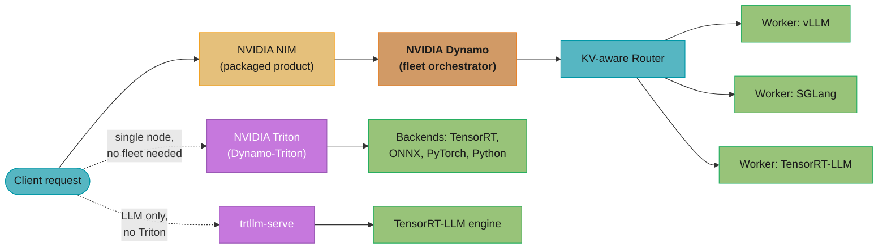
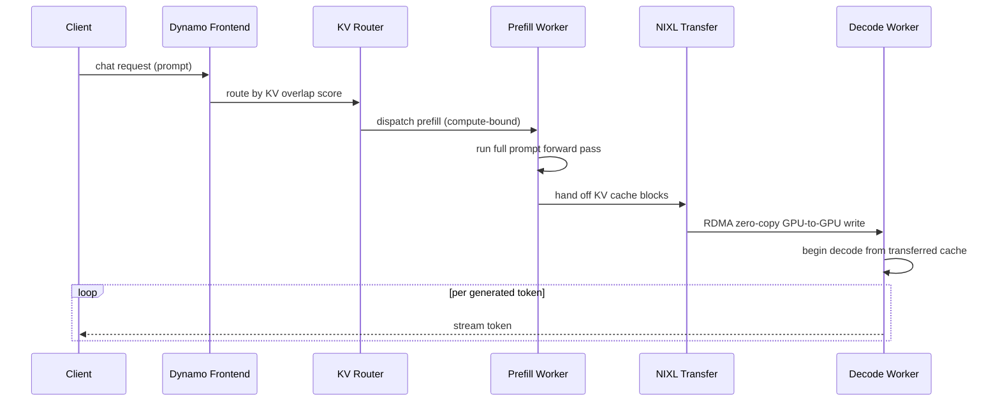
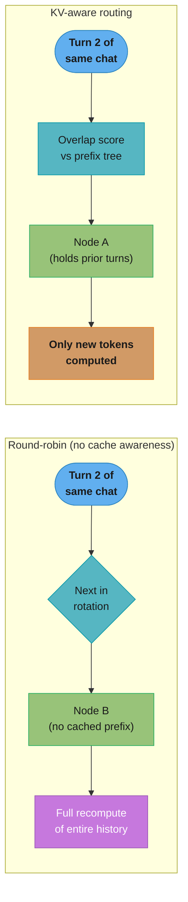

# Dynamo and the NVIDIA Serving Stack

> **Version anchor (2026-10-19).** NVIDIA Dynamo **v1.5.1** (released 2026-10-07,
> `github.com/ai-dynamo/dynamo`), building on the **Dynamo 1.0** production-grade release
> announced at GTC 2026. Dynamo v1.5.0 (2026-09-21) deprecated the KV Block Manager (KVBM)
> with removal targeted for v1.7.0, removed the Go Endpoint Picker in favour of the Rust EPP,
> and renamed AIConfigurator to AISimulate. TensorRT-LLM **1.2.x** (official release-notes
> page, top entry "TensorRT-LLM Release 1.2"). Triton NGC container **26.09-py3** (server
> release 2.73.0, 2026-09-30); NVIDIA ships a new monthly tag, so check
> `catalog.ngc.nvidia.com` before pinning. NVIDIA's own product page brands the
> classic server **"NVIDIA Dynamo-Triton"** — the Dynamo *platform* name applied to the
> Triton *product* — a naming umbrella, not a replacement. Tag version-specific behavior
> inline.

This file answers the question [the Triton module](nvidia_triton_inference_server.md) does
not: given NVIDIA's current product lineup, which serving product do you actually reach
for, and what changes when you also have large, distributed LLMs to serve. It assumes you
have read the parent module's §1, §4, §8, §9 and §11.

---

## 1. Concept Overview

NVIDIA ships five things that all answer "how do I run a model on an NVIDIA GPU," and they
sit at four different layers. Conflating them is the single most common confusion in
NVIDIA's current stack, so start with the map:

| Layer | Product | What it is | Runs on |
|---|---|---|---|
| Engine | **TensorRT-LLM** | Compiled, optimized execution engine for transformer LLMs (in-flight batching, paged KV cache, FP8/INT4) | One node's GPUs |
| Engine | vLLM, SGLang | Open-source LLM engines with their own continuous batching and paged attention | One node's GPUs |
| Server | **NVIDIA Triton** (branded **Dynamo-Triton**) | General-purpose multi-framework model server: one process, many models, many backends, dynamic batching | One node |
| Server | **`trtllm-serve`** | TensorRT-LLM's own OpenAI-compatible server entrypoint — no Triton in the path | One node |
| Distributed orchestrator | **NVIDIA Dynamo** | Schedules and routes across a *fleet* of nodes, KV-cache-aware, disaggregates prefill/decode | Many nodes |
| Packaged product | **NVIDIA NIM** | A container bundling a chosen engine (TensorRT-LLM or vLLM) + a specific model + an OpenAI-compatible route, ready to `docker run` | One node (can sit in front of a Dynamo deployment for multi-node) |

Read the table bottom-up for the honest positioning: **Triton is not deprecated, not
removed, and not being replaced by Dynamo.** It was folded into NVIDIA's broader "Dynamo"
product umbrella and rebranded on NVIDIA's site as **Dynamo-Triton** (2025-03-18, at GTC
2025), but the underlying open-source project (`triton-inference-server/server`) ships a
new NGC container every month, unchanged in scope: a general-purpose, multi-framework,
single-node model server. Dynamo is a *separate, newer, additive* framework — its own docs
say it "builds on the successes of the NVIDIA Triton Inference Server" rather than
supersedes it. Dynamo does not replace Triton as a model server; it replaces the *fleet*
that a Triton deployment used to need hand-rolled Kubernetes and a dumb load balancer to
become.

**The three genuinely new names this file adds** that [the Triton
module](nvidia_triton_inference_server.md) never mentions: **Dynamo** (the distributed
orchestrator), **`trtllm-serve`** (TensorRT-LLM's own server, bypassing Triton entirely),
and **NIM** as a *product* (the parent module names it only in passing as a packaging
layer). Everything else here — TensorRT-LLM, GenAI-Perf, KServe v2 — the parent module
already teaches; this file extends those threads into the distributed-serving problem.

For choosing a serving platform (KServe, Ray Serve, Triton, and others), see [Model Serving Platforms](../../mlops/model_serving_platforms/model_serving_platforms.md), and for disaggregated prefill and decode across engines, see [Distributed Inference and Disaggregation](../../mlops/distributed_inference_and_disaggregation/distributed_inference_and_disaggregation.md), both in `mlops/`.

---

## 2. Intuition

> **One-line model:** Triton serves models on a node; Dynamo schedules a fleet of nodes
> around a KV cache.

Triton's unit of work is a request queue on one process. Dynamo's unit of work is a
*conversation's KV cache* — a multi-gigabyte piece of GPU state that a request must find,
reuse, and eventually hand off, potentially across machines. A single-node server has
nothing to route *to*; once you have more than one GPU serving the same model, the question
stops being "how do I batch requests" (Triton's whole job) and becomes "which GPU already
has this conversation's cache, and should prefill and decode even happen on the same GPU."
That second question does not exist at Triton's scale, and answering it is Dynamo's entire
reason to exist.

---

## 3. Core Principles

- **Prefill and decode have opposite hardware profiles.** Prefill (processing the prompt)
  is compute-bound — one big parallel matmul over every prompt token. Decode (generating
  tokens one at a time) is memory-bandwidth-bound — a tiny matmul per step, dominated by
  reading the KV cache. Serving both phases on the same GPU with the same batching policy
  means neither is well-tuned; the compute-heavy phase wants large batches, the
  bandwidth-heavy phase wants to avoid VRAM pressure from oversized batches.
- **The KV cache is the scarce, mobile resource that decides throughput.** It is
  gigabytes per long conversation, it must live in GPU HBM to be useful, and unlike model
  weights it is *per-request*, not shared. Whoever decides where a request's cache lives —
  and whether an existing cache can be reused — controls most of the achievable throughput.
- **Routing must see engine-internal state, not just node health.** A load balancer that
  round-robins on latency or CPU has no idea which node already holds a request's cache
  prefix. Routing on that information (cache locality) rather than naive load balancing is
  the difference between a cache hit and a full recompute.
- **SLO-driven capacity beats fixed replica counts.** A fixed prefill:decode replica ratio
  is wrong the moment traffic shape changes (short chat turns vs. long-document
  summarization shift the compute/bandwidth balance). Capacity should be derived from a
  latency target (time-to-first-token, inter-token latency) and current traffic, not set
  once at deploy time.
- **Disaggregation is an availability tradeoff, not a free lunch.** Splitting prefill and
  decode onto separate GPU pools requires moving the KV cache across a network boundary
  before decode can start — a new failure mode and a new latency term that a single-node
  server never has to reason about.

---

## 4. Types / Architectures / Strategies

Seven deployment shapes; 4.1 to 4.5 are roughly ordered by operational cost, and 4.6 and 4.7 are packaging and integration options:

### 4.1 Single-node Triton
One Triton process, one or a few models, `instance_group` handles GPU sharing. No routing
problem exists because there is only one place a request can go. This is [the Triton
module](nvidia_triton_inference_server.md)'s entire subject.

### 4.2 Triton behind a plain load balancer
Multiple Triton replicas of the *same* model behind a round-robin or least-connections LB.
Scales throughput linearly for stateless models; for LLMs it is actively harmful, because
the LB has no notion of KV-cache locality and will bounce a follow-up turn in a
conversation to a node that never saw the earlier turns, forcing a full recompute.

### 4.3 `trtllm-serve` direct
One TensorRT-LLM engine served by its own OpenAI-compatible endpoint, no Triton anywhere in
the path. The simplest possible LLM-only deployment — appropriate for a single large model
on a single node where you do not need Triton's multi-framework surface at all.

### 4.4 Dynamo aggregated
A Dynamo frontend plus a KV-aware router plus a pool of workers (running vLLM, SGLang, or
TensorRT-LLM) where each worker still does *both* prefill and decode for the requests
routed to it — the multi-node version of a plain LB, but routing on cache locality instead
of round-robin. This is the easiest Dynamo shape to operate and the right default before
reaching for disaggregation.

### 4.5 Dynamo disaggregated (prefill/decode split)
Separate worker pools for prefill and decode, connected by NIXL for KV-cache transfer. A
request's prompt is processed on a prefill worker, the resulting KV cache is moved (RDMA,
zero-copy, non-blocking) to a decode worker, and generation proceeds there. This is the
shape that needs the SLO Planner, the KV Router, and NIXL all working
together, plus engine-side KV offloading for host and disk tiers: the highest operational cost, reserved for fleets large enough that
independently scaling prefill and decode capacity actually pays for itself.

### 4.6 NIM as a packaged unit
A `docker run`-able container with the engine, the model, and the OpenAI-compatible route
already assembled. NIM can front either a single-node deployment or sit in front of a
Dynamo fleet for multi-node — it is a packaging choice, orthogonal to whether the thing
underneath is one GPU or a hundred.

### 4.7 Triton models behind the Dynamo Frontend (`dynamo.triton`, experimental `[1.5]`)
Dynamo v1.5.0 added a `dynamo.triton` backend, launched like every other runtime with
`python -m dynamo.triton`, that serves models from a Triton model repository as Dynamo
workers. Vision, embedding and other tensor-in, tensor-out models then sit behind the same
Dynamo Frontend, discovery, health checks and metrics as the LLM workers, so one endpoint
can serve both. It is experimental: interfaces and defaults may change without a
deprecation cycle, and no prebuilt image ships for v1.5.0, so you build it from Dynamo's
Triton runtime recipe on an `nvcr.io/nvidia/tritonserver` base. Use it when a pipeline
needs an embedder or a vision encoder next to an LLM behind one front door; keep a plain
Triton fleet for a large non-LLM estate that gains nothing from Dynamo routing.

The seven shapes side by side:

| Shape | Ops burden | Multi-node | KV-cache aware | Right for |
|---|---|---|---|---|
| Single-node Triton | Lowest | No | N/A | Mixed CV/tabular/LLM fleet on one box |
| Triton + plain LB | Low | Yes (naively) | No | Stateless, non-LLM models at scale |
| `trtllm-serve` direct | Low | No (single node) | N/A | One LLM, simple stack, no multi-framework need |
| Dynamo aggregated | Medium | Yes | Yes | Most multi-node LLM deployments |
| Dynamo disaggregated | High | Yes | Yes | Large fleets where P:D ratio must flex independently |
| NIM | Low (packaging only) | Depends what's inside | Depends what's inside | Fast turnkey deploy, less tuning control |
| `dynamo.triton` behind Dynamo Frontend | Medium, experimental | Yes | N/A for the Triton models | A few non-LLM models that must share an endpoint with Dynamo LLM workers |

---

## 5. Architecture Diagrams

### 5.1 The Product Stack



The solid path is the distributed-LLM path this file covers; the dashed paths are the two
single-node shortcuts — Triton for a mixed fleet, `trtllm-serve` for one LLM with nothing
else to consolidate.

### 5.2 Disaggregated Prefill/Decode Request Path



Prefill and decode run on different GPU pools, chosen for their opposite compute profiles.
The KV cache crosses the node boundary exactly once, over NIXL's RDMA path, not through
host memory or the client.

### 5.3 KV-Aware Routing vs. Round-Robin



Round-robin treats every request as stateless and pays a full recompute on every turn of a
conversation; the KV router scores each candidate worker by how much of the request's
prefix it already holds and sends the request there instead, turning a cache miss into a
hit.

---

## 6. How It Works — Detailed Mechanics

### 6.1 The KV-Aware Router

Dynamo's frontend does not load-balance on request count or CPU — it computes an **overlap
score** per candidate worker: how many of the request's KV-cache blocks (tokenized prompt,
chunked into fixed-size blocks) already sit in that worker's cache, tracked globally via a
prefix tree (`KvIndexer`) built from each worker's own KV cache events. A `kv-overlap-score-
weight` parameter (default `1.0`) trades off prefill savings against decode-side load —
raise it to favor routing toward cache hits even if that worker is a little busier on
decode; lower it to spread decode load more evenly. The router's cost model separately
estimates the request's decode cost (from its active blocks) and its prefill cost (from the
blocks it would need to newly compute), and routes to minimize the sum, not just the cache
hit rate in isolation.

### 6.2 NIXL — Moving KV Cache Off the GPU That Computed It

**NIXL** (NVIDIA Inference Xfer Library) is the transport underneath every KV-cache move in
Dynamo. It exists because a KV cache transfer has a shape no general-purpose network
library was built for: many small, addressable blocks that must move GPU VRAM → GPU VRAM,
non-blockingly, while the source GPU keeps serving other requests. NIXL exposes remote
memory as addressable blocks (each worker registers its KV cache pool's memory descriptors,
e.g. in `etcd`, at startup) and issues RDMA read/write operations directly against those
descriptors — the requesting side does not need the remote engine to explicitly hand
anything over. It supports five backends: **RDMA/InfiniBand**, **RoCE via UCX**, a **TCP
fallback** (works anywhere, slowest), **NVMe-oF** (spilling to fast local storage), and an
**S3-compatible** object-store backend (for the coldest tier). The result is a zero-copy,
non-blocking GPU-to-GPU handoff — no trip through host DRAM, no request-response
round-trip, just a direct write into the decode worker's cache pool.

### 6.3 KV-Cache Tiering and the KVBM Deprecation

GPU HBM is the fastest and smallest place to hold KV cache; not every active or
recently-used conversation fits. The answer is a tiered hierarchy, **GPU HBM, then host
DRAM, then NVMe or object storage**: cold blocks are evicted downward and a block is
promoted back to HBM when a request needs it again. Dynamo shipped this as the **KV Block
Manager (KVBM)**, which Dynamo v1.5.0 (2026-09-21) deprecated with removal targeted for
v1.7.0. The v1.5.0 migration note points host and disk tiering at the inference engine's
native KV offloading (vLLM, SGLang, TensorRT-LLM), and scopes cross-node KV sharing to the
separate, early-stage KV Cache Runner project, which does not replace KVBM. This
is the mechanism that makes a KV-cache "hit" possible even for a conversation that has been
idle for minutes: the block did not have to survive in the fastest tier the whole time, it
only had to survive *somewhere* Dynamo knows how to find and re-fetch quickly.

### 6.4 Disaggregated Serving — the Prefill → Decode Handoff, Step by Step

1. Client request lands on the Dynamo frontend; the router picks a prefill worker (by
   overlap score, load, or both).
2. The prefill worker runs the full prompt through one wide forward pass — this is the
   compute-bound phase, and it wants a GPU generation tuned for raw FLOPs, potentially a
   cheaper or different SKU than the decode fleet.
3. On completion, the prefill worker's KV cache blocks are transferred via NIXL directly
   into the decode worker's cache pool — non-blocking, so the prefill GPU is free to start
   the next request's prefill immediately rather than waiting on the transfer.
4. The decode worker begins generating tokens from the transferred cache, streaming them
   back to the client. This phase is bandwidth-bound: it wants more VRAM headroom for more
   concurrent sequences, not more raw compute.

Splitting these phases onto separate GPU pools is reported (NVIDIA's own materials, and
third-party benchmarks such as SemiAnalysis's InferenceX run on Blackwell) to raise
effective throughput per GPU substantially over a single aggregated pool for chat-shaped
traffic — because neither pool is now running a batching policy tuned for the *other*
phase's opposite profile. Treat any specific multiplier as workload- and hardware-specific;
measure it on your own traffic shape before committing to the extra operational cost (see
§9).

### 6.5 The SLO Planner

The Planner is Dynamo's autoscaler, and it targets **latency SLAs directly** —
time-to-first-token (TTFT) and inter-token latency (ITL) — rather than a proxy like CPU or
even GPU utilization. It runs in two modes:

- **Throughput-based (primary, production default)** — uses pre-deployment profiling data
  (how this engine's TTFT/ITL scale with batch size and sequence length) plus a traffic
  predictor to compute the prefill and decode replica counts needed to hit the SLA target
  over the next scaling interval.
- **Load-based (fast-reacting)** — reads live per-worker signals (active prefill tokens,
  active KV blocks) from the router and fits an online linear regression to react to
  traffic bursts faster than the throughput-based mode's prediction window allows.

Both modes scale prefill and decode replica counts **independently and non-blockingly** —
the entire reason disaggregation is worth the operational cost in the first place: a
traffic shift toward long documents can grow the prefill pool without touching decode, and
vice versa.

### 6.6 Grove — Topology-Aware Kubernetes Deployment

A disaggregated Dynamo deployment is not one Kubernetes Deployment, it is several
interdependent pod groups (frontend, router, N prefill workers, M decode workers) that must
often be **placed close together on the network** — inside the same NVLink domain, for
instance — because the prefill→decode NIXL transfer's latency depends on it. **Grove**
provides a single CRD (`PodGang`) that declares this whole multi-component workload as one
spec: minimum-replica gang-scheduling per component (all-or-nothing placement), explicit
startup ordering, and topology-aware placement. Grove sits on top of two lower layers it
depends on: **DRA** (Dynamic Resource Allocation, the Kubernetes mechanism that exposes
structured GPU/NVLink-topology attributes to the scheduler) and **KAI Scheduler** (which
does the actual gang-scheduling and fair-share queuing against those attributes). Without
Grove, achieving the same placement guarantees means hand-writing pod affinity/anti-affinity
rules per component and re-deriving them every time the topology changes.

### 6.7 `trtllm-serve` — Invocation and When It Bypasses Triton Entirely

`trtllm-serve` is TensorRT-LLM's own server: an OpenAI-compatible REST (and gRPC) endpoint
with no Triton process anywhere in the request path.

```bash
# single-node, tensor-parallel across 4 GPUs
trtllm-serve /path/to/model \
  --backend pytorch \
  --tp_size 4 \
  --host 0.0.0.0 --port 8000

# gRPC mode, for a deployment fronted by an external router (e.g. sgl-router)
trtllm-serve /path/to/model --backend pytorch --tp_size 4 --grpc --port 50051

# multi-node on Slurm
trtllm-llmapi-launch trtllm-serve /path/to/model --backend pytorch --tp_size 8 --pp_size 2
```

Reach for it when the deployment is a single LLM (or a small number of them, each with its
own process) and you have no other framework or model type to consolidate onto a shared
server — it is strictly less machinery than routing the same model through Triton's
`tensorrtllm` backend. It is also the natural single-node building block *inside* a Dynamo
worker: a Dynamo TensorRT-LLM worker is, underneath, a `trtllm-serve`-class process that the
router and planner treat as one addressable unit.

### 6.8 Why Triton's Dynamic Batcher Structurally Cannot Disaggregate

[The Triton module](nvidia_triton_inference_server.md) §6.18 already notes Triton is
fundamentally single-node — one model must fit within one node's GPUs. The deeper reason
disaggregation is not a config flag away: the dynamic batcher forms a batch of requests
that are all dispatched to the **same model instance's `execute()` call**, in the **same
process**, against **one loaded engine**. Batching is a grouping decision made *before* a
single forward pass; it has no concept of splitting one request's own generation into two
phases that run on two different processes, on two different GPUs, potentially on two
different nodes, with a cache transfer in between. `instance_group.count` gives you more
*copies* of the same, whole model — replication, not phase-splitting. Building
disaggregation into Triton would mean the dynamic batcher tracking per-request phase state
across a network hop and a live hand-off to a different server process — a different
scheduler with a different unit of work, which is exactly what Dynamo's router and NIXL
are.

### 6.9 Benchmarking — AIPerf, GenAI-Perf, and Token-Level Metrics

[The Triton module](nvidia_triton_inference_server.md) §11.1 already introduces
**GenAI-Perf** as the LLM-aware layer over `perf_analyzer`. As of this file's version
anchor, **GenAI-Perf is in maintenance mode — NVIDIA is not adding new features to it — and
the actively developed successor is AIPerf** (`github.com/ai-dynamo/aiperf`), built for
Dynamo's distributed shape: a multiprocess architecture (roughly ten cooperating services
over ZMQ) rather than GenAI-Perf's single-process design, so it scales to benchmarking a
disaggregated multi-node deployment without becoming the bottleneck itself. NVIDIA ships a
migration guide from GenAI-Perf to AIPerf; both speak the same OpenAI-compatible endpoints,
so the target you point them at does not change, only which binary generates the load.

Whichever tool you use, benchmark on **token-level metrics**, not request latency:

| Metric | What it measures | Why request latency alone misses it |
|---|---|---|
| TTFT (time to first token) | Prefill latency + queueing | Dominated by prompt length; invisible in a single end-to-end number |
| ITL (inter-token latency) | Per-step decode latency | Determines perceived "typing speed"; a slow decode looks fine in total latency if the response is short |
| Output-token throughput | Tokens/sec across all concurrent sequences | The number that actually says whether the GPU is saturated |
| Request throughput | Requests/sec | Misleading alone — a fleet can max this out with tiny/truncated responses |

Benchmarking a streaming LLM endpoint with a generic HTTP load tool reports one latency
number that conflates all four, which is precisely the gap GenAI-Perf (and now AIPerf) was
built to close — see the war story in §10 for what that conflation costs in practice.

---

## 7. Real-World Examples

- **AWS, Microsoft Azure, Google Cloud, and Oracle Cloud Infrastructure** have all
  integrated Dynamo into their managed inference stacks. AWS's integration guide runs
  Dynamo on Amazon EKS with EFS/FSx for Lustre for model storage and EFA for the
  low-latency inter-node communication NIXL's RDMA path needs.
- **Microsoft Azure's AKS Engineering Blog** (multi-part series) deployed Qwen3-32B across
  4 nodes of 8x H100 GPUs, replaying ~23,000 requests from the Mooncake Tool Agent Traces
  dataset, and compared round-robin against Dynamo's KV-aware routing on identical hardware
  — isolating routing as the only variable — then repeated the exercise with Grove for
  topology-aware placement.
- **Baseten** reported roughly **2x faster inference** after adopting KV-cache-aware
  routing over their prior load balancer — a vendor-reported data point, not a universal
  multiplier. **SemiAnalysis's InferenceX benchmark**, an independent third party, measured
  **~7x more requests served** on Blackwell running DeepSeek R1-0528 through Dynamo versus
  its comparison baseline in that specific configuration — read the methodology before
  treating either number as a general expectation for your own traffic.
- **Perplexity, PayPal, Pinterest, and Cursor** are named by NVIDIA as production Dynamo
  deployments — search, fraud/risk inference, recommendation, and coding assistance
  respectively, a genuinely heterogeneous set of LLM-serving problems.
- **NVIDIA NIM** containers are built on this same stack underneath — a NIM for a large
  model can itself be a packaged Dynamo deployment once the model needs more than one node.

---

## 8. Tradeoffs

**Triton vs. Dynamo vs. `trtllm-serve` vs. NIM vs. standalone vLLM**

| | Triton (Dynamo-Triton) | Dynamo | `trtllm-serve` | NIM | Standalone vLLM |
|---|---|---|---|---|---|
| Scope | Single node, any framework | Multi-node fleet, LLM-focused | Single node, TensorRT-LLM only | Packaged single model | Single node, LLM-focused |
| Multi-model / multi-framework | Yes, its core strength | No (orchestrates LLM engines only) | No | No | No |
| Multi-node | No | Yes, its core strength | No | Only if wrapping Dynamo underneath | No |
| KV-cache-aware routing | No | Yes | No | Depends what's inside | No (vLLM does its own local paging, not fleet-wide routing) |
| Ops burden to stand up | Medium | High | Low | Lowest (turnkey) | Low |
| Licence / support | Open-source, NVIDIA AI Enterprise available | Open-source, NVIDIA AI Enterprise available | Open-source (part of TensorRT-LLM) | Commercial (NVIDIA AI Enterprise) | Open-source (Apache 2.0) |
| Best fit | Heterogeneous non-LLM/LLM fleet, one node | Large-scale distributed LLM serving | One LLM, minimal stack | Fast turnkey deploy, less tuning control | LLM-only shop wanting full engine control |

**Aggregated vs. disaggregated Dynamo**

| | Aggregated | Disaggregated |
|---|---|---|
| Worker does both phases | Yes | No — separate prefill/decode pools |
| Needs NIXL for KV transfer | No | Yes |
| Scales P and D independently | No | Yes |
| Extra failure mode | None beyond a normal worker | KV-transfer path (network) becomes a dependency |
| Right for | Most multi-node deployments | Large fleets with a P:D ratio that shifts under real traffic |

This section owns the **NVIDIA product family**; the *pattern* of distributed LLM
inference generally — continuous batching, paged attention, speculative decoding — is
owned by [vLLM](../../llm/vllm_deep_dive/vllm_deep_dive.md) and [LLM inference and
decoding](../../llm/inference_and_decoding/inference_and_decoding.md). Read those for the
engine-level mechanics that Dynamo's TensorRT-LLM, vLLM, and SGLang workers all build on;
read this file for which NVIDIA product wraps them into a fleet.

---

## 9. When to Use / When NOT to Use

**Stay on single-node Triton when:**

- You have a **heterogeneous fleet** — CV models, tabular/tree models, embedders, a couple
  of small-to-medium LLMs — that fits on one node's GPUs. This is still Triton's strongest
  case, and nothing about Dynamo's existence changes it.
- **QPS is modest and one GPU pool serves it fine.** A single 7B model behind a few hundred
  QPS does not need a fleet-scale KV router, a planner, or NIXL — that is solving a scaling
  problem you do not have yet, at real operational cost (see §10).
- You need **ensembles or BLS** — server-side multi-stage pipelines with no client
  round-trips — which Dynamo does not provide; it orchestrates LLM engines, not arbitrary
  DAGs.

**Reach for Dynamo when:**

- The model (or the aggregate traffic) genuinely spans **multiple nodes**, and you are
  already managing multiple GPU replicas of the same LLM behind a naive load balancer that
  is throwing away KV-cache locality on every follow-up turn.
- Traffic is **conversational or agentic** — repeated turns against the same context — so
  cache-aware routing has something real to reuse. A workload of one-shot, independent
  requests gets little from KV-aware routing.
- You have measured (§6.9, §10) that prefill and decode genuinely compete for the same GPU
  pool's capacity in a way that hurts your SLO, and disaggregating is the fix — not a
  default starting point.

**Over-engineering to watch for:** deploying Dynamo's full disaggregated shape — Planner,
KV Router, NIXL, Grove — for a workload that fits on one GPU is adding a fleet scheduler,
a gang-scheduling CRD, and an RDMA transport to a problem a single `trtllm-serve` process
already solves. Start with the simplest shape in §4 that meets today's SLO, and move down
the list only when you have the traffic and the measurements to justify it.

---

## 10. Common Pitfalls (Production War Stories)

- **Adopting Dynamo for a single-GPU workload.** A team serving one 7B model at a few
  hundred QPS stands up the full disaggregated stack — separate prefill/decode pools,
  NIXL, the Planner — because it is "the new NVIDIA way." The model fits on one GPU with
  room to spare; the KV cache never needs to leave the box. Result: more moving parts (a
  router, a planner, an RDMA-capable network path) than the workload has any use for, and a
  new class of failure (a stuck KV transfer) that a single-node deployment could never hit.
  Fix: start at §4.3 or §4.1; move to Dynamo only when multi-node capacity is the actual
  constraint.
- **Disaggregation on a network that cannot carry the KV traffic.** A team enables
  disaggregated serving on a cluster whose inter-node fabric is plain TCP over a shared
  10GbE link, not RDMA/InfiniBand or RoCE. NIXL falls back to its TCP path, and the
  prefill→decode handoff latency dominates the response time — worse than not
  disaggregating at all, because now every request pays a slow cache transfer on top of the
  phases it used to run locally. Fix: verify the fabric (RDMA/InfiniBand or RoCE via UCX)
  before adopting disaggregation; on TCP-only infrastructure, aggregated Dynamo or
  single-node serving both beat a disaggregated deployment with no fast transport.
- **Routing on the wrong metric.** A team wires the KV router's overlap-score weight to
  maximize cache hit rate alone, ignoring decode-side load. Requests pile onto the one
  worker with the best-cached prefix while other decode workers sit idle, and that worker's
  ITL degrades under the concentrated load. Fix: the router's cost model already balances
  prefill savings against decode cost — tune `kv-overlap-score-weight` down rather than
  chasing hit rate in isolation, and watch ITL, not just cache-hit percentage.
- **Benchmarking with request-count concurrency instead of token metrics.** A team
  benchmarks a new LLM deployment with a generic HTTP load tool and reports "P99 latency:
  400ms," which looks great — because the tool measured time-to-first-token on short
  prompts and never observed inter-token latency on long generations, where the real
  degradation was hiding. Production users complain about "slow typing" the load test never
  caught. Fix: benchmark with GenAI-Perf or AIPerf against realistic input/output token
  length distributions, and report TTFT and ITL separately, not one blended number.
- **Assuming Triton is EOL and rewriting a working CV fleet.** A platform team reads that
  NVIDIA "rebranded Triton as part of Dynamo" and concludes the product is being sunset,
  then spends a quarter migrating 40 stable computer-vision models off Triton onto a
  hand-rolled FastAPI fleet for no functional gain — losing dynamic batching, ensembles, and
  a unified metrics surface in the process. Triton ships a new NGC container every month;
  it was not deprecated. Fix: read the release cadence and the actual documentation before
  treating a rebrand as an end-of-life signal.
- **Ignoring the KV offload tier's eviction policy under bursty idle periods.** A chat
  application's users frequently pause mid-conversation for minutes; the engine's KV
  offloading evicts idle blocks down to host DRAM or further, and a burst of returning users all hit a
  cold cache simultaneously, causing a latency spike that looks like a capacity problem but
  is actually a hierarchy-tier miss. Fix: size the DRAM tier for the realistic idle-return
  distribution, not just the hot-path working set, and watch cache-tier hit rates as their
  own signal, separate from GPU-resident cache hit rate.

---

## 11. Technologies & Tools

### 11.1 Dynamo Platform Components

| Tool | What it does |
|---|---|
| NVIDIA Dynamo | Distributed inference orchestrator that routes and schedules LLM serving across a fleet of GPU nodes. |
| Dynamo SLO Planner | Autoscaler that sizes prefill and decode replica counts to hit TTFT/ITL latency targets. |
| Dynamo KV Router | Routes requests by KV-cache overlap score instead of round-robin, minimizing redundant recompute. |
| NIXL | Low-latency transfer library moving KV-cache blocks GPU-to-GPU across RDMA, RoCE, TCP, NVMe-oF or S3. |
| Dynamo KV Block Manager | Tiered KV-cache block manager (HBM, DRAM, cold storage); deprecated in v1.5.0, removal targeted for v1.7.0. |
| Grove | Kubernetes CRD for topology-aware gang scheduling of multi-component disaggregated deployments. |
| KAI Scheduler | Kubernetes scheduler performing gang scheduling and fair-share queuing beneath Grove. |

### 11.2 Benchmarking and Packaging

| Tool | What it does |
|---|---|
| AIPerf | Multiprocess benchmarking tool measuring LLM serving performance; successor to GenAI-Perf. |
| GenAI-Perf | LLM-aware load generator measuring TTFT, inter-token latency and throughput; now in maintenance mode. |
| trtllm-serve | TensorRT-LLM's own OpenAI-compatible REST and gRPC server, with no Triton in the path. |
| NVIDIA NIM | Packaged, containerized inference microservice bundling an engine, a model and an OpenAI-compatible API. |

Related reading: [the Triton module](nvidia_triton_inference_server.md) ·
[vLLM deep dive](../../llm/vllm_deep_dive/vllm_deep_dive.md) ·
[LLM inference and decoding](../../llm/inference_and_decoding/inference_and_decoding.md) ·
[Kubernetes scheduling and autoscaling](../../devops/kubernetes_scheduling_and_autoscaling/kubernetes_scheduling_and_autoscaling.md)

---

## 12. Interview Questions with Answers

**Q: We run 40 CV models and 3 LLMs on one Triton fleet — what actually moves to Dynamo?**
**Short:** The 3 LLMs may move to Dynamo or trtllm-serve; the 40 CV models stay on Triton, which is not going anywhere.
Nothing about the 40 CV models changes — Triton remains actively maintained and is exactly the right server for a heterogeneous multi-framework fleet with no fleet-wide KV cache to route around. The 3 LLMs are the candidates: if they are single-node and modest QPS, `trtllm-serve` or staying on Triton's `tensorrtllm` backend is simpler than adopting Dynamo. If they are large enough to span multiple nodes, or traffic is conversational enough that cache-aware routing matters, that subset moves to a Dynamo deployment. Splitting the fleet this way — not an all-or-nothing migration — is the correct read of NVIDIA's current lineup.

**Q: Is Triton deprecated now that NVIDIA has Dynamo?**
**Short:** No — Triton ships a new NGC container monthly and Dynamo is additive, not a replacement.
No. Triton was folded into NVIDIA's broader "Dynamo" product umbrella and rebranded on NVIDIA's own site as Dynamo-Triton, but the open-source project still ships a new NGC container every month with the same scope: a general-purpose, multi-framework, single-node model server. Dynamo's own documentation says it "builds on the successes" of Triton rather than replacing it — Dynamo solves a different problem, fleet-scale distributed LLM serving, that a single-node server was never designed to solve. Treat the rebrand as a marketing umbrella, not an end-of-life signal, and verify against the actual release cadence before assuming otherwise.

**Q: Why can't you just turn on disaggregated prefill/decode in Triton's config?**
**Short:** Triton's dynamic batcher groups requests into one execute() call on one instance; it has no concept of splitting one request across two processes.
Because the dynamic batcher's unit of work is a batch of requests dispatched to one model instance's `execute()` call, in one process, against one loaded engine — a decision made before any forward pass runs. Disaggregation needs a single request's own generation to run its prefill phase on one process/GPU and its decode phase on a different one, with a live KV-cache transfer across a network boundary in between — a different scheduling model entirely, not a batching-policy tweak. `instance_group.count` gives you more replicas of the same whole model, not a phase split. That capability is what Dynamo's router and NIXL exist to provide.

**Q: What is `trtllm-serve`, and why would you use it over Triton for an LLM?**
**Short:** trtllm-serve is TensorRT-LLM's own OpenAI-compatible server with no Triton process in the request path.
`trtllm-serve` is TensorRT-LLM's own OpenAI-compatible REST/gRPC entrypoint — you point it at a model, choose tensor/pipeline parallelism with `--tp_size`/`--pp_size`, and it serves without any Triton process involved. Use it when the deployment is one LLM (or a few, each its own process) with nothing else to consolidate onto a shared multi-framework server — it is strictly less machinery than routing the same model through Triton's `tensorrtllm` backend. It is also the natural single-node unit that sits inside a Dynamo TensorRT-LLM worker once you scale past one node.

**Q: GenAI-Perf and AIPerf both benchmark LLM serving — which do you reach for now?**
**Short:** AIPerf is the actively developed successor; GenAI-Perf is in maintenance mode with no new features.
Reach for AIPerf for new benchmarking work — NVIDIA has stopped adding features to GenAI-Perf and ships a migration guide to AIPerf, which is built with a multiprocess architecture that scales to benchmarking a disaggregated multi-node Dynamo deployment. Both speak the same OpenAI-compatible endpoint, so switching tools does not change what you point them at. GenAI-Perf still works and existing pipelines built on it are not broken, but greenfield tooling should default to AIPerf.

**Q: What does NVIDIA NIM actually add on top of Dynamo and Triton?**
**Short:** NIM packages a chosen engine, a specific model, and an OpenAI-compatible route into one turnkey container.
NIM is a packaging layer, not a separate serving technology — a container bundling a chosen engine (TensorRT-LLM or vLLM), a specific optimized model, and an OpenAI-compatible API surface so you `docker run` a ready endpoint instead of assembling Triton/`trtllm-serve`/Dynamo configuration yourself. For a large model that needs multiple nodes, what is inside a NIM container can itself be a packaged Dynamo deployment. Reach for NIM when fast turnkey deployment matters more than fine-grained tuning control; reach past it to raw Dynamo or `trtllm-serve` when you need to hand-tune batching, routing, or precision beyond what the packaged defaults expose.

**Q: How does the KV-aware router decide where to send a request, concretely?**
**Short:** It computes an overlap score between the request's prefix and each worker's cached KV blocks, weighted against decode load.
It tokenizes the request into fixed-size blocks and checks each candidate worker's cached blocks — tracked globally via a prefix tree built from every worker's own KV-cache events — to compute an overlap score: how much of this request's prefix that worker already holds. That score is weighted against an estimate of the worker's current decode cost via a tunable parameter (`kv-overlap-score-weight`, default 1.0), so the router balances prefill savings from a cache hit against not overloading an already-busy decode worker. Raising the weight favors cache locality more aggressively; lowering it spreads load more evenly at the cost of more recompute.

**Q: What problem does NIXL solve that a normal RPC framework doesn't?**
**Short:** NIXL moves KV-cache blocks GPU-VRAM-to-GPU-VRAM directly, non-blockingly, without a host round-trip.
A normal RPC framework serializes data through host memory and a request/response cycle, which is far too slow and blocking for moving gigabytes of live KV cache between GPUs on every prefill-to-decode handoff. NIXL instead exposes each worker's registered KV-cache memory as addressable blocks and issues direct RDMA read/write operations against them, so the transfer is zero-copy, GPU-to-GPU, and non-blocking — the source GPU keeps serving other requests while the transfer happens. It supports RDMA/InfiniBand, RoCE via UCX, a TCP fallback, NVMe-oF, and an S3-compatible backend, so the same API works whether the destination is another GPU on the rack or a cold storage tier.

**Q: What does a Dynamo deployment's KV-cache memory hierarchy contain, top to bottom, now that KVBM is deprecated?**
**Short:** GPU HBM, then host DRAM, then NVMe or object storage; since Dynamo v1.5.0 the engine's native KV offloading runs the lower tiers, not KVBM.
Dynamo v1.5.0 deprecated the KV Block Manager (removal targeted for v1.7.0) and points host and disk tiering at the engine's native KV offloading. The tiers are unchanged. GPU HBM holds the hottest, actively-used KV cache; blocks that go cold are evicted down to host DRAM, and the coldest blocks can spill further to NVMe or S3-compatible object storage via NIXL's corresponding backends. A block is promoted back to HBM on demand when a request needs it again, which is what lets a conversation that paused for minutes still get a cache hit instead of a full recompute: the block only had to survive somewhere reachable, not stay resident in the fastest tier the whole time. Size the DRAM tier for your realistic idle-return traffic pattern, not just the always-hot working set.

**Q: What does the SLO Planner actually scale, and on what signal?**
**Short:** It scales prefill and decode replica counts independently, targeting TTFT and inter-token-latency SLAs directly.
It scales prefill and decode worker replica counts independently and non-blockingly, targeting time-to-first-token and inter-token-latency SLA thresholds rather than a proxy metric like CPU or GPU utilization. Its throughput-based mode uses pre-deployment engine profiling plus a traffic predictor for the primary production scaling decision; its load-based mode fits an online regression against live per-worker signals (active prefill tokens, active KV blocks) to react faster to sudden bursts. Independent scaling of the two pools is the entire point of disaggregating in the first place — without it you would just have two fixed-ratio pools instead of one.

**Q: Why does Grove need both DRA and KAI Scheduler underneath it?**
**Short:** DRA exposes GPU/NVLink topology to Kubernetes; KAI Scheduler does the gang scheduling; Grove coordinates the workload spec on top.
Grove provides one declarative spec (the `PodGang` CRD) for a whole multi-component disaggregated deployment, but it needs two lower layers to actually place pods correctly: DRA (Dynamic Resource Allocation) exposes structured GPU and NVLink-topology attributes to the Kubernetes scheduler, and KAI Scheduler consumes those attributes to perform gang scheduling (all-or-nothing placement) and fair-share queuing. Grove sits above both, managing startup ordering and topology-aware placement across the stack it depends on. Without Grove you would hand-write pod affinity/anti-affinity rules per component and re-derive them whenever the topology changes.

**Q: A disaggregated deployment's decode latency spiked after a network change — what's the first thing to check?**
**Short:** Whether the inter-node fabric still supports RDMA/RoCE, since NIXL silently falls back to a slow TCP path otherwise.
Check whether the fabric between the prefill and decode pools still supports RDMA/InfiniBand or RoCE via UCX — if it degraded to plain TCP (a misconfigured NIC, a route now crossing a non-RDMA segment), NIXL falls back to its TCP backend silently, and every request now pays a slow KV-cache transfer where it used to pay a fast RDMA write. This can make disaggregated serving slower than not disaggregating at all, since the transfer cost is now added on top rather than being a fast handoff. Confirm the RDMA/RoCE path is intact before assuming the regression is in the engines or the router.

**Q: What is the Open Inference Protocol, and does Dynamo use it?**
**Short:** It's the current name for the KServe v2 protocol Triton implements; Dynamo speaks OpenAI-compatible APIs instead.
The Open Inference Protocol (OIP) is the current name for what was the KServe v2 (Predict Protocol v2) data-plane contract — the terms are used interchangeably today, and it's the protocol [the Triton module](nvidia_triton_inference_server.md) covers Triton implementing over HTTP and gRPC. Dynamo's frontend, and NIM containers, instead expose an OpenAI-compatible chat/completions API, since that is the surface LLM client libraries and tooling (including AIPerf and GenAI-Perf) already speak. A Dynamo worker running the `tensorrtllm` backend can still sit behind Triton's OIP surface in a non-disaggregated deployment, but the distributed-fleet path standardizes on the OpenAI-compatible contract instead.

**Q: When is aggregated Dynamo the better choice over disaggregated, even at multi-node scale?**
**Short:** When traffic doesn't stress a fixed prefill:decode ratio enough to justify NIXL, the Planner, and a new failure mode.
Aggregated Dynamo — KV-aware routing across a fleet where each worker still does both prefill and decode — is the better choice whenever the traffic's prefill:decode balance is roughly stable and a fixed replica ratio per worker pool isn't leaving throughput on the table. Disaggregation earns its cost (NIXL as a new dependency, the Planner, engine-side KV offload tiers, a network-crossing failure mode) only when prefill and decode genuinely need to scale at different rates under real traffic. Start aggregated, measure whether one phase is starving the other, and disaggregate only once that measurement justifies it.

**Q: How would you benchmark whether disaggregation is worth adopting for your workload, concretely?**
**Short:** Compare TTFT and ITL under realistic concurrency on aggregated versus disaggregated, using AIPerf against real token-length distributions.
Run AIPerf (or GenAI-Perf) against both an aggregated and a disaggregated deployment of the same model, using a token input/output length distribution sampled from real traffic rather than a synthetic uniform one, and compare TTFT and ITL at realistic concurrency, not just peak throughput. If prefill-heavy traffic (long documents) is starving decode latency in the aggregated shape, disaggregation should show a measurable ITL improvement; if the two phases were never contending in the first place, disaggregation adds infrastructure for no measured gain. Treat any vendor-published multiplier (including NVIDIA's own) as a starting hypothesis to verify on your own traffic shape, never a guarantee.

**Q: What's the operational risk of exposing Dynamo's frontend the same way you'd expose Triton?**
**Short:** Neither ships built-in authentication, so both need an authenticating gateway in front regardless of which one you deploy.
Like Triton, Dynamo's frontend and router expose no built-in authentication or authorization — the same gap [the Triton module](nvidia_triton_inference_server.md) §11.3 covers for the single-node case applies here, now across every node in the fleet. Front the Dynamo deployment with the same kind of authenticating gateway (TLS termination, authN/authZ, rate limiting) you would use for Triton, and keep the router's and planner's internal endpoints off any untrusted network. Moving to a distributed architecture does not add security surface Triton already lacked, but it does multiply the number of endpoints you must remember to gate.

**Q: Why might a team see worse latency after migrating an LLM from Triton to Dynamo?**
**Short:** Usually because the workload was single-node and didn't need fleet-scale routing, so Dynamo's extra hops added overhead for nothing.
The most common cause is migrating a workload that never needed multi-node serving in the first place — a model that fit comfortably on one GPU pool gains nothing from a KV-aware router or a fleet-scale frontend, and the extra hop through Dynamo's routing layer is pure overhead compared to serving it directly through Triton's `tensorrtllm` backend or `trtllm-serve`. The fix is not to tune Dynamo harder, it's to recognize the deployment shape in §4 that actually matches the traffic: single-node workloads belong on single-node servers regardless of what NVIDIA's newest product is. Reserve Dynamo for the multi-node, cache-locality-sensitive traffic it was built for.

**Q: What's the relationship between Dynamo's TensorRT-LLM, vLLM, and SGLang workers?**
**Short:** They're the interchangeable engines Dynamo orchestrates; Dynamo adds fleet routing and scheduling on top of whichever you pick.
Dynamo is engine-agnostic at the worker level — a prefill or decode worker can run TensorRT-LLM, vLLM, or SGLang, and the router, Planner, and NIXL transfer logic work the same way regardless of which engine is underneath, since they operate on KV-cache blocks and latency signals rather than engine internals. This means a team already invested in vLLM's ecosystem does not have to switch engines to gain Dynamo's fleet-level routing and disaggregation — they add Dynamo as an orchestration layer over their existing vLLM workers. The choice of engine is still governed by the same tradeoffs [vLLM deep dive](../../llm/vllm_deep_dive/vllm_deep_dive.md) and [LLM inference and decoding](../../llm/inference_and_decoding/inference_and_decoding.md) cover; Dynamo doesn't change which engine is right for a given model and hardware.

**Q: A conversation's second turn is slow even though the first turn was fast — what's the likely routing cause?**
**Short:** The request likely landed on a different worker than turn one, missing the cached prefix and forcing a full recompute.
The most likely cause is that the request was routed by a naive load balancer (round-robin or least-connections) rather than KV-aware routing, so turn two landed on a worker that never processed turn one and holds no cached prefix — forcing a full recompute of the entire conversation history instead of just the new tokens. This is precisely the failure mode KV-aware routing exists to prevent: the router's overlap score should send follow-up turns back to a worker that already holds the matching prefix. Confirm the deployment is actually using Dynamo's KV router (or sticky-session routing at minimum) rather than a plain LB in front of multiple stateless replicas.

---

## 13. Best Practices

- **Default to the simplest shape in §4 that meets today's SLO** — single-node Triton or
  `trtllm-serve` before aggregated Dynamo, aggregated before disaggregated. Each step down
  the list adds real operational surface.
- **Measure before disaggregating** — use AIPerf/GenAI-Perf to confirm prefill and decode
  are actually contending for the same GPU pool's capacity before adopting NIXL, the
  Planner, and Grove to solve a problem you have not yet measured.
- **Verify the fabric before enabling disaggregation** — RDMA/InfiniBand or RoCE via UCX,
  not plain TCP, or the KV-transfer handoff will be slower than not disaggregating.
- **Benchmark on token-level metrics, not request latency** — TTFT and ITL separately,
  against a realistic input/output token-length distribution, never a single blended
  number.
- **Don't treat the Dynamo-Triton rebrand as an EOL signal** — check the actual NGC release
  cadence before migrating a stable non-LLM fleet off Triton.
- **Split fleets, don't migrate them wholesale** — a mixed fleet's LLM subset can move to
  Dynamo or `trtllm-serve` while its non-LLM subset stays on Triton; there is no reason
  either has to move in lockstep.
- **Front every Dynamo endpoint with an authenticating gateway**, exactly as you would
  Triton — the distributed architecture does not add authentication that a single-node
  deployment lacked.
- **Tune the KV router's overlap-score weight against ITL, not cache-hit rate alone** — a
  router chasing pure cache locality can overload the one worker with the best-cached
  prefix.

---

## 14. Case Study — Splitting a Mixed Fleet: 40 CV Models Stay, 3 LLMs Move

**Problem.** A platform team runs a single Triton fleet: 37 computer-vision models (object
detectors, classifiers, embedders), 3 tabular fraud-scoring models, and 3 large language
models (a 70B chat assistant, a 13B summarizer, an 8B code-completion model), all behind one
set of Triton replicas on a shared pool of A100 nodes. The 3 LLMs are each large enough to
need multi-GPU tensor parallelism, and the chat assistant in particular serves long,
multi-turn conversations at growing QPS. A round-robin LB in front of multiple LLM-serving
replicas means every follow-up turn has roughly a 1-in-N chance of missing the node that
holds its prior context, forcing a full prompt recompute on a majority of turns as replica
count grows.

**The wrong move, considered and rejected.** The team's first instinct is to migrate the
whole fleet — CV, tabular, and LLM — off Triton onto Dynamo, on the theory that NVIDIA's
"new" serving product should replace the "old" one. This is exactly the pitfall in §10: the
37 CV models and 3 tabular models have no fleet-wide KV cache to route around, gain nothing
from a KV-aware router or a disaggregation-capable transport layer, and would lose Triton's
ensembles, ragged batching, and unified multi-framework metrics surface for no benefit.

**The actual plan — split the fleet.**

- **CV and tabular models (40 models) stay on Triton, unchanged.** They continue to run
  behind the existing model repository, dynamic batching, and Prometheus metrics setup —
  nothing in this migration touches them, because nothing about their serving problem
  changed.
- **The 8B code-completion model moves to `trtllm-serve` directly**, standalone. It is
  single-node, latency-sensitive (interactive autocomplete), and does not need Dynamo's
  fleet routing at its current traffic — the simplest LLM-only server is the right fit.
- **The 13B summarizer and the 70B chat assistant move to a Dynamo aggregated deployment**
  on their own node pool, fronted by the KV-aware router. Both are conversational
  (multi-turn summarization threads, ongoing chat sessions), so cache locality has real
  traffic to reuse. Disaggregation is deliberately **not** adopted yet — the team measures
  first with AIPerf and finds prefill and decode are not yet contending badly enough on the
  current traffic mix to justify NIXL, the Planner, and Grove.

**Considered and deferred: `dynamo.triton`.** Dynamo v1.5.0's experimental `dynamo.triton`
backend could put the 40 CV and tabular models behind the same Dynamo Frontend as the LLMs,
giving one endpoint and one metrics surface. The team keeps them on the Triton fleet: the
backend is experimental with no prebuilt image, those models gain nothing from KV-aware
routing, and moving 40 models to save one ingress would repeat the whole-fleet mistake above.
They revisit it only if an LLM pipeline starts calling one of the embedders on every request,
where sharing a front door with the LLM would remove a network hop.

**Measured effect of the routing change alone.** Before: round-robin across 6 chat-assistant
replicas meant a returning user's follow-up turn had roughly an 83% (5-in-6) chance of
missing its prior context, paying a full recompute on most turns. After switching to
KV-aware routing — the same class of change Baseten and the Azure AKS blog both report —
the team observes a substantial drop in average time-to-first-token and a corresponding
rise in throughput at the same GPU count, since fewer cycles go to recomputing prefixes
already computed minutes earlier. They treat this as their own measured number, not the
vendor's, and re-benchmark with AIPerf whenever traffic composition shifts.

**Outcome.** The fleet ends up on three serving shapes instead of one: Triton for the
heterogeneous 40-model core (unchanged), `trtllm-serve` for the single latency-critical LLM,
and aggregated Dynamo for the two conversational LLMs where cache locality pays off. No
model moved that did not need to, and the team holds disaggregation in reserve — instrumented,
measured, and ready to adopt — for if and when prefill/decode contention on the chat
assistant's growing traffic actually crosses the threshold that justifies it.

**See also:** [the Triton module](nvidia_triton_inference_server.md) ·
[vLLM deep dive](../../llm/vllm_deep_dive/vllm_deep_dive.md) ·
[LLM inference and decoding](../../llm/inference_and_decoding/inference_and_decoding.md) ·
[Kubernetes scheduling and autoscaling](../../devops/kubernetes_scheduling_and_autoscaling/kubernetes_scheduling_and_autoscaling.md)
