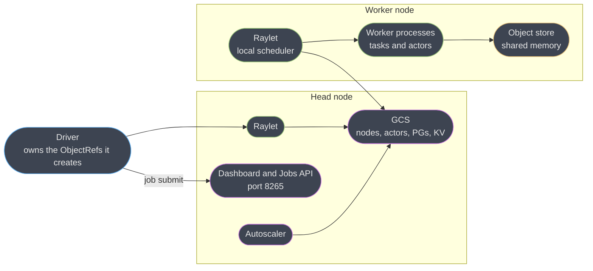
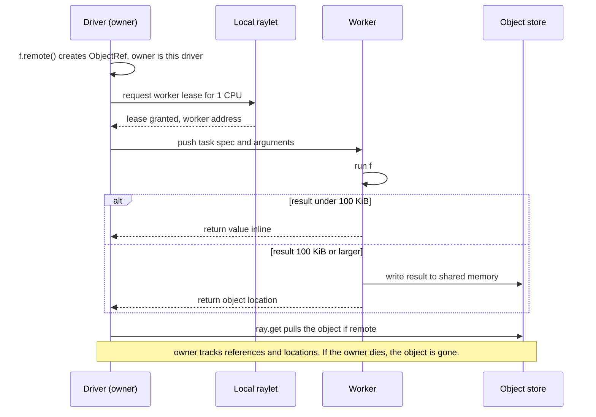
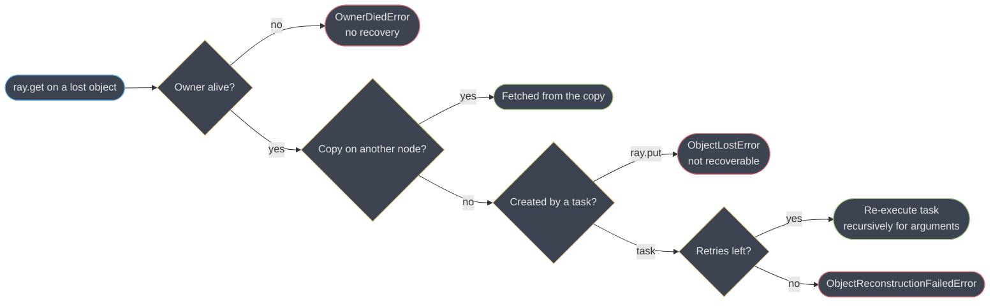
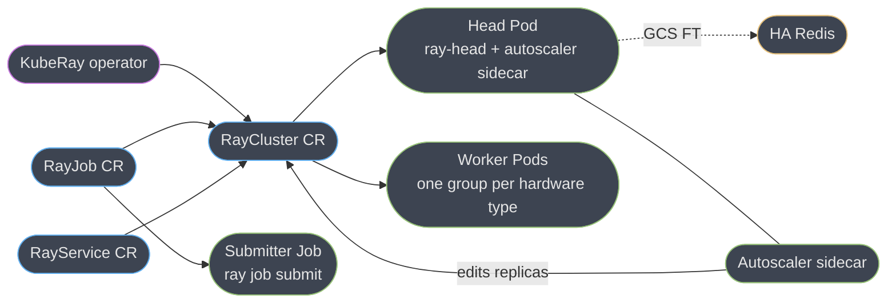
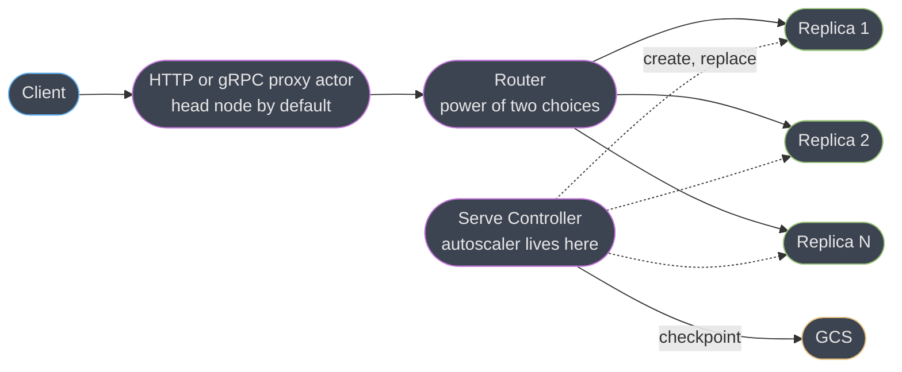
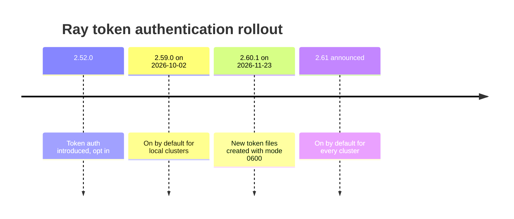

# Ray

> **Version anchor (2026-11-25).** **Ray 2.60.1** (2026-11-23, `github.com/ray-project/ray/releases`)
> is the newest release and the one this page is pinned to; it is the same pin the `mlops/` section
> uses. Release train read from the GitHub releases API: 2.59.0 (2026-10-02), 2.60.0 (2026-11-04),
> 2.60.1 (2026-11-23, a security and bug-fix release with no new features). **KubeRay v1.7.3**
> (2026-11-23) is the newest operator release; on 2026-11-25 GitHub's API redirected
> `ray-project/kuberay` to `kuberay-project/kuberay`, while the Ray docs still link the old path.
> The docs banner on every `docs.ray.io` page reads "Ray 2.59 enables token authentication by
> default for local clusters, and Ray 2.61 extends it to all clusters"; **2.61 is not released
> yet**, so the all-clusters default is a dated promise, not a current behaviour (section 6.9).
> **Ray 2.60.0 is the last release that publishes Python 3.10 (`-py310`) images.** Version-gated
> behaviour is tagged inline as `[2.59+]`, `[2.60+]`, `[KubeRay 1.6+]` and so on; anything untagged
> is stable across the 2.5x-2.6x line. Anyscale is the commercial managed platform from the
> creators of Ray (the Ray docs say so on their Kubernetes page); it is the sponsor, not the
> engineering name, which is why the module is `ray_distributed_computing` and not `anyscale_ray`
> (naming precedent 5 in [`technologies/CLAUDE.md`](../CLAUDE.md)).

Ray is an open-source distributed compute runtime for Python: three primitives (tasks, actors,
objects) on a cluster of processes, plus AI libraries (Data, Train, Tune, Serve, RLlib, LLM) written
as ordinary Ray programs on top of them. This page teaches the product: the ownership model, the
GCS, the object store and spilling, scheduling and placement groups, fault tolerance, KubeRay, the
libraries and the token-auth rollout. It does **not** re-teach what the sibling sections own:
KServe, llm-d, Kueue, Volcano and KAI Scheduler live in
[`mlops/`](../../mlops/README.md) (start at
[`model_serving_platforms`](../../mlops/model_serving_platforms/model_serving_platforms.md) and
[`gpu_cluster_scheduling_and_quotas`](../../mlops/gpu_cluster_scheduling_and_quotas/gpu_cluster_scheduling_and_quotas.md));
vLLM internals live in [`llm/vllm_deep_dive`](../../llm/vllm_deep_dive/vllm_deep_dive.md); the
concept of a pipeline orchestrator lives in
[`ml_pipelines_and_orchestration`](../../mlops/ml_pipelines_and_orchestration/ml_pipelines_and_orchestration.md).
Here those appear only as the seams where Ray meets them.

---

## 1. Concept Overview

### What Ray is, precisely

The Ray overview defines three layers: **Ray AI Libraries** (domain libraries for data
processing, training, tuning, reinforcement learning and serving), **Ray Core** (a general purpose
distributed computing library) and **Ray Clusters** ("a set of worker nodes connected to a common
Ray head node", fixed size or autoscaling). The unit of work is a Python function or class marked
`@ray.remote`. Calling it returns an `ObjectRef` (a future) immediately; the work runs somewhere in
the cluster; `ray.get` fetches the value.

```python
import ray

ray.init()                      # starts a local cluster (and, since 2.59, token auth)

@ray.remote
def square(x):                  # a task: stateless, retried on worker death
    return x * x

@ray.remote
class Counter:                  # an actor: stateful, one process, serial method calls
    def __init__(self):
        self.n = 0
    def incr(self):
        self.n += 1
        return self.n

refs = [square.remote(i) for i in range(8)]   # 8 futures, scheduled in parallel
print(ray.get(refs))                           # [0, 1, 4, 9, 16, 25, 36, 49]
c = Counter.remote()
print(ray.get([c.incr.remote() for _ in range(3)]))   # [1, 2, 3]
```

### What Ray is NOT

- **Not a workflow engine with durable state.** A Ray job that dies is not resumed from an event
  history. Durable orchestration is [Temporal](../temporal_durable_execution/temporal_durable_execution.md);
  scheduled DAGs of heterogeneous steps are
  [Airflow](../apache_airflow/apache_airflow.md). Ray is what those tools launch to do the
  heavy compute step.
- **Not a Kubernetes scheduler or quota system.** Ray schedules tasks and actors onto *Ray nodes*
  using logical resources. Who gets GPUs on the Kubernetes cluster is Kueue, Volcano or KAI
  (mlops-owned); KubeRay is the bridge that turns Ray demand into pods.
- **Not a model registry or a release system.** Ray Serve runs models. Versioned promotion,
  canary policy and rollback belong to
  [`progressive_delivery_for_model_servers`](../../mlops/progressive_delivery_for_model_servers/progressive_delivery_for_model_servers.md).
- **Not a stream processor with exactly-once state.** Ray Data streams blocks through operators,
  but it has no checkpointed keyed state or watermarks; that is [Flink](../apache_flink/apache_flink.md).
- **Not safe by default on an open network.** Token authentication is a shared static bearer
  token sent in an HTTP header; the docs say outright that it does not encrypt traffic (section 6.9).

### Release train and the facts that move

| Item | Value | Source |
|---|---|---|
| Latest Ray | 2.60.1 (2026-11-23), security and bug fixes only | GitHub releases |
| Previous minors | 2.60.0 (2026-11-04), 2.59.0 (2026-10-02) | GitHub releases |
| Ray Serve LLM and Ray Data LLM | General availability since 2.59.0 | 2.59.0 release notes |
| vLLM inside Ray LLM | 0.27.0 in 2.59.0, 0.29.0 in 2.60.0 | 2.59.0 and 2.60.0 release notes |
| Token auth introduced | Ray 2.52.0 (opt-in) | token authentication docs |
| Token auth default | Local clusters since 2.59, all clusters from 2.61 | docs banner and rollout page |
| KubeRay | v1.7.3 (2026-11-23) | KubeRay releases |
| Last Python 3.10 images | Ray 2.60.0 | 2.60.0 release notes |

---

## 2. Intuition

**One-line analogy.** Ray turns a function call into a purchase order: you get a receipt
(`ObjectRef`) at once, the warehouse (cluster) fulfils it wherever stock and capacity exist, and the
receipt is only exchanged for goods (`ray.get`) when you actually need them.

**The mental model.** A Ray cluster is one head node and N worker nodes. Every node runs a
**raylet** (local scheduler plus object store manager). The head node also runs the **GCS** (Global
Control Service), the cluster's small metadata database. Your script is the **driver**; the worker
processes it spawns run your tasks and actors. Data never flows through the GCS: large values sit in
each node's shared-memory object store and move node to node on demand.

**Why it matters.** Python is the language of ML, and Python's concurrency stops at one machine.
Ray gives the same code a path from a laptop to thousands of GPUs, and because the libraries
(Data, Train, Serve) all use the same primitives, one cluster can run preprocessing, training and
serving, with heterogeneous CPU and GPU stages in one pipeline.

**The key insight: ownership.** Every `ObjectRef` has an **owner**, the worker process that created
it (the caller of `f.remote()` or `ray.put()`). The docs state the consequence plainly: an object's
data lives in the object store, its **metadata lives at the owner**, and "Ray can automatically
recover from data loss but not owner failure". That one sentence explains most of Ray's failure
behaviour: lineage reconstruction can rebuild a lost value, but if the owner dies, every
reference to the object becomes an `OwnerDiedError`, whatever copies still exist.

---

## 3. Core Principles

1. **Tasks are stateless, actors are stateful, objects are immutable.** Tasks retry freely because
   they have no state (default `max_retries=3`). Actors hold state in one process, so they restart
   only when you ask (`max_restarts=0` by default). Objects cannot change after creation, which is
   what lets Ray replicate them across object stores with no coherence protocol.
2. **Ownership, not a central object directory.** The owner tracks references and locations for
   objects it created. The GCS stores the node list, actors, placement groups and key-value data, which
   the memory docs call "typically quite small".
3. **Logical resources, hard requirements.** Resources (`CPU`, `GPU`, `memory`, custom) are numbers
   you declare, not measurements of the machine. A task asking for `{"GPU": 1}` is *infeasible* on
   a CPU-only node and waits (or triggers the autoscaler) rather than running there.
4. **Locality before balance.** The `DEFAULT` scheduling strategy sorts nodes to favour ones that
   already hold the task's large arguments, then low utilization, then picks randomly from the top k
   (section 6.4).
5. **The head node is a single point of failure until you pay for GCS fault tolerance.** The GCS is
   in memory by default; if it fails, "the entire Ray cluster fails".
6. **Libraries are Ray programs.** Ray Serve's controller, proxies and replicas are actors; Ray
   Data's operators launch tasks and actor pools. Everything they do you can inspect with `ray list
   actors` and `ray status`.
7. **Autoscaling follows declared demand.** The autoscaler reads logical resource requests, not
   CPU graphs. A pending `num_cpus=2` actor on a cluster of 1-CPU pods never triggers a scale-up
   (section 6.10).
8. **Secure by default is arriving in stages.** Local clusters first (2.59), every cluster later
   (2.61); a platform team must distribute tokens before the second step.

---

## 4. Types / Architectures / Strategies

### 4.1 Process taxonomy

| Component | Runs on | Role |
|---|---|---|
| **Driver** | wherever `ray.init()` or the job entrypoint runs | Runs the user program; owns the objects it creates |
| **GCS** | head node | Cluster metadata: nodes, actors, placement groups, jobs, internal KV; not fault tolerant by default |
| **Raylet** | every node | Local scheduler, worker pool, object manager; a raylet that dies makes its node dead |
| **Object store** | every node (shared memory) | Holds immutable objects; spills to disk when full |
| **Worker processes** | every node | Execute tasks and actors |
| **Dashboard and Jobs API** | head node, port 8265 | UI, `ray job submit`, state API, metrics |
| **Autoscaler** | head node (sidecar container on KubeRay) | Adds and removes nodes from declared demand |
| **Memory monitor** | inside each raylet | Kills workers under memory pressure (section 6.7) |

A restarted raylet on the same machine is a **new node**: "each raylet is associated with a unique
id". Anything the old node owned is gone.

### 4.2 Deployment topologies

| Topology | Launch mechanism | Autoscaling | Notes |
|---|---|---|---|
| Local | `ray.init()` | none | Token auth default since 2.59 |
| VMs | `ray up cluster.yaml` | cluster launcher autoscaler | Token distributed via `file_mounts` |
| **Kubernetes** | **KubeRay** `RayCluster`, `RayJob`, `RayService`, `RayCronJob` | Ray autoscaler sidecar, optional v2 | The docs call KubeRay "the recommended way" to run on Kubernetes |
| Managed | Anyscale | managed | Anyscale manages authentication |

### 4.3 The libraries

| Library | Unit of work | Built from |
|---|---|---|
| **Ray Data** | `Dataset` of blocks (Arrow tables or pandas), streaming execution | tasks and actor pools |
| **Ray Train** | `Trainer` over a worker group, checkpoints to `storage_path` | actors plus placement groups |
| **Ray Tune** | trials, schedulers, searchers | actors, one trial per resource bundle |
| **Ray Serve** | applications and deployments with replicas | controller, proxy and replica actors |
| **Ray LLM** | `ray.serve.llm` and `ray.data.llm` | Serve and Data plus vLLM or SGLang engines |
| **RLlib** | RL algorithms and environment runners | actors |

### 4.4 Scheduling strategies

| Strategy | Meaning | Pitfall |
|---|---|---|
| `"DEFAULT"` | Hybrid locality and load score, random among top k | Tasks pile onto the node holding the data |
| `"SPREAD"` | Best-effort spread across nodes | Gives up locality |
| `PlacementGroupSchedulingStrategy` | Run inside reserved bundles | The reservation holds resources even when idle |
| `NodeAffinitySchedulingStrategy` | Pin to a node id (`soft=True` allows fallback) | Low level; cannot use an autoscaling cluster well |
| Labels (beta) | Select nodes by `ray.io/node-id`, `ray.io/accelerator-type`, custom labels | Beta; the docs plan to prefer it over hard node affinity |

### 4.5 Placement strategies

| Strategy | Placement | Failure mode |
|---|---|---|
| `PACK` (default) | Bundles on one node, best effort | Silently spreads if it cannot pack |
| `STRICT_PACK` | All bundles on a single node | Group stays `PENDING` if one node cannot fit all |
| `SPREAD` | One bundle per node, best effort | Silently overlaps if nodes are short |
| `STRICT_SPREAD` | Each bundle on a distinct node | Pending until enough distinct nodes exist |

---

## 5. Architecture Diagrams

### 5.1 One cluster, three kinds of process



*The head node carries the cluster-wide state (GCS, autoscaler, dashboard); each node's raylet does
the local scheduling and each node's object store holds the data. Values do not pass through the GCS.*

### 5.2 The life of one task and the owner's role



*Small results travel inline to the owner (`max_direct_call_object_size`, 100 KiB default); larger
ones go to the object store and the owner records where they are.*

### 5.3 Object store sizing on three nodes (ASCII)

```
  default object store = min( 30% of available memory , 200 GB ) , then capped at 95% of /dev/shm

  node RAM available     30% of it       200 GB cap          object store
  ------------------     ---------       ----------          ------------
      64 GiB              19.2 GiB       not reached           19.2 GiB
     256 GiB              76.8 GiB       not reached           76.8 GiB
    2048 GiB (2 TiB)     614.4 GiB       reached, clipped       200 GB

  on the 64 GiB node the other ~70% (about 44.8 GiB) is left for worker heaps, raylet and the OS
```

*The 200 GB ceiling is why a 2 TiB node does not get a 600 GiB store (the memory-management docs use
exactly this 2 TB example).*

### 5.4 When an object is lost



*Recovery order per the object fault tolerance docs: look for another copy, else re-run the creating
task (up to its retry limit), and never recover from owner death.*

### 5.5 KubeRay topology



*`RayJob` and `RayService` each create and own a `RayCluster`; the autoscaler sidecar scales by
rewriting the cluster's `replicas` and `workersToDelete` fields, and the operator does the pod work.*

### 5.6 Ray Serve on Ray



*The controller is an actor whose state is checkpointed to the GCS; if it dies, requests keep
flowing but autoscaling pauses until it recovers, and metrics collected so far are lost.*

---

## 6. How It Works — Detailed Mechanics

### 6.1 Tasks, actors and the `ray.get` discipline

`f.remote()` and `Actor.remote()` return immediately. The cost model is: submission is cheap, a
`ray.get` is a synchronization point. The docs' first anti-pattern is calling `ray.get` inside a
loop that also submits work.

```python
# BROKEN: no parallelism, each ray.get blocks before the next task is even submitted
results = []
for i in range(100):
    results.append(ray.get(f.remote(i)))

# FIX: submit everything first, then get once (or stream with ray.wait)
refs = [f.remote(i) for i in range(100)]
results = ray.get(refs)

# Better when results should be processed as they finish
pending = refs
while pending:
    done, pending = ray.wait(pending, num_returns=1)
    handle(ray.get(done[0]))
```

Argument passing has one more rule worth knowing: a top-level `ObjectRef` argument is
**de-referenced** before the task runs (Ray fetches the data first), whereas an `ObjectRef` nested in
a list is passed as a reference and the task must call `ray.get` itself. Nested refs let you pass
data through a pipeline stage without ever moving it to that stage's node.

Actors default to **at-most-once** method execution (`max_task_retries=0`), and by default are not
restarted (`max_restarts=0`). Both defaults are covered in section 6.6.

### 6.2 Ownership and distributed reference counting

The owner of an object is the worker that created its `ObjectRef`. For `y = large_array.remote()`
the owner is the **caller**, even though the value is created and stored on another node. Ray
implements distributed reference counting: any `ObjectRef` in scope anywhere in the cluster pins the
object. `ray memory` reports five kinds of reference that keep an object pinned:

| Kind | What pins the object | Label in `ray memory` |
|---|---|---|
| Local reference | a Python variable holding the `ObjectRef` | `LOCAL_REFERENCE` |
| Pinned in memory | a deserialized copy (for example a numpy array backed by shared memory) still alive after the ref was deleted | `PINNED_IN_MEMORY` |
| Pending task | a submitted task that has not finished with the object | counted under "Pending Tasks" |
| Captured in object | the ref serialized inside another object | `CAPTURED_IN_OBJECT` |
| Actor handle | a reference held through an actor handle | counted under "Actor Handles" |

Immutability and zero-copy reads together mean a numpy array from `ray.get` is backed by shared
memory and keeps the object pinned until the array itself is garbage collected. The pinning example
in the docs shows `a = ray.put(np.zeros(1)); b = ray.get(a); del a` leaving the object
`PINNED_IN_MEMORY` until `b` is deleted.

### 6.3 The object store, spilling and sizing

- **Size.** By default each node's object store is 30% of that node's available memory, capped at
  200 GB, and on Linux additionally capped at 95% of `/dev/shm` (where it lives). Override with
  `--object-store-memory` or `ray.init(object_store_memory=...)` (bytes), or change the defaults
  with `RAY_DEFAULT_OBJECT_STORE_MEMORY_PROPORTION` and `RAY_DEFAULT_OBJECT_STORE_MAX_MEMORY_BYTES`,
  set on every node before Ray starts.
- **macOS** allocates the store under `/tmp` on disk, so performance differs from Linux.
- **Spilling.** When the store fills, Ray spills objects to a directory on the local filesystem
  (default under `/tmp/ray/session_...`). Set `ray.init(object_spilling_directory=...)` or
  `ray start --object-spilling-directory=...`. The raylet logs lines such as `Spilled 50 MiB, 1
  objects, write throughput 230 MiB/s`, and `ray memory --stats-only` prints cluster-wide spill and
  restore totals.
- **Inline objects.** Results under `max_direct_call_object_size` (100 KiB default) never enter the
  object store; they live in the memory of the submitting process. A workload that creates millions
  of tiny shards therefore accumulates them on the driver, which is the head node for most jobs
  (section 10, pitfall 6).
- **Debugging.** `ray memory` accepts sort and group options (the docs show `sort-by=OBJECT_SIZE`
  and `group-by=STACK_TRACE`) that show which line of code created the references behind an
  `ObjectStoreFullError`.

### 6.4 The default scheduling algorithm

Placement is two steps: filter to feasible nodes using resource requirements and label selectors,
then choose among them with the strategy. Defaults, from the scheduling overview:

| Control | Default |
|---|---|
| Task resource requirement | 1 logical CPU |
| Actor resource requirement | 1 CPU to schedule, 0 to run |
| Strategy | `"DEFAULT"` |
| Locality | on for tasks, ignored for actors and when a strategy is set |
| Gang placement | none unless you create a placement group |

`DEFAULT` scores each node by logical utilization: below `RAY_scheduler_spread_threshold` (0.5) the
score is 0 (all lightly loaded nodes are equal), otherwise the score is the utilization itself. Ray
picks randomly among the **top k** lowest scores, where `k = max(nodes * RAY_scheduler_top_k_fraction, RAY_scheduler_top_k_absolute)`
with defaults 0.2 and 1. On a 50-node cluster that is `k = max(50 * 0.2, 1) = 10`.

Two consequences follow directly from the doc table. An actor that declares no resources still
needs a node with one free CPU to *start*, then uses none, so many such actors can share one CPU. And
a node started with `num_cpus=0` runs neither tasks nor actors by default, which is exactly why
KubeRay samples set `num-cpus: "0"` on the head.

### 6.5 Placement groups (gang scheduling)

A **bundle** is a resource dict that must fit on one node (`{"CPU": 9}` cannot be placed on a cluster
of an 8-CPU and a 1-CPU node). A placement group is a list of bundles plus a strategy, created
**atomically**: if one bundle cannot be placed, none is reserved and the group stays `PENDING`.

```python
from ray.util.placement_group import placement_group, remove_placement_group
from ray.util.scheduling_strategies import PlacementGroupSchedulingStrategy

# 4 GPU workers that must start together, one per node (tensor-parallel replica)
pg = placement_group([{"CPU": 4, "GPU": 1}] * 4, strategy="STRICT_SPREAD")
ray.get(pg.ready(), timeout=600)          # raises GetTimeoutError if it never fits

workers = [
    Worker.options(
        scheduling_strategy=PlacementGroupSchedulingStrategy(
            placement_group=pg, placement_group_bundle_index=i)
    ).remote()
    for i in range(4)
]
# ... later
remove_placement_group(pg)    # asynchronous; actors and tasks still using the bundles are killed
```

Lifetime is scoped to the creating driver (or to the detached actor that created it) unless made
detached. The reserved resources are only usable by tasks and actors scheduled with the group's
strategy, which is why a group that is created and then forgotten silently strands GPUs
(`ray status` shows "0.0 used of 1.0 reserved in placement groups"). Ray Train and Ray Tune use
placement groups for all-or-nothing trial and worker-group scheduling.

### 6.6 Fault tolerance, level by level

| Level | Default | Knob | What happens |
|---|---|---|---|
| Task, worker dies | retried up to 3 times | `max_retries` (`-1` infinite, `0` off), env `RAY_TASK_MAX_RETRIES` | Re-run on another worker |
| Task, Python exception | **not** retried | `retry_exceptions=True` or a list of exception types | Wrapped in `RayTaskError`, raised on `ray.get` |
| Actor process dies | **not** restarted | `max_restarts` (`-1` infinite) | Constructor re-runs; state is not restored |
| Actor method on a dead actor | at-most-once | `max_task_retries` (`-1` infinite) | `RayActorError`, even if the method already ran |
| Object value lost | lineage reconstruction | `RAY_max_lineage_bytes` (1 GB), `RAY_TASK_MAX_RETRIES=0` disables | Copy elsewhere, else re-run the task |
| Object owner dies | no recovery | none | `OwnerDiedError` |
| Worker node dies | tasks, actors, owned objects lost | per-level knobs above | Retry paths run on other nodes |
| Head node or GCS dies | whole cluster fails | GCS fault tolerance | See 6.8 |

Details that decide production behaviour: actor tasks are only reconstructable as object producers
if `max_task_retries` is non-zero (the docs assume tasks are deterministic and idempotent); tasks
killed by the **memory monitor** retry with exponential backoff capped at 60 seconds and, unlike
other failures, ignore `max_retries` unless it is `0` (section 6.7); `ObjectFetchTimedOutError`
is governed by `RAY_fetch_fail_timeout_milliseconds` (default 10 minutes); and lineage held for
reconstruction costs driver memory (`RAY_max_lineage_bytes`, default 1 GB, evicts when exceeded).
`[2.60+]` adds an experimental per-job option to disable lineage reconstruction.

### 6.7 The memory monitor

The memory monitor runs inside each raylet and kills workers when combined usage (worker heaps,
object store, raylet) passes a threshold.

| Setting | Default |
|---|---|
| `RAY_memory_monitor_refresh_ms` | 250 (0 disables, only without resource isolation) |
| `RAY_memory_usage_threshold` | 0.95 |
| `--system-reserved-memory` (with resource isolation) | 10% of total memory, min 500 MB, max 10 GB |
| `RAY_idle_worker_killing_memory_threshold_bytes` | 1 GiB |

`[2.56+]` the kill policy prefers idle workers over active ones, picking the largest footprint first;
among active workers it prefers **retriable** tasks, then the newest lease. With cgroup v2 resource
isolation enabled and accurate `memory=` requests, the docs promise zero kernel OOM kills and zero
node deaths from memory contention. A killed task retries without respecting `max_retries` (set
`max_retries=0` to stop that), while a killed actor respects `max_restarts`.

### 6.8 GCS fault tolerance

By default the GCS holds everything in memory; "if it fails, the entire Ray cluster fails". Backing
it with durable storage makes the GCS reload on restart. Two backends exist:

| | External Redis | Embedded RocksDB |
|---|---|---|
| Status | officially supported, with KubeRay for Ray Serve | **alpha**, Linux only |
| State lives in | an HA Redis you run | a local RocksDB directory on a persistent volume |
| Enable | `RAY_REDIS_ADDRESS=host:port ray start --head --redis-password ...` | `RAY_gcs_storage=rocksdb RAY_gcs_storage_path=/mnt/ray-gcs ray start --head` |
| Constraint | Redis must be highly available | single writer, one GCS per path, never share a path between clusters |

While the GCS recovers, these are unavailable: actor creation, deletion and reconstruction;
placement group creation, deletion and reconstruction; resource management; worker node
registration; worker process creation. Running tasks and actors **stay alive** and existing objects
stay available. Each raylet retries the GCS and **exits after 60 seconds** by default
(`RAY_gcs_rpc_server_reconnect_timeout_s`), which marks its node dead. On Kubernetes, without GCS FT
the cluster, the GCS process and the head Pod fate-share: if the GCS dies, the head Pod dies after
that timeout, and the restarted head sees surviving workers as "unknown workers" and terminates
them. The docs recommend GCS FT on `RayService` and say it "isn't recommended" and has no
compatibility guarantee for other workloads. `[2.60+]` GCS active-passive groundwork (leader
election RPC gating, a passive head lifecycle) landed, off by default.

### 6.9 Token authentication and the rollout

Token auth (introduced in 2.52.0) enforces one static bearer token on the dashboard, the GCS and
the other control-plane services. `RAY_AUTH_MODE` has two values: `token` and `disabled`.

| Ray version | Default |
|---|---|
| 2.52.0 to 2.58 | disabled; opt in with `RAY_AUTH_MODE=token` |
| **2.59+** | enabled for **local** clusters: `ray.init()` without an address generates `~/.ray/auth_token` if missing; `ray start --head` enables auth only if a token already exists, otherwise warns |
| **2.61** (announced) | enabled for **all** clusters, including remote and multi-node; `RAY_AUTH_MODE=disabled` is the explicit opt-out |



Token lookup precedence: `RAY_AUTH_TOKEN` (the value), then `RAY_AUTH_TOKEN_PATH` (a file; an
unreadable or empty file is a fatal error, no silent fallback), then `~/.ray/auth_token`
(`%USERPROFILE%\.ray\auth_token` on Windows). Whitespace is stripped. HTTP servers accept
`Authorization: Bearer <token>`, the cookie `ray-authentication-token` (the dashboard, 30 day
`max_age`, `HttpOnly`, `SameSite=Strict`) or `X-Ray-Authorization: Bearer <token>` (for KubeRay and
proxies that strip `Authorization`); a missing token returns 401 and an invalid one 403.

The sharp edges, all from the rollout page:

- **Workers do not opt in automatically.** `ray start --address=...` ignores an available token
  unless `RAY_AUTH_MODE=token` is set, so a worker cannot join a token-auth head, even on the same
  machine with `~/.ray/auth_token` present.
- **Set `RAY_AUTH_MODE=token` before the token exists and `ray start --head` errors** with
  "Token authentication is enabled but no authentication token was found" and tells you to run
  `ray get-auth-token --generate`.
- **Tokens do not expire** and are sent as an HTTP header: plaintext over `http`. The docs say to
  use SSH tunnelling (`ray dashboard`, `kubectl port-forward`), a TLS proxy or an encrypted overlay,
  and never to expose a cluster directly to the internet.
- **`[2.60.1]` fixed a permissions bug**: before it, `ray.init()` and `ray get-auth-token
  --generate` wrote the token with the default umask (typically `0644`), readable by other local
  users. New files are `0600` and a new `~/.ray` is `0700`; **a token file created by an earlier
  version keeps its permissions**, so run `chmod 600 ~/.ray/auth_token`.
- **The 2.61 upgrade plan** is: generate one token, distribute it to every node and client (Secret
  on Kubernetes, `file_mounts` on VMs), set `RAY_AUTH_MODE=token` everywhere, and verify with the
  `401` check before upgrading.

On KubeRay `[KubeRay 1.6+ per the docs]` the `RayCluster` takes `authOptions: {mode: token}`; the
operator creates a Secret holding a random token and sets `RAY_AUTH_TOKEN` and `RAY_AUTH_MODE` on
every Ray container. Clients then export `RAY_AUTH_MODE=token` and `RAY_AUTH_TOKEN` read from that
Secret before `ray job submit`; without them the call returns `401 Unauthorized: Missing
authentication token`.

### 6.10 KubeRay: the three CRDs, autoscaling, GCS FT

**`RayCluster`** is the base resource: a head Pod and worker groups. **`RayJob`** creates a
`RayCluster` and a submitter, and can delete the cluster when the job ends. **`RayService`** manages a
`RayCluster` plus Ray Serve applications (`serveConfigV2`), with in-place updates for Serve config
and **zero-downtime upgrades**: KubeRay creates a pending cluster, waits for readiness, switches
traffic and terminates the old one. **`RayCronJob`** schedules `RayJob`s.

```yaml
apiVersion: ray.io/v1
kind: RayCluster
metadata:
  name: train-cluster
spec:
  rayVersion: "2.60.1"
  enableInTreeAutoscaling: true        # adds the autoscaler sidecar to the head Pod
  authOptions:
    mode: token                        # operator creates the token Secret
  autoscalerOptions:
    version: v2                        # v1 and v2 both need restartPolicy: Never on workers
    upscalingMode: Default             # Conservative rate-limits pending pods
    idleTimeoutSeconds: 60             # the default
  gcsFaultToleranceOptions:            # needs HA Redis, KubeRay 1.3.0+
    redisAddress: "redis:6379"
    redisPassword:
      valueFrom:
        secretKeyRef: {name: redis-password-secret, key: password}
  headGroupSpec:
    rayStartParams:
      num-cpus: "0"                    # no tasks or actors on the head
    template:
      spec:
        containers:
        - name: ray-head
          image: rayproject/ray:2.60.1
          resources:
            limits:   {cpu: "4", memory: "8Gi"}
            requests: {cpu: "4", memory: "8Gi"}
  workerGroupSpecs:
  - groupName: gpu-workers
    replicas: 1
    minReplicas: 1
    maxReplicas: 16
    rayStartParams: {}
    template:
      spec:
        restartPolicy: Never
        containers:
        - name: ray-worker
          image: rayproject/ray:2.60.1
```

(The `authOptions` and `gcsFaultToleranceOptions` fields are taken from the KubeRay v1.7.3 sample
manifests; the autoscaler sidecar defaults to 500m CPU and 512Mi memory limits and requests.)

The autoscaler works on three levels. **Ray actors and tasks** (Serve replicas, Data actor pools)
express demand; the **Ray autoscaler** turns unmet logical demand into worker Pods by incrementing
`replicas` in the `RayCluster` and adding idle pods to `workersToDelete`; the **Kubernetes
autoscaler** (which "you must configure ... yourself") provisions nodes for pending Pods. Scale-down
removes a worker that has been idle for `idleTimeoutSeconds` (default 60), where idle means no
tasks, no actors **and no referenced objects, in memory or spilled to disk**. `[2.41+]` the
autoscaler reads CPU counts from `rayStartParams`, container limits or container requests.
`[2.60+]` autoscaler v2 can scale down pending nodes no demand needs (off by default), `idleTerminationOptions`
is supported, and a Spark node provider for v2 was added.

### 6.11 Ray Data internals

A `Dataset` is a list of **blocks**, Arrow tables unless Arrow cannot represent the data, stored as
objects in the object store. Ray Data bounds block size between 1 MiB and 128 MiB
(`target_min_block_size`, `target_max_block_size`) and splits any block larger than 192 MiB
(`MAX_SAFE_BLOCK_SIZE_FACTOR` 1.5). It cannot split a row, so very large rows (images) defeat the bound.

Execution is **streaming**: operators consume and produce streams of blocks, and the executor loop
(running on the driver, or on a `SplitCoordinator` actor for `streaming_split`) repeatedly collects
outputs, moves them to operator out queues and assigns work to operators that have input, free
resources and are not backpressured. That is what lets a dataset larger than cluster memory flow
through. A chain of map operators is fused (`OperatorFusionRule`) to avoid serialization between them.

`[2.60+]` highlights: shuffle v2 is the default for joins, aggregations, group-by and key-based
repartition (driver-driven, intermediate data in the object store so it can spill, instead of
long-lived `HashShuffleAggregator` actors); an optional **disk-based shuffle** writes shuffle
shards to node-local disk files served over Arrow Flight, enabled with
`DataContext.use_disk_based_hash_shuffle = True` or `RAY_DATA_ENABLE_DISK_SHUFFLE=1`; Parquet reads
bin-pack read tasks from row-group footers; a rate-based cluster autoscaler and a backlog-aware
actor-pool autoscaler are the defaults (`RAY_DATA_ACTOR_AUTOSCALER=DEFAULT` restores the old pool
autoscaler); GPU map operators default to `num_cpus=1` (set `num_cpus=0` to opt out); and `sort`
gains a task-based shuffle v2 path.

### 6.12 Ray Train

Ray Train runs a worker group (one actor per training worker) and restores from checkpoints. The
fault tolerance guide (written for the V2 API, `RAY_TRAIN_V2_ENABLED=1`, available since 2.43)
defines three levels: worker process, worker node and job driver.

```python
import ray.train, ray.train.torch

def train_fn(config):
    ckpt = ray.train.get_checkpoint()            # latest reported checkpoint, if any
    if ckpt:
        with ckpt.as_directory() as d: ...       # load state
    ...
    ray.train.report({"loss": 0.1}, checkpoint=ray.train.Checkpoint.from_directory(d))

trainer = ray.train.torch.TorchTrainer(
    train_fn,
    scaling_config=ray.train.ScalingConfig(num_workers=4, use_gpu=True),
    run_config=ray.train.RunConfig(
        storage_path="s3://bucket/runs",          # required for multi-node
        name="llm-sft-2026-11-25-a",              # unique per run, see pitfall 11
        failure_config=ray.train.FailureConfig(max_failures=3),   # default 0
    ),
)
trainer.fit()
```

On a failure Ray Train shuts **all** workers down, adds nodes if needed and restarts the whole group
from the latest checkpoint. Driver crashes do not count against `max_failures`; recovery finds the
run state through the same `(storage_path, name)` pair. `[2.60+]` adds an opt-in NCCL RAS health
callback for hung collectives and relaxes collectives on preemption so surviving ranks can commit
a just-in-time checkpoint. For the cluster-wide picture of training (Kubeflow Trainer, JobSet,
checkpoint cadence) see
[`training_infrastructure_operations`](../../mlops/training_infrastructure_operations/training_infrastructure_operations.md).

### 6.13 Ray Serve

Serve is three kinds of actor: one **Controller** per Serve instance (control plane, runs the
autoscaler, checkpointed to the GCS), **proxies** (an HTTP proxy on the head by default;
`proxy_location` runs one per node; a gRPC proxy if configured) and **replicas** that run your code.
Requests wait in a `DeploymentHandle` queue and are sent to replicas by **power of two choices**,
never exceeding `max_ongoing_requests` per replica.

`num_replicas="auto"` is documented as equivalent to `max_ongoing_requests: 5`,
`target_ongoing_requests: 2`, `min_replicas: 1`, `max_replicas: 100`. Configure autoscaling by hand
without `"auto"` and `max_replicas` defaults to 1, so nothing scales. With `target_ongoing_requests=2`
and a closed-loop load of 100 users, Serve settles near 50 replicas (the docs' ResNet50 test shows
replicas at roughly half the user count).

`[2.59+]` `BackpressureConfig` turns the 503 for exceeding `max_queued_requests` into a **429**,
optionally with `Retry-After`, so load balancers and SLOs can tell deliberate shedding from a broken
deployment. `[2.60+]` `max_surge_percent` starts replacements before stopping old replicas (default
0, the old stop-then-start); a rolling update whose new replicas keep failing now stops at
`DEPLOY_FAILED` and leaves the old replicas routable (opt out with
`RAY_SERVE_STOP_FAILED_ROLLING_UPDATES=0`); synchronous deployment methods run in a thread pool by
default (`RAY_SERVE_RUN_SYNC_IN_THREADPOOL=0` restores the old behaviour); autoscaling metrics move
to a columnar format that cut controller loop cost by 2.8x to 13.5x at 64 to 4,096 replicas per
handle; custom autoscaling policies reach beta; and `root_path` now follows the ASGI spec, a
**breaking** change: requests that still carry the `root_path` prefix return 404.

### 6.14 Ray LLM

`ray.serve.llm` (GA since 2.59.0) deploys an OpenAI-compatible app from an `LLMConfig`:

```python
from ray import serve
from ray.serve.llm import LLMConfig, build_openai_app

cfg = LLMConfig(
    model_loading_config={"model_id": "qwen-0.5b", "model_source": "Qwen/Qwen2.5-0.5B-Instruct"},
    deployment_config={"autoscaling_config": {"min_replicas": 1, "max_replicas": 2}},
    accelerator_type="A10G",
    engine_kwargs={"tensor_parallel_size": 2},      # passed to the vLLM engine
)
serve.run(build_openai_app({"llm_configs": [cfg]}), blocking=True)
```

It lists tensor, pipeline, expert and data-parallel-attention parallelism, prefill-decode
disaggregation, prefix-aware and KV-aware routing, multi-LoRA and vLLM or SGLang backends. The
engine is **bundled**: Ray 2.59.0 shipped vLLM 0.27.0 and 2.60.0 moved to 0.29.0, so a platform that
needs a newer vLLM feature waits for a Ray release (the `mlops` serving page tracks that lag).
`ray.data.llm` does batch inference as a multi-stage processor (preprocess, chat template, tokenize,
engine, detokenize, postprocess) where **each stage is its own actor pool**; `concurrency=n`
autoscales GPU stages from 1 to n actors, `concurrency=(n, n)` fixes the pool.

---

## 7. Real-World Examples

The Ray use-cases page indexes the workload shapes below; this section sticks to what that page and
the release notes state, and names no adopter metrics that were not fetched.

| Workload | Ray pieces | What it shows |
|---|---|---|
| Batch LLM inference over a corpus | `ray.data.llm` `build_processor`, vLLM actor pool, KubeRay `RayJob` | Heterogeneous CPU preprocessing and GPU engine stages in one streaming pipeline |
| Online LLM serving | `ray.serve.llm`, `RayService`, prefill-decode disaggregation | Serve autoscaling over a GPU pool, token-aware routing |
| Distributed fine-tuning | `TorchTrainer`, placement groups, checkpoints on object storage | Gang scheduling with automatic restart from the last report |
| Hyperparameter search | Ray Tune, one trial per resource bundle | Independent experiments packed by placement groups |
| Reinforcement learning | RLlib environment runners, plus RL frameworks that use Ray for rollouts | Many small stateful actors with a GPU learner |
| ML platform substrate | Data, Train and Serve on one `RayCluster` | One runtime from preprocessing to serving |

The use-cases page links a talk on deep reinforcement learning at Riot Games and an Uber
engineering post on elastic XGBoost on Ray, as examples of production usage; their contents were not
read for this page. For where Ray sits in a build-versus-buy platform decision, read
[`ml_platform_architecture_and_build_vs_buy`](../../mlops/ml_platform_architecture_and_build_vs_buy/ml_platform_architecture_and_build_vs_buy.md);
for online LLM serving alternatives, see
[`model_serving_platforms`](../../mlops/model_serving_platforms/model_serving_platforms.md).

---

## 8. Tradeoffs

### 8.1 Where Ray sits among its neighbours

| Need | Ray | The neighbour | Pick the neighbour when |
|---|---|---|---|
| Parallel Python on many nodes | tasks and actors | a job queue (Celery) or Kubernetes Jobs | work is independent, coarse and needs no shared data or actors |
| Large-scale data transforms | Ray Data (streaming, GPU-aware) | Spark, [Flink](../apache_flink/apache_flink.md), [Trino](../trino/trino.md) | the work is SQL or keyed-state streaming rather than Python and model inference |
| Distributed training | Ray Train (worker group, checkpoint restart) | Kubeflow Trainer and JobSet, see [`training_infrastructure_operations`](../../mlops/training_infrastructure_operations/training_infrastructure_operations.md) | the platform is Kubernetes-native and training is the only Ray use |
| Model serving | Ray Serve (Python composition, actor replicas) | KServe, [Triton](../nvidia_triton_inference_server/nvidia_triton_inference_server.md), see [`model_serving_platforms`](../../mlops/model_serving_platforms/model_serving_platforms.md) | you want Kubernetes-native rollout, scale-to-zero on Knative or a model-server standard rather than Python code |
| Gang scheduling and quotas | placement groups inside a Ray cluster | Kueue, Volcano, KAI at the Kubernetes layer | the question is who gets GPUs across teams, not how a job packs them |
| Durable multi-step workflows | none | [Temporal](../temporal_durable_execution/temporal_durable_execution.md), [Airflow](../apache_airflow/apache_airflow.md) | steps must survive a crash with exactly-once progress |

### 8.2 Choices inside Ray

| Decision | Option A | Option B | Rule |
|---|---|---|---|
| GCS durability | External HA Redis (supported) | Embedded RocksDB (alpha, Linux, single writer) | Redis for production Serve today; RocksDB when you cannot run Redis and can reattach a volume |
| Cluster lifecycle | `RayJob` (cluster per job, deletable) | long-lived `RayCluster` or `RayService` | One-shot batch: `RayJob` with `shutdownAfterJobFinishes`. Always-on serving: `RayService` |
| Placement | `PACK` | `SPREAD`, `STRICT_*` | Pack for locality (tensor-parallel on one node), spread for failure isolation; `STRICT_*` when a silent fallback would be a bug |
| Shuffle | in-memory shuffle v2 | disk-based shuffle | Disk when shuffled bytes far exceed aggregate object-store memory |
| Actor recovery | `max_restarts` plus `max_task_retries` | manual checkpoint and restore | Automatic only for stateless or read-only actors; checkpoint anything with state |
| Serve rollout | stop-then-start (`max_surge_percent=0`) | surge (`max_surge_percent>0`) | Surge when losing replica capacity during a roll breaks the SLO, at the price of extra GPUs |
| Serve LLM engine | Ray's bundled vLLM | a separate vLLM or llm-d deployment | Separate when you need a vLLM feature newer than the one bundled in the current Ray |

### 8.3 What a managed platform changes

Anyscale is the managed Ray platform from the project's creators; the docs state that it "manages
authentication automatically" and offers GCS fault tolerance for head nodes. You trade control of
the cluster layer for not operating KubeRay, Redis and token distribution yourself. The decision
frame, with the other build-or-buy options, is in
[`ml_platform_architecture_and_build_vs_buy`](../../mlops/ml_platform_architecture_and_build_vs_buy/ml_platform_architecture_and_build_vs_buy.md).

---

## 9. When to Use / When NOT to Use

### Use Ray when

- One Python program must fan out over many machines and many accelerators, and tasks share
  intermediate data (so a job queue is the wrong abstraction).
- A pipeline mixes CPU preprocessing and GPU inference in one streaming job (Ray Data with
  separate actor pools per stage), so GPUs stay saturated while CPUs feed them.
- You need stateful, long-lived workers (actors) for model replicas, parameter holders, simulators
  or RL environment runners.
- You want training, batch inference and online serving on the same runtime and the same cluster
  tooling.
- Gang scheduling inside a cluster matters (placement groups for tensor-parallel replicas or
  trial bundles).

### Do NOT use Ray when

- **The job is SQL or a keyed streaming aggregation.** Spark, Flink and Trino have optimizers,
  checkpointed state and connectors Ray does not.
- **You need durable workflow state.** A Ray job that loses its driver loses its owner and with it
  every object it created. Use a workflow engine and have it launch Ray.
- **The only requirement is multi-tenant GPU quota.** That is Kueue, Volcano or KAI at the Kubernetes
  layer; Ray cannot arbitrate between teams on a shared Kubernetes cluster.
- **A cluster open to an untrusted network is the plan.** Token auth is a static shared secret over a
  plaintext header; Ray expects a secured network or TLS in front.
- **Latency per call must be microseconds.** A task has scheduling overhead (a worker lease, an RPC);
  tiny functions in a tight loop should be batched into one task or kept local.
- **The team has no appetite to operate a stateful control plane.** The GCS, Redis, KubeRay and the
  autoscaler are real moving parts; a plain `Deployment` behind a standard model server can be the
  smaller system.

---

## 10. Common Pitfalls (Production War Stories)

**1. `ray.get` in the submit loop.** BROKEN: `for x in items: out.append(ray.get(f.remote(x)))`
runs the tasks one at a time on a cluster that sits idle. FIX: build the list of refs first, then
`ray.get(refs)` once, or loop on `ray.wait`. The docs list four sibling anti-patterns (getting task
arguments inside the task, unnecessary gets, processing in submission order, fetching too many
objects at once).

**2. The head node runs the workload.** BROKEN: the head has 4 CPUs and Ray schedules tasks and
actors on it next to the GCS, the dashboard and the autoscaler; one memory spike stalls the control
plane for the whole cluster. FIX: `num-cpus: "0"` in the head's `rayStartParams` (every KubeRay
sample does it) so the head runs control processes only. The OOM docs say an OOM on the head "may
stall the dashboard or other control processes and cause the cluster to become unusable".

**3. `ObjectStoreFullError` from forgotten references.** BROKEN: a driver stores refs in a list for
"later", or keeps a deserialized numpy array alive, and every object stays pinned while spilling
thrashes the disk. FIX: `ray memory` (sorted by size, grouped by stack trace) to find the call site,
drop references when done, process results with `ray.wait` in a bounded window.

**4. A driver that owns everything.** BROKEN: a long pipeline creates all its refs in a short-lived
driver (or an actor that gets restarted); when it dies, every consumer gets `OwnerDiedError` even
though replicas of the data survive. FIX: keep ownership in a process whose lifetime matches the
data (a detached actor, or the long-lived job driver), and stage durable results in external
storage; `ray.put` objects are never recoverable.

**5. Stateful actor with default restarts.** BROKEN: `max_restarts=0` (default) means a crashed actor
stays dead and callers see `RayActorError`; setting only `max_restarts` revives it with an empty
`__init__` state; setting `max_task_retries=-1` can run a non-idempotent method twice. FIX: checkpoint
the state, restore in the creator or in `__init__`, and add retries only to idempotent methods.

**6. Tiny shards pile up inline on the head.** BROKEN: a big shuffle produces many partitions
smaller than `max_direct_call_object_size` (100 KiB); they are stored inline in the submitter's
memory, and the head node OOMs. FIX: lower the threshold on every node, for example
`RAY_max_direct_call_object_size=8192`, so shard data goes through the spillable object store;
the Ray Data internals page gives exactly this example.

**7. GCS without fault tolerance on a serving cluster.** BROKEN: a `RayService` with the default
in-memory GCS; the head Pod is evicted and the cluster, the GCS and the head Pod fate-share, so
Serve loses its controller state and the surviving workers are terminated as "unknown workers".
FIX: `gcsFaultToleranceOptions` with HA Redis (KubeRay 1.3.0+), a Redis outage budget under the
60 second raylet reconnect window, and a head Pod that Kubernetes can reschedule.

**8. Token-auth surprises.** BROKEN: a script that connects with `ray.init(address=...)` has no
token; a worker started with `ray start --address` has no `RAY_AUTH_MODE`; a laptop token file made
before 2.60.1 is world-readable. FIX: distribute one token to every node and client, export
`RAY_AUTH_MODE=token` on workers, `chmod 600 ~/.ray/auth_token`, and test the 401 path in staging
before the 2.61 upgrade.

**9. Memory monitor retry loops.** BROKEN: a task that always exceeds memory is killed, retried with
backoff up to 60 seconds, killed again, forever, because OOM kills ignore `max_retries`. FIX: declare
an accurate `memory=` request, set `max_retries=0` for tasks that must not loop, enable cgroup v2
resource isolation, and read the kill reason from the raylet logs.

**10. The autoscaler that never scales.** BROKEN: worker pods have 1 logical CPU each and an actor
asks for `num_cpus=2`; the demand is infeasible on any node shape the autoscaler can add, so nothing
happens. FIX: size worker groups to the largest request, check `ray status` for the pending demand,
and remember that an "idle" node still holding referenced or spilled objects is not scaled down.

**11. Reusing a Train run name.** BROKEN: two experiments both use `name="run"` with the same
`storage_path`; the second silently resumes the first's checkpoint. Also `max_failures` defaults to
0, so the first node loss ends the run. FIX: a unique `name` per run (the docs suggest an id the
submitter generates), `FailureConfig(max_failures=3)`, and checkpoints reported every epoch or N steps.

**12. Serve rollouts that shed capacity or break paths.** BROKEN: a rolling update with the default
stop-then-start drops capacity during the roll; overload returns 503 so the load balancer ejects
healthy backends; upgrading to 2.60 changes `root_path` handling and prefixed paths return 404.
FIX: `max_surge_percent` where capacity is tight, `BackpressureConfig` for 429 with `Retry-After`,
and strip the `root_path` prefix at the ingress before the 2.60 upgrade.

**13. Assuming Ray LLM tracks upstream vLLM.** BROKEN: a team needs a vLLM feature from a release
newer than 0.29.0 and finds Ray 2.60.x pinned below it. FIX: check the Ray release notes for the
bundled vLLM before promising a feature, and run a separate vLLM or llm-d deployment (mlops-owned)
when the gap matters.

**14. Placement groups that strand GPUs.** BROKEN: a group is created in a script that crashes after
`pg.ready()`; the reservation is freed only when the driver exits, so a hung driver holds the GPUs;
conversely, removing a group kills whatever still uses it. FIX: name and clean up groups in
`finally`, watch `ray list placement-groups`, and prefer library-managed groups (Train, Tune, Serve).

---

## 11. Technologies & Tools

| Technology | Role around Ray |
|---|---|
| KubeRay | Kubernetes operator with `RayCluster`, `RayJob`, `RayService` and `RayCronJob` CRDs; the docs-recommended way to run Ray on Kubernetes |
| Anyscale | Managed Ray platform from Ray's creators; manages token authentication and offers head-node fault tolerance |
| vLLM | Engine inside Ray Serve LLM and Ray Data LLM; bundled version 0.29.0 in Ray 2.60.x |
| SGLang | Alternate engine backend for Ray Serve LLM and Ray Data LLM |
| Redis | External durable store for GCS fault tolerance (single-shard Redis Cluster or Sentinel, one or more replicas) |
| RocksDB | Embedded alpha GCS backend on a persistent volume, Linux only |
| Apache Arrow | Block format in Ray Data and the transport (Arrow Flight) for disk-based shuffle |
| Apache Iceberg | Table format Ray Data reads, with DataSourceV2 groundwork for catalog-backed sources in 2.60 |
| Delta Lake | `read_delta` and `write_delta`; 2.60.1 rejects column-mapped tables that previously yielded null columns |
| PyTorch | Framework under `TorchTrainer`; see [`ml/pytorch_deep_dive`](../../ml/pytorch_deep_dive/pytorch_deep_dive.md) |
| DeepSpeed | Listed Ray Train integration |
| transformers | Hugging Face library; listed Ray Train and Ray Data LLM integration |
| XGBoost | Listed Ray Train framework |
| LightGBM | Listed Ray Train framework |
| Prometheus | Metrics backend for the dashboard and Serve autoscaling policies (alpha `PrometheusQueryMixin` in 2.60) |
| Grafana | Dashboards for Ray Data ingest, Serve LLM and cluster metrics |
| Kueue | Kubernetes-layer admission of `RayJob` through the `suspend` field; owned by `mlops/` |
| KServe | Kubernetes-native serving alternative; see [`kserve_deep_dive`](../../mlops/model_serving_platforms/kserve_deep_dive.md) |
| Airflow | Launches Ray jobs from a DAG; see [Airflow](../apache_airflow/apache_airflow.md) |
| Temporal | Durable orchestration around Ray jobs; see [Temporal](../temporal_durable_execution/temporal_durable_execution.md) |

---

## 12. Interview Questions with Answers

**Q: A cluster is upgraded to Ray 2.61 and every `ray job submit` returns 401 while new workers refuse to join. What happened and what should have been done first?**
**Short:** 2.61 turns token authentication on for every cluster, so each node and client needs the same token and `RAY_AUTH_MODE=token` before the upgrade.
The docs banner and rollout page say 2.59 enabled token auth by default for local clusters and 2.61 extends it to remote and multi-node clusters, where "every node in a cluster and every client that connects to it needs the same token". A missing token returns 401 and a wrong one 403. Workers are the classic miss: `ray start --address` ignores an available token unless `RAY_AUTH_MODE=token` is set in its environment. The fix before upgrading is to generate one token with `ray get-auth-token --generate`, distribute it (a Secret and KubeRay `authOptions` on Kubernetes, `file_mounts` on VMs), set the mode on every node, and rehearse the 401 path in staging. Opting out with `RAY_AUTH_MODE=disabled` is available but should be a conscious exception.

**Q: What exactly did Ray 2.59 change for a developer who just runs `python train.py` with `ray.init()`?**
**Short:** `ray.init()` without an address now enables token auth and creates `~/.ray/auth_token` if none exists; `RAY_AUTH_MODE=disabled` opts out.
Only a freshly started local cluster changes: connecting with `ray.init(address=...)` never generates a token, and a script that finds a running local cluster enables auth only if a token is available. `ray start --head` enables auth only when a token already exists, otherwise it warns that the cluster is unauthenticated. The security wrinkle is file mode: before 2.60.1 the token was written with the default umask, typically `0644`, so other local users could read it; 2.60.1 writes `0600` for new files but leaves an existing file's permissions alone, so run `chmod 600 ~/.ray/auth_token` once on shared machines.

**Q: Why does calling `ray.get` inside the loop that submits tasks give no speedup?**
**Short:** `ray.get` blocks until that result exists, so the next task is not even submitted until the previous one finishes, which serializes the work.
Submission with `.remote()` returns instantly; the parallelism comes from having many refs in flight. Collect all refs first and call `ray.get(refs)` once, or use `ray.wait` to process results as they complete. A related trap is fetching too many objects in a single `ray.get`, which can fail by exhausting memory, so for very large result sets consume them in bounded windows.

**Q: The driver died but three copies of the object still exist on other nodes. Why does `ray.get` raise `OwnerDiedError`?**
**Short:** An object's metadata lives at its owner, the worker that created the ref, and Ray does not recover from owner failure.
Ownership is the design: the owner tracks references and locations, so when it dies the remaining copies are unreachable by reference and Ray cleans them up to avoid a leak. Lineage reconstruction only rebuilds lost values and needs a living owner. The practical rule is to give long-lived data a long-lived owner, such as a detached actor or the main job driver, and to write results that must outlive the job to external storage rather than relying on `ray.put`.

**Q: A node dies and takes object copies with it. Which objects does Ray rebuild and which are gone for good?**
**Short:** Ray rebuilds task-created objects by lineage reconstruction, but never `ray.put` objects, never objects whose owner died, and only within retry limits.
Recovery order is another copy first, then re-execution of the creating task, recursively for its arguments. Limits from the docs: objects must come from tasks, task results are assumed deterministic and idempotent, a non-actor task re-runs up to `max_retries` (default 3), actor-task results are reconstructable only with a non-zero `max_task_retries`, and lineage is capped by `RAY_max_lineage_bytes` (1 GB default). Past a limit the error is `ObjectReconstructionFailedError`; with reconstruction disabled it is `ObjectLostError`.

**Q: An actor crashed and was restarted by `max_restarts`, but its counters are back to zero and one method ran twice. Is that a bug?**
**Short:** No: restart re-runs the constructor with fresh state, and `max_task_retries` gives at-least-once execution, so a method can run on both the dead and the new actor.
Defaults are `max_restarts=0` (no restart) and `max_task_retries=0` (at-most-once, `RayActorError` even if the method had already run). With `max_task_retries` of -1 or above 0 an in-flight method is retried after restart, and ordering of later calls is preserved, but the method must be idempotent. Ray does not restore application state; checkpoint it (the docs show a controller that holds a checkpoint and restores a replacement actor) and reserve automatic retries for read-only or ephemeral-state actors.

**Q: The head node dies. What is lost, what survives, and what does GCS fault tolerance change?**
**Short:** Without GCS fault tolerance the whole cluster fails; with it, a restarted GCS reloads state from Redis or RocksDB while running tasks, actors and objects keep going.
During recovery the cluster cannot create, delete or reconstruct actors, cannot create or delete placement groups, cannot do resource management, register new worker nodes or start worker processes. Each raylet retries the GCS and exits after 60 seconds by default (`RAY_gcs_rpc_server_reconnect_timeout_s`), so the recovery budget is under a minute unless you raise that. The Redis backend is officially supported with KubeRay for Ray Serve; for other workloads the docs call it at-your-own-risk.

**Q: When would you choose the embedded RocksDB GCS backend over external Redis?**
**Short:** When you want GCS fault tolerance without operating HA Redis and can reattach a persistent volume to the new head, accepting alpha status and Linux only.
RocksDB is embedded in the GCS and single-writer: exactly one GCS may open the path, and the same path must be reused after each restart. Enable it with `RAY_gcs_storage=rocksdb` and `RAY_gcs_storage_path`. The recovery model is identical to Redis. Prefer Redis for a production Serve cluster today because it is the supported path; choose RocksDB for clusters where a durable, reattachable volume is easier than running Redis.

**Q: What is the default object store size, and what happens when it fills?**
**Short:** 30% of the node's available memory, capped at 200 GB and at 95% of `/dev/shm`; when full, Ray spills objects to local disk.
A 2 TB node gets 200 GB, not 600 GB. Pinned objects (live refs) still count, so spilling cannot free memory held by references you never released: `ray memory` shows which refs pin what. Spill location is `object_spilling_directory` (default under `/tmp/ray`); throughput appears in raylet logs and `ray memory --stats-only`. Set the size with `--object-store-memory` or the two `RAY_DEFAULT_OBJECT_STORE_*` variables on every node before start.

**Q: An actor declares no resources, yet it will not start on a node with zero free CPU. Why?**
**Short:** Actors need 1 CPU to be scheduled but hold 0 while running, so a start requires a free CPU and many such actors can then share it.
Tasks default to 1 CPU. The asymmetry exists so that placing an actor respects capacity but an idle actor does not starve work. A node started with `num_cpus=0` runs neither tasks nor actors by default, which is why KubeRay samples set it on the head. An actor declared with `num_cpus=0` and nothing else is placed at random without considering utilization, so such actors are effectively spread.

**Q: Why do all my tasks pile onto the node that holds the big dataset?**
**Short:** The `DEFAULT` strategy puts locality first, preferring nodes that already hold a task's large arguments, then balances by utilization among the top k.
Below a utilization of 0.5 (`RAY_scheduler_spread_threshold`) nodes score equally, and Ray picks randomly from the top `k = max(nodes * 0.2, 1)`. Locality is on only for tasks and is ignored when you set a strategy. To spread CPU-heavy work, set `scheduling_strategy="SPREAD"`, or let Ray Data (which manages its own placement) do the distribution.

**Q: How do placement groups behave, and what are the traps?**
**Short:** They reserve bundles atomically for gang scheduling: all bundles are placed or none, a bundle must fit on one node, and removal kills whatever still uses them.
Strategies are `PACK` (default, best effort), `STRICT_PACK`, `SPREAD` and `STRICT_SPREAD`; only the strict ones fail rather than degrade. A group that cannot fit stays `PENDING` (and its demand reaches the autoscaler through `ray status`). Reserved resources are usable only by work scheduled with that group, so leaks strand GPUs. Lifetime is tied to the creating driver or detached actor unless made detached.

**Q: A node's workers are being killed by Ray, not the kernel. How does the memory monitor pick victims and why do some tasks retry forever?**
**Short:** The raylet monitor kills at 95% node memory, preferring idle then retriable workers, and a killed task retries with backoff regardless of `max_retries` unless that is 0.
The check runs every 250 ms (`RAY_memory_monitor_refresh_ms`) and kills one worker at a time. From 2.56 idle workers go first, largest footprint first; among active workers retriable tasks go first, then the newest lease. Retry delay grows exponentially to a cap of 60 seconds. An actor killed this way respects `max_restarts`. With cgroup v2 resource isolation and accurate `memory=` requests the docs promise no kernel OOM kills; set `max_retries=0` on tasks that must not loop.

**Q: The KubeRay autoscaler will not add a worker for a pending actor, and later will not remove an idle one. Why?**
**Short:** It scales on logical resource demand, so a request larger than any worker shape is unsatisfiable, and idle nodes holding referenced or spilled objects are not idle.
The autoscaler increments the `RayCluster`'s `replicas` and fills `workersToDelete`; it does not read physical utilization. If workers expose 1 CPU, a `num_cpus=2` actor never triggers a scale-up. Scale-down waits `idleTimeoutSeconds` (60 by default) and counts a node as busy while it has tasks, actors or referenced objects in memory or on disk. A pod that cannot be scheduled is the Kubernetes autoscaler's job, which "you must configure ... yourself".

**Q: When do you pick `RayJob`, `RayService` or a plain `RayCluster`?**
**Short:** `RayJob` for one-shot batch with a cluster per job, `RayService` for Ray Serve with zero-downtime upgrades, `RayCluster` for shared or interactive clusters.
`RayJob` creates the cluster and submits `entrypoint` through a Kubernetes Job (`K8sJobMode` default, or `HTTPMode`, `SidecarMode`); `backoffLimit` retries create a new cluster each time; `shutdownAfterJobFinishes` defaults to false and `ttlSecondsAfterFinished` only applies when it is true; `suspend` is the field Kueue uses to admit jobs. `RayService` adds in-place Serve updates and cluster upgrades via a pending cluster plus traffic switch. A bare `RayCluster` is right for notebooks and many short jobs.

**Q: How does a `RayService` upgrade a Ray cluster without downtime, and what must the ingress target?**
**Short:** KubeRay builds a pending `RayCluster`, waits until it is ready, switches traffic, then deletes the old one; point ingress at the `RayService` head and serve services.
Per-cluster head services change during an upgrade (a new `...-raycluster-yyyyy-head-svc` appears), but the stable `<name>-head-svc` and `<name>-serve-svc` follow the active cluster, so ingress that targets them needs no edit. Changing only the Serve config is an in-place update that does not replace the cluster. Combine with GCS fault tolerance, because the docs call it the recommended configuration for Serve high availability.

**Q: How do you size Ray Serve replicas, and what do `target_ongoing_requests` and `max_ongoing_requests` do?**
**Short:** The autoscaler targets an average of `target_ongoing_requests` per replica and the router never sends a replica more than `max_ongoing_requests`.
`num_replicas="auto"` expands to `max_ongoing_requests: 5`, `target_ongoing_requests: 2`, `min_replicas: 1`, `max_replicas: 100`. Set `autoscaling_config` manually without `"auto"` and `max_replicas` is 1, so nothing scales. With a target of 2, 100 steady concurrent requests means about 50 replicas. Lower the target for long requests or tight latency, set `max_replicas` roughly 20% above expected peak, and use `min_replicas=0` only if cold start is acceptable. The Serve autoscaler asks Ray for actors; the Ray autoscaler adds nodes when they do not fit.

**Q: Why return 429 instead of 503 when a Serve deployment is overloaded, and how do rollouts avoid losing capacity?**
**Short:** 503 reads as a broken backend and triggers ejection and retries, while `BackpressureConfig` returns 429 with optional `Retry-After`; `max_surge_percent` keeps capacity during rolls.
`BackpressureConfig` (2.59) changes the response when a request exceeds `max_queued_requests`; defaults are unchanged. In 2.60 a rolling update that keeps failing stops at `DEPLOY_FAILED` and keeps the old replicas routable, and `max_surge_percent` starts new replicas first at the cost of extra capacity. Controller death does not stop traffic, but autoscaling pauses and its collected metrics are lost until it recovers.

**Q: How does Ray Data stream a dataset bigger than cluster memory, and what is the head-node OOM trap in shuffles?**
**Short:** Operators pass blocks as streams with backpressure, never materializing a stage, but many sub-100 KiB shards stay inline on the submitter and can OOM the head.
Blocks are 1 to 128 MiB Arrow tables in the object store; the executor assigns work to operators with input, resources and no backpressure, and fuses chained map operators. Shuffle v2 is the default for joins, aggregations and key-based repartition in 2.60; disk-based shuffle is opt-in for data much larger than the object store. Inline objects below `max_direct_call_object_size` (100 KiB) accumulate on the process that submitted them, so lower it (the docs show 8192) on shuffle-heavy jobs.

**Q: In Ray Data LLM, what is the difference between `concurrency=4` and `concurrency=(4, 4)`, and what limits engine upgrades?**
**Short:** `concurrency=4` autoscales GPU stages from 1 to 4 engine actors; `(4, 4)` pins a fixed pool of 4; the engine version is whatever Ray bundles.
Each stage (tokenize, engine, detokenize and so on) is its own actor pool, so CPU and GPU stages scale independently. Ray 2.59.0 shipped vLLM 0.27.0 and 2.60.0 vLLM 0.29.0, so a vLLM release that postdates your Ray cannot be used inside the processor. For a newer engine run it as its own deployment and have Ray Data query it through `ServeDeploymentProcessorConfig` or an OpenAI-compatible endpoint, the topic of the `mlops` serving pages.

**Q: A multi-node Ray Train job lost one GPU node. What restarts, from where, and how can recovery silently go wrong?**
**Short:** Ray Train stops all workers, replaces the node and restarts the whole group from the latest reported checkpoint, but only if `max_failures` allows and `storage_path` is shared.
`FailureConfig.max_failures` defaults to 0, so fault tolerance is off until you set it (-1 is unlimited). The checkpoint comes from `get_checkpoint()` and lives at `RunConfig(storage_path, name)`, which must be durable shared storage for multi-node. Driver crashes do not count against `max_failures`; a relaunch with the same `(storage_path, name)` resumes, which is also the trap: reusing a `name` for a new experiment resumes the old one. Always pass a unique run id.

**Q: Should a team standardize on Ray, or on Kubernetes-native tools like KServe, Kubeflow Trainer and Kueue?**
**Short:** Use Ray where Python composition, actors and streaming CPU-GPU pipelines are the product; keep Kubernetes-native tools for quota, rollout and per-model serving, and bridge them with KubeRay.
The layers do not compete: Kueue admits `RayJob`s, Ray places tasks inside the admitted cluster, KServe or `RayService` serve models. Ray adds a stateful control plane (GCS, autoscaler) and a token-based security model to operate; a team with only classic model serving and no composition may be better served by KServe or Triton. The boundary analysis lives in the mlops pages linked in section 8.

**Q: What does the Serve Controller do, and what happens to traffic if it dies?**
**Short:** The controller owns the control plane and runs the autoscaler; if it dies, requests still flow but autoscaling stops and past metrics are lost until Ray restarts it.
Replica actors are replaced by the controller when they fail, proxies are restarted by it, and the controller itself is restarted by Ray, with its routing and deployment state checkpointed to the GCS. If the whole Ray cluster fails and you are not using KubeRay, Serve cannot recover. On KubeRay a `RayService` recovers crashed nodes or clusters, and GCS fault tolerance protects against head loss.

---

## 13. Best Practices

- Set `num-cpus: "0"` on the head, keep the object store and workloads on workers, and size the
  head for the GCS, dashboard and autoscaler only.
- Pin the Ray version in image tags, `rayVersion`, the autoscaler image and clients; read the
  release notes for bundled-engine versions (vLLM) and breaking changes (2.60 `root_path`).
- Turn on token authentication everywhere now: one token, a Secret or file mount, `RAY_AUTH_MODE=token`
  on every node and client, TLS or an encrypted network in front, and `0600` on token files.
- Enable GCS fault tolerance (HA Redis) on any `RayService` and keep Redis recovery well under the
  60 second raylet reconnect window.
- Declare honest resources (`num_gpus`, `memory`) and keep worker pod shapes at least as large as
  the biggest single request; the autoscaler works on logical resources.
- Treat actors as disposable: checkpoint state, make methods idempotent before enabling
  `max_task_retries`, and use detached actors only for objects that must outlive a driver.
- Use `ray.wait` windows and bounded in-flight refs; use `ray memory` and `ray status` as the first
  debugging tools.
- Give every Train run a unique name and a shared `storage_path`, set `max_failures`, and report a
  checkpoint on a cadence that matches your preemption tolerance.
- For Serve, set `target_ongoing_requests` from measured request time, use `BackpressureConfig` for
  429s, and enable surge when a roll must not reduce capacity.
- Let Kueue (or your quota layer) admit `RayJob`s so Ray autoscaling cannot bypass team quotas; see
  [`gpu_cluster_scheduling_and_quotas`](../../mlops/gpu_cluster_scheduling_and_quotas/gpu_cluster_scheduling_and_quotas.md)
  and [`inference_autoscaling_and_capacity_planning`](../../mlops/inference_autoscaling_and_capacity_planning/inference_autoscaling_and_capacity_planning.md).
- Know the Kubernetes layer under KubeRay: CRDs and operators are covered in
  [`kubernetes_operators_and_crds`](../../devops/kubernetes_operators_and_crds/kubernetes_operators_and_crds.md),
  and GPU node pools in
  [`ml_platform_and_gpu_infrastructure`](../../devops/ml_platform_and_gpu_infrastructure/ml_platform_and_gpu_infrastructure.md).

---

## 14. Case Study — An Embedding Backfill and Its Online Service on One Platform

**Scenario (a design exercise; all throughput figures are assumptions to be replaced by your own
benchmark).** A search team must re-embed 120 million documents when the embedding model changes,
then keep an online embedding endpoint serving at peak 400 concurrent requests. The mlops
case study
[`design_an_embedding_model_migration`](../../mlops/case_studies/design_an_embedding_model_migration.md)
covers the migration policy (dual indexes, cutover, rollback); this case study covers the compute
layer under it, which that page implements with Ray Data on Ray 2.60.1.

### Batch backfill

```python
import ray

ds = ray.data.read_parquet("s3://corpus/v7/")           # footer-based bin packing in 2.60
# A class UDF runs in an actor pool: the model loads once per actor, not once per task.
# concurrency=(4, 16) lets the pool grow from 4 to 16 GPU actors.
ds = ds.map_batches(Embedder, concurrency=(4, 16), num_gpus=1, batch_size=256)
ds.write_parquet("s3://index/model-b/", min_bytes_per_file=256 * 1024 * 1024)
```

(`Embedder` is your callable class that loads model B in `__init__`.)

Capacity arithmetic with an **assumed** 2,500 documents per second per GPU: 16 GPUs give
40,000 documents per second, so 120,000,000 / 40,000 = 3,000 seconds, about 50 minutes; 4 GPUs take
200 minutes. The pool autoscales from 4 to 16 (`concurrency=(4, 16)`), and the rate-based autoscaler
introduced as the 2.60 default watches operator throughput. At 128 MiB blocks and a corpus of 600 GiB,
the dataset is about 4,800 blocks in total (600 x 1024 / 128), but only a window of them is in
memory at once, because streaming execution applies backpressure between operators.

### Online service

`RayService` with a Serve deployment per model version. Autoscaling: `target_ongoing_requests=8`,
`max_ongoing_requests=16`, peak 400 concurrent requests, so the autoscaler holds about 400 / 8 = 50
replicas at peak; `max_replicas=60` (20% over); `min_replicas=2`. Use `BackpressureConfig` so
saturation returns 429 with `Retry-After`, and `max_surge_percent` so the cutover roll does not drop
below target capacity.

### Broken first design and the fix

BROKEN, as shipped by a first draft:

1. One long-lived `RayCluster` serves both workloads; the head Pod has the default `rayStartParams`
   and runs tasks; GCS is in memory; no token (the cluster is only reachable inside the VPC, "so it
   is fine").
2. The backfill driver runs on the head and the UDF is a plain function that reloads model B on
   every batch task instead of a class UDF that loads it once per actor.
3. Output is written once at the end, so a preemption mid-backfill restarts the job from zero.

What goes wrong in practice: the backfill's memory pressure shares the head node with the Serve
controller, so an OOM on the head stalls the dashboard and Serve; a head restart drops all state; the
2.61 upgrade turns on authentication and every client breaks at once; a preempted GPU node discards
hours of work because nothing was written incrementally.

FIX:

| Change | Mechanism | Evidence in this page |
|---|---|---|
| Two Kubernetes resources: a `RayJob` for the backfill and a `RayService` for serving | Isolated clusters, backfill cluster deleted by `shutdownAfterJobFinishes` | section 6.10 |
| `num-cpus: "0"` on both heads | Control plane never runs user work | pitfall 2 |
| `gcsFaultToleranceOptions` on the `RayService`, HA Redis, recovery under 60 s | Head loss no longer ends Serve | section 6.8 |
| `authOptions: {mode: token}` and a Secret now, TLS ingress | 2.61 becomes a no-op | section 6.9 |
| Write output incrementally (`write_parquet`, per-shard files) and make the job resumable by shard list | Preemption loses minutes, not the run | section 6.11 |
| Kueue admits the `RayJob` against the search team's GPU quota | Autoscaling cannot exceed the quota | mlops quota page |
| Load the model once per actor (class UDF), not once per batch task | Weights load once per actor in an actor pool | section 6.11 and 6.14 |

**Operational numbers to watch:** `ray status` pending demand, object store use per node versus
the 30% default, spill throughput in raylet logs, Serve replica count against the 50-replica
expectation, controller loop time (2.60 cut metric handling cost by 2.8x to 13.5x at 64 to 4,096
replicas per handle), and the 60 second GCS reconnect window against Redis failover time.
