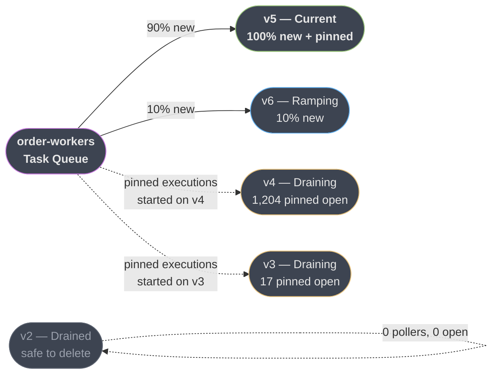
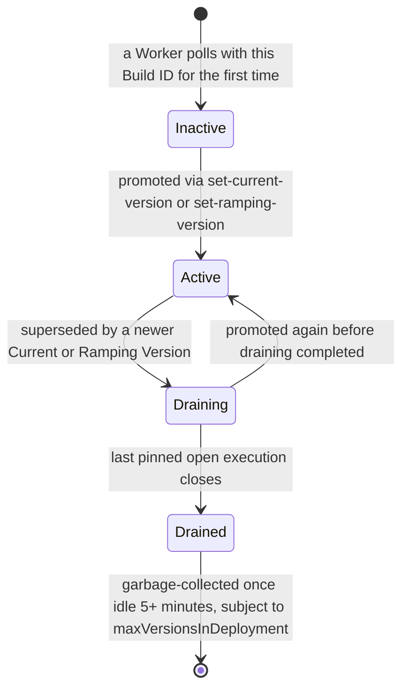
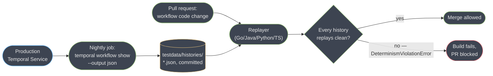

# Versioning and Safe Deploys

> **Version anchor (2026-10-19).** Temporal Server **1.32.1** (released 2026-10-08), the
> same line the parent module studies. Server 1.32 is the last release that contains the
> deprecated legacy Worker Versioning APIs (`UpdateWorkerBuildIdCompatibility`,
> `GetWorkerBuildIdCompatibility`, `UpdateWorkerVersioningRules`, `GetWorkerVersioningRules`,
> `GetWorkerTaskReachability`); it ships their management APIs disabled by default, and the
> 1.32.0 release notes plan complete removal for server 1.33. SDKs: **Go 1.50.0**
> (2026-10-15), **Python 1.34.0** (2026-09-30), **Java 1.40.0** (2026-09-29),
> **TypeScript 1.24.0** (2026-09-15). **Worker Versioning (the Worker Deployment APIs) reached
> GA on 2026-03-30**, after public preview since server 1.28.0. That same announcement put two
> capabilities into **Public Preview**: **Upgrade-on-Continue-as-New** and **Worker
> Controller Autoscaling**. The **Temporal Worker Controller** itself, the Kubernetes
> operator independent of its autoscaling add-on, reached **GA on 2026-05-04**; release
> **v1.13.0** (2026-10-13).
> Version-gated behaviour is tagged inline as `[GA 2026-03-30]`, `[preview]`, and so on.

This page is the judgment call the parent module sets up and defers.
[`temporal_durable_execution.md`](temporal_durable_execution.md) §6.10 and §6.11 already
establish the command-sequence determinism rule, the four-step patching lifecycle, the core
Worker Deployment CLI, and the Continue-As-New event-history limits — read those first, because
this page does not restate the event-history/replay-determinism model, the Service-versus-worker
two-plane split, or that mechanics baseline. What it adds is the fleet-scale question those
mechanics don't answer on their own: across an entire population of long-lived executions — some
started in March, still running in August, six deploys behind — which versioning strategy do you
actually run, at what operational cost, and how do you prove a change is safe before it reaches
400,000 open executions. It ends with a working CI replay gate and the drainage arithmetic that
decides when an old build is finally safe to kill.

---

## 1. Concept Overview

### The problem, stated precisely

A workflow execution started in March. It is still `Running` in August. In between, its code
changed six times — a new activity, a renamed field, a library upgrade that changed how a struct
serializes. Every one of those six deploys will, at some point, be replayed against this
execution's event history by whichever worker picks up its next task. **This is not an edge
case you might hit; it is the steady state of any Temporal deployment with executions that
outlive a deploy cycle**, and it is exactly the population the two-plane architecture creates:
because workers are processes you redeploy on your own schedule while the Service keeps every
open execution's history forever, "new code replays old history" is not a corner of the design
space, it is the design space.

The consequence that makes this a *correctness* problem and not a *rollout* problem: a version
mismatch does not fail loudly. It produces a workflow task failure, which the Service retries
forever with backoff, which leaves the execution silently `Running` and stalled — nothing pages,
nothing is marked `Failed`, and the only symptom is an execution that stops making progress
(parent module §6.14, §10). A rollout problem has a blast radius you can see on a dashboard. A
determinism problem has a blast radius you discover when a customer asks why their order from
March never shipped.

### Why "versioning" and "deploying" are the same question here

In a stateless service, deploying new code and deciding what happens to in-flight requests are
two separate concerns — a request either completes on the old pod or gets retried on the new one,
and either way it started and finished within seconds. In Temporal, an execution's *entire life*
can span the deploy, so "how do I roll out this change" and "how do I keep replaying this
execution correctly" are the same question asked from two directions. Every strategy in §4 is an
answer to both halves at once: a rollout mechanism that is also a correctness guarantee, or vice
versa.

### The fleet framing this page adds

The parent module teaches the mechanics for **one execution and one deploy**. This page is about
**N executions and M deploys**, where N is in the hundreds of thousands and M keeps growing for
as long as the workflow type exists. At that scale the real cost of a versioning strategy is
never the code change itself — it is the tail: the last few thousand executions still pinned to
a build from three deploys ago, the worker pool you cannot yet turn off, and the dashboard that
has to tell you when it is finally safe to.

---

## 2. Intuition

> **One-line analogy:** Deploying new code to a Temporal worker fleet is like changing the rules
> of a card game while thousands of hands are still being played — every hand in progress has to
> either finish under the rules it started with, or be told explicitly, at a safe point, that the
> rules changed.

**Mental model.** Stop thinking of "the deploy" as a single event and start thinking of it as a
**population split**: at the instant you promote a new build, every open execution falls into one
of two buckets — those that will keep running the old rules until they close, and those that will
pick up the new rules at their next move. Which bucket an execution falls into is not implicit;
in every strategy in §4 it is a decision you make explicitly, either per change-site (patching) or
per workflow type (Worker Deployments' Pinned versus Auto-Upgrade). The strategies differ in
*where* that decision is recorded and *how long* the old rules have to stay available for the
first bucket — never in whether the split exists.

**Why it matters.** Teams that skip this framing default to "just redeploy and see" — the
behaviour a stateless service trained them to expect — and discover the population split the hard
way, as a wedged execution weeks later. Naming the split up front turns an incident into a
planning decision: how many executions are in the old-rules bucket right now, and what do I do
until the last one closes.

---

## 3. Core Principles

1. **The command-sequence rule from §6.10 is fixed; only the granularity of what obeys it
   changes.** Patching, Worker Deployments, and a new task-queue name are three different places
   to draw the boundary between "old rules" and "new rules" — none of them relaxes the underlying
   determinism requirement.
2. **Every strategy trades code debt for operational debt, or the reverse.** Patching keeps the
   cost in your source tree (a branch that must eventually be deleted). Worker Deployments moves
   the cost onto your infrastructure (a worker build that must eventually be killed). Nothing
   makes the cost disappear; picking a strategy is picking which team pays it and in which
   currency.
3. **Drainage, not deployment, is the operation that actually finishes a version migration.** A
   `kubectl apply` takes seconds. Getting every open execution off the version you are retiring
   takes as long as your longest-lived workflow, and the whole discipline in §6 exists to make
   that wait observable instead of a guess.
4. **A workflow's Versioning Behavior is a property of the workflow *type*, chosen once, not a
   per-deploy decision.** Pinned versus Auto-Upgrade is answered by how long the workflow lives
   relative to your deploy cadence (§4.4, §9's decision table) — it is a design decision made when
   the workflow type is written, not something you flip per release.
5. **The only trustworthy safety signal is a real replay, not a code review.** Every rule in §6.1
   about what is "safe" to change is a heuristic a reviewer applies from memory; the replay test in
   §6.6 is the same rule enforced by actually running new code against real recorded histories, and
   it is the one check in this entire page that cannot be talked out of a false positive.

---

## 4. Types / Architectures / Strategies

The parent module's §4.6 names four strategies in one table. This section is the judgment layer
on top of that table: what each strategy actually costs a fleet, and the decision procedure for
choosing between them — not the mechanics, which live in §6.

### 4.1 Do nothing / additive-only changes

The cheapest strategy is the one with no name, because it is a discipline rather than a feature:
restrict every change to the "safe" row of the §6.10 command-sequence table — append a step after
everything already recorded, add a field, swap an activity's implementation body. No marker, no
new worker build, no drainage to track. Its ceiling is real: the moment a change needs to insert,
reorder, remove, or branch differently, additive-only has no answer, and the team reaches for
patching or Worker Deployments having spent zero time building the discipline to use either well.
Treat this as the default posture for the majority of changes, not as a strategy you formally
adopt — the other three exist for the minority of changes it cannot cover.

### 4.2 Patching — a per-change-site decision

Patching (§6.1) puts the old-rules/new-rules split **inside the workflow function**, at the exact
line the behaviour diverges. It is the only strategy that can change the behaviour of executions
that are **already running and cannot wait** — nothing about a `GetVersion`/`patched` branch
requires a new worker build, a task-queue change, or a drain window before it takes effect. The
bill comes later: every patch is a permanent branch until you can prove, via a visibility query
(§6.1), that nothing pre-dating it is still open, and a fleet that patches by habit accumulates
branches faster than anyone remembers to remove them.

### 4.3 New workflow type name / new task queue — the isolation hatch

Renaming the workflow type, or standing up a second task queue and starting all new executions
there, sidesteps versioning entirely: old and new code never share a history, because old
executions keep running under the old type/queue and new ones start under the new one. This is
blunt and total — no patch markers, no partial migration, no Pinned/Auto-Upgrade decision — at the
cost of a starter that must know which name or queue to use, and permanent operational duplication
until the old type's last execution closes. Reach for it when the other two genuinely do not fit:
a change so structural that no patch branch could express it, or a migration between two systems
that were never meant to share a version lineage in the first place.

### 4.4 Worker Deployments — a per-workflow-type decision, GA since 2026-03-30

Worker Deployments (§6.2) put the split **outside the workflow function**, at the level of which
built worker binary an execution's tasks are routed to. Every workflow type declares a
**Versioning Behavior**:

- **Pinned** — the execution completes on the Worker Deployment Version it started on, for its
  entire life. It needs no patch branches, ever, because it never sees new code. The cost is
  keeping that version's workers alive until every execution pinned to it closes (§6.3's
  drainage states).
- **Auto-Upgrade** — the execution moves to the deployment's current Target Version at its next
  workflow task. New code applies immediately, which means **you are back to needing patching**
  for anything not on the additive-only list, because an Auto-Upgrade execution can replay across
  a version boundary mid-life.

Temporal's own documentation now states this plainly: *"For most teams, Worker Versioning should
be the default recommendation for deploying Workflow code changes in production. If you can run
versioned worker deployments, prefer Worker Versioning over patching."* The decision procedure in
§9 operationalizes that recommendation per workflow type rather than treating it as all-or-nothing.

### 4.5 Choosing among them — the decision table

| Workflow duration relative to deploy cadence | Uses Continue-As-New? | Recommended strategy | Patching still required? |
|---|---|---|---|
| **Short** — closes before the next deploy | N/A | Pinned | Never |
| **Medium** — spans multiple deploys, closes eventually | No | Auto-Upgrade | Yes |
| **Long** — weeks to years | Yes | Pinned + Upgrade-on-Continue-as-New (§6.4) | Never |
| **Long** — weeks to years | No | Auto-Upgrade + patching | Yes |
| Cannot run versioned worker deployments at all | — | Patching (fallback) | Yes, permanently |

This table is Temporal's own decision guide, restated with its column headers unchanged, because
it is the single artifact that turns "which strategy" from a philosophical question into a lookup.
The fifth row matters as much as the first four: patching remains the correct universal fallback
for any team that cannot yet run blue-green or rainbow worker deployments (§6.2), and §9 covers
when that is a legitimate long-term position rather than a migration in progress.

---

## 5. Architecture Diagrams

### 5.1 A rainbow deployment — five Deployment Versions alive at once



Five Worker Deployment Versions of the same `order-workers` deployment, alive simultaneously. New
and Auto-Upgrade executions split between Current (v5) and Ramping (v6); pinned executions from
two deploys ago keep routing to v4 and v3 by dotted lines, because their pin outlives their
version's Current/Ramping status; v2 has no pollers and no open executions left, and only now is
it safe to delete its worker pool.

### 5.2 Version lifecycle — the four drainage states



A Deployment Version that never becomes Active never drains either — it just sits Inactive until
garbage collection reclaims it. Draining is not a guarantee of forward progress: it can bounce
back to Active if you re-promote the same build, and `DrainageStatus` is refreshed periodically
rather than in real time, so a version can read Draining for a short window after its last pinned
execution has actually closed.

### 5.3 The CI replay gate



The nightly export and the pull-request replay are two separate jobs sharing one fixture
directory. This is the only mechanism on this page that tells you a change is safe *before* it
reaches a real execution — everything else in §4 and §6 controls *how* a change is rolled out, not
*whether* it should be.

---

## 6. How It Works — Detailed Mechanics

### 6.1 The patching lifecycle, in full, with the trap at each stage

The four steps from the parent module's §6.10 in complete code, one language per stage, plus the
two behaviors that surprise people.

**Stage 1 — Patch.** Deploy the two-branch version. `Go`:

```go
v := workflow.GetVersion(ctx, "use-fraud-check", workflow.DefaultVersion, 1)
if v == workflow.DefaultVersion {
    err = workflow.ExecuteActivity(ctx, LegacyRiskScore, order).Get(ctx, &score)
} else {
    err = workflow.ExecuteActivity(ctx, FraudCheckV2, order).Get(ctx, &score)
}
```

**Stage 2 — Drain, verified, not guessed.** Query visibility for executions that predate the
patch. Go's SDK ties this to the `TemporalChangeVersion` search attribute it upserts on first use:

```
WorkflowType = "OrderWorkflow"
    AND ExecutionStatus = "Running"
    AND TemporalChangeVersion IS NULL
```

Executions started **before** `GetVersion` existed carry no marker at all, so `IS NULL` — not a
version-number filter — is the query that finds them. Only once this returns zero rows is the
patch drained.

**Stage 3 — Deprecate.** `Python 1.32`:

```python
if workflow.patched("use-fraud-check"):
    score = await workflow.execute_activity(fraud_check_v2, order, ...)
else:
    score = await workflow.execute_activity(legacy_risk_score, order, ...)
```

becomes, once drained:

```python
workflow.deprecate_patch("use-fraud-check")
score = await workflow.execute_activity(fraud_check_v2, order, ...)
```

`deprecate_patch` still writes a marker if one is missing — it is not a no-op, it is an assertion
that says "if you hit this on replay, the old branch should already be gone." `TypeScript 1.23`
uses the same two functions: `patched('use-fraud-check')` then, after drain,
`deprecatePatch('use-fraud-check')`, both from `@temporalio/workflow`. `Go` and `Java` have no
separate deprecate call — instead you raise `GetVersion`'s **minSupported** bound, which makes a
too-old replay fail outright rather than silently falling back:

```go
// stage 3 in Go: minSupported raised from DefaultVersion to 1 — an execution
// still on DefaultVersion now fails replay instead of silently taking the old branch
v := workflow.GetVersion(ctx, "use-fraud-check", 1, 1)
```

**Stage 4 — Remove.** Delete the patch call and the old branch entirely, once every execution
that could hit the old branch has left **retention**, not merely closed — a closed workflow can
still be replayed by a Query within its retention window, and that replay runs the same code path
it always did.

**Trap 1 — branch order.** `patched()` (Python/TypeScript/.NET/Ruby) returns `true` on a fresh,
non-replaying execution the *first* time a given patch ID is evaluated, so whichever branch is
written first in an `if`/`elif` chain is the one new executions take:

```python
# RIGHT — newest code checked first, so a fresh execution takes it
if workflow.patched('v3'):
    ...
elif workflow.patched('v2'):     # WRONG order would have been v2 first, v3 unreachable
    ...
```

**Trap 2 — a patch call with no marker, mid-replay.** If replay reaches a `patched()` call whose
ID has no marker anywhere in the history, it returns `false` **for the rest of that execution's
life** — including after replay catches up and the execution is running fresh code. A patch
introduced after an execution has already passed that point in its logic never activates for it,
by design: the alternative would silently apply new behaviour to a history that never recorded the
decision to.

### 6.2 Configuring Worker Deployments

A **Deployment Version** is `deployment name + Build ID`; a **Worker Deployment** is the named
group across all its versions. `Go 1.48` worker construction:

```go
w := worker.New(client, "order-workers", worker.Options{
    DeploymentOptions: worker.DeploymentOptions{
        UseVersioning: true,
        Version: worker.WorkerDeploymentVersion{
            DeploymentName: "order-workers",
            BuildID:        "2026.08.26-a91f",
        },
        DefaultVersioningBehavior: worker.VersioningBehaviorAutoUpgrade,
    },
})
```

`Python 1.32` is the same shape through a `deployment_config=WorkerDeploymentConfig(version=WorkerDeploymentVersion(deployment_name=..., build_id=...), use_worker_versioning=True, default_versioning_behavior=VersioningBehavior.AUTO_UPGRADE)` argument to `Worker(...)`.

A workflow type overrides that default per type — `Go`: `workflow.RegisterOptions{VersioningBehavior:
workflow.VersioningBehaviorPinned}`; `Python`: `@workflow.defn(versioning_behavior=VersioningBehavior.PINNED)`;
`Java`: `@WorkflowVersioningBehavior(VersioningBehavior.PINNED)` on the implementation method;
`.NET`: `[Workflow(VersioningBehavior = VersioningBehavior.Pinned)]`.

**The CLI that promotes a version** — check pollers, ramp 10%, promote, confirm cutover:

```bash
temporal worker deployment describe --name order-workers
temporal worker deployment set-ramping-version \
    --deployment-name order-workers --build-id 2026.08.26-a91f --percentage 10
temporal worker deployment set-current-version \
    --deployment-name order-workers --build-id 2026.08.26-a91f
temporal workflow describe -w order-1043-2026
#   Versioning Info:  Behavior AutoUpgrade   Version order-workers.2026.08.26-a91f
```

**Pre-deployment testing without touching production traffic:** start a synthetic execution
pinned to the *unpromoted* build via a `versioning_override=PinnedVersioningOverride(WorkerDeploymentVersion("order-workers", "2026.08.26-a91f"))` argument on `start_workflow` (Python; every SDK exposes the equivalent override), so it exercises the new build before any real traffic does.

**Moving pinned executions off a bad build**, individually or by query, via
`temporal workflow update-options`:

```bash
temporal workflow update-options \
    --query "TemporalWorkerDeploymentVersion='order-workers:2026.08.26-BAD'" \
    --versioning-override-behavior pinned \
    --versioning-override-deployment-name order-workers \
    --versioning-override-build-id 2026.08.26-FIXED
```

If the bad build's change was **not** replay-compatible with the fixed build — a genuine
non-additive change, not just a bug fix — moving the override alone is not enough, because the
fixed build must still be able to replay the bad build's already-recorded history. Where the two
builds are not compatible, use **Reset-with-Move** instead, which resets the execution to a known
event and applies the version override atomically at that point:

```bash
temporal workflow reset with-workflow-update-options \
    --workflow-id order-1043-2026 --event-id 42 --reason "bad-build-migration" \
    --versioning-override-behavior pinned \
    --versioning-override-deployment-name order-workers \
    --versioning-override-build-id 2026.08.26-FIXED
```

### 6.3 Drainage — the four states, and the ceiling nobody budgets for

Every version moves through **Inactive → Active → Draining → Drained** (§5.2). Watch it with
`temporal worker deployment describe-version`:

```bash
temporal worker deployment describe-version \
    --deployment-name order-workers --build-id 2026.07.29-c114
#   DrainageStatus            draining
#   DrainageLastCheckedTime   31 seconds ago
```

`DrainageStatus` is refreshed **periodically, not continuously** — the docs' own caveat is that a
version can read Draining with zero open pinned executions for a short window before the next
refresh confirms Drained. Treat the status as authoritative only after it settles, not on the
first check.

**The ceiling:** Worker Deployment Versions are garbage-collected to stay under
`matching.maxVersionsInDeployment`, **100 by default in Temporal Cloud**. On the 101st version
being deployed, the Service looks for the oldest Drained version with **zero pollers for the last
5 minutes** and deletes it; if none of the existing 100 qualifies — because something is still
polling every one of them — the 101st version's poll simply **fails**. A team that deploys daily
and pins long-running workflows can hit this in under four months if nothing is ever fully
drained; §10 walks through exactly this failure.

### 6.4 Upgrade-on-Continue-as-New `[Public Preview]`

Pinned has one structurally awkward case: an entity workflow, or an AI-agent workflow with long
sleeps, that Continues-As-New forever and therefore never naturally reaches the end of its pinned
version's life. Upgrade-on-Continue-as-New lets such a workflow move to its **Target Worker
Deployment Version** exactly at a Continue-As-New boundary — the one point its history resets, so
no replay divergence is possible. `Python`:

```python
while True:
    await workflow.sleep(timedelta(hours=1))
    if workflow.info().is_target_worker_deployment_version_changed():
        workflow.continue_as_new(
            state, initial_versioning_behavior=ContinueAsNewVersioningBehavior.AUTO_UPGRADE,
        )
```

`is_target_worker_deployment_version_changed()` (the equivalent flag exists in every SDK, e.g. Go's
`GetTargetWorkerDeploymentVersionChanged()`) is **refreshed only when the workflow executes a
workflow task** — this is the feature's own documented limitation, **"lazy moving only"**: a
workflow that is genuinely idle (sleeping, waiting on a signal, no scheduled work) does not
proactively learn that a new version is available. If you need an idle execution to notice, you
must wake it — a signal, or a periodic timer — for the check to run at all (§10's first war story).

### 6.5 The Temporal Worker Controller — GA, its autoscaling add-on still preview

The CLI commands in §6.2 are the primitives; the **Temporal Worker Controller**
(`temporalio/temporal-worker-controller`, a Kubernetes operator, **GA 2026-05-04**) automates the
fleet side they leave to you: it creates a new versioned Kubernetes `Deployment` per Build ID when
you push an image, drives a `Manual`, `AllAtOnce`, or `Progressive` rollout against the Temporal
Service, can gate promotion on a probe workflow succeeding first, and **deletes the Kubernetes
resources for a version once it is Drained** — the exact bookkeeping §6.3 describes doing by hand.
A progressive rollout is declared, not scripted:

```yaml
rollout:
  strategy: Progressive
  steps:
    - rampPercentage: 1
      pauseDuration: 30s
    - rampPercentage: 10
      pauseDuration: 1m
  gate:
    workflowType: "HelloWorld"
```

**Autoscaling is layered on top, separately dated.** A `WorkerResourceTemplate` lets the
controller attach a `HorizontalPodAutoscaler` or a KEDA `ScaledObject` to *each* versioned
Deployment independently, so an old build draining pinned executions and a new build ramping up
scale on their own load rather than the fleet's combined metric. This capability entered **Public
Preview on 2026-03-30**, the same day Worker Versioning itself went GA, and it is a distinct
feature from the controller's core rollout automation — evaluate the controller for rollout
automation with confidence today; treat its autoscaling integration as preview until Temporal
publishes its own GA notice.

### 6.6 The replay test — the only real safety net

Everything above depends on knowing, before a deploy, whether new code still replays old
histories. Code review cannot answer that reliably — every rule in §6.1 and the parent module's
§6.10 table is a heuristic a reviewer applies from memory. **Running the replayer against real
production histories is the only mechanism that actually answers it**, and it belongs in CI as a
required gate, not as a manual step someone remembers before a risky release.

`Go` — export nightly, replay on every pull request:

```go
func TestReplayProductionHistories(t *testing.T) {
    replayer := worker.NewWorkflowReplayer()
    replayer.RegisterWorkflow(OrderWorkflow)
    for _, f := range histories("testdata/histories/*.json") {
        require.NoError(t, replayer.ReplayWorkflowHistoryFromJSONFile(nil, f), f)
    }
}
```

```bash
temporal workflow show --workflow-id order-1043-2026 --output json > testdata/histories/order-1043.json
```

`Python 1.32` — `temporalio.worker.Replayer`:

```python
replayer = Replayer(workflows=[OrderWorkflow])
results = replayer.replay_workflows(histories, fail_fast=True)
```

One documented gotcha worth carrying into your fixture pipeline: histories fetched straight from
the server are **protobuf-encoded bytes**, while `Replayer` typically expects a decoded history —
mixing the two raises a `TypeError` that has nothing to do with determinism and everything to do
with forgetting to decode the export. `Java` exposes the same capability as
`io.temporal.testing.WorkflowReplayer.replayWorkflowExecutions(client, failFast, MyWorkflow.class)`;
`TypeScript 1.23` as the static `Worker.runReplayHistory` / `Worker.runReplayHistories`, not a
standalone class.

A `DeterminismViolationError` is the signal you're gating on; a plain `ReplayError` means the
replay itself couldn't run (bad fixture, missing registration) and is a test-infra bug, not a
determinism bug — don't conflate the two in your CI failure message.

### 6.7 Managing the tail

The last few hundred executions pinned to a retiring version are where the operational cost of
Pinned versioning actually lives. Three practical levers, in the order to reach for them: (1) wait
— most tails close naturally within the workflow type's typical duration; (2) if a handful of
outliers are stuck far longer than expected (a stalled saga, an execution waiting on a human that
never responded), investigate those specifically rather than extending the whole fleet's wait; (3)
only as a last resort, force a move with `update-options` or Reset-with-Move (§6.2) — forcing a
move is itself a version-compatibility question, so confirm the target build can actually replay
the source history before you do it in bulk.

---

## 7. Real-World Examples

Public Temporal case studies make this page's decision concrete rather than abstract, even where
the companies don't publish their internal versioning playbook:

- **ShareChat** rebuilt subscription billing on Temporal and reports 99.9% reliability — recurring
  billing is exactly the "Medium — spans multiple deploys, closes eventually" row in §4.5's
  table: long enough to cross a deploy boundary, short enough that Auto-Upgrade plus patching is
  the natural fit rather than a fleet of pinned builds kept alive for months.
- **Emergent** runs over one billion agent actions a month on Temporal Cloud; a platform at that
  action volume is the textbook case for the "Long, uses Continue-As-New" row — entity- or
  session-style agent workflows that loop indefinitely are precisely what Upgrade-on-Continue-as-New
  (§6.4) targets, since a fleet that large cannot afford to keep every historical build's workers
  alive indefinitely waiting for pinned executions to drain on their own.
- **Mews** runs hospitality and payments workflows at global scale on .NET — a domain (payments,
  reservations spanning weeks) where a version-incompatible change reaching an in-flight booking
  is a financial-correctness incident, not a cosmetic bug, which is the strongest possible argument
  for Pinned over Auto-Upgrade on those specific workflow types even if other, shorter-lived
  workflow types in the same fleet run Auto-Upgrade.
- **Vinted** runs 10 to 12 million workflows a day while keeping developer velocity and
  infrastructure cost low — at that throughput, the drainage ceiling in §6.3
  (`matching.maxVersionsInDeployment`, 100 by default) and the garbage-collection window (5 idle
  minutes) stop being background trivia and become capacity-planning inputs, exactly like the
  history-size limits are for any single execution.

---

## 8. Tradeoffs

### 8.1 Patching versus Worker Deployments — the honest cost comparison

| | Patching | Worker Deployments (Pinned) |
|---|---|---|
| Where the cost lives | In your source tree — a branch per change, forever until drained and removed | In your infrastructure — an old worker build kept running until its pinned executions drain |
| What "forgetting to clean up" costs you | Permanent branch clutter; eventually nobody remembers which patches are safe to remove | A worker build nobody remembers to kill; wasted compute, and eventually the `maxVersionsInDeployment` ceiling (§6.3) |
| Granularity | Per change-site, inside one workflow function | Per workflow type, at the deployment level |
| Can it change already-running executions? | Yes — the entire reason it exists | No, by design for Pinned — that is the guarantee, not a limitation |
| Operational surface added | None — no new worker builds, no drain tracking | A rainbow/blue-green deployment pipeline, a drainage dashboard, and (optionally) the Worker Controller |
| Determinism risk after adoption | Ongoing — every future change through a hot patch is still a hand-reasoned "is this safe" call | Effectively zero for Pinned workflows — they never see new code, so there is nothing to replay incorrectly |

### 8.2 Pinned versus Auto-Upgrade — the tradeoff inside Worker Deployments

| | Pinned | Auto-Upgrade |
|---|---|---|
| New code applies to in-flight executions? | Never | Immediately, at the next workflow task |
| Patching still needed? | No (with Upgrade-on-CAN, for the CAN-looping case too) | Yes, for anything past additive-only |
| What you keep alive | Every version with an open pinned execution | Only the Current and Ramping versions |
| Right default for | Long-lived, correctness-sensitive workflows (payments, provisioning, entity workflows) | Short-to-medium workflows, and blue-green deployments generally |
| Failure mode if misapplied | A tail of ancient builds nobody can retire (§10) | A determinism bug reaching thousands of in-flight executions at once, because they all upgrade together |

---

## 9. When to Use / When NOT to Use

### Patching is still the right call when

- The fleet cannot yet run versioned worker deployments at all — no blue-green or rainbow
  deployment pipeline exists, and building one is not justified by the change at hand. Temporal's
  own guidance names this explicitly as the fallback case.
- The change must reach **executions that are already running and cannot wait** for a new
  deployment to roll out and drain — patching is the only strategy in §4 that can do this.
  Worker Deployments changes what *new* work sees; it does not reach into an execution that is
  already Pinned to an older version.
- It's a single, small, one-off compatible change to a workflow type that otherwise runs
  Auto-Upgrade — introducing a full Pinned migration for one change is more process than the
  change warrants.
- The workflow population is short-lived enough that a patch branch drains within days, so the
  "permanent" cost in §8.1 is measured in a sprint, not a quarter.

### Worker Deployments earns its cost when

- Workflow durations regularly cross deploy boundaries — the fleet framing in §1: hundreds of
  thousands of open executions, several deploys deep, is exactly where patch-branch accumulation
  becomes unmanageable (parent module's §14 case study hit **five live `GetVersion` branches** in
  two months before switching).
  - The workflow type is correctness-sensitive enough that "in-flight executions never see
    unreviewed new behaviour" (Pinned's guarantee) is worth infrastructure spend to obtain.
- You are already running, or can justify building, a blue-green or rainbow deployment pipeline —
  Worker Deployments is the routing layer that pipeline needs; it is not a reason to build the
  pipeline on its own.
- You want instant rollback: a bad Current Version's traffic is one `set-current-version` call
  away from moving back, with zero code change, versus patching's requirement that a rollback
  itself be replay-safe.

---

## 10. Common Pitfalls (Production War Stories)

1. **The pinned agent that never upgraded.** An AI-agent workflow was set to Pinned +
   Upgrade-on-Continue-as-New so a months-long session could eventually pick up new prompt-handling
   code without patching. It never did — the workflow spent most of its life in a long
   `workflow.sleep` waiting on the next user turn, and `is_target_worker_deployment_version_changed()`
   is refreshed only when a workflow task actually runs (§6.4's documented "lazy moving only"
   limitation). Months of sessions sat on a stale build while the team assumed the upgrade was
   happening automatically. **Fix:** for any workflow whose triggers are sparse enough that a
   workflow task might not run for days, send an explicit signal (or a short periodic timer) after
   a version promotion specifically to wake it and let it observe the change.
2. **The 101st version.** A team deployed daily, ran Pinned by default, and never built a drainage
   dashboard. Four months in, a routine deploy's worker poll started failing outright — they had
   hit `matching.maxVersionsInDeployment` (100 by default), and every one of their 100 live
   versions still had at least one poller, so none was eligible for garbage collection. **Fix:**
   drainage tracking from day one (§6.3), and a policy of actively retiring old worker pools rather
   than letting them idle — a version with pollers but zero open executions still blocks GC.
3. **The library upgrade that broke replay, three months later.** A JSON serialization library was
   upgraded as a routine dependency bump — safe in every test, because tests don't replay a
   three-month-old history. The upgrade changed how an activity's input struct serialized an
   optional field, and an Auto-Upgrade workflow whose history predated the bump failed
   non-deterministically the first time it replayed against the new build. **Fix:** the replay test
   in §6.6 is the only check that would have caught this — a dependency bump is not exempt from it
   just because it "isn't a workflow code change."
4. **The Pinned version scaled to zero.** An autoscaler keyed purely on task-queue backlog depth
   scaled a drained-looking worker pool to zero replicas. A handful of pinned executions — stragglers
   still legitimately open — had tasks queue silently with no poller to serve them; nothing failed,
   nothing alerted, they just stopped moving. **Fix:** never scale a Deployment Version's workers to
   zero purely on backlog metrics until its `DrainageStatus` reads Drained, not merely low-traffic;
   the Worker Controller's per-version autoscaling (§6.5) exists specifically to tie scaling to the
   version's actual lifecycle rather than a generic queue metric.
5. **A forced version jump on a near-limit history.** A team used `update-options` to move a batch
   of Auto-Upgrade executions onto a new Target Version mid-migration. Several of the oldest
   executions were already approaching the **10,240-event warning threshold** (parent module §6.11);
   the forced version jump meant every one of them had to fully replay its near-maximum history
   against the new build on its very next task, and worker CPU spiked hard enough to trip
   autoscaling alerts across the whole task queue. **Fix:** for workflow types anywhere near the
   history-size limits, migrate via Continue-As-New (checking
   `workflow.info().get_current_history_length()`) rather than a live version jump, so the replay
   that follows starts from an empty history instead of a near-maximum one.

---

## 11. Technologies & Tools

### 11.1 Deployment automation

| Tool | What it does |
|---|---|
| Temporal CLI | Single binary for `worker deployment describe`/`set-current-version`/`set-ramping-version`/`describe-version` and `workflow update-options` — the primitives every strategy in §6.2 is built on. |
| Temporal Worker Controller | Kubernetes operator, GA 2026-05-04, that automates versioned `Deployment` creation, progressive rollout, and sunsetting drained versions. |
| Kubernetes | The orchestration substrate the Worker Controller targets — one versioned `Deployment` resource per Build ID. |
| Helm | Packages the Worker Controller's own installation (`oci://docker.io/temporalio/helm-charts/temporal-worker-controller`). |

### 11.2 Autoscaling the fleet

| Tool | What it does |
|---|---|
| Horizontal Pod Autoscaler | Scales a versioned Deployment on CPU, memory, or a custom metric via a `WorkerResourceTemplate`; recommended default with the Prometheus Adapter. |
| KEDA | Scale-to-zero and sub-minute reactivity for versioned Deployments, at the cost of per-namespace Temporal API rate limits. |
| Prometheus Adapter | Exposes Task Queue backlog and `approximate_backlog_count` (with `worker_version` labels) as custom metrics HPA can scale on. |

### 11.3 CI and verification

| Tool | What it does |
|---|---|
| GitHub Actions | Typical home for the nightly history-export job and the pull-request replay gate in §6.6. |
| Temporal Web UI | Verifies drainage and version routing visually — `DrainageStatus`, `Versioning Info` on an execution, and the search-attribute queries §6.1 uses to confirm a patch is safe to remove. |

### 11.4 Related reading

The parent module, [Temporal — Durable Execution](temporal_durable_execution.md), owns the
event-history, replay-determinism, and two-plane fundamentals this page assumes throughout. For
the vendor-neutral vocabulary of rolling, blue-green, and canary deployments that §4 and §6.2 build
on, see [`devops/deployment_strategies`](../../devops/deployment_strategies/deployment_strategies.md).
[`apache_airflow`](../apache_airflow/apache_airflow.md) is a useful contrast on the orchestration
side: Airflow versions whole DAG files, not individual in-flight executions, because a DAG run is
short-lived by comparison — the entire reason this page exists is that a Temporal execution is not.

---

## 12. Interview Questions with Answers

**Q: You removed a `deprecatePatch` call for a patch you were sure had drained, and a workflow that had been dormant for months immediately failed on its next task — what happened?**
**Short:** An execution predating the patch was still open and unreplayed; removing the call deleted the only branch it could still take.
Drained means "no open execution has been *observed* running the old branch," and that observation depends on a visibility query catching every execution that started before the patch — including one that has been sitting idle in a long sleep or waiting on a signal for months and simply never surfaced in a recent query. Once the patch call and its old branch are deleted, that execution's next replay hits code with no old branch to take and fails with a non-determinism or missing-marker error. Query with `TemporalChangeVersion IS NULL` (executions that predate the patch entirely) as well as the versioned form before deleting anything, and don't trust a single query — dormant executions are exactly the ones a quick check misses.

**Q: An Auto-Upgrade workflow crossed a version boundary and started failing non-deterministically even though the diff looked like a routine dependency bump — why?**
**Short:** A serialization-library upgrade changed how an activity input serializes, and an Auto-Upgrade execution replayed the old history against the new encoding.
Auto-Upgrade executions move to the Target Version at their next workflow task, which means any change reachable from that task — including a change several layers down in a serialization or JSON library, not just workflow code you touched directly — is now part of what gets replayed against old history. A test suite that only exercises fresh executions never replays an old history and cannot catch this. The fix is the replay test (§6.6) run against real production histories in CI, treated as mandatory for any dependency bump that touches payload encoding, not only for workflow-code pull requests.

**Q: A Pinned Deployment Version's pollers were scaled to zero and its remaining executions just... stopped, with nothing marked failed — what happened?**
**Short:** With zero pollers for that version, its pinned tasks queue silently; nothing errors because nothing is actually broken, just unstaffed.
Pinned executions keep routing to the exact version they started on regardless of that version's Current/Ramping status, so as long as any execution is pinned there, that version needs at least one poller. An autoscaler driven purely by aggregate backlog or CPU can see a "quiet" version and scale it to zero, at which point its tasks simply accumulate with no worker to claim them — no error, no alert, because nothing has actually failed. Confirm `DrainageStatus` reads Drained, not just low-traffic, before scaling a version's workers to zero, and prefer the Worker Controller's per-version autoscaling, which is built to respect the drainage lifecycle rather than a generic queue metric.

**Q: You deployed your 101st Worker Deployment Version and the new worker's poll failed outright — why?**
**Short:** `matching.maxVersionsInDeployment` caps live versions at 100 by default, and none of the existing 100 was eligible for garbage collection.
Worker Deployment Versions are garbage-collected only when they are Drained *and* have had zero pollers for at least five minutes; on the 101st deploy the Service looks for the oldest version meeting both conditions and deletes it to make room, and if every one of the 100 still has even one straggling poller, none qualifies and the new version's poll is rejected. This is a capacity ceiling, not a bug, and it bites teams that deploy frequently under Pinned versioning without ever actively retiring old worker pools. Track drainage from day one, decommission worker pools once Drained rather than letting them idle, and raise `matching.maxVersionsInDeployment` only as a stopgap while you fix the retirement process.

**Q: A long-running agent workflow is Pinned with Upgrade-on-Continue-as-New enabled, and it's been three deploys behind for weeks — isn't it supposed to upgrade automatically?**
**Short:** Only lazily — the target-version-changed flag refreshes on a workflow task, so an idle sleeping workflow never notices a new version exists.
Upgrade-on-Continue-as-New checks `is_target_worker_deployment_version_changed()` (or the equivalent per-SDK flag), and that flag is refreshed only when the workflow actually executes a workflow task — this is documented as "lazy moving only," a current Public Preview limitation, not a bug. A workflow spending most of its life in a long `sleep` or waiting on a signal simply never runs the task that would let it see the new target version. Send it a signal, or add a periodic short timer, specifically to force a workflow task after a version promotion if you need genuinely idle long-lived executions to pick up new code promptly.

**Q: What is the actual difference between Pinned and Auto-Upgrade, and how do you decide which one a given workflow type should use?**
**Short:** Pinned never sees new code after it starts; Auto-Upgrade moves to whatever is Current at its next task — decide by how long the workflow runs relative to your deploy cadence.
A Pinned execution completes entirely on the Worker Deployment Version it started on, so it needs no patch branches but keeps that version's worker build alive for as long as it runs. An Auto-Upgrade execution moves to the Target Version — the deployment's Current or Ramping version — at its very next workflow task, so it never blocks retiring an old build, but it must still be kept replay-safe with patching for anything beyond additive-only changes. Temporal's own decision guide keys this off duration: short-lived workflows and anything correctness-sensitive default to Pinned, medium-duration workflows that regularly span deploys default to Auto-Upgrade, and long-running loops that Continue-As-New should be Pinned plus Upgrade-on-Continue-as-New so they get both guarantees at once.

**Q: You wrote `if patched('v2'): ... elif patched('v3'): ...` and new executions ran the v2 branch instead of v3 — why?**
**Short:** `patched()` returns true on the first branch a fresh execution reaches, so branch order — not chronological version order — decides which code runs.
On a non-replaying execution, `patched()` returns `true` the first time a given patch ID is evaluated and writes its marker immediately, so whichever branch appears first in the `if`/`elif` chain wins for every new execution, regardless of which version number is "newer." Writing `v2` before `v3` means new executions never reach the `v3` check at all. The fix is a house rule, not a language feature: always put the newest patched branch at the top of the chain, so a fresh execution's first `patched()` call is the one you actually want it to take.

**Q: What is an "Independent Activity" in Worker Versioning, and why does it matter when a workflow calls a shared activity across different worker builds?**
**Short:** An activity that starts on a task queue outside its calling workflow's own Worker Deployment Version, so it is not part of that workflow's version at all.
Activities normally inherit their workflow's version — a Pinned workflow's activities start on the pinned version, an Auto-Upgrade workflow's on its Target Version — but an activity whose task queue belongs to a different Worker Deployment entirely (a shared notification service, say) is an Independent Activity: it always runs on whatever is Current or Ramping for *its own* deployment, unaffected by the calling workflow's version. This matters because it is easy to assume every activity a Pinned workflow calls is frozen along with it; a shared Independent Activity keeps receiving new code the moment its own deployment promotes a version, whether or not the workflows calling it are Pinned.

**Q: What CI check actually catches a non-deterministic change before it ships, and what does it replay?**
**Short:** A replayer (Go `WorkflowReplayer`, Python/TS/Java equivalents) re-runs new workflow code against real, previously recorded production event histories.
Every other rule in §6.1's "what's safe to change" table is a heuristic applied from memory during code review; the replay test is that same rule enforced empirically by feeding new code the actual event histories production has already recorded and checking that it produces the same command sequence, throwing `DeterminismViolationError` if it doesn't. Fixtures come from a nightly export (`temporal workflow show --output json`) committed to the repository, and the replayer runs against them on every pull request touching workflow code — or any dependency that could change serialization, per the war story in §10. Treat a failing replay test as a hard merge block, because it is the only signal in this entire page that a change is unsafe *before* it reaches a real execution rather than after.

**Q: You need to move a batch of pinned executions off a build with a bug onto the fixed build — what's the command, and when is that not enough?**
**Short:** `temporal workflow update-options` with a `--query` filter moves the pin; if the two builds aren't replay-compatible, you need Reset-with-Move instead.
`temporal workflow update-options --query "TemporalWorkerDeploymentVersion='dep:bad-build'" --versioning-override-behavior pinned --versioning-override-deployment-name dep --versioning-override-build-id fixed-build` re-pins every matching execution to the fixed build, and it works whenever the fixed build can correctly replay the bad build's already-recorded history — i.e., the fix itself was a replay-safe change. If the change between the two builds was not replay-compatible, moving the override alone leaves the execution unable to replay past the point where the builds diverge; use `temporal workflow reset with-workflow-update-options` to reset the execution to a known-good event and apply the version override atomically at that reset point instead.

**Q: State the actual tradeoff between patching and Worker Deployments as a cost comparison, not a feature list.**
**Short:** Patching's cost sits in your source tree as permanent branches; Worker Deployments' cost sits in your infrastructure as worker builds you must keep alive until they drain.
Patching never requires a second worker build or a drainage pipeline, but every patch is debt that lives in code forever until someone proves it drained and deletes it — and that proof step is the one most fleets skip. Worker Deployments with Pinned behaviour removes that code debt entirely for pinned workflow types, but replaces it with an operational one: N worker builds alive simultaneously, a dashboard to know when each is Drained, and a hard ceiling (`matching.maxVersionsInDeployment`, 100 by default) if drainage is neglected. Neither cost disappears — the decision in §9 is about which team is better positioned to carry it: engineers maintaining branches, or platform/SRE maintaining a fleet.

**Q: When is patching still the right answer even though Temporal's own documentation recommends Worker Versioning as the default?**
**Short:** When you cannot yet run versioned worker deployments, or the change is a single small compatible tweak to an otherwise short-lived, Auto-Upgrade workflow type.
Worker Versioning needs a blue-green or rainbow deployment pipeline to route traffic between builds; a team without that infrastructure has patching as its only option, and building the pipeline purely to avoid one patch branch is very often not worth it. It is also still correct for a genuinely small, one-off, compatible change to a workflow type that runs Auto-Upgrade and closes quickly — the patch drains in days, well inside the window where "permanent branch debt" is a real cost. The recommendation to prefer Worker Versioning is about the *default* for workflow types with long or correctness-sensitive lifetimes, not a blanket ban on patching.

**Q: What does the Temporal Worker Controller actually automate that the raw CLI commands leave to you, and is it production-ready today?**
**Short:** It automates creating versioned worker Deployments, progressive rollout, and deleting drained versions' resources; the core controller is GA, its autoscaling add-on is still preview.
The CLI (`set-current-version`, `set-ramping-version`) changes routing but does nothing about actually standing up the new worker build, keeping the old one alive while it drains, or tearing it down once safe — that bookkeeping is what the Worker Controller does, reacting to a new container image by creating a versioned Kubernetes `Deployment`, driving a declared `Progressive`/`AllAtOnce`/`Manual` rollout, optionally gating promotion on a probe workflow, and deleting a version's resources once `DrainageStatus` reports Drained. The controller itself reached GA on 2026-05-04 and is the recommended way to run versioned workers on Kubernetes; its separate autoscaling integration (`WorkerResourceTemplate` attaching HPA or KEDA per version) entered Public Preview the same day Worker Versioning went GA and should be evaluated as preview, not assumed GA, until Temporal states otherwise.

**Q: What's the risk of leaving `DefaultVersioningBehavior` unset while migrating a fleet to Worker Versioning?**
**Short:** An unset default behaves like the pre-Worker-Versioning world — effectively Auto-Upgrade — until every workflow type is explicitly annotated.
Temporal's own guidance is to leave `DefaultVersioningBehavior` unset only during migration, because most teams start there and gradually annotate each workflow type as Pinned or Auto-Upgrade; leaving it unset is deliberately "the most similar to legacy behavior," not a stable end state. The risk is forgetting to finish the annotation pass: a workflow type nobody got around to marking Pinned keeps behaving like Auto-Upgrade indefinitely, silently exposed to every future deploy's changes and needing patching it was never designed for. Track annotation coverage as an explicit migration checklist item, and remove `DefaultVersioningBehavior` entirely once every workflow type carries its own explicit behavior.

**Q: A Ramping Version at 50% suddenly saw 100% of new traffic route to the old Current Version when the new build's workers crashed — is the ramp broken?**
**Short:** No — it's a documented queue-blocking limitation: tasks for a down Current Version can block the queue even when a healthy Ramping Version could take them.
If the Current Version's workers go down, you might expect the configured ramp to redirect that traffic automatically to the healthy Ramping Version, but Temporal's own documentation names the opposite as a known limitation: tasks destined for the Current Version can block the task queue rather than falling through to Ramping, so throughput drops instead of failing over. This is specific to new and Auto-Upgrade workflow tasks contending on a shared queue — it is not a routing bug, and it is a reason to treat "50% ramped" as a traffic split under normal conditions, not an automatic failover mechanism. Monitor both versions' health independently rather than assuming the ramp percentage is a resilience guarantee.

**Q: How does Worker Versioning interact with Continue-As-New, child workflows, and retries — does a child inherit its parent's pinned version?**
**Short:** Only conditionally — a Pinned parent's child inherits the pinned version if the child's task queue belongs to that same Worker Deployment; Auto-Upgrade parents pass nothing.
Inheritance is deliberately narrow: a child of a Pinned parent inherits that parent's version only if its own task queue is part of the same Worker Deployment, and even then only its first workflow task runs under the inherited version — an Auto-Upgrade child then immediately reverts to Auto-Upgrade behavior after that task. A Continue-As-New run inherits its predecessor's pinned version under the same task-queue condition; an Auto-Upgrade original passes on no version at all. Retries inherit only when the retried run was itself already pinned via inheritance and stays on a task queue within that version, and cron-job iterations never inherit anything, ever. Don't assume a child or a retry is automatically as safe as its parent — check the task-queue condition explicitly for anything correctness-sensitive.

---

## 13. Best Practices

### Choosing a strategy
- Default new, long-lived, or correctness-sensitive workflow types to Pinned; default short workflow types and anything mid-migration to Auto-Upgrade — never leave `DefaultVersioningBehavior` unset past the migration window.
- Reserve patching for the case Worker Deployments cannot solve: a change that must reach executions already running, right now, with no drain window available.
- Treat "new workflow type name / new task queue" as the isolation hatch for structural changes, not a routine tool.

### Running the fleet
- Build a drainage dashboard (`describe-version`, `DrainageStatus`) before you need one — the first time you need it is usually mid-incident.
- Adopt the Temporal Worker Controller if you run versioned workers on Kubernetes; evaluate its autoscaling add-on as Public Preview, not GA, until Temporal says otherwise.
- Never scale a Deployment Version's workers to zero on a backlog metric alone — confirm `DrainageStatus` is Drained first.
- Wake genuinely idle Pinned + Upgrade-on-Continue-as-New workflows explicitly (a signal or short timer) rather than assuming they'll notice a new version — the flag only refreshes on a workflow task.

### Safety
- Put the replay test in CI as a required gate, fed by a nightly export of real production histories, before any workflow-code or serialization-touching dependency change merges.
- Always put the newest patched branch first in an `if`/`elif` chain.
- Query for both `TemporalChangeVersion IS NULL` and the specific old version before declaring a patch drained — pre-patch executions carry no marker at all.
- Verify a fixed build can replay a bad build's history before using `update-options` to move pinned executions to it in bulk; reach for Reset-with-Move when it can't.

---

## 14. Case Study — Rolling Out a Breaking Prompt-Schema Change Across 400,000 Open Agent Sessions

### The situation

A conversational-agent platform runs one Temporal workflow execution per user session: `SessionWorkflow`, Pinned, looping on signals and Continuing-As-New every few hundred turns to stay well under the event-history limits. At any given moment roughly 400,000 sessions are open — some started minutes ago, some have been running, on and off, for months, the same population shape the real platforms named in §7 operate at. The team needs to ship a breaking change to how a tool-call result is serialized into the prompt: not additive, not safely patchable without real cost, because the old and new encodings genuinely cannot both be interpreted by the same prompt-construction code.

### Why the obvious options don't fit

Patching in a `GetVersion` branch would work, but the team has learned from the parent module's own §14 story (five live patch branches in two months on a 45-day workflow) that a fleet at this scale, with sessions living far longer than 45 days, turns one patch into a permanent maintenance burden long before it drains. A new workflow type name would isolate the change completely but would strand 400,000 open sessions on the old type forever, doubling the operational surface for as long as any of them stay open — unacceptable for a change that is genuinely just "improve the tool-call encoding," not a system migration.

### The chosen architecture

Worker Deployments, Pinned, with Upgrade-on-Continue-as-New:

- Every `SessionWorkflow` execution is already Pinned. The new prompt-encoding code ships as a new Deployment Version and is promoted to Current; existing sessions keep routing to their original pinned version and are entirely unaffected by the new encoding — no risk of an in-flight session hitting half-old, half-new prompt construction.
- Upgrade-on-Continue-as-New is enabled so that each session picks up the new version cleanly at its own next Continue-As-New boundary, rather than needing to fully close and restart.
- Because most sessions are not permanently idle — they Continue-As-New every few hundred turns during active use — the "lazy moving only" limitation (§6.4) mostly resolves itself for active users. Sessions that go quiet for days are the exception the team has to handle deliberately (below).

### Rollout sequence

1. **Synthetic canary first.** A handful of scripted test sessions are started pinned directly to the new, unpromoted build via `versioning_override` (§6.2), exercising the new prompt encoding against real downstream tool integrations before any real user traffic sees it.
2. **1% ramp, 30-minute soak.** `set-ramping-version --percentage 1`. Only brand-new sessions are affected — every session already Pinned to the previous Current Version is untouched by definition.
3. **Progressive ramp to 100% Current** over the following day, in the same shape as the Worker Controller's example `Progressive` rollout in §6.5 — 1% → 10% → 50% → 100%, each step paused and gated on error-rate dashboards.
4. **The Continue-As-New tail.** Over the following two weeks, active sessions upgrade themselves naturally as they Continue-As-New. The team tracks `DrainageStatus` on the old version daily.
5. **The quiet-session sweep.** At the two-week mark, roughly 6,000 sessions are still pinned to the old version — not because anything is wrong, but because those users simply haven't returned. The team sends each a lightweight internal signal (a no-op "wake" event with no user-visible effect) specifically to force a workflow task, let the target-version-changed flag refresh, and let genuinely idle sessions notice the promoted version at their own next natural Continue-As-New.

### What went wrong, and the fix

Roughly 40 sessions did not drain even after the wake sweep — investigation found they were paused mid-way through a tool call that was itself waiting on a slow external API, and the wake signal queued behind that pending activity rather than triggering an immediate Continue-As-New. Terminating and restarting was rejected (it would drop the tool call's in-flight state); instead the team let those sessions finish their pending activity naturally, and drainage completed within another 48 hours without intervention. The lesson kept for the next migration: a "wake sweep" gets a session to *notice* the new version, not to *act on it instantly* — anything mid-activity finishes what it's doing first, and that is a feature of durable execution, not a bug in the migration.

### Outcome

- **Zero determinism errors reached production** — the replay-test CI gate (§6.6), run against 5,000 sampled real session histories the week before rollout, caught two genuinely unsafe encoding edge cases before the ramp began.
- **Old-version drainage: 400,000 sessions to zero in 16 days**, without a single forced termination.
- **`matching.maxVersionsInDeployment` never became a factor** — the team retired the old version's worker pool the day it read Drained, rather than letting it idle, keeping their live-version count in the single digits throughout.
