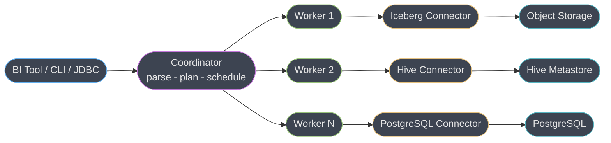
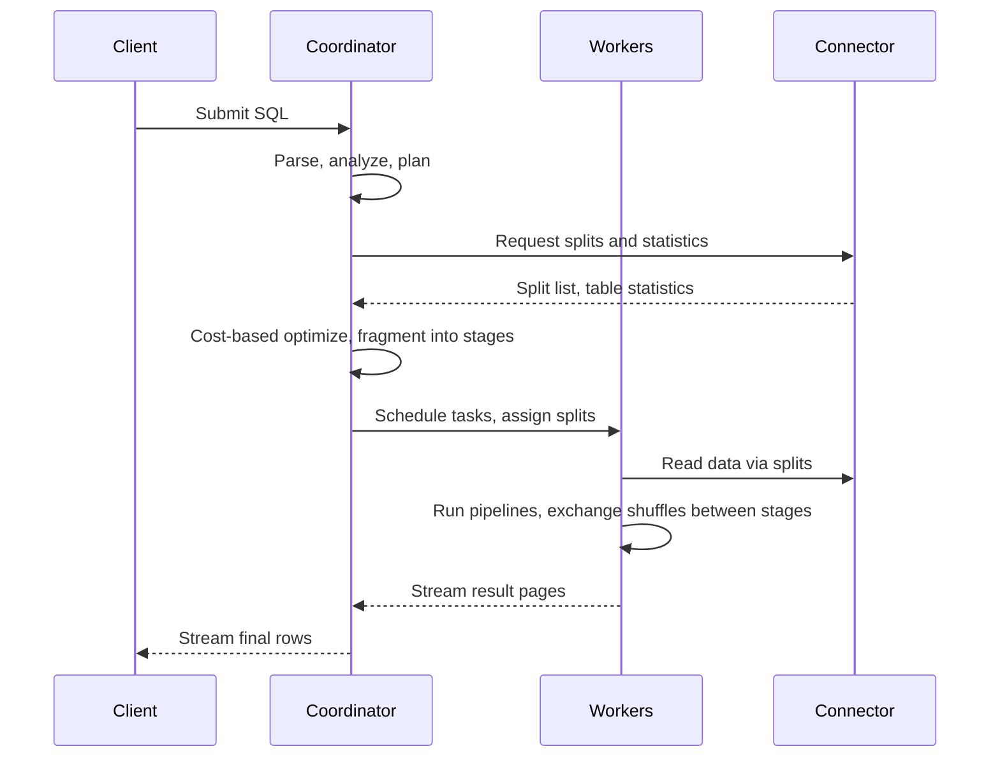
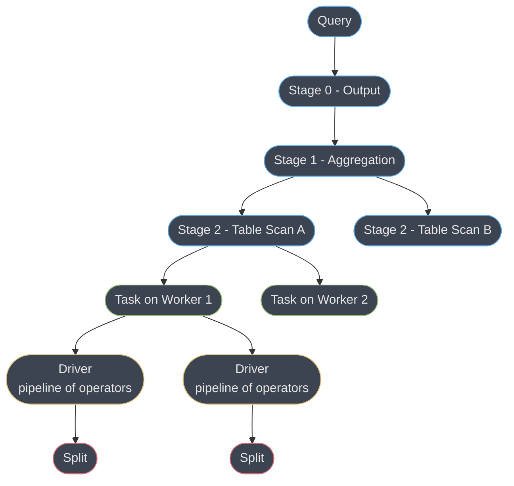
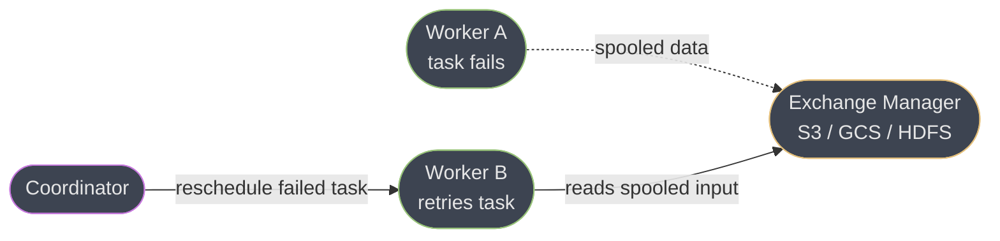
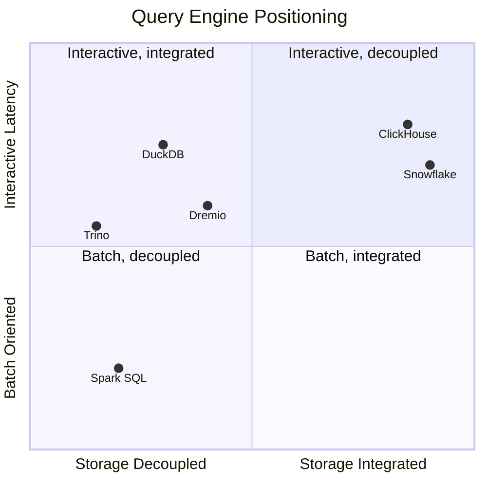

# Trino

> **Version anchor (2026-10-19).** **Trino 484** (released 2026-10-15, `trino.io/docs/current/release.html`)
> is the stable release this page is pinned to. Releases are numbered, with irregular gaps
> (481 on 2026-05-11, 482 on 2026-06-25, 483 on 2026-07-17, then 484 three months later), so
> check the release page before trusting this number. Release 484 carries breaking changes an
> upgrade from 483 must plan for: the Hive and Lakehouse connectors default
> `hive.storage-format` to `PARQUET` (set `ORC` to keep the old behaviour); the Alluxio file
> system cache settings (`fs.cache.directories`, `fs.cache.max-sizes` and related) move to a
> node-wide cache config shared by all catalogs, which now set only `fs.cache.enabled`; and the
> Docker image is built on the Red Hat Hardened core runtime image, has no `run-trino` script,
> and needs `node.id=${ENV:HOSTNAME}` in any custom `node.properties`.
> **Amazon Athena engine version 3**, generally available since October 2022, is built on Trino and AWS states it targets staying within 60-90 days of upstream Trino
> releases. **Starburst Enterprise (SEP)** and **Starburst Galaxy** are Starburst's commercial
> distributions of Trino, founded in 2017 by Justin Borgman together with Trino's original
> creators. The **Iceberg connector** referenced throughout §6.8 tracks whatever Iceberg table
> spec version the connector build supports; see the version anchor in
> [`apache_iceberg.md`](../apache_iceberg/apache_iceberg.md) for the Iceberg-side version line.
> Version-gated behaviour is tagged inline as `[484]`, `[483]`, `[Athena v3]`, `[SEP]` and so on; anything
> untagged is stable across the current release line.

Trino is a distributed MPP SQL query engine: a stateless compute layer that plans and executes
ANSI SQL across many data sources through a connector plugin interface, owning no storage and no
catalog of its own. This page is the query-engine deep dive — coordinator/worker mechanics, the
real config keys and defaults that govern memory, retries and optimization, and the Iceberg
connector's specific knobs. The storage half of the lakehouse story — Iceberg's metadata tree,
catalogs, and maintenance procedures — belongs to
[`apache_iceberg.md`](../apache_iceberg/apache_iceberg.md); the vendor-neutral case for table
formats belongs to
[`database/lakehouse_and_table_formats`](../../database/lakehouse_and_table_formats/lakehouse_and_table_formats.md).
This page assumes both and does not restate them.

---

## 1. Concept Overview

### What Trino is, precisely

Trino is a Java-based distributed query engine that speaks ANSI SQL and executes queries as a
cluster of one **coordinator** and many **workers**, using a **connector SPI** (service provider
interface) to read from — and in many cases write to — external systems: object storage via
Iceberg, Hive Metastore-backed tables, PostgreSQL, MySQL, Kafka topics, Elasticsearch, and dozens
more in one query. It has no query-optimizer-adjacent storage engine, no write-ahead log, no
buffer pool, and no persistence layer of its own: every byte a Trino query touches lives in
something else's system, and every byte a Trino query writes is written through a connector into
something else's system.

### What Trino is NOT

- **Not a database.** There is no Trino storage engine, no Trino-native table you can create
  without a connector backing it, and (until fault-tolerant execution's exchange spooling, which
  is intermediate shuffle data, not table data) nothing durable survives a coordinator restart.
- **Not a catalog.** Trino's `etc/catalog/<name>.properties` files map a catalog *name* to a
  connector and its connection details — they configure access to someone else's catalog (Hive
  Metastore, Glue, a REST catalog), they do not implement one.
- **Not an ETL orchestrator.** Trino executes SQL statements; scheduling a DAG of statements,
  retrying at the job level, and sequencing dependencies is Airflow's, Dagster's, or dbt's job,
  not Trino's.
- **Not, by default, a long-running-batch-safe engine** — though fault-tolerant execution (§6.5)
  narrows this gap considerably from where it stood a few years ago.

### The fork history, stated once

| Date | Event |
|---|---|
| 2012-2013 | Facebook builds Presto internally, open-sources it |
| January 2019 | Presto's original creators (Martin Traverso, Dain Sundstrom, David Phillips, Eric Hwang) leave Facebook and fork the project as **PrestoSQL**, in response to Facebook retaining control of the "Presto" trademark and governance |
| September 2019 | Facebook donates its PrestoDB codebase to the Linux Foundation, forming the **Presto Foundation** |
| 2020-12-27 | PrestoSQL is renamed **Trino**, moving to the independently governed **Trino Software Foundation**, because the Presto Foundation controls the "Presto" name |

The practical consequence: **PrestoDB** ("Presto") and **Trino** are two different projects with
a shared ancestor and a 2019 split, not two names for the same thing. PrestoDB is maintained
under the Linux Foundation's Presto Foundation with Meta as the largest contributor; Trino is
maintained by the Trino Software Foundation and the original project's creators. They have
diverged in SQL dialect details, connector implementations, and release cadence ever since.

### Trino vs. Presto vs. Starburst vs. Athena

| Product | What it is | Governance |
|---|---|---|
| **Trino** | The open-source engine this page covers | Trino Software Foundation |
| **PrestoDB ("Presto")** | The other fork of the same 2012 Facebook project | Presto Foundation (Linux Foundation), Meta-led |
| **Starburst (SEP / Galaxy)** | Commercial distribution *of Trino* — same engine, plus enterprise connectors, added security, and a bundled cost-based optimizer tier | Starburst (company), founded by Trino's creators |
| **Amazon Athena** | AWS's serverless, pay-per-query managed service; engine version 3 runs on **Trino** under the hood (engine versions 1-2 ran on PrestoDB) | AWS |

Starburst is not a competitor to Trino in the way ClickHouse or Snowflake are — it *is* Trino,
commercially packaged. Athena is not a fork; it is a managed deployment of Trino behind AWS's own
API and billing model (§14 uses Athena's real on-demand price as a cost-model contrast).

---

## 2. Intuition

**One-line analogy.** Trino is a SQL router bolted to a compute fabric: it does not own any data,
it goes to wherever the data already lives and runs the query there, in parallel, across as many
machines as the query needs.

**The mental model.** Think of Trino as a stateless cluster of calculators. The coordinator reads
your SQL, works out a plan, and hands out pieces of that plan to workers; workers ask connectors
for data, connectors go get it from whatever system actually stores it, and the workers combine,
filter and aggregate the results as they stream back. No worker "owns" a piece of the table the
way a shard owns its rows in a sharded database — a worker's role in a query is reassigned every
time a new query runs, and (outside fault-tolerant execution) nothing on a worker's disk survives
past the query that put it there.

**Why it matters.** The traditional answer to "query many data sources" was ETL: copy everything
into one warehouse first, then query the copy. Trino's bet is that for a large class of ad-hoc and
federated queries, moving the compute to the data — rather than the data to a warehouse — is
cheaper and faster than the ETL round-trip, especially when the data already lives somewhere
well-suited to storing it (an Iceberg lakehouse on object storage, an operational Postgres
database) and copying it elsewhere would just be redundant storage cost.

**The key insight.** Execution in Trino is **streaming pipelined execution**, not the
materialize-every-stage-to-disk model classic MapReduce (and Hive-on-MapReduce) used. Data flows
operator to operator within a driver in memory, and even *between* stages it flows through
in-memory exchanges by default — nothing hits disk unless the query spills (§6.4) or
fault-tolerant execution spools exchange data deliberately (§6.5). This is why a well-tuned Trino
query returns the first rows of a multi-terabyte scan in seconds: the coordinator doesn't wait for
one stage to fully materialize before the next stage starts consuming its output.

---

## 3. Core Principles

1. **Separation of compute from storage via the connector SPI.** Every data-source integration —
   Iceberg, Hive, PostgreSQL, Kafka, Elasticsearch — implements the same
   `ConnectorMetadata`/`ConnectorSplitManager`/`ConnectorPageSource` interfaces; Trino's planner
   and executor never know or care what's on the other side. This is what makes a single query
   across four unrelated systems possible at all: the planner reasons about "a table with these
   columns and these statistics," and only the connector implementation knows whether that table
   is really a PostgreSQL relation, an Iceberg snapshot, or a Kafka topic read as a stream of rows.
2. **No durable local state, by default.** Outside of spill files (§6.4) and fault-tolerant
   execution's spooled exchange data (§6.5), a worker holds nothing that survives the query that
   created it — restart a worker and you lose only what was in flight on it. This is also why
   horizontal scaling a Trino cluster is operationally simple compared to a stateful system: adding
   or removing a worker never requires rebalancing owned data, because no worker owns any.
3. **Shared-nothing MPP execution.** Query work is partitioned across workers with no shared
   memory or shared disk between them; workers communicate only by shuffling data through
   exchanges (§6.1) over the network. The corollary is that network bandwidth between workers is a
   real, first-class resource the planner has to reason about — a badly chosen join distribution
   (§4.4) is, mechanically, a decision about how much data crosses that network.
4. **Streaming pipelined execution, not stage-barrier batch.** Operators pull rows from upstream
   as they become available rather than waiting for a whole stage to finish (§2). The practical
   payoff is that a client sees the first rows of a large query while later stages are still
   running — there is no equivalent of "the job is at 40%" the way a MapReduce-style batch system
   reports progress, because there is no single global barrier to measure progress against.
5. **Cost-based optimization is opportunistic, not guaranteed.** The planner uses table statistics
   when a connector supplies them and falls back to rule-based, syntactic ordering when it
   doesn't (§6.6) — the same query plan differently depending on whether `ANALYZE` has ever run.
   This means two structurally identical queries against two different catalogs can be optimized
   completely differently, and "the optimizer will figure it out" is only true for connectors that
   actually report statistics.
6. **Fault tolerance is opt-in, not structural.** The default `retry-policy=NONE` means a worker
   failure fails the whole query; surviving a worker failure gracefully is a deliberate
   configuration choice (§6.5), not Trino's baseline behavior. Treating Trino as inherently
   fault-tolerant because it's "distributed" is a category error worth naming explicitly — being
   distributed and being fault-tolerant are independent properties, and Trino ships the first
   without the second unless you turn the second on.

---

## 4. Types / Architectures / Strategies

Trino gives an operator four independent axes to configure — where the cluster runs, how it
recovers from failure, how it reaches a given table format's metastore, and how it distributes a
join — and the shape of a specific deployment is really a combination of choices along all four,
not a single "architecture" picked once. §14 walks through one concrete combination end to end.

### 4.1 Deployment topologies

Coordinator/worker separation (§1, §5) is fixed by the engine; what varies is how many clusters
exist and how work is routed between them.

| Topology | Shape | When to use |
|---|---|---|
| Single coordinator, N dedicated workers | `node-scheduler.include-coordinator=false` | Standard production shape once the cluster exceeds a couple of nodes |
| Coordinator-worker combined | `node-scheduler.include-coordinator=true` (default) | Local dev, tiny single-node evaluation clusters only |
| Split interactive / batch clusters | Two independent Trino clusters, often behind Trino Gateway | Isolating latency-sensitive dashboards from long fault-tolerant batch jobs (§6.5, §14) |
| Kubernetes (Helm chart) | Coordinator and worker pods, autoscaled worker pool | Elastic capacity, cloud-native ops |

### 4.2 Fault-tolerant execution retry policies

This is the single biggest architectural fork in how a cluster behaves under failure, and it is
set per cluster, not per query — which is exactly why §4.1's split-cluster topology and §6.5's
retry-policy choice are two views of the same decision.

| Policy | Granularity | Requires exchange manager | Best for |
|---|---|---|---|
| `NONE` (default) | None — a worker failure fails the query | No | Short interactive queries where a full retry is cheap |
| `QUERY` | Whole query re-executed from scratch | Optional (32MB result buffer without one) | Many small, fast queries |
| `TASK` | Individual failed tasks retried in place | Yes, mandatory | Large batch queries that must survive node preemption |

### 4.3 Iceberg connector catalog types

`iceberg.catalog.type` selects the metastore implementation the connector talks to:
`hive_metastore` (default), `glue`, `jdbc`, `rest`, `nessie`, `snowflake` — see §6.8 for the
REST catalog's own sub-properties, which is the direction the ecosystem is converging on per
`apache_iceberg.md` §1. This is a per-catalog configuration property, so a single Trino cluster
can run one Iceberg catalog against `hive_metastore` and another against `rest` simultaneously —
useful when migrating between metastore implementations without a cutover window.

### 4.4 Join distribution strategies

Chosen per join, at plan time, not once for the whole query — a query with several joins can mix
`BROADCAST` and `PARTITIONED` strategies across its own stages depending on each join's estimated
sizes.

| Strategy | Mechanism | Chosen when |
|---|---|---|
| `BROADCAST` | Smaller (build) side copied whole to every node running the join | Build side small enough to fit under `join-max-broadcast-table-size` (100MB default) |
| `PARTITIONED` | Both sides hash-redistributed by join key | Build side too large to broadcast safely |
| `AUTOMATIC` (default) | Cost-based choice between the two, using table statistics when available | Statistics present; falls back to `PARTITIONED` without them |

### 4.5 Resource group scheduling policies

Resource groups are how a single cluster is subdivided into isolated workload classes without
standing up separate clusters for each one (§10, §14) — the scheduling policy decides how queued
queries within a group compete for the group's own concurrency slots.

`fair` (default, FIFO with round-robin sub-groups), `weighted_fair`, `weighted`
(priority-proportional stochastic selection), `query_priority` (strict priority, every sub-group
must define one) — §6.10 and §14 use these to isolate interactive analysts from a batch tenant.

---

## 5. Architecture Diagrams



*One coordinator plans and schedules every query; workers never talk to each other's connectors
directly — each worker's connector instance talks only to its own backing system.*



*Results stream back before the whole query finishes — a client can see rows while later stages
are still running.*



*A stage is a plan concept, not a running thing — only its tasks execute. Each task runs one or
more drivers, and each driver is a single-threaded pipeline of operators consuming one split.*



*Under `retry-policy=TASK`, exchange data is spooled to external storage instead of only living
in the failed worker's memory, so a replacement worker can pick the task back up without
re-running everything upstream of it.*

---

## 6. How It Works — Detailed Mechanics

### 6.1 Query lifecycle, end to end

1. **Parse.** The coordinator parses the SQL text into an abstract syntax tree.
2. **Analyze.** Table and column references are resolved against connector metadata — this is
   the first point a connector is consulted, and it's where an unresolvable catalog/schema/table
   name fails fast.
3. **Logical plan + rule-based optimization.** Predicate pushdown, projection pushdown, and other
   rewrite rules run regardless of whether statistics exist.
4. **Cost-based optimization**, when the connector supplies table statistics (§6.6): join
   reordering and join-distribution-type selection (`join-reordering-strategy`,
   `join-distribution-type`).
5. **Fragmentation into stages.** The distributed plan is split into a tree of stages connected
   by exchanges (§5, third diagram).
6. **Scheduling.** The coordinator asks each connector for the query's splits and assigns them to
   tasks on workers, bounded by `node-scheduler.max-splits-per-node` (256 default) and
   `node-scheduler.min-pending-splits-per-task` (16 default).
7. **Execution.** Each task runs `task.concurrency` drivers (default: number of physical CPUs,
   minimum 2, maximum 32 — **defaults to 8 under fault-tolerant execution**), each driver a
   single-threaded pipeline of operators pulling from its split.
8. **Exchange.** Data moves between stages over the network, optionally compressed by
   `exchange.compression-codec` (`NONE` default; `LZ4` or `ZSTD` available), buffered per
   `exchange.max-buffer-size` (32MB default).
9. **Result streaming.** The root stage streams result pages back to the coordinator, which
   streams them to the client — the client can start consuming rows before the query is fully
   finished.

### 6.2 Memory management and the low-memory killer

| Property | Default | What it bounds |
|---|---|---|
| `query.max-memory` | `20GB` | Total *user* memory a single query may use across the whole cluster |
| `query.max-memory-per-node` | 30% of the node's max JVM heap | User memory a single query may use on one node |
| `query.max-total-memory` | `query.max-memory` × 2 | User + system memory across the cluster, combined |
| `memory.heap-headroom-per-node` | 30% of the node's max JVM heap | Reserved for JVM/GC overhead, off-limits to queries |
| `query.low-memory-killer.policy` | `total-reservation-on-blocked-nodes` | Which query to kill when a node runs out of memory |
| `task.low-memory-killer.policy` | `total-reservation-on-blocked-nodes` | Which *task* to kill under `retry-policy=TASK`, instead of the whole query |

`query.max-memory-per-node` plus `memory.heap-headroom-per-node` must together stay under the
JVM's max heap size on that node — Trino enforces this constraint and refuses to start otherwise.

**Broken → fixed.** A team leaves `query.max-memory` at its 20GB default while running wide,
multi-way joins on a cluster with dozens of workers. Queries that should easily fit the cluster's
aggregate memory get killed with `Query exceeded distributed user memory limit`, because the
20GB ceiling is a *per-query* cluster-wide cap, not a cluster capacity limit — raising cluster
size does nothing for it. The fix is deliberately sizing `query.max-memory` and
`query.max-memory-per-node` to the workload (§13), and for genuinely large batch jobs, moving to
`retry-policy=TASK` (§6.5) so a memory-triggered task kill retries just that task instead of
failing the whole multi-hour query.

### 6.3 Task concurrency and node scheduling

`task.concurrency` (physical CPUs, min 2, max 32, defaulting to 8 under fault-tolerant execution)
governs how many drivers a task runs in parallel for joins and aggregations.
`task.max-worker-threads` defaults to node CPUs × 2 and bounds threads available to process
splits generally. `node-scheduler.include-coordinator` defaults to `true` — appropriate only for
single-node evaluation — because on any cluster with dedicated workers, letting the coordinator
also run query tasks competes with its own planning and scheduling threads for CPU, and the
coordinator's work does not parallelize the way task execution does (§5, diagram 1).

### 6.4 Spill to disk (legacy)

`spill-enabled` defaults to `false`. When enabled, memory-intensive operators (aggregations,
joins, sorts) can offload intermediate state to `spiller-spill-path`, bounded by
`max-spill-per-node` and `query-max-spill-per-node` (both `100GB` default), with
`spiller-max-used-space-threshold` (`0.9` default) taking a path out of rotation once it's 90%
full, and `spill-compression-codec` defaulting to `NONE`. Trino's own documentation describes
spill as **legacy functionality** and directs operators toward fault-tolerant execution (§6.5)
instead — spill helps a single query survive a memory spike on one node, but does nothing for a
worker that dies outright, which is the failure mode fault-tolerant execution actually targets.

### 6.5 Fault-tolerant execution (Project Tardigrade)

`retry-policy` defaults to `NONE`: a worker failure fails the whole query outright, full stop.

- **`QUERY`** retries the entire query from scratch on a fresh set of workers. Results larger
  than the exchange buffer need an exchange manager configured (otherwise results are capped
  around the in-memory exchange buffer, `exchange.deduplication-buffer-size` at `32MB` default).
  Suited to workloads with many small, fast queries where a full retry is cheap.
- **`TASK`** retries only the individual failed task, reusing everything already computed
  upstream of it. This requires an **exchange manager**: an `etc/exchange-manager.properties`
  file on every node naming `exchange-manager.name` (`filesystem`, `hdfs`, or a cloud-specific
  implementation for S3/GCS/Azure Blob) and `exchange.base-directories` (the URI(s) intermediate
  exchange data is spooled to), with `exchange.sink-max-file-size` defaulting to `1GB` per
  spooled file.

**Broken → fixed.** A team sets `retry-policy=TASK` on a long batch cluster and starts running a
six-hour reconciliation job, but never creates `exchange-manager.properties`. The cluster refuses
to start (or the property is silently ignored, depending on version) because task retry has no
mechanism for a replacement worker to fetch a failed task's inputs without spooled exchange data
— the fix is deploying the exchange manager config to every node before enabling `TASK` policy,
not after the first mid-job failure teaches you it was missing.

**Limitation:** query retries require connector support. As of the current release line, the
Iceberg, Hive, Delta Lake, and several JDBC connectors (PostgreSQL, MySQL, MariaDB, Oracle,
SQL Server, Redshift), BigQuery, and MongoDB support fault-tolerant execution; a connector that
doesn't fails a `TASK`- or `QUERY`-policy query with an explicit "this connector does not support
query retries" error rather than silently falling back to `NONE` behavior. Trino's own guidance
is to run `TASK`-policy batch workloads on a **dedicated cluster** separate from latency-sensitive
interactive queries, because the spooling round-trip adds latency every short query would then
pay for no benefit (§14 follows this guidance).

### 6.6 Cost-based optimizer and table statistics

`ANALYZE table_name` (optionally with a `WITH (columns = ARRAY[...])` clause) collects table
statistics — row counts, distinct-value counts, min/max, null fraction — that connectors
supporting it (Iceberg, Hive) persist and the optimizer consumes on later queries.

- `join-reordering-strategy` (`AUTOMATIC` default) uses statistics to reorder a multi-way join for
  lowest estimated cost; `ELIMINATE_CROSS_JOINS` only removes unnecessary cross joins;
  `NONE` keeps the syntactic order the query was written in. Without statistics, Trino falls back
  to processing joins right-to-left, which is why the classic manual-tuning advice — "put your
  biggest table leftmost" — still matters for un-analyzed tables or connectors without stats
  support.
- `join-distribution-type` (`AUTOMATIC` default) chooses `BROADCAST` vs. `PARTITIONED` per join
  based on the estimated size of the smaller side, capped by `join-max-broadcast-table-size`
  (`100MB` default) — above that size the planner won't broadcast even if `AUTOMATIC` estimates
  it as cheaper, to bound the risk of a bad estimate blowing up every node's memory at once.

**Missing statistics defeats the CBO silently.** A table nobody has ever run `ANALYZE` on, or one
behind a connector that doesn't support statistics at all, forces `join-distribution-type` back
onto rough heuristics — the planner may broadcast a table that is actually far larger than 100MB
if its size estimate is wrong, or fail to reorder a join that would trivially benefit from it. The
query still runs; it just runs however the optimizer's best guess says to, and there's no error to
tell you the guess was wrong until a worker runs out of memory.

### 6.7 Dynamic filtering

Dynamic filtering is enabled by default (`enable-dynamic-filtering` config property,
`enable_dynamic_filtering` session property). It collects candidate values from a join's build
(smaller) side while it's being processed and uses them to filter the probe (larger) side before
it's fully scanned — a runtime predicate the static query plan couldn't have known in advance.

- **Broadcast joins**: since the whole build side is already local to every node running the
  probe scan, the runtime filter is pushed straight into the local table scan on the same worker
  with no network round-trip.
- **Partitioned joins**: the coordinator collects filters from build-side tasks across the
  cluster and distributes them to worker table scans over the network — a small added latency
  cost for potentially skipping most of the probe side.
- **Connector pushdown**: Hive and Iceberg both support *dynamic partition pruning* from this
  mechanism, skipping whole partitions (and, for Iceberg, whole manifest entries) that can't
  contain matching rows, rather than only filtering rows after they're read. A per-catalog session
  property (`<catalog>.dynamic_filtering_wait_timeout`) lets a scan hold briefly for the filter to
  arrive before starting, trading a little latency for the chance to skip a full scan entirely.

This is the single biggest practical win for the common star-schema pattern — a large fact table
joined to a small, heavily filtered dimension table — because the fact-table scan can skip most of
its own files once the dimension-side filter is known, without the query author writing anything
differently.

### 6.8 The Iceberg connector's specifics

The `apache_iceberg.md` page owns Iceberg's own metadata tree and commit protocol; this section
covers only the Trino-side connector configuration that sits on top of it.

**Catalog configuration** — `iceberg.catalog.type`: `hive_metastore` (default), `glue`, `jdbc`,
`rest`, `nessie`, `snowflake`. REST catalog specifics (the direction the ecosystem is
converging on):

| Property | Default | Purpose |
|---|---|---|
| `iceberg.rest-catalog.uri` | — (required) | REST server API endpoint |
| `iceberg.rest-catalog.warehouse` | — | Warehouse identifier/location |
| `iceberg.rest-catalog.security` | `NONE` | `NONE`, `SIGV4`, `GOOGLE`, or `OAUTH2` |
| `iceberg.rest-catalog.vended-credentials-enabled` | `false` | Use storage credentials the REST backend vends, instead of locally configured ones |
| `iceberg.rest-catalog.session-timeout` | `1h` | How long a cached authentication session is kept |
| `iceberg.rest-catalog.nested-namespace-enabled` | `false` | Support for querying objects under nested namespaces |
| `iceberg.rest-catalog.view-endpoints-enabled` | `true` | Enable the REST catalog's view endpoints |

**Write and file layout properties:**

| Property | Default | Purpose |
|---|---|---|
| `iceberg.file-format` | `PARQUET` | Data file format (`PARQUET`, `ORC`, `AVRO`) |
| `iceberg.compression-codec` | `ZSTD` | Compression for written data files |
| `iceberg.target-max-file-size` | `1GB` | Target size for newly written data files |
| `iceberg.max-partitions-per-writer` | `100` | Partitions a single writer may handle concurrently |

**Materialized views.** An Iceberg-connector materialized view is a view definition backed by a
real Iceberg storage table; `iceberg.materialized-views.storage-schema` (or the per-view
`storage_schema` property) controls which schema that storage table lives in — by default, the
same schema as the view definition. `REFRESH MATERIALIZED VIEW` deletes the storage table's
existing rows and inserts the freshly computed result **atomically**, so readers querying the
view continue to see a consistent (if stale, until the refresh commits) result throughout the
refresh rather than a half-updated table.

**Table procedures**, invoked as `ALTER TABLE t EXECUTE procedure(...)`: `optimize` (compacts data
files, mirroring `rewrite_data_files` on the Iceberg side), `optimize_manifests` (compacts
manifest files), `expire_snapshots` (default `retention_threshold` of `7d`), `remove_orphan_files`
(default `retention_threshold` of `7d`), and `drop_extended_stats`. These are the Trino-side
entrypoints to the exact maintenance operations `apache_iceberg.md` §6 and §10 describe in depth
— this page does not re-derive why they're needed, only how you invoke them from SQL.

### 6.9 Query federation and cross-catalog joins

Each catalog is an independent `etc/catalog/<name>.properties` file naming a connector; a single
query can reference `catalog_a.schema.table` and `catalog_b.schema.table` in the same `FROM`
clause by fully-qualified name, and Trino plans the join across them like any other join.

The planner still applies whatever pushdown a given connector supports — predicate, projection,
sometimes aggregation pushdown — independently per catalog. But **a cross-catalog join
fundamentally cannot be pushed down as a join**, because there is no way for two different
backing systems to shuffle data directly between each other; Trino's own workers are the only
shared substrate, so both sides must be pulled into Trino's compute layer and shuffled through a
normal in-cluster exchange regardless of how well either side's individual scan was pushed down.

**This is where cross-catalog joins hurt.** Pushdown depth and statistics availability vary
wildly by connector — a mature connector to a columnar warehouse might push complex predicates and
report real statistics; a generic or read-only connector might report neither. Join a
poorly-filtered, stats-less source against a well-pruned Iceberg table, and the planner has no
signal that the first side is enormous: it can choose `BROADCAST`, pull the entire un-filtered
table across the network into every worker's memory, and take the whole cluster down with it —
correctly, by the numbers it had, and wrongly, by what actually happened.

A concrete example of the shape:

```sql
-- lakehouse.warehouse.orders lives in Iceberg, well-partitioned and analyzed.
-- legacy_pg.public.customers is a plain PostgreSQL table the JDBC connector
-- cannot report statistics for.
SELECT o.order_id, o.total_amount, c.customer_name
FROM lakehouse.warehouse.orders o
JOIN legacy_pg.public.customers c
  ON o.customer_id = c.customer_id
WHERE o.order_date >= DATE '2026-08-01';
```

The `orders` side prunes cleanly to a handful of Iceberg partitions. The `customers` side has no
statistics for the optimizer to reason about, so `join_distribution_type=AUTOMATIC` may guess it
is small enough to broadcast — and if `legacy_pg.public.customers` is actually a multi-million-row
table nobody expected a SQL analyst to full-scan, every worker just received a full copy of it.
`EXPLAIN` (§6.10) run before scheduling this as a recurring report is the way to catch this before
production does.

### 6.10 Reading the plan: EXPLAIN, EXPLAIN ANALYZE, and query time limits

`EXPLAIN` accepts a `TYPE` (`LOGICAL` — deprecated in favor of `DISTRIBUTED`; `DISTRIBUTED`
(default) — shows how the plan fragments across nodes and which distribution (`SINGLE`, `HASH`,
`ROUND_ROBIN`, `BROADCAST`, `SOURCE`) each fragment uses; `VALIDATE` — checks syntax and semantics
without planning; `IO` — reports exactly which partitions/files a query would touch, as JSON) and a
`FORMAT` (`TEXT`, `GRAPHVIZ`, `JSON`). A `DISTRIBUTED` plan looks roughly like:

```text
Fragment 0 [SINGLE]
    Output layout: [regionkey, count]
    Aggregate(FINAL)[regionkey]
    └─ RemoteSource[1]
Fragment 1 [HASH]
    Aggregate(PARTIAL)[regionkey]
    └─ TableScan[lakehouse.warehouse.orders]
```

Each `Fragment [...]` line names the exchange distribution for that stage, which is exactly where
you confirm whether the planner chose `BROADCAST` or a hash-partitioned join before running the
query — not after it OOMs a worker. `EXPLAIN ANALYZE` goes further: it actually runs the query and
annotates the plan with **actual** row counts and CPU time alongside the **estimated** ones the
cost-based optimizer used, which is the direct way to catch a statistics-driven misestimate (§6.6)
— a huge gap between estimated and actual rows at a given operator is the signature of a stale or
missing `ANALYZE`.

**Query time limits**, distinct from the memory limits in §6.2:

| Property | Default | What it bounds |
|---|---|---|
| `query.max-execution-time` | `100d` | Time a query may spend actively executing |
| `query.max-run-time` | `100d` | Time a query may spend on the cluster total, including time queued |
| `query.max-planning-time` | `10m` | Time a query may spend in the planning phase before execution starts |
| `query.max-stage-count` | `150` | Stages a single query's distributed plan may fragment into |

Both time defaults are deliberately generous (100 days) because Trino has no built-in notion of
"this workload should be fast" — that judgment belongs to resource groups and application-level
timeouts, not a blanket engine default that would otherwise kill a legitimately long-running batch
job. `query.max-planning-time` is the tighter one by design: a query still stuck in planning after
10 minutes is very likely pathological — a deeply nested view chain or a plan pushing toward
`query.max-stage-count`'s ceiling — rather than doing genuine, if slow, work.

### 6.11 Session properties vs. configuration properties

Two different mechanisms both look like "settings" and are easy to conflate. **Configuration
properties** (`etc/config.properties`, `etc/catalog/<name>.properties`) are set once per node at
startup and require a restart to change — `retry-policy`, `query.max-memory`, and everything else
this section has covered so far is one of these. **Session properties** are set per query or per
client session with `SET SESSION property = value` and take effect immediately with no restart —
`join_distribution_type`, `enable_dynamic_filtering`, and a catalog-qualified property like
`<catalog>.dynamic_filtering_wait_timeout` are all session properties, and many (not all) config
properties have a session-property twin that lets a single query override the cluster-wide
default for just itself. This is exactly the mechanism §6.9's cross-catalog join mitigation and
§6.7's dynamic-filtering tuning both rely on: an analyst forcing `join_distribution_type` to
`PARTITIONED` for one risky query does not require a coordinator restart or affect any other query
running on the same cluster.

### 6.12 Access control

Authorization is pluggable via `access-control.name` in `etc/access-control.properties` (or a
comma-separated list of property files via `access-control.config-files`, letting more than one
access control implementation run at once). With no file configured at all, Trino's **default**
system access control permits essentially every operation except user impersonation and
triggering a graceful shutdown — a permissive baseline appropriate for a trusted internal
evaluation cluster, not a shared production one. Built-in options beyond the default: `allow-all`
(explicitly permit everything, equivalent to the default's data-access behavior), `read-only`
(permit reads and session-property changes, block all writes), and `file` (authorization rules
defined declaratively in a rules file — the common starting point for real deployments before
reaching for an external policy engine). For centralized, auditable policy management across more
than one Trino cluster, `opa` (Open Policy Agent) and `ranger` (Apache Ranger) implementations
delegate the actual authorization decision to an external policy service rather than encoding
rules locally on each coordinator.

### 6.13 File system cache `[484]`

The Delta Lake, Hive and Iceberg connectors can cache object-storage reads on each
node's local disk, so a hot Parquet footer or row group is read from S3 once and then from SSD.
From 484 the cache is one per node, shared by every catalog, and configured in two places:

```properties
# etc/config.properties (identical on every node)
cache-manager.config-files=etc/cache-manager-alluxio.properties

# etc/cache-manager-alluxio.properties
cache-manager.name=alluxio
fs.cache.directories=/mnt/nvme/trino-cache
fs.cache.max-sizes=500GB          # or fs.cache.max-disk-usage-percentages
# fs.cache.ttl=7d, fs.cache.page-size=1MB are the defaults

# etc/catalog/lake.properties (each catalog that should cache)
fs.cache.enabled=true
```

A catalog with `fs.cache.enabled=true` on a node with no `alluxio` cache manager fails to
start. A separate `memory` cache manager caches coordinator metadata on the heap
(`fs.memory-cache.max-size`, `fs.memory-cache.ttl` default `1h`).

**Why locality decides the hit rate.** Each node caches only what it reads, so the scheduler
prefers a fixed set of nodes for the splits of a given file: `node-scheduler.cache-preferred-hosts-count`
(default 2) on the coordinator. Lower values mean fewer duplicate copies and more effective
cache; higher values spread hot files over more nodes and survive a node loss with a warm
copy. When the preferred nodes are busy the split runs elsewhere and that node caches the file
too. Put the cache on dedicated local NVMe, never on the root disk and never on shared storage,
and expect the hit rate to drop after autoscaling adds nodes, since a new node starts cold.

### 6.14 Table functions and query pass-through

A table function returns a table and is called in `FROM` inside `TABLE(...)`. When its output
columns depend on its arguments it is a **polymorphic table function** (PTF), the SQL:2016
feature Trino implements in its SPI. Arguments are scalars (constant expressions), descriptors
(`DESCRIPTOR(id BIGINT, name VARCHAR)`) or tables (`TABLE(orders)` or `TABLE(SELECT ...)`), passed
either all by name (`=>`) or all by position, never mixed.

| Function | Where it lives | What it returns |
|---|---|---|
| `exclude_columns(input => TABLE(t), columns => DESCRIPTOR(a, b))` | `system.builtin` | `t` minus the listed columns, so `SELECT *` without a wide `SELECT` list |
| `sequence(start => 0, stop => n, step => 1)` | `system.builtin` | one `bigint` column `sequential_number`; `stop` is inclusive, output is unordered |
| `<catalog>.system.query(query => '...')` | JDBC connectors (PostgreSQL, MySQL, Oracle, SQL Server and others) | the result set of a native query, executed entirely by the source |
| `<catalog>.system.table_changes(schema_name, table_name, start_snapshot_id, end_snapshot_id)` | Iceberg connector | row-level changes between two snapshots, with `_change_type`, `_change_version_id`, `_change_timestamp` and `_change_ordinal` |

A table argument declared with set semantics also accepts `PARTITION BY`, `ORDER BY` and
`KEEP WHEN EMPTY` or `PRUNE WHEN EMPTY`, which lets Trino run one function instance per partition
in parallel across workers, the same way it parallelises a window function.

```sql
-- Pass-through: PostgreSQL runs the window frame exclusion Trino's SQL does not have
SELECT * FROM TABLE(
  legacy_pg.system.query(query => 'SELECT id, array_agg(week) OVER (ORDER BY week
     ROWS BETWEEN 2 PRECEDING AND 2 FOLLOWING EXCLUDE GROUP) AS w FROM test.time_data'));

-- Iceberg incremental read: only rows changed between two snapshots
SELECT * FROM TABLE(lake.system.table_changes(
  schema_name => 'sales', table_name => 'orders',
  start_snapshot_id => 6541165659943306573,   -- exclusive
  end_snapshot_id   => 6745790645714043599));  -- inclusive
```

**Pass-through is a hole in the security model.** The native query string goes to the source
unparsed: Trino does not validate it, does not apply its own table, column, row-filter or mask
rules to it, and the source checks it with the catalog's connection credentials. Trino also does
not preserve an `ORDER BY` inside the string. With file-based access control, `system.query` is
gated by a function rule on schema `system`, function `query`, privilege `EXECUTE`; with no
function rules only `system.builtin` functions run. With the default allow-all access control
(§6.12) every user can call it. Grant it to the few users who need a native feature, and connect
that catalog with a read-only database role so a pass-through `DELETE` fails at the source.

---

## 7. Real-World Examples

- **Lyft** runs Trino for large-scale ETL: roughly 10 petabytes read and 100 terabytes written
  per day, around 250,000 queries a day across roughly 2,000 unique users, on a fleet Lyft has
  actively shrunk — cutting the number of Trino nodes in half over a year while workload grew,
  attributed to engine and cluster efficiency work (Trino Summit 2022).
- **Shopify** migrated its analytics workloads onto Trino and quickly adopted the Iceberg table
  format after hitting Hive-format scaling issues; Shopify's clusters sustain roughly 15 Gbps and
  over 300 million rows per second of throughput (Shopify Engineering, Trino Summit 2022).
- **Pinterest** reported a roughly 2x efficiency improvement on its Trino deployment (Trino
  Summit 2022), the kind of gain that typically comes from exactly the tuning categories §6 and
  §10 describe: memory sizing, resource groups, and compaction cadence on the underlying tables.
- **LinkedIn** presented on operating Trino at exabyte scale, including the operational work of
  keeping a cluster of that size on a current release line.
- **Amazon Athena** is, at cluster scale, the single largest deployment of Trino in existence:
  every Athena query on engine version 3 — the default since GA in October 2022 — runs on Trino,
  making AWS's own managed-query product a Trino distribution in all but name (§14 uses Athena's
  published on-demand pricing as a cost-model reference point).
- **Netflix** is where much of the operational pressure that shaped Iceberg's own design came
  from — `apache_iceberg.md` documents Netflix's role in building Iceberg specifically to fix
  Hive-metastore metadata scaling problems Netflix hit running Presto/Trino at scale; this page
  does not restate that story, only notes that the query-engine and table-format halves of it
  come from the same operational pressure.

### What these deployments have in common

Every one of the workload shapes above is either **wide fan-out ad-hoc analytics** (many users,
unpredictable query shapes, no single "typical" query to hand-tune for) or **large-scale scheduled
ETL** (predictable, recurring, resource-intensive) — and none of them is a low-latency serving
workload. That split maps directly onto §4.1's two-cluster deployment pattern and §14's case
study: production Trino operators consistently end up separating these two shapes onto different
clusters (or at minimum different resource groups) rather than running one undifferentiated pool,
because the tuning that helps one actively hurts the other (§6.5, §10).

---

## 8. Tradeoffs



*Trino sits alone in "interactive, decoupled" — the only engine on this chart with no storage
engine of its own that still targets interactive latency; that combination is both its whole
pitch and the source of every tradeoff below.*

| Engine | Where it beats Trino | Where Trino beats it |
|---|---|---|
| **Apache Spark SQL** | Long, multi-stage batch ETL with complex DAGs, broader library ecosystem (MLlib, structured streaming) beyond SQL, more mature large-shuffle fault tolerance as a first-class default | Interactive latency, ad-hoc federated SQL, no need to write a job — just a query |
| **DuckDB** | Single-machine or embedded analytics — zero cluster/coordinator overhead, often faster on data that fits one node, trivial to run in a notebook or CI job | Anything exceeding one machine's memory/disk, or needing concurrent multi-user access — DuckDB has no cluster mode |
| **ClickHouse** | Very high-QPS, low-latency point and aggregation queries against its own storage — the real-time dashboard / serving-layer use case | Federated queries across sources ClickHouse doesn't own; ClickHouse has no equivalent of "query a table you never loaded into it" |
| **Snowflake / BigQuery** | Fully managed elasticity, native storage with automatic clustering/caching, mature governance with far less operational burden | No storage lock-in — BYO storage and BYO catalog; usually cheaper for genuinely ad-hoc federated queries where a warehouse would need a full ingest first |
| **Dremio / Starburst** | Dremio's Arrow-Flight-native reflections (materialized caching) can beat a cold Trino scan on repeat queries; Starburst *is* Trino plus enterprise features, not really a competitor | Trino OSS has no licensing cost and the broadest independent connector ecosystem of any of them |

**Be honest about where Trino loses outright.** It is not competitive for sub-100ms,
thousands-of-QPS point lookups — that's Druid, Pinot, or ClickHouse territory, because Trino pays
real per-query planning and coordination overhead even for trivial queries. It is not a place to
run a genuinely massive, deeply-dependent multi-day batch DAG — Spark's checkpointing and
broader retry model still fit that shape more naturally, even with fault-tolerant execution
narrowing the gap for single long queries. And it owns no storage, so anything a warehouse gets
"for free" from owning its own storage layer (automatic clustering, native result caching, tight
query-to-storage co-design) Trino has to get, if at all, from the connector underneath it.

### The cost model is structurally different, not just cheaper or more expensive

A managed warehouse like Snowflake or BigQuery bills for compute time or bytes scanned bundled
with its storage and optimization work as one line item; Trino itself has zero license cost, but
every dollar of "storage optimization" a warehouse quietly does for you — clustering, automatic
result caching, background compaction — is a dollar of engineering time a Trino-on-Iceberg
operator has to spend explicitly (§6.8, §10, §13). Amazon Athena is the useful middle case: it
runs Trino, but bills per-TB-scanned ($5/TB on-demand, §14) with no cluster to operate at all,
which makes it directly comparable to a self-managed cluster's amortized EC2 cost for a given
query volume — the crossover point is usually query *frequency*: bursty, occasional workloads
favor Athena's pay-per-scan model, and sustained, high-volume workloads favor a dedicated
self-managed (or Starburst-operated) cluster where the fixed cost is already amortized.

---

## 9. When to Use / When NOT to Use

**Use Trino when:**
- Ad-hoc, interactive SQL analytics across a lakehouse (Iceberg, Hive) needs to serve many
  analysts and BI tools without a per-tool ETL pipeline.
- You need one query to join data that genuinely lives in different systems — an Iceberg fact
  table joined against a live PostgreSQL dimension table, for example — without copying either
  first.
- Batch reporting or reconciliation jobs need to survive worker preemption (spot instances) —
  fault-tolerant execution with `TASK` retry (§6.5, §14) makes this practical where it wasn't a
  few years ago.
- Multiple engines (Spark for ETL, Trino for ad-hoc, a BI tool for dashboards) must all read and
  write the same physical tables — Trino's Iceberg/REST-catalog support makes it a peer, not a
  silo.

**Do NOT use Trino when:**
- You need a data warehouse's integrated storage, automatic clustering, and native caching —
  Trino owns none of that; pair it deliberately with Iceberg/Hive/Delta and accept the extra
  moving part, or just use a warehouse.
- You need sub-100ms point lookups at high concurrency — that's a serving-layer engine's job
  (ClickHouse, Druid, Pinot, a KV store), not an MPP SQL engine's.
- You need job scheduling, dependency management, or retries *between* statements — that's an
  orchestrator's job (Airflow, Dagster), and Trino has no opinion about it.
- You're running a single-node or small-data workload where a cluster's coordination overhead
  outweighs any benefit — DuckDB is faster and has zero operational surface for that case.
- You need a massive, deeply state-dependent multi-day batch pipeline — Spark still fits that
  shape more naturally than Trino, fault-tolerant execution notwithstanding.

**The decision usually isn't binary.** Most production lakehouses that adopt Trino do not replace
an existing warehouse with it — they add it as the federated, ad-hoc layer sitting alongside a
warehouse or a scheduled Spark ETL pipeline, exactly as §7's real-world examples and §14's case
study do. The question worth asking up front is narrower than "Trino or not": which specific
workloads in your platform are genuinely ad-hoc and federated (Trino's strength), which are
scheduled and long-running (increasingly Trino-viable with `TASK` retry, but still often better on
Spark), and which need sub-second serving latency against a fixed schema (never Trino, regardless
of tuning). Getting that split wrong in either direction — running everything through Trino, or
never trying it for a workload that's actually a good fit — is the more common failure than
picking the wrong engine outright.

---

## 10. Common Pitfalls (Production War Stories)

**The coordinator as the single point of everything.** Every query's parsing, planning,
scheduling, and dynamic-filter distribution runs through one coordinator process regardless of
worker count; a cluster with `query.max-stage-count` (default `150`) worth of stages fanning out
across hundreds of splits can put real, sustained CPU and GC pressure on that one node even while
every worker sits idle. Teams that scale workers without ever watching the coordinator's own JMX
metrics learn this the hard way — the fix is treating coordinator health as its own first-class
dashboard, not an assumed-fine appendage to worker metrics.

**Memory-killer thrashing.** The default `query.low-memory-killer.policy` of
`total-reservation-on-blocked-nodes` picks whichever query is using the most memory *on the nodes
that are currently blocked* — which is not necessarily the query that caused the pressure. A
single innocent, unrelated large query can be killed because it happened to have a large
allocation on the same nodes a smaller, badly-behaved query pushed into low memory first. Teams
that don't understand this policy's selection criterion end up chasing the wrong query in the
postmortem.

**Small-files death on object storage.** A CDC-fed or frequently-committed Iceberg table without
a matched compaction cadence accumulates enough small files and manifest entries that Trino's
query *planning* — before a single row is read — becomes the bottleneck; `apache_iceberg.md` §10
documents a real case where planning alone went from 3 seconds to 4 minutes 40 seconds at 970,000
files. The Trino-side symptom looks like "the cluster got slow" when the actual cause is entirely
on the Iceberg maintenance side, which is why §6.8's table procedures need their own operational
cadence, not a one-time cleanup.

**One bad query kills the cluster.** Without resource groups, any single query can consume
`query.max-memory`'s full ceiling on every node it touches simultaneously, and with no
`maxQueued`/`hardConcurrencyLimit` in place, nothing stops a burst of similarly heavy queries from
queueing behind each other and starving every other workload. The fix is resource groups: give
interactive analysts and batch/reporting tenants separate groups with their own
`hardConcurrencyLimit`, `softMemoryLimit`, and `maxQueued`, so one team's runaway query queues
inside its own group's limits instead of starving everyone else's (§14 shows a working config).

**Missing table statistics defeats the CBO.** A table nobody ever ran `ANALYZE` on gets whatever
size estimate the connector can produce without real statistics — often wrong by an order of
magnitude — and `join-distribution-type=AUTOMATIC` can decide to broadcast a table that is
actually far over the `join-max-broadcast-table-size` (100MB) threshold it was implicitly assuming.
The failure mode is every worker running low on memory at once, roughly simultaneously, for a
join that a single `ANALYZE` run would have planned correctly.

**Cross-catalog joins pushing everything through the coordinator.** §6.9's mechanism means a join
against a poorly-instrumented connector can pull an entire un-filtered remote table into Trino's
compute layer before the join logic even runs — a query author who assumes "the database will
push the filter down" learns otherwise only when the query either times out or takes the cluster
down with it, because nothing in the query's SQL looked wrong.

**Spill enabled without real disk headroom.** A team enables `spill-enabled` to work around
memory pressure on a heavy `GROUP BY` workload, sets `spiller-spill-path` to a volume shared with
other workloads, and accepts the `max-spill-per-node` default of `100GB` without checking whether
that much space is genuinely free. The first sustained aggregation that actually needs to spill
fills the volume faster than anyone budgeted for, and — because spill is exactly the mechanism
meant to *prevent* an out-of-memory failure — the node fails on disk exhaustion instead, which is
a worse and less diagnosable failure than the OOM it was trying to avoid. Provision real,
dedicated headroom before enabling spill, or skip it in favor of `retry-policy=TASK` for workloads
that need actual resilience rather than a memory-pressure release valve.

**Batch and interactive workloads sharing one cluster.** A team enables
`retry-policy=TASK` on the same cluster interactive analysts use during business hours, reasoning
that fault tolerance can only help. Every query on that cluster — including trivial, few-second
interactive ones — now pays the exchange-manager spooling round-trip regardless of whether it
ever needs to survive a worker failure, and p95 interactive latency regresses measurably even
though nothing about the interactive workload changed. Trino's own fault-tolerant-execution
guidance is explicit that `TASK`-policy batch workloads belong on a **dedicated cluster**; §14's
case study hit this exact regression before splitting into the two-cluster architecture it
documents.

**The 484 upgrade that failed at catalog load.** A cluster upgraded from 483 with
`fs.cache.directories` and `fs.cache.max-sizes` still in each catalog file, as every pre-484
example shows. From 484 those keys live only in the node-wide cache-manager file named by
`cache-manager.config-files`, and catalogs set only `fs.cache.enabled`, so the catalogs failed
to load. The same upgrade changed three behaviours that do not fail loudly: new Hive and
Lakehouse tables default to `PARQUET` instead of `ORC` (set `hive.storage-format=ORC` to keep
ORC), JSON casts and constructors now keep numeric types, decimal scale, member order and
duplicate keys and reject nesting deeper than 1,024, and interval multiplication and division
truncate to the interval's field range. Diff the release notes' breaking-change list against the
queries your dashboards run before upgrading, not after.

---

## 11. Technologies & Tools

### 11.1 Core engine and clients

| Tool | What it does |
|---|---|
| Trino Server | The coordinator/worker Java process that is the engine itself. |
| Trino CLI | Terminal SQL client shipped with the project. |
| Trino JDBC Driver | Standard JDBC connectivity for BI tools and applications. |
| Trino Python Client | Official Python DB-API client library. |
| Trino Web UI | Built-in coordinator web console for live and historical query monitoring. |

### 11.2 Managed and commercial distributions

| Tool | What it does |
|---|---|
| Starburst Enterprise | Commercial, self-managed distribution of Trino with added connectors and security. |
| Starburst Galaxy | Starburst's fully managed cloud SaaS distribution of Trino. |
| Amazon Athena | AWS serverless, pay-per-query service running Trino as engine version 3. |

### 11.3 Related and competing engines

| Tool | What it does |
|---|---|
| PrestoDB | The Meta-led sibling fork Trino split from in 2019. |
| Apache Spark | Batch/streaming engine with its own SQL layer, the closest ETL-side alternative. |
| DuckDB | Embedded single-node analytical engine for data that fits one machine. |
| ClickHouse | High-QPS OLAP engine with its own native storage, built for serving-layer latency. |
| Snowflake | Fully managed cloud data warehouse with native storage. |
| Google BigQuery | Serverless managed warehouse with native storage. |
| Dremio | Lakehouse query engine with Arrow-Flight-native caching (Reflections). |

### 11.4 Catalogs and metastores Trino connects to

| Tool | What it does |
|---|---|
| Hive Metastore | The legacy Thrift-based metastore many connectors still speak by default. |
| AWS Glue Data Catalog | AWS-native metastore, also reachable via the Iceberg REST protocol. |
| Apache Polaris | ASF REST catalog with credential vending, a common Iceberg-connector target. |
| Project Nessie | Git-like versioned catalog with branch and multi-table commit support. |
| Databricks Unity Catalog | Governance layer exposing a native Iceberg REST Catalog endpoint. |

### 11.5 Storage and table formats read through connectors

| Tool | What it does |
|---|---|
| Apache Iceberg | The primary lakehouse table format Trino's Iceberg connector targets. |
| Delta Lake | Alternative open table format with its own Trino connector. |
| Apache Hudi | Alternative open table format with its own Trino connector. |
| Apache Parquet | The dominant on-disk columnar format for Trino-written data files. |

### 11.6 Ecosystem, orchestration and observability

| Tool | What it does |
|---|---|
| Trino Gateway | Routes queries and load-balances across multiple Trino clusters. |
| Apache Airflow | Orchestrates SQL statements and pipelines that submit queries to Trino. |
| Apache Superset | BI/dashboard tool commonly deployed against Trino as its SQL source. |
| Prometheus | Scrapes coordinator/worker JMX metrics for cluster dashboards. |
| Grafana | Renders dashboards over query, memory and resource-group metrics. |

### 11.7 Access control and governance

| Tool | What it does |
|---|---|
| Open Policy Agent | External policy engine Trino's `opa` access control delegates authorization decisions to. |
| Apache Ranger | Centralized policy management Trino's `ranger` access control integrates with. |

### 11.8 Related reading

Related reading: [Apache Iceberg](../apache_iceberg/apache_iceberg.md),
[lakehouse and table formats](../../database/lakehouse_and_table_formats/lakehouse_and_table_formats.md),
[analytical databases and OLAP](../../database/analytical_databases_and_olap/analytical_databases_and_olap.md),
[SQL query optimization](../../database/sql_query_optimization/sql_query_optimization.md),
[Apache Airflow](../apache_airflow/apache_airflow.md).

---

## 12. Interview Questions with Answers

**Q: A 20-worker cluster sits under 30% average CPU but query latency keeps climbing as more analysts connect — what's the first thing to check?**
**Short:** The coordinator, not the workers — it alone parses, plans, schedules and distributes dynamic filters for every query.
Trino has exactly one coordinator per cluster, and planning, scheduling, and dynamic-filter distribution all run there regardless of how idle the workers are, so average worker CPU tells you nothing about coordinator load. Check the coordinator's own JVM heap and CPU/GC time first — a cluster with `node-scheduler.include-coordinator=true` (the default) compounds this by also running worker tasks on the same node the planning threads need. In production, set that property to `false` once you have dedicated workers, and monitor the coordinator's own JMX metrics as their own first-class dashboard rather than inferring health from worker averages.

**Q: One analyst's runaway query is starving every other team's dashboard — what config would have prevented it?**
**Short:** Resource groups with a `hardConcurrencyLimit`, `softMemoryLimit`, and `maxQueued` isolating that team from everyone else.
Without resource groups, any single query can consume up to `query.max-memory`'s full ceiling on every node it touches, and nothing stops several such queries from queueing behind each other and blocking the whole cluster. Resource groups, configured via `resource-groups.configuration-manager` (`file` or `db`), let you give each team or workload class its own `hardConcurrencyLimit`, `softMemoryLimit`, and `maxQueued`, so a runaway query in one group queues or gets rejected inside that group's own limits instead of starving everyone else's. The fix is proactive segmentation by workload type before the first incident, not a reactive kill after one team's query takes the cluster down.

**Q: A low-memory kill removed a completely unrelated, well-behaved query instead of the one that actually caused the pressure — how is that possible?**
**Short:** The default `query.low-memory-killer.policy` of `total-reservation-on-blocked-nodes` kills the biggest consumer on blocked nodes, not the cause.
`total-reservation-on-blocked-nodes` selects whichever query is currently using the most memory specifically on the nodes that are blocked — it has no notion of causality, only current reservation size on the affected nodes. A large but otherwise well-behaved query can be sitting on the same blocked nodes a smaller, badly-partitioned query just pushed into low memory, and the policy kills the bigger one regardless of who's actually responsible. Understanding this selection criterion up front saves a postmortem spent chasing the wrong query.

**Q: `query.max-memory` is left at its default and a wide multi-way join keeps failing with "exceeded distributed user memory limit" even on a large cluster — why doesn't adding more workers fix it?**
**Short:** `query.max-memory` defaults to 20GB and is a per-query cluster-wide cap, not a function of cluster size.
Adding workers increases aggregate cluster capacity but does nothing to a fixed per-query ceiling — `query.max-memory` (20GB default) bounds total user memory one query may use across the *entire* cluster, so a query that legitimately needs more than that fails identically whether the cluster has 10 or 200 workers. The fix is deliberately sizing `query.max-memory` and `query.max-memory-per-node` to the actual workload, and for genuinely large batch queries, moving to `retry-policy=TASK` so a memory-triggered kill removes just the offending task rather than failing the whole multi-hour query.

**Q: A table has been compacted nightly for months, but query planning against it keeps getting slower — what's usually missing?**
**Short:** Expiring old snapshots — compaction writes new files but never deletes the ones superseded snapshots still reference.
This is an Iceberg-side maintenance gap surfacing as a Trino-side symptom: `optimize` (Trino's entrypoint to Iceberg's `rewrite_data_files`) writes new, larger files but leaves every file a still-retained older snapshot points to untouched, so file count — and the manifest entries Trino's planner has to evaluate before a query even starts — keeps growing regardless of how often compaction runs. `expire_snapshots` (default `retention_threshold` of `7d`, invoked as `ALTER TABLE t EXECUTE expire_snapshots`) is the separate step that actually removes files no retained snapshot references any more, and it has to be scheduled alongside compaction, not assumed to happen automatically. See `apache_iceberg.md` §10 for the full mechanics of why this happens.

**Q: A cross-catalog join between a small, well-filtered Iceberg table and a large, un-filtered PostgreSQL table takes the whole cluster down — what actually happened?**
**Short:** The planner had no statistics for the PostgreSQL side, guessed it was small, and broadcast the entire un-filtered table to every worker.
A cross-catalog join can never be pushed down as a join — both sides must land in Trino's own compute layer and shuffle through a normal in-cluster exchange, because two different backing systems have no way to shuffle data directly between each other. When the PostgreSQL connector can't supply real table statistics, `join-distribution-type=AUTOMATIC` has no reliable signal that the table is actually huge, and if its estimate lands under `join-max-broadcast-table-size` (100MB default) it will happily broadcast the whole thing to every node running the join, exhausting memory across the cluster simultaneously. The mitigation is filtering aggressively on the poorly-instrumented side in the query itself, or forcing `join_distribution_type='PARTITIONED'` as a session override when statistics can't be trusted.

**Q: A team enables `retry-policy=TASK` for a long batch cluster and the cluster won't start (or task retries silently don't work) — what's missing?**
**Short:** An exchange manager — `TASK` retry mandates spooling intermediate exchange data externally, and it isn't configured by default.
`TASK` retry needs a replacement worker to be able to fetch a failed task's already-computed upstream input without re-running everything before it, and that only works if exchange data is spooled to external storage rather than living only in the failed worker's memory. That requires `etc/exchange-manager.properties` on every node, naming `exchange-manager.name` (`filesystem`, `hdfs`, or a cloud object-storage implementation) and `exchange.base-directories`, with `exchange.sink-max-file-size` defaulting to `1GB` per spooled file. The fix is deploying that file to every node before enabling `TASK` policy, not discovering the gap during the first mid-job worker failure.

**Q: Spill-to-disk is enabled and a heavy `GROUP BY` starts causing worker node failures — what went wrong?**
**Short:** Spill filled local disk faster than expected, and Trino's own docs call spill legacy functionality superseded by fault-tolerant execution.
`spill-enabled` (`false` by default) lets memory-intensive operators offload state to `spiller-spill-path`, bounded by `max-spill-per-node` (`100GB` default), but that bound is a ceiling per node, not a guarantee the node has that much free disk available alongside everything else running on it — a node without real headroom fills its disk and fails outright rather than gracefully degrading. Trino's own documentation is explicit that spill is legacy, existing to survive a single query's memory spike on one node, and directs teams toward fault-tolerant execution instead, which handles the more common failure mode (a worker dying) that spill was never designed for. The practical fix is provisioning genuine disk headroom before enabling spill, or skipping it in favor of `retry-policy=TASK` for workloads that actually need resilience.

**Q: What's the actual difference between running a query with `retry-policy=NONE` versus `TASK` when a worker dies mid-query?**
**Short:** `NONE` fails the whole query outright; `TASK` retries only the failed task, reusing already-computed upstream results.
Under the default `NONE`, a worker failure at any point fails the entire query with no partial credit for work already done — the client has to resubmit from scratch. Under `TASK`, only the specific failed task is rescheduled onto a healthy worker, which fetches its already-staged input from the exchange manager's spooled data (§ above) rather than recomputing everything upstream of it, so a six-hour batch job surviving one preempted spot instance loses minutes, not hours. The tradeoff is the spooling overhead every task pays even when nothing fails, which is why `TASK` is recommended for dedicated batch clusters, not mixed with latency-sensitive interactive workloads.

**Q: `ANALYZE` was run once at table creation and never again — six months later, a join that used to be fast is suddenly slow. Why?**
**Short:** Stale statistics are worse than none — the CBO trusts numbers that no longer reflect the table's actual size or distribution.
`join-distribution-type=AUTOMATIC` and `join-reordering-strategy=AUTOMATIC` both make decisions based on whatever statistics `ANALYZE` last recorded, and a table that has grown or changed shape substantially since then feeds the optimizer confidently wrong numbers rather than an honest "I don't know." A join that broadcast correctly when the table was 50MB can keep broadcasting long after it's grown past `join-max-broadcast-table-size`, because nothing re-triggers `ANALYZE` automatically. The fix is scheduling `ANALYZE` on a cadence matched to how fast the table's shape actually changes, not treating it as a one-time setup step.

**Q: Why can't you run a `MERGE` or `UPDATE` against every catalog Trino can query?**
**Short:** DML support is connector-specific — a read-only or limited connector can be queried but never written to.
Trino's SQL surface is uniform, but each connector independently implements how much of it it supports; the Iceberg, Hive, and Delta Lake connectors support row-level `MERGE`/`UPDATE`/`DELETE` because their underlying table formats support row-level mutation, while many JDBC-based or read-oriented connectors expose query-only access. Attempting a `MERGE` against an unsupported connector fails with an explicit "this connector does not support X" error rather than silently degrading to something else. This is why a federation architecture needs to plan which catalog is the actual write target up front, not assume every connected source is equally writable.

**Q: What does `node-scheduler.include-coordinator=true` actually cost you in production, given it's the default?**
**Short:** It lets the coordinator run worker tasks, competing with its own planning and scheduling threads for CPU on the one node everything depends on.
The property is `true` by default because it's what makes a single-node evaluation cluster usable at all — with no dedicated workers, the coordinator has to do double duty. On any cluster with real dedicated workers, leaving it `true` means query task execution directly competes for CPU with the coordinator's own parsing, planning, and dynamic-filter-distribution work, and because the coordinator is the one node every query depends on, that contention shows up as cluster-wide latency, not just slowness on one node. Setting it to `false` in production is one of the cheapest tuning wins available and should be part of the initial cluster configuration, not a fix applied after the first incident.

**Q: How does streaming pipelined execution actually differ from the classic MapReduce stage-barrier model, mechanically?**
**Short:** Operators pull rows from upstream continuously; nothing waits for an entire stage to materialize before the next stage starts consuming it.
In a MapReduce-style model, each stage writes its complete output to disk before the next stage can begin reading, which is simple to reason about but means a client waits for the slowest part of the *entire* pipeline before seeing any result. In Trino, drivers within a stage — and stages connected by exchanges — pull data as it becomes available, so a well-planned query can stream its first result rows back to the client while later parts of the plan are still executing, all without any intermediate materialization to disk. This is the direct mechanical reason Trino returns first rows of a large scan in seconds where a batch-barrier engine would make you wait for the whole job.

**Q: Two workers are both under `task.concurrency`'s configured parallelism, but one is running noticeably fewer drivers than the other for the same stage — expected or a bug?**
**Short:** Expected — `task.concurrency` bounds parallelism per task, but split assignment and data skew still vary actual driver counts per worker.
`task.concurrency` (physical CPUs, min 2, max 32, defaulting to 8 under fault-tolerant execution) sets an upper bound on how many drivers a single task may run concurrently for joins and aggregations, not a guarantee every worker runs that many at once — a worker assigned fewer or smaller splits by the scheduler, or handling data that happens to be skewed toward fewer distinct keys, will naturally show fewer active drivers even under identical configuration. This is a normal consequence of `node-scheduler.max-splits-per-node` (256 default) bounding split assignment per node rather than guaranteeing even distribution, not a sign of misconfiguration by itself — check for genuine data skew before assuming a scheduling bug.

**Q: What is `exchange.compression-codec` set to by default, and when does changing it actually matter?**
**Short:** `NONE` by default; it matters most once network bandwidth between nodes, not CPU, becomes the query's real bottleneck.
Trino ships with `exchange.compression-codec=NONE`, trading network bytes for zero CPU overhead on the shuffle path, which is the right default on a fast, low-latency LAN where network was never going to be the constraint. Setting it to `LZ4` (cheap CPU cost, moderate compression) or `ZSTD` (higher CPU cost, better ratio) pays off specifically when workers are spread across availability zones or otherwise network-constrained, where the CPU spent compressing is cheaper than the bytes saved crossing a costlier or slower network path. Changing it blindly on a cluster that was never network-bound just adds CPU overhead to every exchange for no benefit.

**Q: A materialized view's `REFRESH` is running for several minutes — can analysts querying it get a half-updated result in the meantime?**
**Short:** No — the Iceberg connector's refresh deletes and re-inserts the storage table's data atomically, so readers see the old result or the new one, never a mix.
`REFRESH MATERIALIZED VIEW` against the Iceberg connector deletes the storage table's existing rows and inserts the newly computed result as a single atomic operation, backed by the same snapshot-isolation guarantee Iceberg gives any commit (`apache_iceberg.md` §3) — a reader's query resolves against whichever snapshot was current the instant it started, so it either sees the fully-pre-refresh result or the fully-post-refresh result, never a partial one. This is a direct consequence of the underlying table format's commit protocol, not something the Trino connector implements independently, which is why the guarantee holds regardless of how long the refresh query itself takes to compute.

**Q: A team wants multi-vendor engine access to the same lakehouse tables — should they pick the REST catalog or stick with `hive_metastore`?**
**Short:** REST catalog — it's the interoperability standard every major engine vendor's Iceberg client now implements, unlike Hive Metastore's bespoke Thrift protocol.
`iceberg.catalog.type=rest` with `iceberg.rest-catalog.uri` pointed at a REST-speaking catalog (Apache Polaris, Unity Catalog, Glue's REST endpoint, Snowflake Open Catalog) gets Trino talking the same documented protocol every other REST-speaking engine vendor's client implements, whereas `hive_metastore` (the connector's default) ties the cluster to a specific bespoke integration surface each engine vendor has to build separately. Enabling `iceberg.rest-catalog.vended-credentials-enabled` (`false` by default) additionally lets the REST backend hand out storage credentials per request instead of every engine needing its own locally configured storage access. The choice matters precisely when more than one engine vendor needs write access to the same tables — for a single-engine, AWS-only estate, `glue` may still be simpler operationally.

**Q: Amazon Athena and a self-managed Trino cluster both query the same Iceberg table — do they behave identically?**
**Short:** Functionally close but not identical — Athena runs Trino as engine version 3, targeting staying within roughly 60-90 days of upstream releases, not the exact same build.
Athena's engine version 3 has run on Trino since its GA in October 2022, and AWS has stated it aims to track upstream Trino releases within a 60-90 day window, so feature and behavior parity is close but not guaranteed to be release-for-release identical at any given moment. A feature landing in a very recent Trino release, or a config-level knob Athena doesn't expose through its managed interface, can behave differently — or not be available at all — on Athena versus a self-managed cluster running the exact latest Trino build. Treat Athena as "Trino, managed and slightly lagged," not as a byte-identical deployment.

**Q: What actually differs between PrestoDB and Trino today, given they share a 2012 origin?**
**Short:** They're two independently governed projects since a January 2019 fork, not two names for the same engine — SQL dialect, connectors, and release cadence have diverged since.
Presto's original creators forked the Facebook-originated codebase as PrestoSQL in January 2019 over disagreement about trademark and governance control, Facebook then donated its PrestoDB codebase to the Linux Foundation's Presto Foundation in September 2019, and PrestoSQL renamed itself Trino in December 2020 under the independently governed Trino Software Foundation specifically because it no longer controlled the "Presto" name. The two projects have diverged in SQL dialect details, connector implementations, and release cadence in the years since, and treating "Presto" documentation, config properties, or version numbers as interchangeable with Trino's is a common and avoidable source of confusion. When a resource just says "Presto" without specifying which fork, check its date — anything from 2019 or earlier predates the split.

**Q: Is choosing Starburst instead of open-source Trino a different architectural decision, or just a licensing one?**
**Short:** Licensing and support, mostly — Starburst Enterprise and Galaxy run the same Trino engine, adding connectors, security features, and managed operations on top.
Starburst was founded by Trino's original creators specifically to commercialize the engine they'd built, and Starburst Enterprise (self-managed) and Starburst Galaxy (fully managed SaaS) both run Trino underneath, layering on additional proprietary connectors, finer-grained security and access control, and (for Galaxy) removing cluster operations entirely from the customer's plate. The architectural mechanics described throughout this page — coordinator/worker split, connector SPI, fault-tolerant execution, dynamic filtering — apply identically to a Starburst deployment, because it is the same engine, not a different one. The decision is closer to "how much of the operational and support burden do we want to own ourselves," not "which query engine architecture do we want."

**Q: A batch cluster running `retry-policy=TASK` is also serving a handful of interactive dashboard queries, and dashboard latency got noticeably worse after enabling it — why?**
**Short:** Every query on that cluster now pays the exchange-spooling round-trip, including short interactive ones that never needed the resilience.
`TASK` retry's exchange manager spools intermediate data to external storage for every task on the cluster it's configured on, not selectively for the queries that actually benefit from surviving a worker failure — a short interactive query that would have finished in seconds now pays a network round-trip to spool and (if needed) re-fetch exchange data it almost certainly never needed to recover. Trino's own documentation recommends running `TASK`-policy batch workloads on a dedicated cluster, separate from latency-sensitive interactive queries, precisely to avoid this cross-contamination. The fix is splitting the workload across two clusters (or two resource-group-isolated pools reachable through something like Trino Gateway) rather than running both retry profiles on one shared cluster.

**Q: What is `query.max-stage-count` and why would you ever hit its default limit of 150?**
**Short:** A hard ceiling on how many stages a single query's distributed plan may fragment into, meant to catch runaway or pathological plans before they exhaust the coordinator.
Every join, aggregation boundary, and exchange point in a query's plan can add another stage, and a sufficiently complex query — many joins, deeply nested subqueries, a wide `UNION` — can genuinely need dozens of stages for legitimate reasons; the default cap of `150` exists as a safety net against plans that are pathologically fragmented, often from a query-generation tool producing deeply nested SQL rather than from a hand-written query. Hitting the limit is nearly always a signal to simplify the query or the tool generating it — restructuring a deeply nested view chain, for instance — rather than a config value to casually raise, since a query with hundreds of stages is exactly the shape that overloads the single coordinator (§10) even if it technically completes.

**Q: A query author assumes filtering on a Postgres-backed catalog inside a Trino query behaves like filtering directly in Postgres — what's the gap?**
**Short:** Pushdown depth is connector-specific — Trino only pushes down what that connector's implementation explicitly supports, not everything Postgres itself could execute.
Trino's JDBC-family connectors push down what their specific implementation has been built to translate into the source system's native query language — simple predicates and often aggregations for a mature connector — but any expression, function, or join shape the connector doesn't translate gets pulled into Trino's own compute layer and evaluated there instead, silently, with no error indicating the pushdown didn't happen. The practical consequence is that a query which would be trivially fast run directly against Postgres can be dramatically slower through Trino if it relies on pushdown the connector doesn't implement — checking `EXPLAIN` output for what actually got pushed down (versus assumed) is the only reliable way to know, not reading the connector's marketing description.

**Q: A team gets around a missing pushdown by wrapping the PostgreSQL query in `system.query` pass-through. What did they give up?**
**Short:** Trino's own access control on that query: the native SQL runs unparsed with the catalog's credentials, so table, column, row-filter and mask rules do not apply.
`TABLE(pg.system.query(query => '...'))` is a polymorphic table function whose output columns come from the result set of a string Trino never parses. PostgreSQL executes it in full, which does fix the pushdown gap, but Trino cannot see which tables or columns it touches, so none of its own column masks or row filters run, and the source authorizes it as the catalog's connection user. Trino also does not keep an `ORDER BY` written inside the string. With the default allow-all access control every user can call it; with file-based control it needs a function rule for schema `system`, function `query`, privilege `EXECUTE`. Grant it to named users, and give the catalog a read-only database role so a pass-through write fails at the source.

**Q: Trino 484's file system cache is on and the hit rate was 80%, then autoscaling doubled the workers and query latency got worse for an hour. Why?**
**Short:** Each node caches only what it reads; split scheduling prefers a few hosts per file, and the new nodes start with empty caches, so many splits go back to object storage.
The `alluxio` cache manager stores pages on each worker's local disk, and `node-scheduler.cache-preferred-hosts-count` (default 2) makes the coordinator send a file's splits to the same small set of nodes so the cache stays warm. Adding nodes changes that host set for many files, so their preferred hosts are now cold workers that read from S3 again and fill their own `fs.cache.directories`. The hit rate climbs back as the working set is re-read. Scale out ahead of the peak rather than during it, keep the cache on local NVMe, and watch the cache hit metrics after every scaling event, not only the CPU graph.

**Q: Why does Trino's own documentation describe spill-to-disk as legacy rather than removing it outright?**
**Short:** Spill still solves a narrower problem fault-tolerant execution doesn't — a single query's memory spike on one otherwise-healthy node.
Fault-tolerant execution is designed around surviving a worker's outright failure or preemption, spooling data so a *different* worker can pick up a failed task; it does nothing for a query that's simply using more memory than one node comfortably has while that node stays up and healthy. Spill addresses exactly that narrower case — an operator offloading intermediate state to local disk to avoid an out-of-memory kill on a node that never actually failed — which is a real, distinct scenario even in a fault-tolerant-execution-enabled cluster. Trino's guidance to prefer fault-tolerant execution is about which mechanism to reach for *first*, not a claim that spill has no remaining use.

**Q: A team wants to compare Trino against Snowflake for a new analytics platform and assumes Trino will always be cheaper because it's open-source — is that assumption safe?**
**Short:** No — Trino's compute is free, but the infrastructure, storage, catalog, and operational staffing it needs are real costs a managed warehouse bundles in already.
Trino itself has no license cost, but running it well requires provisioning and operating a cluster (or paying Athena's or Starburst's managed pricing), a separate storage layer, a catalog service, and the engineering time to tune memory limits, resource groups, and compaction cadence — all of which Snowflake bundles into its own pricing model as a single, less operationally visible line item. The honest comparison is total cost of ownership including staffing and operational maturity, not license price alone; a small team without lakehouse operations experience can easily spend more in engineering time keeping a self-managed Trino cluster healthy than a managed warehouse would have cost outright. Athena's per-TB-scanned pricing (§14) is one way to get Trino's engine with none of the cluster-operations burden, at a different cost tradeoff again.

**Q: What's the practical difference between choosing `join_distribution_type='PARTITIONED'` as a manual override versus trusting `AUTOMATIC`?**
**Short:** `PARTITIONED` guarantees predictable, bounded-per-node memory use regardless of estimate accuracy; `AUTOMATIC` can be faster but bets on statistics being right.
`AUTOMATIC` (the default) chooses `BROADCAST` when its cost estimate puts the smaller side under `join-max-broadcast-table-size` (100MB default), which is faster when the estimate is correct because it avoids redistributing the larger side entirely — but a wrong estimate, from missing or stale statistics, can broadcast a table that's actually enormous. Forcing `PARTITIONED` manually gives up that potential speed win in exchange for redistributing both sides by hash regardless of estimated size, which bounds per-node memory use predictably even when statistics are absent or untrustworthy — exactly the situation §6.9's cross-catalog join war story describes. The practical rule: trust `AUTOMATIC` on well-analyzed, statistics-rich tables; override to `PARTITIONED` explicitly when joining against a connector you know has poor or missing statistics.

**Q: A recurring report query is scheduled to start regressing badly, but nobody notices until it's already timing out in production — how could it have been caught earlier?**
**Short:** `EXPLAIN ANALYZE` on the query before scheduling it, comparing estimated versus actual rows at each stage.
`EXPLAIN ANALYZE` actually runs the query and annotates the resulting plan with real row counts and CPU time alongside the estimates the cost-based optimizer used to build that plan, so a large gap between estimated and actual at a specific operator is a direct, visible signature of stale or missing statistics (§6.6) — exactly the condition that later causes a broadcast-join OOM or a badly-chosen join order once the underlying table has grown past what `ANALYZE` last recorded. Making `EXPLAIN ANALYZE` a required step before promoting any new recurring query to a schedule — not just checking that it currently returns correct results — catches the regression while it's still a planning-time observation instead of a production incident. This is a cheap habit for exactly the same reason `git diff` before a commit is: it costs one extra run to see what the engine is actually going to do.

**Q: A query that used to plan in milliseconds is now stuck "planning" for minutes before any execution even starts — where do you look?**
**Short:** `query.max-planning-time` (10-minute default) exists precisely because a stuck-in-planning query is almost never doing genuine work.
Planning time covers parsing, metadata resolution, and optimization — none of which touches actual data — so a query stuck there for minutes is far more likely pathological than legitimately slow: a deeply nested view chain, a query-generation tool producing excessive `UNION`s, or a plan pushing toward `query.max-stage-count`'s 150-stage ceiling (§10, §12) before it even gets scheduled. `query.max-planning-time` defaults to `10m` specifically because Trino's authors judged that boundary as the point past which "still planning" stops being plausible for hand-written SQL. The fix is almost always simplifying the query or the tool generating it, not raising the timeout to let a pathological plan through.

**Q: A resource group's `softMemoryLimit` and `hardConcurrencyLimit` are both configured sensibly, but one query in that group still scans an unreasonable amount of data before anyone notices — what property closes that gap?**
**Short:** `hardPhysicalDataScanLimit` — a resource-group ceiling on total bytes scanned, independent of memory or concurrency.
`softMemoryLimit` and `hardConcurrencyLimit` bound how much memory a group's queries hold and how many run at once, but neither says anything about how much data a single query is allowed to read off storage before those limits even come into play — a query that scans terabytes but streams through them without holding much in memory at any one instant can sail past both. `hardPhysicalDataScanLimit`, set per resource group, queues or rejects a query once it crosses a configured bytes-scanned ceiling, which is the direct lever for capping the cost-model exposure (§8) of a single runaway ad-hoc query, distinct from capping its memory footprint. It matters most for exactly the pay-per-scan mental model Athena makes explicit — a self-managed cluster doesn't bill per byte the way Athena does, but the physical cost (network, storage IOPS, time) is the same regardless of who's paying for it.

**Q: Dynamic filtering is enabled, but a fact-table scan still reads far more files than expected on a heavily-filtered dimension join — what's the likely cause?**
**Short:** The scan started before the dynamic filter arrived — raise the per-catalog `dynamic_filtering_wait_timeout` session property.
A table scan can begin reading before the build side of the join has finished collecting its dynamic filter values, especially under a partitioned join where the filter has to travel over the network from wherever it was collected; if the scan is fast enough relative to the filter's collection time, it may finish reading — without the benefit of the filter — before the filter is even available to apply. The per-catalog session property (`<catalog>.dynamic_filtering_wait_timeout`) lets a scan hold briefly, trading a small fixed latency cost for the chance to skip most of the scan entirely once the filter lands — the right trade for a fact table large enough that skipping files matters far more than the wait. Leaving it at a default too short for the join's actual filter-collection latency is a common, easy-to-miss reason dynamic filtering looks like it isn't working even though it's genuinely enabled.

**Q: An analyst runs `SET SESSION join_distribution_type = 'PARTITIONED'` to fix one risky query — does that change need a coordinator restart or affect anyone else's queries?**
**Short:** Neither — session properties apply immediately, scoped only to that session's own queries, unlike configuration properties.
Configuration properties (`etc/config.properties`, `etc/catalog/<name>.properties`) are read once at node startup and require a restart to change; session properties, set with `SET SESSION property = value`, take effect immediately for the session that set them and never touch any other session or query running concurrently on the same cluster. `join_distribution_type`, `enable_dynamic_filtering`, and catalog-qualified properties like `<catalog>.dynamic_filtering_wait_timeout` are all session properties precisely so an individual analyst can override a cluster-wide default for one risky query without coordinating a cluster-wide config change. The practical rule: reach for a session property first when the fix is query-specific, and only promote it to a configuration-property change once the same override is needed broadly enough to justify making it the new default.

**Q: A newly stood-up Trino cluster has no `access-control.properties` file at all — what can any connected user actually do?**
**Short:** Almost anything — the default system access control permits nearly every operation except user impersonation and triggering a graceful shutdown.
With no access control file configured, Trino's built-in default access control is deliberately permissive: reads, writes, DDL, and catalog access are all allowed for any authenticated (or even unauthenticated, depending on the separate authentication configuration) connection, which is appropriate for a trusted single-team evaluation cluster and dangerous for anything shared. Moving to a real policy — `file` for declarative local rules, or `opa`/`ranger` to delegate decisions to an external policy engine for centralized management across multiple clusters — is set via `access-control.name` in `etc/access-control.properties` (or a comma-separated `access-control.config-files` list to layer more than one). Treat "we haven't configured access control yet" as an explicit, visible risk on any cluster more than one team can reach, not a neutral default state.

---

## 13. Best Practices

- **Set `query.max-memory` and `query.max-memory-per-node` deliberately for the workload**, not
  left at the 20GB / 30%-of-heap defaults — size them from real query profiles, and revisit when
  cluster size or workload shape changes materially (§6.2, §10).
- **Set `node-scheduler.include-coordinator=false`** on any cluster with dedicated workers; treat
  it as part of initial cluster configuration, not a fix applied after the first incident (§6.3,
  §10).
- **Always `ANALYZE` before relying on cost-based join reordering or distribution selection**, and
  put it on a schedule matched to how fast each table's shape actually changes — a one-time
  `ANALYZE` at table creation goes stale exactly when the table matters most (§6.6, §12).
- **Use resource groups to segregate workload classes** — interactive analysts, scheduled
  reporting, and any FTE-batch tenant should each have their own `hardConcurrencyLimit`,
  `softMemoryLimit`, and `maxQueued`, not share an undifferentiated pool (§10, §14).
- **Match Iceberg compaction cadence to ingestion pattern**, not a fixed nightly schedule — see
  `apache_iceberg.md` §6 and §10 for the CDC-specific version of this rule; the Trino-side symptom
  of getting it wrong is planning latency, not a Trino bug.
- **Run `retry-policy=TASK` batch workloads on a dedicated cluster**, separate from
  latency-sensitive interactive queries — every task on a `TASK`-enabled cluster pays the
  exchange-spooling round-trip, including ones that never needed the resilience (§6.5, §12).
- **Prefer a REST-speaking catalog with vended credentials** for any lakehouse more than one
  engine vendor needs to write to — Hive Metastore's Thrift protocol is a bespoke integration
  surface each vendor has to build separately (§6.8, §12).
- **Check `EXPLAIN` output for what actually got pushed down**, especially on cross-catalog joins
  against connectors with uncertain statistics support — never assume a pushdown happened because
  it seemed like it should have (§6.9, §12).
- **Grant `system.query` pass-through to named users only**, and connect JDBC catalogs with a
  read-only database role, since the native string bypasses Trino's own access control (§6.14).
- **Monitor the coordinator as its own dashboard**, not an assumed-fine appendage to worker
  metrics — JMX via Prometheus/Grafana on coordinator CPU, GC, and query-queue depth catches the
  bottleneck §10 describes before it becomes an incident.
- **Dry-run a new recurring heavy query with `EXPLAIN ANALYZE`** and compare estimated versus
  actual rows/bytes at each stage before scheduling it to run regularly — a large gap is exactly
  the signature of missing statistics or unexpected pushdown failure.

---

## 14. Case Study — Ad-Hoc Analytics Platform Over an Iceberg Lakehouse

### Scenario

A mid-size fintech analytics platform serves roughly 150 analysts running ad-hoc SQL against an
Iceberg lakehouse fed by CDC (the same pipeline shape `apache_iceberg.md` §14 builds — this case
study picks up on the query-engine side of that same lakehouse), plus one nightly batch tenant
that reconciles ledger balances across six hours of processing. Spark also writes to some of the
same tables from a separate ETL pipeline, so the catalog has to be multi-engine from day one.

### Requirements

- Interactive analyst queries: p95 latency under 10 seconds for typical filtered scans.
- Nightly reconciliation batch job: must complete in its overnight window and survive worker
  preemption on spot-priced compute without restarting from scratch.
- Multi-team isolation: one analyst's bad query must never starve another team's dashboard.
- Multi-engine lakehouse: both Trino and Spark write to shared tables, so the catalog must be
  something both speak natively — ruling out an engine-specific proprietary metastore.

### Architecture decisions

**Two clusters, not one.** Following Trino's own fault-tolerant-execution guidance (§6.5), the
platform runs a small, always-on **interactive cluster** (`retry-policy=NONE`, optimized for low
per-query latency) and a separate, larger **batch cluster** (`retry-policy=TASK`) that only spins
up for the nightly reconciliation window, running on spot-priced nodes it's specifically designed
to tolerate losing mid-query.

**Catalog: REST, with vended credentials.** Because Spark and Trino both need write access to the
same tables, the platform uses `iceberg.catalog.type=rest` against an Apache Polaris deployment
rather than Hive Metastore, with `iceberg.rest-catalog.vended-credentials-enabled=true` so
neither engine needs its own separately configured storage credentials.

**Resource groups on the interactive cluster:**

```json
{
  "rootGroups": [
    {
      "name": "global",
      "softMemoryLimit": "80%",
      "hardConcurrencyLimit": 50,
      "maxQueued": 200,
      "schedulingPolicy": "weighted_fair",
      "subGroups": [
        {
          "name": "analysts",
          "softMemoryLimit": "60%",
          "hardConcurrencyLimit": 30,
          "maxQueued": 100
        },
        {
          "name": "reporting",
          "softMemoryLimit": "30%",
          "hardConcurrencyLimit": 10,
          "maxQueued": 50
        }
      ]
    }
  ]
}
```

`analysts` gets the larger share of concurrency for genuinely ad-hoc queries; `reporting`
(scheduled dashboards) gets a smaller, predictable slice so a scheduled report burst can never
crowd out a live analyst session.

**Fault-tolerant execution on the batch cluster:**

```properties
# etc/config.properties (batch cluster)
retry-policy=TASK

# etc/exchange-manager.properties (every node)
exchange-manager.name=filesystem
exchange.base-directories=s3://lakehouse-exchange-spool/trino
exchange.sink-max-file-size=1GB
```

**Compaction cadence tied to ingestion.** The Iceberg tables the CDC pipeline feeds run `optimize`
hourly, scoped to only the partitions that saw traffic in the last window, plus a nightly
`expire_snapshots` (`retention_threshold => '7d'`) and weekly `remove_orphan_files` with `dry_run
=> true` reviewed before the real run — matching `apache_iceberg.md` §6's guidance for a
CDC-churn-rate table rather than a fixed nightly-only schedule.

### Cost model

The platform runs self-managed Trino on EC2 rather than Athena, but Athena's published on-demand
pricing of $5 per TB scanned (10MB minimum per query) is the reference point the team benchmarks
against when deciding whether a given ad-hoc workload belongs on the self-managed cluster or would
be cheaper run occasionally through Athena instead — a low-frequency, bursty workload with no
dedicated cluster to amortize against often comes out cheaper on Athena's per-scan model than
holding capacity for it continuously on EC2.

### What went wrong, and the fix

- **No resource groups at launch.** Within the first month, a single analyst's accidental cross
  join without a join key stalled the shared cluster for roughly 40 minutes, blocking every other
  team's dashboard. Resource groups (above) were added the same week.
- **No `ANALYZE` cadence.** The reconciliation job's join against a large, freshly-loaded ledger
  table broadcast an un-analyzed 4GB table under a stale small-table estimate, exhausting memory
  on every batch-cluster worker simultaneously. A scheduled `ANALYZE` run after each nightly load,
  before the reconciliation query runs, fixed it.
- **Batch and interactive sharing one cluster initially.** The reconciliation job's first
  deployment ran `retry-policy=TASK` on the same cluster analysts used during the day; every
  interactive query started paying the exchange-spooling round-trip even though it never needed
  the resilience, and p95 latency regressed noticeably. Splitting into the two-cluster
  architecture above (interactive cluster on `NONE`, batch cluster on `TASK`, spun up only
  overnight) restored interactive latency and gave the batch job the resilience it actually
  needed.

### Operational playbook

1. Nightly: CDC lands in Iceberg via the pipeline `apache_iceberg.md` §14 documents.
2. Post-load: `ANALYZE` runs against every table the reconciliation job touches.
3. Reconciliation batch job launches on the `TASK`-retry batch cluster, spooling exchange data to
   `s3://lakehouse-exchange-spool/trino`.
4. Hourly during business hours: `optimize` runs against actively-written partitions on the
   interactive-facing tables.
5. Weekly: `remove_orphan_files` with `dry_run => true`, reviewed, then the real run.
6. Continuous: Prometheus/Grafana dashboards on coordinator JMX metrics (both clusters), resource
   group queue depth, and per-query memory, alerting on sustained coordinator CPU/GC pressure
   before it becomes analyst-visible latency.
