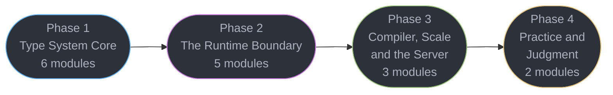

# TypeScript — Senior Engineer & Interview Prep Guide

The language half of the front-end track. The browser, the build pipeline and the toolchain
live in [../frontend_platform/](../frontend_platform/README.md); React itself lives in
[../react/](../react/README.md).

A comprehensive reference for **TypeScript as a language** — the type system from
assignability through type-level programming, the runtime boundary where types stop
existing, the compiler that checks them, and the judgment to know when a clever type is the
wrong answer. Covers what a senior TypeScript engineer is expected to know in interviews,
and what a staff engineer is expected to decide.

> **No runnable application** — all content is Markdown with compilable-shaped TypeScript 7 code blocks.

---

## 1. Section Overview

This section covers:

- **The type system** — structural typing and the assignability relation, narrowing and
  exhaustiveness, generics and variance, conditional and mapped types, template literal
  types and the point at which type-level programming stops paying for itself
- **The runtime boundary** — where erasure bites: classes and decorators, ESM/CJS
  resolution and package `exports`, `.d.ts` authoring, runtime validation, and running
  TypeScript directly under Node, Deno and Bun
- **Compiler, scale and the server** — the TypeScript 7 native compiler, why a build is
  slow and how to measure it, typed backend services, project references, and the patterns
  and antipatterns that separate a codebase you can refactor from one you cannot

**Primary target: TypeScript 7.0** (GA 2026-07-08). Inline `[5.x]` / `[6.0]` / `[7.0]` tags
mark the version a feature arrived in.

**JavaScript language semantics** — prototypes, closures, `this`, `Proxy`/`Reflect` — are
deliberately **not** here. They live in
[`../frontend_platform/javascript_language_semantics/`](../frontend_platform/javascript_language_semantics/javascript_language_semantics.md),
so the runtime substrate is taught once rather than three times. **Linting, bundling and
workspace tooling** are likewise in `frontend_platform/`: they are JavaScript-toolchain
topics, not TypeScript ones.

---

## 2. Module Table

| # | Module Directory | Phase | Difficulty | Key Topics |
|---|-----------------|-------|-----------|-----------|
| 1 | [typescript_fundamentals_and_tsconfig](typescript_fundamentals_and_tsconfig/typescript_fundamentals_and_tsconfig.md) | 1 — Type System Core | Beginner | Erasure vs emit, `tsconfig` anatomy, the TS 6.0 strict defaults, `strict` flag-by-flag |
| 2 | [structural_typing_and_assignability](structural_typing_and_assignability/structural_typing_and_assignability.md) | 1 — Type System Core | Intermediate | Structural vs nominal, assignability, excess property checks and freshness, widening, `satisfies` `[4.9]` |
| 3 | [unions_narrowing_and_exhaustiveness](unions_narrowing_and_exhaustiveness/unions_narrowing_and_exhaustiveness.md) | 1 — Type System Core | Intermediate | Discriminated unions, control-flow analysis, type predicates, inferred predicates `[5.5]`, `unknown`/`any`/`never` |
| 4 | [generics_and_type_parameters](generics_and_type_parameters/generics_and_type_parameters.md) | 1 — Type System Core | Advanced | Constraints, inference sites, `const` type params `[5.0]`, `NoInfer` `[5.4]`, overloads, variance, `strictFunctionTypes` |
| 5 | [conditional_and_mapped_types](conditional_and_mapped_types/conditional_and_mapped_types.md) | 1 — Type System Core | Advanced | `infer`, distributive conditionals, mapped modifiers, key remapping, the utility types, recursion depth |
| 6 | [template_literal_types_and_type_level_programming](template_literal_types_and_type_level_programming/template_literal_types_and_type_level_programming.md) | 1 — Type System Core | Advanced | Template literal types, tuple manipulation, type-level arithmetic, when to stop |
| 7 | [classes_decorators_and_resource_management](classes_decorators_and_resource_management/classes_decorators_and_resource_management.md) | 2 — The Runtime Boundary | Intermediate | Class typing, `this` types, decorators `[5.0]` vs `experimentalDecorators`, enums vs unions, `using` `[5.2]` |
| 8 | [modules_resolution_and_package_exports](modules_resolution_and_package_exports/modules_resolution_and_package_exports.md) | 2 — The Runtime Boundary | Advanced | ESM vs CJS, `moduleResolution`, `exports` maps, the dual-package hazard, `verbatimModuleSyntax` |
| 9 | [declaration_files_and_library_authoring](declaration_files_and_library_authoring/declaration_files_and_library_authoring.md) | 2 — The Runtime Boundary | Advanced | `.d.ts` authoring, declaration merging, module augmentation, `isolatedDeclarations` `[5.5]` |
| 10 | [runtime_validation_and_parse_dont_validate](runtime_validation_and_parse_dont_validate/runtime_validation_and_parse_dont_validate.md) | 2 — The Runtime Boundary | Intermediate | The type/runtime gap, Zod v4, Standard Schema v1, branded types, trust boundaries |
| 11 | [typescript_at_runtime_node_deno_bun](typescript_at_runtime_node_deno_bun/typescript_at_runtime_node_deno_bun.md) | 2 — The Runtime Boundary | Intermediate | Node type stripping, `--erasableSyntaxOnly` `[5.8]`, Deno's type-check, Bun's strip-only |
| 12 | [the_typescript_compiler_and_type_performance](the_typescript_compiler_and_type_performance/the_typescript_compiler_and_type_performance.md) | 3 — Compiler, Scale & Server | Advanced | The compiler pipeline, the TS 7 Go port, `--checkers`, why builds are slow, `skipLibCheck` |
| 13 | [typescript_for_node_and_backend_services](typescript_for_node_and_backend_services/typescript_for_node_and_backend_services.md) | 3 — Compiler, Scale & Server | Advanced | Typed HTTP servers, end-to-end contracts with tRPC and OpenAPI codegen, typed env, error types |
| 14 | [typescript_in_large_codebases](typescript_in_large_codebases/typescript_in_large_codebases.md) | 3 — Compiler, Scale & Server | Advanced | Project references, composite builds, enforced module boundaries, incremental CI, JS to TS migration |
| 15 | [testing_typed_code](testing_typed_code/testing_typed_code.md) | 4 — Practice & Judgment | Intermediate | `expectTypeOf`, `tsd`, `@ts-expect-error` as an assertion, typing mocks, testing inference |
| 16 | [typescript_patterns_and_antipatterns](typescript_patterns_and_antipatterns/typescript_patterns_and_antipatterns.md) | 4 — Practice & Judgment | Advanced | Branded types over `as`, containing `any`, HKT workarounds, over-abstraction, when to stop |

---

## 3. 4-Phase Learning Path



### Phase 1 — Type System Core (6 modules)

| # | Module | Why it is here |
|---|--------|----------------|
| 1 | [TypeScript Fundamentals & tsconfig](typescript_fundamentals_and_tsconfig/typescript_fundamentals_and_tsconfig.md) | Every later module assumes you know what the compiler is and is not doing |
| 2 | [Structural Typing & Assignability](structural_typing_and_assignability/structural_typing_and_assignability.md) | The single rule the whole type system is built on |
| 3 | [Unions, Narrowing & Exhaustiveness](unions_narrowing_and_exhaustiveness/unions_narrowing_and_exhaustiveness.md) | How TypeScript models "one of these", and how it proves you handled all of them |
| 4 | [Generics & Type Parameters](generics_and_type_parameters/generics_and_type_parameters.md) | Where inference stops being invisible and starts needing to be understood |
| 5 | [Conditional & Mapped Types](conditional_and_mapped_types/conditional_and_mapped_types.md) | Types that compute types — and every utility type explained by implementing it |
| 6 | [Template Literal Types & Type-Level Programming](template_literal_types_and_type_level_programming/template_literal_types_and_type_level_programming.md) | The far end, and the judgment to not go there |

### Phase 2 — The Runtime Boundary (5 modules)

| # | Module | Why it is here |
|---|--------|----------------|
| 7 | [Classes, Decorators & Resource Management](classes_decorators_and_resource_management/classes_decorators_and_resource_management.md) | The constructs that do not fully erase, and what that costs |
| 8 | [Modules, Resolution & Package Exports](modules_resolution_and_package_exports/modules_resolution_and_package_exports.md) | Why "it works locally but not when published" |
| 9 | [Declaration Files & Library Authoring](declaration_files_and_library_authoring/declaration_files_and_library_authoring.md) | Shipping types other people depend on |
| 10 | [Runtime Validation & Parse, Don't Validate](runtime_validation_and_parse_dont_validate/runtime_validation_and_parse_dont_validate.md) | Types are gone at runtime; the trust boundary is not |
| 11 | [TypeScript at Runtime — Node, Deno, Bun](typescript_at_runtime_node_deno_bun/typescript_at_runtime_node_deno_bun.md) | Running `.ts` with no build step, and exactly what that forbids |

### Phase 3 — Compiler, Scale & the Server (3 modules)

| # | Module | Why it is here |
|---|--------|----------------|
| 12 | [The TypeScript Compiler & Type Performance](the_typescript_compiler_and_type_performance/the_typescript_compiler_and_type_performance.md) | The pipeline is in this curriculum *because* of build speed |
| 13 | [TypeScript for Node & Backend Services](typescript_for_node_and_backend_services/typescript_for_node_and_backend_services.md) | The section's claim to full-stack: typed servers and end-to-end contracts |
| 14 | [TypeScript in Large Codebases](typescript_in_large_codebases/typescript_in_large_codebases.md) | Project references, enforced boundaries, and migrating a JavaScript codebase |

### Phase 4 — Practice & Judgment (2 modules)

| # | Module | Why it is here |
|---|--------|----------------|
| 15 | [Testing Typed Code](testing_typed_code/testing_typed_code.md) | Asserting on types, not just on values |
| 16 | [TypeScript Patterns & Antipatterns](typescript_patterns_and_antipatterns/typescript_patterns_and_antipatterns.md) | The capstone: what to reach for, and what to refuse |

**Dependencies to note:**

- Phase 1 is strictly ordered. Module 5 assumes module 4's generics; module 6 assumes
  module 5's `infer`.
- Module 9 assumes module 8's resolution model — you cannot ship types correctly without
  knowing how they are found.
- **This section is a prerequisite for [`../react/`](../react/README.md)**, whose every
  example is TypeScript. It is *not* a prerequisite for
  [`../frontend_platform/`](../frontend_platform/README.md) Phase 1, which is browser-level.

---

## Learning Paths

This section is exhaustive by design. That is right for a reference and wrong for someone
two weeks from an interview, so there are **three ways through it**; the game's Study view
surfaces them as a Full / Senior / Principal toggle.

### Full Path (16 modules)

The complete curriculum in the order above — see
[4-Phase Learning Path](#3-4-phase-learning-path). Nothing is dropped.

The two curated tiers below are **different cuts, not nested depths**. Senior is the craft
of using the type system; Principal is the judgment about what it costs — which approach at
what build-time price, and what you tell a team *not* to reach for.

<!-- study-path-table senior -->
### Senior Path (10 modules)

| # | Module | Files |
|---|--------|-------|
| 1 | [typescript_fundamentals_and_tsconfig](typescript_fundamentals_and_tsconfig/typescript_fundamentals_and_tsconfig.md) | module page only |
| 2 | [structural_typing_and_assignability](structural_typing_and_assignability/structural_typing_and_assignability.md) | module page only |
| 3 | [unions_narrowing_and_exhaustiveness](unions_narrowing_and_exhaustiveness/unions_narrowing_and_exhaustiveness.md) | module page only |
| 4 | [generics_and_type_parameters](generics_and_type_parameters/generics_and_type_parameters.md) | module page only |
| 5 | [conditional_and_mapped_types](conditional_and_mapped_types/conditional_and_mapped_types.md) | module page only |
| 7 | [classes_decorators_and_resource_management](classes_decorators_and_resource_management/classes_decorators_and_resource_management.md) | module page only |
| 8 | [modules_resolution_and_package_exports](modules_resolution_and_package_exports/modules_resolution_and_package_exports.md) | module page only |
| 10 | [runtime_validation_and_parse_dont_validate](runtime_validation_and_parse_dont_validate/runtime_validation_and_parse_dont_validate.md) | module page only |
| 11 | [typescript_at_runtime_node_deno_bun](typescript_at_runtime_node_deno_bun/typescript_at_runtime_node_deno_bun.md) | module page only |
| 15 | [testing_typed_code](testing_typed_code/testing_typed_code.md) | module page only |

**Not in this path** (6 of 16, Full Path only): `template_literal_types_and_type_level_programming`, `declaration_files_and_library_authoring`, `the_typescript_compiler_and_type_performance`, `typescript_for_node_and_backend_services`, `typescript_in_large_codebases`, `typescript_patterns_and_antipatterns`
<!-- /study-path-table -->

<!-- study-path-table principal -->
### Principal Path (6 modules)

| # | Module | Files |
|---|--------|-------|
| 8 | [modules_resolution_and_package_exports](modules_resolution_and_package_exports/modules_resolution_and_package_exports.md) | module page only |
| 9 | [declaration_files_and_library_authoring](declaration_files_and_library_authoring/declaration_files_and_library_authoring.md) | module page only |
| 12 | [the_typescript_compiler_and_type_performance](the_typescript_compiler_and_type_performance/the_typescript_compiler_and_type_performance.md) | module page only |
| 13 | [typescript_for_node_and_backend_services](typescript_for_node_and_backend_services/typescript_for_node_and_backend_services.md) | module page only |
| 14 | [typescript_in_large_codebases](typescript_in_large_codebases/typescript_in_large_codebases.md) | module page only |
| 16 | [typescript_patterns_and_antipatterns](typescript_patterns_and_antipatterns/typescript_patterns_and_antipatterns.md) | module page only |

**Not in this path** (10 of 16, Full Path only): `typescript_fundamentals_and_tsconfig`, `structural_typing_and_assignability`, `unions_narrowing_and_exhaustiveness`, `generics_and_type_parameters`, `conditional_and_mapped_types`, `template_literal_types_and_type_level_programming`, `classes_decorators_and_resource_management`, `runtime_validation_and_parse_dont_validate`, `typescript_at_runtime_node_deno_bun`, `testing_typed_code`
<!-- /study-path-table -->

---

## 4. Version Notes

**Primary target: TypeScript 7.0**, GA **2026-07-08**. The compiler is now a native Go
binary (internally "Project Corsa"): 7.7-11.9x faster full builds, memory down 6-26%, with
`--checkers` / `--builders` / `--singleThreaded` controlling parallelism.

**TypeScript 6.0** (2026-03-23) was the last JavaScript-codebase release and an explicit
deprecation bridge, and the removed/deprecated split is load-bearing — most write-ups get
it wrong by putting too much in the first list.

- **Removed** (hard configuration error, the build stops): `--moduleResolution classic`,
  `--outFile`, AMD/UMD/SystemJS module emit.
- **Deprecated** (emits a warning, compiles exactly as before): `esModuleInterop: false`
  and `allowSyntheticDefaultImports: false`, `--baseUrl` as a resolution root,
  `--alwaysStrict false`, `--moduleResolution node` (`node10`), `target: es5`,
  `--downlevelIteration`.

Only three things actually fail a 6.0 build. Everything else on a 5.x config still
compiles with a warning, which is the whole point of a bridge release. New defaults: `strict: true`, `module: esnext`, `target` floating to the
current year (`es2025`), `types: []`, `rootDir: "."`, `noUncheckedSideEffectImports: true`.

**The TS 7.0 caveat that matters most in practice:** there is no stable programmatic
Compiler API until 7.1. typescript-eslint (8.69.0), ts-jest, ts-morph and framework
template checkers therefore still run on the aliased
`typescript@npm:@typescript/typescript6` package (binary `tsc6`).

Releases now land every 3-4 months, so this pin goes stale several times a year. Verify
against the TypeScript devblog rather than memory.

| Tag | What it gates |
|-----|---------------|
| `[7.0]` | Native Go compiler; `--checkers` / `--builders` / `--singleThreaded` |
| `[6.0]` | New strict defaults; ES2025 target; `Map`/`WeakMap` `getOrInsert`; Temporal types; `--stableTypeOrdering` |
| `[5.8]` | `--erasableSyntaxOnly` |
| `[5.5]` | Inferred type predicates; `isolatedDeclarations` |
| `[5.4]` | `NoInfer` |
| `[5.2]` | `using` / `await using` (explicit resource management) |
| `[5.0]` | Stage-3-shaped decorators; `const` type parameters; `--moduleResolution bundler` |
| `[4.9]` | `satisfies` |

**REPLACE, DO NOT ANNOTATE.** An answer names the current API, never "`foo()` is
deprecated, use `bar()`". The three exceptions are in root `CLAUDE.md`.

### Ecosystem pins — verified 2026-09-04

Re-check any of these against the project's own release page before writing a version
number into prose.

| Tool | Version | Note |
|------|---------|------|
| Node.js | **26 Current / 24 "Krypton" Active LTS** | type stripping non-experimental at v24.12.0 / v25.2.0; flag removed at v26.0.0 |
| Deno / Bun | **2.9** / **1.4.0** | Bun 1.4.0 (2026-08-20) is the Zig to Rust core rewrite |
| Zod / Valibot / ArkType | **4.5.4** / **1.4.2** / **2.2.3** | no Zod v5 |
| `@standard-schema/spec` | **1.1.0** | a spec, not a runtime library — the `~standard` interface |
| tRPC | **11.18.0** | accepts any Standard Schema validator natively |
| typescript-eslint | **8.69.0** | does not yet support TS 7 / tsgo |
| Vitest | **5.0.0** | shipped 2026-09-03; 4.1.11 is the last 4.x |
| pnpm / npm / Yarn Berry | **11.25.0** / **12.0.2** / **4.18.0** | pnpm 12 (Rust) went stable 2026-08-26 under `next-12` |
| ts-node / tsup | **10.9.2** / **8.5.1** | both effectively unmaintained; prefer `tsx` (4.23.13) or native stripping |

### Spec status

Check `github.com/tc39/proposals` before repeating any of this.

| Proposal | Stage | Note |
|----------|-------|------|
| Temporal | **4**, shipped in ES2026 | MDN marks it "Limited availability — not Baseline" |
| Decorators | **2.7** | Reached Stage 3 in 2022; TC39 later inserted 2.7 as an intermediate checkpoint and re-slotted existing proposals into it. Below Stage 3 today, but as a process change — not a rejection on the merits |
| Pipeline operator | **2** | Hack-style won over F#-style, but the topic token is **not** final — the proposal says `%` "could instead be `^`, or many other tokens" |
| Type Annotations | **1**, dormant | its own README says "not updated regularly" |
| Records & Tuples | **withdrawn** | repo archived 2025-04-15 |

**ECMAScript 2026 was ratified 2026-06-30** (Ecma 131st General Assembly, ECMA-262 17th
edition). Also Stage 4 in it: `JSON.parse` source-text access, Iterator Sequencing,
`Uint8Array` to/from Base64, `Math.sumPrecise`, `Error.isError`, `Array.fromAsync`,
`RegExp.escape`.

---

## 5. Case Studies

**None yet — this is a gap, not a policy.** Six are planned and specified in
[§7 Known Gaps & Planned Work](#7-known-gaps--planned-work); none has been written.

An earlier version of this section justified the absence as "a pure-language section,
following the `../python/` precedent". That was wrong on the facts:
[`../python/case_studies/`](../python/case_studies/case_studies.md) holds six studies plus
an index, and [`../go/case_studies/`](../go/case_studies/case_studies.md) holds six plus an
index. Both are pure-language sections, and both frame their studies as language and runtime
work that stops at the process boundary — which is exactly the shape this section needs.

What *is* true is the boundary: applied, end-to-end **product** design lives in
[`../react/case_studies/`](../react/case_studies/case_studies.md), where the client system
is the thing being designed. A TypeScript case study designs a *type surface*, a migration,
or a build, and stops there.

---

## 6. Cross-Section Links

| Topic | Owner | This section's boundary |
|-------|-------|------------------------|
| JavaScript language semantics | [`../frontend_platform/javascript_language_semantics/`](../frontend_platform/javascript_language_semantics/javascript_language_semantics.md) | that module owns the substrate; this section starts where types are added |
| Bundling, linting, package management | [`../frontend_platform/`](../frontend_platform/README.md) Phase 3 | JavaScript-toolchain topics. Only typescript-eslint's *type-aware* rule cost is discussed here, inside module 12 |
| Runtime validation / parse-don't-validate | [`../fastapi/pydantic_v2_deep_dive/`](../fastapi/pydantic_v2_deep_dive/pydantic_v2_deep_dive.md), [`../backend/api_contracts_and_schema_governance/`](../backend/api_contracts_and_schema_governance/api_contracts_and_schema_governance.md) | same idea, different runtime — module 10 states the parallel and cross-links rather than re-deriving it |
| Typed API contracts, codegen, BFF | [`../backend/rest_api_design/`](../backend/rest_api_design/rest_api_design.md), [`../backend/api_contracts_and_schema_governance/`](../backend/api_contracts_and_schema_governance/api_contracts_and_schema_governance.md) | those own the contract; module 13 owns typing the TypeScript side of it |
| Type systems in other languages | [`../python/the_type_system_and_typing/`](../python/the_type_system_and_typing/the_type_system_and_typing.md), [`../go/generics_and_type_parameters/`](../go/generics_and_type_parameters/generics_and_type_parameters.md) | modules 2 and 4 contrast structural typing here with Python `Protocol` and Go interfaces |
| Typing React components | [`../react/typing_react_components/`](../react/typing_react_components/typing_react_components.md) | React-specific typing belongs to React, not here |

---

## 7. Known Gaps & Planned Work

All 16 module pages are written. What is missing is listed here so the next person picks up
a briefed unit of work rather than re-deriving the gap. Every entry is self-contained: the
concern, and the reason it is not already covered by a module.

### 7.1 Case studies — 6 planned, 0 written

There is no `typescript/case_studies/` directory yet. Writing the first one also means
creating `case_studies/case_studies.md` (the 5-section index the root `CLAUDE.md` requires:
Quick Start, Full Learning Path, Cross-Cutting, Dependency Map, Interview Prep Shortcuts)
and adding each file to the `<!-- study-paths -->` block in the same commit.

Template: the 11-section principal case study, 900-1100 lines. Scope boundary: a TypeScript
case study designs a type surface, a migration, or a build, and stops at the process
boundary — product-shaped, end-to-end client design belongs to `../react/case_studies/`.

| # | Proposed file | Concern | What no module teaches |
|---|---------------|---------|------------------------|
| 1 | `design_a_typed_sdk_for_a_public_api` | Shipping a type surface as a versioned product | The **sequencing**. It chains declaration emit to `exports` conditions to `tsd`/`attw`/`publint` to semver-of-types across three releases. Module 9 owns emit and module 8 owns resolution and module 15 owns type tests, and each one assumes the others already happened. |
| 2 | `migrate_a_400k_line_javascript_monorepo` | Strictness and structure adopted at once, under feature pressure | That the prescriptions **conflict**. Modules 1, 14 and 12 each give an ordering and the three fight each other — `composite` forces `declaration: true` on files still under `allowJs`. Only a case study can pick one and pay for it. |
| 3 | `design_the_type_layer_for_a_schema_driven_form_engine` | A runtime schema producing compile-time-typed values | The case where the honest answer is **codegen**, arrived at after building the type-level version and measuring it with `--extendedDiagnostics`. Modules 5 and 6 teach how far the type system goes; none shows someone deciding it went too far. |
| 4 | `diagnose_a_fourteen_minute_type_check` | Attribution when causes compound | **Compounding.** Every example in module 12 has exactly one cause. This one has three plus a red herring, ordered by payoff and proven with `--generateTrace` rather than guessed. |
| 5 | `design_an_end_to_end_contract_for_three_consumers` | Typed contracts when one consumer is not TypeScript | The non-TypeScript consumer. Module 13 §7 sketches this in eight lines of prose and never works it through. |
| 6 | `design_a_typed_plugin_host` | The case where TypeScript is the wrong tool | The **negative result**, demonstrated. Module 16 §9 asserts it and never shows it. |

### 7.2 Modules — 3 planned

| Proposed module | Placement | Why it is missing, and what it covers |
|-----------------|-----------|----------------------------------------|
| `compiler_api_and_codemods` | Phase 3, beside `typescript_in_large_codebases` | Five §14 case studies resolve their migration with a codemod this section never teaches. Module 12 §6.5 explains the TS 7.1 Compiler-API gap, which makes the topic *topical* rather than evergreen — write it while that gap is live. Cover: AST vs symbol vs type; `ts-morph` vs the raw Compiler API vs jscodeshift; a rename-safe transform through `getReferencesAtPosition`; why these still run on `tsc6` today; how to test a codemod. |
| `asynchrony_in_the_type_system` | Phase 2, after `classes_decorators_and_resource_management` | The pieces are scattered across modules 3, 4, 5 and 13, and nothing owns them. Cover: `Promise<T>` variance; `Awaited` vs `PromiseLike`; `Promise.all` tuple inference against `allSettled`'s discriminated union; typed `AbortSignal`; `AsyncGenerator<T, TReturn, TNext>`; `void`-returning callbacks and `no-misused-promises`; `await using` ordering. |
| `typed_javascript_and_jsdoc` | Phase 1 or Phase 3 | Module 16 §9 twice recommends "JSDoc types with `checkJs`" and the section shows **not one line of JSDoc syntax**. Module 14 §6.6 treats `// @ts-check` as a migration step without teaching what goes inside it. |

Adding any of these means a `STUDY_ORDER["typescript"]` entry in `game/app.js` at the right
learning-path position, plus the `<!-- study-paths -->` line, plus `--write-paths`.

### 7.3 Expansions — §7 "Real-World Examples" is the one uniformly thin heading

Measured across all 16 module pages: §7 has a median of **27 lines** against §6's **245**,
and **10 of 16 pages have no code block in §7 at all**. Thinnest first:

| Module | §7 lines | Code in §7 |
|--------|---------:|------------|
| `typescript_for_node_and_backend_services` | 17 | no |
| `classes_decorators_and_resource_management` | 18 | no |
| `modules_resolution_and_package_exports` | 18 | no |
| `the_typescript_compiler_and_type_performance` | 20 | no |
| `testing_typed_code` | 22 | no |
| `typescript_patterns_and_antipatterns` | 22 | no |

`testing_typed_code` is the weakest page overall — it has both the smallest §6 (194 lines)
and a prose-only §7. Start there.

### 7.4 Cross-links — four one-directional seams

These four modules link *out* and nothing links *back*. The inbound edit belongs to whoever
owns the other section; this section cannot make it.

| Other section's module | Should link back to |
|------------------------|---------------------|
| `../react/forms_and_validation/` | `runtime_validation_and_parse_dont_validate` |
| `../backend/api_contracts_and_schema_governance/` | `typescript_for_node_and_backend_services` |
| `../fastapi/pydantic_v2_deep_dive/` | `runtime_validation_and_parse_dont_validate` |
| `../react/react_architecture_and_antipatterns/` | `typescript_patterns_and_antipatterns` |

Separately: `runtime_validation_and_parse_dont_validate` is this section's trust-boundary
module and **nothing anywhere in the repository links to it**. It is the page most likely to
be wanted from another section and the least reachable.

---

## 8. Build Manifest

Per-file status tracker. **This is the resume point** — the first `pending` row is the next
unit of work. Flip `pending` to `done` in the same commit as the file, filling in the
measured counts; a `done` row with no counts is not trustworthy.

Target per module page: **700-900 lines, 6-8 Mermaid fences, 15-18 Q&As** (every one
carrying an authored `**Short:**` line), all 14 template sections.

| # | File | Phase | Status | Q&As | Lines |
|---|------|-------|--------|-----:|------:|
| 1 | `typescript_fundamentals_and_tsconfig/typescript_fundamentals_and_tsconfig.md` | 1 | **done** | 16 | 869 |
| 2 | `structural_typing_and_assignability/structural_typing_and_assignability.md` | 1 | **done** | 18 | 850 |
| 3 | `unions_narrowing_and_exhaustiveness/unions_narrowing_and_exhaustiveness.md` | 1 | **done** | 18 | 900 |
| 4 | `generics_and_type_parameters/generics_and_type_parameters.md` | 1 | **done** | 18 | 889 |
| 5 | `conditional_and_mapped_types/conditional_and_mapped_types.md` | 1 | **done** | 18 | 879 |
| 6 | `template_literal_types_and_type_level_programming/template_literal_types_and_type_level_programming.md` | 1 | **done** | 16 | 880 |
| 7 | `classes_decorators_and_resource_management/classes_decorators_and_resource_management.md` | 2 | **done** | 16 | 880 |
| 8 | `modules_resolution_and_package_exports/modules_resolution_and_package_exports.md` | 2 | **done** | 18 | 890 |
| 9 | `declaration_files_and_library_authoring/declaration_files_and_library_authoring.md` | 2 | **done** | 18 | 876 |
| 10 | `runtime_validation_and_parse_dont_validate/runtime_validation_and_parse_dont_validate.md` | 2 | **done** | 16 | 870 |
| 11 | `typescript_at_runtime_node_deno_bun/typescript_at_runtime_node_deno_bun.md` | 2 | **done** | 16 | 880 |
| 12 | `the_typescript_compiler_and_type_performance/the_typescript_compiler_and_type_performance.md` | 3 | **done** | 18 | 879 |
| 13 | `typescript_for_node_and_backend_services/typescript_for_node_and_backend_services.md` | 3 | **done** | 16 | 893 |
| 14 | `typescript_in_large_codebases/typescript_in_large_codebases.md` | 3 | **done** | 16 | 878 |
| 15 | `testing_typed_code/testing_typed_code.md` | 4 | **done** | 16 | 851 |
| 16 | `typescript_patterns_and_antipatterns/typescript_patterns_and_antipatterns.md` | 4 | **done** | 16 | 889 |

### Conventions reminder (for future batch agents)

- The page is named for its folder: `<module>/<module>.md`. A `README.md` below a section
  root is invisible to `extract.py`.
- **Never** name a file `*_deep_dive.md` or `*_internals.md` — `DEEP_NAME_RE` in
  `game/build_tech.py` makes that a FATAL `--strict` error unless hand-listed.
- Q&As go under `## 12. Interview Questions with Answers`. `## 12. Interview Tips` matches
  nothing and contributes **zero** questions, silently.
- Tag code fences ` ```ts ` / ` ```tsx `, **not** ` ```typescript ` — the reader's
  `LANG_ALIAS` map does not alias the long form, so it renders unhighlighted.
- Adding a file means adding its line to the `<!-- study-paths -->` block below **in the
  same commit**, then running `python3 game/extract.py --write-paths`.

<!-- study-paths
     THE source of truth for this section's file inventory and study-tier membership.
     Every module and every file it owns is listed here with the tiers it belongs to;
     `-` means Full path only. Content files carry NO structural metadata. Order is never
     declared here: it comes from STUDY_ORDER in game/app.js. The tier TABLES in this file
     are generated from this block by `python3 game/extract.py --write-paths`. A file on
     disk missing from this block, or listed here and absent from disk, FAILS
     `extract.py --strict`.

     Entries are added AS EACH FILE LANDS -- listing a not-yet-written file is fatal.

typescript_fundamentals_and_tsconfig
  typescript_fundamentals_and_tsconfig.md  senior
structural_typing_and_assignability
  structural_typing_and_assignability.md  senior
unions_narrowing_and_exhaustiveness
  unions_narrowing_and_exhaustiveness.md  senior
testing_typed_code
  testing_typed_code.md  senior
generics_and_type_parameters
  generics_and_type_parameters.md  senior
conditional_and_mapped_types
  conditional_and_mapped_types.md  senior
modules_resolution_and_package_exports
  modules_resolution_and_package_exports.md  senior, principal
runtime_validation_and_parse_dont_validate
  runtime_validation_and_parse_dont_validate.md  senior
the_typescript_compiler_and_type_performance
  the_typescript_compiler_and_type_performance.md  principal
declaration_files_and_library_authoring
  declaration_files_and_library_authoring.md  principal
typescript_at_runtime_node_deno_bun
  typescript_at_runtime_node_deno_bun.md  senior
classes_decorators_and_resource_management
  classes_decorators_and_resource_management.md  senior
template_literal_types_and_type_level_programming
  template_literal_types_and_type_level_programming.md  -
typescript_for_node_and_backend_services
  typescript_for_node_and_backend_services.md  principal
typescript_in_large_codebases
  typescript_in_large_codebases.md  principal
typescript_patterns_and_antipatterns
  typescript_patterns_and_antipatterns.md  principal
-->
